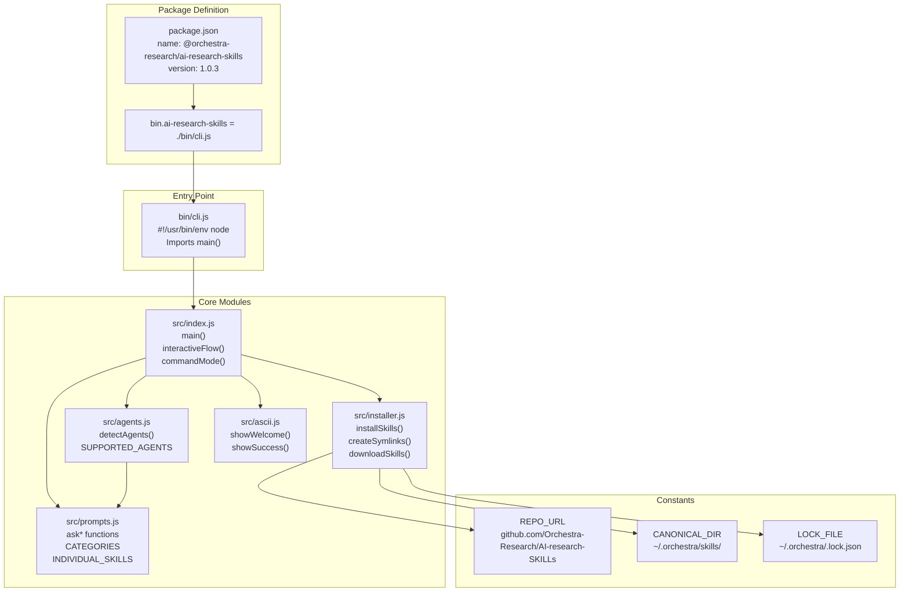
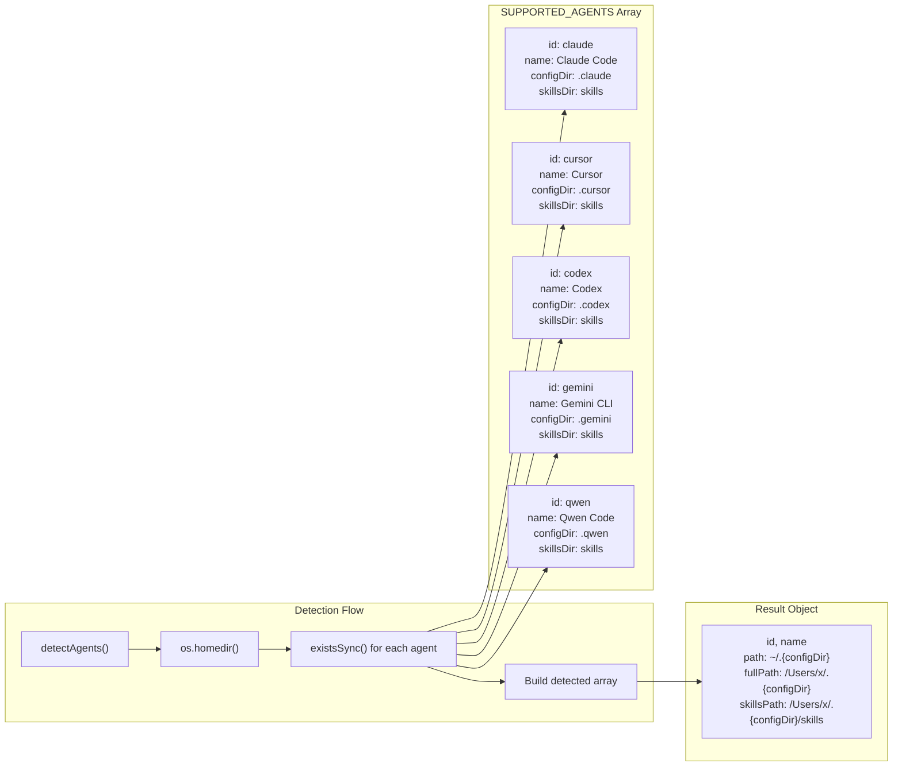
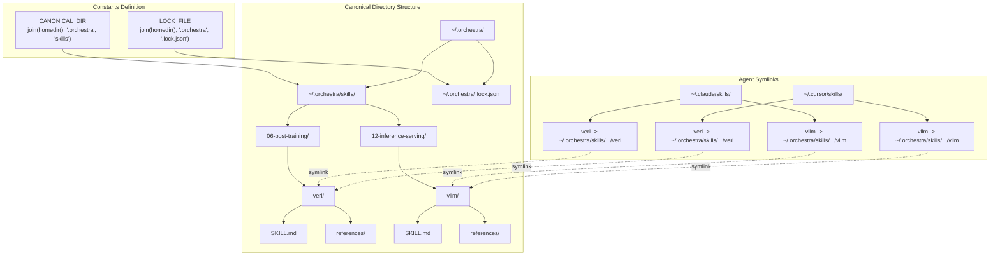
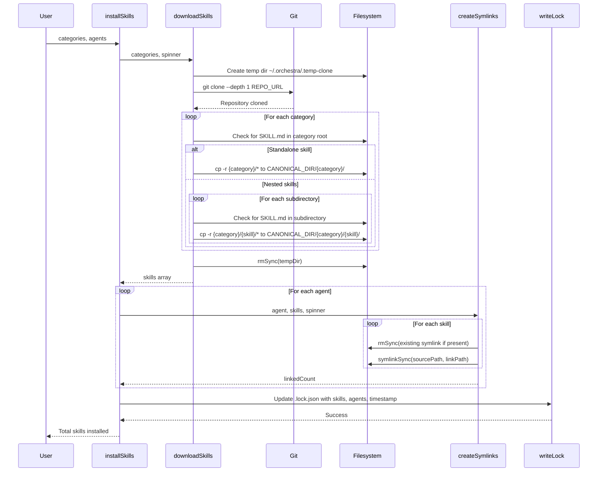
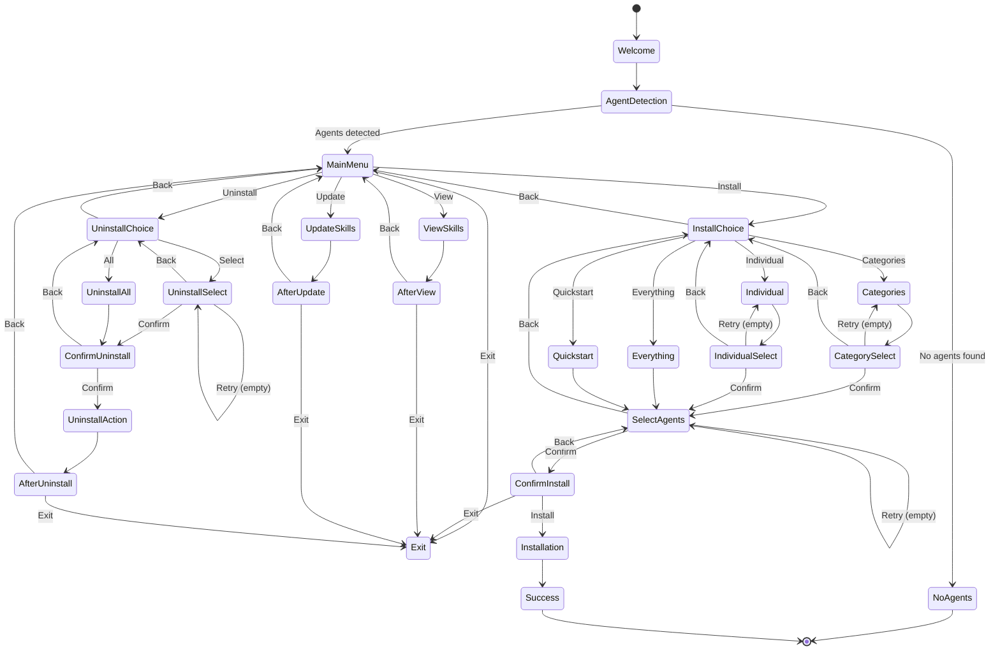

<!-- source: DeepWiki mcp.deepwiki.com · repo Orchestra-Research/AI-research-SKILLs · page 6.3 CLI Architecture & Implementation · fetched 2026-10-26 -->

# CLI Architecture & Implementation

<details>
<summary>Relevant source files</summary>

The following files were used as context for generating this wiki page:

- [docs/npm-package-ux-mockup.html](docs/npm-package-ux-mockup.html)
- [packages/ai-research-skills/.gitignore](packages/ai-research-skills/.gitignore)
- [packages/ai-research-skills/README.md](packages/ai-research-skills/README.md)
- [packages/ai-research-skills/bin/cli.js](packages/ai-research-skills/bin/cli.js)
- [packages/ai-research-skills/package-lock.json](packages/ai-research-skills/package-lock.json)
- [packages/ai-research-skills/package.json](packages/ai-research-skills/package.json)
- [packages/ai-research-skills/src/agents.js](packages/ai-research-skills/src/agents.js)
- [packages/ai-research-skills/src/ascii.js](packages/ai-research-skills/src/ascii.js)
- [packages/ai-research-skills/src/index.js](packages/ai-research-skills/src/index.js)
- [packages/ai-research-skills/src/installer.js](packages/ai-research-skills/src/installer.js)
- [packages/ai-research-skills/src/prompts.js](packages/ai-research-skills/src/prompts.js)

</details>


This document describes the internal architecture of the NPM package `@orchestra-research/ai-research-skills`, including its entry points, agent detection logic, canonical storage pattern, symlink management, and interactive UI state machine.

For information about how this CLI integrates with the broader distribution system, see [6.1](#6.1). For details on the GitHub Actions sync workflow, see [6.2](#6.2). For the complete skill lifecycle from creation to usage, see [6.4](#6.4).

---

## Package Structure & Entry Points

The NPM package is organized as an ES module with a binary entry point that launches an interactive installer or processes direct commands.



**Sources:** [packages/ai-research-skills/package.json:1-46](), [packages/ai-research-skills/bin/cli.js:1-9](), [packages/ai-research-skills/src/index.js:1-24](), [packages/ai-research-skills/src/installer.js:8-10]()

The package exports a single binary command that invokes [src/index.js:347-358]() `main()` function, which parses command-line arguments via [src/prompts.js:499-529]() `parseArgs()` and routes to either interactive or command mode.

| Entry Point | Path | Purpose |
|-------------|------|---------|
| Binary | `bin/cli.js` | Shebang wrapper that invokes `main()` |
| Main Function | `src/index.js:main()` | Routes to `interactiveFlow()` or `commandMode()` |
| Interactive | `src/index.js:interactiveFlow()` | Guided wizard with state machine |
| Command | `src/index.js:commandMode()` | Direct command execution (install/list/update) |

**Sources:** [packages/ai-research-skills/bin/cli.js:1-9](), [packages/ai-research-skills/src/index.js:347-358]()

### Dependencies

The package has minimal external dependencies, all focused on CLI user experience:

| Dependency | Version | Purpose |
|------------|---------|---------|
| `chalk` | 5.3.0 | Terminal text styling and colors |
| `inquirer` | 9.2.12 | Interactive prompts (list, checkbox, confirm) |
| `ora` | 8.0.1 | Spinner animations during async operations |

**Sources:** [packages/ai-research-skills/package.json:41-45]()

Node.js 18.0.0+ is required due to ES module syntax and use of native APIs like `fs.symlinkSync()`.

---

## Agent Detection System

The agent detection system identifies installed AI coding agents by scanning for known configuration directories in the user's home directory.



**Sources:** [packages/ai-research-skills/src/agents.js:9-64]()

The [src/agents.js:9-40]() `SUPPORTED_AGENTS` constant defines five agent configurations. Each agent configuration specifies:
- `id`: Unique identifier for command-line arguments
- `name`: Human-readable display name
- `configDir`: Directory name under home directory (e.g., `.claude`)
- `skillsDir`: Subdirectory for skills (always `skills`)

The [src/agents.js:46-64]() `detectAgents()` function iterates through `SUPPORTED_AGENTS`, checks if `~/{configDir}` exists using `fs.existsSync()`, and returns an array of detected agents with computed paths:

```javascript
{
  id: 'claude',
  name: 'Claude Code',
  configDir: '.claude',
  skillsDir: 'skills',
  path: '~/.claude',              // Display path
  fullPath: '/Users/x/.claude',   // Absolute path
  skillsPath: '/Users/x/.claude/skills'  // Target for symlinks
}
```

**Sources:** [packages/ai-research-skills/src/agents.js:46-64]()

This detection runs once at the start of [src/index.js:39-48]() `interactiveFlow()` or [src/index.js:288-316]() `commandMode()`, displaying results via [src/ascii.js:36-52]() `showAgentsDetected()`.

---

## Canonical Storage Architecture

The CLI implements a single-source-of-truth pattern where skills are stored once in a canonical directory and symlinked to each agent's skills directory.



**Sources:** [packages/ai-research-skills/src/installer.js:8-10](), [packages/ai-research-skills/README.md:63-81]()

The canonical directory pattern provides several benefits:
- **Single Update Point**: Skills updated in `~/.orchestra/skills/` immediately reflect in all agents
- **Disk Space Efficiency**: One copy shared by all agents instead of N copies
- **Consistent State**: Lock file tracks installed skills and versions globally

The [src/installer.js:15-23]() `ensureCanonicalDir()` function creates the directory structure if it doesn't exist:

```javascript
function ensureCanonicalDir() {
  const orchestraDir = join(homedir(), '.orchestra');
  if (!existsSync(orchestraDir)) {
    mkdirSync(orchestraDir, { recursive: true });
  }
  if (!existsSync(CANONICAL_DIR)) {
    mkdirSync(CANONICAL_DIR, { recursive: true });
  }
}
```

**Sources:** [packages/ai-research-skills/src/installer.js:15-23]()

Skills are organized in the canonical directory using the same `{category}/{skill}/` structure as the GitHub repository, with two cases:
1. **Standalone Skills**: Category folder contains `SKILL.md` directly (e.g., `20-ml-paper-writing/SKILL.md`)
2. **Nested Skills**: Category folder contains multiple skill subdirectories (e.g., `06-post-training/verl/SKILL.md`)

**Sources:** [packages/ai-research-skills/src/installer.js:78-101]()

---

## Installation Workflow

The installation workflow orchestrates repository cloning, skill extraction, symlink creation, and lock file updates.



**Sources:** [packages/ai-research-skills/src/installer.js:260-293](), [packages/ai-research-skills/src/installer.js:49-114](), [packages/ai-research-skills/src/installer.js:118-151]()

### Download Phase

The [src/installer.js:49-114]() `downloadSkills()` function clones the GitHub repository to a temporary location:

1. **Shallow Clone**: Uses `git clone --depth 1` to minimize bandwidth (only latest commit)
2. **Temporary Directory**: Clones to `~/.orchestra/.temp-clone` to avoid conflicts
3. **Category Iteration**: Loops through selected category IDs
4. **Skill Detection**: Checks for `SKILL.md` to determine standalone vs nested structure
5. **Copy Operation**: Uses `cp -r` to copy skill directories to canonical location
6. **Cleanup**: Removes temporary clone directory via `rmSync()`

**Sources:** [packages/ai-research-skills/src/installer.js:49-114]()

The function returns a `skills` array with objects like:
```javascript
{ category: '06-post-training', skill: 'verl', standalone: false }
{ category: '20-ml-paper-writing', skill: '20-ml-paper-writing', standalone: true }
```

For individual skill installation, [src/installer.js:156-219]() `downloadSpecificSkills()` accepts an array of skill paths (e.g., `['06-post-training/verl', '20-ml-paper-writing']`) and downloads only those skills.

**Sources:** [packages/ai-research-skills/src/installer.js:156-219]()

### Symlink Phase

The [src/installer.js:118-151]() `createSymlinks()` function creates symbolic links from each agent's skills directory to the canonical storage:

```javascript
function createSymlinks(agent, skills, spinner) {
  const agentSkillsPath = agent.skillsPath;  // e.g., ~/.claude/skills
  
  // Ensure agent skills directory exists
  if (!existsSync(agentSkillsPath)) {
    mkdirSync(agentSkillsPath, { recursive: true });
  }
  
  let linkedCount = 0;
  
  for (const skill of skills) {
    const sourcePath = skill.standalone
      ? join(CANONICAL_DIR, skill.category)
      : join(CANONICAL_DIR, skill.category, skill.skill);
    
    const linkName = skill.standalone ? skill.category : skill.skill;
    const linkPath = join(agentSkillsPath, linkName);
    
    // Remove existing symlink if present
    if (existsSync(linkPath)) {
      rmSync(linkPath, { recursive: true, force: true });
    }
    
    try {
      symlinkSync(sourcePath, linkPath);
      linkedCount++;
    } catch (error) {
      // Ignore symlink errors
    }
  }
  
  return linkedCount;
}
```

**Sources:** [packages/ai-research-skills/src/installer.js:118-151]()

Key behaviors:
- **Directory Creation**: Ensures agent's skills directory exists before creating symlinks
- **Conflict Resolution**: Removes existing symlinks before creating new ones
- **Link Naming**: For nested skills, uses skill name only (not full path) as link name
- **Error Handling**: Silently ignores symlink errors (e.g., permission issues)

### Lock File Updates

The [src/installer.js:42-44]() `writeLock()` function persists installation state to `~/.orchestra/.lock.json`:

```json
{
  "version": "1.0.0",
  "installedAt": "2024-01-15T12:34:56.789Z",
  "skills": [
    { "category": "06-post-training", "skill": "verl", "standalone": false },
    { "category": "20-ml-paper-writing", "skill": "20-ml-paper-writing", "standalone": true }
  ],
  "agents": ["claude", "cursor", "gemini"]
}
```

**Sources:** [packages/ai-research-skills/src/installer.js:28-44](), [packages/ai-research-skills/src/installer.js:280-286]()

The lock file enables:
- **Update Detection**: [src/installer.js:397-427]() `getInstalledSkillPaths()` reads the lock to determine what's installed
- **Version Tracking**: Future versions can check for updates
- **Agent Tracking**: Records which agents have symlinks

---

## Symlink Management

Symlinks are the core mechanism for sharing skills across multiple agents without duplication.

```mermaid
graph TB
    subgraph "Symlink Creation"
        CreateEntry["createSymlinks(agent, skills, spinner)"]
        EnsureDir["mkdirSync(agent.skillsPath, recursive: true)"]
        LoopSkills["for (skill of skills)"]
        ComputePaths["sourcePath = CANONICAL_DIR/category/skill<br/>linkPath = agent.skillsPath/skill"]
        RemoveExisting["rmSync(linkPath) if exists"]
        CreateLink["symlinkSync(sourcePath, linkPath)"]
    end
    
    subgraph "Symlink Removal"
        UninstallEntry["uninstallSpecificSkills(skillPaths, agents)"]
        LoopAgents["for (agent of agents)"]
        CheckSymlink["lstatSync(linkPath).isSymbolicLink()"]
        RemoveLink["rmSync(linkPath, force: true)"]
        CleanupDir["Remove empty category folders"]
    end
    
    subgraph "Symlink Verification"
        ListEntry["listInstalledSkills()"]
        ScanCanonical["readdirSync(CANONICAL_DIR)"]
        VerifyStructure["Check for SKILL.md in each skill"]
        DisplayResults["Console output with skill names"]
    end
    
    CreateEntry --> EnsureDir
    EnsureDir --> LoopSkills
    LoopSkills --> ComputePaths
    ComputePaths --> RemoveExisting
    RemoveExisting --> CreateLink
    
    UninstallEntry --> LoopAgents
    LoopAgents --> CheckSymlink
    CheckSymlink --> RemoveLink
    RemoveLink --> CleanupDir
    
    ListEntry --> ScanCanonical
    ScanCanonical --> VerifyStructure
    VerifyStructure --> DisplayResults
```



**Sources:** [packages/ai-research-skills/src/installer.js:118-151](), [packages/ai-research-skills/src/installer.js:523-593](), [packages/ai-research-skills/src/installer.js:298-363]()

### Creation Strategy

Symlinks are created using Node.js `fs.symlinkSync(target, path)`:
- **Target**: Path to canonical skill directory (e.g., `~/.orchestra/skills/06-post-training/verl`)
- **Path**: Link location in agent directory (e.g., `~/.claude/skills/verl`)

The link name uses only the skill name (not the full category path) for cleaner agent UX. For standalone skills, the category name becomes the link name.

**Sources:** [packages/ai-research-skills/src/installer.js:130-144]()

### Update Workflow

The [src/installer.js:432-470]() `updateInstalledSkills()` function re-downloads skills without changing selections:

1. **Read Installed**: Calls [src/installer.js:397-427]() `getInstalledSkillPaths()` to get current skill paths
2. **Download**: Uses `downloadSpecificSkills()` to fetch updated versions
3. **Recreate Symlinks**: Calls `createSymlinks()` for each agent (overwrites existing)
4. **Update Lock**: Writes new timestamp to lock file

**Sources:** [packages/ai-research-skills/src/installer.js:432-470]()

This pattern ensures agents immediately see updated content without requiring reinstallation.

### Uninstallation

The [src/installer.js:523-593]() `uninstallSpecificSkills()` function removes skills selectively:

```javascript
for (const skillPath of skillPaths) {
  const parts = skillPath.split('/');
  const categoryId = parts[0];
  const skillName = parts[1] || null;
  const linkName = skillName || categoryId;
  
  // Remove symlinks from each agent
  for (const agent of agents) {
    const linkPath = join(agent.skillsPath, linkName);
    const stats = lstatSync(linkPath);
    if (stats.isSymbolicLink()) {
      rmSync(linkPath, { force: true });
    }
  }
  
  // Remove from canonical directory
  if (skillName) {
    rmSync(join(CANONICAL_DIR, categoryId, skillName), { recursive: true });
    // Clean up empty category folder
    const remaining = readdirSync(join(CANONICAL_DIR, categoryId));
    if (remaining.length === 0) {
      rmSync(join(CANONICAL_DIR, categoryId), { recursive: true });
    }
  } else {
    rmSync(join(CANONICAL_DIR, categoryId), { recursive: true });
  }
}
```

**Sources:** [packages/ai-research-skills/src/installer.js:527-575]()

The function uses `lstatSync()` to verify symlinks before removal, ensuring it only deletes Orchestra-managed links.

For complete uninstallation, [src/installer.js:475-516]() `uninstallAllSkills()` removes all symlinks from all agents, deletes the canonical directory, and removes the lock file.

**Sources:** [packages/ai-research-skills/src/installer.js:475-516]()

---

## Lock File Management

The lock file (`.lock.json`) tracks installation state for update and uninstall operations.

### Lock File Schema

```typescript
interface LockFile {
  version: string | null;           // Installed version (e.g., "1.0.0")
  installedAt: string | null;       // ISO timestamp
  skills: Array<{
    category: string;                // e.g., "06-post-training"
    skill: string;                   // e.g., "verl"
    standalone: boolean;             // true for standalone skills
  }>;
  agents: string[];                  // e.g., ["claude", "cursor", "gemini"]
}
```

**Sources:** [packages/ai-research-skills/src/installer.js:28-36]()

### Read/Write Operations

The [src/installer.js:28-36]() `readLock()` function loads the lock file with error handling:

```javascript
function readLock() {
  if (existsSync(LOCK_FILE)) {
    try {
      return JSON.parse(readFileSync(LOCK_FILE, 'utf8'));
    } catch {
      return { version: null, installedAt: null, skills: [] };
    }
  }
  return { version: null, installedAt: null, skills: [] };
}
```

**Sources:** [packages/ai-research-skills/src/installer.js:28-37]()

The [src/installer.js:42-44]() `writeLock()` function persists state:

```javascript
function writeLock(data) {
  writeFileSync(LOCK_FILE, JSON.stringify(data, null, 2));
}
```

**Sources:** [packages/ai-research-skills/src/installer.js:42-44]()

### Lock File Consumers

Multiple functions read the lock file to determine current state:

| Function | Purpose | Usage |
|----------|---------|-------|
| `getInstalledSkillPaths()` | Returns array of skill paths | Used by `updateInstalledSkills()` to determine what to re-download |
| `getInstalledSkillsForSelection()` | Returns skills with display info | Used by uninstall prompts to show checkboxes |
| `listInstalledSkills()` | Displays installed skills | Scans canonical directory (not lock) for accuracy |

**Sources:** [packages/ai-research-skills/src/installer.js:397-427](), [packages/ai-research-skills/src/installer.js:599-611](), [packages/ai-research-skills/src/installer.js:298-363]()

Note: `listInstalledSkills()` scans the actual filesystem rather than trusting the lock file, providing resilience against manual edits or corruption.

---

## Interactive UI State Machine

The interactive flow implements a finite state machine with backward navigation support.



**Sources:** [packages/ai-research-skills/src/index.js:34-283]()

### State Management

The [src/index.js:34-283]() `interactiveFlow()` function uses labeled loops and continue statements to implement navigation:

```javascript
async function interactiveFlow() {
  let agents = [];
  
  // STEP 1: Welcome + Agent Detection
  showWelcome();
  agents = detectAgents();
  
  if (agents.length === 0) {
    showNoAgents();
    return;
  }
  
  // STEP 2: Show detected agents + main menu
  step2_menu:
  while (true) {
    showAgentsDetected(agents);
    const menuAction = await askMainMenuAction();
    
    if (menuAction === 'exit') return;
    
    if (menuAction === 'install') {
      // STEP 3: Choose what to install
      step3_choice:
      while (true) {
        const choice = await askInstallChoice();
        
        if (choice === 'back') {
          continue step2_menu;  // Return to main menu
        }
        
        if (choice === 'categories') {
          // STEP 4: Select categories
          step4_categories:
          while (true) {
            const result = await askCategories();
            
            if (result.action === 'back') {
              continue step3_choice;  // Return to install choice
            }
            if (result.action === 'retry') {
              continue step4_categories;  // Show prompt again
            }
            
            // Proceed to agent selection...
            break;
          }
        }
        
        // STEP 5: Select agents + Confirmation
        // STEP 6: Installation
        // STEP 7: Success
      }
    }
  }
}
```

**Sources:** [packages/ai-research-skills/src/index.js:58-282]()

This pattern allows users to navigate backward through the wizard using labeled continue statements that jump to outer loop iterations.

### Prompt Functions

The [src/prompts.js:1-530]() prompts module defines functions for each interactive step:

| Function | Return Type | Purpose |
|----------|-------------|---------|
| `askMainMenuAction()` | `'install' \| 'view' \| 'update' \| 'uninstall' \| 'exit'` | Main menu selection |
| `askInstallChoice()` | `'everything' \| 'quickstart' \| 'categories' \| 'individual' \| 'back'` | Installation scope |
| `askCategories()` | `{ categories: string[], action: 'confirm' \| 'retry' \| 'back' }` | Category multi-select |
| `askIndividualSkills()` | `{ skills: string[], action: 'confirm' \| 'retry' \| 'back' }` | Skill multi-select |
| `askSelectAgents()` | `{ agents: Agent[], action: 'confirm' \| 'retry' \| 'back' }` | Agent multi-select |
| `askConfirmation()` | `'confirm' \| 'back' \| 'exit'` | Final confirmation |
| `askUninstallChoice()` | `'select' \| 'all' \| 'back'` | Uninstall scope |

**Sources:** [packages/ai-research-skills/src/prompts.js:96-474]()

Each function uses `inquirer` to render interactive prompts:
- `list` type: Single selection with arrow keys
- `checkbox` type: Multi-selection with spacebar
- Validation: Returns `action: 'retry'` if empty selection

### Visual Screens

The [src/ascii.js:1-127]() module provides branded terminal screens:

| Function | Displays |
|----------|----------|
| `showWelcome()` | ASCII art logo + stats (82 skills, 20 categories, 5 agents) |
| `showAgentsDetected(agents)` | Logo + list of detected agents with paths |
| `showMenuHeader()` | Simple header for inner screens |
| `showSuccess(skillCount, agents)` | Completion message + example commands |
| `showNoAgents()` | Warning + list of supported agents |

**Sources:** [packages/ai-research-skills/src/ascii.js:18-126]()

All screens use `chalk` for color styling and maintain consistent spacing with 14-character padding for alignment.

---

## Command-Line Interface

In addition to the interactive wizard, the CLI supports direct command execution for automation and power users.

### Command Mode Routing

The [src/index.js:288-342]() `commandMode()` function handles non-interactive commands:

```javascript
async function commandMode(options) {
  if (options.command === 'list') {
    listInstalledSkills();
    return;
  }
  
  if (options.command === 'update') {
    const agents = detectAgents();
    if (agents.length === 0) {
      console.log(chalk.yellow('No agents detected.'));
      return;
    }
    const installedPaths = getInstalledSkillPaths();
    if (installedPaths.length === 0) {
      console.log(chalk.yellow('No skills installed to update.'));
      return;
    }
    await updateInstalledSkills(agents);
    console.log(chalk.green('✓ Skills updated!'));
    return;
  }
  
  if (options.command === 'install' || options.all || options.category || options.skill) {
    const agents = detectAgents();
    let categories;
    if (options.all) {
      categories = getAllCategoryIds();
    } else if (options.category) {
      categories = [options.category];
    } else if (options.skill) {
      // Match skill name to category
      const matchingCategory = CATEGORIES.find(c =>
        c.id.includes(options.skill) || c.name.toLowerCase().includes(options.skill.toLowerCase())
      );
      if (matchingCategory) {
        categories = [matchingCategory.id];
      } else {
        console.log(chalk.yellow(`Category or skill "${options.skill}" not found.`));
        return;
      }
    } else {
      categories = getAllCategoryIds();
    }
    
    await installSkills(categories, agents);
    console.log(chalk.green('✓ Done!'));
    return;
  }
}
```

**Sources:** [packages/ai-research-skills/src/index.js:288-342]()

### Argument Parsing

The [src/prompts.js:499-529]() `parseArgs()` function converts command-line arguments to options object:

```javascript
function parseArgs(args) {
  const options = {
    command: null,      // 'install' | 'list' | 'update'
    all: false,         // --all flag
    category: null,     // --category {id}
    skill: null,        // Positional skill name
    agent: null,        // --agent {id}
  };
  
  for (let i = 0; i < args.length; i++) {
    const arg = args[i];
    
    if (arg === 'install') {
      options.command = 'install';
    } else if (arg === 'list') {
      options.command = 'list';
    } else if (arg === 'update') {
      options.command = 'update';
    } else if (arg === '--all' || arg === '-a') {
      options.all = true;
    } else if (arg === '--agent' && args[i + 1]) {
      options.agent = args[++i];
    } else if (arg === '--category' && args[i + 1]) {
      options.category = args[++i];
    } else if (!arg.startsWith('-') && !options.command) {
      options.skill = arg;
    }
  }
  
  return options;
}
```

**Sources:** [packages/ai-research-skills/src/prompts.js:499-529]()

### Supported Commands

| Command | Example | Behavior |
|---------|---------|----------|
| (none) | `npx @orchestra-research/ai-research-skills` | Launch interactive wizard |
| `list` | `npx @orchestra-research/ai-research-skills list` | Display installed skills by scanning canonical directory |
| `update` | `npx @orchestra-research/ai-research-skills update` | Re-download all installed skills from GitHub |
| `install --all` | `npx @orchestra-research/ai-research-skills install --all` | Install all 82 skills to all detected agents |
| `install {category}` | `npx @orchestra-research/ai-research-skills install post-training` | Install all skills in specified category |
| `install {skill}` | `npx @orchestra-research/ai-research-skills install verl` | Fuzzy match skill name to category and install |

**Sources:** [packages/ai-research-skills/src/index.js:347-358](), [packages/ai-research-skills/README.md:32-48]()

Command mode bypasses all interactive prompts and executes directly, making it suitable for CI/CD pipelines or shell scripts.

---

## Data Structures

### Category Definition

The [src/prompts.js:7-28]() `CATEGORIES` array defines skill categories with metadata:

```javascript
export const CATEGORIES = [
  { 
    id: '01-model-architecture', 
    name: 'Model Architecture', 
    skills: 6, 
    examples: 'LitGPT, Mamba, TorchTitan, Megatron' 
  },
  { 
    id: '06-post-training', 
    name: 'Post-Training', 
    skills: 8, 
    examples: 'GRPO, verl, slime, miles, torchforge' 
  },
  // ... 18 more categories
];
```

**Sources:** [packages/ai-research-skills/src/prompts.js:7-28]()

The `examples` field displays in interactive prompts to help users understand category contents without downloading.

### Individual Skills

The [src/prompts.js:33-65]() `INDIVIDUAL_SKILLS` array defines cherry-pickable skills:

```javascript
export const INDIVIDUAL_SKILLS = [
  { id: '06-post-training/grpo-rl-training', name: 'GRPO Training', category: 'Post-Training' },
  { id: '06-post-training/verl', name: 'verl', category: 'Post-Training' },
  { id: '12-inference-serving/vllm', name: 'vLLM', category: 'Inference' },
  { id: '20-ml-paper-writing', name: 'ML Paper Writing', category: 'Writing' },
  // ... 21 more skills
];
```

**Sources:** [packages/ai-research-skills/src/prompts.js:33-65]()

The `id` field uses the repository path format (`{category}/{skill}`) to enable direct downloads via `downloadSpecificSkills()`.

### Quick Start Bundle

The [src/prompts.js:70-85]() `QUICK_START_SKILLS` array defines a curated set of essential skills:

```javascript
export const QUICK_START_SKILLS = [
  '06-post-training/grpo-rl-training',
  '06-post-training/verl',
  '06-post-training/trl-fine-tuning',
  '03-fine-tuning/axolotl',
  '03-fine-tuning/unsloth',
  '12-inference-serving/vllm',
  '12-inference-serving/sglang',
  '08-distributed-training/deepspeed',
  '10-optimization/flash-attention',
  '13-mlops/wandb',
  '11-evaluation/lm-eval-harness',
  '16-prompt-engineering/dspy',
  '15-rag/chroma',
  '20-ml-paper-writing',
];
```

**Sources:** [packages/ai-research-skills/src/prompts.js:70-85]()

This bundle includes 14 high-impact skills covering the complete AI research workflow from training to paper writing.

---

## Error Handling

The CLI implements defensive error handling at multiple levels:

### Installation Errors

The [src/installer.js:260-293]() `installSkills()` function wraps operations in try-catch:

```javascript
try {
  const skills = await downloadSkills(categories, spinner);
  spinner.succeed(`Downloaded ${skills.length} skills`);
  
  // Create symlinks...
  
  writeLock(lock);
  return skills.length;
} catch (error) {
  spinner.fail('Installation failed');
  throw error;
}
```

**Sources:** [packages/ai-research-skills/src/installer.js:260-293]()

The spinner displays failure state before re-throwing to [bin/cli.js:5-7]() which logs the error and exits with status 1.

### Lock File Corruption

The [src/installer.js:28-37]() `readLock()` function handles JSON parse errors gracefully:

```javascript
try {
  return JSON.parse(readFileSync(LOCK_FILE, 'utf8'));
} catch {
  return { version: null, installedAt: null, skills: [] };
}
```

**Sources:** [packages/ai-research-skills/src/installer.js:28-37]()

If the lock file is corrupted or missing, the CLI treats it as a fresh installation.

### Symlink Failures

The [src/installer.js:142-147]() `createSymlinks()` function silently ignores symlink errors:

```javascript
try {
  symlinkSync(sourcePath, linkPath);
  linkedCount++;
} catch (error) {
  // Ignore symlink errors (e.g., already exists)
}
```

**Sources:** [packages/ai-research-skills/src/installer.js:142-147]()

This allows partial success if some agents have permission issues while others succeed.

### Empty Selections

Interactive prompts validate user input and provide retry flows:

```javascript
const { categories } = await inquirer.prompt([...]);

if (categories.length === 0) {
  const { action } = await inquirer.prompt([
    {
      type: 'list',
      name: 'action',
      message: chalk.yellow('No categories selected'),
      choices: [
        { name: 'Try again', value: 'retry' },
        { name: chalk.dim('← Back'), value: 'back' },
      ],
    },
  ]);
  return { categories: [], action };
}

return { categories, action: 'confirm' };
```

**Sources:** [packages/ai-research-skills/src/prompts.js:264-296]()

This pattern prevents users from accidentally confirming empty selections.

---

## Performance Optimizations

The CLI implements several optimizations for speed and efficiency:

| Optimization | Implementation | Benefit |
|--------------|----------------|---------|
| Shallow Clone | `git clone --depth 1` | Downloads only latest commit, reducing bandwidth 90%+ |
| Temporary Directory | `~/.orchestra/.temp-clone` | Avoids conflicts with existing repositories |
| Symlinks vs Copies | `fs.symlinkSync()` | Zero-copy sharing, 100% disk space savings |
| Spinner Animations | `ora` library | Provides feedback during long operations |
| Batch Operations | Loop through skills, not git calls | Single clone for all skills in a category |

**Sources:** [packages/ai-research-skills/src/installer.js:61-63](), [packages/ai-research-skills/src/installer.js:142-144]()

The shallow clone optimization is particularly impactful since the repository contains 82 skills with full documentation (300KB+ per skill), totaling 20MB+. With `--depth 1`, only the latest commit is fetched (~2MB).

**Sources:** [packages/ai-research-skills/src/installer.js:61-63]()

---

