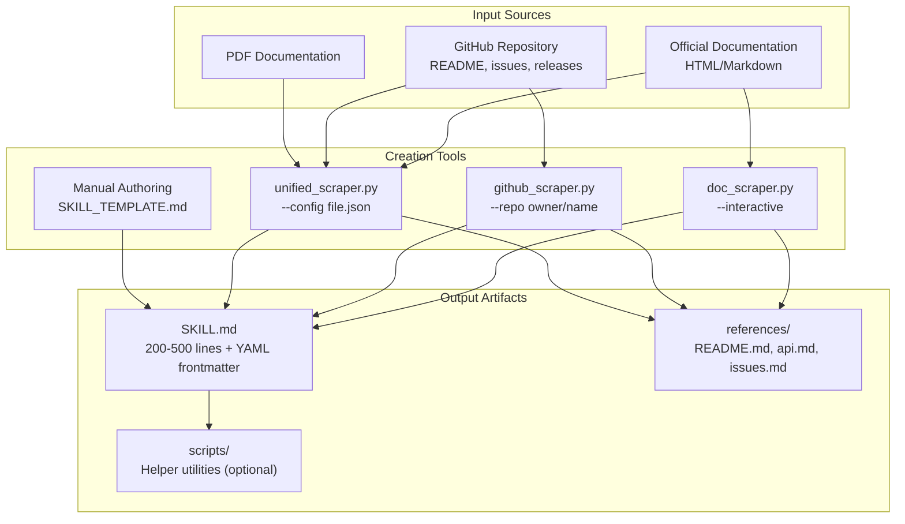
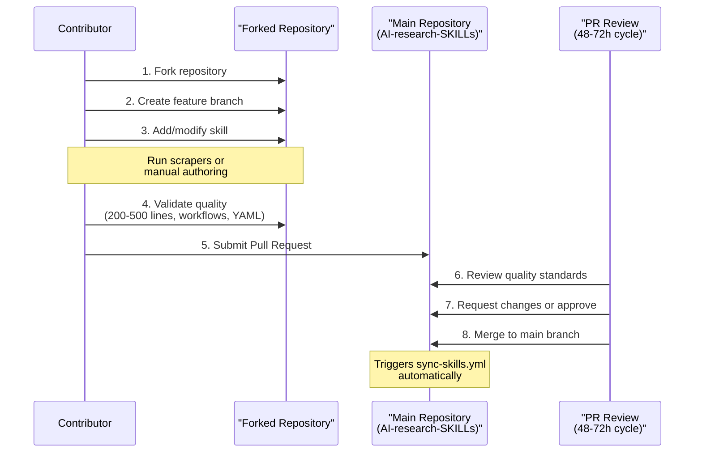
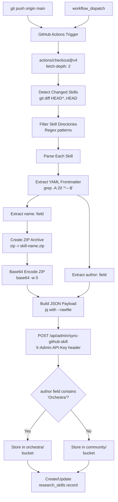
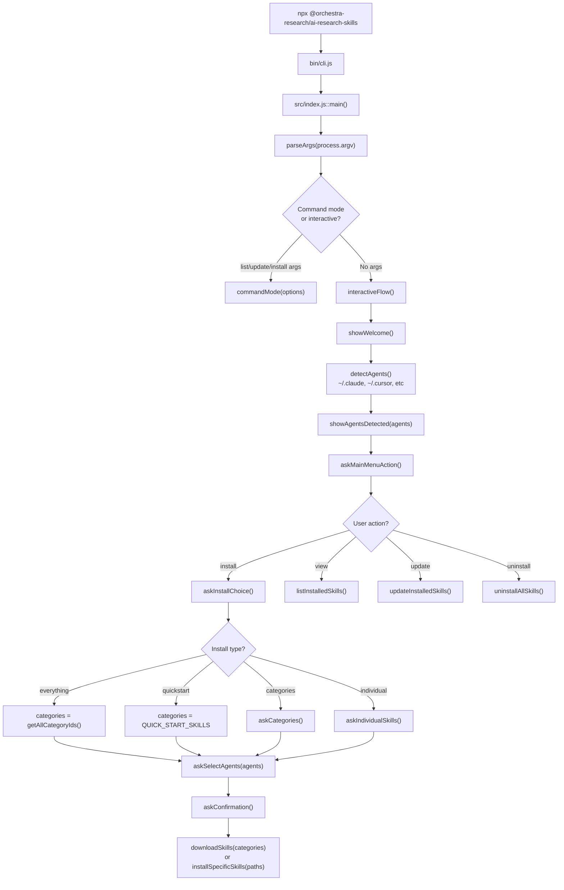
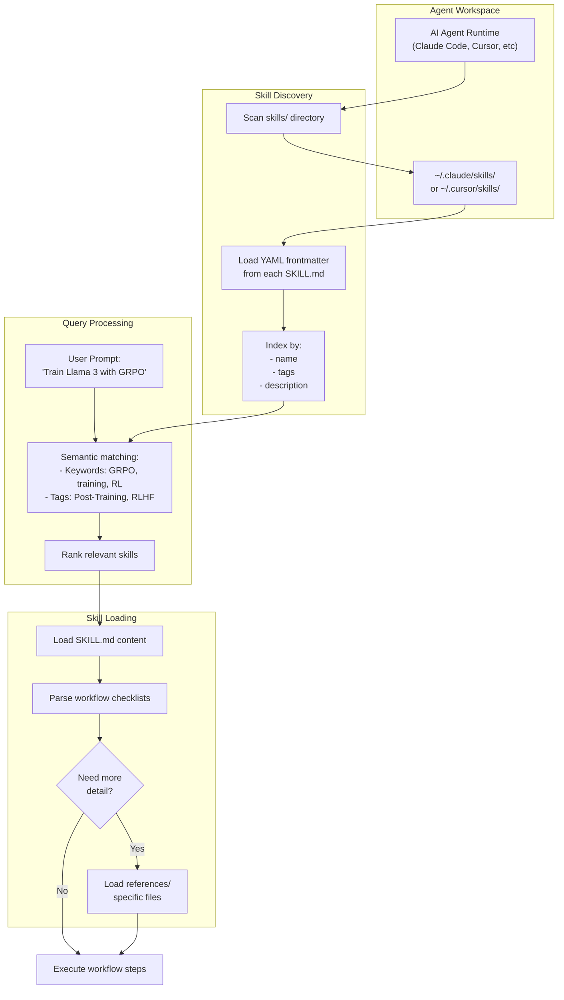
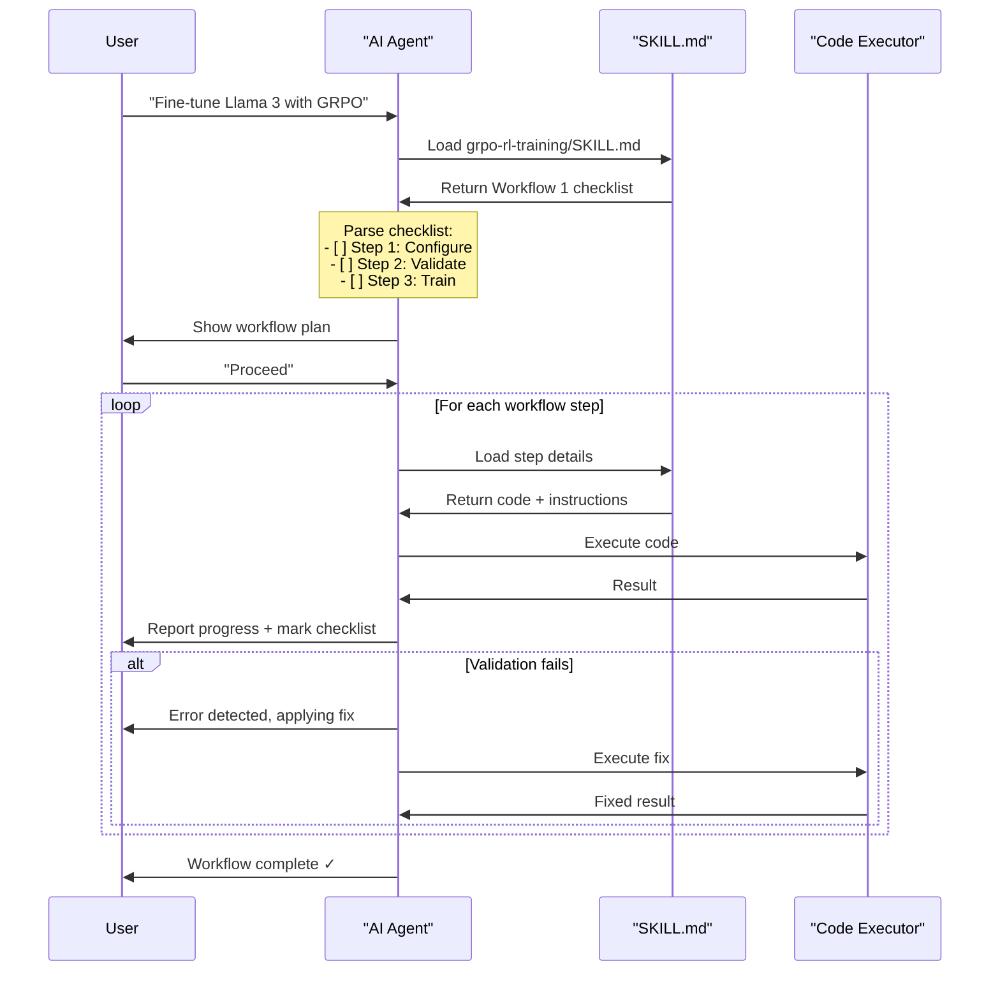
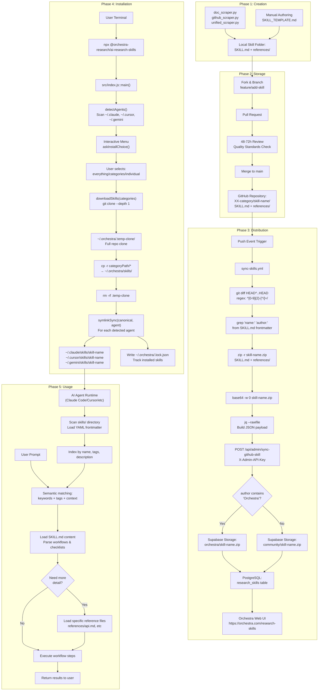

<!-- source: DeepWiki mcp.deepwiki.com · repo Orchestra-Research/AI-research-SKILLs · page 6.4 Skill Lifecycle & Data Flow · fetched 2026-10-26 -->

# Skill Lifecycle & Data Flow

<details>
<summary>Relevant source files</summary>

The following files were used as context for generating this wiki page:

- [.claude-plugin/marketplace.json](.claude-plugin/marketplace.json)
- [.github/workflows/sync-skills.yml](.github/workflows/sync-skills.yml)
- [01-model-architecture/litgpt/SKILL.md](01-model-architecture/litgpt/SKILL.md)
- [CLAUDE.md](CLAUDE.md)
- [CONTRIBUTING.md](CONTRIBUTING.md)
- [README.md](README.md)
- [demos/README.md](demos/README.md)
- [dev_data/GITHUB_SKILLS_SYNC_SETUP.md](dev_data/GITHUB_SKILLS_SYNC_SETUP.md)
- [docs/ROADMAP.md](docs/ROADMAP.md)
- [docs/SKILL_CREATION_GUIDE.md](docs/SKILL_CREATION_GUIDE.md)
- [docs/SKILL_TEMPLATE.md](docs/SKILL_TEMPLATE.md)
- [docs/assets/promo.gif](docs/assets/promo.gif)
- [docs/christmas-tree.svg](docs/christmas-tree.svg)
- [docs/tech-tree.svg](docs/tech-tree.svg)
- [packages/ai-research-skills/package.json](packages/ai-research-skills/package.json)
- [packages/ai-research-skills/src/index.js](packages/ai-research-skills/src/index.js)
- [packages/ai-research-skills/src/installer.js](packages/ai-research-skills/src/installer.js)
- [packages/ai-research-skills/src/prompts.js](packages/ai-research-skills/src/prompts.js)

</details>


This document describes the complete lifecycle of a skill from initial creation through distribution, installation, and consumption by AI agents. It covers the automated pipelines, data transformations, and storage patterns that enable skills to flow from contributor repositories to running AI agent workspaces.

For information about the individual distribution channels (NPM, GitHub Actions, Claude Marketplace), see [Distribution Channels](#6.1). For details on the GitHub Actions sync implementation, see [GitHub Actions Sync Workflow](#6.2). For the NPM CLI architecture, see [CLI Architecture & Implementation](#6.3).

---

## Lifecycle Stages Overview

The skill lifecycle consists of five sequential stages:

| Stage | Location | Key Outputs | Automation Level |
|-------|----------|-------------|------------------|
| **1. Creation** | Developer workstation | `SKILL.md`, `references/` directory | Semi-automated (scrapers) |
| **2. Storage** | GitHub repository | Version-controlled skill folders | Manual (PR review) |
| **3. Distribution** | GitHub Actions → Orchestra API | ZIP files, database records | Fully automated |
| **4. Installation** | User workstation | `~/.orchestra/skills/`, symlinks | User-initiated |
| **5. Usage** | AI agent runtime | Loaded skill content | Automatic (agent-driven) |

Each stage transforms the skill representation and makes it available through different access patterns optimized for different consumers.

Sources: [README.md:1-643](), [Diagram 2 from high-level overview]()

---

## Phase 1: Skill Creation

### Creation Methods

Skills are created through three approaches, all producing the standardized `SKILL.md` format:



### YAML Frontmatter Structure

Every `SKILL.md` must begin with YAML frontmatter conforming to this schema:

```yaml
---
name: skill-name-kebab-case
description: Third-person description including what AND when to use (max 1024 chars)
version: 1.0.0
author: Orchestra Research
license: MIT
tags: [Tag One, Tag Two, ACRONYM]
dependencies: [package1>=1.0.0, package2]
---
```

| Field | Required | Format | Validation Rules |
|-------|----------|--------|------------------|
| `name` | Yes | kebab-case string | No quotes, lowercase with hyphens |
| `description` | Yes | Plain text | No quotes, must describe what+when |
| `version` | Yes | Semantic versioning | `MAJOR.MINOR.PATCH` |
| `author` | Yes | Plain text | Used for Orchestra vs Community classification |
| `license` | Yes | SPDX identifier | Typically `MIT` |
| `tags` | Yes | Array of strings | Title Case, no quotes, 5-10 tags |
| `dependencies` | Optional | Array of strings | Package names with version constraints |

The `author` field determines storage bucket classification during sync (see Phase 3).

Sources: [CONTRIBUTING.md:126-196](), [01-model-architecture/litgpt/SKILL.md:1-9](), [CLAUDE.md:56-78]()

---

## Phase 2: Repository Storage

### Directory Structure Pattern

Skills are organized by category in the GitHub repository using a two-level hierarchy:

```
AI-research-SKILLs/
├── XX-category-name/          # Category folder (01-20)
│   ├── skill-name/            # Nested skill (most common)
│   │   ├── SKILL.md
│   │   ├── references/
│   │   │   ├── README.md
│   │   │   ├── api.md
│   │   │   ├── tutorials.md
│   │   │   ├── issues.md
│   │   │   └── releases.md
│   │   ├── scripts/
│   │   └── examples/
│   └── standalone-skill/      # Alternative: SKILL.md at category root
│       └── SKILL.md
└── .github/workflows/
    └── sync-skills.yml        # Auto-sync trigger
```

**Pattern Detection:**
- Nested skills: `^[0-9]{2}-[^/]+/[^/]+/SKILL.md` (e.g., `06-post-training/grpo-rl-training/SKILL.md`)
- Standalone skills: `^[0-9]{2}-[^/]+/SKILL.md` (e.g., `20-ml-paper-writing/SKILL.md`)

Both patterns are supported by the sync workflow via regex matching.

Sources: [README.md:387-415](), [.github/workflows/sync-skills.yml:28-48]()

### Contribution Workflow



Quality validation occurs before PR submission and during review. The 48-72 hour review cycle ensures Gold Standard compliance.

Sources: [CONTRIBUTING.md:30-75](), [CONTRIBUTING.md:82-196]()

---

## Phase 3: Distribution via GitHub Actions

### Sync Workflow Trigger

The `sync-skills.yml` workflow executes on two trigger conditions:

```yaml
on:
  push:
    branches:
      - main
  workflow_dispatch:  # Manual trigger
```

**Execution Flow:**



### Change Detection Logic

The workflow uses git diff with regex patterns to identify modified skills:

```bash
# Pattern 1: Nested skills
grep -E '^[0-9]{2}-[^/]+/[^/]+/' | sed -E 's|^([0-9]{2}-[^/]+/[^/]+)/.*|\1|'

# Pattern 2: Standalone skills  
grep -E '^[0-9]{2}-[^/]+/SKILL\.md$' | sed -E 's|^([0-9]{2}-[^/]+)/SKILL\.md$|\1|'
```

Results are converted to JSON array for matrix processing.

Sources: [.github/workflows/sync-skills.yml:19-63]()

### API Payload Structure

The workflow constructs a JSON payload with embedded ZIP content:

```json
{
  "skillName": "extracted-from-yaml",
  "skillPath": "06-post-training/grpo-rl-training",
  "author": "Orchestra Research",
  "skillMdContent": "...(full SKILL.md text)...",
  "zipBase64": "...(base64 encoded ZIP)..."
}
```

**ZIP Archive Contents:**
- `skill-name/SKILL.md`
- `skill-name/references/` (all files)
- `skill-name/scripts/` (if present)
- `skill-name/examples/` (if present)

Excludes: hidden files (`*/.*`), `.gitkeep`, `.DS_Store`

Sources: [.github/workflows/sync-skills.yml:112-186]()

### Orchestra API Endpoint

**Endpoint:** `POST /api/admin/sync-github-skill`

**Authentication:** `X-Admin-API-Key` header (secret stored in GitHub Actions)

**Response Codes:**
- `200`: Success (skill created or updated)
- `401`: Invalid API key
- `400`: Validation error (missing fields, invalid YAML)
- `500`: Server error

**Success Response:**
```json
{
  "action": "created" | "updated",
  "source": "orchestra" | "community",
  "skillId": "uuid"
}
```

The API stores the ZIP in Supabase Storage and creates a database record with metadata extracted from YAML frontmatter.

Sources: [.github/workflows/sync-skills.yml:162-183](), [dev_data/GITHUB_SKILLS_SYNC_SETUP.md:54-58]()

---

## Phase 4: Installation via NPM CLI

### Installation Entry Point

The NPM package provides an interactive CLI installer:

```bash
npx @orchestra-research/ai-research-skills
```

**Execution Flow:**



Sources: [packages/ai-research-skills/src/index.js:1-358]()

### Canonical Storage Pattern

The installer uses a **canonical directory with symlinks** pattern to support multiple agents:

```
~/.orchestra/
├── skills/                    # Canonical storage (single source of truth)
│   ├── 01-model-architecture/
│   │   ├── litgpt/
│   │   │   ├── SKILL.md
│   │   │   └── references/
│   │   └── mamba/
│   ├── 06-post-training/
│   │   ├── grpo-rl-training/
│   │   └── verl/
│   └── 20-ml-paper-writing/   # Standalone skill
│       ├── SKILL.md
│       └── references/
├── .temp-clone/               # Temporary during download (deleted after)
└── .lock.json                 # Installation state tracking
```

**Agent Symlinks:**
```
~/.claude/skills/litgpt -> ~/.orchestra/skills/01-model-architecture/litgpt
~/.cursor/skills/litgpt -> ~/.orchestra/skills/01-model-architecture/litgpt
~/.gemini/skills/litgpt -> ~/.orchestra/skills/01-model-architecture/litgpt
```

This pattern ensures:
1. **Single source of truth** for updates
2. **No duplication** across multiple agents
3. **Atomic updates** via canonical directory
4. **Agent-specific visibility** via symlinks

Sources: [packages/ai-research-skills/src/installer.js:8-10](), [packages/ai-research-skills/src/installer.js:116-151]()

### Download and Symlink Creation

**Download Implementation:**

```javascript
// packages/ai-research-skills/src/installer.js:48-114
async function downloadSkills(categories, spinner) {
  const tempDir = join(homedir(), '.orchestra', '.temp-clone');
  
  // 1. Clone repository
  execSync(`git clone --depth 1 ${REPO_URL}.git ${tempDir}`);
  
  // 2. Copy selected categories
  for (const categoryId of categories) {
    const categoryPath = join(tempDir, categoryId);
    const targetCategoryPath = join(CANONICAL_DIR, categoryId);
    
    // Check for standalone vs nested pattern
    if (existsSync(join(categoryPath, 'SKILL.md'))) {
      // Standalone skill
      execSync(`cp -r "${categoryPath}"/* "${targetCategoryPath}/"`);
      skills.push({ category: categoryId, skill: categoryId, standalone: true });
    } else {
      // Nested skills
      const entries = readdirSync(categoryPath, { withFileTypes: true });
      for (const entry of entries) {
        if (entry.isDirectory() && existsSync(join(categoryPath, entry.name, 'SKILL.md'))) {
          const targetSkillPath = join(targetCategoryPath, entry.name);
          execSync(`cp -r "${join(categoryPath, entry.name)}"/* "${targetSkillPath}/"`);
          skills.push({ category: categoryId, skill: entry.name, standalone: false });
        }
      }
    }
  }
  
  // 3. Cleanup temp directory
  rmSync(tempDir, { recursive: true, force: true });
  
  return skills;
}
```

**Symlink Creation:**

```javascript
// packages/ai-research-skills/src/installer.js:119-151
function createSymlinks(agent, skills, spinner) {
  const agentSkillsPath = agent.skillsPath;
  
  for (const skill of skills) {
    const sourcePath = skill.standalone
      ? join(CANONICAL_DIR, skill.category)
      : join(CANONICAL_DIR, skill.category, skill.skill);
    
    const linkName = skill.standalone ? skill.category : skill.skill;
    const linkPath = join(agentSkillsPath, linkName);
    
    // Remove existing symlink
    if (existsSync(linkPath)) {
      rmSync(linkPath, { recursive: true, force: true });
    }
    
    // Create new symlink
    symlinkSync(sourcePath, linkPath);
    linkedCount++;
  }
  
  return linkedCount;
}
```

Sources: [packages/ai-research-skills/src/installer.js:48-151]()

### Lock File Tracking

The `.lock.json` file maintains installation state:

```json
{
  "version": "1.0.0",
  "installedAt": "2024-01-15T10:30:00.000Z",
  "skills": [
    {
      "category": "06-post-training",
      "skill": "grpo-rl-training",
      "standalone": false
    },
    {
      "category": "20-ml-paper-writing",
      "skill": "20-ml-paper-writing",
      "standalone": true
    }
  ],
  "agents": ["claude", "cursor", "gemini"]
}
```

**Usage:**
- `listInstalledSkills()` reads from filesystem (ground truth)
- `updateInstalledSkills()` reads lock file to get installed paths
- `writeLock()` updates after install/update/uninstall

Sources: [packages/ai-research-skills/src/installer.js:26-44](), [packages/ai-research-skills/src/installer.js:241-248]()

---

## Phase 5: Agent Usage

### Skill Discovery by Agents

AI agents discover skills through directory scanning and YAML frontmatter parsing:



### YAML Frontmatter Usage

Agents use specific frontmatter fields for discovery and filtering:

| Field | Agent Usage | Example Query Match |
|-------|-------------|---------------------|
| `name` | Exact skill identification | "Use grpo-rl-training skill" |
| `description` | Primary semantic matching | "I need to fine-tune with reinforcement learning" → matches "GRPO/RL fine-tuning" |
| `tags` | Keyword filtering | "Show me all RLHF skills" → matches `[RLHF, ...]` |
| `dependencies` | Environment validation | Check if `transformers>=4.47.0` is installed |
| `version` | Compatibility checking | Ensure skill version matches agent requirements |

The `description` field is particularly important as it contains both **what** the skill does and **when** to use it, enabling context-aware skill selection.

Sources: [CONTRIBUTING.md:126-196](), [CLAUDE.md:56-78]()

### Progressive Disclosure in Practice

When an agent loads a skill, it follows the progressive disclosure pattern:

**Step 1: Initial Load**
```
Load: 06-post-training/grpo-rl-training/SKILL.md (300 lines)
Parse: Quick start, workflow checklists, common issues
```

**Step 2: Conditional Detail Loading**
```
If user asks about advanced batching:
  → Load: references/batch-size-tuning.md
  
If user encounters gradient issues:
  → Load: references/gradient-checkpointing.md
  
If user needs API reference:
  → Load: references/api.md
```

This prevents loading unnecessary content into the context window while maintaining access to detailed information when needed.

Sources: [docs/SKILL_CREATION_GUIDE.md:46-64](), [CLAUDE.md:82-90]()

### Workflow Execution Pattern

Agents use the checklist-based workflow pattern for multi-step tasks:



The checklist provides structure while allowing the agent to adapt to errors and iterate on validation steps.

Sources: [docs/SKILL_CREATION_GUIDE.md:66-102]()

---

## Complete End-to-End Data Flow

### Comprehensive Lifecycle Diagram



Sources: [Complete integration of all previous sources]()

---

## Key Data Structures

### Skill Metadata Object (In-Flight)

During GitHub Actions sync, skills are represented as:

```typescript
interface SkillPayload {
  skillName: string;        // From YAML frontmatter 'name' field
  skillPath: string;        // e.g., "06-post-training/grpo-rl-training"
  author: string;           // From YAML frontmatter 'author' field
  skillMdContent: string;   // Full SKILL.md file content
  zipBase64: string;        // Base64-encoded ZIP archive
}
```

Sources: [.github/workflows/sync-skills.yml:143-155]()

### Installed Skill Object (Client-Side)

After installation, the NPM CLI tracks skills as:

```typescript
interface InstalledSkill {
  category: string;         // e.g., "06-post-training"
  skill: string;            // e.g., "grpo-rl-training"
  standalone: boolean;      // true if SKILL.md at category root
}
```

**Example lock file:**
```json
{
  "version": "1.0.0",
  "installedAt": "2024-01-15T10:30:00.000Z",
  "skills": [
    { "category": "06-post-training", "skill": "grpo-rl-training", "standalone": false },
    { "category": "20-ml-paper-writing", "skill": "20-ml-paper-writing", "standalone": true }
  ],
  "agents": ["claude", "cursor"]
}
```

Sources: [packages/ai-research-skills/src/installer.js:26-44](), [packages/ai-research-skills/src/installer.js:65-102]()

### Agent Detection Object

The CLI detects installed agents using this structure:

```typescript
interface DetectedAgent {
  id: string;               // e.g., "claude", "cursor"
  name: string;             // e.g., "Claude Code", "Cursor"
  path: string;             // e.g., "~/.claude"
  skillsPath: string;       // e.g., "~/.claude/skills"
  detected: boolean;        // true if directory exists
}
```

Detection logic scans well-known paths:
- `~/.claude` → `~/.claude/skills`
- `~/.cursor` → `~/.cursor/skills`
- `~/.gemini` → `~/.gemini/skills`
- `~/.codex` → `~/.codex/skills`
- `~/.windsurf` → `~/.windsurf/skills`

Sources: [packages/ai-research-skills/src/agents.js]() (referenced but not provided in files)

### Category Definition Object

Categories are defined in the CLI prompts:

```typescript
interface CategoryDefinition {
  id: string;               // e.g., "06-post-training"
  name: string;             // e.g., "Post-Training"
  skills: number;           // Count of skills in category
  examples: string;         // e.g., "GRPO, verl, slime, miles"
}
```

Used for interactive selection in `askCategories()` prompt.

Sources: [packages/ai-research-skills/src/prompts.js:7-28]()

---

## Storage Location Summary

| Phase | Location | Format | Access Pattern |
|-------|----------|--------|----------------|
| Creation | Developer workstation | Raw files | Direct filesystem |
| Repository | `github.com/Orchestra-Research/AI-research-SKILLs` | Git-versioned | HTTP clone/download |
| Marketplace | Supabase Storage (`orchestra/` or `community/`) | ZIP archives | Authenticated API |
| Marketplace DB | PostgreSQL `research_skills` table | Relational records | SQL queries |
| Canonical | `~/.orchestra/skills/XX-category/skill-name/` | Extracted files | Direct filesystem |
| Agent | `~/.{agent}/skills/skill-name` → symlink | Symbolic links | Dereferenced filesystem |
| Lock | `~/.orchestra/.lock.json` | JSON | Read/write JSON parsing |

The symlink pattern ensures updates to the canonical directory (`~/.orchestra/skills/`) automatically propagate to all agent directories without requiring re-installation.

Sources: [packages/ai-research-skills/src/installer.js:9-10](), [.github/workflows/sync-skills.yml:112-124]()

---

