<!-- source: DeepWiki mcp.deepwiki.com · repo Orchestra-Research/AI-research-SKILLs · page 6.5 Promotional Video System · fetched 2026-10-26 -->

# Promotional Video System

<details>
<summary>Relevant source files</summary>

The following files were used as context for generating this wiki page:

- [video-promo/ai-research-skills-promo/.gitignore](video-promo/ai-research-skills-promo/.gitignore)
- [video-promo/ai-research-skills-promo/package-lock.json](video-promo/ai-research-skills-promo/package-lock.json)
- [video-promo/ai-research-skills-promo/package.json](video-promo/ai-research-skills-promo/package.json)
- [video-promo/ai-research-skills-promo/public/music.wav](video-promo/ai-research-skills-promo/public/music.wav)
- [video-promo/ai-research-skills-promo/remotion.config.ts](video-promo/ai-research-skills-promo/remotion.config.ts)
- [video-promo/ai-research-skills-promo/src/AIResearchSkillsPromo.tsx](video-promo/ai-research-skills-promo/src/AIResearchSkillsPromo.tsx)
- [video-promo/ai-research-skills-promo/src/Root.tsx](video-promo/ai-research-skills-promo/src/Root.tsx)
- [video-promo/ai-research-skills-promo/src/components/AgentDetection.tsx](video-promo/ai-research-skills-promo/src/components/AgentDetection.tsx)
- [video-promo/ai-research-skills-promo/src/components/CallToAction.tsx](video-promo/ai-research-skills-promo/src/components/CallToAction.tsx)
- [video-promo/ai-research-skills-promo/src/components/CategorySelection.tsx](video-promo/ai-research-skills-promo/src/components/CategorySelection.tsx)
- [video-promo/ai-research-skills-promo/src/components/InstallProgress.tsx](video-promo/ai-research-skills-promo/src/components/InstallProgress.tsx)
- [video-promo/ai-research-skills-promo/src/components/OrchestraLogo.tsx](video-promo/ai-research-skills-promo/src/components/OrchestraLogo.tsx)
- [video-promo/ai-research-skills-promo/src/components/StatsDisplay.tsx](video-promo/ai-research-skills-promo/src/components/StatsDisplay.tsx)
- [video-promo/ai-research-skills-promo/src/components/SuccessScreen.tsx](video-promo/ai-research-skills-promo/src/components/SuccessScreen.tsx)

</details>


## Purpose and Scope

This document covers the Remotion-based video generation system that produces a 15.5-second promotional video demonstrating the AI Research Skills installation workflow. The system renders a programmatic video with 8 sequential scenes, each showcasing a specific step of the user journey from agent detection through installation to completion.

For information about the distribution channels that use this video as promotional material, see [Distribution Channels](#6.1). For details about the CLI installation process being demonstrated, see [CLI Architecture & Implementation](#6.3).

---

## System Architecture

The video system is built on [Remotion](https://remotion.dev), a framework for creating videos programmatically using React components. The entire project is located in `video-promo/ai-research-skills-promo/` and outputs either MP4 or GIF format.

### Video Composition Structure

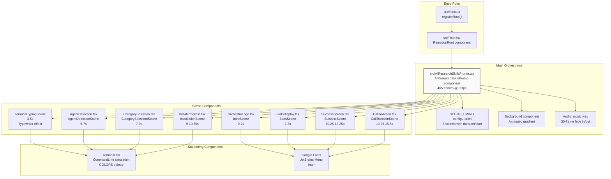

**Sources:** [video-promo/ai-research-skills-promo/src/AIResearchSkillsPromo.tsx:1-328](), [video-promo/ai-research-skills-promo/src/Root.tsx:1-18]()

---

## Scene Timing Configuration

The video uses a centralized `SCENE_TIMING` object to orchestrate the 8 scenes with precise frame-based timing. Each scene is rendered as a `<Sequence>` component with calculated start frames and durations.

### Timing Table

| Scene | Start (s) | Duration (s) | Frames (30fps) | Purpose |
|-------|-----------|--------------|----------------|---------|
| `intro` | 0 | 2.0 | 0-60 | Display Orchestra ASCII logo and subtitle |
| `stats` | 2 | 1.0 | 60-90 | Count up to 82 skills, 20 categories, 5 agents |
| `terminalTyping` | 3 | 2.0 | 90-150 | Typewriter effect for npx command |
| `agentDetection` | 5 | 2.0 | 150-210 | Show 5 detected agents with staggered checkmarks |
| `categorySelection` | 7 | 2.0 | 210-270 | Display "Everything" selection with 6 categories |
| `installation` | 9 | 1.25 | 270-307 | Progress bar from 0-100% with scrolling skills |
| `success` | 10.25 | 3.0 | 307-397 | Checkmark circle with 3 example prompts |
| `callToAction` | 13.25 | 2.25 | 397-465 | npx command with blinking cursor + links |

**Sources:** [video-promo/ai-research-skills-promo/src/AIResearchSkillsPromo.tsx:26-36]()

### Frame Conversion Function

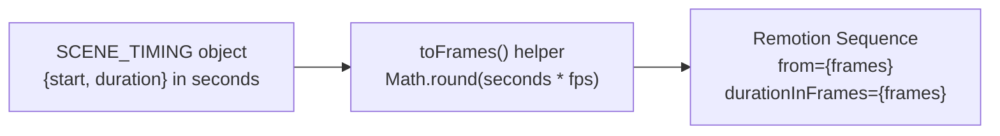

The `toFrames()` helper at [video-promo/ai-research-skills-promo/src/AIResearchSkillsPromo.tsx:237]() converts seconds to frame numbers: `Math.round(seconds * fps)`. Each `<Sequence>` component uses `from={toFrames(SCENE_TIMING.sceneName.start)}` and `durationInFrames={toFrames(SCENE_TIMING.sceneName.duration)}`.

**Sources:** [video-promo/ai-research-skills-promo/src/AIResearchSkillsPromo.tsx:237-260]()

---

## Component Implementation Details

### IntroScene: Orchestra Logo

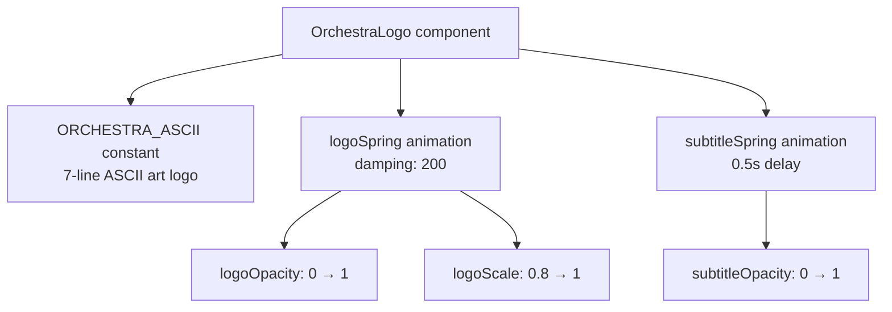

The logo uses a hardcoded `ORCHESTRA_ASCII` constant at [video-promo/ai-research-skills-promo/src/components/OrchestraLogo.tsx:13-20]() rendered in a `<pre>` tag with JetBrains Mono at 14px. Spring animations control fade-in (opacity 0→1) and scale (0.8→1) with a damping of 200 for smooth motion. The subtitle "AI Research Skills" appears 0.5 seconds after the logo with its own spring animation.

**Sources:** [video-promo/ai-research-skills-promo/src/components/OrchestraLogo.tsx:1-120](), [video-promo/ai-research-skills-promo/src/AIResearchSkillsPromo.tsx:72-83]()

### StatsScene: Count-Up Animation

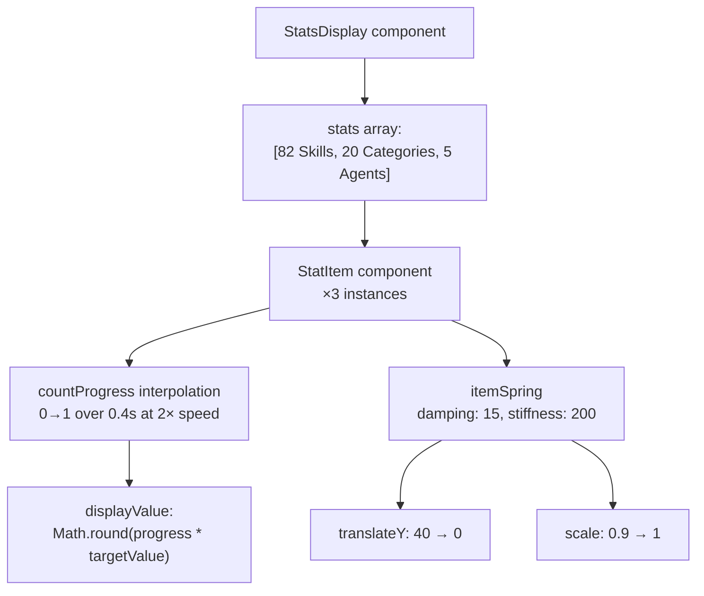

The stats scene renders three `StatItem` components with staggered delays (0.08s × index). Each item uses `interpolate()` to animate the count from 0 to the target value over 0.4 seconds at 2× speed. The `displayValue` is `Math.round(countProgress * targetValue)` at [video-promo/ai-research-skills-promo/src/components/StatsDisplay.tsx:52](), creating the counting effect. Spring animations add translateY (40→0) and scale (0.9→1) motion.

**Sources:** [video-promo/ai-research-skills-promo/src/components/StatsDisplay.tsx:1-183](), [video-promo/ai-research-skills-promo/src/AIResearchSkillsPromo.tsx:86-105]()

### TerminalTypingScene: Typewriter Effect

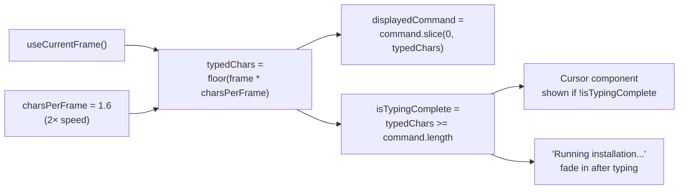

The typewriter effect at [video-promo/ai-research-skills-promo/src/AIResearchSkillsPromo.tsx:112-120]() uses `Math.floor(frame * charsPerFrame)` to calculate how many characters to display. With `charsPerFrame = 1.6` (2× speed), the 50-character command `"npx @orchestra-research/ai-research-skills"` types in ~31 frames (~1 second). The `Cursor` component displays only when typing is incomplete. Once finished, a "Running installation..." message fades in.

**Sources:** [video-promo/ai-research-skills-promo/src/AIResearchSkillsPromo.tsx:108-154]()

### AgentDetectionScene: Staggered Checkmarks

The scene displays 5 agents with their config directory paths:

| Agent Name | Path |
|------------|------|
| Claude Code | `~/.claude/skills` |
| Cursor | `~/.cursor/skills` |
| Windsurf | `~/.codeium/windsurf/skills` |
| Gemini CLI | `~/.gemini/skills` |
| Kilo Code | `~/.kilocode/skills` |

Each `AgentItem` component has a staggered delay of `0.2 * fps * index`. The item first animates in with translateX (-20→0), then after 8 frames, the checkmark animates from "○" to "●" using a spring animation with scale (0→1).

**Sources:** [video-promo/ai-research-skills-promo/src/components/AgentDetection.tsx:1-148](), [video-promo/ai-research-skills-promo/src/AIResearchSkillsPromo.tsx:157-170]()

### CategorySelectionScene: Interactive Menu Mockup

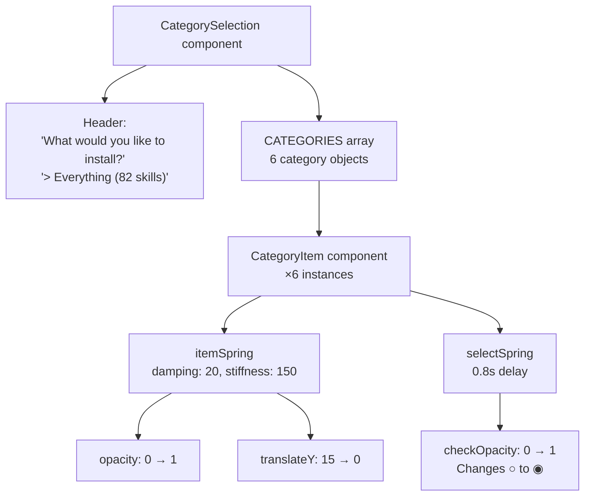

Six categories are defined in the `CATEGORIES` array at [video-promo/ai-research-skills-promo/src/components/CategorySelection.tsx:21-28](): Post-Training (8 skills), Fine-Tuning (5 skills), Inference Serving (4 skills), Distributed Training (6 skills), Optimization (6 skills), and Evaluation (3 skills). Each category animates in sequentially with a 0.1s stagger. After 0.8s, checkmarks animate from "○" to "◉" to simulate selection.

**Sources:** [video-promo/ai-research-skills-promo/src/components/CategorySelection.tsx:1-188](), [video-promo/ai-research-skills-promo/src/AIResearchSkillsPromo.tsx:173-186]()

### InstallationScene: Progress Bar with Scrolling Skills

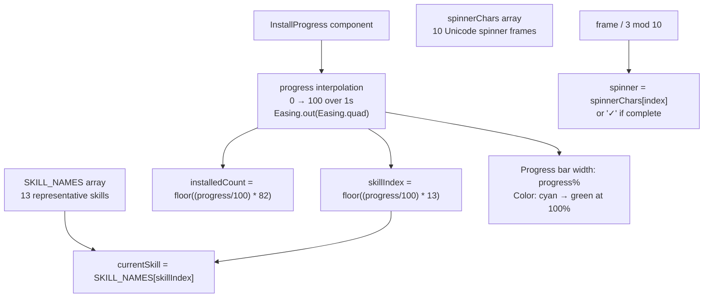

The installation scene at [video-promo/ai-research-skills-promo/src/components/InstallProgress.tsx:1-191]() uses `interpolate()` with `Easing.out(Easing.quad)` to animate progress from 0→100 over 1 second. As progress increases, `skillIndex` changes to display the current skill from the `SKILL_NAMES` array (13 skills: grpo-rl-training, verl, slime, vllm, sglang, deepspeed, flash-attention, axolotl, unsloth, wandb, lm-eval-harness, dspy, ml-paper-writing). The installed count interpolates to 82. A Unicode spinner rotates through 10 characters ("⠋⠙⠹⠸⠼⠴⠦⠧⠇⠏") every 3 frames, changing to "✓" when complete.

**Sources:** [video-promo/ai-research-skills-promo/src/components/InstallProgress.tsx:1-191](), [video-promo/ai-research-skills-promo/src/AIResearchSkillsPromo.tsx:189-202]()

### SuccessScene: Completion Checkmark

The success screen displays a circular checkmark icon (80×80px with 2px border) that scales from 0→1 with a spring animation (damping: 18, stiffness: 100). Below it, the title "Ready to go" and subtitle "82 skills installed across 5 agents" fade in. After 0.8s, three example prompts appear with staggered delays (0.15s apart):

1. "Help me set up GRPO training with verl"
2. "How do I serve a model with vLLM?"
3. "Write a NeurIPS paper introduction"

Each prompt has a translateY animation (15→0) and fades in individually.

**Sources:** [video-promo/ai-research-skills-promo/src/components/SuccessScreen.tsx:1-231](), [video-promo/ai-research-skills-promo/src/AIResearchSkillsPromo.tsx:205-216]()

### CallToActionScene: Blinking Cursor

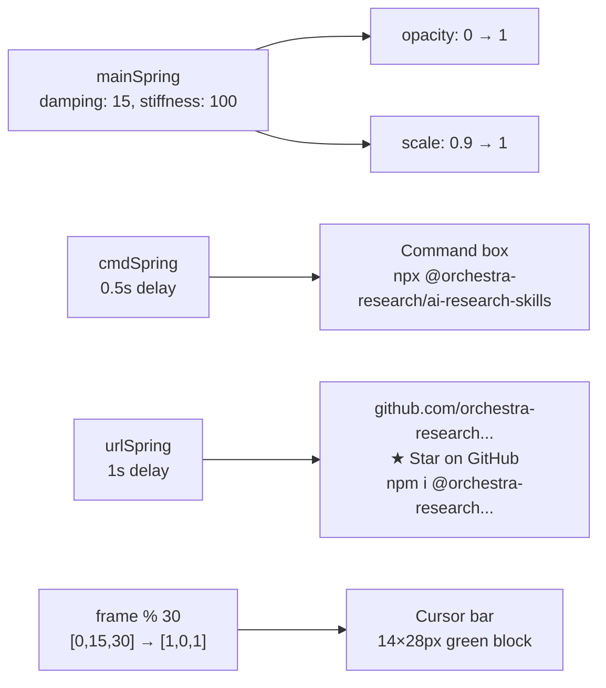

The call-to-action displays the heading "Get Started in One Command" with "One Command" in cyan. The command box at [video-promo/ai-research-skills-promo/src/components/CallToAction.tsx:106-140]() appears after 0.5s with a box shadow and border. A blinking cursor (14×28px green bar) uses `interpolate(adjustedFrame % 30, [0, 15, 30], [1, 0, 1])` to blink every 30 frames (1 second). Links to GitHub and npm appear after 1 second.

**Sources:** [video-promo/ai-research-skills-promo/src/components/CallToAction.tsx:1-170](), [video-promo/ai-research-skills-promo/src/AIResearchSkillsPromo.tsx:219-230]()

---

## Animation System

### Spring-Based Animations

All animations use Remotion's `spring()` function with configurable damping and stiffness:

| Component | Damping | Stiffness | Effect |
|-----------|---------|-----------|--------|
| Logo | 200 | default | Very smooth, slow settle |
| Stats container | 15 | 150 | Fast, bouncy |
| Stats items | 15 | 200 | Fast, slightly stiffer |
| Agent items | 20 | 200 | Medium speed |
| Category items | 20 | 150 | Medium speed, looser |
| Install fade | 200 | default | Very smooth |
| Success checkmark | 18 | 100 | Slow, elegant |
| CTA main | 15 | 100 | Fast, looser |

The spring function returns a value from 0 to 1 based on the current frame, which is then interpolated to the desired range (e.g., opacity, scale, translateY).

**Sources:** [video-promo/ai-research-skills-promo/src/AIResearchSkillsPromo.tsx:1-328](), [video-promo/ai-research-skills-promo/src/components/OrchestraLogo.tsx:37-44](), [video-promo/ai-research-skills-promo/src/components/StatsDisplay.tsx:34-38]()

### Background Gradient Animation

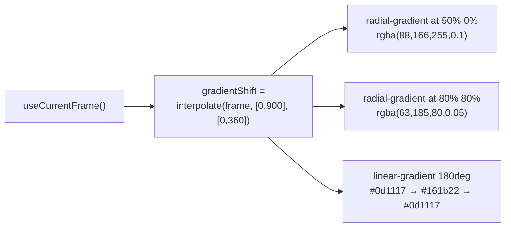

The `Background` component at [video-promo/ai-research-skills-promo/src/AIResearchSkillsPromo.tsx:39-69]() uses a static triple-gradient background: two radial gradients (blue-tinted at top-left, green-tinted at bottom-right) layered over a linear gradient (dark gray vertical fade). The `gradientShift` variable animates from 0 to 360 but is currently unused in the actual gradient definitions.

**Sources:** [video-promo/ai-research-skills-promo/src/AIResearchSkillsPromo.tsx:39-69]()

### Audio Fade Envelope

The audio track `music.wav` uses a volume interpolation function:

```
interpolate(frame, [0, 30, 435, 465], [0, 0.6, 0.6, 0])
```

This creates a fade-in from 0→0.6 over frames 0-30 (1 second), maintains 0.6 volume until frame 435 (14.5s), then fades out to 0 over frames 435-465 (last 1 second).

**Sources:** [video-promo/ai-research-skills-promo/src/AIResearchSkillsPromo.tsx:242-250]()

---

## Supporting Components

### Terminal Component

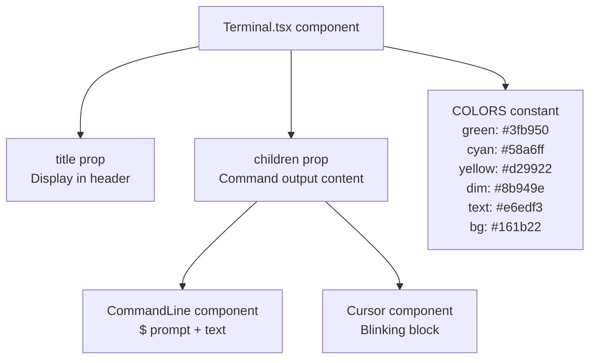

The `Terminal` component (referenced but not provided in files) simulates a command-line interface with a header title and content area. It uses the `COLORS` palette defined across components for consistent GitHub-style terminal colors. The `CommandLine` component renders a shell prompt (`$`) in green followed by command text. The `Cursor` component displays a blinking block cursor.

**Sources:** [video-promo/ai-research-skills-promo/src/AIResearchSkillsPromo.tsx:14](), [video-promo/ai-research-skills-promo/src/components/InstallProgress.tsx:13-20]()

### Font Loading

Google Fonts are loaded via `@remotion/google-fonts` package:

- **JetBrains Mono**: Monospace font for terminal, code, and technical text
- **Inter**: Sans-serif font for headings, labels, and UI text

The fonts are loaded at the top of components using:
```typescript
const { fontFamily: monoFont } = loadFont();
const { fontFamily: interFont } = loadInterFont();
```

**Sources:** [video-promo/ai-research-skills-promo/src/AIResearchSkillsPromo.tsx:12-13,23-24](), [video-promo/ai-research-skills-promo/src/components/SuccessScreen.tsx:8-12]()

---

## Build System

### Configuration

The Remotion configuration at [video-promo/ai-research-skills-promo/remotion.config.ts:1-5]() sets:

- `setVideoImageFormat("jpeg")`: Use JPEG for intermediate frames (smaller file size)
- `setOverwriteOutput(true)`: Overwrite existing output files without prompting

**Sources:** [video-promo/ai-research-skills-promo/remotion.config.ts:1-5]()

### Composition Registration

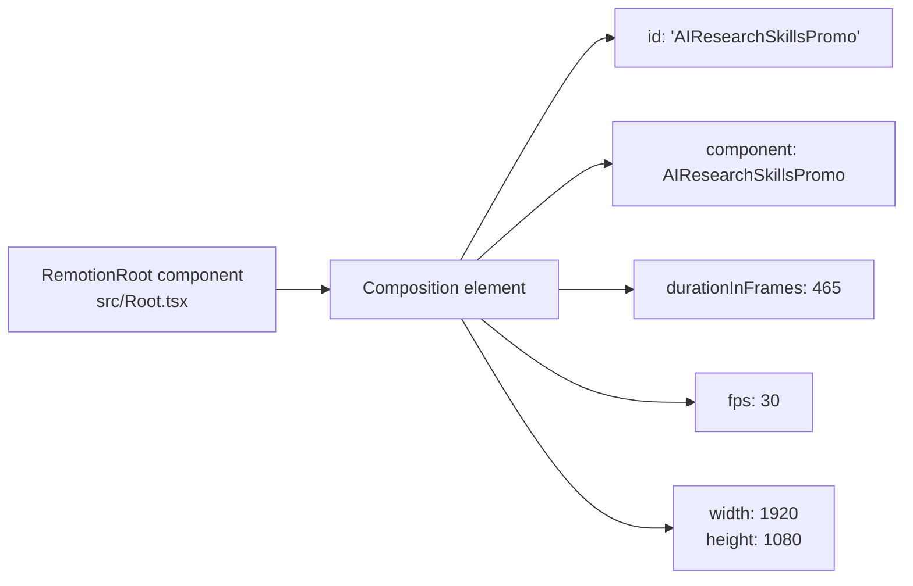

The `RemotionRoot` component at [video-promo/ai-research-skills-promo/src/Root.tsx:4-17]() registers a single composition with ID `"AIResearchSkillsPromo"`, 465 frames at 30fps (15.5 seconds), and 1920×1080 resolution (Full HD).

**Sources:** [video-promo/ai-research-skills-promo/src/Root.tsx:1-18]()

### Build Scripts

The `package.json` defines three npm scripts:

| Script | Command | Output |
|--------|---------|--------|
| `start` | `remotion studio` | Opens browser-based preview/editor |
| `build` | `remotion render Root AIResearchSkillsPromo out/promo.mp4` | Renders MP4 to `out/promo.mp4` |
| `build:gif` | `remotion render Root AIResearchSkillsPromo out/promo.gif` | Renders GIF to `out/promo.gif` |

The build command syntax is: `remotion render <entry-point> <composition-id> <output-path>`

**Sources:** [video-promo/ai-research-skills-promo/package.json:6-10]()

### Build Pipeline Flow

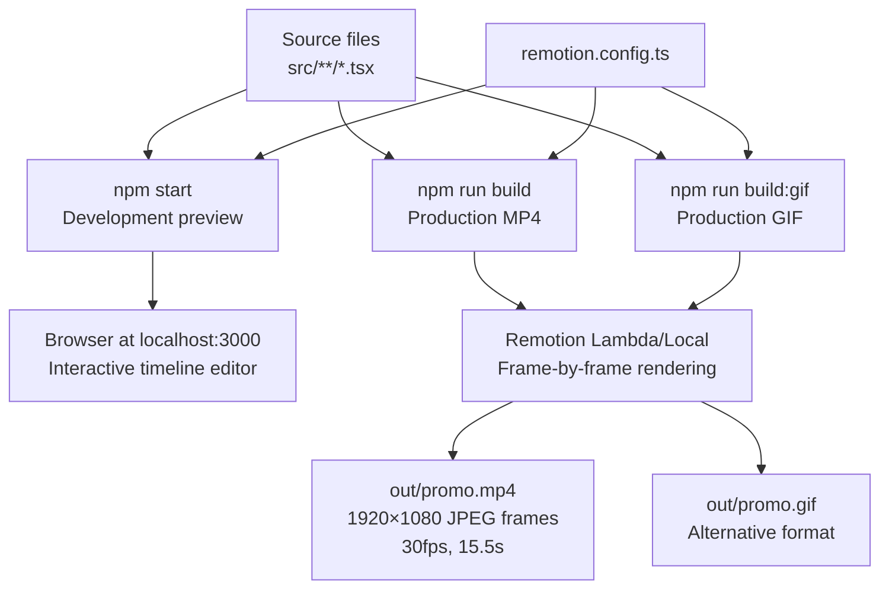

Development workflow uses `npm start` to open Remotion Studio in the browser at `localhost:3000`, providing an interactive timeline editor with real-time preview. Production builds use `npm run build` to render the final video, processing each frame sequentially and encoding to MP4 or GIF.

**Sources:** [video-promo/ai-research-skills-promo/package.json:1-23](), [video-promo/ai-research-skills-promo/remotion.config.ts:1-5]()

---

## Data Constants

### Skill Names in Installation Scene

The `SKILL_NAMES` array at [video-promo/ai-research-skills-promo/src/components/InstallProgress.tsx:22-36]() contains 13 representative skills displayed during installation:

1. grpo-rl-training
2. verl
3. slime
4. vllm
5. sglang
6. deepspeed
7. flash-attention
8. axolotl
9. unsloth
10. wandb
11. lm-eval-harness
12. dspy
13. ml-paper-writing

These skills were chosen to represent the breadth of the library: post-training (grpo-rl-training, verl, slime), inference (vllm, sglang), distributed training (deepspeed), optimization (flash-attention), fine-tuning (axolotl, unsloth), MLOps (wandb), evaluation (lm-eval-harness), prompt engineering (dspy), and advanced workflows (ml-paper-writing).

**Sources:** [video-promo/ai-research-skills-promo/src/components/InstallProgress.tsx:22-36]()

### Agent Detection Constants

The `AGENTS` array at [video-promo/ai-research-skills-promo/src/components/AgentDetection.tsx:18-24]() defines the 5 detected agents:

```typescript
const AGENTS = [
  { name: "Claude Code", path: "~/.claude/skills" },
  { name: "Cursor", path: "~/.cursor/skills" },
  { name: "Windsurf", path: "~/.codeium/windsurf/skills" },
  { name: "Gemini CLI", path: "~/.gemini/skills" },
  { name: "Kilo Code", path: "~/.kilocode/skills" },
];
```

These match the agent detection logic in the actual CLI installer (see [CLI Architecture & Implementation](#6.3)).

**Sources:** [video-promo/ai-research-skills-promo/src/components/AgentDetection.tsx:18-24]()

### Example Prompts

The `EXAMPLE_PROMPTS` array at [video-promo/ai-research-skills-promo/src/components/SuccessScreen.tsx:23-27]() shows three use cases:

1. "Help me set up GRPO training with verl"
2. "How do I serve a model with vLLM?"
3. "Write a NeurIPS paper introduction"

These demonstrate the range of tasks skills enable: post-training RLHF, inference serving, and academic writing.

**Sources:** [video-promo/ai-research-skills-promo/src/components/SuccessScreen.tsx:23-27]()

---

## File Structure

```
video-promo/ai-research-skills-promo/
├── package.json              # npm dependencies and build scripts
├── remotion.config.ts        # Remotion configuration (JPEG format, overwrite)
├── src/
│   ├── index.ts              # Entry point - registerRoot()
│   ├── Root.tsx              # RemotionRoot - composition registration
│   ├── AIResearchSkillsPromo.tsx  # Main orchestrator - 8 scenes
│   └── components/
│       ├── OrchestraLogo.tsx      # Scene 1 - ASCII logo
│       ├── StatsDisplay.tsx       # Scene 2 - count-up stats
│       ├── AgentDetection.tsx     # Scene 4 - agent list
│       ├── CategorySelection.tsx  # Scene 5 - category menu
│       ├── InstallProgress.tsx    # Scene 6 - progress bar
│       ├── SuccessScreen.tsx      # Scene 7 - completion
│       ├── CallToAction.tsx       # Scene 8 - CTA
│       └── Terminal.tsx           # Supporting - CLI simulation
├── public/
│   └── music.wav             # Background audio track
└── out/
    ├── promo.mp4             # Build output (gitignored)
    └── promo.gif             # Build output (gitignored)
```

**Sources:** [video-promo/ai-research-skills-promo/package.json:1-23](), [video-promo/ai-research-skills-promo/.gitignore:1-6]()

---

## Color Palette

All components use a consistent GitHub-inspired color palette:

| Color Name | Hex Code | Usage |
|------------|----------|-------|
| `green` | `#3fb950` | Success states, checkmarks, `$` prompt |
| `cyan` | `#58a6ff` | Highlights, selected text, links |
| `yellow` | `#d29922` | Loading states, warnings |
| `dim` | `#8b949e` | Secondary text, labels |
| `text` | `#e6edf3` | Primary text |
| `white` | `#ffffff` | Emphasis text, headings |
| `lightGray` | `rgba(255,255,255,0.7)` | Subtle text |
| `subtleGray` | `rgba(255,255,255,0.5)` | Dividers, borders |
| `bg` | `#0d1117` or `#161b22` | Background layers |
| `selected` | `#238636` | Selected items (darker green) |

The palette creates a dark mode aesthetic consistent with GitHub's interface.

**Sources:** [video-promo/ai-research-skills-promo/src/components/InstallProgress.tsx:13-20](), [video-promo/ai-research-skills-promo/src/components/StatsDisplay.tsx:12-18](), [video-promo/ai-research-skills-promo/src/components/CategorySelection.tsx:12-19]()

---

