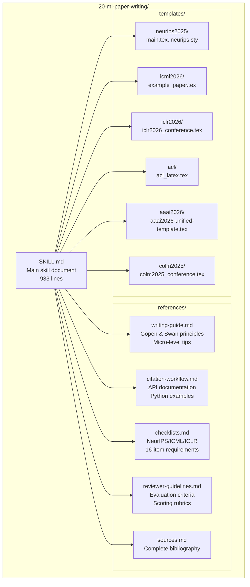
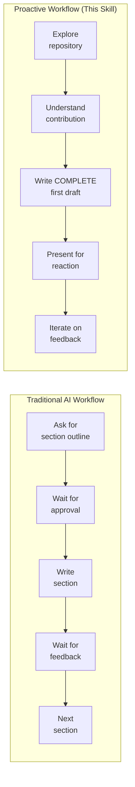
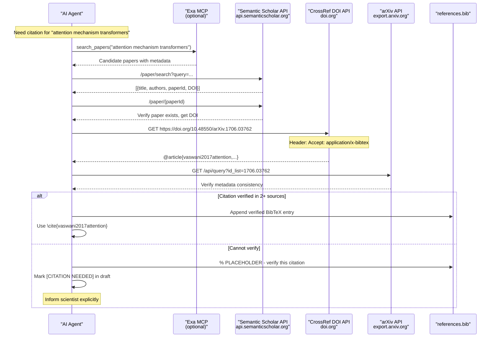
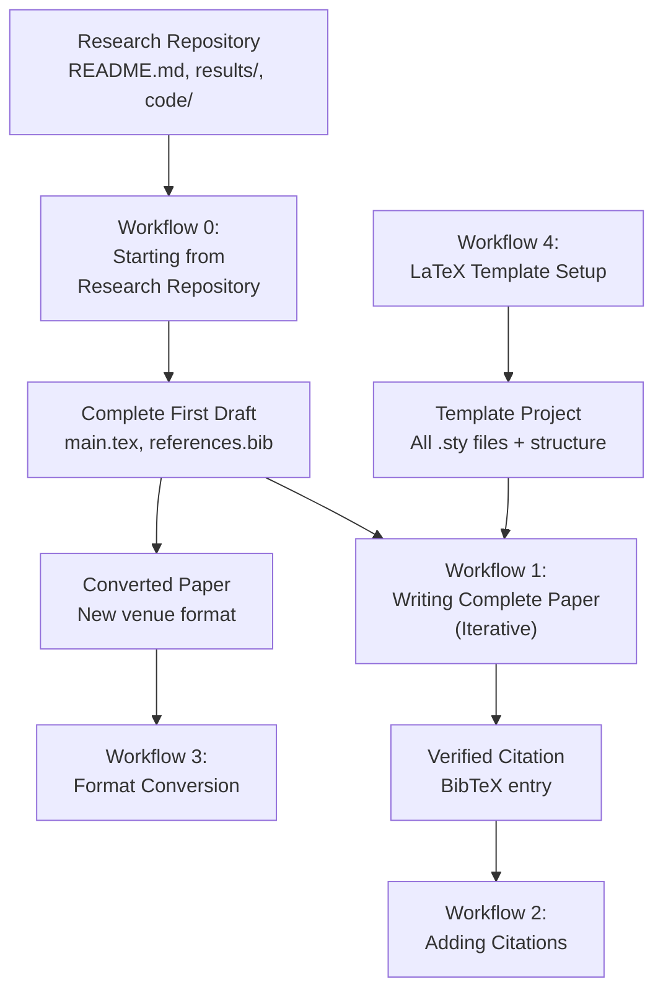
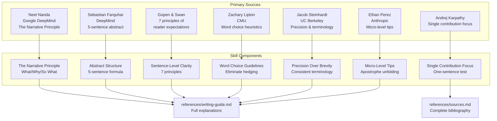
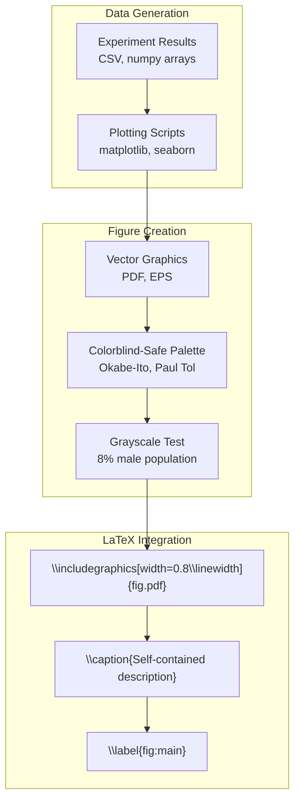
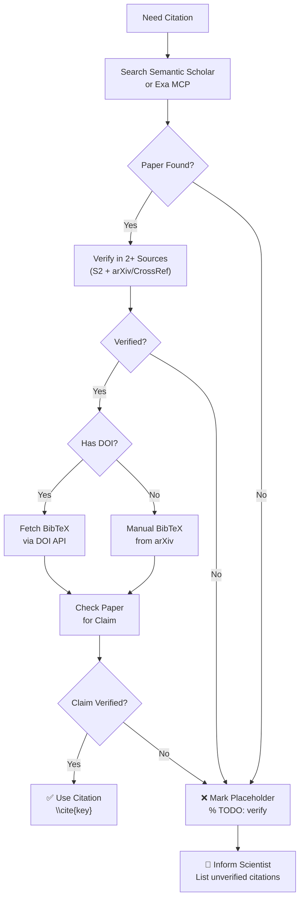
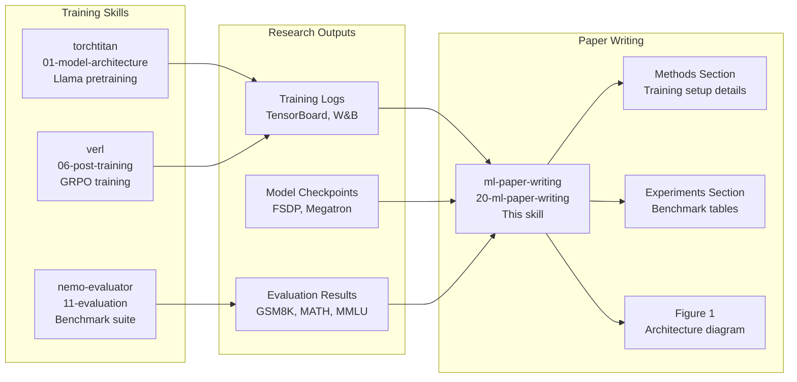

<!-- source: DeepWiki mcp.deepwiki.com · repo Orchestra-Research/AI-research-SKILLs · page 7.1 ML Paper Writing Skill · fetched 2026-10-26 -->

# ML Paper Writing Skill

<details>
<summary>Relevant source files</summary>

The following files were used as context for generating this wiki page:

- [01-model-architecture/torchtitan/SKILL.md](01-model-architecture/torchtitan/SKILL.md)
- [06-post-training/miles/SKILL.md](06-post-training/miles/SKILL.md)
- [06-post-training/slime/SKILL.md](06-post-training/slime/SKILL.md)
- [06-post-training/torchforge/SKILL.md](06-post-training/torchforge/SKILL.md)
- [06-post-training/verl/SKILL.md](06-post-training/verl/SKILL.md)
- [20-ml-paper-writing/SKILL.md](20-ml-paper-writing/SKILL.md)
- [docs/writing-assets/ML_paper_guide.md](docs/writing-assets/ML_paper_guide.md)
- [docs/writing-assets/ml_paper_writing_sources.md](docs/writing-assets/ml_paper_writing_sources.md)

</details>


## Purpose and Scope

This document provides comprehensive technical documentation for the `ml-paper-writing` skill, one of the advanced skills in the AI Research Skills library. This skill guides AI agents in writing publication-ready ML/AI papers for top-tier conferences (NeurIPS, ICML, ICLR, ACL, AAAI, COLM) from research repositories.

The skill addresses three critical challenges in AI-assisted academic writing:
1. **Proactive draft delivery** - enabling agents to generate complete first drafts rather than blocking on feedback
2. **Citation verification** - preventing the ~40% hallucination rate in AI-generated references
3. **Conference compliance** - ensuring submissions meet venue-specific formatting and checklist requirements

For general information about the skills library taxonomy and organization, see [Taxonomy & Organization](#3.1). For other advanced skills, see [Advanced Skills](#3.7).

Sources: [20-ml-paper-writing/SKILL.md:1-9]()

---

## Skill File Structure

The `ml-paper-writing` skill follows the standard skill format with extended reference materials for academic writing.



**YAML Frontmatter Structure**

The skill metadata is defined in the frontmatter:

| Field | Value | Purpose |
|-------|-------|---------|
| `name` | `ml-paper-writing` | Skill identifier |
| `description` | Publication-ready paper writing guidance | Agent search index |
| `version` | `1.0.0` | Semantic versioning |
| `author` | `Orchestra Research` | Ownership/classification |
| `tags` | `[Academic Writing, NeurIPS, ICML, ...]` | Categorical search |
| `dependencies` | `[semanticscholar, arxiv, habanero, requests]` | Python API requirements |

Sources: [20-ml-paper-writing/SKILL.md:1-9](), [20-ml-paper-writing/SKILL.md:902-913]()

---

## Proactive Drafting Philosophy

The skill implements a "draft-first, iterate-second" approach that differs from typical AI assistance patterns.

### The Collaborative Writing Model



**Key Principles** (from [20-ml-paper-writing/SKILL.md:15-28]()):

1. **Understand the project** by exploring code, results, and documentation
2. **Deliver a complete first draft** when confident about the contribution
3. **Search literature** using web search and APIs for citations
4. **Refine through feedback cycles** rather than blocking
5. **Ask for clarification** only when genuinely uncertain about key decisions

**Decision Matrix for Proactivity**

| Confidence Level | Agent Action | Example |
|------------------|--------------|---------|
| **High** (clear repo, obvious contribution) | Write full draft → deliver → iterate | Research repo with README explaining contribution + results directory |
| **Medium** (some ambiguity) | Write draft with flagged uncertainties → continue | Multiple possible framings, flag them in draft |
| **Low** (major unknowns) | Ask 1-2 targeted questions → draft anyway | Target venue unclear, affects page limits |

The skill explicitly states when NOT to block: "Don't block for word choice decisions, section ordering, which specific results to show (make a choice, flag it), citation completeness (draft with what you find, note gaps)."

Sources: [20-ml-paper-writing/SKILL.md:15-28](), [20-ml-paper-writing/SKILL.md:190-221]()

---

## Citation Verification Pipeline

The most critical component of the skill is the anti-hallucination system for citations.

### The Problem Statement

From [20-ml-paper-writing/SKILL.md:31-46]():

```
⚠️ CRITICAL: Never Hallucinate Citations
- AI-generated citations have ~40% error rate
- Hallucinated references = academic misconduct
- Can result in desk rejection or retraction
```

**The Golden Rule** ([20-ml-paper-writing/SKILL.md:38-39]()):

```
NEVER generate BibTeX entries from memory. ALWAYS fetch programmatically.
```

### Citation Verification Workflow Diagram



### API Integration Code Patterns

The skill provides executable Python examples for citation verification ([20-ml-paper-writing/SKILL.md:743-775]()):

```python
from semanticscholar import SemanticScholar

sch = SemanticScholar()
results = sch.search_paper("attention mechanism transformers", limit=5)
for paper in results:
    print(f"{paper.title} - {paper.paperId}")
    print(f"  DOI: {paper.externalIds.get('DOI', 'N/A')}")
```

**DOI to BibTeX conversion** ([20-ml-paper-writing/SKILL.md:761-775]()):

```python
import requests

def doi_to_bibtex(doi: str) -> str:
    """Get verified BibTeX from DOI via CrossRef."""
    response = requests.get(
        f"https://doi.org/{doi}",
        headers={"Accept": "application/x-bibtex"}
    )
    response.raise_for_status()
    return response.text

# Example
bibtex = doi_to_bibtex("10.48550/arXiv.1706.03762")
```

### Placeholder Handling

When verification fails, the skill mandates explicit placeholder syntax ([20-ml-paper-writing/SKILL.md:47-56]()):

```latex
% EXPLICIT PLACEHOLDER - requires human verification
\cite{PLACEHOLDER_author2024_verify_this}  % TODO: Verify this citation exists
```

The agent must inform the scientist: "I've marked [X] citations as placeholders that need verification. I could not confirm these papers exist."

### Exa MCP Integration

The skill recommends installing Exa MCP for enhanced paper search ([20-ml-paper-writing/SKILL.md:58-84]()):

**Claude Code installation**:
```bash
claude mcp add exa -- npx -y mcp-remote "https://mcp.exa.ai/mcp"
```

**Cursor/VS Code configuration**:
```json
{
  "mcpServers": {
    "exa": {
      "type": "http",
      "url": "https://mcp.exa.ai/mcp"
    }
  }
}
```

Sources: [20-ml-paper-writing/SKILL.md:31-84](), [20-ml-paper-writing/SKILL.md:706-811]()

---

## Workflow System

The skill defines five distinct workflows for different paper writing scenarios.

### Workflow Overview Diagram



### Workflow 0: Starting from Research Repository

**Purpose**: Understand a codebase and extract the paper narrative.

**Checklist** ([20-ml-paper-writing/SKILL.md:92-101]()):

```
Project Understanding:
- [ ] Step 1: Explore the repository structure
- [ ] Step 2: Read README, existing docs, and key results
- [ ] Step 3: Identify the main contribution with the scientist
- [ ] Step 4: Find papers already cited in the codebase
- [ ] Step 5: Search for additional relevant literature
- [ ] Step 6: Outline the paper structure together
- [ ] Step 7: Draft sections iteratively with feedback
```

**Repository Exploration Commands** ([20-ml-paper-writing/SKILL.md:105-117]()):

```bash
# Understand project structure
ls -la
find . -name "*.py" | head -20
find . -name "*.md" -o -name "*.txt" | xargs grep -l -i "result\|conclusion\|finding"
```

**Existing Citation Discovery** ([20-ml-paper-writing/SKILL.md:121-127]()):

```bash
# Find existing citations
grep -r "arxiv\|doi\|cite" --include="*.md" --include="*.bib" --include="*.py"
find . -name "*.bib"
```

**Critical Step 3**: Explicitly confirm contribution with scientist before writing ([20-ml-paper-writing/SKILL.md:132-139]()):

> "Based on my understanding of the repo, the main contribution appears to be [X].
> The key results show [Y]. Is this the framing you want for the paper,
> or should we emphasize different aspects?"

Sources: [20-ml-paper-writing/SKILL.md:88-173]()

### Workflow 1: Writing a Complete Paper

**Purpose**: Iterative section-by-section drafting with feedback loops.

**Checklist** ([20-ml-paper-writing/SKILL.md:248-260]()):

```
Paper Writing Progress:
- [ ] Step 1: Define the one-sentence contribution (with scientist)
- [ ] Step 2: Draft Figure 1 → get feedback → revise
- [ ] Step 3: Draft abstract → get feedback → revise
- [ ] Step 4: Draft introduction → get feedback → revise
- [ ] Step 5: Draft methods → get feedback → revise
- [ ] Step 6: Draft experiments → get feedback → revise
- [ ] Step 7: Draft related work → get feedback → revise
- [ ] Step 8: Draft limitations → get feedback → revise
- [ ] Step 9: Complete paper checklist (required)
- [ ] Step 10: Final review cycle and submission
```

**Abstract Structure**: 5-sentence formula from Sebastian Farquhar ([20-ml-paper-writing/SKILL.md:282-291]()):

```
1. What you achieved: "We introduce...", "We prove...", "We demonstrate..."
2. Why this is hard and important
3. How you do it (with specialist keywords for discoverability)
4. What evidence you have
5. Your most remarkable number/result
```

**Introduction Requirements** ([20-ml-paper-writing/SKILL.md:295-301]()):

- Maximum 1-1.5 pages
- 2-4 bullet contribution list (max 1-2 lines each in two-column format)
- Clear problem statement
- Brief approach overview
- Methods should start by page 2-3 maximum

**Experiments Section Structure** ([20-ml-paper-writing/SKILL.md:313-324]()):

For each experiment, explicitly state:
- What claim it supports
- How it connects to main contribution
- Experimental setting (details in appendix)
- What to observe: "the blue line shows X, which demonstrates Y"

Requirements:
- Error bars with methodology (standard deviation vs standard error)
- Hyperparameter search ranges
- Compute infrastructure (GPU type, total hours)
- Seed-setting methods

**Limitations Section** ([20-ml-paper-writing/SKILL.md:335-342]()): 

Required by all major conferences. Key insight: "Counter-intuitively, honesty helps—reviewers are instructed not to penalize honest limitation acknowledgment."

Sources: [20-ml-paper-writing/SKILL.md:242-345]()

### Workflow 2: Adding Citations

**Purpose**: Verify and add citations without hallucination.

**Mandatory Checklist** ([20-ml-paper-writing/SKILL.md:721-729]()):

```
Citation Verification (MANDATORY for every citation):
- [ ] Step 1: Search using Exa MCP or Semantic Scholar API
- [ ] Step 2: Verify paper exists in 2+ sources (Semantic Scholar + arXiv/CrossRef)
- [ ] Step 3: Retrieve BibTeX via DOI (programmatically, not from memory)
- [ ] Step 4: Verify the claim you're citing actually appears in the paper
- [ ] Step 5: Add verified BibTeX to bibliography
- [ ] Step 6: If ANY step fails → mark as placeholder, inform scientist
```

**Citation Decision Table** ([20-ml-paper-writing/SKILL.md:799-808]()):

| Situation | Action |
|-----------|--------|
| Found paper, got DOI, fetched BibTeX | ✅ Use the citation |
| Found paper, no DOI | ✅ Use arXiv BibTeX or manual entry from paper |
| Paper exists but can't fetch BibTeX | ⚠️ Mark placeholder, inform scientist |
| Uncertain if paper exists | ❌ Mark `[CITATION NEEDED]`, inform scientist |
| "I think there's a paper about X" | ❌ **NEVER cite** - search first or mark placeholder |

Sources: [20-ml-paper-writing/SKILL.md:706-811]()

### Workflow 3: Conference Format Conversion

**Purpose**: Resubmit papers to different venues with format compliance.

**Conversion Checklist** ([20-ml-paper-writing/SKILL.md:619-627]()):

```
Format Conversion Checklist:
- [ ] Step 1: Identify source and target template differences
- [ ] Step 2: Create new project with target template
- [ ] Step 3: Copy content sections (not preamble)
- [ ] Step 4: Adjust page limits and content
- [ ] Step 5: Update conference-specific requirements
- [ ] Step 6: Verify compilation and formatting
```

**Conference Transition Matrix** ([20-ml-paper-writing/SKILL.md:631-637]()):

| From → To | Page Change | Key Adjustments |
|-----------|-------------|-----------------|
| NeurIPS → ICML | 9 → 8 pages | Cut 1 page, add Broader Impact if missing |
| ICML → ICLR | 8 → 9 pages | Can expand experiments, add LLM disclosure |
| NeurIPS → ACL | 9 → 8 pages | Restructure for NLP conventions, add Limitations |
| ICLR → AAAI | 9 → 7 pages | Significant cuts needed, strict style adherence |
| Any → COLM | varies → 9 | Reframe for language model focus |

**Critical Rule** ([20-ml-paper-writing/SKILL.md:640-654]()): "NEVER copy LaTeX preambles between templates." Always start fresh with target template, then copy only content sections.

**Conference-Specific Additions** ([20-ml-paper-writing/SKILL.md:673-679]()):

| Target Venue | Required Additions |
|--------------|-------------------|
| **ICML** | Broader Impact Statement (after conclusion) |
| **ICLR** | LLM usage disclosure, reciprocal reviewing agreement |
| **ACL/EMNLP** | Limitations section (mandatory), Ethics Statement |
| **AAAI** | Strict adherence to style file (no modifications) |
| **NeurIPS** | Paper checklist (appendix), lay summary if accepted |

Sources: [20-ml-paper-writing/SKILL.md:613-703]()

### Workflow 4: LaTeX Template Setup

**Purpose**: Initialize a new paper project from conference templates.

**Setup Checklist** ([20-ml-paper-writing/SKILL.md:467-475]()):

```
Template Setup Checklist:
- [ ] Step 1: Copy entire template directory to new project
- [ ] Step 2: Verify template compiles as-is (before any changes)
- [ ] Step 3: Read the template's example content to understand structure
- [ ] Step 4: Replace example content section by section
- [ ] Step 5: Keep template comments/examples as reference until done
- [ ] Step 6: Clean up template artifacts only at the end
```

**Critical Step 1 Commands** ([20-ml-paper-writing/SKILL.md:479-486]()):

```bash
# Create your paper directory with the complete template
cp -r templates/neurips2025/ ~/papers/my-new-paper/
cd ~/papers/my-new-paper/

# Verify structure is complete
ls -la
# Should see: main.tex, neurips.sty, Makefile, etc.
```

**Important Warning** ([20-ml-paper-writing/SKILL.md:488-493]()): Copy the ENTIRE directory, not just `main.tex`. Templates include:
- Style files (`.sty`) - required for compilation
- Bibliography styles (`.bst`) - required for references
- Example content - useful as reference
- Makefiles - for easy compilation

**Compilation Verification** ([20-ml-paper-writing/SKILL.md:497-513]()):

```bash
# Using latexmk (recommended)
latexmk -pdf main.tex

# Or manual compilation
pdflatex main.tex
bibtex main
pdflatex main.tex
pdflatex main.tex
```

If the unmodified template doesn't compile, fix that first before making any changes.

**Template Pitfalls** ([20-ml-paper-writing/SKILL.md:591-599]()):

| Pitfall | Problem | Solution |
|---------|---------|----------|
| Copying only `main.tex` | Missing `.sty`, won't compile | Copy entire directory |
| Modifying `.sty` files | Breaks conference formatting | Never edit style files |
| Adding random packages | Conflicts, breaks template | Only add if necessary |
| Deleting template content too early | Lose formatting reference | Keep as comments until done |
| Not compiling frequently | Errors accumulate | Compile after each section |

Sources: [20-ml-paper-writing/SKILL.md:461-610]()

---

## Conference Requirements System

The skill maintains a comprehensive reference system for venue-specific requirements.

### Conference Quick Reference

From [20-ml-paper-writing/SKILL.md:442-456]():

| Conference | Page Limit | Extra for Camera-Ready | Key Requirement |
|------------|------------|------------------------|-----------------|
| **NeurIPS 2025** | 9 pages | +0 | Mandatory checklist, lay summary for accepted |
| **ICML 2026** | 8 pages | +1 | Broader Impact Statement required |
| **ICLR 2026** | 9 pages | +1 | LLM disclosure required, reciprocal reviewing |
| **ACL 2025** | 8 pages (long) | varies | Limitations section mandatory |
| **AAAI 2026** | 7 pages | +1 | Strict style file adherence |
| **COLM 2025** | 9 pages | +1 | Focus on language models |

**Universal Requirements**:
- Double-blind review (anonymize submissions)
- References don't count toward page limit
- Appendices unlimited but reviewers not required to read
- LaTeX required for all venues

### Template Directory Structure

From [20-ml-paper-writing/SKILL.md:602-609]():

| Conference | Main File | Key Style File | Notes |
|------------|-----------|----------------|-------|
| NeurIPS 2025 | `main.tex` | `neurips.sty` | Has Makefile |
| ICML 2026 | `example_paper.tex` | `icml2026.sty` | Includes algorithm packages |
| ICLR 2026 | `iclr2026_conference.tex` | `iclr2026_conference.sty` | Has math_commands.tex |
| ACL | `acl_latex.tex` | `acl.sty` | Strict formatting |
| AAAI 2026 | `aaai2026-unified-template.tex` | `aaai2026.sty` | Very strict compliance |
| COLM 2025 | `colm2025_conference.tex` | `colm2025_conference.sty` | Similar to ICLR |

### Reviewer Evaluation Criteria

The skill documents what reviewers look for ([20-ml-paper-writing/SKILL.md:845-863]()):

**Four Core Dimensions**:

| Criterion | What Reviewers Look For |
|-----------|------------------------|
| **Quality** | Technical soundness, well-supported claims |
| **Clarity** | Clear writing, reproducible by experts |
| **Significance** | Community impact, advances understanding |
| **Originality** | New insights (doesn't require new method) |

**NeurIPS 6-Point Scoring Scale**:
- 6: Strong Accept - Groundbreaking, flawless
- 5: Accept - Technically solid, high impact
- 4: Borderline Accept - Solid, limited evaluation
- 3: Borderline Reject - Solid but weaknesses outweigh
- 2: Reject - Technical flaws
- 1: Strong Reject - Known results or ethics issues

**Reference Documentation**: See [references/reviewer-guidelines.md](references/reviewer-guidelines.md) for detailed reviewer instructions.

Sources: [20-ml-paper-writing/SKILL.md:440-863]()

---

## Writing Philosophy Framework

The skill synthesizes writing principles from multiple leading ML researchers.

### Source Attribution System



### The Narrative Principle

From [20-ml-paper-writing/SKILL.md:224-238]():

**Core Definition**: "A paper is a short, rigorous, evidence-based technical story with a takeaway readers care about."

**Three Pillars** (must be crystal clear by end of introduction):

| Pillar | Description | Example |
|--------|-------------|---------|
| **The What** | 1-3 specific novel claims within cohesive theme | "We prove that X achieves Y under condition Z" |
| **The Why** | Rigorous empirical evidence supporting claims | Strong baselines, experiments distinguishing hypotheses |
| **The So What** | Why readers should care | Connection to recognized community problems |

**The One-Sentence Test**: "If you cannot state your contribution in one sentence, you don't yet have a paper."

### Gopen & Swan's 7 Principles

From [20-ml-paper-writing/SKILL.md:384-397]():

| Principle | Rule | Example |
|-----------|------|---------|
| **Subject-verb proximity** | Keep subject and verb close | ❌ "The model, which was trained on..., achieves" → ✅ "The model achieves... after training on..." |
| **Stress position** | Place emphasis at sentence ends | ❌ "Accuracy improves by 15% when using attention" → ✅ "When using attention, accuracy improves by **15%**" |
| **Topic position** | Put context first, new info after | ✅ "Given these constraints, we propose..." |
| **Old before new** | Familiar info → unfamiliar info | Link backward, then introduce new |
| **One unit, one function** | Each paragraph makes one point | Split multi-point paragraphs |
| **Action in verb** | Use verbs, not nominalizations | ❌ "We performed an analysis" → ✅ "We analyzed" |
| **Context before new** | Set stage before presenting | Explain before showing equation |

**Full principles with detailed examples**: See [references/writing-guide.md](references/writing-guide.md#the-7-principles-of-reader-expectations)

### Micro-Level Writing Tips

From [20-ml-paper-writing/SKILL.md:400-409]():

- **Minimize pronouns**: ❌ "This shows..." → ✅ "This result shows..."
- **Verbs early**: Position verbs near sentence start
- **Unfold apostrophes**: ❌ "X's Y" → ✅ "The Y of X" (when awkward)
- **Delete filler words**: "actually," "a bit," "very," "really," "basically," "quite," "essentially"

### Word Choice Heuristics

From [20-ml-paper-writing/SKILL.md:411-416]():

- **Be specific**: ❌ "performance" → ✅ "accuracy" or "latency" (say what you mean)
- **Eliminate hedging**: Drop "may" and "can" unless genuinely uncertain
- **Avoid incremental vocabulary**: ❌ "combine," "modify," "expand" → ✅ "develop," "propose," "introduce"
- **Delete intensifiers**: ❌ "provides *very* tight approximation" → ✅ "provides tight approximation"

### Time Allocation Strategy

From [20-ml-paper-writing/SKILL.md:372-379]():

Spend approximately **equal time** on each of:
1. The abstract
2. The introduction
3. The figures
4. Everything else combined

**Rationale**: Most reviewers form judgments before reaching methods. Readers encounter papers as: **title → abstract → introduction → figures → maybe the rest.**

### Reviewer Reading Patterns

From [20-ml-paper-writing/SKILL.md:425-436]():

| Paper Section | % Reviewers Who Read | Implication |
|---------------|---------------------|-------------|
| Abstract | 100% | Must be perfect |
| Introduction | 90%+ (skimmed) | Front-load contribution |
| Figures | Examined before methods | Figure 1 is critical |
| Methods | Only if interested | Don't bury the lede |
| Appendix | Rarely | Put only supplementary details |

Sources: [20-ml-paper-writing/SKILL.md:348-436](), [20-ml-paper-writing/SKILL.md:224-238]()

---

## Tables and Figures Formatting

The skill provides specific technical requirements for visual elements.

### Table Formatting with `booktabs`

From [20-ml-paper-writing/SKILL.md:869-895]():

```latex
\usepackage{booktabs}
\begin{tabular}{lcc}
\toprule
Method & Accuracy ↑ & Latency ↓ \\
\midrule
Baseline & 85.2 & 45ms \\
\textbf{Ours} & \textbf{92.1} & 38ms \\
\bottomrule
\end{tabular}
```

**Rules**:
- Bold best value per metric
- Include direction symbols (↑ higher is better, ↓ lower is better)
- Right-align numerical columns
- Consistent decimal precision

### Figure Requirements

From [20-ml-paper-writing/SKILL.md:891-899]():

- **Vector graphics** (PDF, EPS) for all plots and diagrams
- **Raster** (PNG 600 DPI) only for photographs
- Use **colorblind-safe palettes** (Okabe-Ito or Paul Tol)
- Verify **grayscale readability** (8% of men have color vision deficiency)
- **No title inside figure**—the caption serves this function
- **Self-contained captions**—reader should understand without main text

### Visual Communication Pipeline



Sources: [20-ml-paper-writing/SKILL.md:865-899]()

---

## Reference Documentation System

The skill uses a modular reference system for deep-dive content.

### Reference Document Roles

From [20-ml-paper-writing/SKILL.md:904-912]():

| Document | Contents |
|----------|----------|
| [writing-guide.md](references/writing-guide.md) | Gopen & Swan 7 principles, Ethan Perez micro-tips, word choice |
| [citation-workflow.md](references/citation-workflow.md) | Citation APIs, Python code, BibTeX management |
| [checklists.md](references/checklists.md) | NeurIPS 16-item, ICML, ICLR, ACL requirements |
| [reviewer-guidelines.md](references/reviewer-guidelines.md) | Evaluation criteria, scoring, rebuttals |
| [sources.md](references/sources.md) | Complete bibliography of all sources |

### External Source Links

From [20-ml-paper-writing/SKILL.md:927-936]():

**Writing Philosophy**:
- [Neel Nanda: How to Write ML Papers](https://www.alignmentforum.org/posts/eJGptPbbFPZGLpjsp/highly-opinionated-advice-on-how-to-write-ml-papers) - Narrative, "What/Why/So What"
- [Farquhar: How to Write ML Papers](https://sebastianfarquhar.com/on-research/2024/11/04/how_to_write_ml_papers/) - 5-sentence abstract
- [Gopen & Swan: Science of Scientific Writing](https://cseweb.ucsd.edu/~swanson/papers/science-of-writing.pdf) - 7 reader expectation principles
- [Lipton: Heuristics for Scientific Writing](https://www.approximatelycorrect.com/2018/01/29/heuristics-technical-scientific-writing-machine-learning-perspective/) - Word choice
- [Perez: Easy Paper Writing Tips](https://ethanperez.net/easy-paper-writing-tips/) - Micro-level clarity

**APIs**: [Semantic Scholar](https://api.semanticscholar.org/api-docs/) | [CrossRef](https://www.crossref.org/documentation/retrieve-metadata/rest-api/) | [arXiv](https://info.arxiv.org/help/api/basics.html)

**Venues**: [NeurIPS](https://neurips.cc/Conferences/2025/PaperInformation/StyleFiles) | [ICML](https://icml.cc/Conferences/2025/AuthorInstructions) | [ICLR](https://iclr.cc/Conferences/2026/AuthorGuide) | [ACL](https://github.com/acl-org/acl-style-files)

Sources: [20-ml-paper-writing/SKILL.md:902-937]()

---

## Common Issues and Solutions

The skill documents frequent problems and their resolutions.

### Issue: Abstract Too Generic

**Problem**: Abstract could be prepended to any ML paper.

**Solution** ([20-ml-paper-writing/SKILL.md:817-819]()): Delete first sentence if it's generic. Start with your specific contribution.

### Issue: Introduction Exceeds 1.5 Pages

**Problem**: Introduction is too long, methods start after page 3.

**Solution** ([20-ml-paper-writing/SKILL.md:821-823]()): Split background into Related Work. Front-load contribution bullets. Methods should start by page 2-3.

### Issue: Experiments Lack Explicit Claims

**Problem**: Reviewers can't understand what experiments are testing.

**Solution** ([20-ml-paper-writing/SKILL.md:825-827]()): Add sentence before each experiment: "This experiment tests whether [specific claim]..."

### Issue: Reviewers Find Paper Hard to Follow

**Problem**: Paper structure is unclear.

**Solution** ([20-ml-paper-writing/SKILL.md:829-833]()):
- Add explicit signposting: "In this section, we show X"
- Use consistent terminology throughout
- Include figure captions that stand alone

### Issue: Missing Statistical Significance

**Problem**: Results lack error bars and statistical tests.

**Solution** ([20-ml-paper-writing/SKILL.md:835-841]()): Always include:
- Error bars (specify: std dev or std error)
- Number of runs
- Statistical tests if comparing methods

### Citation Issues Decision Tree



Sources: [20-ml-paper-writing/SKILL.md:815-841]()

---

## Integration with Other Training Skills

The ML paper writing skill complements other skills in the library, particularly for documenting research results.

### Cross-Skill Workflow Example



**Example: Writing Paper from Training Results**

1. Agent uses `torchtitan` skill ([01-model-architecture/torchtitan/SKILL.md]()) to pretrain Llama 3
2. Agent uses `verl` skill ([06-post-training/verl/SKILL.md]()) for GRPO post-training
3. Agent uses `nemo-evaluator` skill (11-evaluation/) to run benchmarks
4. Agent uses `ml-paper-writing` skill (this document) to:
   - Extract training configuration from torchtitan TOML configs
   - Document GRPO algorithm details from verl configs
   - Generate results tables from evaluation outputs
   - Verify citations for baseline methods
   - Format for NeurIPS submission

**Citation Integration Example**:

When documenting the torchtitan 4D parallelism approach, the skill would:

1. Search Semantic Scholar for "PyTorch FSDP2" and "TorchTitan"
2. Find the torchtitan paper (arXiv:2410.06511)
3. Verify DOI and fetch BibTeX
4. Cite in Methods: "We use TorchTitan's 4D parallelism \cite{torchtitan2024}"

Sources: [01-model-architecture/torchtitan/SKILL.md:1-15](), [06-post-training/verl/SKILL.md:1-13](), [20-ml-paper-writing/SKILL.md:88-173]()

---

## Skill Usage Patterns in AI Agents

The skill is designed for consumption by AI coding agents through specific integration patterns.

### Agent Discovery Mechanism

From the YAML frontmatter ([20-ml-paper-writing/SKILL.md:1-9]()):

```yaml
name: ml-paper-writing
description: Write publication-ready ML/AI papers for NeurIPS, ICML, ICLR, ACL, AAAI, COLM. Use when drafting papers from research repos, structuring arguments, verifying citations, or preparing camera-ready submissions. Includes LaTeX templates, reviewer guidelines, and citation verification workflows.
tags: [Academic Writing, NeurIPS, ICML, ICLR, ACL, AAAI, COLM, LaTeX, Paper Writing, Citations, Research]
```

Agents search this metadata when users request: "Write a paper about my training results" or "Format this for NeurIPS submission."

### Progressive Disclosure Structure

The skill follows the standard 200-500 line main document with extended references pattern:

- **SKILL.md** (933 lines): Complete end-to-end workflows, critical rules, quick reference tables
- **references/** directory: Deep-dive content loaded only when needed

This enables agents to:
1. Load SKILL.md into context initially (covers 80% of use cases)
2. Load specific reference documents on demand (e.g., when writing Related Work, load `writing-guide.md`)
3. Access templates only when compiling LaTeX

### Example Agent Interaction Flow

```
User: "I've trained a model with torchtitan. Write a paper about it."

Agent:
1. Loads ml-paper-writing/SKILL.md into context
2. Executes Workflow 0 (Starting from Research Repository)
3. Explores repository: ls -la, find results/, read README.md
4. Identifies contribution: "Multi-GPU pretraining with 4D parallelism"
5. Searches for citations: calls Semantic Scholar API for "FSDP2", "TorchTitan"
6. Loads templates/neurips2025/ directory
7. Generates first draft with verified citations
8. Presents draft: "I've written a complete first draft. The contribution is framed as [X]. Let me know if adjustments are needed."
```

**When the agent encounters problems**:

```
Agent encounters: "I can't find a citation for Smith et al. 2023 on reward hacking"

Agent action:
1. Marks in draft: \cite{PLACEHOLDER_smith2023_verify}
2. Adds comment: % TODO: Verify this citation exists
3. Tells user: "I've marked 1 citation as placeholder that needs verification: Smith et al. 2023 on reward hacking - could not find in Semantic Scholar."
```

Sources: [20-ml-paper-writing/SKILL.md:1-9](), [20-ml-paper-writing/SKILL.md:15-28](), [20-ml-paper-writing/SKILL.md:47-56]()

---

