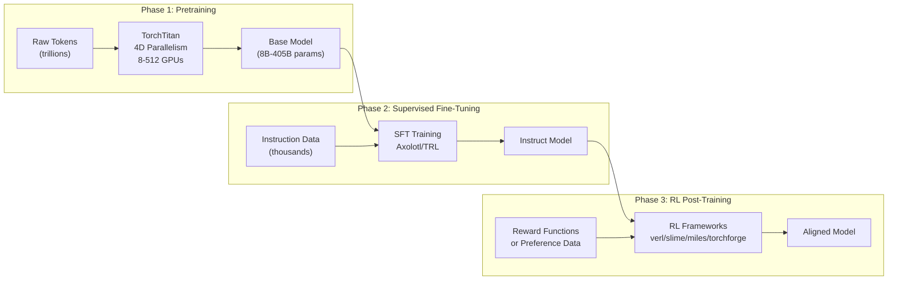
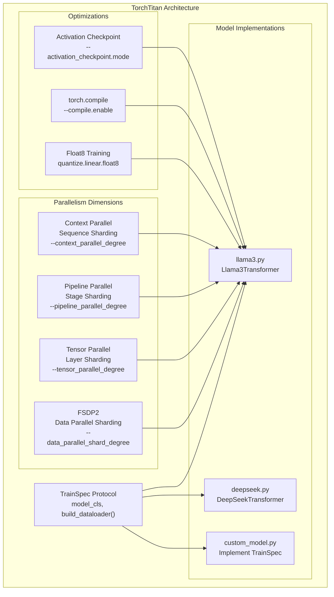
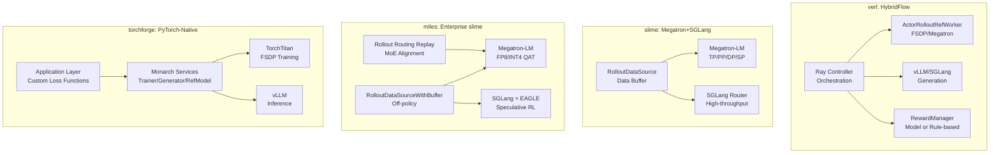
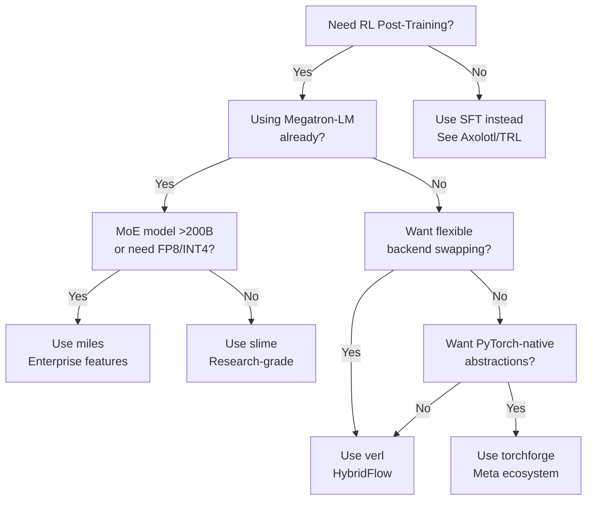
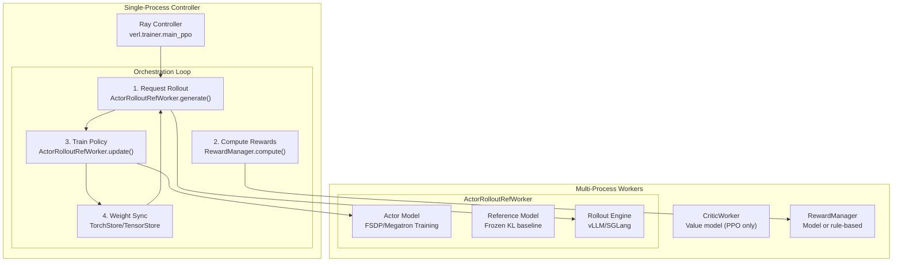
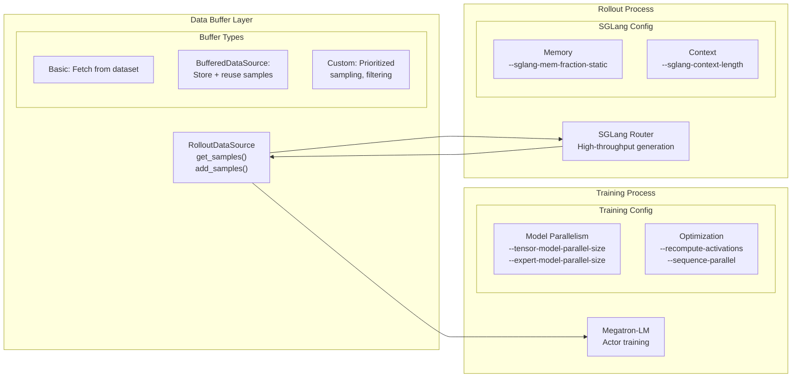
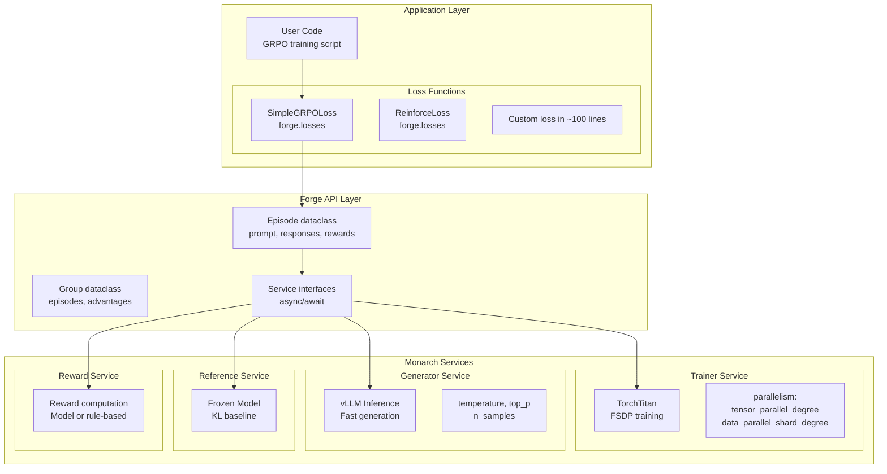
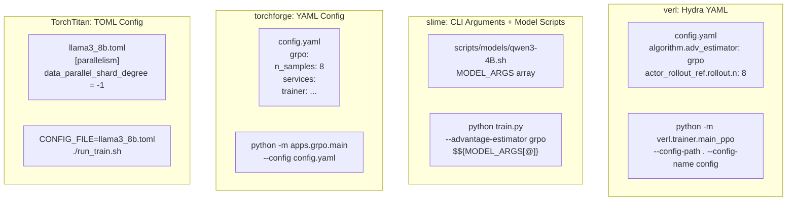
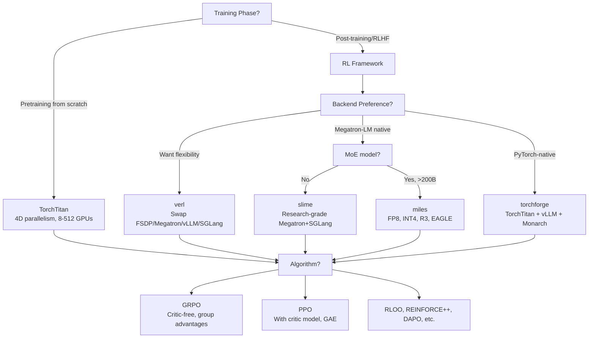

<!-- source: DeepWiki mcp.deepwiki.com · repo Orchestra-Research/AI-research-SKILLs · page 7.2 LLM Training Skills (TorchTitan, verl, GRPO) · fetched 2026-10-26 -->

# LLM Training Skills (TorchTitan, verl, GRPO)

<details>
<summary>Relevant source files</summary>

The following files were used as context for generating this wiki page:

- [01-model-architecture/torchtitan/SKILL.md](01-model-architecture/torchtitan/SKILL.md)
- [03-fine-tuning/unsloth/SKILL.md](03-fine-tuning/unsloth/SKILL.md)
- [05-data-processing/nemo-curator/SKILL.md](05-data-processing/nemo-curator/SKILL.md)
- [05-data-processing/ray-data/SKILL.md](05-data-processing/ray-data/SKILL.md)
- [06-post-training/grpo-rl-training/SKILL.md](06-post-training/grpo-rl-training/SKILL.md)
- [06-post-training/miles/SKILL.md](06-post-training/miles/SKILL.md)
- [06-post-training/slime/SKILL.md](06-post-training/slime/SKILL.md)
- [06-post-training/torchforge/SKILL.md](06-post-training/torchforge/SKILL.md)
- [06-post-training/verl/SKILL.md](06-post-training/verl/SKILL.md)
- [08-distributed-training/deepspeed/SKILL.md](08-distributed-training/deepspeed/SKILL.md)
- [20-ml-paper-writing/SKILL.md](20-ml-paper-writing/SKILL.md)
- [docs/writing-assets/ML_paper_guide.md](docs/writing-assets/ML_paper_guide.md)
- [docs/writing-assets/ml_paper_writing_sources.md](docs/writing-assets/ml_paper_writing_sources.md)

</details>


## Purpose and Scope

This document provides technical guidance for **large-scale LLM training** across two distinct phases: distributed pretraining and reinforcement learning post-training. It covers:

- **Pretraining**: TorchTitan's PyTorch-native 4D parallelism (FSDP2, TP, PP, CP) for training models from scratch at 8-512+ GPU scale
- **Post-training/RLHF**: Four major RL frameworks (verl, slime, miles, torchforge) that implement algorithms like GRPO, PPO, and specialized techniques for aligning pretrained models
- **GRPO algorithm**: Group Relative Policy Optimization as a critic-free alternative to PPO

For supervised fine-tuning without RL, see [Fine-Tuning Skills](#3.3). For data preparation before training, see [Data Processing Skills](#3.3). For production inference serving after training, see [Inference & Serving Skills](#3.5).

---

## Training Lifecycle: Pretraining vs Post-Training

The following diagram shows where TorchTitan and the RL frameworks fit in the model development pipeline:



**Sources**: [01-model-architecture/torchtitan/SKILL.md:1-358](), [06-post-training/verl/SKILL.md:1-392](), [06-post-training/grpo-rl-training/SKILL.md:1-573]()

---

## TorchTitan: PyTorch-Native Distributed Pretraining

### Architecture and 4D Parallelism

TorchTitan implements composable parallelism strategies that can be combined for models from 8B to 405B+ parameters:



**Key Code Entities**:
- `TrainSpec` protocol: [01-model-architecture/torchtitan/SKILL.md:350]() defines the interface models must implement
- Configuration via TOML files: [01-model-architecture/torchtitan/SKILL.md:63-102]()
- `run_train.sh` script: [01-model-architecture/torchtitan/SKILL.md:37]() launches distributed training

**Sources**: [01-model-architecture/torchtitan/SKILL.md:1-358]()

### Configuration Pattern Example

TorchTitan uses TOML configuration for all hyperparameters:

| Configuration Category | Key Parameters | Example Values |
|------------------------|----------------|----------------|
| **Parallelism** | `data_parallel_shard_degree` | `-1` (use all GPUs), `32` |
| | `tensor_parallel_degree` | `8` (within-node TP) |
| | `pipeline_parallel_degree` | `8` (across-node PP) |
| **Model** | `name`, `flavor` | `"llama3"`, `"8B"` |
| | `hf_assets_path` | Path to tokenizer |
| **Training** | `local_batch_size` | `2` |
| | `seq_len` | `8192` |
| | `steps` | `1000` |
| **Optimization** | `quantize.linear.float8` | Enable FP8 |
| | `compile.enable` | Enable torch.compile |

Configuration file pattern: [01-model-architecture/torchtitan/SKILL.md:63-102]()

**Launch command**: `CONFIG_FILE="./llama3_8b.toml" ./run_train.sh`

**Sources**: [01-model-architecture/torchtitan/SKILL.md:63-114]()

### 4D Parallelism for 405B Models

For models exceeding 70B parameters, TorchTitan combines all four parallelism dimensions:

**Workflow** (from [01-model-architecture/torchtitan/SKILL.md:216-258]()):
1. **Create seed checkpoint** on single GPU for consistent initialization
2. **Configure 4D parallelism**: DP=8, TP=8, PP=8, CP=1 (512 GPUs total)
3. **Launch with torchrun**: `--nnodes=64 --nproc_per_node=8`

**Sources**: [01-model-architecture/torchtitan/SKILL.md:216-258]()

---

## RL Post-Training: Framework Comparison

### Architecture Comparison

The four major RL frameworks differ in their infrastructure choices and target use cases:



**Sources**: [06-post-training/verl/SKILL.md:64-79](), [06-post-training/slime/SKILL.md:36-50](), [06-post-training/miles/SKILL.md:29-45](), [06-post-training/torchforge/SKILL.md:29-56]()

### Feature Matrix

| Framework | Training Backend | Inference Backend | Algorithms | Target Use Case |
|-----------|------------------|-------------------|------------|-----------------|
| **verl** | FSDP, FSDP2, Megatron-LM | vLLM, SGLang, HF | PPO, GRPO, RLOO, REINFORCE++, DAPO | Flexible backend swapping, research |
| **slime** | Megatron-LM | SGLang | GRPO, GSPO, PPO | Megatron-native, custom data workflows |
| **miles** | Megatron-LM (FP8/INT4) | SGLang (EAGLE) | GRPO, GSPO, PPO | Enterprise MoE, speculative RL, 1TB+ models |
| **torchforge** | TorchTitan (FSDP) | vLLM | GRPO, DAPO, CISPO, SAPO | PyTorch-native, algorithm research |

**Supported Models**:
- verl: Qwen-3, Llama-3.1, DeepSeek (0.5B-671B)
- slime: GLM-4.x, Qwen3, DeepSeek V3, Llama 3
- miles: DeepSeek V3/R1, Qwen3-MoE, MiniMax (MoE-focused)
- torchforge: Any HF-compatible model with TorchTitan support

**Sources**: [06-post-training/verl/SKILL.md:16-35](), [06-post-training/slime/SKILL.md:12-34](), [06-post-training/miles/SKILL.md:12-28](), [06-post-training/torchforge/SKILL.md:12-35]()

### Framework Selection Decision Tree



**Sources**: [06-post-training/verl/SKILL.md:16-27](), [06-post-training/slime/SKILL.md:12-27](), [06-post-training/miles/SKILL.md:12-28](), [06-post-training/torchforge/SKILL.md:12-27]()

---

## GRPO: Group Relative Policy Optimization

### Algorithm Overview

GRPO is a **critic-free RL algorithm** that learns by comparing multiple completions within groups:

**Key Difference from PPO**:
- **PPO**: Requires separate critic model for value estimation (GAE)
- **GRPO**: Uses group-relative advantages directly from rewards

**Mathematical Flow**:
```
For each prompt p:
  1. Generate N completions: {c₁, c₂, ..., cₙ}
  2. Compute rewards: {r₁, r₂, ..., rₙ}
  3. Calculate group-relative advantages: aᵢ = (rᵢ - mean(r)) / std(r)
  4. Update policy to increase P(high-reward completions)
```

**Sources**: [06-post-training/grpo-rl-training/SKILL.md:33-52](), [06-post-training/verl/SKILL.md:86-103]()

### Implementation Across Frameworks

#### verl Implementation

**Configuration pattern** (from [06-post-training/verl/SKILL.md:129-159]()):

```yaml
algorithm:
  adv_estimator: grpo       # vs 'gae' for PPO
  gamma: 1.0
  lam: 1.0

actor_rollout_ref:
  rollout:
    n: 8                    # Group size: completions per prompt
  actor:
    use_kl_loss: true       # KL penalty to reference model
    kl_loss_coef: 0.001
```

**Launch command**: 
```bash
python3 -m verl.trainer.main_ppo \
    algorithm.adv_estimator=grpo \
    actor_rollout_ref.rollout.n=8
```

**Sources**: [06-post-training/verl/SKILL.md:52-60](), [06-post-training/verl/SKILL.md:129-159]()

#### slime Implementation

**Configuration pattern** (from [06-post-training/slime/SKILL.md:84-104]()):

```bash
python train.py \
    --advantage-estimator grpo \
    --rollout-batch-size 32 \
    --n-samples-per-prompt 8 \
    --global-batch-size 256 \
    --use-kl-loss --kl-loss-coef 0.001
```

**Key constraint**: `rollout_batch_size × n_samples_per_prompt = global_batch_size × num_steps_per_rollout`

**Sources**: [06-post-training/slime/SKILL.md:74-104](), [06-post-training/slime/SKILL.md:250-302]()

#### torchforge Implementation

**Configuration via `GRPOConfig`** (from [06-post-training/torchforge/SKILL.md:106-143]()):

```yaml
grpo:
  n_samples: 8              # Group size
  clip_low: 0.2
  clip_high: 0.28
  beta: 0.1                 # KL penalty coefficient
  temperature: 0.7
```

**Trainer instantiation**:
```python
from trl import GRPOTrainer

trainer = GRPOTrainer(
    model=model,
    processing_class=tokenizer,
    reward_funcs=[format_reward, correctness_reward],
    args=grpo_config,
    train_dataset=dataset,
)
```

**Sources**: [06-post-training/torchforge/SKILL.md:86-143](), [06-post-training/grpo-rl-training/SKILL.md:199-238]()

### Reward Function Pattern

All frameworks use similar reward function signatures. **TRL/torchforge example** (from [06-post-training/grpo-rl-training/SKILL.md:120-143]()):

```python
def reward_function_name(
    prompts,        # List[List[Dict]]: Original prompts
    completions,    # List[List[Dict]]: Model generations
    answer=None,    # Optional: Ground truth from dataset
    **kwargs        # Additional dataset columns
) -> list[float]:
    """Return rewards for each completion."""
    responses = [comp[0]['content'] for comp in completions]
    return [compute_score(response) for response in responses]
```

**Common reward types**:

| Reward Type | Purpose | Example Weight | Code Location |
|-------------|---------|----------------|---------------|
| **Correctness** | Verify answers (math, code) | 2.0 | [06-post-training/grpo-rl-training/SKILL.md:147-153]() |
| **Format** | Enforce structure (XML, JSON) | 1.0 | [06-post-training/grpo-rl-training/SKILL.md:156-164]() |
| **Incremental** | Partial credit for compliance | 0.25 per element | [06-post-training/grpo-rl-training/SKILL.md:167-190]() |

**Sources**: [06-post-training/grpo-rl-training/SKILL.md:54-69](), [06-post-training/grpo-rl-training/SKILL.md:120-190]()

---

## verl: HybridFlow Distributed Architecture

### Controller-Worker Separation

verl's **HybridFlow** design (from paper: arxiv.org/abs/2409.19256) separates orchestration from computation:



**Key code entities**:
- `verl.trainer.main_ppo`: Entry point, controller logic
- `ActorRolloutRefWorker`: Combines policy training + generation + reference model
- `CriticWorker`: Separate value estimation for PPO/GAE
- `RewardManager`: Handles model-based or rule-based reward computation

**Sources**: [06-post-training/verl/SKILL.md:64-79]()

### Backend Flexibility

verl supports swapping training and inference backends:

| Component | Options | Configuration Flag |
|-----------|---------|-------------------|
| **Training** | FSDP, FSDP2, Megatron-LM | `actor_rollout_ref.actor.strategy` |
| **Inference** | vLLM, SGLang, HuggingFace | `actor_rollout_ref.rollout.name` |
| **Weight Sync** | TorchStore, Ray shared memory | Automatic based on backend |

**Megatron-LM integration example** (from [06-post-training/verl/SKILL.md:221-255]()):

```yaml
actor_rollout_ref:
  model:
    path: /path/to/megatron/checkpoint
    backend: megatron
  actor:
    strategy: megatron
    tensor_model_parallel_size: 8
    pipeline_model_parallel_size: 2
  rollout:
    name: vllm
    tensor_parallel_size: 8
```

**Sources**: [06-post-training/verl/SKILL.md:14-35](), [06-post-training/verl/SKILL.md:221-255]()

---

## slime/miles: Megatron+SGLang Integration

### Data Buffer System

slime introduces a **flexible data buffer** that decouples prompt management from training:



**Code entities**:
- `RolloutDataSource`: Base class with `get_samples()` and `add_samples()` [06-post-training/slime/SKILL.md:310-320]()
- `RolloutDataSourceWithBuffer`: Off-policy data reuse [06-post-training/slime/SKILL.md:323-337]()

**Three argument types**:
1. **Megatron arguments**: Passed directly (e.g., `--tensor-model-parallel-size`)
2. **SGLang arguments**: Prefixed with `--sglang-` (e.g., `--sglang-mem-fraction-static`)
3. **slime arguments**: Framework-specific (e.g., `--colocate`, `--num-rollout`)

**Sources**: [06-post-training/slime/SKILL.md:36-50](), [06-post-training/slime/SKILL.md:250-302](), [06-post-training/slime/SKILL.md:310-337]()

### miles: Enterprise Extensions

miles adds production-grade features to slime:

**Key enhancements**:

| Feature | Purpose | Configuration |
|---------|---------|---------------|
| **Unified FP8** | End-to-end FP8 training/inference | `export NVTE_FP8_BLOCK_SCALING_FP32_SCALES=1` |
| **INT4 QAT** | 3.1x memory reduction (1TB → 420GB) | Quantization-aware training |
| **Rollout Routing Replay (R3)** | Bit-wise MoE expert alignment | `sample.rollout_routed_experts` field |
| **Speculative RL** | 25-40% faster rollout with EAGLE | `--sglang-speculative-algorithm EAGLE` |
| **Online MTP** | Update draft model during training | `--enable-mtp-training` |

**R3 workflow** (MoE alignment):
1. SGLang records expert routing decisions during inference
2. Store in `sample.rollout_routed_experts` field
3. Megatron replays routing during training (no recomputation)
4. Guarantees identical expert selection between train/inference

**Sources**: [06-post-training/miles/SKILL.md:29-45](), [06-post-training/miles/SKILL.md:202-220](), [06-post-training/miles/SKILL.md:126-158]()

---

## torchforge: PyTorch-Native Service Architecture

### Monarch Service System

torchforge uses **Monarch** (Meta's actor framework) to abstract distributed services:



**Key abstractions**:
- `Episode`: Single prompt + multiple responses [06-post-training/torchforge/SKILL.md:310-319]()
- `Group`: Collection of episodes for advantage calculation
- Service interfaces: Async/await for distributed coordination

**Configuration pattern** (from [06-post-training/torchforge/SKILL.md:106-143]()):

```yaml
services:
  generator:
    procs: 1                # Processes per service
    num_replicas: 1         # Service replicas
    with_gpus: true         # GPU allocation
  trainer:
    procs: 1
    num_replicas: 1
    with_gpus: true
  ref_model:
    procs: 1
    num_replicas: 1
    with_gpus: true
```

**Sources**: [06-post-training/torchforge/SKILL.md:29-56](), [06-post-training/torchforge/SKILL.md:106-143](), [06-post-training/torchforge/SKILL.md:286-319]()

### Loss Function Abstraction

torchforge provides built-in loss functions with clean interfaces:

**Built-in losses** (from `forge.losses`):

| Loss Function | Use Case | Key Parameters |
|---------------|----------|----------------|
| `SimpleGRPOLoss` | Group-relative advantages | `beta` (KL penalty) |
| `ReinforceLoss` | Policy gradient with baseline | `clip_ratio` (PPO-style) |
| `CISPOLoss` | Contrastive policy optimization | - |
| `GRPOLoss` | Full GRPO implementation | - |

**Custom loss example** (from [06-post-training/torchforge/SKILL.md:183-220]()):

```python
import torch.nn as nn

class CustomLoss(nn.Module):
    def __init__(self, clip_range: float = 0.2, beta: float = 0.1):
        super().__init__()
        self.clip_range = clip_range
        self.beta = beta

    def forward(
        self,
        logprobs: torch.Tensor,
        ref_logprobs: torch.Tensor,
        advantages: torch.Tensor,
        padding_mask: torch.Tensor,
    ) -> torch.Tensor:
        # Compute importance ratio
        ratio = torch.exp(logprobs - ref_logprobs)
        # ... clipped policy gradient + KL penalty
```

**Sources**: [06-post-training/torchforge/SKILL.md:287-351](), [06-post-training/torchforge/SKILL.md:183-237]()

---

## Implementation Patterns Across Frameworks

### Configuration File Patterns

Each framework uses a different configuration approach:



**Sources**: [06-post-training/verl/SKILL.md:129-159](), [06-post-training/slime/SKILL.md:128-159](), [06-post-training/torchforge/SKILL.md:106-143](), [01-model-architecture/torchtitan/SKILL.md:63-102]()

### Training Loop Comparison

**verl's HybridFlow loop** (conceptual):
```python
# Controller orchestrates workers
for rollout_step in range(num_rollouts):
    # 1. Generate completions
    samples = actor_rollout_ref_worker.generate(prompts, n_samples=8)
    
    # 2. Compute rewards
    rewards = reward_manager.compute(samples)
    
    # 3. Train policy
    actor_rollout_ref_worker.update(samples, rewards, advantages=compute_grpo_advantages(rewards))
    
    # 4. Sync weights (automatic via TorchStore)
```

**slime's data buffer loop** (conceptual):
```python
# Data buffer drives the process
for rollout_idx in range(num_rollouts):
    # 1. Get prompts from data source
    samples = data_source.get_samples(rollout_batch_size)
    
    # 2. Generate with SGLang
    samples = sglang_generate(samples, n_samples=8)
    
    # 3. Compute rewards
    compute_rewards(samples)
    
    # 4. Train with Megatron
    megatron_train(samples)
    
    # 5. Store back to buffer (optional)
    data_source.add_samples(samples)
```

**torchforge's service loop** (conceptual):
```python
# Services communicate via async interfaces
for rollout_step in range(num_rollouts):
    # 1. Generate via generator service
    completions = await generator.generate(prompts, n_samples=8)
    
    # 2. Get reference log probs
    ref_logprobs = await ref_model.compute_logprobs(completions)
    
    # 3. Compute rewards (via reward actors)
    rewards = await reward_actors.compute(completions)
    
    # 4. Train via trainer service
    await trainer.train_step(inputs, targets={
        'ref_logprobs': ref_logprobs,
        'advantages': compute_advantages(rewards)
    })
```

**Sources**: [06-post-training/verl/SKILL.md:86-103](), [06-post-training/slime/SKILL.md:36-50](), [06-post-training/torchforge/SKILL.md:286-305]()

### Reward Function Pattern Comparison

All frameworks support similar reward function patterns, differing mainly in signature details:

**TRL/torchforge signature** (from [06-post-training/grpo-rl-training/SKILL.md:120-143]()):
```python
def reward_fn(
    prompts: List[List[Dict]],      # Chat format
    completions: List[List[Dict]],  # Model generations
    answer=None,                    # Ground truth (optional)
    **kwargs                        # Additional dataset columns
) -> List[float]:
    """Return rewards for completions."""
    responses = [comp[0]['content'] for comp in completions]
    return [compute_score(response) for response in responses]
```

**verl signature** (inferred from [06-post-training/verl/SKILL.md:106-124]()):
```python
def compute_reward(responses, ground_truths):
    rewards = []
    for response, gt in zip(responses, ground_truths):
        # Extract answer and compare
        if extract_answer(response) == gt:
            rewards.append(1.0)
        else:
            rewards.append(0.0)
    return rewards
```

**Composing multiple rewards**:

```python
# verl: List of functions
trainer = GRPOTrainer(
    reward_funcs=[
        incremental_format_reward,
        format_reward,
        correctness_reward,
    ],
)

# Rewards are summed automatically
```

**Sources**: [06-post-training/grpo-rl-training/SKILL.md:120-190](), [06-post-training/verl/SKILL.md:106-124]()

---

## Performance Characteristics

### TorchTitan Scaling

Performance on H100 GPUs (from [01-model-architecture/torchtitan/SKILL.md:333-341]()):

| Model | GPUs | Parallelism | TPS/GPU | Techniques | Speedup |
|-------|------|-------------|---------|------------|---------|
| Llama 8B | 8 | FSDP | 5,762 | Baseline | 1.0× |
| Llama 8B | 8 | FSDP+compile+FP8 | 8,532 | Optimized | **1.48×** |
| Llama 70B | 256 | FSDP+TP+AsyncTP | 876 | 2D parallel | - |
| Llama 405B | 512 | FSDP+TP+PP | 128 | 3D parallel | - |

**Key optimizations**:
- **torch.compile**: 20-30% speedup for training loop
- **Float8**: 30-50% speedup on H100 (requires careful tuning)
- **Async TP**: Overlap communication with computation

**Sources**: [01-model-architecture/torchtitan/SKILL.md:333-341](), [01-model-architecture/torchtitan/SKILL.md:172-214]()

### RL Framework Throughput

Comparative throughput characteristics:

| Framework | Rollout Throughput | Training Throughput | Special Optimizations |
|-----------|-------------------|---------------------|----------------------|
| **verl** | High (vLLM/SGLang) | Medium (FSDP) | Backend flexibility |
| **slime** | Very High (SGLang Router) | High (Megatron) | Custom data buffers |
| **miles** | Highest (Speculative RL) | High (FP8 Megatron) | EAGLE +25-40%, R3 for MoE |
| **torchforge** | High (vLLM) | Medium (TorchTitan) | Async weight sync |

**miles speculative RL speedup** (from [06-post-training/miles/SKILL.md:152-158]()):
- Standard rollout: Baseline
- Speculative RL (EAGLE): **25-40% faster**
- + Partial rollout: Additional 10-15% throughput

**Sources**: [06-post-training/verl/SKILL.md:14-35](), [06-post-training/slime/SKILL.md:12-34](), [06-post-training/miles/SKILL.md:152-158]()

---

## Common Issues and Solutions

### TorchTitan Issues

**OOM on large models** (from [01-model-architecture/torchtitan/SKILL.md:276-293]()):

```toml
# Solution 1: Enable full activation checkpointing
[activation_checkpoint]
mode = "full"  # Instead of "selective"

# Solution 2: Reduce batch size + gradient accumulation
[training]
local_batch_size = 1
global_batch_size = 32  # Accumulates gradients
```

**TP high memory with async collectives** (from [01-model-architecture/torchtitan/SKILL.md:295-299]()):
```bash
export TORCH_NCCL_AVOID_RECORD_STREAMS=1
```

**Sources**: [01-model-architecture/torchtitan/SKILL.md:274-321]()

### RL Framework Issues

**verl: OOM during rollout** (from [06-post-training/verl/SKILL.md:296-310]()):

```yaml
# Reduce batch size
actor_rollout_ref.rollout.log_prob_micro_batch_size: 4

# Enable gradient checkpointing
actor_rollout_ref.model.enable_gradient_checkpointing: true

# Use FSDP2 with CPU offloading
actor_rollout_ref.actor.strategy: fsdp2
actor_rollout_ref.actor.fsdp_config.offload_policy: true
```

**slime: SGLang engine crash** (from [06-post-training/slime/SKILL.md:342-356]()):

```bash
# Enable fault tolerance
--use-fault-tolerance

# Increase memory allocation
--sglang-mem-fraction-static 0.85

# Reduce batch size
--rollout-batch-size 16
```

**miles: FP8 training collapse** (from [06-post-training/miles/SKILL.md:266-275]()):

```bash
# Use block scaling
export NVTE_FP8_BLOCK_SCALING_FP32_SCALES=1

# Reduce learning rate
--lr 5e-7

# Ensure MoE routing consistency via R3
```

**torchforge: Not enough GPUs** (from [06-post-training/torchforge/SKILL.md:357-378]()):

```yaml
# Solution: Reduce service requirements
services:
  generator:
    procs: 1
    with_gpus: true
  trainer:
    procs: 1
    with_gpus: true
  # Remove ref_model (uses generator weights)
```

**Sources**: [06-post-training/verl/SKILL.md:296-350](), [06-post-training/slime/SKILL.md:342-398](), [06-post-training/miles/SKILL.md:266-293](), [06-post-training/torchforge/SKILL.md:357-423]()

---

## Summary: Choosing the Right Tool

### Decision Matrix



**Quick reference**:
- **Pretraining 8-70B**: TorchTitan with FSDP2 + TP
- **Pretraining 405B+**: TorchTitan with 4D parallelism (FSDP2+TP+PP)
- **RLHF with flexibility**: verl (swap backends easily)
- **RLHF with Megatron**: slime (research) or miles (production)
- **RLHF with PyTorch**: torchforge (Meta ecosystem)
- **Algorithm choice**: GRPO for critic-free, PPO for value-based

**Sources**: All framework comparison sections above

---

