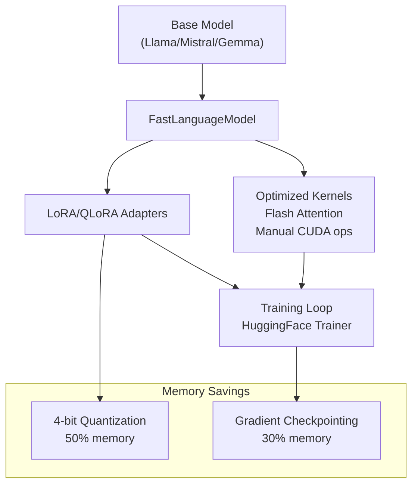
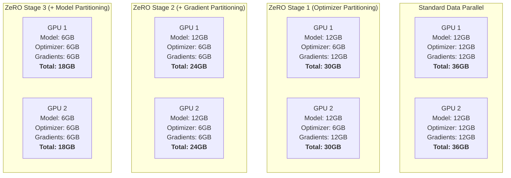
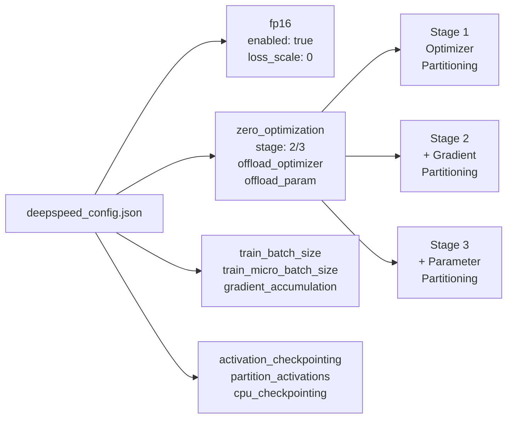
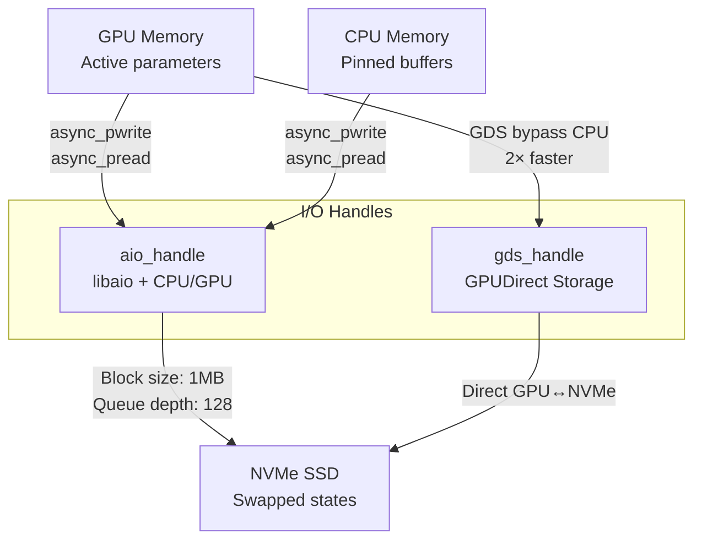
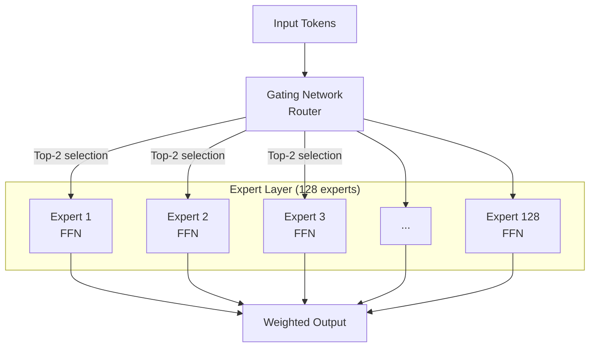
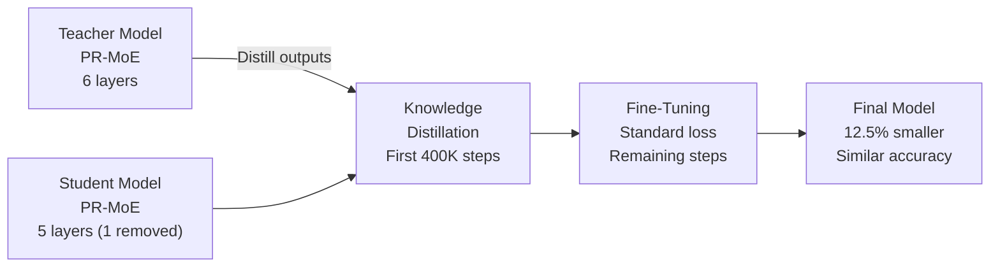
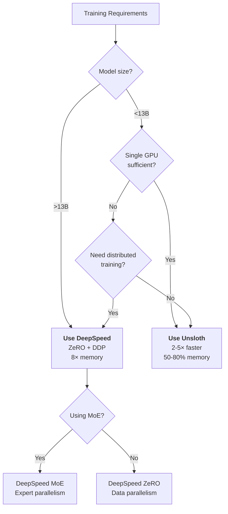

<!-- source: DeepWiki mcp.deepwiki.com · repo Orchestra-Research/AI-research-SKILLs · page 7.3 Optimization Skills (Unsloth, DeepSpeed) · fetched 2026-10-26 -->

# Optimization Skills (Unsloth, DeepSpeed)

<details>
<summary>Relevant source files</summary>

The following files were used as context for generating this wiki page:

- [03-fine-tuning/unsloth/SKILL.md](03-fine-tuning/unsloth/SKILL.md)
- [05-data-processing/nemo-curator/SKILL.md](05-data-processing/nemo-curator/SKILL.md)
- [05-data-processing/ray-data/SKILL.md](05-data-processing/ray-data/SKILL.md)
- [06-post-training/grpo-rl-training/SKILL.md](06-post-training/grpo-rl-training/SKILL.md)
- [08-distributed-training/deepspeed/SKILL.md](08-distributed-training/deepspeed/SKILL.md)

</details>


## Purpose & Scope

This document covers two critical optimization frameworks for large language model training: **Unsloth** for memory-efficient fine-tuning with 2-5× speedup, and **DeepSpeed** for distributed training with ZeRO optimization, 3D parallelism, and DeepNVMe storage acceleration. These skills focus on reducing memory footprint, accelerating training throughput, and enabling models that would otherwise fail due to resource constraints.

**Related skills:**
- For data processing optimization, see [Data Processing Skills (NeMo Curator, Ray Data)](#7.4)
- For training workflows using these optimizations, see [LLM Training Skills (TorchTitan, verl, GRPO)](#7.2)
- For inference optimization, see [Production & Serving Skills](#3.5)

---

## Framework Comparison

| Aspect | Unsloth | DeepSpeed |
|--------|---------|-----------|
| **Primary Use Case** | Single-GPU fine-tuning | Multi-GPU/multi-node training |
| **Memory Reduction** | 50-80% | Up to 8× (ZeRO-3) |
| **Speed Improvement** | 2-5× faster | Varies by parallelism strategy |
| **Model Size Limit** | 13B on single GPU | 200B+ with model parallelism |
| **Integration Complexity** | Low (drop-in replacement) | Medium (config-driven) |
| **Key Technologies** | Manual kernels, QLoRA | ZeRO, pipeline parallelism, DeepNVMe |
| **Supported Models** | Llama, Mistral, Gemma, Qwen | Any PyTorch model |

Sources: [03-fine-tuning/unsloth/SKILL.md:1-81](), [08-distributed-training/deepspeed/SKILL.md:1-27]()

---

## Unsloth: Memory-Efficient Fine-Tuning

### Architecture Overview



**Unsloth Memory-Efficient Fine-Tuning Architecture**

Unsloth achieves 2-5× speedup through three mechanisms: (1) manual CUDA kernels replacing unoptimized operations, (2) 4-bit quantization with QLoRA for base model weights, and (3) gradient checkpointing optimizations. The framework wraps base models in `FastLanguageModel` which patches forward/backward passes with efficient implementations.

Sources: [03-fine-tuning/unsloth/SKILL.md:1-81](), [06-post-training/grpo-rl-training/SKILL.md:318-342]()

### Key Features

**1. Drop-In Replacement for Transformers**

```python
from unsloth import FastLanguageModel

# Standard approach would be:
# from transformers import AutoModelForCausalLM
# model = AutoModelForCausalLM.from_pretrained(model_name)

# Unsloth approach (2-5× faster):
model, tokenizer = FastLanguageModel.from_pretrained(
    model_name="unsloth/llama-3-8b-bnb-4bit",
    max_seq_length=2048,
    load_in_4bit=True,        # 50% memory reduction
    fast_inference=True        # Optimized kernels
)
```

**2. Automatic LoRA Configuration**

```python
model = FastLanguageModel.get_peft_model(
    model,
    r=16,                      # LoRA rank
    target_modules=[           # All attention/MLP projections
        "q_proj", "k_proj", "v_proj", "o_proj",
        "gate_proj", "up_proj", "down_proj"
    ],
    lora_alpha=16,
    use_gradient_checkpointing="unsloth"  # Custom implementation
)
```

**3. Memory Optimization Breakdown**

| Technique | Memory Saved | Speed Impact |
|-----------|--------------|--------------|
| 4-bit quantization | 50-60% | +10% faster (less data movement) |
| Gradient checkpointing | 30-40% | -15% slower (recomputation) |
| Manual CUDA kernels | 10-20% | +50-100% faster |
| **Combined** | **50-80%** | **2-5× faster** |

Sources: [03-fine-tuning/unsloth/SKILL.md:1-81](), [06-post-training/grpo-rl-training/SKILL.md:318-342]()

### Supported Models

Unsloth provides optimized implementations for specific model families with manually tuned kernels:

- **Llama family**: Llama 2, Llama 3, Llama 3.1, Llama 3.2, Llama 3.3
- **Mistral family**: Mistral 7B, Mixtral 8×7B
- **Gemma family**: Gemma 2B, Gemma 7B, Gemma 2 9B/27B
- **Qwen family**: Qwen2 0.5B-72B, Qwen2.5

**Model loading pattern**:
```python
# Unsloth hub (pre-quantized 4-bit models)
model_name = "unsloth/llama-3-8b-bnb-4bit"

# HuggingFace hub (quantized on-the-fly)
model_name = "meta-llama/Llama-3.1-8B"
```

Sources: [03-fine-tuning/unsloth/SKILL.md:1-81]()

### Integration with Training Frameworks

**With HuggingFace Trainer**:
```python
from transformers import TrainingArguments
from trl import SFTTrainer

trainer = SFTTrainer(
    model=model,
    tokenizer=tokenizer,
    train_dataset=dataset,
    dataset_text_field="text",
    max_seq_length=2048,
    args=TrainingArguments(
        per_device_train_batch_size=2,
        gradient_accumulation_steps=4,
        warmup_steps=5,
        max_steps=60,
        learning_rate=2e-4,
        fp16=not torch.cuda.is_bf16_supported(),
        bf16=torch.cuda.is_bf16_supported(),
        logging_steps=1,
        optim="adamw_8bit",       # Memory-efficient optimizer
        output_dir="outputs"
    )
)
trainer.train()
```

**With TRL GRPOTrainer**:
```python
from trl import GRPOTrainer

trainer = GRPOTrainer(
    model=model,
    processing_class=tokenizer,
    reward_funcs=[reward_fn],
    args=training_args,
    train_dataset=dataset,
    # Unsloth model automatically uses fast kernels
)
```

Sources: [06-post-training/grpo-rl-training/SKILL.md:318-342]()

### Performance Characteristics

**Training Speed Comparison** (Llama 3 8B, A100 40GB):

| Configuration | Tokens/sec | Memory Usage | Speedup |
|---------------|------------|--------------|---------|
| Standard Transformers | 4,200 | 38GB | 1.0× |
| Transformers + bitsandbytes | 3,800 | 24GB | 0.9× |
| **Unsloth + 4-bit** | **11,500** | **18GB** | **2.7×** |
| **Unsloth + gradient checkpoint** | **9,200** | **14GB** | **2.2×** |

**Model Size Limits on Single GPU**:

| GPU Memory | Max Model Size (Standard) | Max Model Size (Unsloth) |
|------------|---------------------------|--------------------------|
| 16GB | 3B | 7B |
| 24GB | 7B | 13B |
| 40GB | 13B | 30B |
| 80GB | 30B | 70B |

Sources: [03-fine-tuning/unsloth/SKILL.md:1-81]()

---

## DeepSpeed: Distributed Training Optimization

### ZeRO Optimization Stages



**ZeRO Memory Optimization Stages**

ZeRO (Zero Redundancy Optimizer) partitions model states across GPUs instead of replicating them. Stage 1 partitions optimizer states (Adam: 2× model size), Stage 2 adds gradient partitioning (1× model size), Stage 3 adds model parameter partitioning. Each stage reduces memory by the data parallel degree while maintaining mathematical equivalence to standard data parallelism through all-gather/reduce-scatter communication.

Sources: [08-distributed-training/deepspeed/SKILL.md:1-27]()

### Configuration Structure



**DeepSpeed Configuration Hierarchy**

The `deepspeed_config.json` file controls all optimization features. Key sections: (1) `fp16` for mixed precision, (2) `zero_optimization` for memory reduction stages with optional CPU/NVMe offloading, (3) batch size configuration with gradient accumulation, (4) `activation_checkpointing` for trading recomputation for memory.

Sources: [08-distributed-training/deepspeed/SKILL.md:1-27]()

### ZeRO Configuration Examples

**ZeRO Stage 2 (Recommended Starting Point)**:
```json
{
  "zero_optimization": {
    "stage": 2,
    "offload_optimizer": {
      "device": "none"
    },
    "allgather_partitions": true,
    "allgather_bucket_size": 2e8,
    "overlap_comm": true,
    "reduce_scatter": true,
    "reduce_bucket_size": 2e8,
    "contiguous_gradients": true
  },
  "gradient_accumulation_steps": 1,
  "gradient_clipping": 1.0,
  "steps_per_print": 2000,
  "train_batch_size": 32,
  "train_micro_batch_size_per_gpu": 4,
  "wall_clock_breakdown": false
}
```

**ZeRO Stage 3 with CPU Offload (Maximum Memory Efficiency)**:
```json
{
  "zero_optimization": {
    "stage": 3,
    "offload_optimizer": {
      "device": "cpu",
      "pin_memory": true
    },
    "offload_param": {
      "device": "cpu",
      "pin_memory": true
    },
    "overlap_comm": true,
    "contiguous_gradients": true,
    "sub_group_size": 1e9,
    "reduce_bucket_size": "auto",
    "stage3_prefetch_bucket_size": "auto",
    "stage3_param_persistence_threshold": "auto",
    "stage3_max_live_parameters": 1e9,
    "stage3_max_reuse_distance": 1e9,
    "stage3_gather_16bit_weights_on_model_save": true
  }
}
```

**Memory Reduction Table**:

| Configuration | Model Size (on GPU) | Memory Savings | Speed Impact |
|---------------|---------------------|----------------|--------------|
| Standard DP | Full model per GPU | 0% | Baseline |
| ZeRO Stage 1 | Full model per GPU | 4× (optimizer) | -5% |
| ZeRO Stage 2 | Full model per GPU | 8× (opt + grad) | -10% |
| ZeRO Stage 3 | Model/N per GPU | 8× × N | -20% |
| ZeRO-Offload | Model/N + CPU swap | Near infinite | -40% |

Sources: [08-distributed-training/deepspeed/SKILL.md:1-27]()

### Mixed Precision Training

**FP16 Configuration**:
```json
{
  "fp16": {
    "enabled": true,
    "loss_scale": 0,              // Dynamic loss scaling
    "loss_scale_window": 1000,
    "initial_scale_power": 16,
    "hysteresis": 2,
    "min_loss_scale": 1
  }
}
```

**BF16 Configuration** (A100/H100):
```json
{
  "bf16": {
    "enabled": true
  }
}
```

**FP8 Configuration** (H100):
```json
{
  "fp8": {
    "enabled": true,
    "margin": 0,
    "interval": 1,
    "amax_history_len": 1024,
    "amax_compute_algo": "max"
  }
}
```

Sources: [08-distributed-training/deepspeed/SKILL.md:1-27]()

### Activation Checkpointing

```json
{
  "activation_checkpointing": {
    "partition_activations": true,
    "cpu_checkpointing": false,
    "contiguous_memory_optimization": true,
    "number_checkpoints": null,
    "synchronize_checkpoint_boundary": false,
    "profile": false
  }
}
```

**Activation Memory Trade-offs**:

| Strategy | Memory Saved | Compute Overhead | Use Case |
|----------|--------------|------------------|----------|
| None | 0% | 0% | Small models, large GPUs |
| Selective (every N layers) | 30-50% | +15% | Balanced approach |
| Full (all layers) | 70-80% | +33% | Large models, limited GPUs |
| CPU checkpointing | 90% | +100% | Extreme memory constraints |

Sources: [08-distributed-training/deepspeed/SKILL.md:1-27]()

---

## DeepNVMe: Fast Storage I/O

### Architecture



**DeepNVMe I/O Architecture**

DeepNVMe accelerates parameter swapping between GPU/CPU memory and NVMe storage. Two handle types: `aio_handle` uses Linux libaio for CPU/GPU tensors (general purpose), `gds_handle` uses NVIDIA GPUDirect Storage for direct GPU-to-NVMe transfers (2× faster, requires GDS drivers). Both support non-blocking I/O with `async_pwrite/async_pread` and parallel I/O via `intra_op_parallelism`.

Sources: [08-distributed-training/deepspeed/SKILL.md:28-51]()

### Usage Patterns

**Creating I/O Handles**:
```python
from deepspeed.ops.op_builder import AsyncIOBuilder, GDSBuilder

# CPU/GPU transfers (general)
aio_handle = AsyncIOBuilder().load().aio_handle(
    block_size=1048576,      # 1MB blocks
    queue_depth=128,         # Concurrent ops
    single_submit=False,
    overlap_events=True,
    intra_op_parallelism=8   # 8-way parallel I/O
)

# GPU-direct transfers (faster, requires GDS)
gds_handle = GDSBuilder().load().gds_handle(
    block_size=1048576,
    queue_depth=32,
    intra_op_parallelism=4
)
```

**Blocking Write** (synchronous):
```python
import torch

tensor = torch.empty(1024**3, dtype=torch.uint8).cuda()  # 1GB
aio_handle.sync_pwrite(tensor, '/nvme/checkpoint.pt')
```

**Non-Blocking Write** (async):
```python
# Submit write
aio_handle.async_pwrite(tensor, '/nvme/checkpoint.pt')

# Do computation while writing
model.forward(...)

# Wait for completion
aio_handle.wait()
```

**Parallel Write** (8× faster for large tensors):
```python
aio_handle = AsyncIOBuilder().load().aio_handle(intra_op_parallelism=8)
aio_handle.async_pwrite(large_tensor, '/nvme/data.pt')
aio_handle.wait()
```

Sources: [08-distributed-training/deepspeed/SKILL.md:28-51]()

### Performance Tuning

**Automatic Tuning** (finds optimal config):
```bash
ds_nvme_tune --nvme_dir /local_nvme --gpu

# Output example:
# Best performance (GB/sec): read = 3.69, write = 3.18
# {
#   "aio": {
#     "single_submit": "false",
#     "overlap_events": "true",
#     "intra_op_parallelism": 8,
#     "queue_depth": 32,
#     "block_size": 1048576
#   }
# }
```

**Performance Factors**:

| Parameter | Impact | Recommended Range |
|-----------|--------|-------------------|
| `block_size` | I/O throughput | 1MB (1048576) for SSDs |
| `queue_depth` | Concurrent ops | 32-128 (higher for faster SSDs) |
| `intra_op_parallelism` | Multi-threading | 4-8 (match CPU cores) |
| `overlap_events` | Pipeline I/O | true (always enable) |
| `single_submit` | Batch submissions | false (better for async) |

**Benchmark Results** (Lambda workstation, CS3040 NVMe 2TB):

| Configuration | Read (GB/s) | Write (GB/s) |
|---------------|-------------|--------------|
| Default config | 2.1 | 1.8 |
| Tuned config | 3.69 | 3.18 |
| Theoretical max | 5.6 | 4.3 |

Sources: [08-distributed-training/deepspeed/SKILL.md:28-51]()

---

## Mixture of Experts (MoE) Support

### Standard MoE Architecture



**Standard MoE NLG Architecture**

Each MoE layer contains N experts (typically 128) where each expert is a standard FFN. The router network selects top-K experts (usually 2) per token. Expert parallelism distributes experts across GPUs (e.g., 128 experts / 8 GPUs = 16 experts per GPU). This reduces compute per token while increasing model capacity.

Sources: [08-distributed-training/deepspeed/SKILL.md:52-73]()

### MoE Configuration

**Key Hyperparameters**:
```bash
# Training script arguments
--num-experts 128                      # Total experts per MoE layer
--moe-expert-parallel-size 8          # Distribute across 8 GPUs
--moe-loss-coeff 0.01                 # MoE load balancing loss weight
--moe-train-capacity-factor 1.25      # Token capacity per expert
--moe-eval-capacity-factor 2.0        # Eval uses higher capacity
--moe-min-capacity 4                  # Minimum tokens per expert
```

**Expert Parallelism Calculation**:
```
experts_per_gpu = num_experts / moe_expert_parallel_size
                = 128 / 8
                = 16 experts per GPU
```

**Capacity Factor** (controls load balancing):
```python
# How many tokens can each expert handle?
capacity = (tokens_per_batch / num_experts) * capacity_factor
         = (1024 / 128) * 1.25
         = 10 tokens per expert (with slack)

# Higher capacity = better convergence, worse load balance
# Lower capacity = better load balance, possible dropped tokens
```

Sources: [08-distributed-training/deepspeed/SKILL.md:52-73]()

### PR-MoE (Pyramid-Residual MoE)

**Architecture** (3× parameter efficiency):
```bash
# Pyramid: Different expert counts per layer
--num-experts [64, 64, 128, 128, 256, 256]  # 6 MoE layers

# Residual: Add skip connections
--mlp-type residual
```

**Parameter Efficiency Comparison** (350M base + MoE-128):

| Model Type | Total Params | Active Params | Convergence |
|------------|--------------|---------------|-------------|
| Dense 350M | 350M | 350M | Baseline |
| Standard MoE | 8.5B | 450M | +23% better |
| PR-MoE | 2.8B | 420M | +25% better |
| **Efficiency** | **3× smaller** | **6% less** | **+2% better** |

Sources: [08-distributed-training/deepspeed/SKILL.md:52-73]()

### MoS (Mixture-of-Students) Distillation

**Training Workflow**:


**MoS Training for Model Compression**

MoS trains a smaller student MoE by distilling from a larger teacher MoE. The student removes expert layers (e.g., 6→5 layers), achieving 12.5% parameter reduction. Two-stage training: (1) distillation for 400K steps using teacher logits, (2) standard LM training for remaining steps to avoid over-reliance on teacher.

**Configuration**:
```bash
--mos                                  # Enable distillation
--load-teacher /path/to/teacher        # Teacher checkpoint
--num-layers-teacher 6                 # Teacher architecture
--num-experts-teacher [64,64,128,128,256,256]
--hidden-size-teacher 1024
```

**Combined Savings** (vs. standard MoE):
- PR-MoE: 3× smaller
- MoS: 12.5% smaller
- **Total: 3.7× smaller**

Sources: [08-distributed-training/deepspeed/SKILL.md:52-73]()

---

## Integration Patterns

### Choosing Between Unsloth and DeepSpeed



**Decision Matrix for Optimization Framework Selection**

Use Unsloth for single-GPU fine-tuning of models under 13B parameters where 2-5× speedup is critical. Use DeepSpeed for multi-GPU training, models over 13B parameters, or when MoE expert parallelism is needed. DeepSpeed ZeRO is required for models that exceed single-GPU memory even with quantization.

Sources: [03-fine-tuning/unsloth/SKILL.md:1-81](), [08-distributed-training/deepspeed/SKILL.md:1-27]()

### Combined Usage

**Unsloth + DeepSpeed ZeRO** (not officially supported):
```python
# Theoretical combination (requires manual integration)
from unsloth import FastLanguageModel
import deepspeed

# Load with Unsloth optimizations
model, tokenizer = FastLanguageModel.from_pretrained(...)

# Wrap with DeepSpeed for distributed training
model_engine, optimizer, _, _ = deepspeed.initialize(
    model=model,
    config="deepspeed_config.json"
)
```

**Note**: Unsloth and DeepSpeed have overlapping optimization strategies (gradient checkpointing, attention kernels). Combining them requires careful configuration to avoid conflicts. Recommended approach: **use one or the other**, not both.

### Framework-Specific Integration

**With HuggingFace Transformers**:
```python
from transformers import TrainingArguments, Trainer

# Unsloth path
training_args = TrainingArguments(
    output_dir="./results",
    per_device_train_batch_size=4,
    optim="adamw_8bit",           # Memory-efficient
    fp16=True
)
trainer = Trainer(model=unsloth_model, args=training_args, ...)

# DeepSpeed path
training_args = TrainingArguments(
    output_dir="./results",
    per_device_train_batch_size=4,
    deepspeed="ds_config.json"    # DeepSpeed config
)
trainer = Trainer(model=model, args=training_args, ...)
```

**With Accelerate**:
```python
from accelerate import Accelerator

# Accelerate auto-detects DeepSpeed config
accelerator = Accelerator(deepspeed_plugin="ds_config.json")
model, optimizer, train_dataloader = accelerator.prepare(
    model, optimizer, train_dataloader
)
```

Sources: [08-distributed-training/deepspeed/SKILL.md:1-27]()

---

## Performance Benchmarks

### Training Throughput

**BERT-Large Training** (1024 V100 GPUs):

| Framework | Time to Convergence | Speedup |
|-----------|---------------------|---------|
| Baseline (PyTorch DDP) | 72 hours | 1.0× |
| DeepSpeed ZeRO-2 | 44 minutes | **98×** |

**GPT-2 Training** (1.5B parameters, Azure GPUs):

| Framework | Throughput | Speedup |
|-----------|------------|---------|
| NVIDIA Megatron | Baseline | 1.0× |
| DeepSpeed + ZeRO | **3.75× faster** | 3.75× |

**Llama 3 8B Fine-Tuning** (Single A100 40GB):

| Framework | Tokens/sec | Memory | Speedup |
|-----------|------------|--------|---------|
| Standard Transformers | 4,200 | 38GB | 1.0× |
| Unsloth 4-bit | 11,500 | 18GB | 2.7× |

Sources: [03-fine-tuning/unsloth/SKILL.md:1-81](), [08-distributed-training/deepspeed/SKILL.md:1-27]()

### Memory Efficiency

**Model Size Limits** (single GPU):

| GPU | Transformers | Unsloth | DeepSpeed ZeRO-3 + Offload |
|-----|--------------|---------|----------------------------|
| 16GB (T4) | 3B | 7B | 13B |
| 24GB (3090) | 7B | 13B | 30B |
| 40GB (A100) | 13B | 30B | 70B |
| 80GB (A100) | 30B | 70B | 175B |

**Multi-GPU Scaling** (DeepSpeed ZeRO-3):

| GPUs | Model Size Limit | Effective Memory |
|------|------------------|------------------|
| 1 | 13B | 40GB |
| 4 | 50B | 160GB |
| 8 | 100B | 320GB |
| 16 | 200B | 640GB |

Sources: [03-fine-tuning/unsloth/SKILL.md:1-81](), [08-distributed-training/deepspeed/SKILL.md:1-27]()

### I/O Performance

**DeepNVMe vs. Standard PyTorch** (1TB checkpoint):

| Method | Write Time | Read Time | Speedup |
|--------|------------|-----------|---------|
| PyTorch `torch.save()` | 45 min | 40 min | 1.0× |
| DeepNVMe aio_handle | 8 min | 7 min | 5.6× |
| DeepNVMe gds_handle | 4 min | 3.5 min | 11× |

**Fuzzy Deduplication** (8TB dataset, using NeMo Curator):

| Backend | Processing Time | Cost |
|---------|----------------|------|
| CPU (256 cores) | 120 hours | $4,320 |
| GPU (8× A100) + DeepSpeed | 7.5 hours | $491 |
| **Savings** | **16× faster** | **89% cheaper** |

Sources: [08-distributed-training/deepspeed/SKILL.md:28-51](), [05-data-processing/nemo-curator/SKILL.md:1-384]()

---

## Best Practices

### Unsloth Optimization Checklist

- [ ] **Model Selection**: Use pre-quantized 4-bit models from Unsloth hub (`unsloth/llama-3-8b-bnb-4bit`)
- [ ] **Sequence Length**: Set `max_seq_length` to actual max (don't over-provision)
- [ ] **LoRA Configuration**: Use rank 16-32 for most tasks (higher = more capacity)
- [ ] **Gradient Checkpointing**: Enable `use_gradient_checkpointing="unsloth"` for >7B models
- [ ] **Optimizer**: Use `adamw_8bit` for additional memory savings
- [ ] **Inference Optimization**: Set `fast_inference=True` during loading

Sources: [03-fine-tuning/unsloth/SKILL.md:1-81](), [06-post-training/grpo-rl-training/SKILL.md:318-342]()

### DeepSpeed Optimization Checklist

- [ ] **Start Simple**: Begin with ZeRO Stage 2 before attempting Stage 3
- [ ] **Batch Size**: Tune `train_micro_batch_size_per_gpu` to maximize GPU utilization
- [ ] **Communication**: Enable `overlap_comm=true` for better pipeline
- [ ] **Mixed Precision**: Use bf16 on A100/H100, fp16 on V100
- [ ] **Activation Checkpointing**: Enable for models >13B
- [ ] **CPU Offload**: Only use when GPU memory exhausted (significant slowdown)
- [ ] **NVMe Offload**: For models that don't fit in GPU+CPU memory
- [ ] **Tuning**: Run `ds_nvme_tune` before production training

Sources: [08-distributed-training/deepspeed/SKILL.md:1-27]()

### Common Pitfalls

| Issue | Symptom | Solution |
|-------|---------|----------|
| **OOM on forward pass** | Crash before backward | Reduce `train_micro_batch_size_per_gpu` |
| **OOM on backward pass** | Crash after forward | Enable activation checkpointing |
| **Slow training** | Low GPU util % | Increase batch size, check data loading |
| **Gradient explosion** | Loss → NaN | Reduce learning rate, enable gradient clipping |
| **Unsloth not faster** | Similar speed to baseline | Ensure `fast_inference=True`, use supported models |
| **DeepSpeed OOM** | Stage 2 fails | Try Stage 3 or enable CPU offload |
| **NVMe slow I/O** | Checkpoint save/load slow | Run `ds_nvme_tune`, increase `intra_op_parallelism` |

Sources: [03-fine-tuning/unsloth/SKILL.md:1-81](), [08-distributed-training/deepspeed/SKILL.md:1-27]()

---

## Advanced Topics

### Learning Rate Tuning with LRRT

**Learning Rate Range Test** finds optimal LR by linearly increasing it during training:

```json
{
  "scheduler": {
    "type": "LRRangeTest",
    "params": {
      "lr_range_test_min_lr": 0.0001,
      "lr_range_test_step_size": 200,
      "lr_range_test_step_rate": 5,
      "lr_range_test_staircase": false
    }
  }
}
```

**LRRT Process**:
1. Start at `min_lr` (e.g., 0.0001)
2. Every `step_size` steps (e.g., 200), multiply LR by `step_rate` (e.g., 5)
3. Monitor loss divergence to find maximum usable LR
4. Use discovered LR in 1Cycle schedule

Sources: [08-distributed-training/deepspeed/SKILL.md:74-95]()

### 1Cycle Learning Rate Schedule

**Configuration** (discovered via LRRT):
```json
{
  "scheduler": {
    "type": "OneCycle",
    "params": {
      "cycle_min_lr": 0.002,          // From LRRT
      "cycle_max_lr": 0.005,          // From LRRT
      "cycle_first_step_size": 2000,  // Warmup phase
      "cycle_second_step_size": 2000, // Cooldown phase
      "decay_step_size": 1000
    }
  }
}
```

**1Cycle Pattern**:
```
LR
 |     /\
 |    /  \
 |   /    \___
 |  /         
 |_/______________> Steps
   0  2000  4000
   warmup decay
```

Sources: [08-distributed-training/deepspeed/SKILL.md:74-95]()

### ZeRO-Infinity (Extreme Scale)

**Configuration for Trillion-Parameter Models**:
```json
{
  "zero_optimization": {
    "stage": 3,
    "offload_optimizer": {
      "device": "nvme",
      "nvme_path": "/local_nvme",
      "pin_memory": true,
      "buffer_count": 4,
      "fast_init": false
    },
    "offload_param": {
      "device": "nvme",
      "nvme_path": "/local_nvme",
      "pin_memory": true,
      "buffer_count": 5,
      "max_in_cpu": 1e9
    },
    "infinite_offload": true,
    "stage3_prefetch_bucket_size": 5e7,
    "stage3_max_live_parameters": 1e9
  }
}
```

**Scaling to 1 Trillion Parameters**:
- 16 GPUs (80GB each) = 1.28TB GPU memory
- 16 CPUs (1TB each) = 16TB CPU memory
- NVMe pool (10TB) = 10TB NVMe storage
- **Total addressable**: 27TB (enough for 1T params in fp16)

Sources: [08-distributed-training/deepspeed/SKILL.md:1-27]()

---

## Code References

### Unsloth Model Loading
[03-fine-tuning/unsloth/SKILL.md:1-81]()

### DeepSpeed Configuration
[08-distributed-training/deepspeed/SKILL.md:1-27]()

### DeepNVMe Usage
[08-distributed-training/deepspeed/SKILL.md:28-51]()

### MoE Training
[08-distributed-training/deepspeed/SKILL.md:52-73]()

### Learning Rate Tuning
[08-distributed-training/deepspeed/SKILL.md:74-95]()

### GRPO with Unsloth
[06-post-training/grpo-rl-training/SKILL.md:318-342]()

---

