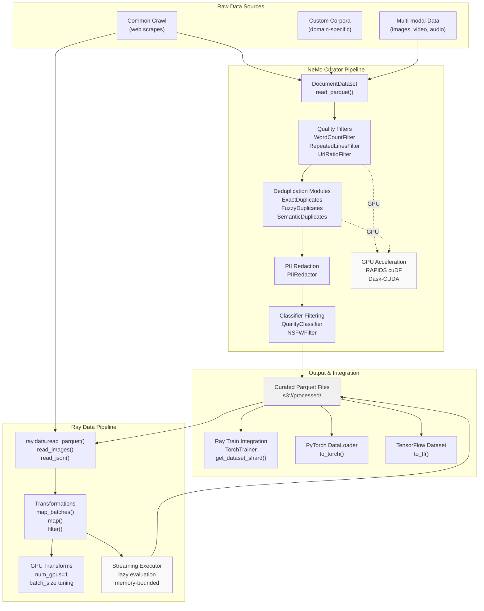
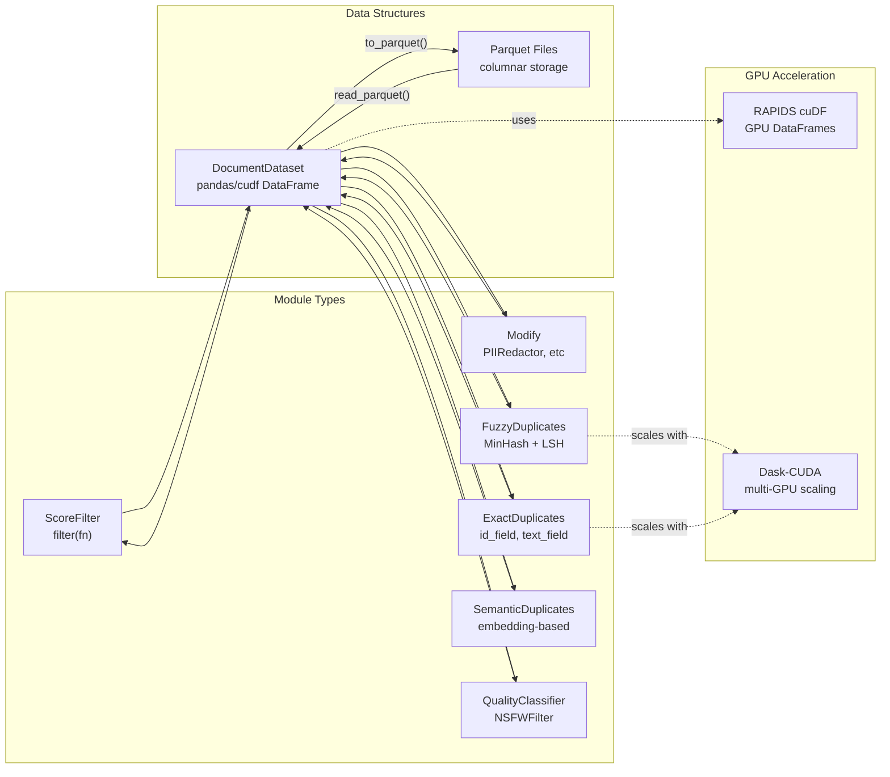
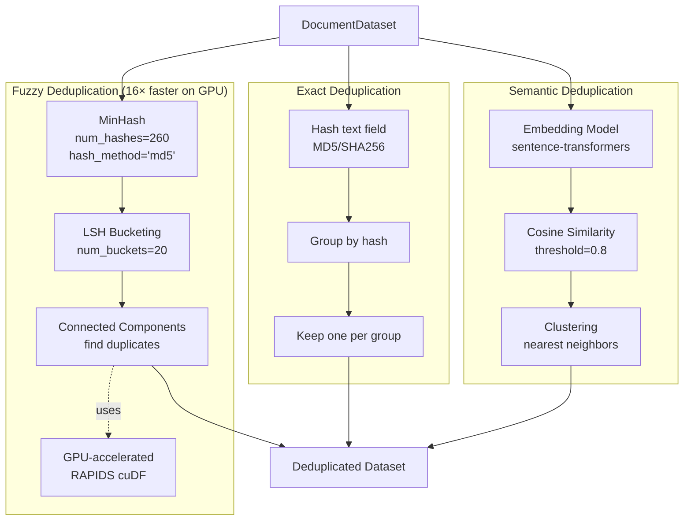
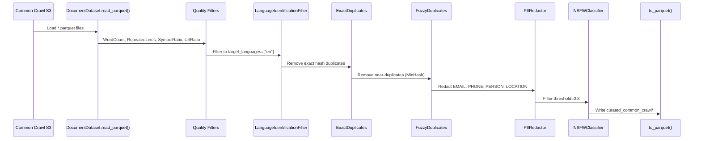
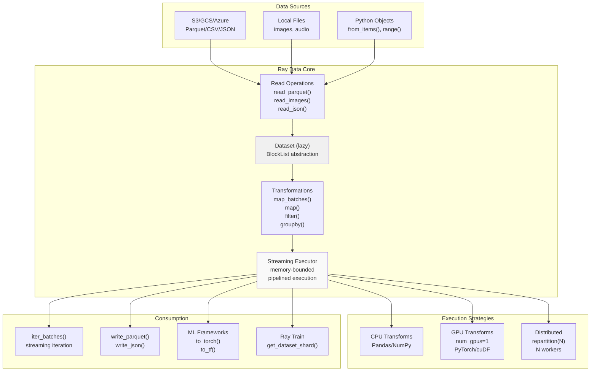
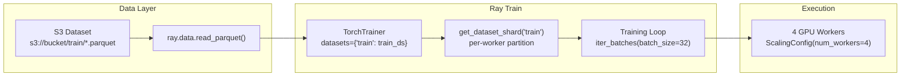
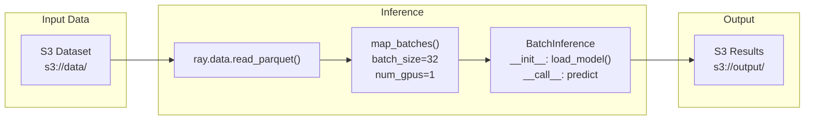
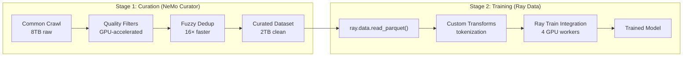

<!-- source: DeepWiki mcp.deepwiki.com · repo Orchestra-Research/AI-research-SKILLs · page 7.4 Data Processing Skills (NeMo Curator, Ray Data) · fetched 2026-10-26 -->

# Data Processing Skills (NeMo Curator, Ray Data)

<details>
<summary>Relevant source files</summary>

The following files were used as context for generating this wiki page:

- [03-fine-tuning/unsloth/SKILL.md](03-fine-tuning/unsloth/SKILL.md)
- [05-data-processing/nemo-curator/SKILL.md](05-data-processing/nemo-curator/SKILL.md)
- [05-data-processing/ray-data/SKILL.md](05-data-processing/ray-data/SKILL.md)
- [06-post-training/grpo-rl-training/SKILL.md](06-post-training/grpo-rl-training/SKILL.md)
- [08-distributed-training/deepspeed/SKILL.md](08-distributed-training/deepspeed/SKILL.md)

</details>


## Purpose and Scope

This document provides technical deep dives into two complementary data processing skills for large-scale LLM training pipelines: **NeMo Curator** for GPU-accelerated data curation and **Ray Data** for distributed ETL and ML data processing. These skills address the critical bottleneck of preparing high-quality, large-scale datasets for model training.

**Coverage:**
- NeMo Curator's GPU-accelerated curation pipeline (16× faster deduplication)
- Ray Data's distributed execution model for ML workloads
- Performance benchmarks, cost analysis, and integration patterns
- Production-grade implementation guidance

**Related Skills:**
- For fine-tuning workflows that consume curated data, see [Optimization Skills](#7.3)
- For post-training data requirements (RLHF, DPO), see [LLM Training Skills](#7.2)
- For data efficiency techniques during training, see [Training & Data Skills](#3.3)

---

## Data Processing Architecture Overview



**Architecture Overview**: NeMo Curator specializes in data quality and deduplication using GPU acceleration, while Ray Data handles distributed transformations and ML framework integration. The pipelines are complementary: NeMo Curator prepares clean datasets, Ray Data consumes them for training.

Sources: [05-data-processing/nemo-curator/SKILL.md:1-384](), [05-data-processing/ray-data/SKILL.md:1-327]()

---

## NeMo Curator: GPU-Accelerated Data Curation

### Core Architecture and Module System

NeMo Curator organizes curation workflows into composable modules that operate on `DocumentDataset` objects backed by RAPIDS cuDF DataFrames for GPU acceleration.



**Module Composition Pattern**: All modules follow a functional interface `module(dataset) -> dataset`, enabling pipeline chaining. GPU acceleration is transparent—modules automatically use cuDF when available.

Sources: [05-data-processing/nemo-curator/SKILL.md:52-72](), [05-data-processing/nemo-curator/SKILL.md:183-193]()

---

### Quality Filtering Pipeline

NeMo Curator provides 30+ heuristic filters for removing low-quality content. Filters are applied via `ScoreFilter` or direct dataset methods.

**Common Filter Implementations**:

| Filter Class | Purpose | Typical Threshold | Code Reference |
|-------------|---------|-------------------|----------------|
| `WordCountFilter` | Remove short/long docs | min=50, max=100K words | [05-data-processing/nemo-curator/SKILL.md:89-90]() |
| `RepeatedLinesFilter` | Detect repetitive content | max_fraction=0.3 | [05-data-processing/nemo-curator/SKILL.md:92-93]() |
| `UrlRatioFilter` | Limit URL density | max_ratio=0.2 | [05-data-processing/nemo-curator/SKILL.md:95-96]() |
| `NonAlphaNumericFilter` | Remove symbol spam | max_ratio=0.3 | [05-data-processing/nemo-curator/SKILL.md:79-84]() |
| `LanguageIdentificationFilter` | Enforce language | target=["en"] | [05-data-processing/nemo-curator/SKILL.md:284]() |

**Pipeline Application Example**:

```python
# Sequential filtering from nemo-curator/SKILL.md
dataset = dataset.filter(WordCountFilter(min_words=50, max_words=100000))
dataset = dataset.filter(RepeatedLinesFilter(max_repeated_line_fraction=0.3))
dataset = dataset.filter(UrlRatioFilter(max_url_ratio=0.2))
```

**Filter Execution Model**: Filters evaluate each document and return boolean scores. GPU acceleration via cuDF string operations provides 10× speedup over CPU pandas for regex-heavy filters.

Sources: [05-data-processing/nemo-curator/SKILL.md:76-97](), [05-data-processing/nemo-curator/SKILL.md:175-180]()

---

### Deduplication Strategies

NeMo Curator implements three deduplication methods with different accuracy/speed tradeoffs.



**Performance Comparison (8TB RedPajama v2 dataset)**:

| Method | Hardware | Time | Speedup | Use Case |
|--------|----------|------|---------|----------|
| Exact (CPU) | 256 cores | 8 hours | 1× | Hash-based duplicates |
| Exact (GPU) | 8× A100 | 0.5 hours | 16× | Hash-based duplicates |
| Fuzzy (CPU) | 256 cores | 120 hours | 1× | Near-duplicates |
| Fuzzy (GPU) | 8× A100 | 7.5 hours | 16× | Near-duplicates |
| Semantic (GPU) | 4× A100 | ~15 hours | — | Meaning-based dedup |

**Implementation Details**:

**Exact Deduplication** [05-data-processing/nemo-curator/SKILL.md:101-107]():
```python
from nemo_curator.modules import ExactDuplicates
deduped = ExactDuplicates(id_field="id", text_field="text")(dataset)
```

**Fuzzy Deduplication** [05-data-processing/nemo-curator/SKILL.md:109-123]():
```python
from nemo_curator.modules import FuzzyDuplicates
fuzzy_dedup = FuzzyDuplicates(
    id_field="id",
    text_field="text",
    num_hashes=260,      # MinHash signature size
    num_buckets=20,      # LSH bucket count
    hash_method="md5"
)
deduped = fuzzy_dedup(dataset)
```

**Semantic Deduplication** [05-data-processing/nemo-curator/SKILL.md:125-138]():
```python
from nemo_curator.modules import SemanticDuplicates
semantic_dedup = SemanticDuplicates(
    id_field="id",
    text_field="text",
    embedding_model="sentence-transformers/all-MiniLM-L6-v2",
    threshold=0.8  # Cosine similarity threshold
)
deduped = semantic_dedup(dataset)
```

**GPU Acceleration Mechanism**: Fuzzy deduplication uses RAPIDS cuDF for string hashing, Dask-CUDA for distributed execution across GPU nodes. The 16× speedup comes from parallelizing MinHash computation and LSH bucketing on GPU cores.

Sources: [05-data-processing/nemo-curator/SKILL.md:99-138](), [05-data-processing/nemo-curator/SKILL.md:326-342]()

---

### Multi-modal Data Curation

NeMo Curator extends beyond text to support image, video, and audio curation with specialized modules.

**Image Curation Pipeline**:

| Module | Function | Model/Method | Code Reference |
|--------|----------|--------------|----------------|
| `AestheticFilter` | Score image quality | Aesthetic scorer model | [05-data-processing/nemo-curator/SKILL.md:206]() |
| `NSFWFilter` | Detect unsafe content | NSFW classifier | [05-data-processing/nemo-curator/SKILL.md:209-211]() |
| `CLIPEmbedder` | Generate embeddings | `openai/clip-vit-base-patch32` | [05-data-processing/nemo-curator/SKILL.md:213-215]() |

**Video Curation Pipeline**:

| Module | Function | Parameters | Code Reference |
|--------|----------|------------|----------------|
| `SceneDetector` | Segment scenes | threshold=27.0 | [05-data-processing/nemo-curator/SKILL.md:228]() |
| `ClipExtractor` | Extract clips | min/max duration | [05-data-processing/nemo-curator/SKILL.md:231-232]() |
| `InternVideo2Embedder` | Video embeddings | InternVideo2 model | [05-data-processing/nemo-curator/SKILL.md:235-237]() |

**Audio Curation Pipeline**:

| Module | Function | Model | Code Reference |
|--------|----------|-------|----------------|
| `ASRInference` | Transcribe audio | FastConformer | [05-data-processing/nemo-curator/SKILL.md:250-251]() |
| `WERFilter` | Filter by quality | max_wer=0.3 | [05-data-processing/nemo-curator/SKILL.md:253-255]() |
| `DurationFilter` | Length filtering | min/max duration | [05-data-processing/nemo-curator/SKILL.md:257-259]() |

Sources: [05-data-processing/nemo-curator/SKILL.md:195-261]()

---

### PII Redaction and Safety Filtering

**PII Redaction** [05-data-processing/nemo-curator/SKILL.md:142-153]():
```python
from nemo_curator.modules import Modify
from nemo_curator.modifiers import PIIRedactor

pii_redactor = PIIRedactor(
    supported_entities=["EMAIL_ADDRESS", "PHONE_NUMBER", "PERSON", "LOCATION"],
    anonymize_action="replace"  # or "redact"
)
redacted = Modify(pii_redactor)(dataset)
```

**Classifier-Based Filtering** [05-data-processing/nemo-curator/SKILL.md:156-169]():
```python
from nemo_curator.classifiers import QualityClassifier

quality_clf = QualityClassifier(
    model_path="nvidia/quality-classifier-deberta",
    batch_size=256,
    device="cuda"
)
high_quality = dataset.filter(lambda doc: quality_clf(doc["text"]) > 0.5)
```

**Safety Architecture**: PII redaction uses NER models to detect entities, while quality/NSFW classifiers run inference on batched documents. Both leverage GPU batch processing for throughput.

Sources: [05-data-processing/nemo-curator/SKILL.md:140-169]()

---

### Production Curation Workflow

**Common Crawl Processing Pipeline** [05-data-processing/nemo-curator/SKILL.md:264-303]():



**Execution Code** [05-data-processing/nemo-curator/SKILL.md:272-302]():
```python
dataset = DocumentDataset.read_parquet("common_crawl/*.parquet")

pipeline = [
    WordCountFilter(min_words=100, max_words=50000),
    RepeatedLinesFilter(max_repeated_line_fraction=0.2),
    SymbolToWordRatioFilter(max_symbol_to_word_ratio=0.3),
    UrlRatioFilter(max_url_ratio=0.3),
    LanguageIdentificationFilter(target_languages=["en"]),
    ExactDuplicates(id_field="id", text_field="text"),
    FuzzyDuplicates(id_field="id", text_field="text", num_hashes=260),
    PIIRedactor(),
    NSFWClassifier(threshold=0.8)
]

for stage in pipeline:
    dataset = stage(dataset)

dataset.to_parquet("curated_common_crawl/")
```

Sources: [05-data-processing/nemo-curator/SKILL.md:263-303]()

---

### Multi-GPU Scaling

**Distributed Processing Setup** [05-data-processing/nemo-curator/SKILL.md:306-322]():
```python
from nemo_curator import get_client
from dask_cuda import LocalCUDACluster

# Multi-GPU cluster
cluster = LocalCUDACluster(n_workers=8)
client = get_client(cluster=cluster)

# Process large dataset
dataset = DocumentDataset.read_parquet("s3://large_dataset/*.parquet")
deduped = FuzzyDuplicates(...)(dataset)

client.close()
cluster.close()
```

**Scaling Characteristics**: NeMo Curator achieves near-linear scaling across GPU nodes via Dask-CUDA. For fuzzy deduplication, 8 A100 GPUs process 8TB in 7.5 hours vs. 120 hours on 256 CPU cores.

Sources: [05-data-processing/nemo-curator/SKILL.md:172-180](), [05-data-processing/nemo-curator/SKILL.md:306-322]()

---

## Ray Data: Distributed ETL & ML Pipelines

### Execution Model and Architecture

Ray Data implements a streaming execution model with lazy evaluation and memory-bounded processing.



**Lazy Evaluation**: Transformations like `map_batches()` build a computation graph. Execution occurs when iterating with `iter_batches()` or writing output. This enables memory-efficient processing of datasets larger than RAM.

Sources: [05-data-processing/ray-data/SKILL.md:43-57](), [05-data-processing/ray-data/SKILL.md:210-217]()

---

### Data Loading Patterns

**Cloud Storage Loading** [05-data-processing/ray-data/SKILL.md:89-105]():

| Format | Function | Use Case | Code Reference |
|--------|----------|----------|----------------|
| Parquet | `read_parquet()` | ML training data | [05-data-processing/ray-data/SKILL.md:95]() |
| CSV | `read_csv()` | Tabular data | [05-data-processing/ray-data/SKILL.md:98]() |
| JSON | `read_json()` | Semi-structured | [05-data-processing/ray-data/SKILL.md:101]() |
| Images | `read_images()` | Computer vision | [05-data-processing/ray-data/SKILL.md:104]() |

**In-Memory Construction** [05-data-processing/ray-data/SKILL.md:107-120]():
```python
# From Python list
ds = ray.data.from_items([{"id": i, "value": i * 2} for i in range(1000)])

# Synthetic data
ds = ray.data.range(1000000)

# From pandas DataFrame
import pandas as pd
df = pd.DataFrame({"col1": [1, 2, 3], "col2": [4, 5, 6]})
ds = ray.data.from_pandas(df)
```

**Data Format Support** [05-data-processing/ray-data/SKILL.md:284-293]():

| Format | Read | Write | Best For |
|--------|------|-------|----------|
| Parquet | ✅ | ✅ | ML data (columnar) |
| CSV | ✅ | ✅ | Tabular exports |
| JSON | ✅ | ✅ | Semi-structured |
| Images | ✅ | ❌ | CV datasets |
| NumPy | ✅ | ✅ | Array data |
| Pandas | ✅ | ❌ | DataFrame conversion |

Sources: [05-data-processing/ray-data/SKILL.md:88-120](), [05-data-processing/ray-data/SKILL.md:284-293]()

---

### Transformation Operations

**Vectorized Batch Operations** [05-data-processing/ray-data/SKILL.md:124-133]():
```python
def process_batch(batch):
    batch["doubled"] = batch["value"] * 2
    return batch

ds = ds.map_batches(process_batch, batch_size=1000)
```

**Row-by-Row Operations** [05-data-processing/ray-data/SKILL.md:135-144]():
```python
def process_row(row):
    row["squared"] = row["value"] ** 2
    return row

ds = ds.map(process_row)  # Slower than map_batches
```

**Filtering** [05-data-processing/ray-data/SKILL.md:146-151]():
```python
ds = ds.filter(lambda row: row["value"] > 100)
```

**Aggregation** [05-data-processing/ray-data/SKILL.md:153-161]():
```python
# Count by group
ds = ds.groupby("category").count()

# Custom aggregation
ds = ds.groupby("category").map_groups(lambda group: {"sum": group["value"].sum()})
```

**Performance Optimization Hierarchy**:
1. `map_batches()` with large batch sizes (fastest, vectorized)
2. `map_batches()` with small batch sizes
3. `map()` row-by-row (slowest)

Sources: [05-data-processing/ray-data/SKILL.md:123-161]()

---

### GPU-Accelerated Transformations

**GPU Transform Pattern** [05-data-processing/ray-data/SKILL.md:163-179]():
```python
def preprocess_images_gpu(batch):
    import torch
    images = torch.tensor(batch["image"]).cuda()
    processed = images * 255
    return {"processed": processed.cpu().numpy()}

ds = ds.map_batches(
    preprocess_images_gpu,
    batch_size=64,
    num_gpus=1  # Request GPU resource
)
```

**GPU Allocation**: Setting `num_gpus=1` requests GPU assignment from Ray's resource manager. The transform function executes on GPU-enabled workers.

**GPU Scaling Performance** [05-data-processing/ray-data/SKILL.md:301-305]():

| Configuration | Throughput | Use Case |
|---------------|------------|----------|
| CPU only | 1,000 images/sec | Baseline |
| 1 GPU | 5,000 images/sec | 5× speedup |
| 4 GPUs | 18,000 images/sec | 18× speedup |

Sources: [05-data-processing/ray-data/SKILL.md:163-179](), [05-data-processing/ray-data/SKILL.md:301-305]()

---

### ML Framework Integration

**PyTorch Integration** [05-data-processing/ray-data/SKILL.md:261-270]():
```python
torch_ds = ds.to_torch(label_column="label", batch_size=32)

for batch in torch_ds:
    inputs, labels = batch["features"], batch["label"]
    # Train model
```

**TensorFlow Integration** [05-data-processing/ray-data/SKILL.md:272-281]():
```python
tf_ds = ds.to_tf(feature_columns=["image"], label_column="label", batch_size=32)

for features, labels in tf_ds:
    # Train model
    pass
```

**Ray Train Integration** [05-data-processing/ray-data/SKILL.md:59-85]():



**Code Implementation** [05-data-processing/ray-data/SKILL.md:62-85]():
```python
from ray.train.torch import TorchTrainer
from ray.train import ScalingConfig

train_ds = ray.data.read_parquet("s3://bucket/train/*.parquet")

def train_func(config):
    train_ds = ray.train.get_dataset_shard("train")
    
    for epoch in range(10):
        for batch in train_ds.iter_batches(batch_size=32):
            # Train on batch
            pass

trainer = TorchTrainer(
    train_func,
    datasets={"train": train_ds},
    scaling_config=ScalingConfig(num_workers=4, use_gpu=True)
)
trainer.fit()
```

**Sharding Strategy**: Ray Train automatically shards datasets across workers. Each worker receives `1/num_workers` of the data via `get_dataset_shard()`.

Sources: [05-data-processing/ray-data/SKILL.md:59-85](), [05-data-processing/ray-data/SKILL.md:261-281]()

---

### Performance Optimization Techniques

**Repartitioning** [05-data-processing/ray-data/SKILL.md:196-201]():
```python
# Match parallelism to cluster size
ds = ds.repartition(100)  # 100 blocks for 100-core cluster
```

**Batch Size Tuning** [05-data-processing/ray-data/SKILL.md:203-208]():
```python
# Larger batches = better vectorization
ds.map_batches(process_fn, batch_size=10000)  # vs batch_size=100
```

**Streaming Execution** [05-data-processing/ray-data/SKILL.md:210-217]():
```python
# Process data larger than memory
ds = ray.data.read_parquet("s3://huge-dataset/")
for batch in ds.iter_batches(batch_size=1000):
    process(batch)  # Memory-bounded streaming
```

**Scaling Benchmarks** [05-data-processing/ray-data/SKILL.md:295-305]():

**100GB Dataset Processing**:
- 1 node (16 cores): ~30 minutes
- 4 nodes (64 cores): ~8 minutes (3.75× speedup)
- 16 nodes (256 cores): ~2 minutes (15× speedup)

**Near-linear scaling** achieved through data partitioning and distributed task execution.

Sources: [05-data-processing/ray-data/SKILL.md:194-217](), [05-data-processing/ray-data/SKILL.md:295-305]()

---

### Batch Inference Pattern

**Distributed Model Inference** [05-data-processing/ray-data/SKILL.md:221-244]():



**Implementation** [05-data-processing/ray-data/SKILL.md:232-244]():
```python
class BatchInference:
    def __init__(self):
        self.model = load_model()  # Loaded once per worker

    def __call__(self, batch):
        predictions = self.model(batch["input"])
        return {"prediction": predictions}

ds = ray.data.read_parquet("s3://data/")
predictions = ds.map_batches(BatchInference, batch_size=32, num_gpus=1)
predictions.write_parquet("s3://output/")
```

**Inference Optimization**:
- Model loaded once per worker (in `__init__`)
- Batched prediction for GPU efficiency
- Results written directly to cloud storage

Sources: [05-data-processing/ray-data/SKILL.md:219-244]()

---

## Comparative Analysis: NeMo Curator vs Ray Data

### Feature Comparison

| Capability | NeMo Curator | Ray Data |
|------------|--------------|----------|
| **Primary Use Case** | Data curation, quality control | Distributed ETL, ML pipelines |
| **GPU Acceleration** | Built-in (RAPIDS cuDF) | Manual (via transforms) |
| **Deduplication** | Exact, fuzzy, semantic | Not specialized |
| **Quality Filtering** | 30+ heuristics | Custom logic required |
| **Multi-modal** | Text, image, video, audio | Generic data loading |
| **Execution Model** | Eager (immediate) | Lazy (streaming) |
| **Framework Integration** | Standalone | PyTorch, TF, Ray Train |
| **Best For** | Preparing training data | Training pipelines |

Sources: [05-data-processing/nemo-curator/SKILL.md:1-384](), [05-data-processing/ray-data/SKILL.md:1-327]()

---

### Performance Characteristics

**GPU Acceleration Comparison**:

| Operation | NeMo Curator (GPU) | Ray Data (CPU) | Ray Data (GPU) |
|-----------|-------------------|----------------|----------------|
| Fuzzy Dedup (8TB) | 7.5 hours (8×A100) | 120 hours (256 cores) | N/A (not specialized) |
| Quality Filtering (100GB) | 0.2 hours (2×A100) | 2 hours (32 cores) | 0.5 hours (custom kernel) |
| Image Processing (1M images) | Via CLIPEmbedder | 30 min (CPU) | 6 min (4×GPU) |

**Cost Analysis (8TB Dataset Curation)**:

**NeMo Curator (GPU approach)**:
- Hardware: AWS p4d.24xlarge × 2 ($65.54/hour)
- Time: 7.5 hours
- Total: $491.55

**Ray Data (CPU approach)**:
- Hardware: AWS c5.18xlarge × 10 ($36/hour)
- Time: 120 hours
- Total: $4,320

**Savings**: 89% cost reduction with NeMo Curator GPU pipeline.

Sources: [05-data-processing/nemo-curator/SKILL.md:326-357](), [05-data-processing/ray-data/SKILL.md:295-305]()

---

### Complementary Integration Pattern

**Hybrid Workflow**: Use NeMo Curator for curation, Ray Data for training pipelines.



**Rationale**: NeMo Curator excels at quality control and deduplication (specialized GPU kernels), while Ray Data handles distributed training pipelines (framework integration, sharding).

Sources: [05-data-processing/nemo-curator/SKILL.md:364-370](), [05-data-processing/ray-data/SKILL.md:59-85]()

---

## Production Use Cases

### NeMo Curator Deployments

**NVIDIA Nemotron-4 Training Data** [05-data-processing/nemo-curator/SKILL.md:364-370]():
- Used NeMo Curator to prepare training corpus
- Processing: Common Crawl → quality filtering → fuzzy dedup → PII redaction
- Scale: Multi-TB web scrapes processed on GPU clusters

**RedPajama v2 Dataset** [05-data-processing/nemo-curator/SKILL.md:368]():
- Open-source LLM training dataset
- Applied fuzzy deduplication (8TB in 7.5 hours on 8×A100)
- Quality filters: word count, URL ratio, repeated lines

Sources: [05-data-processing/nemo-curator/SKILL.md:364-370]()

---

### Ray Data Deployments

**Pinterest: Last-Mile Data Processing** [05-data-processing/ray-data/SKILL.md:308-312]():
- Use case: ML feature engineering before training
- Scale: 100s of nodes for preprocessing
- Integration: Ray Data → Ray Train → PyTorch

**ByteDance: Multi-modal LLM Inference** [05-data-processing/ray-data/SKILL.md:309]():
- Use case: Batch inference on images + text
- Pattern: `map_batches()` with multi-modal models
- Scale: Distributed GPU inference

**Spotify: ML Platform Batch Inference** [05-data-processing/ray-data/SKILL.md:310]():
- Use case: Offline recommendation model scoring
- Pattern: `BatchInference` class with model loading
- Scale: Daily batch jobs on cluster

Sources: [05-data-processing/ray-data/SKILL.md:307-312]()

---

## Installation and Setup

### NeMo Curator Installation

**Text-only (minimal)** [05-data-processing/nemo-curator/SKILL.md:38-47]():
```bash
# CUDA 12
uv pip install "nemo-curator[text_cuda12]"

# All modalities (text, image, video, audio)
uv pip install "nemo-curator[all_cuda12]"

# CPU-only (slower, no GPU acceleration)
uv pip install "nemo-curator[cpu]"
```

**GPU Requirements**:
- CUDA 11.8+ or CUDA 12.x
- NVIDIA GPU with 16GB+ VRAM (A100/V100 recommended)
- RAPIDS-compatible GPU (compute capability 7.0+)

Sources: [05-data-processing/nemo-curator/SKILL.md:36-47]()

---

### Ray Data Installation

**Basic installation** [05-data-processing/ray-data/SKILL.md:38-41]():
```bash
pip install -U 'ray[data]'
```

**Dependencies**:
- Python 3.8+
- PyArrow for Parquet support
- Optional: PyTorch, TensorFlow for ML integration

Sources: [05-data-processing/ray-data/SKILL.md:38-41]()

---

## Best Practices

### NeMo Curator Best Practices

1. **Start with quality filtering before deduplication** to reduce data volume
2. **Use fuzzy dedup for web data** (exact dedup insufficient for near-duplicates)
3. **Test filters on samples** before running full pipeline
4. **Monitor GPU memory** (adjust batch sizes if OOM errors occur)
5. **Combine multiple filters** for robust quality control

### Ray Data Best Practices

1. **Use `map_batches()` over `map()`** for vectorization
2. **Tune batch sizes** (larger = better GPU utilization, but watch memory)
3. **Repartition datasets** to match cluster size (1 block per core)
4. **Enable streaming** (`iter_batches()`) for large datasets
5. **Profile with `ray.data.DataContext.get_current().execution_options`**

Sources: [05-data-processing/nemo-curator/SKILL.md:1-384](), [05-data-processing/ray-data/SKILL.md:194-217]()

---

## Resources

### NeMo Curator

- **GitHub**: https://github.com/NVIDIA/NeMo-Curator ⭐ 500+
- **Documentation**: https://docs.nvidia.com/nemo-framework/user-guide/latest/datacuration/
- **Version**: 0.4.0+
- **License**: Apache 2.0

### Ray Data

- **Documentation**: https://docs.ray.io/en/latest/data/data.html
- **GitHub**: https://github.com/ray-project/ray ⭐ 36,000+
- **Version**: Ray 2.40.0+
- **Examples**: https://docs.ray.io/en/latest/data/examples/overview.html

Sources: [05-data-processing/nemo-curator/SKILL.md:376-381](), [05-data-processing/ray-data/SKILL.md:315-324]()

---

