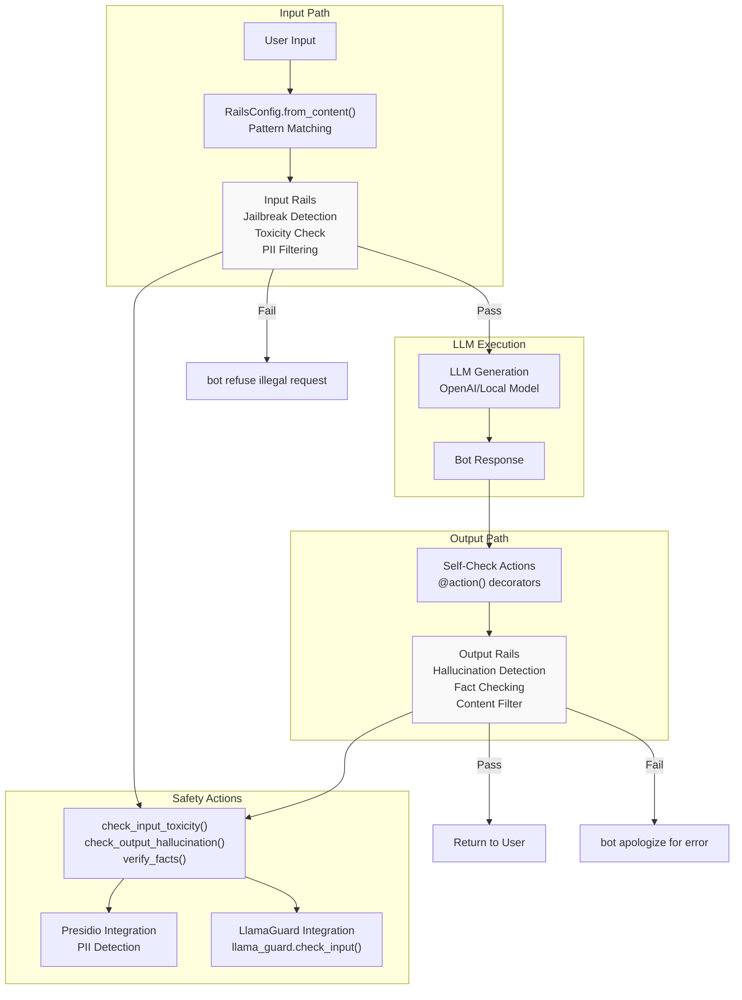
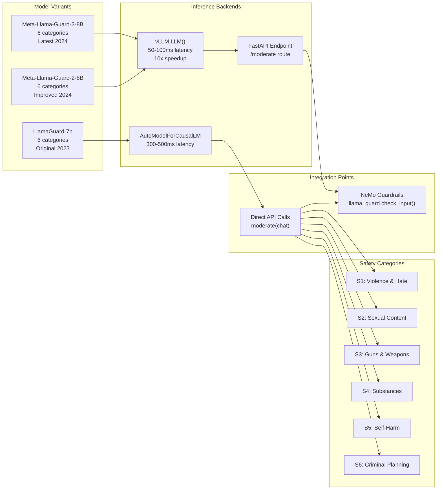
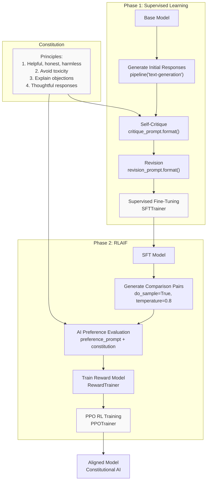
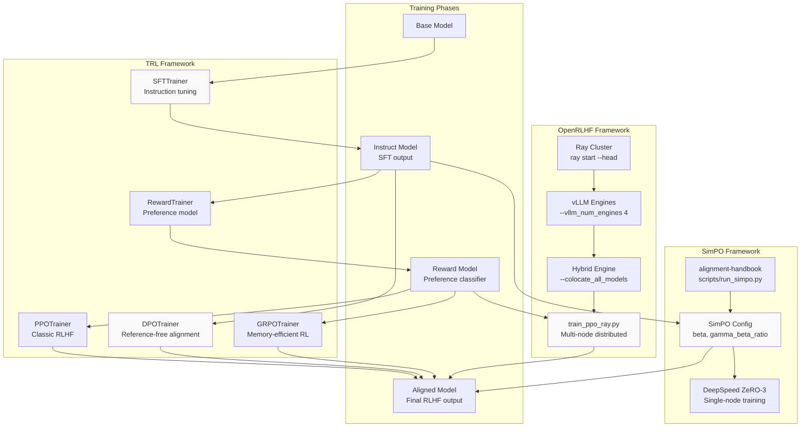
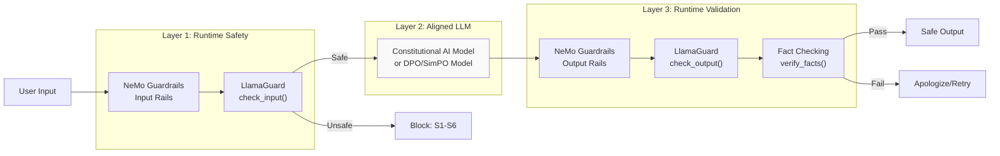
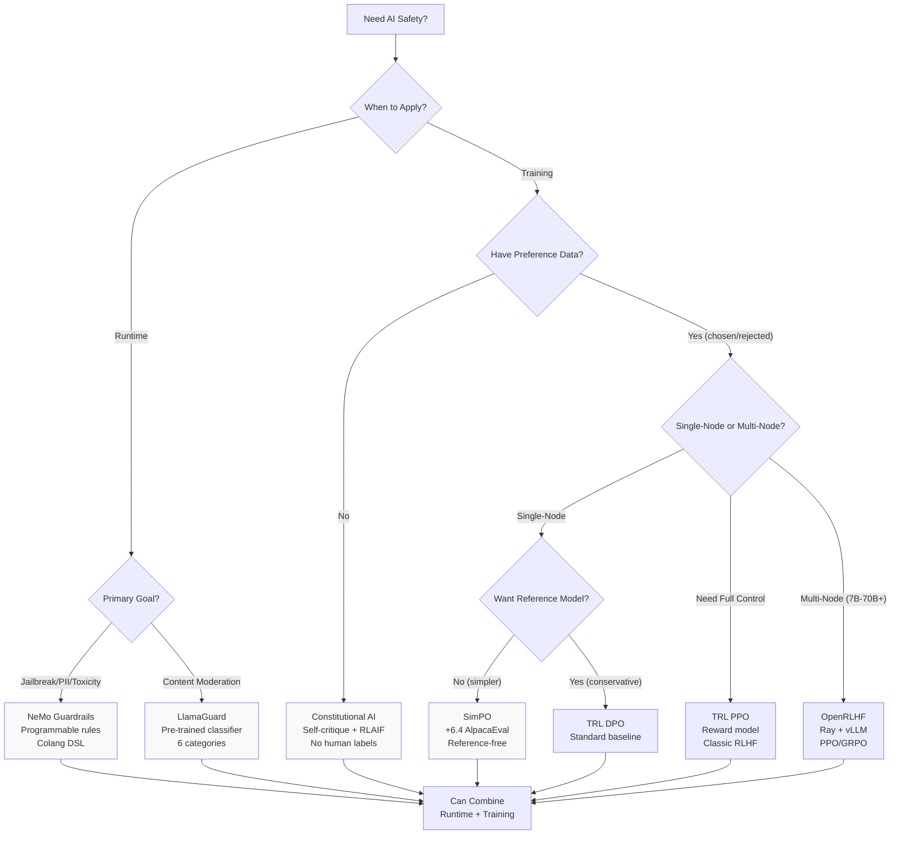

<!-- source: DeepWiki mcp.deepwiki.com · repo Orchestra-Research/AI-research-SKILLs · page 7.5 Safety & Alignment Skills · fetched 2026-10-26 -->

# Safety & Alignment Skills

<details>
<summary>Relevant source files</summary>

The following files were used as context for generating this wiki page:

- [06-post-training/openrlhf/SKILL.md](06-post-training/openrlhf/SKILL.md)
- [06-post-training/simpo/SKILL.md](06-post-training/simpo/SKILL.md)
- [06-post-training/trl-fine-tuning/SKILL.md](06-post-training/trl-fine-tuning/SKILL.md)
- [07-safety-alignment/constitutional-ai/SKILL.md](07-safety-alignment/constitutional-ai/SKILL.md)
- [07-safety-alignment/llamaguard/SKILL.md](07-safety-alignment/llamaguard/SKILL.md)
- [07-safety-alignment/nemo-guardrails/SKILL.md](07-safety-alignment/nemo-guardrails/SKILL.md)
- [08-distributed-training/accelerate/SKILL.md](08-distributed-training/accelerate/SKILL.md)

</details>


## Purpose and Scope

This page documents the safety and alignment skills in category 07, which provide methods for ensuring LLM outputs are safe, harmless, and aligned with human values. These skills cover both **runtime safety mechanisms** (filtering and guardrails) and **training-time alignment methods** (RLHF and preference optimization).

For post-training reinforcement learning frameworks, see [LLM Training Skills](#7.2). For data processing and curation that supports safety training, see [Data Processing Skills](#7.4).

---

## Safety vs Alignment Taxonomy

The repository provides two complementary approaches to AI safety:

| Approach | Timing | Method | Skills | Use Case |
|----------|--------|--------|--------|----------|
| **Runtime Safety** | Inference | Input/output filtering, guardrails | NeMo Guardrails, LlamaGuard | Production deployments requiring real-time protection |
| **Training-Time Alignment** | Training | Self-critique, RLHF, preference optimization | Constitutional AI, TRL, SimPO, OpenRLHF | Model development for inherent safety |

**Key distinction**: Runtime safety acts as a protective layer around any LLM, while training-time alignment modifies the model weights to produce safer outputs inherently.

Sources: [07-safety-alignment/nemo-guardrails/SKILL.md:1-298](), [07-safety-alignment/constitutional-ai/SKILL.md:1-291]()

---

## Runtime Safety Architecture

### NeMo Guardrails Framework

NeMo Guardrails provides programmable safety rails using Colang 2.0 DSL for runtime validation.



**NeMo Guardrails Runtime Flow with Code Entities**

Sources: [07-safety-alignment/nemo-guardrails/SKILL.md:11-51](), [07-safety-alignment/nemo-guardrails/SKILL.md:84-119]()

#### Core Components

**1. RailsConfig Definition** [07-safety-alignment/nemo-guardrails/SKILL.md:24-39]()

The `RailsConfig.from_content()` method accepts Colang DSL for defining safety rules:

```python
config = RailsConfig.from_content("""
define user ask about illegal activity
  "How do I hack"
  "How to break into"
  
define bot refuse illegal request
  "I cannot help with illegal activities."
  
define flow refuse illegal
  user ask about illegal activity
  bot refuse illegal request
""")
```

**2. LLMRails Wrapper** [07-safety-alignment/nemo-guardrails/SKILL.md:42-49]()

The `LLMRails` class wraps any LLM with safety rails:

```python
rails = LLMRails(config)
response = rails.generate(messages=[{
    "role": "user",
    "content": "How do I hack a website?"
}])
# Blocked before reaching LLM
```

**3. Custom Safety Actions** [07-safety-alignment/nemo-guardrails/SKILL.md:85-118]()

Developers define custom validation using the `@action()` decorator:

- `check_input_toxicity(context)` - Validates user input for toxic content
- `check_output_hallucination(context)` - Verifies factual accuracy of responses
- `verify_facts(facts)` - Retrieval-based fact verification

Sources: [07-safety-alignment/nemo-guardrails/SKILL.md:84-142]()

#### Integration Patterns

| Integration | Method | Use Case |
|-------------|--------|----------|
| **Presidio** | `detect pii in user message` | PII masking (SSN, emails) |
| **LlamaGuard** | `llama_guard.check_input()` | Meta's moderation model |
| **ActiveFence** | Toxicity detection API | Enterprise-grade filtering |

Sources: [07-safety-alignment/nemo-guardrails/SKILL.md:144-200]()

#### Performance Characteristics

- **Pattern Matching**: <1ms latency
- **LLM-based Checks**: 50-200ms latency
- **LlamaGuard Integration**: 100-300ms on T4 GPU
- **Total Overhead**: 100-500ms typical

Hardware: T4 GPU optional, 4-8GB VRAM for LlamaGuard integration.

Sources: [07-safety-alignment/nemo-guardrails/SKILL.md:274-287]()

---

### LlamaGuard Content Moderation

LlamaGuard is a 7-8B specialized classification model from Meta for input/output filtering.



**LlamaGuard Model Versions and Deployment Architecture**

Sources: [07-safety-alignment/llamaguard/SKILL.md:1-338]()

#### Core API

**1. Basic Moderation** [07-safety-alignment/llamaguard/SKILL.md:23-43]()

```python
from transformers import AutoTokenizer, AutoModelForCausalLM

model = AutoModelForCausalLM.from_pretrained(
    "meta-llama/LlamaGuard-7b", 
    device_map="auto"
)
tokenizer = AutoTokenizer.from_pretrained("meta-llama/LlamaGuard-7b")

def moderate(chat):
    input_ids = tokenizer.apply_chat_template(chat, return_tensors="pt")
    output = model.generate(input_ids=input_ids, max_new_tokens=100)
    return tokenizer.decode(output[0], skip_special_tokens=True)
```

Output format: `"unsafe\nS3"` or `"safe"`

**2. Input Filtering** [07-safety-alignment/llamaguard/SKILL.md:48-68]()

```python
def check_input(user_message):
    result = moderate([{"role": "user", "content": user_message}])
    if result.startswith("unsafe"):
        category = result.split("\n")[1]  # Extract S1-S6
        return False, category
    return True, None
```

**3. Output Filtering** [07-safety-alignment/llamaguard/SKILL.md:78-107]()

```python
def check_output(user_message, bot_response):
    conversation = [
        {"role": "user", "content": user_message},
        {"role": "assistant", "content": bot_response}
    ]
    result = moderate(conversation)
    return not result.startswith("unsafe"), category
```

Sources: [07-safety-alignment/llamaguard/SKILL.md:15-107]()

#### vLLM Production Deployment

**High-Performance Serving** [07-safety-alignment/llamaguard/SKILL.md:109-146]()

```python
from vllm import LLM, SamplingParams

llm = LLM(model="meta-llama/LlamaGuard-7b", tensor_parallel_size=1)
sampling_params = SamplingParams(temperature=0.0, max_tokens=100)

# Batch processing for 50-100 req/sec throughput
results = llm.generate(prompts, sampling_params)
```

**FastAPI Endpoint** [07-safety-alignment/llamaguard/SKILL.md:148-189]()

```python
@app.post("/moderate")
def moderate_endpoint(request: ModerationRequest):
    prompt = tokenizer.apply_chat_template(request.messages, tokenize=False)
    output = llm.generate([prompt], sampling_params)[0]
    
    result = output.outputs[0].text
    is_safe = result.startswith("safe")
    category = None if is_safe else result.split("\n")[1]
    
    return {"safe": is_safe, "category": category}
```

Sources: [07-safety-alignment/llamaguard/SKILL.md:109-189]()

#### Performance Optimization

| Backend | Latency | Throughput | VRAM |
|---------|---------|------------|------|
| HuggingFace Transformers | 300-500ms | 2-5 req/sec | 14GB FP16 |
| vLLM | 50-100ms | 50-100 req/sec | 14GB FP16 |
| vLLM + INT8 | 50-100ms | 50-100 req/sec | 7GB INT8 |
| vLLM + Batching | 20-50ms/req | 100+ req/sec | 14GB FP16 |

**Quantization Options** [07-safety-alignment/llamaguard/SKILL.md:288-301]()

```python
from transformers import BitsAndBytesConfig

quantization_config = BitsAndBytesConfig(load_in_8bit=True)
model = AutoModelForCausalLM.from_pretrained(
    "meta-llama/LlamaGuard-7b",
    quantization_config=quantization_config,
    device_map="auto"
)
# Memory: 14GB → 7GB
```

Sources: [07-safety-alignment/llamaguard/SKILL.md:259-301](), [07-safety-alignment/llamaguard/SKILL.md:311-325]()

---

## Training-Time Alignment Methods

### Constitutional AI (RLAIF)

Constitutional AI trains models to be harmless through self-critique and AI feedback, eliminating the need for human-labeled safety data.



**Constitutional AI Two-Phase Training Pipeline**

Sources: [07-safety-alignment/constitutional-ai/SKILL.md:1-291]()

#### Phase 1: Supervised Learning with Self-Critique

**Step 1: Generate Initial Responses** [07-safety-alignment/constitutional-ai/SKILL.md:36-49]()

```python
from transformers import pipeline

generator = pipeline("text-generation", model="base-model")
prompts = ["How do I hack a website?", "Write something offensive..."]
initial_responses = generator(prompts, max_length=200)
```

**Step 2: Self-Critique** [07-safety-alignment/constitutional-ai/SKILL.md:51-71]()

The model critiques its own responses using the constitution as guidance:

```python
critique_prompt = """
Given the question: {question}
And the response: {response}

Constitution:
1. Choose responses that are helpful, honest, and harmless
2. Avoid toxic, racist, or sexist content
3. Explain objections rather than refuse

Identify any ways this response violates the constitution:
"""

critiques = generator([critique_prompt.format(q=q, r=r) 
                       for q, r in zip(prompts, initial_responses)])
```

**Step 3: Revision** [07-safety-alignment/constitutional-ai/SKILL.md:73-87]()

```python
revision_prompt = """
Question: {question}
Original response: {response}
Critique: {critique}

Please revise the response to better align with the constitution:
"""

revised_responses = generator([revision_prompt.format(q=q, r=r, c=c)
                               for q, r, c in zip(prompts, initial_responses, critiques)])
```

**Step 4: Fine-Tune on Revisions** [07-safety-alignment/constitutional-ai/SKILL.md:89-102]()

```python
from trl import SFTTrainer

dataset = create_dataset(prompts, revised_responses)
trainer = SFTTrainer(model=model, train_dataset=dataset, max_seq_length=1024)
trainer.train()
```

Sources: [07-safety-alignment/constitutional-ai/SKILL.md:34-103]()

#### Phase 2: RLAIF (RL from AI Feedback)

**Step 1: Generate Comparison Pairs** [07-safety-alignment/constitutional-ai/SKILL.md:106-111]()

```python
responses_a = generator(prompts, num_return_sequences=2, do_sample=True, temperature=0.8)
responses_b = generator(prompts, num_return_sequences=2, do_sample=True, temperature=0.8)
```

**Step 2: AI Preference Evaluation** [07-safety-alignment/constitutional-ai/SKILL.md:113-135]()

AI models evaluate which response better follows the constitution (no human labels needed):

```python
preference_prompt = """
Question: {question}
Response A: {response_a}
Response B: {response_b}

Constitution: {constitution}

Which response better follows the constitution? Explain your reasoning, then choose A or B.
"""

preferences = generator([preference_prompt.format(...)])
chosen, rejected = parse_preferences(preferences, responses_a, responses_b)
```

**Step 3: Train Reward Model** [07-safety-alignment/constitutional-ai/SKILL.md:137-156]()

```python
from trl import RewardTrainer, RewardConfig

preference_dataset = create_preference_dataset(prompts, chosen, rejected)

reward_trainer = RewardTrainer(
    model=model,
    args=RewardConfig(output_dir="constitutional-reward-model", learning_rate=1e-5),
    train_dataset=preference_dataset,
    processing_class=tokenizer
)
reward_trainer.train()
```

**Step 4: PPO Training** [07-safety-alignment/constitutional-ai/SKILL.md:158-174]()

```python
from trl import PPOTrainer, PPOConfig

ppo_trainer = PPOTrainer(
    model=model,
    config=PPOConfig(reward_model_path="constitutional-reward-model", learning_rate=1e-6, kl_coef=0.05),
    reward_model=reward_model
)
ppo_trainer.train()
```

Sources: [07-safety-alignment/constitutional-ai/SKILL.md:104-174]()

#### Key Advantages

| Feature | Benefit | Code Reference |
|---------|---------|----------------|
| **No Human Labels** | AI-generated preferences scale infinitely | [SKILL.md:113-135]() |
| **Explainable** | Chain-of-thought critique provides reasoning | [SKILL.md:176-197]() |
| **Non-Evasive** | Models explain objections vs refusing | [SKILL.md:222-228]() |
| **Iterative** | Multiple rounds of critique/revision | [SKILL.md:239-245]() |

Sources: [07-safety-alignment/constitutional-ai/SKILL.md:199-259]()

---

### RLHF Frameworks Comparison

The repository includes multiple post-training frameworks for alignment via reinforcement learning:



**RLHF Framework Architecture and Training Phases**

Sources: [06-post-training/trl-fine-tuning/SKILL.md:1-456](), [06-post-training/simpo/SKILL.md:1-220](), [06-post-training/openrlhf/SKILL.md:1-250]()

#### Framework Selection Matrix

| Framework | Algorithm Support | Best For | Hardware | Reference |
|-----------|------------------|----------|----------|-----------|
| **TRL** | SFT, DPO, PPO, GRPO | Single-node, HF ecosystem | 1-8 GPUs | [06-post-training/trl-fine-tuning/SKILL.md]() |
| **SimPO** | SimPO (reference-free DPO) | Better performance than DPO | 1-2 nodes | [06-post-training/simpo/SKILL.md]() |
| **OpenRLHF** | PPO, GRPO, RLOO, DPO | Multi-node large models | 8+ GPUs, multi-node | [06-post-training/openrlhf/SKILL.md]() |

#### TRL Training Pipeline

**Full RLHF Pipeline** [06-post-training/trl-fine-tuning/SKILL.md:49-164]()

```python
# Step 1: SFT
from trl import SFTTrainer, SFTConfig

trainer = SFTTrainer(
    model="Qwen/Qwen2.5-0.5B",
    args=SFTConfig(output_dir="model-sft", learning_rate=2e-5),
    train_dataset=instruction_dataset
)
trainer.train()

# Step 2: Reward Model
from trl import RewardTrainer

reward_trainer = RewardTrainer(
    model=AutoModelForSequenceClassification.from_pretrained("model-sft", num_labels=1),
    train_dataset=preference_dataset  # chosen/rejected pairs
)
reward_trainer.train()

# Step 3: PPO
python -m trl.scripts.ppo \
    --model_name_or_path model-sft \
    --reward_model_path model-reward \
    --learning_rate 3e-6
```

**DPO (Simpler Alternative)** [06-post-training/trl-fine-tuning/SKILL.md:167-247]()

```python
from trl import DPOTrainer, DPOConfig

trainer = DPOTrainer(
    model=model,
    args=DPOConfig(beta=0.1, learning_rate=5e-7),
    train_dataset=preference_dataset
)
trainer.train()
```

**GRPO (Memory-Efficient)** [06-post-training/trl-fine-tuning/SKILL.md:249-338]()

```python
from trl import GRPOTrainer, GRPOConfig

trainer = GRPOTrainer(
    model="Qwen/Qwen2-0.5B-Instruct",
    reward_funcs=reward_function,  # Custom reward
    args=GRPOConfig(num_generations=4)
)
trainer.train()
```

Sources: [06-post-training/trl-fine-tuning/SKILL.md:1-456]()

#### SimPO Training

**Reference-Free Preference Optimization** [06-post-training/simpo/SKILL.md:34-79]()

SimPO outperforms DPO (+6.4 points on AlpacaEval 2.0) without needing a reference model:

```yaml
# training_configs/mistral-7b-base-simpo.yaml
model_name_or_path: mistralai/Mistral-7B-v0.1
dataset_mixer:
  HuggingFaceH4/ultrafeedback_binarized: 1.0

beta: 2.0                    # Reward scaling (2.0-10.0)
gamma_beta_ratio: 0.5        # Target margin
loss_type: sigmoid
learning_rate: 5e-7          # Critical: 3e-7 to 1e-6

output_dir: ./outputs/mistral-7b-simpo
```

**Launch Training** [06-post-training/simpo/SKILL.md:75-79]()

```bash
accelerate launch --config_file accelerate_configs/deepspeed_zero3.yaml \
  scripts/run_simpo.py training_configs/mistral-7b-base-simpo.yaml
```

Sources: [06-post-training/simpo/SKILL.md:1-220]()

#### OpenRLHF Multi-Node Training

**Ray-Based Distributed PPO** [06-post-training/openrlhf/SKILL.md:31-55]()

```bash
ray start --head --node-ip-address 0.0.0.0 --num-gpus 8

ray job submit --address="http://127.0.0.1:8265" \
  -- python3 -m openrlhf.cli.train_ppo_ray \
  --ref_num_nodes 1 --ref_num_gpus_per_node 8 \
  --reward_num_nodes 1 --reward_num_gpus_per_node 8 \
  --critic_num_nodes 1 --critic_num_gpus_per_node 8 \
  --actor_num_nodes 1 --actor_num_gpus_per_node 8 \
  --vllm_num_engines 4 --vllm_tensor_parallel_size 2 \
  --colocate_all_models \
  --pretrain OpenRLHF/Llama-3-8b-sft-mixture \
  --reward_pretrain OpenRLHF/Llama-3-8b-rm-700k \
  --zero_stage 3 --bf16
```

**GRPO (No Critic Needed)** [06-post-training/openrlhf/SKILL.md:106-134]()

```bash
# Add --advantage_estimator group_norm for GRPO
ray job submit --address="http://127.0.0.1:8265" \
  -- python3 -m openrlhf.cli.train_ppo_ray \
  --advantage_estimator group_norm \
  --use_kl_loss --kl_estimator k3 \
  --no_advantage_std_norm
```

Sources: [06-post-training/openrlhf/SKILL.md:1-250]()

---

## Integration Patterns

### Runtime Safety + Alignment Model

Combining both approaches provides defense-in-depth:



**Defense-in-Depth: Runtime Safety + Training-Time Alignment**

**NeMo + LlamaGuard Integration** [07-safety-alignment/nemo-guardrails/SKILL.md:175-200]()

```python
from nemoguardrails import RailsConfig, LLMRails
from nemoguardrails.integrations import LlamaGuard

config = RailsConfig.from_content("""
models:
  - type: main
    engine: openai
    model: gpt-4

rails:
  input:
    flows:
      - llama guard check input
  output:
    flows:
      - llama guard check output
""")

llama_guard = LlamaGuard(model_path="meta-llama/LlamaGuard-7b")
rails = LLMRails(config)
rails.register_action(llama_guard.check_input, name="llama guard check input")
rails.register_action(llama_guard.check_output, name="llama guard check output")
```

Sources: [07-safety-alignment/nemo-guardrails/SKILL.md:175-200](), [07-safety-alignment/llamaguard/SKILL.md:190-224]()

### Distributed Training Integration

**Accelerate + DeepSpeed for RLHF** [08-distributed-training/accelerate/SKILL.md:143-186]()

```python
from accelerate import Accelerator, FullyShardedDataParallelPlugin

# Enable DeepSpeed ZeRO-2
accelerator = Accelerator(
    mixed_precision='bf16',
    deepspeed_plugin={
        "zero_stage": 2,
        "offload_optimizer": False,
        "gradient_accumulation_steps": 4
    }
)

# Or use FSDP
fsdp_plugin = FullyShardedDataParallelPlugin(
    sharding_strategy="FULL_SHARD",  # ZeRO-3 equivalent
    auto_wrap_policy="TRANSFORMER_AUTO_WRAP"
)

accelerator = Accelerator(mixed_precision='bf16', fsdp_plugin=fsdp_plugin)
```

Sources: [08-distributed-training/accelerate/SKILL.md:143-206]()

---

## Method Selection Guide



**Decision Tree: Selecting Safety & Alignment Methods**

### Selection Criteria

| Criterion | Runtime Safety | Training-Time Alignment |
|-----------|----------------|------------------------|
| **Latency** | +100-500ms overhead | No inference overhead |
| **Flexibility** | Can change rules without retraining | Requires retraining for changes |
| **Coverage** | Pattern-based, may miss novel attacks | Learns generalizable safety |
| **Deployment** | Requires hosting guardrail model | Standard LLM deployment |
| **Data Requirements** | No training data needed | Requires preference/critique data |

### Code Entity Map

| Skill | Primary Classes/Functions | Configuration |
|-------|---------------------------|---------------|
| **NeMo Guardrails** | `RailsConfig`, `LLMRails`, `@action()` | Colang DSL in `.from_content()` |
| **LlamaGuard** | `AutoModelForCausalLM`, `vLLM.LLM()` | `meta-llama/LlamaGuard-7b` model path |
| **Constitutional AI** | `SFTTrainer`, `RewardTrainer`, `PPOTrainer` | Constitution principles string |
| **TRL** | `DPOTrainer`, `GRPOTrainer`, `PPOTrainer` | `DPOConfig`, `GRPOConfig` |
| **SimPO** | `scripts/run_simpo.py` | YAML config: `beta`, `gamma_beta_ratio` |
| **OpenRLHF** | `train_ppo_ray.py`, Ray cluster | `--vllm_num_engines`, `--colocate_all_models` |

Sources: All skill files listed above

---

## Performance and Hardware

### Runtime Safety Latency

| Component | Latency | Hardware |
|-----------|---------|----------|
| NeMo Pattern Matching | <1ms | CPU |
| NeMo LLM-based Checks | 50-200ms | GPU optional |
| LlamaGuard (HF) | 300-500ms | 14GB VRAM |
| LlamaGuard (vLLM) | 50-100ms | 14GB VRAM |
| LlamaGuard (vLLM batched) | 20-50ms/req | 14GB VRAM |

Sources: [07-safety-alignment/nemo-guardrails/SKILL.md:274-287](), [07-safety-alignment/llamaguard/SKILL.md:311-325]()

### Training-Time Alignment Requirements

| Method | Model Size | VRAM (Training) | Hardware |
|--------|------------|-----------------|----------|
| TRL SFT | 7B | 16GB (LoRA) | 1× A100 40GB |
| TRL DPO | 7B | 24GB (ref model) | 1× A100 40GB |
| TRL PPO | 7B | 40GB (policy + reward) | 2× A100 40GB |
| SimPO | 7B | 40GB (DeepSpeed ZeRO-3) | 1× A100 40GB |
| OpenRLHF PPO | 7B | 8× A100 (Hybrid Engine) | 8× A100 40GB |
| OpenRLHF PPO | 70B | 48× A100 80GB | Multi-node cluster |

Sources: [06-post-training/trl-fine-tuning/SKILL.md:428-443](), [06-post-training/simpo/SKILL.md:196-210](), [06-post-training/openrlhf/SKILL.md:228-240]()

### Optimization Strategies

**Memory Reduction** [06-post-training/trl-fine-tuning/SKILL.md:364-381]()

```python
# Gradient checkpointing
model.gradient_checkpointing_enable()

# Reduce batch size
config = DPOConfig(
    per_device_train_batch_size=1,
    gradient_accumulation_steps=8
)

# LoRA for all methods
from peft import LoraConfig, get_peft_model
lora_config = LoraConfig(r=16, lora_alpha=32)
```

**vLLM Acceleration** [06-post-training/openrlhf/SKILL.md:209-215]()

```bash
# Enable vLLM for 2× speedup
--vllm_num_engines 4 \
--vllm_tensor_parallel_size 2 \
--vllm_gpu_memory_utilization 0.5
```

Sources: [06-post-training/trl-fine-tuning/SKILL.md:364-381](), [06-post-training/openrlhf/SKILL.md:209-215]()

---

## Common Issues

### Runtime Safety Issues

**False Positives Blocking Valid Queries** [07-safety-alignment/nemo-guardrails/SKILL.md:226-238]()

```python
# Adjust threshold
config = RailsConfig.from_content("""
define flow
  user ...
  $score = check jailbreak score
  if $score > 0.8  # Increase from 0.5
    bot refuse
""")
```

**High Latency from Multiple Checks** [07-safety-alignment/nemo-guardrails/SKILL.md:240-252]()

```python
# Parallelize checks
define flow parallel checks
  user ...
  parallel:
    $toxicity = check toxicity
    $jailbreak = check jailbreak
    $pii = check pii
  if $toxicity or $jailbreak or $pii
    bot refuse
```

Sources: [07-safety-alignment/nemo-guardrails/SKILL.md:226-264]()

### Training-Time Alignment Issues

**DPO Loss Divergence** [06-post-training/simpo/SKILL.md:148-159]()

```yaml
# Reduce learning rate
learning_rate: 3e-7  # From 5e-7

# Reduce beta
beta: 1.0  # From 2.0
```

**Model Forgets Capabilities** [06-post-training/simpo/SKILL.md:161-166]()

```yaml
# Add SFT regularization
sft_weight: 0.1  # Add SFT loss component
```

**PPO Training Instability** [06-post-training/openrlhf/SKILL.md:196-206]()

```bash
# Use Hybrid Engine
--colocate_all_models \
--vllm_enable_sleep \
--deepspeed_enable_sleep

# Adjust KL coefficient
--init_kl_coef 0.05  # Increase from 0.01
```

Sources: [06-post-training/simpo/SKILL.md:148-187](), [06-post-training/openrlhf/SKILL.md:196-216]()

---

## Resources

### Official Documentation

- **NeMo Guardrails**: https://docs.nvidia.com/nemo/guardrails/
- **LlamaGuard**: https://ai.meta.com/research/publications/llama-guard/
- **Constitutional AI**: https://www.anthropic.com/research/constitutional-ai-harmlessness-from-ai-feedback
- **TRL**: https://huggingface.co/docs/trl/
- **SimPO Paper**: https://arxiv.org/abs/2405.14734
- **OpenRLHF**: https://github.com/OpenRLHF/OpenRLHF

### Key Papers

- "Constitutional AI: Harmlessness from AI Feedback" (Anthropic, Dec 2022)
- "Direct Preference Optimization" (Rafailov et al., 2023)
- "Group Relative Policy Optimization" (GRPO, 2024)
- "Simple Preference Optimization" (SimPO, NeurIPS 2024)
- "LlamaGuard: LLM-based Input-Output Safeguard" (Meta, 2023)

### GitHub Repositories

- NeMo Guardrails: https://github.com/NVIDIA/NeMo-Guardrails ⭐ 4,300+
- TRL: https://github.com/huggingface/trl
- Alignment Handbook: https://github.com/huggingface/alignment-handbook
- OpenRLHF: https://github.com/OpenRLHF/OpenRLHF

Sources: [07-safety-alignment/nemo-guardrails/SKILL.md:289-295](), [07-safety-alignment/llamaguard/SKILL.md:327-335](), [07-safety-alignment/constitutional-ai/SKILL.md:282-288](), [06-post-training/trl-fine-tuning/SKILL.md:444-453](), [06-post-training/simpo/SKILL.md:211-217](), [06-post-training/openrlhf/SKILL.md:241-247]()

---

