<!-- source: DeepWiki mcp.deepwiki.com · repo Orchestra-Research/AI-research-SKILLs · page 7.6 Evaluation Skills (NeMo Evaluator, BigCode Harness) · fetched 2026-10-26 -->

# Evaluation Skills (NeMo Evaluator, BigCode Harness)

<details>
<summary>Relevant source files</summary>

The following files were used as context for generating this wiki page:

- [11-evaluation/bigcode-evaluation-harness/SKILL.md](11-evaluation/bigcode-evaluation-harness/SKILL.md)
- [11-evaluation/bigcode-evaluation-harness/references/benchmarks.md](11-evaluation/bigcode-evaluation-harness/references/benchmarks.md)
- [11-evaluation/bigcode-evaluation-harness/references/custom-tasks.md](11-evaluation/bigcode-evaluation-harness/references/custom-tasks.md)
- [11-evaluation/bigcode-evaluation-harness/references/issues.md](11-evaluation/bigcode-evaluation-harness/references/issues.md)
- [11-evaluation/nemo-evaluator/SKILL.md](11-evaluation/nemo-evaluator/SKILL.md)
- [11-evaluation/nemo-evaluator/references/adapter-system.md](11-evaluation/nemo-evaluator/references/adapter-system.md)
- [11-evaluation/nemo-evaluator/references/configuration.md](11-evaluation/nemo-evaluator/references/configuration.md)
- [11-evaluation/nemo-evaluator/references/custom-benchmarks.md](11-evaluation/nemo-evaluator/references/custom-benchmarks.md)
- [11-evaluation/nemo-evaluator/references/execution-backends.md](11-evaluation/nemo-evaluator/references/execution-backends.md)

</details>


## Purpose and Scope

This page provides a deep technical dive into two enterprise-grade evaluation frameworks included in the AI Research Skills library: **NeMo Evaluator SDK** (NVIDIA's multi-backend benchmarking platform) and **BigCode Evaluation Harness** (BigCode Project's code generation evaluator). These frameworks enable scalable, reproducible LLM evaluation across 100+ benchmarks with multi-backend execution support.

**Scope of this page**:
- Architecture and component breakdown for both frameworks
- Execution backend systems (Docker, Slurm, Lepton)
- Adapter/interceptor pipeline for request processing
- Benchmark implementation patterns
- Integration with MLOps platforms (MLflow, W&B)

**For related content**:
- General evaluation overview: See [3.4: Infrastructure & Optimization Skills](#3.4)
- MLOps integration: See [3.5: Production & Serving Skills](#3.5)
- Writing evaluation results to papers: See [7.1: ML Paper Writing Skill](#7.1)

---

## NeMo Evaluator Architecture

### System Components

NeMo Evaluator implements a containerized, multi-backend evaluation platform with a three-tier architecture: launcher CLI, execution backends, and evaluation containers.

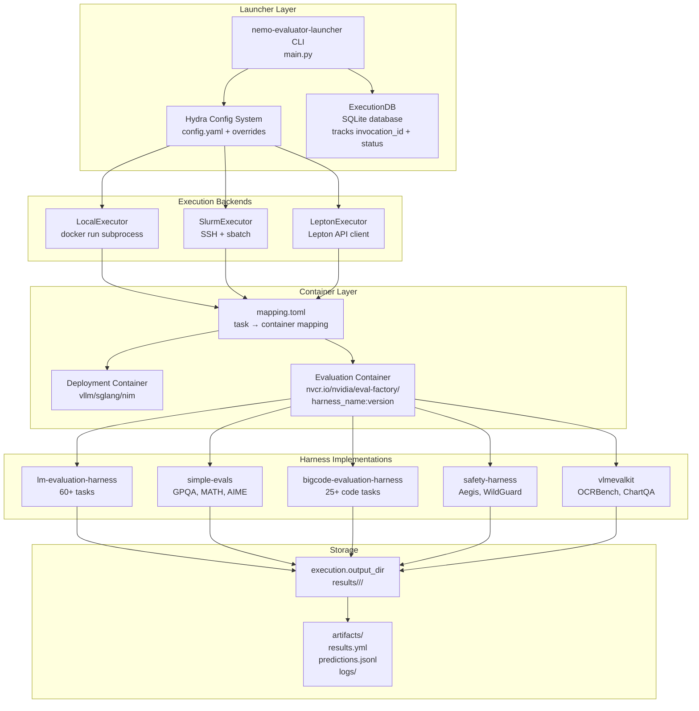

**Sources**: [11-evaluation/nemo-evaluator/SKILL.md:1-495](), [11-evaluation/nemo-evaluator/references/execution-backends.md:1-362]()

### Execution Backend System

The `nemo-evaluator-launcher` supports three execution backends with a common interface defined in the executor classes. Each backend implements job submission, status polling, and result collection.

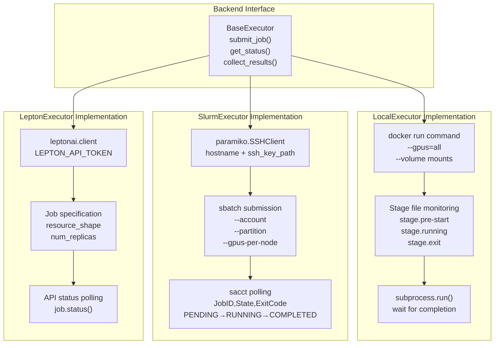

**Backend selection logic** in [11-evaluation/nemo-evaluator/references/execution-backends.md:275-285]():

| Use Case | Backend | Rationale |
|----------|---------|-----------|
| Quick local testing | `local` | Docker on workstation |
| Large-scale batch | `slurm` | Multi-node HPC cluster |
| CI/CD pipeline | `local` or `lepton` | Automated reproducibility |
| Multi-model comparison | `slurm` | Parallel job submission |
| Cloud-native | `lepton` | No infrastructure setup |

**Sources**: [11-evaluation/nemo-evaluator/references/execution-backends.md:1-362]()

### Adapter and Interceptor Pipeline

NeMo Evaluator uses an adapter system to process requests and responses through a configurable interceptor chain. Interceptors execute in order for requests and reverse order for responses.

```mermaid
graph LR
    subgraph "Request Pipeline"
        Req["API Request<br/>messages: []<br/>temperature<br/>max_tokens"]
        SysMsg["SystemMessageInterceptor<br/>inject system_message"]
        ReqLog["RequestLoggingInterceptor<br/>log to JSONL"]
        Cache["CachingInterceptor<br/>check cache_dir/<br/>hash(request)"]
    end
    
    subgraph "Endpoint"
        HTTP["EndpointInterceptor<br/>POST url<br/>headers: api_key"]
    end
    
    subgraph "Response Pipeline"
        Resp["API Response<br/>choices[0].message"]
        Reasoning["ReasoningInterceptor<br/>extract "]
        RespLog["ResponseLoggingInterceptor<br/>log response"]
        CacheSave["CachingInterceptor<br/>save to cache"]
    end
    
    Req --> SysMsg
    SysMsg --> ReqLog
    ReqLog --> Cache
    Cache --> HTTP
    
    HTTP --> Reasoning
    Reasoning --> RespLog
    RespLog --> CacheSave
    CacheSave --> Resp
```

**Configuration example** from [11-evaluation/nemo-evaluator/references/adapter-system.md:143-173]():

```yaml
adapter_config:
  interceptors:
    # Pre-endpoint (request processing)
    - name: system_message
      config:
        system_message: "You are a helpful AI assistant."
    - name: request_logging
      config:
        max_requests: 50
    - name: caching
      config:
        cache_dir: "./evaluation_cache"
        reuse_cached_responses: true
    
    # Endpoint (HTTP call)
    - name: endpoint
    
    # Post-endpoint (response processing)
    - name: response_logging
      config:
        max_responses: 50
    - name: reasoning
      config:
        start_reasoning_token: ""
```

**Available interceptors** in [11-evaluation/nemo-evaluator/references/adapter-system.md:54-141]():

| Interceptor | Stage | Purpose |
|-------------|-------|---------|
| `system_message` | Request | Inject system prompt |
| `request_logging` | Request | Log outbound requests |
| `caching` | Request/Response | Cache responses by hash |
| `endpoint` | Execution | HTTP call to model API |
| `reasoning` | Response | Extract/strip reasoning tokens |
| `response_logging` | Response | Log API responses |
| `progress_tracking` | Response | Report progress to external URL |

**Sources**: [11-evaluation/nemo-evaluator/references/adapter-system.md:1-341]()

### Task Registry and Container Mapping

NeMo Evaluator maintains a `mapping.toml` file that maps task names to NGC container images. The launcher reads this file to determine which container to execute for each task.

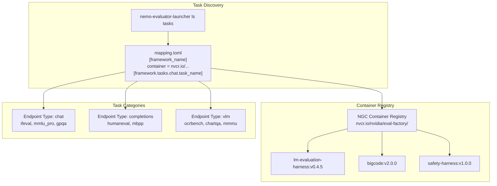

**Task configuration** from [11-evaluation/nemo-evaluator/SKILL.md:99-111]():

```yaml
evaluation:
  tasks:
    - name: ifeval           # Instruction following
    - name: gpqa_diamond     # Graduate-level QA
      env_vars:
        HF_TOKEN: HF_TOKEN   # Some tasks need HF token
    - name: gsm8k_cot_instruct  # Math reasoning
    - name: humaneval        # Code generation
```

**Supported harnesses** from [11-evaluation/nemo-evaluator/SKILL.md:338-352]():

| Harness | Task Count | Categories |
|---------|-----------|------------|
| `lm-evaluation-harness` | 60+ | MMLU, GSM8K, HellaSwag, ARC |
| `simple-evals` | 20+ | GPQA, MATH, AIME |
| `bigcode-evaluation-harness` | 25+ | HumanEval, MBPP, MultiPL-E |
| `safety-harness` | 3 | Aegis, WildGuard |
| `garak` | 1 | Security probing |
| `vlmevalkit` | 6+ | OCRBench, ChartQA, MMMU |
| `bfcl` | 6 | Function calling v2/v3 |
| `mtbench` | 2 | Multi-turn conversation |
| `livecodebench` | 10+ | Live coding evaluation |
| `helm` | 15 | Medical domain |
| `nemo-skills` | 8 | Math, science, agentic |

**Sources**: [11-evaluation/nemo-evaluator/SKILL.md:1-495](), [11-evaluation/nemo-evaluator/references/configuration.md:223-263]()

---

## BigCode Evaluation Harness Architecture

### Task System Architecture

BigCode Evaluation Harness implements a task-based architecture where each benchmark inherits from a base `Task` class and implements standard methods for dataset loading, prompting, postprocessing, and evaluation.

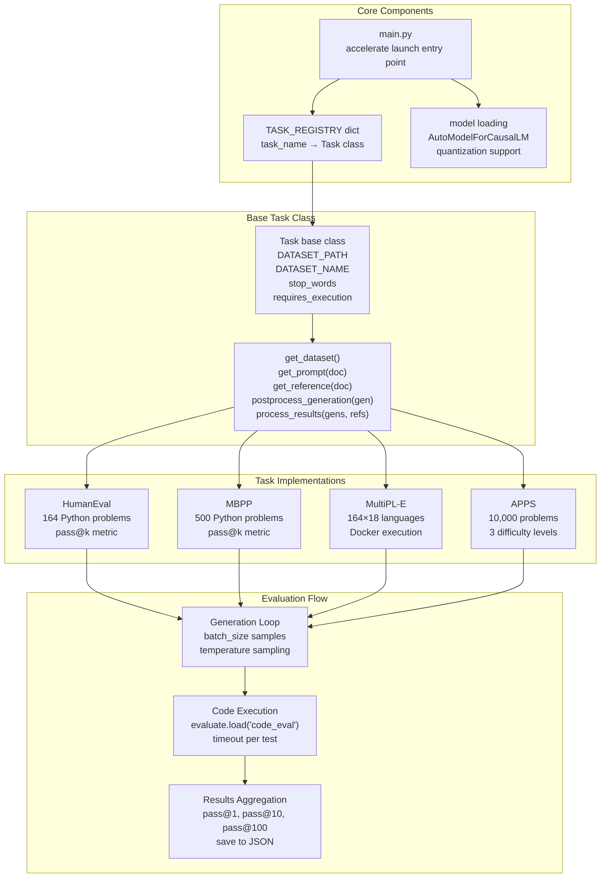

**Sources**: [11-evaluation/bigcode-evaluation-harness/SKILL.md:1-406](), [11-evaluation/bigcode-evaluation-harness/references/custom-tasks.md:6-98]()

### Task Implementation Pattern

Each task implements a standard interface defined in the base `Task` class. The pattern is shown in [11-evaluation/bigcode-evaluation-harness/references/custom-tasks.md:39-99]():

```python
class Task:
    DATASET_PATH: str  # HuggingFace dataset ID
    DATASET_NAME: str  # Dataset configuration (or None)

    def __init__(self, stop_words, requires_execution):
        """Initialize task with stop words and execution flag."""

    def get_dataset(self):
        """Return the evaluation dataset."""

    def get_prompt(self, doc):
        """Format document into model prompt."""

    def get_reference(self, doc):
        """Extract reference solution from document."""

    def postprocess_generation(self, generation, idx):
        """Clean up model output."""

    def process_results(self, generations, references):
        """Evaluate and return metrics."""
```

**Example task implementation** for code execution tasks from [11-evaluation/bigcode-evaluation-harness/references/custom-tasks.md:130-155]():

```python
class CodeExecutionTask(Task):
    def __init__(self):
        super().__init__(
            stop_words=["\nclass", "\ndef", "\n#"],
            requires_execution=True,  # CRITICAL: Enable execution
        )

    def get_reference(self, doc):
        """Return test code to execute."""
        return f"\n{doc['test']}\ncheck({doc['entry_point']})"

    def process_results(self, generations, references):
        code_metric = load("code_eval")
        results, details = code_metric.compute(
            references=references,
            predictions=generations,
            k=[1, 10, 100],
            timeout=10.0,  # Seconds per test
        )
        return results
```

**Sources**: [11-evaluation/bigcode-evaluation-harness/references/custom-tasks.md:1-425]()

### Benchmark Suite

BigCode Harness includes comprehensive benchmarks for code generation across multiple languages and difficulty levels.

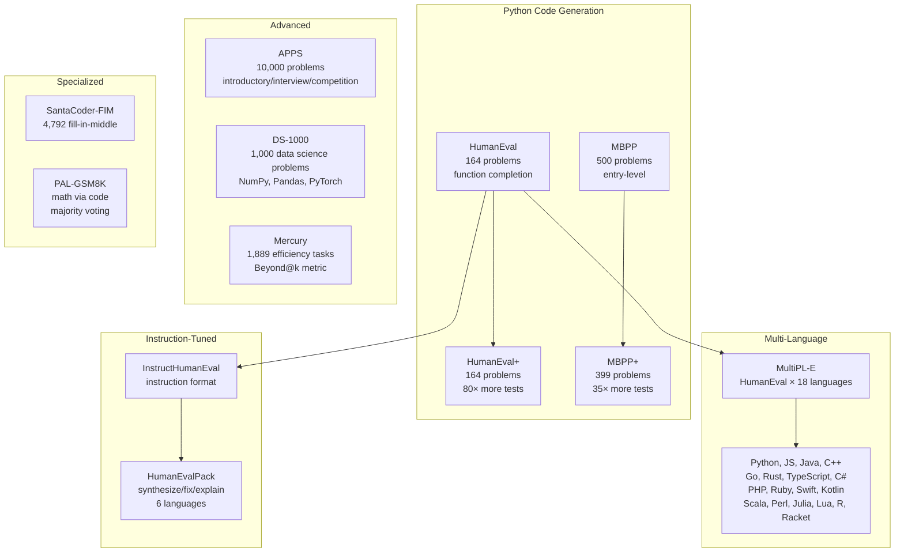

**Benchmark comparison** from [11-evaluation/bigcode-evaluation-harness/references/benchmarks.md:359-372]():

| Goal | Recommended Benchmarks |
|------|------------------------|
| Quick sanity check | HumanEval (n_samples=20) |
| Standard evaluation | HumanEval + MBPP |
| Rigorous evaluation | HumanEval+ + MBPP+ |
| Multi-language | MultiPL-E |
| Instruction models | InstructHumanEval, HumanEvalPack |
| FIM/Infilling | SantaCoder-FIM, StarCoder-FIM |
| Data science | DS-1000 |
| Competition-level | APPS |
| Efficiency | Mercury |
| Math reasoning | PAL-GSM8K |

**Sources**: [11-evaluation/bigcode-evaluation-harness/references/benchmarks.md:1-394](), [11-evaluation/bigcode-evaluation-harness/SKILL.md:296-309]()

### pass@k Metric Calculation

BigCode Harness calculates pass@k using unbiased estimators to measure the probability that at least one of k samples passes all unit tests.

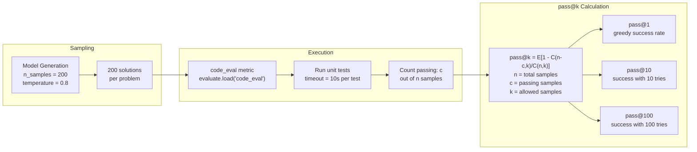

**pass@k formula** from [11-evaluation/bigcode-evaluation-harness/references/benchmarks.md:375-394]():

```
pass@k = E[1 - C(n-c, k) / C(n, k)]

Where:
- n = total samples generated
- c = samples that pass all tests
- k = number of samples allowed
```

**Recommended n_samples by k**:
- pass@1: n ≥ 20
- pass@10: n ≥ 100
- pass@100: n ≥ 200

**Temperature recommendations** from [11-evaluation/bigcode-evaluation-harness/references/benchmarks.md:391-394]():
- pass@1: `temperature = 0.2` (near-greedy)
- pass@10, pass@100: `temperature = 0.8` (more diverse sampling)

**Sources**: [11-evaluation/bigcode-evaluation-harness/references/benchmarks.md:375-394](), [11-evaluation/bigcode-evaluation-harness/SKILL.md:117-136]()

---

## Framework Comparison and Selection

### Feature Matrix

| Feature | NeMo Evaluator | BigCode Harness |
|---------|----------------|-----------------|
| **Primary Use Case** | General LLM benchmarking | Code generation evaluation |
| **Benchmark Count** | 100+ across 18+ harnesses | 25+ code-specific benchmarks |
| **Execution Backends** | Local, Slurm, Lepton | Local, Docker (multi-language) |
| **Containerization** | NGC containers per harness | Docker for safe code execution |
| **Multi-Backend** | Yes (3 backends) | No (local only) |
| **Multi-Language Code** | Via `bigcode` harness | Native (18 languages) |
| **Adapter System** | Yes (interceptor pipeline) | No |
| **Response Caching** | Yes (via interceptor) | No |
| **MLOps Export** | MLflow, W&B, local | JSON only |
| **Enterprise Features** | Slurm integration, API key management | N/A |
| **HuggingFace Models** | Via API endpoints | Direct model loading |
| **Quantization Support** | N/A (endpoint-based) | 4-bit, 8-bit built-in |

**Sources**: [11-evaluation/nemo-evaluator/SKILL.md:322-336](), [11-evaluation/bigcode-evaluation-harness/SKILL.md:279-293]()

### Selection Decision Tree

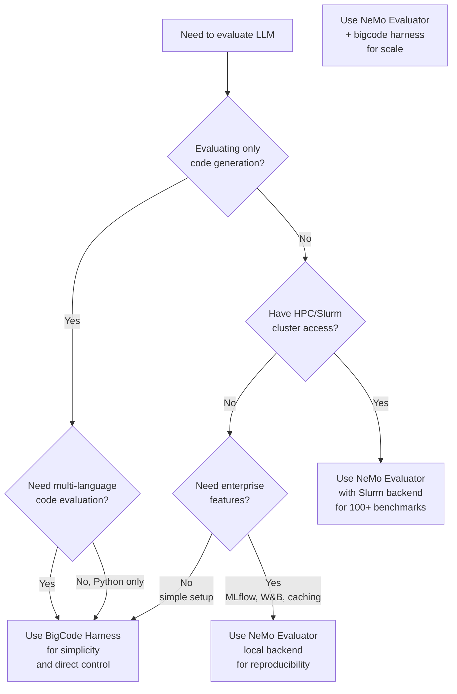

**When to use NeMo Evaluator** from [11-evaluation/nemo-evaluator/SKILL.md:322-336]():
- Need **100+ benchmarks** from 18+ harnesses in one platform
- Running evaluations on **Slurm HPC clusters** or cloud
- Requiring **reproducible** containerized evaluation
- Evaluating against **OpenAI-compatible APIs** (vLLM, TRT-LLM, NIMs)
- Need **enterprise-grade** evaluation with result export (MLflow, W&B)

**When to use BigCode Harness** from [11-evaluation/bigcode-evaluation-harness/SKILL.md:279-293]():
- Evaluating **code generation** models specifically
- Need **multi-language** evaluation (18 languages via MultiPL-E)
- Testing **functional correctness** with unit tests (pass@k)
- Benchmarking for **BigCode/HuggingFace leaderboards**
- Evaluating **fill-in-the-middle** (FIM) capabilities

**Sources**: [11-evaluation/nemo-evaluator/SKILL.md:322-336](), [11-evaluation/bigcode-evaluation-harness/SKILL.md:279-293]()

---

## Integration Patterns

### NeMo Evaluator + BigCode Integration

NeMo Evaluator includes BigCode Harness as one of its 18+ supported harnesses, enabling unified execution across all benchmarks.

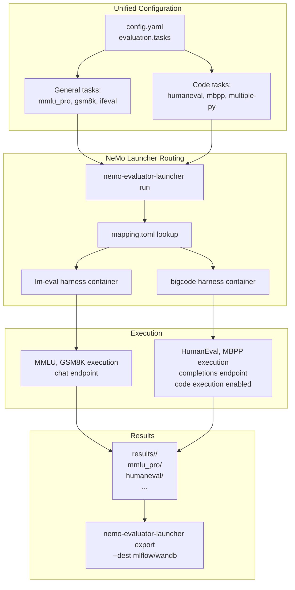

**Unified configuration example** from [11-evaluation/nemo-evaluator/SKILL.md:238-249]():

```yaml
evaluation:
  nemo_evaluator_config:
    config:
      params:
        temperature: 0.01
        parallelism: 4
  tasks:
    - name: mmlu_pro       # General benchmark
    - name: gsm8k_cot_instruct
    - name: ifeval
    - name: humaneval      # Code benchmark
    - name: mbpp
```

**Sources**: [11-evaluation/nemo-evaluator/SKILL.md:216-281]()

### MLOps Export Integration

NeMo Evaluator provides native export to MLflow, Weights & Biases, and local formats for tracking experiments.

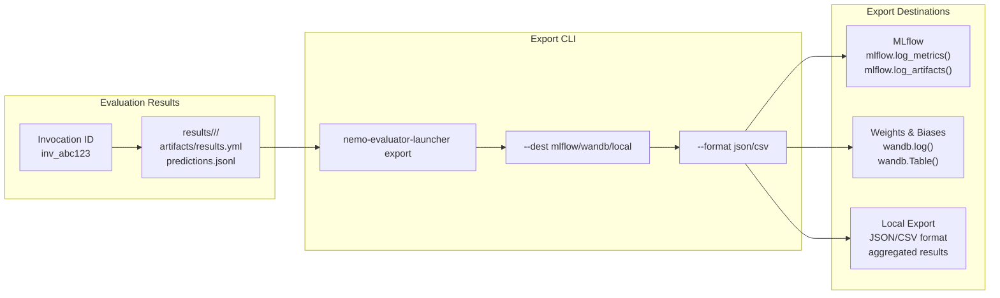

**Export commands** from [11-evaluation/nemo-evaluator/SKILL.md:269-281]():

```bash
# Export to MLflow
nemo-evaluator-launcher export <invocation_id_1> --dest mlflow
nemo-evaluator-launcher export <invocation_id_2> --dest mlflow

# Export to local JSON
nemo-evaluator-launcher export <invocation_id> --dest local --format json

# Export to Weights & Biases
nemo-evaluator-launcher export <invocation_id> --dest wandb
```

**Sources**: [11-evaluation/nemo-evaluator/SKILL.md:269-281](), [11-evaluation/nemo-evaluator/SKILL.md:402-413]()

### Custom Benchmark Integration

Both frameworks support custom benchmark integration through different mechanisms.

**NeMo Evaluator: Framework Definition Files (FDFs)**

From [11-evaluation/nemo-evaluator/references/custom-benchmarks.md:14-41]():

```yaml
# framework_def.yaml
framework:
  name: my-custom-framework
  package_name: my_custom_eval

defaults:
  command: "python -m my_custom_eval.run --model-id {model_id} --task {task} --output-dir {output_dir}"

evaluations:
  - name: custom_task_1
    defaults:
      temperature: 0.0
      max_new_tokens: 512
      extra:
        custom_param: value

  - name: custom_task_2
    defaults:
      temperature: 0.7
      max_new_tokens: 1024
```

**BigCode Harness: Task Class Implementation**

From [11-evaluation/bigcode-evaluation-harness/references/custom-tasks.md:39-99]():

```python
class MyCustomTask(Task):
    """Custom code evaluation task."""

    DATASET_PATH = "username/dataset-name"  # HuggingFace dataset
    DATASET_NAME = None  # or specific config name

    def __init__(self):
        super().__init__(
            stop_words=["\nclass", "\ndef", "\n#", "\nif", "\nprint"],
            requires_execution=True,  # Set True if running unit tests
        )

    def get_dataset(self):
        """Load evaluation split."""
        from datasets import load_dataset
        return load_dataset(self.DATASET_PATH, self.DATASET_NAME, split="test")

    def get_prompt(self, doc):
        """Format problem into prompt for model."""
        return doc["prompt"]

    def get_reference(self, doc):
        """Return test cases or reference solution."""
        return doc["test"]

    def postprocess_generation(self, generation, idx):
        """Clean model output."""
        for stop_word in self.stop_words:
            if stop_word in generation:
                generation = generation[:generation.index(stop_word)]
        return generation

    def process_results(self, generations, references):
        """Execute tests and compute pass@k."""
        code_metric = load("code_eval")
        results, _ = code_metric.compute(
            references=references,
            predictions=generations,
            k=[1, 10, 100]
        )
        return results
```

**Sources**: [11-evaluation/nemo-evaluator/references/custom-benchmarks.md:1-316](), [11-evaluation/bigcode-evaluation-harness/references/custom-tasks.md:1-425]()

---

## Advanced Usage Patterns

### Caching and Resume for Long Evaluations

NeMo Evaluator supports response caching via the caching interceptor, enabling interrupted evaluations to resume from where they left off.

From [11-evaluation/nemo-evaluator/references/execution-backends.md:209-224]():

```yaml
execution:
  walltime: "24:00:00"  # Extended walltime for Slurm

target:
  api_endpoint:
    adapter_config:
      interceptors:
        - name: caching
          config:
            cache_dir: "/shared/cache"
            reuse_cached_responses: true
```

**How it works**:
1. Caching interceptor computes `hash(request)` before sending to endpoint
2. Checks `cache_dir/hash.json` for existing response
3. If found, returns cached response without API call
4. If not found, makes API call and saves response to cache
5. On interruption/restart, previously cached requests are skipped

**Sources**: [11-evaluation/nemo-evaluator/references/execution-backends.md:209-224](), [11-evaluation/nemo-evaluator/references/adapter-system.md:79-90]()

### Multi-Model Comparison Pipeline

Both frameworks support systematic multi-model comparison through scripting.

**NeMo Evaluator approach** from [11-evaluation/nemo-evaluator/SKILL.md:216-267]():

```bash
# Evaluate Llama 3.1 8B
nemo-evaluator-launcher run \
  --config-dir . \
  --config-name base_eval \
  -o target.api_endpoint.model_id=meta/llama-3.1-8b-instruct \
  -o target.api_endpoint.url=https://integrate.api.nvidia.com/v1/chat/completions

# Evaluate Mistral 7B
nemo-evaluator-launcher run \
  --config-dir . \
  --config-name base_eval \
  -o target.api_endpoint.model_id=mistralai/mistral-7b-instruct-v0.3 \
  -o target.api_endpoint.url=https://integrate.api.nvidia.com/v1/chat/completions

# Export all results
nemo-evaluator-launcher export <invocation_id_1> --dest mlflow
nemo-evaluator-launcher export <invocation_id_2> --dest mlflow
```

**BigCode Harness approach** from [11-evaluation/bigcode-evaluation-harness/SKILL.md:226-276]():

```bash
#!/bin/bash
# eval_models.sh

MODELS=(
  "bigcode/starcoder2-7b"
  "codellama/CodeLlama-7b-hf"
  "deepseek-ai/deepseek-coder-6.7b-base"
)
TASKS="humaneval,mbpp"

for model in "${MODELS[@]}"; do
  model_name=$(echo $model | tr '/' '-')
  echo "Evaluating $model"

  accelerate launch main.py \
    --model $model \
    --tasks $TASKS \
    --temperature 0.2 \
    --n_samples 20 \
    --batch_size 20 \
    --allow_code_execution \
    --metric_output_path results/${model_name}.json
done

# Generate comparison table
python compare_results.py results/*.json
```

**Sources**: [11-evaluation/nemo-evaluator/SKILL.md:216-281](), [11-evaluation/bigcode-evaluation-harness/SKILL.md:226-276]()

### Slurm-Based Parallel Evaluation

NeMo Evaluator's Slurm backend enables large-scale parallel evaluation across multiple nodes.

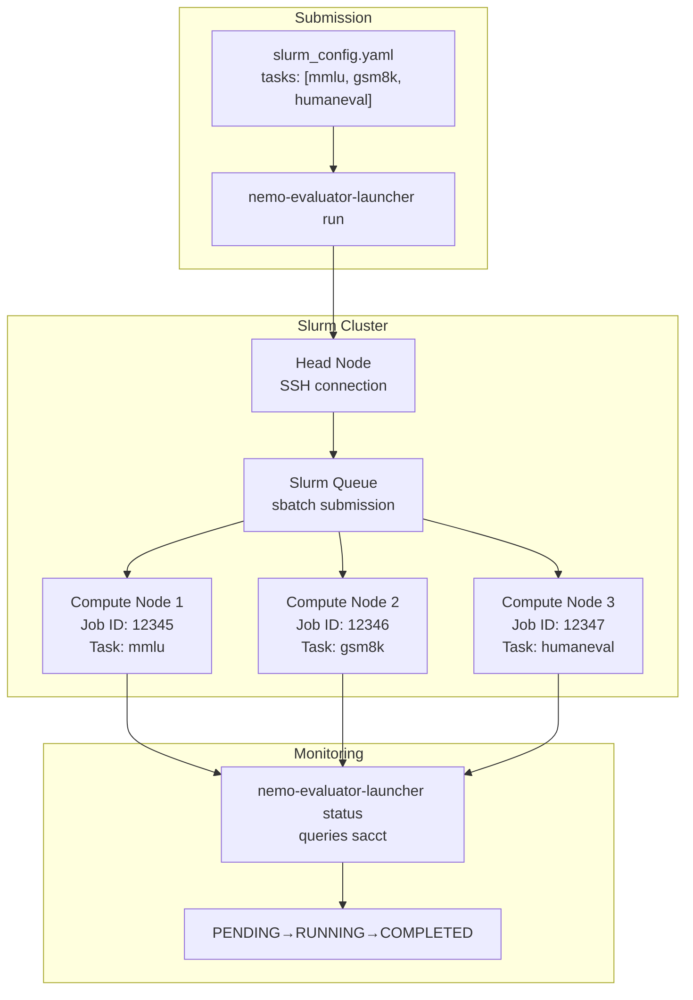

**Configuration** from [11-evaluation/nemo-evaluator/SKILL.md:160-213]():

```yaml
defaults:
  - execution: slurm
  - deployment: vllm
  - _self_

execution:
  hostname: cluster.example.com
  account: my_slurm_account
  partition: gpu
  output_dir: /shared/results
  walltime: "04:00:00"
  nodes: 1
  gpus_per_node: 8

deployment:
  checkpoint_path: /shared/models/llama-3.1-8b
  tensor_parallel_size: 2
  data_parallel_size: 4
  max_model_len: 4096

target:
  api_endpoint:
    model_id: llama-3.1-8b
    # URL auto-generated by deployment

# Launch evaluation
nemo-evaluator-launcher run \
  --config-dir . \
  --config-name slurm_config

# Check status (queries sacct)
nemo-evaluator-launcher status <invocation_id>

# View detailed info
nemo-evaluator-launcher info <invocation_id>
```

**Sources**: [11-evaluation/nemo-evaluator/SKILL.md:147-213](), [11-evaluation/nemo-evaluator/references/execution-backends.md:90-223]()