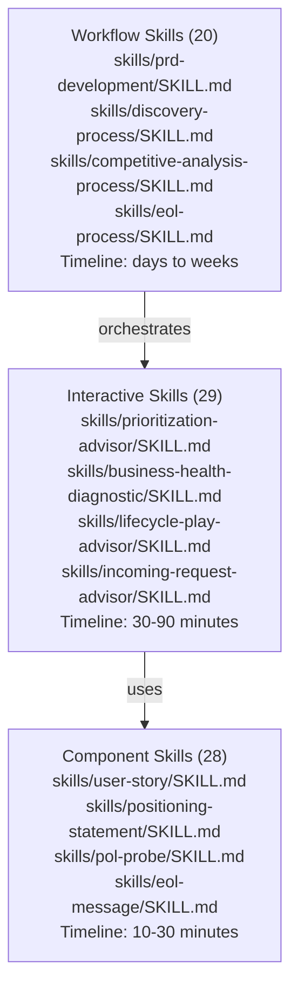
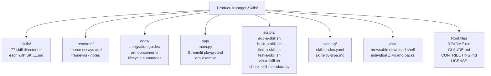
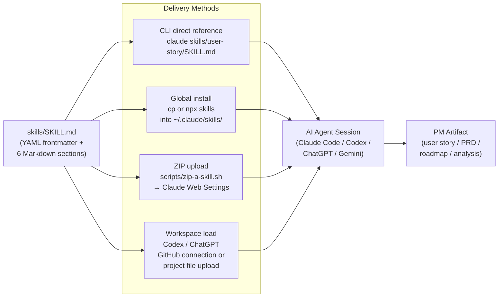

<!-- source: DeepWiki mcp.deepwiki.com · repo deanpeters/Product-Manager-Skills · page 1 Overview · fetched 2026-10-26 -->

# Overview

<details>
<summary>Relevant source files</summary>

The following files were used as context for generating this wiki page:

- [.claude-plugin/marketplace.json](.claude-plugin/marketplace.json)
- [CLAUDE.md](CLAUDE.md)
- [README.md](README.md)
- [catalog/skills-by-type.md](catalog/skills-by-type.md)
- [catalog/skills-index.yaml](catalog/skills-index.yaml)
- [docs/announcements/2026-07-08-v0-82-inbound-requests-and-dist-shelf.md](docs/announcements/2026-07-08-v0-82-inbound-requests-and-dist-shelf.md)
- [skills/company-intel/SKILL.md](skills/company-intel/SKILL.md)
- [skills/derisk-measurement-advisor/SKILL.md](skills/derisk-measurement-advisor/SKILL.md)
- [skills/incoming-request-advisor/SKILL.md](skills/incoming-request-advisor/SKILL.md)
- [skills/incoming-request-advisor/examples/conversation-flow.md](skills/incoming-request-advisor/examples/conversation-flow.md)
- [skills/incoming-request-advisor/template.md](skills/incoming-request-advisor/template.md)

</details>


This page introduces the Product Manager Skills repository: its purpose, the problem it solves, how skills are structured, and how AI agents consume them. For a detailed breakdown of the three-tier dependency model, see [Three-Tier Skill Architecture](#1.1). For the full directory layout, see [Repository Structure](#1.2). For a catalog of all skills by tier, see [Skill Catalog](#2).

---

## What This Repository Is

The Product Manager Skills repository is a collection of **77 structured Markdown files** that encode product management frameworks in a format readable by AI agents. Rather than prompting an agent from scratch each time, a practitioner loads one or more skill files into an agent's context, then invokes the skill by name. The agent executes the framework—asking questions, generating artifacts, or orchestrating multi-phase processes—without the user re-explaining the methodology.

Each skill is a single file, `SKILL.md`, stored in its own lowercase kebab-case directory under `skills/`. Every file contains YAML frontmatter declaring its `name`, `description`, `type`, and metadata like `theme` or `estimated_time`, followed by six standard Markdown sections.

**Minimal skill frontmatter:**
[skills/derisk-measurement-advisor/SKILL.md:1-25]()
```yaml
---
name: derisk-measurement-advisor
description: Identify what to measure, test, or track to de-risk a product or AI idea.
type: interactive
theme: validation-experiments
estimated_time: "15-20 min"
---
```

Skills are organized into three types that form a strict dependency hierarchy: **Component**, **Interactive**, and **Workflow**. No circular dependencies are permitted; the direction is always Component ← Interactive ← Workflow.

Sources: [README.md:24-34](), [CLAUDE.md:9-16](), [catalog/skills-index.yaml:1-13]()

---

## The Problem This Solves

| Without Skills | With Skills |
|---|---|
| Re-explain the framework every session | Agent loads `SKILL.md` once and knows the protocol |
| Generic output from vague prompts | Structured output from encoded methodology |
| Inconsistent results across team members | Repeatable, predictable artifacts |
| Manual orchestration of multi-step processes | Workflow skills handle phase sequencing |

The repository targets AI agents that can read structured knowledge: Claude Code, Claude Desktop/Web, OpenAI Codex, ChatGPT, Gemini, and any agent supporting file-based context loading. The goal is dual: **functional** (equipping agents to do PM work) and **pedagogic** (teaching humans the reasoning behind frameworks).

Sources: [README.md:28-36](), [CLAUDE.md:1-3]()

---

## Three-Tier Skill Architecture

Skills form a three-tier dependency hierarchy. Higher tiers orchestrate lower tiers; lower tiers never reference upward. As of v0.84, the library contains 77 skills across these tiers.

**Three-Tier Dependency Hierarchy**



Sources: [CLAUDE.md:11-14](), [catalog/skills-by-type.md:5-130]()

| Tier | Count | Characteristics | Example |
|---|---|---|---|
| **Component** | 28 | Self-contained artifact templates; no external skill dependencies | `skills/user-story/SKILL.md` produces a user story with Gherkin criteria |
| **Interactive** | 29 | Multi-turn Q&A flows; ask 3–5 questions, then apply Component skills | `skills/incoming-request-advisor/SKILL.md` decodes Slack pings into JTBD |
| **Workflow** | 20 | End-to-end multi-phase processes; reference both Component and Interactive skills | `skills/competitive-analysis-process/SKILL.md` orchestrates a 6-step analysis |

Sources: [CLAUDE.md:11-14](), [skills/incoming-request-advisor/SKILL.md:1-25](), [catalog/skills-index.yaml:113-122]()

---

## Repository Layout

**Top-Level Directory Structure**



Sources: [CLAUDE.md:9-16](), [docs/announcements/2026-07-08-v0-82-inbound-requests-and-dist-shelf.md:19-25]()

Each skill follows a flat directory pattern. The `SKILL.md` filename is case-sensitive and required for compatibility. The folder name must exactly match the `name` field in YAML frontmatter.

Sources: [CLAUDE.md:16](), [docs/announcements/2026-07-08-v0-82-inbound-requests-and-dist-shelf.md:41-42]()

---

## How AI Agents Consume Skills

**Agent Integration Paths**



Sources: [docs/announcements/2026-07-08-v0-82-inbound-requests-and-dist-shelf.md:33-38](), [CLAUDE.md:3-5]()

For step-by-step instructions by agent platform, see [Using Skills with Claude](#4.1), [Using Skills with OpenAI Codex](#4.2), and [Using Skills with ChatGPT](#4.3).

---

## Skill File Internal Structure

Every `SKILL.md` file follows the same six-section body, preceded by YAML frontmatter:

| Section | Purpose |
|---|---|
| `## Purpose` | What the skill does and when to use it |
| `## Key Concepts` | Core frameworks, definitions, anti-patterns |
| `## Application` | Step-by-step instructions with examples |
| `## Examples` | Real-world cases (Fieldlight, Northfield, Brightwater) |
| `## Common Pitfalls` | What to avoid and why |
| `## References` | Related skills and external frameworks cited |

The `name` field must be ≤ 64 characters; `description` must be ≤ 200 characters. v0.84 skills also include three standard example universes: **Fieldlight** (B2B SaaS), **Northfield Automation** (Industrial/Hardware), and **Brightwater Biologics** (Life Sciences).

Sources: [CLAUDE.md:18-19](), [skills/derisk-measurement-advisor/SKILL.md:27-124]()

---

## Tooling Overview

The `scripts/` directory contains utilities that support skill authoring, search, testing, and packaging:

| Script | Role |
|---|---|
| `scripts/add-a-skill.sh` | AI-assisted skill generation from a file or clipboard input |
| `scripts/build-a-skill.sh` | Interactive wizard that prompts section-by-section |
| `scripts/find-a-skill.sh` | Ranked keyword/type search across existing skills |
| `scripts/test-a-skill.sh` | Conformance checks and optional smoke tests |
| `scripts/zip-a-skill.sh` | Builds upload-ready `.zip` files by skill, type, or preset |
| `scripts/check-skill-metadata.py` | Strict YAML frontmatter validation |

The Streamlit playground at `app/main.py` provides a local browser UI for browsing and running skills interactively. v0.82 introduced the `dist/` shelf, providing a browsable directory of pre-packaged ZIPs for non-technical users.

Sources: [docs/announcements/2026-07-08-v0-82-inbound-requests-and-dist-shelf.md:19-25](), [CLAUDE.md:37-42]()

---

## Quick-Start Paths by Audience

| Goal | Starting Point |
|---|---|
| Use an existing skill with Claude Code | `cd` into the repo; run `claude "Using skills/user-story/SKILL.md, write stories for..."` |
| Load skills into Claude Web | Navigate to `dist/`, download a pack ZIP, upload via Claude Settings → Capabilities → Skills |
| Browse and test skills locally | `pip install -r app/requirements.txt` then `streamlit run app/main.py` |
| Create a new skill | Run `scripts/add-a-skill.sh research/your-notes.md` or `scripts/build-a-skill.sh` |
| Find the right skill for a task | Run `scripts/find-a-skill.sh --keyword pricing --type interactive` |
| Triage a stakeholder request | Use `skills/incoming-request-advisor/SKILL.md` |

Sources: [docs/announcements/2026-07-08-v0-82-inbound-requests-and-dist-shelf.md:33-38](), [skills/incoming-request-advisor/SKILL.md:20-25]()

---

## Version History Summary

| Version | Date | Key Changes |
|---|---|---|
| v0.84 | Aug 10, 2026 | **Lifecycle & EOL Suite** (8 skills); 77 total skills; full adornment with Fieldlight/Northfield/Brightwater examples. |
| v0.83 | Jul 17, 2026 | **Market Intelligence Suite** (12 skills); autonomous-investigation protocol; library at 69 skills. |
| v0.82 | Jul 8, 2026 | `incoming-request-advisor` added; `dist/` browsable download shelf established; 56 total skills. |

Sources: [CLAUDE.md:7-42](), [docs/announcements/2026-07-08-v0-82-inbound-requests-and-dist-shelf.md:1-28]()

---

## License

CC BY-NC-SA 4.0 — non-commercial use with share-alike. See `LICENSE` for full terms.

Sources: [README.md:20](), [CLAUDE.md:15]()

---

