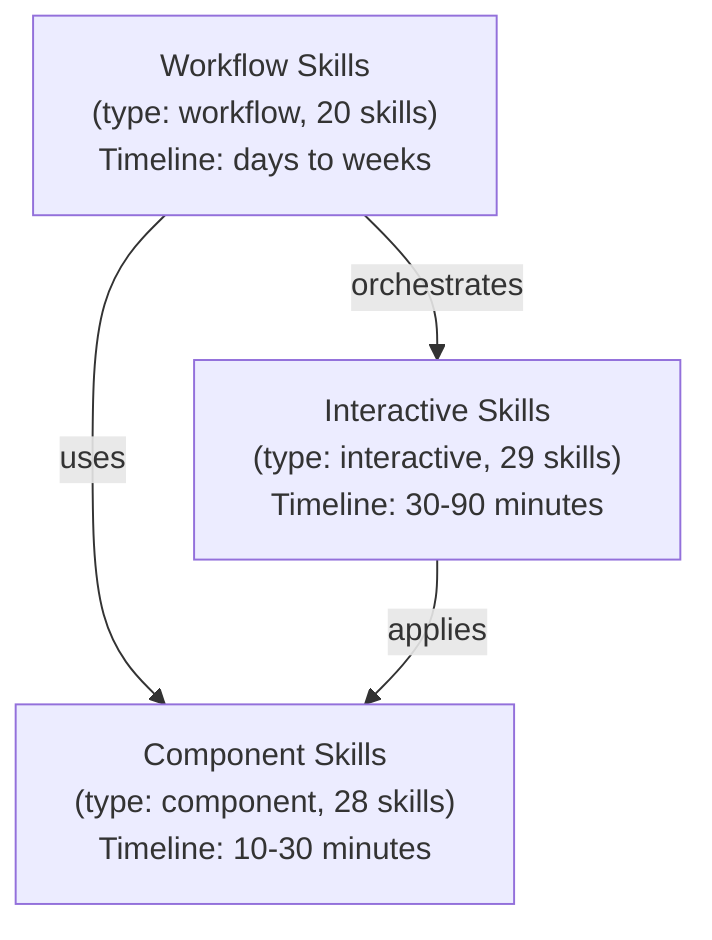
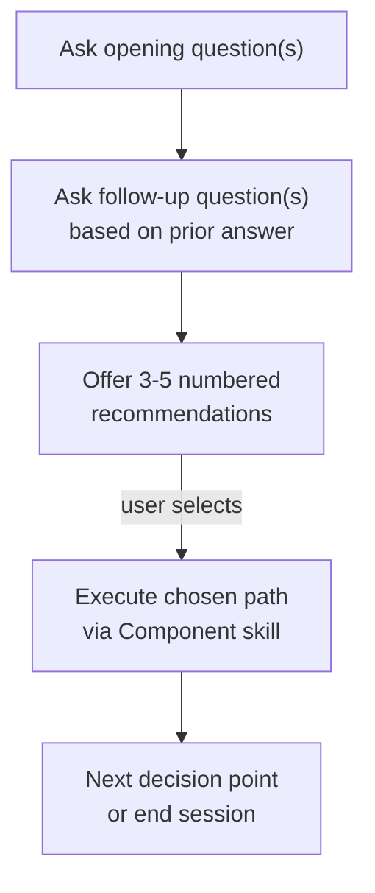
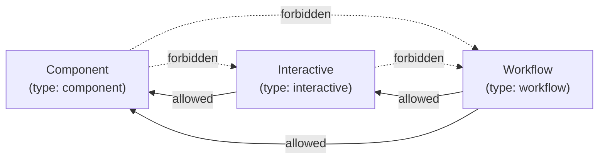
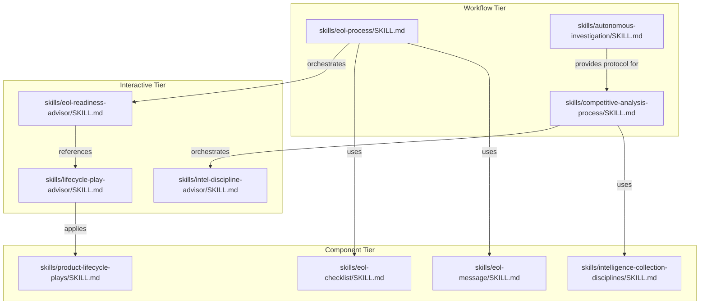
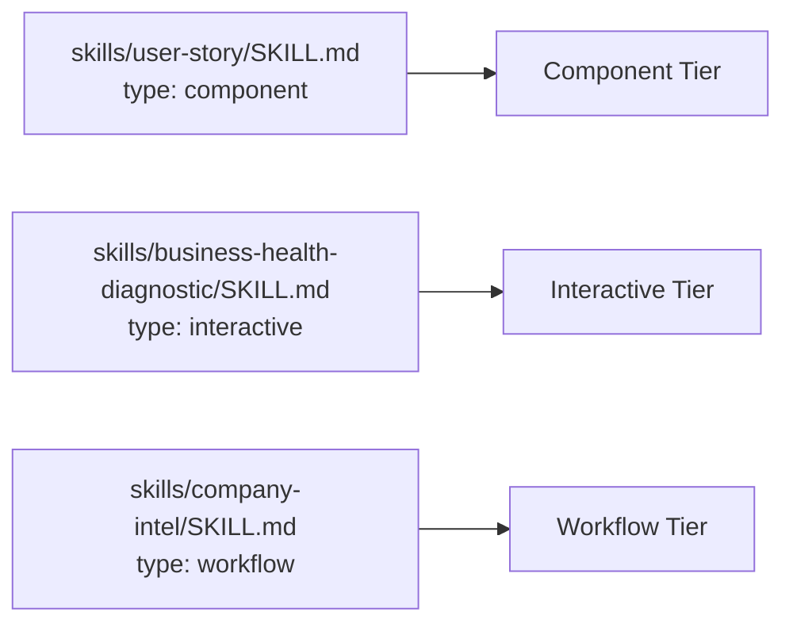

<!-- source: DeepWiki mcp.deepwiki.com · repo deanpeters/Product-Manager-Skills · page 1.1 Three-Tier Skill Architecture · fetched 2026-10-26 -->

# Three-Tier Skill Architecture

Relevant source files

The following files were used as context for generating this wiki page:

- [CLAUDE.md](CLAUDE.md)
- [CONTRIBUTING.md](CONTRIBUTING.md)
- [README.md](README.md)
- [catalog/skills-by-type.md](catalog/skills-by-type.md)
- [catalog/skills-index.yaml](catalog/skills-index.yaml)
- [docs/Add-a-Skill Utility Guide.md](docs/Add-a-Skill Utility Guide.md)
- [docs/Building PM Skills.md](docs/Building PM Skills.md)
- [docs/CHANGELOG.md](docs/CHANGELOG.md)
- [docs/announcements/2026-07-08-v0-82-inbound-requests-and-dist-shelf.md](docs/announcements/2026-07-08-v0-82-inbound-requests-and-dist-shelf.md)
- [scripts/build-a-skill.sh](scripts/build-a-skill.sh)
- [skills/company-intel/SKILL.md](skills/company-intel/SKILL.md)
- [skills/derisk-measurement-advisor/SKILL.md](skills/derisk-measurement-advisor/SKILL.md)

This page defines the dependency hierarchy that governs how the **77 skills** in this repository relate to each other. It covers each tier's responsibilities, constraints, time expectations, and the no-circular-dependency rule that enforces clean skill composition.

For a complete listing of every skill organized by tier, see [Skill Catalog](#2). For the file format that declares a skill's tier, see [Skill Format Reference](#5.1). For the process of creating a skill that conforms to these rules, see [Skill Authoring Workflow](#5.2).

---

## Architecture Overview

Every skill belongs to exactly one of three tiers. The tiers form a strict upward-only dependency chain: higher tiers orchestrate lower tiers; lower tiers never reference higher ones.

| Tier | `type` value in frontmatter | Count | Typical time | Role |
|------|-----------------------------|-------|-------------|------|
| Component | `component` | 28 | 10–30 min | Artifact template; self-contained deliverable format |
| Interactive | `interactive` | 29 | 30–90 min | Multi-turn Q&A; gathers context, issues recommendations |
| Workflow | `workflow` | 20 | Days to weeks | End-to-end process; orchestrates the two lower tiers |

The `type` field in each `SKILL.md` frontmatter is the authoritative declaration of a skill's tier. 

**Three-Tier Dependency Flow**

Sources: [README.md:17-20](), [CLAUDE.md:12-14](), [docs/Building PM Skills.md:79-84]()

---

## Tier 1: Component Skills

Component skills are self-contained artifact templates. Each one teaches an AI agent how to produce a single, well-structured PM deliverable or look up specific reference data.

**Characteristics:**

- Focused on "how to create X correctly" — not on gathering context or sequencing steps.
- Includes template structure, quality criteria, examples, and common pitfalls.
- No dependency on Interactive or Workflow skills.
- Consumed by Interactive and Workflow skills as execution targets.

**Representative examples:**

| Skill folder | Deliverable produced |
|---|---|
| `skills/user-story/` | User story with Mike Cohn format and Gherkin acceptance criteria |
| `skills/positioning-statement/` | Geoffrey Moore positioning statement |
| `skills/pol-probe/` | Proof of Life validation experiment definition |
| `skills/finance-metrics-quickref/` | SaaS finance metrics, formulas, and benchmarks |
| `skills/eol-message/` | Right-sized End-of-Life announcement comms |

Sources: [CLAUDE.md:12](), [catalog/skills-by-type.md:5-62](), [docs/Building PM Skills.md:81]()

---

## Tier 2: Interactive Skills

Interactive skills run a bounded multi-turn conversation — typically 3–5 questions — to gather context, then issue a ranked set of concrete recommendations. They frequently end by invoking a Component skill to produce a deliverable.

**Characteristics:**

- One question (or small batch) at a time; answers inform subsequent questions.
- Presents 3–5 enumerated, context-aware recommendations after the Q&A phase.
- Supports three canonical entry modes: **Guided**, **Context dump**, and **Best guess**.
- May reference Component skills as output targets, but never Workflow skills.

**Canonical question-flow pattern:**

**Representative examples:**

| Skill folder | Context gathered | Recommendation type |
|---|---|---|
| `skills/prioritization-advisor/` | Product stage, team size, data availability | RICE, ICE, Kano, or other framework |
| `skills/acquisition-channel-advisor/` | Unit economics, CAC, LTV | Scale, test, or kill a growth channel |
| `skills/derisk-measurement-advisor/` | AI/Product idea, stage | Risk register (Act now vs. Watch) |
| `skills/lifecycle-play-advisor/` | Product stage, trigger, pressure source | Extend, Replace, Retire, or "Nothing yet" |

Sources: [CLAUDE.md:13](), [catalog/skills-by-type.md:64-122](), [skills/derisk-measurement-advisor/SKILL.md:27-31](), [skills/lifecycle-play-advisor/SKILL.md:25]()

---

## Tier 3: Workflow Skills

Workflow skills represent complete end-to-end PM processes. They define multi-phase sequences with decision points, delegate context-gathering to Interactive skills, and delegate artifact production to Component skills.

**Characteristics:**

- Span multiple sessions (days to weeks of real work).
- Include explicit phase structure (e.g., Frame → Research → Synthesize → Validate).
- Reference both Interactive and Component skills by name.
- Contain decision points that branch based on what was learned in prior phases.

**Representative examples:**

| Skill folder | What it orchestrates | Timeline |
|---|---|---|
| `skills/product-strategy-session/` | positioning → problem framing → roadmap | 2–4 weeks |
| `skills/discovery-process/` | frame → research → synthesize → validate | 3–4 weeks |
| `skills/competitive-analysis-process/` | landscape → comparison → strategic direction | 6-step umbrella |
| `skills/autonomous-investigation/` | search-plan → evidence labeling → diffable outputs | Protocol skill |
| `skills/eol-process/` | Prepare → Notify → Execute → Close | 6-phase sunset |

Sources: [CLAUDE.md:14](), [catalog/skills-by-type.md:124-165](), [skills/company-intel/SKILL.md:14](), [skills/competitive-analysis-process/SKILL.md:118]()

---

## Dependency Rules

The three-tier architecture enforces a strict no-circular-dependency rule. Allowed reference directions are summarized below.

| Skill tier | May reference | May NOT reference |
|---|---|---|
| `component` | Nothing | `interactive`, `workflow` |
| `interactive` | `component` | `workflow` |
| `workflow` | `component`, `interactive` | Nothing forbidden, but no cycles |

No skill at any tier may create a cycle (A references B, B references A).

**Allowed and Forbidden Reference Directions**

Sources: [docs/Building PM Skills.md:79-84](), [CONTRIBUTING.md:77]()

---

## Concrete Skill-Entity Dependency Graph

The following diagram maps real `SKILL.md` file entities to their dependency relationships for representative cross-tier suites, such as Market Intelligence and Lifecycle/EOL.

**Cross-Tier Suite Dependencies (Code Entity Space)**

Sources: [CLAUDE.md:21-31](), [CLAUDE.md:35-42](), [README.md:76-84]()

---

## How the YAML `type` Field Encodes Tier

Every `SKILL.md` file begins with a YAML frontmatter block. The `type` field is what the tooling (scripts like `check-skill-metadata.py` and `add-a-skill.sh`) reads to classify a skill into its tier.

**`type` Field Values Mapped to Repository Tiers**

The three accepted values for `type` are: `component`, `interactive`, and `workflow`. Any other value causes `scripts/check-skill-metadata.py` to reject the skill. 

Sources: [docs/Building PM Skills.md:102-107](), [docs/Add-a-Skill Utility Guide.md:197-202](), [scripts/build-a-skill.sh:167-184]()

---

