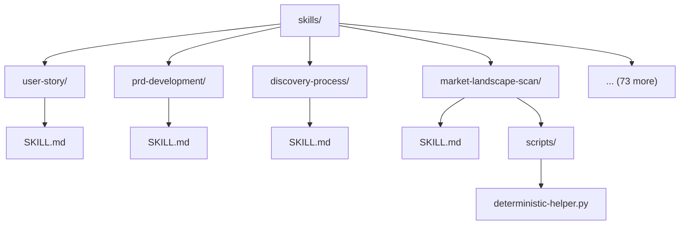
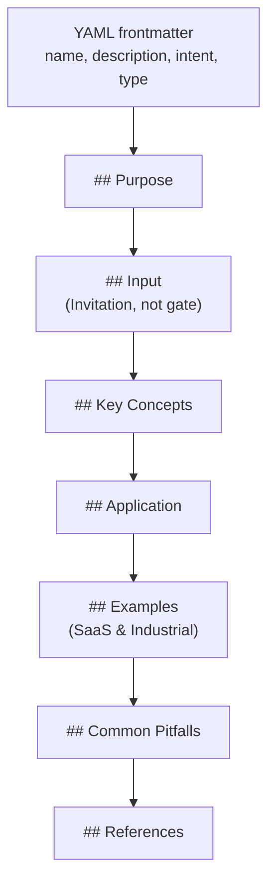
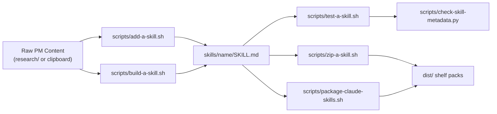

<!-- source: DeepWiki mcp.deepwiki.com · repo deanpeters/Product-Manager-Skills · page 1.2 Repository Structure · fetched 2026-10-26 -->

# Repository Structure

<details>
<summary>Relevant source files</summary>

The following files were used as context for generating this wiki page:

- [AGENTS.md](AGENTS.md)
- [CLAUDE.md](CLAUDE.md)
- [CONTRIBUTING.md](CONTRIBUTING.md)
- [README.md](README.md)
- [docs/Add-a-Skill Utility Guide.md](docs/Add-a-Skill Utility Guide.md)
- [docs/Building PM Skills.md](docs/Building PM Skills.md)
- [docs/CHANGELOG.md](docs/CHANGELOG.md)
- [scripts/build-a-skill.sh](scripts/build-a-skill.sh)

</details>


This page documents the physical layout of the Product Manager Skills repository: directory organization, file naming conventions, and the design principles that govern how content is stored and consumed. For information about the logical relationships between skill types (Component, Interactive, Workflow), see [Three-Tier Skill Architecture](#1.1). For a complete catalog of individual skills, see [Skill Catalog](#2).

---

## Design Principle: Markdown-First, No Build System

The repository is intentionally buildless. Every skill is a standalone Markdown file that an AI agent can read directly. There is no compilation step, no dependency graph to resolve, and no runtime required to consume skill content. As stated in `AGENTS.md`:

> "This is a Markdown-first repository with lightweight validation and packaging scripts." [AGENTS.md:33-33]()

This design choice means any AI agent that can read structured text can consume skills without complex tooling. The only exception is the optional Streamlit playground under `app/`, which requires a Python environment. The repository prioritizes **Pedagogy and Practicality**, ensuring skills teach human PMs the *why* while instructing agents on the *how* [AGENTS.md:3-7]().

Sources: [AGENTS.md:3-7](), [AGENTS.md:33-33]()

---

## Top-Level Directory Layout

```
Product-Manager-Skills/
├── skills/           # All 77 skill definitions
├── research/         # Source essays and reference materials
├── docs/             # Usage guides and integration documentation
├── app/              # Streamlit (beta) local playground
├── scripts/          # Authoring, validation, and packaging tools
├── commands/         # Reusable orchestration workflows
├── catalog/          # Generated indexes for fast browsing
├── dist/             # Generated release artifacts
├── README.md         # Primary catalog and navigation hub
├── CLAUDE.md         # Skill distillation protocol for Claude
├── AGENTS.md         # Repository guidelines for AI agents
├── CONTRIBUTING.md   # Contributor guidelines
├── PLANS.md          # Development roadmap
└── LICENSE           # CC BY-NC-SA 4.0
```

**Directory-to-function mapping:**

| Directory / File | Role |
|---|---|
| `skills/` | Canonical skill definitions; one subdirectory per skill [AGENTS.md:23-23]() |
| `research/` | Raw source material (essays, transcripts, frameworks) [AGENTS.md:26-26]() |
| `docs/` | Human-facing usage guides, integration documentation, announcements [AGENTS.md:27-27]() |
| `app/` | Streamlit playground for locally test-driving skills [AGENTS.md:28-28]() |
| `scripts/` | Shell and Python tools for authoring, searching, and validating [AGENTS.md:32-41]() |
| `commands/` | YAML-frontmatter workflows that chain local skills [AGENTS.md:24-24]() |
| `catalog/` | Generated indexes (e.g., `skills-by-type.md`, `commands.md`) [AGENTS.md:25-25]() |
| `dist/` | Generated release artifacts; do not edit directly [AGENTS.md:29-29]() |
| `README.md` | Master index: skill catalog tables, usage instructions, architecture overview [AGENTS.md:30-30]() |
| `CLAUDE.md` | Distillation protocol for converting raw content into skills [AGENTS.md:30-30]() |
| `AGENTS.md` | Operating guidelines for AI agents working in the repo [AGENTS.md:1-2]() |

Sources: [AGENTS.md:22-30](), [AGENTS.md:32-41]()

---

## The `skills/` Directory

This is the core of the repository. Every skill is stored in its own subdirectory under `skills/`, using the pattern `skills/<skill-name>/SKILL.md`.

**Naming rules:**
- Folder name: lowercase kebab-case (e.g., `user-story`, `prd-development`) [AGENTS.md:23-23]()
- Folder name **must exactly match** the `name` field in the skill's YAML frontmatter [AGENTS.md:49-49]()
- The skill file is always named `SKILL.md` (uppercase, fixed filename) [AGENTS.md:23-23]()

**Directory structure diagram:**

*Figure 1: skills/ directory structure and file naming pattern*



Some skills include an optional `scripts/` subdirectory for deterministic calculation helpers. These scripts must be deterministic, avoid network calls, and be documented in the parent `SKILL.md` [AGENTS.md:86-87]().

Sources: [AGENTS.md:23-23](), [AGENTS.md:49-49](), [AGENTS.md:86-87]()

---

## `SKILL.md` File Format

Each `SKILL.md` file begins with YAML frontmatter and is followed by a fixed set of Markdown sections.

**Frontmatter fields:**

| Field | Constraint | Purpose |
|---|---|---|
| `name` | ≤ 64 characters; matches folder name exactly | Skill identifier used by agent interfaces [AGENTS.md:48-49]() |
| `description` | ≤ 200 characters | Short summary for trigger detection; uses "Use when..." [AGENTS.md:48-48](), [docs/Building PM Skills.md:104-104]() |
| `intent` | Richer summary | Longer repo-facing summary of why the skill exists [docs/Building PM Skills.md:105-105]() |
| `type` | `component` \| `interactive` \| `workflow` | Tier identifier [AGENTS.md:47-47]() |

**Required body sections (in order):**

| Section | Role |
|---|---|
| `## Purpose` | What the skill does, when to use it, and expected outcome [docs/Building PM Skills.md:109-109]() |
| `## Input` | Plain language invitation for user context; NO `$ARGUMENTS` [docs/Building PM Skills.md:111-111](), [CONTRIBUTING.md:25-31]() |
| `## Key Concepts` | Core ideas, definitions, and non-obvious principles [docs/Building PM Skills.md:113-113]() |
| `## Application` | Step-by-step instructions for running the skill [docs/Building PM Skills.md:115-115]() |
| `## Examples` | Concrete cases, including anti-patterns [docs/Building PM Skills.md:117-117]() |
| `## Common Pitfalls` | Named failure modes the framework prevents [docs/Building PM Skills.md:119-119]() |
| `## References` | Links to related skills and external frameworks [docs/Building PM Skills.md:121-121]() |

*Figure 2: SKILL.md internal structure mapped to file sections*



Sources: [AGENTS.md:45-49](), [docs/Building PM Skills.md:102-122](), [CONTRIBUTING.md:25-31]()

---

## The `research/` Directory

Contains source material that informs skill content. This includes essays, transcripts, and framework notes [AGENTS.md:26-26](). These files are inputs to the distillation workflow and are transformed into `SKILL.md` files via `scripts/add-a-skill.sh` or `scripts/build-a-skill.sh` [docs/Building PM Skills.md:19-20]().

Sources: [AGENTS.md:26-26](), [docs/Building PM Skills.md:19-20]()

---

## The `app/` Directory

Contains the Streamlit (beta) local playground for testing skills interactively.

| File | Purpose |
|---|---|
| `app/main.py` | Streamlit entry point [AGENTS.md:28-28]() |
| `app/STREAMLIT_INTERFACE.md` | Interface documentation [AGENTS.md:28-28]() |
| `app/.env.example` | Template for API keys and model selection |

Launch command:
```bash
streamlit run app/main.py
```
Sources: [AGENTS.md:28-28](), [AGENTS.md:41-41]()

---

## The `scripts/` Directory

Automation tools for the skill lifecycle. These are the only executable artifacts in the repository.

| Script | Language | Role |
|---|---|---|
| `scripts/add-a-skill.sh` | Bash | AI-assisted generation from raw content [docs/Add-a-Skill Utility Guide.md:9-15]() |
| `scripts/build-a-skill.sh` | Bash | Interactive section-by-section authoring wizard [scripts/build-a-skill.sh:5-8]() |
| `scripts/find-a-skill.sh` | Bash | Keyword and type-based search [AGENTS.md:72-72]() |
| `scripts/test-a-skill.sh` | Bash | Conformance and smoke checks [AGENTS.md:72-72]() |
| `scripts/check-skill-metadata.py` | Python | Strict YAML and character limit validation [AGENTS.md:72-72]() |
| `scripts/zip-a-skill.sh` | Bash | Builds upload-ready `.zip` files for presets [docs/Building PM Skills.md:26-26]() |
| `scripts/package-claude-skills.sh` | Bash | Renames `SKILL.md` → `Skill.md` for Claude Web [AGENTS.md:85-85]() |

*Figure 3: Tooling Data Flow from Source to Distribution*



Sources: [docs/Add-a-Skill Utility Guide.md:9-15](), [scripts/build-a-skill.sh:5-8](), [AGENTS.md:72-72](), [AGENTS.md:85-85]()

---

## Claude Web Upload: `Skill.md` Case-Sensitivity

Claude's web interface requires the skill file to be named `Skill.md` (capital S, lowercase remainder) [AGENTS.md:85-85](). The repository stores files as `SKILL.md` for local use and CLI compatibility. The `scripts/package-claude-skills.sh` script handles the rename and frontmatter sanitization automatically for distribution to the `dist/` directory [AGENTS.md:85-85]().

Sources: [AGENTS.md:85-85]()

---

