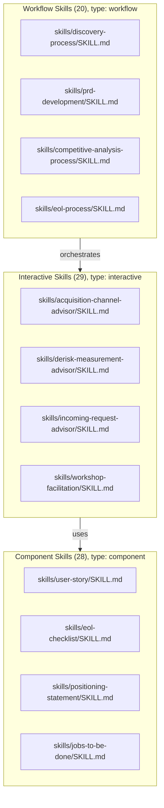
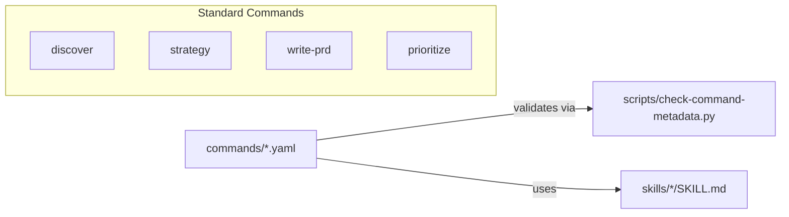

<!-- source: DeepWiki mcp.deepwiki.com · repo deanpeters/Product-Manager-Skills · page 2 Skill Catalog · fetched 2026-10-26 -->

# Skill Catalog

<details>
<summary>Relevant source files</summary>

The following files were used as context for generating this wiki page:

- [.claude-plugin/marketplace.json](.claude-plugin/marketplace.json)
- [.claude-plugin/plugin.json](.claude-plugin/plugin.json)
- [catalog/skills-by-type.md](catalog/skills-by-type.md)
- [catalog/skills-index.yaml](catalog/skills-index.yaml)
- [docs/Lifecycle and EOL Suite Summary.md](docs/Lifecycle and EOL Suite Summary.md)
- [docs/announcements/2026-07-08-v0-82-inbound-requests-and-dist-shelf.md](docs/announcements/2026-07-08-v0-82-inbound-requests-and-dist-shelf.md)
- [docs/announcements/2026-08-10-v0-84-lifecycle-and-eol-suite.md](docs/announcements/2026-08-10-v0-84-lifecycle-and-eol-suite.md)
- [scripts/build-claude-desktop-packs.sh](scripts/build-claude-desktop-packs.sh)
- [scripts/build-dist.sh](scripts/build-dist.sh)
- [skills/company-intel/SKILL.md](skills/company-intel/SKILL.md)
- [skills/derisk-measurement-advisor/SKILL.md](skills/derisk-measurement-advisor/SKILL.md)
- [skills/incoming-request-advisor/SKILL.md](skills/incoming-request-advisor/SKILL.md)
- [skills/incoming-request-advisor/examples/conversation-flow.md](skills/incoming-request-advisor/examples/conversation-flow.md)
- [skills/incoming-request-advisor/template.md](skills/incoming-request-advisor/template.md)

</details>


This page is the complete reference index for all **77 skills** in the repository, organized by tier. Each entry lists the skill folder path, `type` value from the YAML frontmatter, and a one-line description. Use this page to identify which skill to load into an AI agent for a given task.

For deeper documentation, see:
- [Component Skills](#2.1) — Describe what Component Skills are (self-contained, reusable artifact templates, 10-30 min).
- [Interactive Skills](#2.2) — Describe what Interactive Skills are (multi-turn adaptive Q&A flows, 30-90 min).
- [Workflow Skills](#2.3) — Describe what Workflow Skills are (end-to-end multi-phase processes spanning days or weeks).
- [Commands](#2.4) — Document the `commands/` directory as a distinct orchestration layer above skills.

---

## How Skills Are Identified

Every skill is a folder under `skills/` containing a single `SKILL.md` file. The YAML frontmatter in that file declares the skill's identity [.claude-plugin/marketplace.json:1-11]().

```yaml
---
name: user-story
description: Create user stories with Mike Cohn format and Gherkin acceptance criteria.
type: component
---
```

The `type` field determines the tier and usage mode [catalog/skills-index.yaml:1-7]().

| Frontmatter Field | Constraint | Role |
|---|---|---|
| `name` | lowercase kebab-case, max 64 chars | Folder name; agent-facing identifier |
| `description` | max 200 chars | Shown in skill pickers and search results |
| `type` | `component`, `interactive`, or `workflow` | Assigns the skill to a tier |

Sources: [.claude-plugin/marketplace.json:1-11](), [catalog/skills-index.yaml:1-7](), [skills/derisk-measurement-advisor/SKILL.md:1-12]()

---

## Tier Architecture

The three tiers form a strict, acyclic dependency hierarchy. Higher tiers orchestrate lower tiers. Component skills have no upward dependencies.

**Tier Architecture Mapped to System Entities:**



Sources: [catalog/skills-by-type.md:5-64](), [docs/announcements/2026-08-10-v0-84-lifecycle-and-eol-suite.md:4-5]()

---

## Component Skills (28)

Component skills produce a single, specific PM deliverable from a template. They are self-contained artifacts designed for 10-30 minute tasks [catalog/skills-by-type.md:5-62](). For detailed usage, see [Component Skills](#2.1).

| Skill Folder | Description |
|---|---|
| `skills/altitude-horizon-framework/` | Understand the PM-to-Director transition through altitude and horizon thinking. |
| `skills/company-research/` | Create a company research brief with executive quotes, product strategy, and org context. |
| `skills/customer-journey-map/` | Create a customer journey map across stages, touchpoints, actions, emotions, and metrics. |
| `skills/eol-checklist/` | Build a phase-gated EOL checklist sized to the sunset. |
| `skills/eol-message/` | Write a right-sized EOL announcement with three transition paths. |
| `skills/epic-hypothesis/` | Frame an epic as a testable hypothesis with target user and expected outcome. |
| `skills/finance-metrics-quickref/` | Look up SaaS finance metrics, formulas, and benchmarks fast. |
| `skills/jobs-to-be-done/` | Uncover customer jobs, pains, and gains in a structured JTBD format. |
| `skills/pestel-analysis/` | Analyze political, economic, social, technological, environmental, and legal forces. |
| `skills/pol-probe/` | Define a Proof of Life probe to test a risky hypothesis cheaply. |
| `skills/positioning-statement/` | Create a Geoffrey Moore-style positioning statement. |
| `skills/user-story/` | Create user stories with Mike Cohn format and Gherkin acceptance criteria. |

Sources: [catalog/skills-by-type.md:5-62](), [skills/derisk-measurement-advisor/SKILL.md:120-122]()

---

## Interactive Skills (29)

Interactive skills run multi-turn, adaptive Q&A flows (30-90 min). They apply the canonical facilitation protocol defined in `skills/workshop-facilitation/SKILL.md` [skills/incoming-request-advisor/SKILL.md:71-82](). For detailed usage, see [Interactive Skills](#2.2).

| Skill Folder | Description |
|---|---|
| `skills/acquisition-channel-advisor/` | Evaluate acquisition channels using unit economics and scalability. |
| `skills/agent-orchestration-advisor/` | Design multi-agent AI workflows with clear boundaries and handoffs. |
| `skills/ai-shaped-readiness-advisor/` | Assess whether product work is AI-first or AI-shaped across 5 competencies. |
| `skills/business-health-diagnostic/` | Diagnose SaaS business health across growth, retention, and efficiency. |
| `skills/context-engineering-advisor/` | Diagnose context stuffing vs. context engineering in AI workflows. |
| `skills/derisk-measurement-advisor/` | Identify what to measure or track to de-risk a product or AI idea. |
| `skills/incoming-request-advisor/` | Decode an incoming message separating the literal ask from the JTBD. |
| `skills/lifecycle-play-advisor/` | Map a product's lifecycle stage and choose extension, replacement, or retirement. |
| `skills/prioritization-advisor/` | Recommend the right prioritization framework for the current situation. |

Sources: [catalog/skills-by-type.md:64-120](), [skills/incoming-request-advisor/SKILL.md:1-17](), [skills/derisk-measurement-advisor/SKILL.md:1-25]()

---

## Workflow Skills (20)

Workflow skills define end-to-end multi-phase processes spanning days or weeks. They orchestrate lower-tier skills and handle complex decision points [docs/announcements/2026-08-10-v0-84-lifecycle-and-eol-suite.md:93-96](). For detailed usage, see [Workflow Skills](#2.3).

| Skill Folder | Description |
|---|---|
| `skills/ansoff-matrix/` | Map growth options across the Ansoff Matrix with risk-rated sequencing. |
| `skills/autonomous-investigation/` | Protocol for AI research: evidence labels, search-plan gate, diffable output. |
| `skills/battle-card-builder/` | Research and draft a competitive battle card from public evidence. |
| `skills/company-intel/` | Research a company or industry using seven analytical lenses. |
| `skills/competitive-analysis-process/` | Orchestrate a complete six-step competitive analysis. |
| `skills/discovery-process/` | Complete discovery cycle from problem framing to solution validation. |
| `skills/eol-process/` | 6-phase sunset workflow: decide, align, plan, prepare, announce, close. |
| `skills/prd-development/` | Structured PRD creation orchestrating multiple component skills. |

Sources: [catalog/skills-index.yaml:44-118](), [skills/company-intel/SKILL.md:1-28](), [docs/announcements/2026-08-10-v0-84-lifecycle-and-eol-suite.md:93-96]()

---

## Orchestration Layer: Commands

The `commands/` directory contains YAML files that act as a distinct orchestration layer, chaining multiple skills into fast execution paths [scripts/build-dist.sh:24-25]().

**Command Execution Logic:**



| Command | Role |
|---|---|
| `discover` | Chains research and discovery skills. |
| `strategy` | Orchestrates positioning and strategy sessions. |
| `write-prd` | Fast-track PRD development using component templates. |
| `prioritize` | Invokes the prioritization advisor and relevant canvases. |

For details, see [Commands](#2.4).

Sources: [scripts/build-dist.sh:24-25](), [docs/announcements/2026-08-10-v0-84-lifecycle-and-eol-suite.md:4-5]()

---

