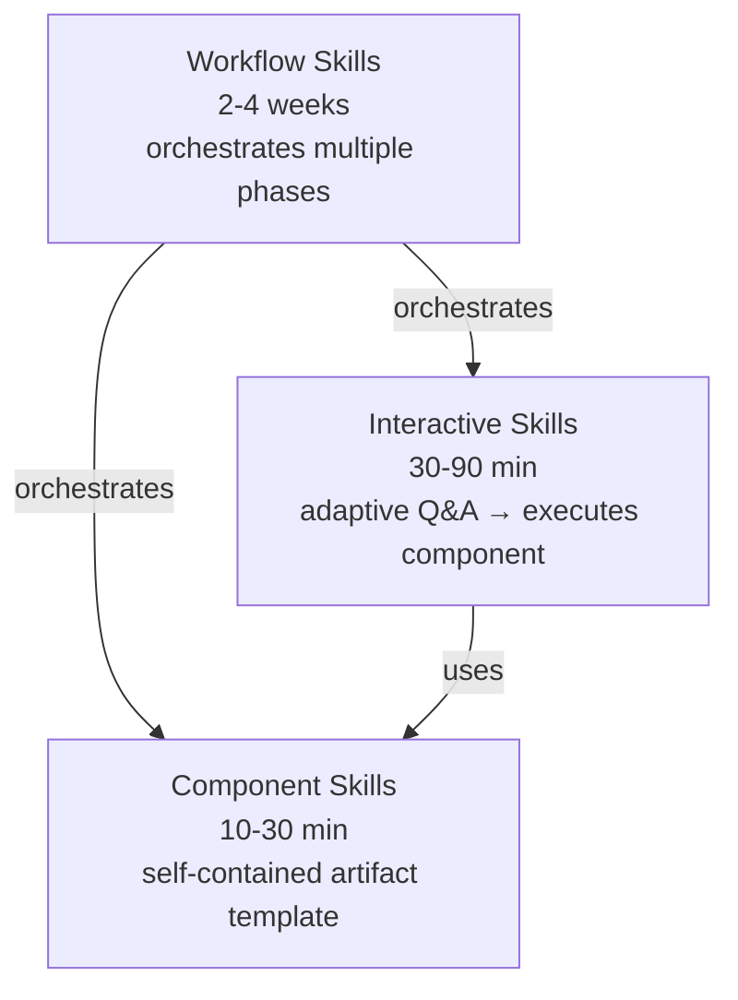
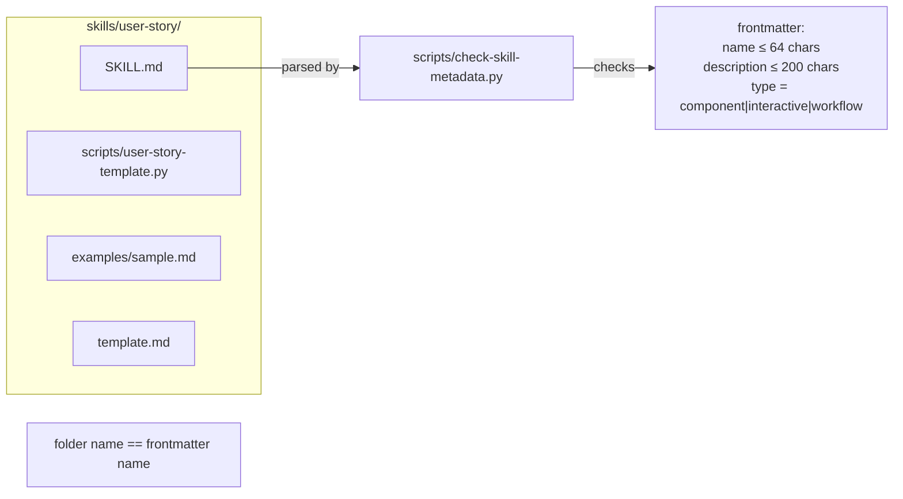
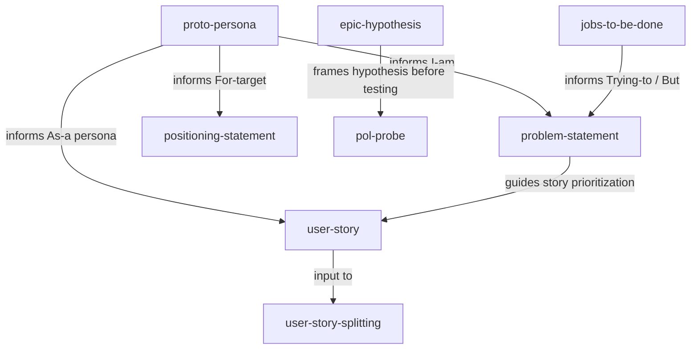
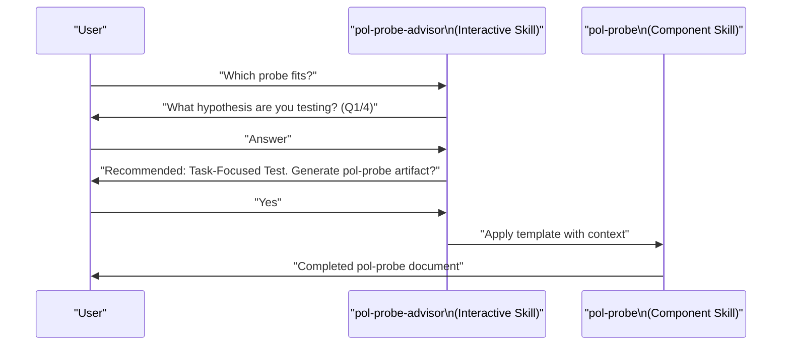

<!-- source: DeepWiki mcp.deepwiki.com · repo deanpeters/Product-Manager-Skills · page 2.1 Component Skills · fetched 2026-10-26 -->

# Component Skills

<details>
<summary>Relevant source files</summary>

The following files were used as context for generating this wiki page:

- [catalog/skills-by-type.md](catalog/skills-by-type.md)
- [catalog/skills-index.yaml](catalog/skills-index.yaml)
- [dist/positioning-statement.zip](dist/positioning-statement.zip)
- [dist/user-story.zip](dist/user-story.zip)
- [docs/announcements/2026-07-08-v0-82-inbound-requests-and-dist-shelf.md](docs/announcements/2026-07-08-v0-82-inbound-requests-and-dist-shelf.md)
- [skills/company-intel/SKILL.md](skills/company-intel/SKILL.md)
- [skills/derisk-measurement-advisor/SKILL.md](skills/derisk-measurement-advisor/SKILL.md)
- [skills/epic-hypothesis/examples/sample-industrial.md](skills/epic-hypothesis/examples/sample-industrial.md)
- [skills/jobs-to-be-done/SKILL.md](skills/jobs-to-be-done/SKILL.md)
- [skills/pol-probe-advisor/SKILL.md](skills/pol-probe-advisor/SKILL.md)
- [skills/pol-probe/SKILL.md](skills/pol-probe/SKILL.md)
- [skills/positioning-statement/examples/sample-industrial.md](skills/positioning-statement/examples/sample-industrial.md)
- [skills/press-release/examples/sample-industrial.md](skills/press-release/examples/sample-industrial.md)
- [skills/problem-statement/SKILL.md](skills/problem-statement/SKILL.md)
- [skills/problem-statement/examples/sample-industrial.md](skills/problem-statement/examples/sample-industrial.md)
- [skills/proto-persona/examples/sample-industrial.md](skills/proto-persona/examples/sample-industrial.md)
- [skills/storyboard/examples/sample-industrial.md](skills/storyboard/examples/sample-industrial.md)
- [skills/user-story/examples/sample-industrial.md](skills/user-story/examples/sample-industrial.md)

</details>


This page documents the **Component Skill** tier: what they are, how their files are structured, the full catalog of the 28 skills in this tier, and concrete usage examples from `user-story` and `pol-probe`. Component Skills are the foundational building blocks of the three-tier architecture.

For the tiers above this one, see [Interactive Skills](#2.2) and [Workflow Skills](#2.3). For the skill file format specification that applies to all skill types, see [Skill Format Reference](#5.1). For authoring new skills of any type, see [Skill Authoring Workflow](#5.2).

---

## Role in the Three-Tier Architecture

Component Skills occupy the **base tier** of the dependency hierarchy. They produce a single, concrete PM artifact per invocation. Interactive and Workflow Skills depend on them, but they never depend upward.

**Figure: Three-tier dependency hierarchy**



Sources: [catalog/skills-index.yaml:1-77](), [catalog/skills-by-type.md:5-62]()

The no-circular-dependency rule means a Component Skill may reference sibling Component Skills in its `References` section (for context), but the execution path always flows downward: a Component Skill does not invoke an Interactive or Workflow Skill.

---

## Defining Characteristics

| Property | Value |
|---|---|
| Frontmatter `type` | `component` |
| Typical session time | 10–30 min |
| Interaction model | Single-shot: one prompt in, one artifact out |
| Inputs | User context provided inline |
| Output | A filled-in, structured PM deliverable |
| Dependencies | None (may reference sibling components for context only) |

Component Skills are intentionally self-contained. They encode one framework and produce one artifact. This makes them composable: an Interactive Skill like `pol-probe-advisor` finishes by offering to generate a `pol-probe` artifact via the corresponding Component Skill.

Sources: [skills/pol-probe-advisor/SKILL.md:22-24](), [skills/pol-probe-advisor/SKILL.md:102-105]()

---

## File Structure

Every Component Skill lives at `skills/<skill-name>/SKILL.md`. The folder name must exactly match the `name` field in the YAML frontmatter.

**Figure: Component Skill file layout and validation constraints**



Sources: [skills/user-story/SKILL.md:1-18](), [dist/user-story.zip:1-33]()

The `scripts/` and `examples/` subdirectories are optional but common. Where present, the `scripts/` folder contains deterministic helpers (no network calls, no side effects) that generate stub artifacts from CLI inputs.

---

## Full Component Skill Catalog

| Skill folder | Framework / Origin | Primary Deliverable |
|---|---|---|
| `altitude-horizon-framework` | Leadership | Two-axis mental model for PM→Director transition |
| `company-research` | Market Intel | Deep-dive company research brief |
| `customer-journey-map` | UX/Discovery | Map of stages, touchpoints, and emotions |
| `eol-checklist` | Lifecycle | Phase-gated sunset operational plan |
| `eol-internal-enablement` | Lifecycle | Support FAQ and objection handling |
| `eol-message` | Lifecycle | Right-sized EOL announcement |
| `eol-stakeholder-sequence` | Lifecycle | Stakeholder communication sequence plan |
| `epic-hypothesis` | Discovery | Epic framed as a testable hypothesis |
| `finance-metrics-quickref` | Finance | SaaS metric definitions and formulas |
| `intelligence-collection-disciplines` | Market Intel | Intelligence agency collection protocols (OSINT, etc.) |
| `jobs-to-be-done` | Discovery | JTBD format (Jobs, Pains, Gains) |
| `pestel-analysis` | Strategy | External force analysis (P, E, S, T, E, L) |
| `pol-probe` | Discovery | Proof of Life probe validation artifact |
| `positioning-statement` | Core PM | Geoffrey Moore-style positioning |
| `press-release` | Core PM | Amazon-style future press release |
| `problem-statement` | Core PM | User-centered problem framing |
| `product-lifecycle-plays` | Lifecycle | Extend, Replace, or Retire decision map |
| `product-sense-interview-answer` | Career | Structured response for product sense interviews |
| `proto-persona` | Discovery | Hypothesis-based customer profile |
| `recommendation-canvas` | AI/Strategy | AI product idea evaluation |
| `saas-economics-efficiency-metrics` | Finance | Unit economics and capital efficiency metrics |
| `saas-revenue-growth-metrics` | Finance | Revenue, retention, and growth metrics |
| `stakeholder-identification` | Core PM | Comprehensive stakeholder mapping |
| `stakeholder-mapping` | Core PM | Prioritization grids for engagement |
| `storyboard` | UX/Discovery | Six-frame problem-to-solution narrative |
| `user-story` | Core PM | Mike Cohn / Gherkin format stories |
| `user-story-mapping` | Planning | User journey-based release slicing |
| `user-story-splitting` | Planning | Pattern-based story decomposition |

Sources: [catalog/skills-by-type.md:5-62](), [catalog/skills-index.yaml:1-100]()

---

## Dependency Graph Among Component Skills

Several Component Skills cross-reference each other as upstream inputs. The graph below captures the documented reference relationships.

**Figure: Reference relationships between Component Skills**



Sources: [skills/user-story/SKILL.md:37-50](), [skills/pol-probe/SKILL.md:116-130](), [catalog/skills-by-type.md:5-62]()

---

## How Higher-Tier Skills Invoke Component Skills

Component Skills are consumed in two ways by upper tiers:

1. **Interactive → Component (terminal step):** After an Interactive Skill completes its Q&A phase, it offers to generate the corresponding Component artifact. Example: `pol-probe-advisor` ends by matching the user to one of 5 probe flavors and recommending the `pol-probe` artifact.
2. **Workflow → Component (mid-phase step):** A Workflow Skill like `competitive-analysis-process` calls Component Skills at designated phases (e.g., `pestel-analysis`).

**Figure: pol-probe-advisor (Interactive) recommending pol-probe (Component)**



Sources: [skills/pol-probe-advisor/SKILL.md:107-140](), [skills/pol-probe-advisor/SKILL.md:20-24]()

---

## Worked Example: `user-story`

The `user-story` skill ([skills/user-story/SKILL.md]()) combines two frameworks into a single artifact template:

- **Use Case:** Mike Cohn's "As a / I want to / so that" format
- **Acceptance Criteria:** Gherkin's "Given / When / Then" format

### Concrete Output (Industrial Example)

```markdown
### User Story 118:
- **Summary:** Push firmware to NFA-500 units remotely

#### Use Case:
- **As a** field service technician supporting 40+ installations
- **I want to** apply a firmware update to a controller without traveling to the site
- **so that** a 20-minute patch stops costing a full day of windshield time

#### Acceptance Criteria:
- **Scenario:** Update fails mid-apply
- **Given** a firmware update has begun
- **When** the update fails or the connection drops
- **Then** the controller rolls back to the previous firmware
```

Sources: [skills/user-story/examples/sample-industrial.md:15-44](), [dist/user-story.zip:20-25]()

---

## Worked Example: `pol-probe`

The `pol-probe` skill ([skills/pol-probe/SKILL.md]()) templates a **Proof of Life (PoL) probe** — a disposable validation experiment to test a single hypothesis before committing to development.

### Five Probe Types

| Type | Core Question | Timeline |
|---|---|---|
| Feasibility Check | "Can we build this?" | 1–2 days |
| Task-Focused Test | "Can users complete this job?" | 2–5 days |
| Narrative Prototype | "Does this earn buy-in?" | 1–3 days |
| Synthetic Data Simulation | "Can we model this?" | 2–4 days |
| Vibe-Coded PoL Probe | "Will this survive user contact?" | 2–3 days |

Sources: [skills/pol-probe/SKILL.md:78-90](), [skills/pol-probe-advisor/SKILL.md:49-55]()

### Quality Constraints (The 5 Essential Characteristics)

Every PoL probe must satisfy these criteria to avoid "prototype theater":
- **Lightweight:** Minimal resource investment.
- **Disposable:** Explicitly planned for deletion.
- **Narrow Scope:** Tests one specific hypothesis.
- **Brutally Honest:** Surfaces harsh truths.
- **Tiny & Focused:** Reconnaissance mission, not an MVP.

Sources: [skills/pol-probe/SKILL.md:47-58](), [skills/pol-probe-advisor/SKILL.md:57-59]()

---

