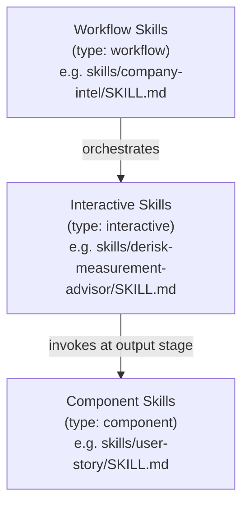
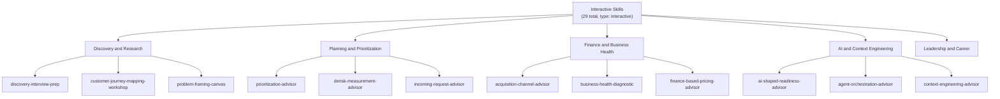

<!-- source: DeepWiki mcp.deepwiki.com · repo deanpeters/Product-Manager-Skills · page 2.2 Interactive Skills · fetched 2026-10-26 -->

# Interactive Skills

<details>
<summary>Relevant source files</summary>

The following files were used as context for generating this wiki page:

- [.claude-plugin/marketplace.json](.claude-plugin/marketplace.json)
- [catalog/skills-by-type.md](catalog/skills-by-type.md)
- [catalog/skills-index.yaml](catalog/skills-index.yaml)
- [dist/prioritization-advisor.zip](dist/prioritization-advisor.zip)
- [dist/workshop-facilitation.zip](dist/workshop-facilitation.zip)
- [docs/announcements/2026-07-08-v0-82-inbound-requests-and-dist-shelf.md](docs/announcements/2026-07-08-v0-82-inbound-requests-and-dist-shelf.md)
- [skills/company-intel/SKILL.md](skills/company-intel/SKILL.md)
- [skills/derisk-measurement-advisor/SKILL.md](skills/derisk-measurement-advisor/SKILL.md)
- [skills/incoming-request-advisor/SKILL.md](skills/incoming-request-advisor/SKILL.md)
- [skills/incoming-request-advisor/examples/conversation-flow.md](skills/incoming-request-advisor/examples/conversation-flow.md)
- [skills/incoming-request-advisor/template.md](skills/incoming-request-advisor/template.md)

</details>


This page documents the **Interactive Skills** tier of the Product Manager Skills repository: what they are, how they behave during a session, and the complete catalog of available skills. For the broader three-tier architecture (Component → Interactive → Workflow), see [Three-Tier Skill Architecture](#1.1). For the Component Skills tier, see [Component Skills](#2.1). For Workflow Skills, see [Workflow Skills](#2.3).

---

## What Interactive Skills Are

Interactive Skills are multi-turn, adaptive conversational sessions in which an AI agent collects context through sequential questions and then produces tailored, enumerated recommendations. They sit in the middle tier of the skill hierarchy.

| Property | Value |
|---|---|
| `type` (YAML frontmatter) | `interactive` |
| Estimated duration | 15–90 minutes |
| Question depth | 3–13 questions, depending on skill |
| Output | Enumerated recommendations + optional artifact |
| Dependencies | May invoke Component Skills at output stage |
| Invoked by | Workflow Skills as sub-processes |

**Key behavioral characteristics:**

- Asks questions one at a time, bounded to 3–5 per phase (up to 13 total in complex skills).
- Uses prior answers to inform subsequent questions.
- Offers **enumerated, context-aware recommendations** (3–5 numbered options) at decision points.
- Allows number selection (`1`, `2 & 4`, `1,3`) or free-text input.
- Adapts based on user choices.
- Applies Component Skills at the output stage.

Sources: [catalog/skills-index.yaml:7-13](), [skills/derisk-measurement-advisor/SKILL.md:12-23](), [skills/incoming-request-advisor/SKILL.md:7-17]()

---

## Position in the Three-Tier Architecture

**Tier relationship diagram: file-level**



Sources: [catalog/skills-by-type.md:5-64](), [catalog/skills-by-type.md:65-115](), [catalog/skills-by-type.md:116-156]()

---

## The Canonical Facilitation Protocol

### Source of Truth: `workshop-facilitation/SKILL.md`

The file `skills/workshop-facilitation/SKILL.md` defines the interaction protocol that all other interactive skills must follow. Each individual interactive skill may add domain-specific logic on top, but in case of conflict with `workshop-facilitation`, the domain-specific logic wins.

Reference pattern used in skill files:

```
### Facilitation Source of Truth
Use [`workshop-facilitation`](../workshop-facilitation/SKILL.md) as the default interaction protocol for this skill.
```

Sources: [skills/incoming-request-advisor/SKILL.md:71-73](), [skills/derisk-measurement-advisor/SKILL.md:126-128]()

### Session Structure

**Facilitation protocol state diagram**

```mermaid
stateDiagram-v2
    [*] --> "SessionHeadsUp"
    "SessionHeadsUp" --> "EntryModeSelection" : "offer Guided / Context dump / Best guess"
    "EntryModeSelection" --> "GuidedMode" : "1"
    "EntryModeSelection" --> "ContextDumpMode" : "2"
    "EntryModeSelection" --> "BestGuessMode" : "3"
    "GuidedMode" --> "QuestionTurn" : "one question per turn\nContext Qx/N"
    "ContextDumpMode" --> "ParsePastedContext" : "user pastes known context"
    "ParsePastedContext" --> "QuestionTurn" : "skip resolved, ask gaps only"
    "BestGuessMode" --> "InferDefaults" : "label each as Assumption"
    "InferDefaults" --> "QuestionTurn" : "ask minimum viable input"
    "QuestionTurn" --> "QuestionTurn" : "next question (progress label)"
    "QuestionTurn" --> "DecisionPoint" : "context sufficient"
    "DecisionPoint" --> "EnumeratedRecommendations" : "numbered 1. 2. 3."
    "EnumeratedRecommendations" --> "UserSelection" : "accept: 1 / 1 and 3 / 1,3 / custom"
    "UserSelection" --> "QuestionTurn" : "more phases"
    "UserSelection" --> "FinalSummary" : "all phases done"
    "FinalSummary" --> "AssumptionsToValidate" : "if best-guess or context-dump mode"
    "AssumptionsToValidate" --> [*]
    "FinalSummary" --> [*]
```

Sources: [skills/incoming-request-advisor/examples/conversation-flow.md:20-110](), [skills/incoming-request-advisor/SKILL.md:83-110]()

### Three Entry Modes

| Mode | Trigger | Behavior |
|---|---|---|
| **Guided** | `1` | One question per turn, full sequence. |
| **Context dump** | `2` | User pastes existing context; agent skips resolved questions, asks 0–2 gap questions. |
| **Best guess** | `3` | Agent infers missing details, labels each as `Assumption` with confidence levels, continues without blocking. |

In **Best guess** mode and **Context dump** mode, the final summary includes an **Assumptions to Validate** section listing all inferred values.

Sources: [skills/incoming-request-advisor/SKILL.md:59-62](), [skills/incoming-request-advisor/examples/conversation-flow.md:90-94]()

### Decision Point Recommendations

Enumerated recommendations appear **only at decision points**, not after every answer. 

**Format Example from `incoming-request-advisor`:**
```
1. **Draft a reply to Priya** (Recommended)
2. **Build a meeting agenda for this ask**
3. **Reframe the ask as a discovery framing**
4. **Draft a counter-proposal that protects the outcome**
```

Accepted selection inputs: `#1`, `1`, `1 and 3`, `1,3`, or free text. Multi-selections are synthesized into a combined path.

Sources: [skills/incoming-request-advisor/examples/conversation-flow.md:102-109](), [skills/incoming-request-advisor/template.md:71-76]()

---

## Interactive Skill Catalog

As of version 0.84, there are 29 Interactive Skills. Key examples include:

### Discovery and Research
- `discovery-interview-prep`: Plans customer interviews (Mom Test style).
- `customer-journey-mapping-workshop`: Guides journey mapping with pain point identification.
- `problem-framing-canvas`: Leads through MITRE Problem Framing (Look Inward / Outward / Reframe).

### Planning and Prioritization
- `prioritization-advisor`: Recommends the right prioritization framework (RICE, ICE, Kano, etc.).
- `derisk-measurement-advisor`: Identifies what to measure/test across DUFV and PESTEL dimensions. [skills/derisk-measurement-advisor/SKILL.md:2-11]()
- `incoming-request-advisor`: Decodes messages into Ask vs. Job-to-be-Done. [skills/incoming-request-advisor/SKILL.md:2-7]()

### Finance and Business Health
- `acquisition-channel-advisor`: Evaluates acquisition channels using unit economics. [catalog/skills-index.yaml:4-13]()
- `business-health-diagnostic`: Diagnoses SaaS business health across growth and retention. [catalog/skills-index.yaml:76-84]()
- `feature-investment-advisor`: Evaluates feature investments using revenue impact and ROI.

### AI and Context Engineering
- `ai-shaped-readiness-advisor`: Assesses 5 AI competencies. [catalog/skills-index.yaml:24-33]()
- `agent-orchestration-advisor`: Designs multi-agent AI workflows with clear boundaries. [catalog/skills-index.yaml:14-23]()
- `context-engineering-advisor`: Diagnoses context stuffing vs. context engineering.

Sources: [catalog/skills-by-type.md:64-115](), [.claude-plugin/marketplace.json:1-205]()

---

## Thematic Grouping Overview



Sources: [catalog/skills-by-type.md:64-115](), [.claude-plugin/marketplace.json:11-205]()

---

## YAML Frontmatter for Interactive Skills

Every interactive skill file (`SKILL.md`) declares its type via YAML frontmatter. This metadata is consumed by orchestration scripts and the Streamlit app.

```yaml
---
name: derisk-measurement-advisor
argument-hint: "[product or AI idea]"
description: Identify what to measure, test, or track to de-risk a product or AI idea.
type: interactive
---
```

Sources: [skills/derisk-measurement-advisor/SKILL.md:1-12](), [skills/incoming-request-advisor/SKILL.md:1-7]()

---

