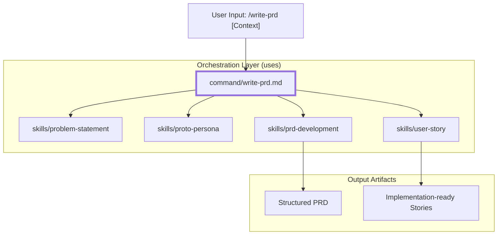
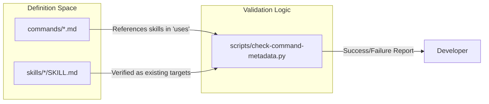

<!-- source: DeepWiki mcp.deepwiki.com · repo deanpeters/Product-Manager-Skills · page 2.4 Commands · fetched 2026-10-26 -->

# Commands

Relevant source files

The following files were used as context for generating this wiki page:

- [CLAUDE.md](CLAUDE.md)
- [PLANS.md](PLANS.md)
- [README.md](README.md)
- [commands/write-prd.md](commands/write-prd.md)
- [docs/Finance Suite Summary.md](docs/Finance Suite Summary.md)
- [research/Context Engineering for Product Managers.md](research/Context Engineering for Product Managers.md)
- [skills/business-health-diagnostic/SKILL.md](skills/business-health-diagnostic/SKILL.md)
- [skills/discovery-interview-prep/SKILL.md](skills/discovery-interview-prep/SKILL.md)
- [skills/discovery-process/SKILL.md](skills/discovery-process/SKILL.md)
- [skills/prd-development/SKILL.md](skills/prd-development/SKILL.md)
- [skills/prd-development/examples/sample.md](skills/prd-development/examples/sample.md)
- [skills/prd-development/template.md](skills/prd-development/template.md)
- [skills/roadmap-planning/SKILL.md](skills/roadmap-planning/SKILL.md)
- [skills/saas-revenue-growth-metrics/SKILL.md](skills/saas-revenue-growth-metrics/SKILL.md)

Commands represent the highest orchestration layer in the repository, residing in the `commands/` directory. While **Skills** provide the atomic frameworks and guided protocols, **Commands** chain these skills into fast execution paths designed to achieve specific Product Management outcomes (e.g., writing a PRD or planning a roadmap) with minimal friction [PLANS.md:13-20]().

## Command Format and Metadata

Every command is defined in a Markdown file within the `commands/` directory. They utilize a strict YAML frontmatter schema to ensure they are discoverable by scripts and compatible with AI agent orchestration [PLANS.md:45-48]().

### YAML Frontmatter Fields

| Field | Description |
| :--- | :--- |
| `name` | The unique identifier for the command (e.g., `write-prd`). |
| `description` | A concise summary of the outcome this command provides. |
| `argument-hint` | A visual cue for the user on what inputs to provide (e.g., `"<feature or initiative>"`). |
| `uses` | A list of underlying skills (by their `name` metadata) that this command orchestrates. |
| `outputs` | The specific artifacts or states generated upon completion. |

[commands/write-prd.md:1-15]()

### Data Flow: Command Orchestration
The following diagram illustrates how a Command (Natural Language Space) maps to the underlying Code Entities (Skills) to produce specific PM artifacts.

**Command Execution Logic**

**Sources:** [commands/write-prd.md:1-15](), [PLANS.md:13-16]()

---

## Available Commands

There are six core commands designed to cover the primary lifecycle of product management work [PLANS.md:37-43]().

| Command | Purpose | Key Skills Orchestrated |
| :--- | :--- | :--- |
| `discover` | Validates problem space and customer pain. | `discovery-process`, `problem-framing-canvas` |
| `strategy` | Sets product direction and positioning. | `product-strategy-session`, `positioning-statement` |
| `write-prd` | Generates a decision-ready requirements doc. | `prd-development`, `problem-statement`, `user-story` |
| `plan-roadmap` | Sequences delivery and aligns stakeholders. | `roadmap-planning`, `prioritization-advisor` |
| `prioritize` | Ranks initiatives based on business value. | `prioritization-advisor`, `feature-investment-advisor` |
| `leadership-transition` | Manages 30-60-90 day onboarding for leaders. | `executive-onboarding-playbook` |

**Sources:** [PLANS.md:37-43](), [commands/write-prd.md:5-10]()

---

## The `write-prd` Workflow Example

The `write-prd` command demonstrates how multiple tiers of skills are chained. It moves from a high-level **Interactive Skill** (problem definition) to a complex **Workflow Skill** (PRD development) and finally to **Component Skills** (user stories) [commands/write-prd.md:27-34]().

### Execution Steps
1. **Context Setting**: Uses `problem-statement` to define the "why" [commands/write-prd.md:29]().
2. **User Alignment**: Invokes `proto-persona` to anchor the requirements in a specific user segment [commands/write-prd.md:30]().
3. **Core Drafting**: Orchestrates the 8-phase `prd-development` workflow [commands/write-prd.md:31]().
4. **Scaffolding**: Generates initial `user-story` drafts and splits them using `user-story-splitting` [commands/write-prd.md:32-33]().

**Sources:** [commands/write-prd.md:27-34](), [skills/prd-development/SKILL.md:150]()

---

## Tooling and Validation

To maintain the integrity of the command layer, the repository includes specific scripts for discovery and metadata enforcement [PLANS.md:45-48]().

### Key Scripts

*   **`scripts/find-a-command.sh`**: A terminal-based discovery tool that allows users to search the `commands/` directory by keyword or outcome [PLANS.md:24]().
*   **`scripts/check-command-metadata.py`**: A strict validator that ensures every command file follows the YAML schema and that all referenced skills in the `uses` field actually exist in the `skills/` directory [PLANS.md:46]().
*   **`scripts/run-pm.sh`**: A launcher that provides the execution scaffolding for both skills and commands [PLANS.md:47]().

### System Architecture: Command Validation
This diagram shows the relationship between the command definitions and the validation scripts that enforce repository standards.

**Metadata Validation Flow**

**Sources:** [PLANS.md:45-51](), [commands/write-prd.md:5-10]()

---

## Checkpoints and Best Practices

Commands include built-in "Checkpoints" to ensure the AI agent maintains high-quality output throughout the chain [commands/write-prd.md:35-42]().

*   **Gap Tagging**: Every command requires the agent to tag unknowns as either an 🔶 **Assumption** (plausible but unvalidated) or a 🔵 **Open Question** (needs discovery) [commands/write-prd.md:40]().
*   **Self-Assessment**: Upon completion, commands prompt for a summary of the strongest and weakest sections of the generated artifact [commands/write-prd.md:42]().
*   **Next Steps**: Commands provide logical follow-on actions, such as running `/prioritize` if the generated PRD scope exceeds capacity [commands/write-prd.md:44-48]().

**Sources:** [commands/write-prd.md:35-48](), [skills/prd-development/SKILL.md:23-31]()

---

