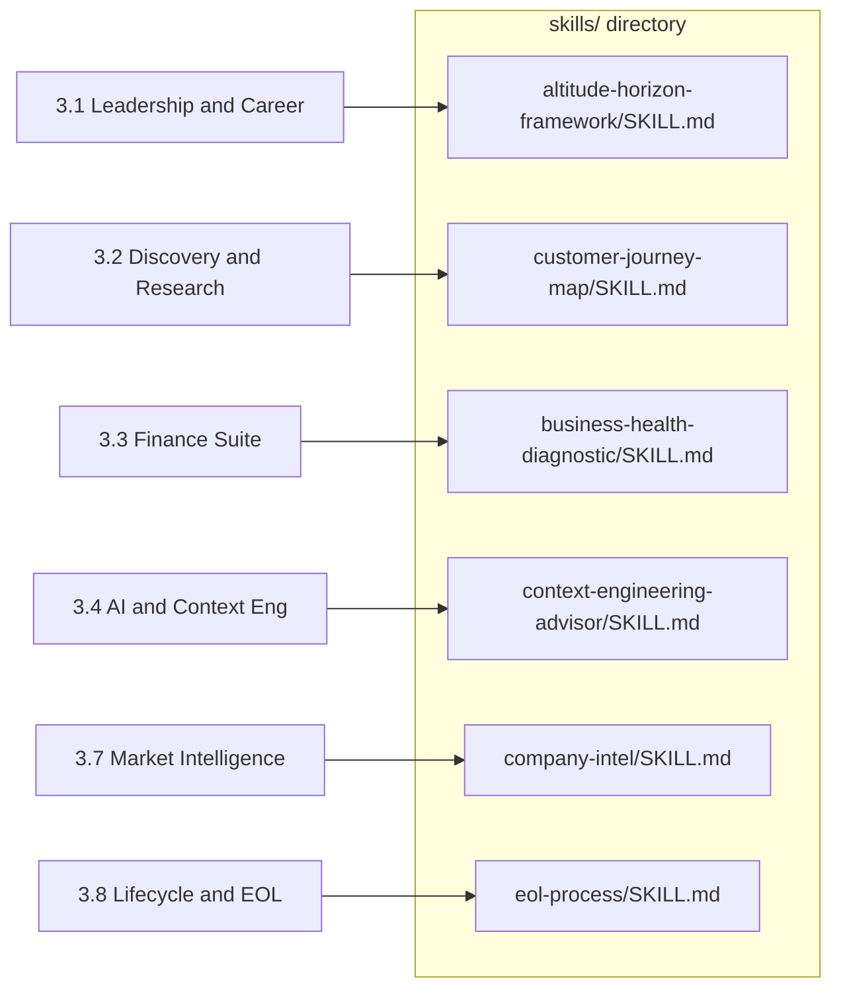
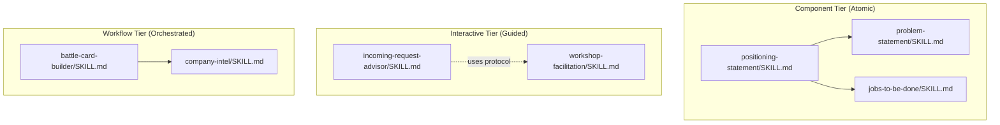

<!-- source: DeepWiki mcp.deepwiki.com · repo deanpeters/Product-Manager-Skills · page 3 Skill Reference · fetched 2026-10-26 -->

# Skill Reference

<details>
<summary>Relevant source files</summary>

The following files were used as context for generating this wiki page:

- [.claude-plugin/marketplace.json](.claude-plugin/marketplace.json)
- [catalog/skills-by-type.md](catalog/skills-by-type.md)
- [catalog/skills-index.yaml](catalog/skills-index.yaml)
- [docs/announcements/2026-07-08-v0-82-inbound-requests-and-dist-shelf.md](docs/announcements/2026-07-08-v0-82-inbound-requests-and-dist-shelf.md)
- [skills/company-intel/SKILL.md](skills/company-intel/SKILL.md)
- [skills/derisk-measurement-advisor/SKILL.md](skills/derisk-measurement-advisor/SKILL.md)
- [skills/incoming-request-advisor/SKILL.md](skills/incoming-request-advisor/SKILL.md)
- [skills/incoming-request-advisor/examples/conversation-flow.md](skills/incoming-request-advisor/examples/conversation-flow.md)
- [skills/incoming-request-advisor/template.md](skills/incoming-request-advisor/template.md)

</details>


This section is the domain-grouped reference for all 77 skills in the `skills/` directory. Each sub-page groups skills by functional domain rather than by tier. If you are looking for the tier-based catalog (Component / Interactive / Workflow), see the [Skill Catalog](#2). For a detailed explanation of the three-tier architecture itself, see [Three-Tier Skill Architecture](#1.1).

---

## Domain Groups

The 77 skills are distributed across eight domain groups, each with a dedicated reference sub-page.

| Section | Domain | Skill Count | Tiers Present |
|---------|--------|-------------|---------------|
| [Leadership and Career Development Skills](#3.1) | Leadership and Career Development | 4 | 1 Component, 2 Interactive, 1 Workflow |
| [Discovery and Research Skills](#3.2) | Discovery and Research | 8 | 1 Component, 6 Interactive, 1 Workflow |
| [Finance Suite](#3.3) | Finance Suite | 7 | 3 Component, 4 Interactive |
| [AI and Context Engineering Skills](#3.4) | AI and Context Engineering | 3 | 3 Interactive |
| [Core PM Deliverable Skills](#3.5) | Core PM Deliverables | 11 | 8 Component, 3 Interactive |
| [Planning and Strategy Skills](#3.6) | Planning and Strategy | 14 | 7 Component, 4 Interactive, 3 Workflow |
| [Market Intelligence Suite](#3.7) | Market Intelligence Suite | 17 | 2 Component, 1 Interactive, 14 Workflow |
| [Lifecycle and EOL Suite](#3.8) | Lifecycle and EOL Suite | 7 | 4 Component, 2 Interactive, 1 Workflow |

**Meta-Skills** (`workshop-facilitation` and `skill-authoring-workflow`) are not assigned to a domain group. `workshop-facilitation/SKILL.md` is the canonical facilitation protocol source of truth referenced by all interactive skills. `skill-authoring-workflow/SKILL.md` is documented in [Skill Authoring Workflow](#5.2).

Sources: [catalog/skills-index.yaml:2-250](), [catalog/skills-by-type.md:5-150]()

---

## File Organization

Every skill lives at exactly one path: `skills/<skill-name>/SKILL.md`. The `<skill-name>` folder is lowercase kebab-case and matches the `name` field in the YAML frontmatter of the file. Domain groups are a conceptual and wiki-level grouping only; the `skills/` directory itself is flat.

Each `SKILL.md` file begins with a frontmatter block declaring required fields:

```yaml
---
name: skill-name-in-kebab-case
description: One-sentence summary under 200 characters
type: component|interactive|workflow
---
```

**Diagram: Wiki Sections Mapped to Code Entity Space (representative files)**



Sources: [.claude-plugin/marketplace.json:1-150](), [catalog/skills-index.yaml:1-100]()

---

## Cross-Reference Architecture

Skills reference each other through a strictly uni-directional dependency rule. This ensures no circular dependencies and keeps component skills portable.

| Tier | May Reference | May Not Reference |
|------|--------------|-------------------|
| `component` | Other component skills | Interactive or workflow skills |
| `interactive` | Component skills | Workflow skills |
| `workflow` | Component and interactive skills | — |

**Facilitation protocol:** `skills/workshop-facilitation/SKILL.md` is the canonical source of truth for the guided multi-turn interaction pattern. All interactive skills reference it via their `References` section rather than re-implementing the protocol inline.

**Diagram: High-Level Cross-Reference Dependencies**



Sources: [skills/incoming-request-advisor/SKILL.md:71-82](), [skills/company-intel/SKILL.md:5-13]()

---

## Domain Group Summaries

### 3.1 Leadership and Career Development → [Leadership and Career Development Skills](#3.1)
Covers the PM-to-Director transition. The anchor is `altitude-horizon-framework`, a component skill providing a two-axis mental model (altitude scope and horizon time).

### 3.2 Discovery and Research → [Discovery and Research Skills](#3.2)
Covers the continuous discovery cycle. Includes the `discovery-process` workflow and interactive canvases like `problem-framing-canvas` and `opportunity-solution-tree`.

### 3.3 Finance Suite → [Finance Suite](#3.3)
A three-layer architecture: Foundation (metrics), Decision (advisors for acquisition/investment), and Diagnostic (`business-health-diagnostic`).

### 3.4 AI and Context Engineering → [AI and Context Engineering Skills](#3.4)
Focused on how PMs design AI workflows. Includes `context-engineering-advisor` for diagnosing "context stuffing" and `ai-shaped-readiness-advisor` for assessing team maturity.

### 3.5 Core PM Deliverables → [Core PM Deliverable Skills](#3.5)
The foundational artifact skills: `user-story`, `positioning-statement`, `problem-statement`, and the `pol-probe` (Proof of Life) for cheap hypothesis testing.

### 3.6 Planning and Strategy → [Planning and Strategy Skills](#3.6)
Skills for long-horizon work, including `roadmap-planning`, `product-strategy-session`, and `user-story-mapping`.

### 3.7 Market Intelligence Suite → [Market Intelligence Suite](#3.7)
A heavy-duty research suite built on the `autonomous-investigation` protocol. Includes `company-intel` (7-lens research) and the `battle-card-builder`.

### 3.8 Lifecycle and EOL Suite → [Lifecycle and EOL Suite](#3.8)
A 7-skill suite for managing product decline. Orchestrated by `eol-process`, it covers the "Goldilocks" right-sizing model and the eight lifecycle gates from GA to EOSRV.

Sources: [catalog/skills-index.yaml:1-250](), [docs/announcements/2026-07-08-v0-82-inbound-requests-and-dist-shelf.md:9-15]()

---

