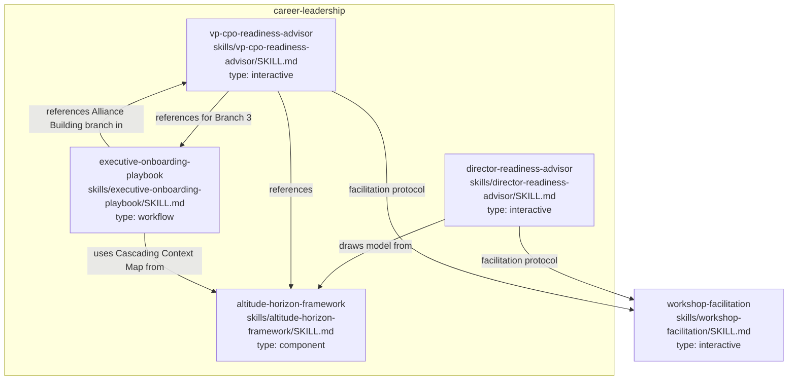
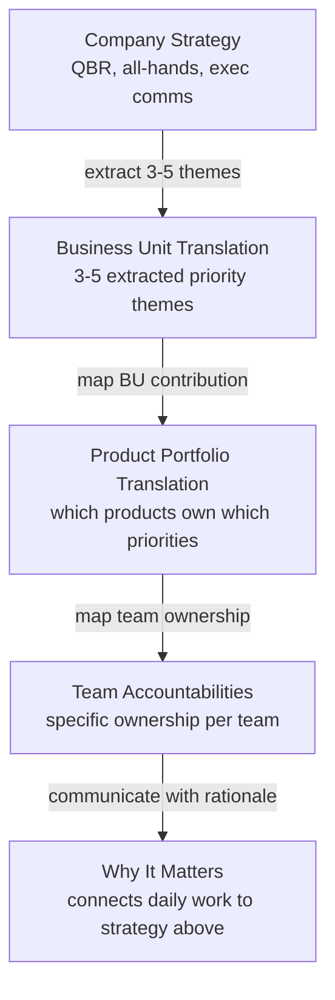
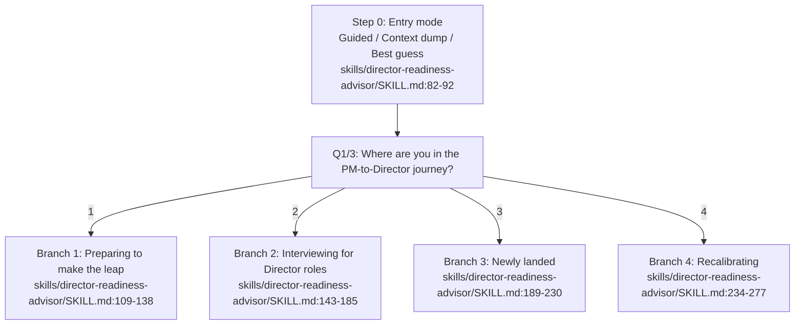
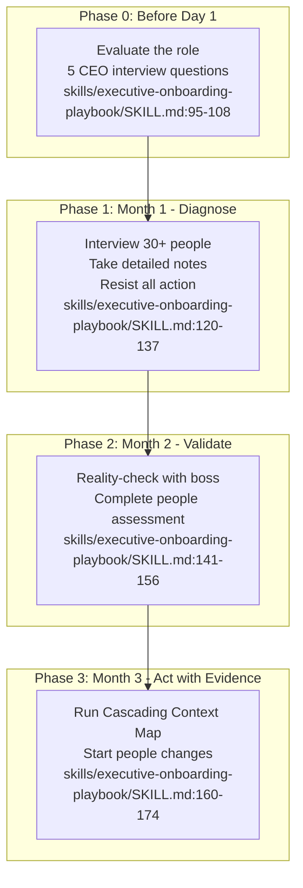
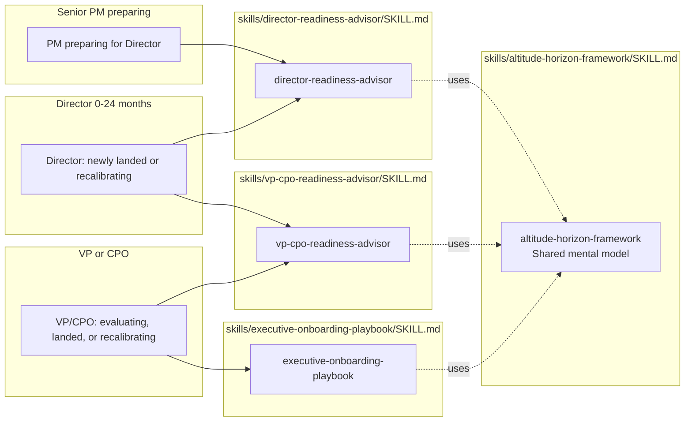

<!-- source: DeepWiki mcp.deepwiki.com · repo deanpeters/Product-Manager-Skills · page 3.1 Leadership and Career Development Skills · fetched 2026-10-26 -->

# Leadership and Career Development Skills

<details>
<summary>Relevant source files</summary>

The following files were used as context for generating this wiki page:

- [dist/director-readiness-advisor.zip](dist/director-readiness-advisor.zip)
- [dist/executive-onboarding-playbook.zip](dist/executive-onboarding-playbook.zip)
- [dist/vp-cpo-readiness-advisor.zip](dist/vp-cpo-readiness-advisor.zip)
- [skills/altitude-horizon-framework/SKILL.md](skills/altitude-horizon-framework/SKILL.md)
- [skills/customer-journey-map/SKILL.md](skills/customer-journey-map/SKILL.md)
- [skills/director-readiness-advisor/SKILL.md](skills/director-readiness-advisor/SKILL.md)
- [skills/executive-onboarding-playbook/SKILL.md](skills/executive-onboarding-playbook/SKILL.md)
- [skills/vp-cpo-readiness-advisor/SKILL.md](skills/vp-cpo-readiness-advisor/SKILL.md)

</details>


This page documents the four skills in the `career-leadership` theme: the foundational Altitude-Horizon Framework, two interactive coaching advisors for Director and VP/CPO transitions, and a structured onboarding workflow for new executives. Together these skills cover the full arc from PM-to-Director to VP/CPO-level leadership.

For skills related to discovery or research workflows, see [Discovery and Research Skills](#3.2). For core PM deliverables like user stories and PRDs, see [Core PM Deliverable Skills](#3.5).

---

## Skills in This Group

| Skill Name | Type | Estimated Time | Purpose |
|---|---|---|---|
| `altitude-horizon-framework` | component | 10–15 min | Core mental model for the PM-to-Director transition |
| `director-readiness-advisor` | interactive | 10–15 min | Adaptive coaching for the PM-to-Director transition |
| `vp-cpo-readiness-advisor` | interactive | 15–20 min | Adaptive coaching for the Director-to-VP/CPO transition |
| `executive-onboarding-playbook` | workflow | 20–30 min | Structured 30-60-90 day diagnostic for new VP/CPO roles |

The component skill provides shared vocabulary and templates consumed by all three higher-tier skills. For a full explanation of component, interactive, and workflow tier behavior, see [Three-Tier Skill Architecture](#1.1).

---

## Dependency Architecture

**Skill relationships and file locations — career-leadership theme:**



Sources: [skills/director-readiness-advisor/SKILL.md:50-56](), [skills/vp-cpo-readiness-advisor/SKILL.md:109-120](), [skills/executive-onboarding-playbook/SKILL.md:164-165]()

---

## altitude-horizon-framework

**File:** [skills/altitude-horizon-framework/SKILL.md]()
**Type:** component | **Theme:** career-leadership

### The Two Axes

The framework defines two dimensions that change when a PM becomes a Director:

| Axis | PM | Director |
|---|---|---|
| **Altitude** (scope) | Individual features, customer problems, sprint priorities | Portfolio decisions, cross-functional systems, budget allocation, market positioning |
| **Horizon** (time) | Days to weeks; a quarter at most | Quarter as baseline; annual planning cycles, multi-year strategy, market shifts |

The shift is not about ignoring customer problems — it is about zooming out to see the entire system rather than one table in it.

Sources: [skills/altitude-horizon-framework/SKILL.md:38-49]()

### Waiter vs. Restaurant Operator

| Dimension | PM (Waiter) | Director (Restaurant Operator) |
|---|---|---|
| Focus | Individual diner experience | Entire system: staffing, margins, menu, suppliers |
| Authority | Influence without control | Portfolio decisions, budget, resource allocation |
| Success metric | Table seven is happy | Restaurant is profitable, consistent, and scalable |
| Relationship to customers | Direct, daily, intimate | Aggregate patterns, buyer personas, market cohorts |
| Failure mode | Ignoring Table Seven's needs | Obsessing over Table Seven's lemons |

Sources: [skills/altitude-horizon-framework/SKILL.md:52-64]()

### Four Transition Zones

The PM→Director shift requires movement across four named zones. Most people struggle with one or two more than the others — diagnosing which zone is creating friction is the leverage point.

| Zone | Stop | Start |
|---|---|---|
| **Zone 1 — Thinking Altitude** | Solving individual customer problems directly | Designing systems and teams that solve classes of problems |
| **Zone 2 — Persona Shift** | Obsessing over individual user personas and daily touchpoints | Thinking in buyer personas, market cohorts, organizational stakeholders |
| **Zone 3 — Hero Syndrome Recovery** | Being the person who saves the day | Getting satisfaction from team success; your product is your people |
| **Zone 4 — Direction Creation** | Waiting for clear direction from above | Creating context cascades from incomplete company strategy |

Sources: [skills/altitude-horizon-framework/SKILL.md:68-87]()

### Named Failure Modes

Five failure modes are explicitly named in the framework:

| Failure Mode | Symptom | Cost |
|---|---|---|
| **Hero Syndrome** | Jumping in to solve problems directly; staying in the tactical work | Under-performing as a Director while over-functioning as a senior IC; team doesn't grow |
| **Allergic to Process** | Resisting shared structures; each PM runs their own playbook | Stakeholders can't synthesize inconsistent outputs; coordination costs become invisible |
| **People-Pleaser Leadership** | Avoiding hard feedback; saying yes to preserve relationships | Confusing "popular" with "effective"; trust is built through clarity, not niceness |
| **Instant Gratification Trap** | Collecting certifications; asking "what do I need to do to get promoted?" | Director readiness requires lived humility and war stories; studying provides vocabulary, not readiness |
| **Black-and-White Thinking** | "Why is everything so political here?" | Fast decisions with low confidence create downstream chaos; grayscale is the actual terrain |

Sources: [skills/altitude-horizon-framework/SKILL.md:90-115]()

### The Cascading Context Map

The Cascading Context Map is the primary tool Directors use when organizational direction is absent or vague. Rather than waiting for clarity from above, the Director translates available signal into team-level context. The template is defined at [skills/altitude-horizon-framework/SKILL.md:145-153]():

```markdown
## Context Cascade

**Company Priority:** [What leadership said — in their words]
**Business Unit Translation:** [How your BU contributes to that priority]
**Product Portfolio Translation:** [How your products contribute to that]
**Team Accountabilities:** [What each team owns specifically]
**Why this matters:** [The so-what for your team — what changes, what stays the same]
```

**Information flow through the cascade:**



The six-step process for building a cascade is defined at [skills/altitude-horizon-framework/SKILL.md:117-128]().

Sources: [skills/altitude-horizon-framework/SKILL.md:84-87](), [skills/altitude-horizon-framework/SKILL.md:117-153]()

---

## director-readiness-advisor

**File:** [skills/director-readiness-advisor/SKILL.md]()
**Type:** interactive | **Theme:** career-leadership

### Overview

An adaptive coaching session for PMs and Directors navigating the PM-to-Director transition. The skill draws directly on the `altitude-horizon-framework` model and uses `workshop-facilitation` as its facilitation protocol ([skills/director-readiness-advisor/SKILL.md:50-72]()).

Structure: **1 diagnostic question + up to 3 adaptive follow-up questions → 3–5 enumerated recommendations** ([skills/director-readiness-advisor/SKILL.md:76-78]()).

### Branching Logic

**Director Readiness Advisor — interaction flow:**



Sources: [skills/director-readiness-advisor/SKILL.md:82-277]()

---

## vp-cpo-readiness-advisor

**File:** [skills/vp-cpo-readiness-advisor/SKILL.md]()
**Type:** interactive | **Theme:** career-leadership

### The Three Ps Framework

At VP and CPO level, accountability expands across three dimensions simultaneously:

| Dimension | Description |
|---|---|
| **Product** | Portfolio decisions, roadmap strategy, product family coherence |
| **Practice** | How the work gets done; process discipline, execution consistency |
| **People** | Org structure, talent matching, developing leaders, setting expectations |

Sources: [skills/vp-cpo-readiness-advisor/SKILL.md:39-47]()

### The VP → CPO Paradigm Shift

| | VP Mindset | CPO Mindset |
|---|---|---|
| Primary question | "What are we releasing? How does our portfolio perform?" | "What business outcomes are we accountable for, and how does the product org achieve them?" |
| Language | Product language acceptable | Switch to business language: ROI, revenue, retention, margin |

Sources: [skills/vp-cpo-readiness-advisor/SKILL.md:61-73]()

---

## executive-onboarding-playbook

**File:** [skills/executive-onboarding-playbook/SKILL.md]()
**Type:** workflow | **Theme:** career-leadership

### Phase Structure

**Executive Onboarding Playbook — phase flow:**



Sources: [skills/executive-onboarding-playbook/SKILL.md:95-174]()

### Key Concepts

**Consultant Mindset** — Enter every VP/CPO role as an external consultant hired to assess before changing. Negotiate explicitly: Month 1 is learning; Month 2 is recommending. ([skills/executive-onboarding-playbook/SKILL.md:41-52]())

**Unwritten Strategy** — Strategy lives in the CEO's head, board dynamics, and off-the-record founder conversations. Your job is to surface this unwritten layer. ([skills/executive-onboarding-playbook/SKILL.md:55-71]())

**Body of Evidence** — Every decision in Month 3 should rest on a body of evidence (patterns, notes, reality-checks) collected in Months 1 and 2. ([skills/executive-onboarding-playbook/SKILL.md:73-81]())

---

## Career Track and Skill Coverage

**Skill scope mapped to career progression:**



Sources: [skills/altitude-horizon-framework/SKILL.md:1-15](), [skills/director-readiness-advisor/SKILL.md:1-15](), [skills/vp-cpo-readiness-advisor/SKILL.md:1-15](), [skills/executive-onboarding-playbook/SKILL.md:1-15]()

---

