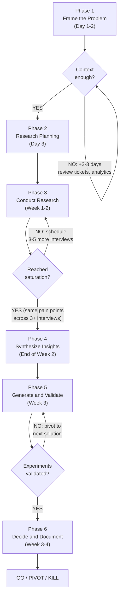
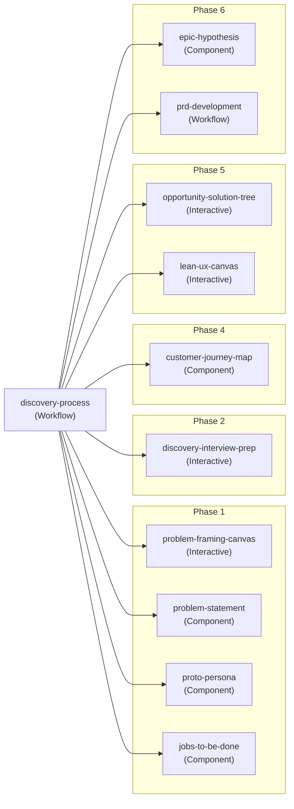
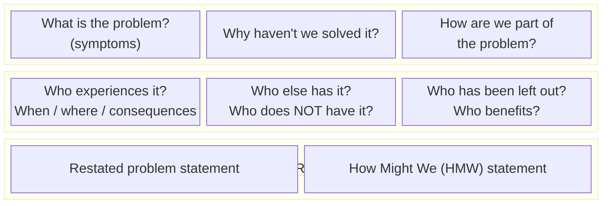
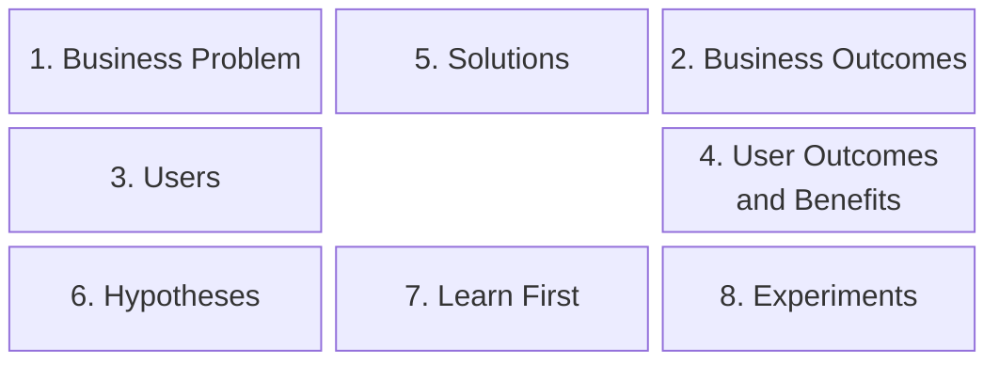
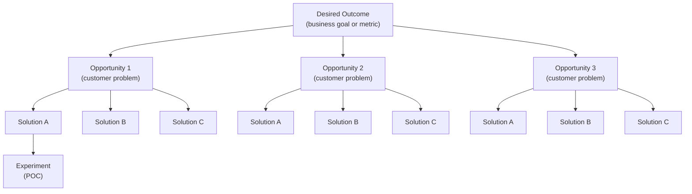
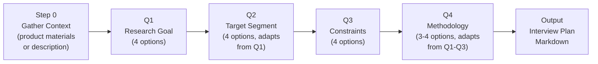
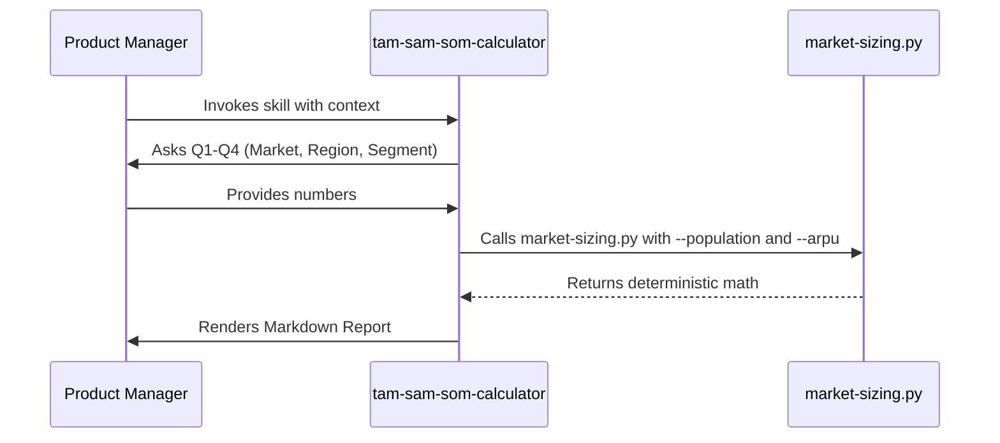
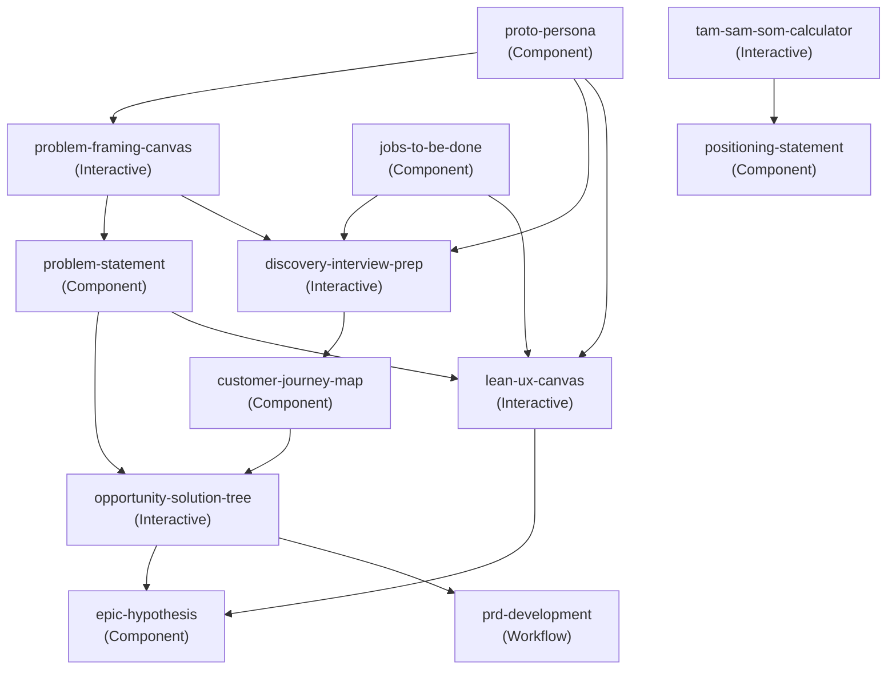

<!-- source: DeepWiki mcp.deepwiki.com · repo deanpeters/Product-Manager-Skills · page 3.2 Discovery and Research Skills · fetched 2026-10-26 -->

# Discovery and Research Skills

Relevant source files

The following files were used as context for generating this wiki page:

- [dist/discovery-interview-prep.zip](dist/discovery-interview-prep.zip)
- [dist/discovery-process.zip](dist/discovery-process.zip)
- [dist/lean-ux-canvas.zip](dist/lean-ux-canvas.zip)
- [dist/opportunity-solution-tree.zip](dist/opportunity-solution-tree.zip)
- [dist/tam-sam-som-calculator.zip](dist/tam-sam-som-calculator.zip)
- [skills/business-health-diagnostic/SKILL.md](skills/business-health-diagnostic/SKILL.md)
- [skills/discovery-interview-prep/SKILL.md](skills/discovery-interview-prep/SKILL.md)
- [skills/discovery-process/SKILL.md](skills/discovery-process/SKILL.md)
- [skills/epic-breakdown-advisor/SKILL.md](skills/epic-breakdown-advisor/SKILL.md)
- [skills/lean-ux-canvas/SKILL.md](skills/lean-ux-canvas/SKILL.md)
- [skills/problem-framing-canvas/SKILL.md](skills/problem-framing-canvas/SKILL.md)
- [skills/roadmap-planning/SKILL.md](skills/roadmap-planning/SKILL.md)
- [skills/saas-revenue-growth-metrics/SKILL.md](skills/saas-revenue-growth-metrics/SKILL.md)
- [skills/tam-sam-som-calculator/SKILL.md](skills/tam-sam-som-calculator/SKILL.md)

This page documents the seven skills in the discovery-research theme: `lean-ux-canvas`, `problem-framing-canvas`, `opportunity-solution-tree`, `tam-sam-som-calculator`, `discovery-interview-prep`, `customer-journey-map`, and the `discovery-process` workflow that orchestrates them. These skills cover the full arc from initial problem hypothesis through validated solution.

For skills that belong to adjacent domains—PRD authoring, story writing, or epic splitting—see [Core PM Deliverable Skills](#3.5). For planning-horizon skills that consume discovery outputs, see [Planning and Strategy Skills](#3.6).

---

## Skill Inventory

| Skill | File | Type | Time |
|---|---|---|---|
| `discovery-process` | `skills/discovery-process/SKILL.md` | Workflow | 30–60 min session; 3–8 weeks total |
| `lean-ux-canvas` | `skills/lean-ux-canvas/SKILL.md` | Interactive | ~90 min |
| `problem-framing-canvas` | `skills/problem-framing-canvas/SKILL.md` | Interactive | ~90 min |
| `opportunity-solution-tree` | `skills/opportunity-solution-tree/SKILL.md` | Interactive | ~90 min |
| `tam-sam-som-calculator` | `skills/tam-sam-som-calculator/SKILL.md` | Interactive | ~60 min |
| `discovery-interview-prep` | `skills/discovery-interview-prep/SKILL.md` | Interactive | 15–20 min |
| `customer-journey-map` | `skills/customer-journey-map/SKILL.md` | Component | 20–30 min |

All interactive and workflow skills in this group use `skills/workshop-facilitation/SKILL.md` as their facilitation protocol, which governs session entry mode, one-question-per-turn cadence, progress labels, and numbered option lists. Each skill's own file governs domain logic when conflicts arise.

Sources: [skills/discovery-process/SKILL.md:1-17](), [skills/lean-ux-canvas/SKILL.md:1-18](), [skills/tam-sam-som-calculator/SKILL.md:1-17](), [skills/discovery-interview-prep/SKILL.md:1-18](), [skills/discovery-process/SKILL.md:73-85]()

---

## The Discovery Process Workflow

`discovery-process` is the only Workflow-type skill in this group. It orchestrates the component and interactive skills into a six-phase cycle lasting three to eight weeks.

**Six-Phase Continuous Discovery Cycle**

Sources: [skills/discovery-process/SKILL.md:95-212]()

### Phase–Skill Mapping

Each phase delegates to one or more component or interactive skills:

| Phase | Skills Invoked | Type | Required / Optional |
|---|---|---|---|
| 1: Frame the Problem | `problem-framing-canvas` | Interactive | Required |
| 1: Frame the Problem | `problem-statement` | Component | Required |
| 1: Frame the Problem | `proto-persona` | Component | Optional |
| 1: Frame the Problem | `jobs-to-be-done` | Component | Optional |
| 2: Research Planning | `discovery-interview-prep` | Interactive | Required |
| 4: Synthesize Insights | `customer-journey-map` | Component | Optional |
| 5: Generate and Validate | `opportunity-solution-tree` | Interactive | Required |
| 5: Generate and Validate | `lean-ux-canvas` | Interactive | Alternative to OST |
| 6: Decide and Document | `epic-hypothesis` | Component | If GO |
| 6: Decide and Document | `prd-development` | Workflow | If GO |

Sources: [skills/discovery-process/SKILL.md:101-209]()

**Skill orchestration across discovery phases**

Sources: [skills/discovery-process/SKILL.md:101-209]()

---

## Individual Skill Reference

### `problem-framing-canvas`

**Type:** Interactive | **File:** `skills/problem-framing-canvas/SKILL.md`

Implements MITRE's Problem Framing Canvas (v3) as a three-phase facilitated conversation. The purpose is to challenge assumptions before committing to a problem definition, not to brainstorm solutions.

**Canvas Structure**

Sources: [skills/discovery-process/SKILL.md:101-106]()

---

### `lean-ux-canvas`

**Type:** Interactive | **File:** `skills/lean-ux-canvas/SKILL.md`

Implements Jeff Gothelf's Lean UX Canvas v2 as an 8-step facilitated flow. The canvas reframes work from "solution to implement" to "business problem to solve."

**Canvas Layout (8 boxes)**

Sources: [skills/lean-ux-canvas/SKILL.md:57-71]()

**Fill order and key distinctions:**

| Box | Content Type | Common Pitfall |
|---|---|---|
| 1. Business Problem | What changed in the world | Stating a solution instead of a change |
| 2. Business Outcomes | Measurable behavior change (metrics) | Confusing with Box 4 (user emotions) |
| 3. Users | Specific persona(s) | "All users" — too broad |
| 4. User Outcomes & Benefits | Goals, emotions, empathy | Metrics belong in Box 2, not here |
| 5. Solutions | Candidate features/policies | Listing only one solution |
| 6. Hypotheses | "We believe [Box 2] if [Box 3] attains [Box 4] with [Box 5]" | Non-testable statements |
| 7. Learn First | Riskiest assumption | Skipping risk prioritization |
| 8. Experiments | Smallest test to validate Box 7 | "We'll just build it" |

Sources: [skills/lean-ux-canvas/SKILL.md:73-116]()

---

### `opportunity-solution-tree`

**Type:** Interactive | **File:** `skills/opportunity-solution-tree/SKILL.md`

Implements Teresa Torres's Opportunity Solution Tree from *Continuous Discovery Habits* (2021). Operates in two phases: generating the tree, then selecting a proof-of-concept.

**OST Structure**

Sources: [skills/discovery-process/SKILL.md:175-182]()

---

### `discovery-interview-prep`

**Type:** Interactive | **File:** `skills/discovery-interview-prep/SKILL.md`

Produces a tailored interview plan through up to 4 adaptive questions. The output is a structured Markdown document covering methodology, question framework with follow-ups and biases to avoid, logistics, and success criteria.

**Question Flow**

Sources: [skills/discovery-interview-prep/SKILL.md:88-155]()

**Research Goal Options (Q1):**

| # | Goal | Typical Context |
|---|---|---|
| 1 | Problem validation | New product idea |
| 2 | Jobs-to-be-Done discovery | Product strategy |
| 3 | Retention/churn investigation | Existing product with churn |
| 4 | Feature prioritization | Roadmap planning |

Sources: [skills/discovery-interview-prep/SKILL.md:124-130]()

---

### `tam-sam-som-calculator`

**Type:** Interactive | **File:** `skills/tam-sam-som-calculator/SKILL.md`

Guides a four-question adaptive flow to produce a citation-backed TAM/SAM/SOM analysis. The output is a structured Markdown report with population estimates, dollar figures, data sources, and year 1–3 SOM projections.

**System Data Flow: Calculator to CLI**

Sources: [skills/tam-sam-som-calculator/SKILL.md:134-142](), [tam-sam-som-calculator/scripts/market-sizing.py:1-32]()

**TAM/SAM/SOM definitions:**

| Term | Scope | Key Question |
|---|---|---|
| TAM | Full market, no constraints | "If we captured 100%, what's revenue?" |
| SAM | Segment reachable with this product | "Who can we actually reach?" |
| SOM | Realistic 1–3 year capture from SAM | "What can we capture given competition?" |

Sources: [skills/tam-sam-som-calculator/SKILL.md:46-59]()

---

## How the Skills Chain Together

The diagram below shows the most common chaining paths between discovery and research skills, including which skills feed into downstream deliverables outside this group.

**Discovery skill dependency graph**

Sources: [skills/discovery-process/SKILL.md:101-209](), [skills/lean-ux-canvas/SKILL.md:143-145](), [skills/discovery-interview-prep/SKILL.md:72-84]()

---

## Facilitation Protocol

All interactive and workflow skills in this group delegate session mechanics to `skills/workshop-facilitation/SKILL.md`. The contract is referenced identically across all five interactive skills and the workflow:

- **Entry modes:** Guided (question-by-question), Context dump (paste all at once), Best guess (agent infers from available context)
- **Turn structure:** One question per turn with plain-language prompts
- **Progress labels:** Format `Context Qx/N` and `Scoring Qx/N`
- **Options:** Numbered enumerated lists (3–4 per question); always includes "Other (specify)" where appropriate
- **Decision points:** Numbered recommendations
- **Conflict rule:** When the domain skill's logic conflicts with the facilitation protocol, the domain skill wins

Sources: [skills/discovery-process/SKILL.md:73-85](), [skills/lean-ux-canvas/SKILL.md:143-155](), [skills/tam-sam-som-calculator/SKILL.md:85-97](), [skills/discovery-interview-prep/SKILL.md:72-84]()

---

