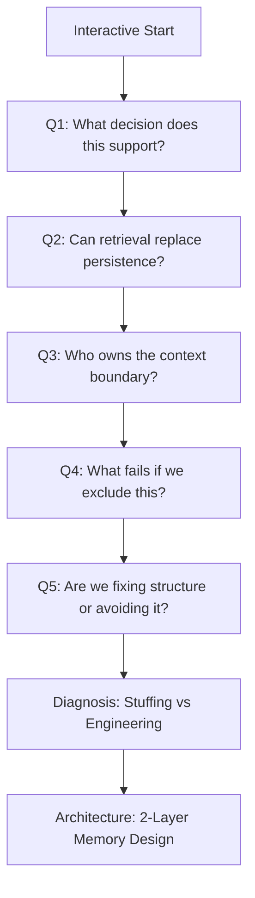
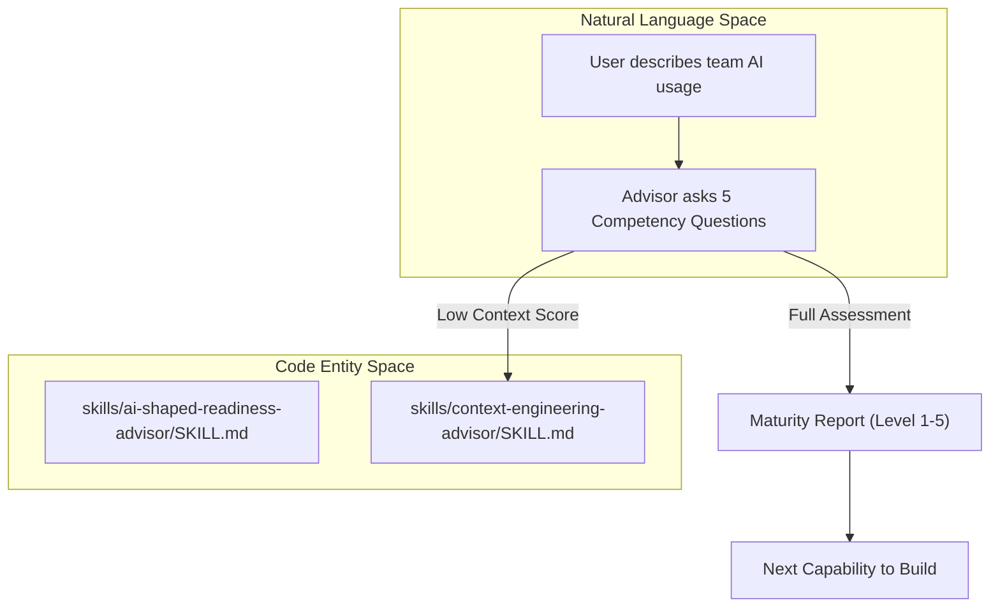

<!-- source: DeepWiki mcp.deepwiki.com · repo deanpeters/Product-Manager-Skills · page 3.4 AI and Context Engineering Skills · fetched 2026-10-26 -->

# AI and Context Engineering Skills

Relevant source files

The following files were used as context for generating this wiki page:

- [15MAY26.md](15MAY26.md)
- [26APR26.md](26APR26.md)
- [PLANS.md](PLANS.md)
- [dist/acquisition-channel-advisor.zip](dist/acquisition-channel-advisor.zip)
- [dist/agent-orchestration-advisor.zip](dist/agent-orchestration-advisor.zip)
- [dist/ai-shaped-readiness-advisor.zip](dist/ai-shaped-readiness-advisor.zip)
- [dist/altitude-horizon-framework.zip](dist/altitude-horizon-framework.zip)
- [dist/packages/05-ai-pm-pack.zip](dist/packages/05-ai-pm-pack.zip)
- [docs/Finance Suite Summary.md](docs/Finance Suite Summary.md)
- [research/Context Engineering for Product Managers.md](research/Context Engineering for Product Managers.md)
- [research/deanpeters-substack-posts.zip](research/deanpeters-substack-posts.zip)
- [research/v080-ai-product-builder-execution-brief.md](research/v080-ai-product-builder-execution-brief.md)
- [skills/ai-shaped-readiness-advisor/SKILL.md](skills/ai-shaped-readiness-advisor/SKILL.md)
- [skills/context-engineering-advisor/SKILL.md](skills/context-engineering-advisor/SKILL.md)
- [skills/positioning-statement/SKILL.md](skills/positioning-statement/SKILL.md)
- [skills/user-story/SKILL.md](skills/user-story/SKILL.md)
- [skills/workshop-facilitation/SKILL.md](skills/workshop-facilitation/SKILL.md)

## Purpose and Scope

This page documents two `interactive`-type skills in the `ai-agents` theme:

- **`context-engineering-advisor`** ([skills/context-engineering-advisor/SKILL.md:2-7]()): Guides PMs through diagnosing context stuffing problems and designing proper AI memory and retrieval architecture.
- **`ai-shaped-readiness-advisor`** ([skills/ai-shaped-readiness-advisor/SKILL.md:2-7]()): Assesses organizational AI maturity across five competencies and produces a prioritized action plan.

Both skills follow the facilitation protocol defined in `workshop-facilitation` ([PLANS.md:74-78]()). For loading these skills into AI agents, see [Integration Guides](#4).

Supporting theoretical background is found in the research essays based on Dean Peters' Substack articles, specifically addressing the transition from "AI-First" to "AI-Shaped" operations ([PLANS.md:108-112]()).

Sources: [skills/context-engineering-advisor/SKILL.md:1-17](), [skills/ai-shaped-readiness-advisor/SKILL.md:1-17](), [PLANS.md:102-112]()

---

## context-engineering-advisor

### Purpose
The skill frames the PM's role as an **architect of informational ecosystems** ([skills/context-engineering-advisor/SKILL.md:47-48]()). It addresses the "Fundamental Problem" where LLMs rely on parametric knowledge (static training data) and fail when asked about proprietary data ([skills/context-engineering-advisor/SKILL.md:42-45]()).

### Key Concepts

#### Context Stuffing vs. Context Engineering
The advisor distinguishes between **Context Stuffing** (Volume = Quality) and **Context Engineering** (Structure = Quality) ([skills/context-engineering-advisor/SKILL.md:53-60]()).

| Dimension | Context Stuffing | Context Engineering |
|-----------|------------------|---------------------|
| **Mindset** | Volume = quality | Structure = quality |
| **Persistence** | Persist all context | Retrieve with intent |
| **Agent Chains** | Share everything between agents | Bounded context per agent |

Sources: [skills/context-engineering-advisor/SKILL.md:53-60]()

#### Memory Architecture
The skill implements a **Two-Layer Memory Architecture** ([skills/context-engineering-advisor/SKILL.md:120-133]()):
1.  **Short-Term (Conversational):** Single session interactions, managed via summarization or truncation.
2.  **Long-Term (Persistent):** Facts (Declarative) and Behavioral patterns (Procedural) stored in vector databases.

#### The Research-Plan-Reset-Implement Cycle
To solve "Context Rot" (accumulated noise in a long session), the skill prescribes a 4-phase cycle ([skills/context-engineering-advisor/SKILL.md:139-148]()):
1.  **Research:** Gather raw data.
2.  **Plan:** Synthesize into high-density artifacts (e.g., `SPEC.md`).
3.  **Reset:** Clear the entire context window.
4.  **Implement:** Start a fresh session using only the high-density plan.

### Data Flow and Logic

**Context Engineering Diagnosis Flow**

Sources: [skills/context-engineering-advisor/SKILL.md:108-118]()

---

## ai-shaped-readiness-advisor

### Purpose
Assesses whether product work is **"AI-first"** (automating tasks for speed) or **"AI-shaped"** (redesigning operations around AI capabilities) ([skills/ai-shaped-readiness-advisor/SKILL.md:23-25]()).

### The 5 Essential PM Competencies (2026)
The maturity assessment evaluates the organization across five pillars ([skills/ai-shaped-readiness-advisor/SKILL.md:54-150]()):

1.  **Context Design:** Building a durable "reality layer" (definitions, evidence standards).
2.  **Agent Orchestration:** Creating repeatable, traceable AI workflows rather than one-off prompts.
3.  **Outcome Acceleration:** Compressing learning cycles and eliminating validation lag.
4.  **Team-AI Facilitation:** Redesigning systems so AI acts as co-intelligence, not an accountability shield.
5.  **Strategic Differentiation:** Creating defensible moats (e.g., proprietary datasets) rather than temporary efficiency gains.

### Application Logic

**AI Readiness Maturity Assessment**

Sources: [skills/ai-shaped-readiness-advisor/SKILL.md:54-150](), [skills/ai-shaped-readiness-advisor/SKILL.md:86-87]()

### Common Pitfalls
- **Positioning Theater:** Using AI for generic efficiency without solving specific customer pains ([skills/ai-shaped-readiness-advisor/SKILL.md:158-159]()).
- **Context Rot:** Allowing irrelevant data to accumulate in AI workflows ([skills/context-engineering-advisor/SKILL.md:77-78]()).

Sources: [skills/ai-shaped-readiness-advisor/SKILL.md:152-161](), [skills/context-engineering-advisor/SKILL.md:75-80]()

---

