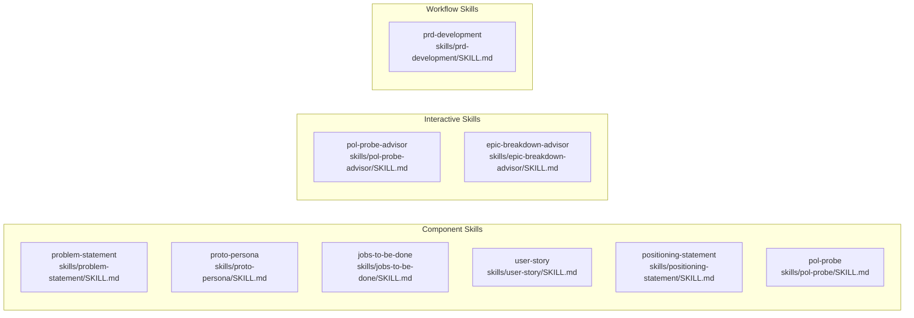
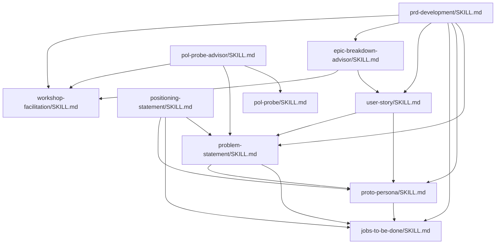

<!-- source: DeepWiki mcp.deepwiki.com · repo deanpeters/Product-Manager-Skills · page 3.5 Core PM Deliverable Skills · fetched 2026-10-26 -->

# Core PM Deliverable Skills

<details>
<summary>Relevant source files</summary>

The following files were used as context for generating this wiki page:

- [commands/write-prd.md](commands/write-prd.md)
- [dist/epic-breakdown-advisor.zip](dist/epic-breakdown-advisor.zip)
- [dist/jobs-to-be-done.zip](dist/jobs-to-be-done.zip)
- [dist/positioning-statement.zip](dist/positioning-statement.zip)
- [dist/prd-development.zip](dist/prd-development.zip)
- [dist/problem-statement.zip](dist/problem-statement.zip)
- [dist/proto-persona.zip](dist/proto-persona.zip)
- [dist/user-story.zip](dist/user-story.zip)
- [skills/jobs-to-be-done/SKILL.md](skills/jobs-to-be-done/SKILL.md)
- [skills/pol-probe-advisor/SKILL.md](skills/pol-probe-advisor/SKILL.md)
- [skills/pol-probe/SKILL.md](skills/pol-probe/SKILL.md)
- [skills/prd-development/SKILL.md](skills/prd-development/SKILL.md)
- [skills/prd-development/examples/sample.md](skills/prd-development/examples/sample.md)
- [skills/prd-development/template.md](skills/prd-development/template.md)
- [skills/problem-statement/SKILL.md](skills/problem-statement/SKILL.md)

</details>


## Purpose and Scope

This page documents the skills in the **Core PM Deliverable** group. These skills produce the foundational artifacts of product management: user personas, problem frames, user stories, positioning statements, validation probes, epic breakdowns, and full PRDs. They span all three skill tiers and act as the raw material consumed by planning, discovery, and engineering handoff processes.

For discovery-specific skills (Lean UX Canvas, Opportunity Solution Tree, discovery interview prep), see [Discovery and Research Skills](3.2). For roadmap and strategy orchestration skills, see [Planning and Strategy Skills](3.6). For the SKILL.md file format and frontmatter schema, see [Skill Format Reference](5.1).

---

## Skill Inventory

| Skill | File Path | Tier | Estimated Time |
|---|---|---|---|
| `problem-statement` | `skills/problem-statement/SKILL.md` | Component | 15–30 min |
| `proto-persona` | `skills/proto-persona/SKILL.md` | Component | 30–60 min |
| `jobs-to-be-done` | `skills/jobs-to-be-done/SKILL.md` | Component | 30–60 min |
| `user-story` | `skills/user-story/SKILL.md` | Component | 5–10 min |
| `positioning-statement` | `skills/positioning-statement/SKILL.md` | Component | 10–15 min |
| `pol-probe` | `skills/pol-probe/SKILL.md` | Component | 15-25 min |
| `pol-probe-advisor` | `skills/pol-probe-advisor/SKILL.md` | Interactive | 15-20 min |
| `epic-breakdown-advisor` | `skills/epic-breakdown-advisor/SKILL.md` | Interactive | 60–90 min |
| `prd-development` | `skills/prd-development/SKILL.md` | Workflow | 60–120 min |

**Diagram: Skill Files by Tier (Natural Language → Code Space)**



Sources: [skills/user-story/SKILL.md:1-14](), [skills/positioning-statement/SKILL.md:1-14](), [skills/pol-probe/SKILL.md:1-18](), [skills/pol-probe-advisor/SKILL.md:1-18](), [skills/prd-development/SKILL.md:1-17](), [skills/problem-statement/SKILL.md:1-4](), [skills/proto-persona/SKILL.md:1-4](), [skills/jobs-to-be-done/SKILL.md:1-4]()

---

## Inter-Skill Dependencies

Skills in this group have a layered dependency structure. Foundation skills (persona, problem, JTBD) feed into artifact skills (user story, positioning), which feed the orchestration layer (PRD development). The `workshop-facilitation` skill acts as a shared facilitation protocol for all interactive and workflow skills.

**Diagram: Reference Graph — File Paths as Identifiers**



Sources: [skills/prd-development/SKILL.md:148-149](), [skills/pol-probe-advisor/SKILL.md:86-88](), [skills/prd-development/SKILL.md:126-128](), [commands/write-prd.md:5-15]()

---

## Foundation Skills

### Problem Statement

**File:** `skills/problem-statement/SKILL.md` | **Type:** Component

Produces a human-centered problem narrative using a five-field empathy framework. The output is a single-sentence **Final Problem Statement** suitable for stakeholder alignment before solutioning.

**Final Problem Statement formula:**
```
[Persona] needs a way to [desired outcome] because [root cause],
which currently [emotional/practical impact].
```

Sources: [skills/problem-statement/SKILL.md:20-50]()

---

### Proto-Persona

**File:** `skills/proto-persona/SKILL.md` | **Type:** Component

Creates an assumption-based working hypothesis about the target user. Unlike a validated persona, a proto-persona makes its assumptions explicit and taggable with `[ASSUMPTION—VALIDATE]`.

**Template Sections:**
- Name (Alliterative, e.g., "Manager Mike")
- Bio & Demographics
- Quotes (Real or representative)
- Pains (Friction points)
- Goals (Short and long-term)

Sources: [skills/proto-persona/SKILL.md:20-45]()

---

### Jobs-to-be-Done

**File:** `skills/jobs-to-be-done/SKILL.md` | **Type:** Component  
**Framework:** Clayton Christensen JTBD / Osterwalder Value Proposition Canvas

Structures customer needs into three top-level categories: Customer Jobs (Functional, Social, Emotional), Pains, and Gains.

Sources: [skills/jobs-to-be-done/SKILL.md:20-50]()

---

## Artifact Skills

### User Story

**File:** `skills/user-story/SKILL.md` | **Type:** Component | **Theme:** `pm-artifacts`  
**Frameworks:** Mike Cohn + Gherkin/Cucumber | **Time:** 5–10 min

Combines the Mike Cohn use case format with Gherkin acceptance criteria into a single testable artifact.

**Format:**
- **As a** [persona]
- **I want to** [action]
- **so that** [outcome]
- **Scenario:** [title]
- **Given** [context] **When** [trigger] **Then** [result]

**Automation:** `skills/user-story/scripts/user-story-template.py` generates deterministic Markdown stubs via CLI.

Sources: [skills/user-story/SKILL.md:20-50](), [skills/user-story/scripts/user-story-template.py:1-10]()

---

### Positioning Statement

**File:** `skills/positioning-statement/SKILL.md` | **Type:** Component | **Theme:** `strategy-positioning`  
**Framework:** Geoffrey Moore framework | **Time:** 10–15 min

A strategic clarity artifact consisting of a Value Proposition and a Differentiation Statement.

**Template:**
- **For** [target] **that need** [need], [product] **is a** [category] **that** [benefit].
- **Unlike** [competitor], [product] **provides** [differentiation].

Sources: [skills/positioning-statement/SKILL.md:20-50]()

---

## Validation Skills

### PoL Probe (Component)

**File:** `skills/pol-probe/SKILL.md` | **Type:** Component

A Proof of Life (PoL) probe is a deliberate, disposable validation experiment designed to answer one specific question as cheaply as possible. It is a reconnaissance mission, not an MVP.

**The 5 Essential Characteristics:**
1. **Lightweight:** Minimal resource investment.
2. **Disposable:** Planned for deletion, not scaling.
3. **Narrow Scope:** Tests one specific hypothesis.
4. **Brutally Honest:** Surfaces harsh truths.
5. **Tiny & Focused:** Never an MVP.

Sources: [skills/pol-probe/SKILL.md:39-57]()

### PoL Probe Advisor (Interactive)

**File:** `skills/pol-probe-advisor/SKILL.md` | **Type:** Interactive  

Guides selection between the **5 Prototype Flavors**:
1. **Feasibility Checks:** "Can we build this?" (Technical risk)
2. **Task-Focused Tests:** "Can users complete this job?" (UX friction)
3. **Narrative Prototypes:** "Does this earn buy-in?" (Stakeholder alignment)
4. **Synthetic Data Simulations:** "Can we model this?" (Edge cases)
5. **Vibe-Coded PoL Probes:** "Will it survive user contact?" (Frankensoft/No-code)

Sources: [skills/pol-probe-advisor/SKILL.md:47-57](), [skills/pol-probe/SKILL.md:78-90]()

---

## Backlog Management

### Epic Breakdown Advisor (Interactive)

**File:** `skills/epic-breakdown-advisor/SKILL.md` | **Type:** Interactive  

Applies **9 splitting patterns** to decompose epics into vertical slices:
1. Workflow Steps
2. Operations (CRUD)
3. Business Rule Variations
4. Data Variations
5. Data Entry Methods
6. Major Effort
7. Simple/Complex
8. Defer Performance
9. Break Out a Spike

Sources: [dist/epic-breakdown-advisor.zip]() (Skill content)

---

## Orchestration Layer

### PRD Development (Workflow)

**File:** `skills/prd-development/SKILL.md` | **Type:** Workflow | **Theme:** `pm-artifacts`  

Orchestrates **8 phases** over 2-4 days. It utilizes `template.md` which includes per-section coaching, inline gap tagging (🔶 Assumption, 🔵 Open Question), and a final self-assessment.

**Phase Overview:**
- Phase 1: Executive Summary
- Phase 2: Problem Statement
- Phase 3: Target Users & Personas
- Phase 4: Strategic Context
- Phase 5: Solution Overview
- Phase 6: Success Metrics
- Phase 7: User Stories & Requirements
- Phase 8: Out of Scope & Dependencies

Sources: [skills/prd-development/SKILL.md:49-100](), [skills/prd-development/SKILL.md:140-154]()

### write-prd (Command)

**File:** `commands/write-prd.md` | **Type:** Command

Chains multiple skills into a fast execution path: `problem-statement` -> `proto-persona` -> `prd-development` -> `user-story` -> `user-story-splitting`.

Sources: [commands/write-prd.md:1-15]()

---

