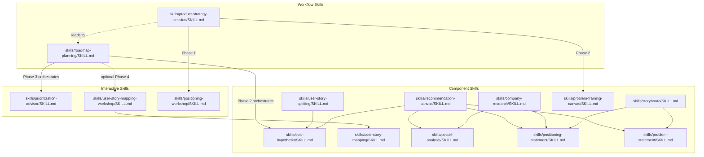
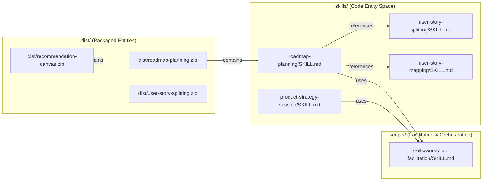
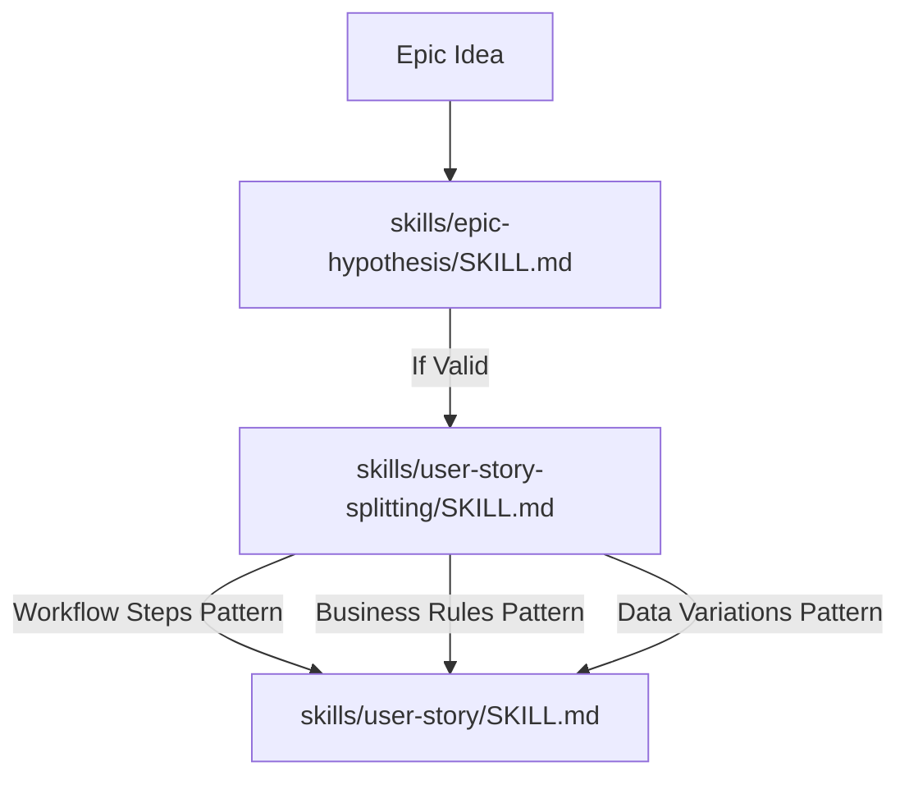

<!-- source: DeepWiki mcp.deepwiki.com · repo deanpeters/Product-Manager-Skills · page 3.6 Planning and Strategy Skills · fetched 2026-10-26 -->

# Planning and Strategy Skills

Relevant source files

The following files were used as context for generating this wiki page:

- [dist/product-strategy-session.zip](dist/product-strategy-session.zip)
- [dist/recommendation-canvas.zip](dist/recommendation-canvas.zip)
- [dist/roadmap-planning.zip](dist/roadmap-planning.zip)
- [dist/storyboard.zip](dist/storyboard.zip)
- [dist/user-story-mapping.zip](dist/user-story-mapping.zip)
- [dist/user-story-splitting.zip](dist/user-story-splitting.zip)
- [skills/discovery-process/examples/sample-lifesciences.md](skills/discovery-process/examples/sample-lifesciences.md)
- [skills/prd-development/examples/sample-industrial.md](skills/prd-development/examples/sample-industrial.md)
- [skills/product-strategy-session/examples/sample-lifesciences.md](skills/product-strategy-session/examples/sample-lifesciences.md)
- [skills/roadmap-planning/examples/sample-industrial.md](skills/roadmap-planning/examples/sample-industrial.md)

## Purpose and Scope

This page documents the skills that support longer-horizon product planning: translating business goals, customer insights, and strategic bets into sequenced, outcome-driven roadmaps. The group spans the full tier hierarchy—from Component artifacts (single-use templates for planning tools) up through Workflow orchestrations that span 1–2 weeks.

Covered here:

- **`roadmap-planning`**: A Workflow that orchestrates epic definition, prioritization, sequencing, and stakeholder communication.
- **`product-strategy-session`**: A Workflow for high-level positioning, problem framing, and discovery synthesis before roadmap commitment.
- **`user-story-mapping`** and **`user-story-mapping-workshop`**: A Component/Interactive pair for visualizing user workflows and planning releases.
- **`user-story-splitting`**: A Component for decomposing epics into sprint-sized stories using systematic patterns.
- **`storyboard`**: A Component for narrative-based stakeholder alignment.
- **`recommendation-canvas`**: A Component for structuring AI product proposals for executive review.
- **`company-research`**: A Component for competitive intelligence gathering.

Sources: [skills/roadmap-planning/SKILL.md:1-25](), [skills/product-strategy-session/SKILL.md:1-30](), [skills/user-story-mapping/SKILL.md:1-10](), [skills/user-story-splitting/SKILL.md:1-12]()

---

## Skill Inventory

| Skill | Type | File | Est. Time |
|---|---|---|---|
| `roadmap-planning` | Workflow | `skills/roadmap-planning/SKILL.md` | 45–90 min session; 1–2 weeks end-to-end |
| `product-strategy-session` | Workflow | `skills/product-strategy-session/SKILL.md` | 2–4 hour session; 1 week prep |
| `user-story-mapping` | Component | `skills/user-story-mapping/SKILL.md` | 30-60 min |
| `user-story-mapping-workshop` | Interactive | `skills/user-story-mapping-workshop/SKILL.md` | 30–90 min |
| `user-story-splitting` | Component | `skills/user-story-splitting/SKILL.md` | 20-40 min |
| `storyboard` | Component | `skills/storyboard/SKILL.md` | 30-60 min |
| `recommendation-canvas` | Component | `skills/recommendation-canvas/SKILL.md` | 60-90 min |
| `company-research` | Component | `skills/company-research/SKILL.md` | 2-4 hours |

Sources: [skills/roadmap-planning/SKILL.md:7-15](), [skills/product-strategy-session/SKILL.md:7-15](), [skills/user-story-mapping/SKILL.md:7-10](), [skills/user-story-splitting/SKILL.md:7-10]()

---

## Skill Relationships

**Planning & Strategy Skill Dependency Map**

Sources: [skills/roadmap-planning/SKILL.md:471-503](), [skills/product-strategy-session/SKILL.md:435-460](), [skills/recommendation-canvas/SKILL.md:350-374](), [skills/user-story-splitting/SKILL.md:277-301]()

---

## Product Strategy Session Workflow

### Overview
`skills/product-strategy-session/SKILL.md` is a high-altitude Workflow that answers the "Should we do this?" question before the roadmap answers "When?". It is particularly effective for internal tools considering a product pivot or highly regulated domains like Life Sciences [skills/product-strategy-session/examples/sample-lifesciences.md:1-12]().

### 4-Phase Workflow
1.  **Phase 1: Positioning**: Defines segments and proto-personas. Dispatches to `positioning-workshop` [skills/product-strategy-session/SKILL.md:105-150]().
2.  **Phase 2: Problem Framing**: Uses `problem-framing-canvas` to look inward (internal constraints) and outward (market pull) [skills/product-strategy-session/SKILL.md:152-195]().
3.  **Phase 3: Discovery**: Synthesizes interviews to identify blockers like regulatory validation or "services in software clothing" [skills/product-strategy-session/SKILL.md:197-250]().
4.  **Phase 4: Roadmap & Decision**: Establishes a "Kill Criterion" (e.g., "if validation takes > 2 quarters, stop") and sequences a limited pilot [skills/product-strategy-session/SKILL.md:252-320]().

Sources: [skills/product-strategy-session/SKILL.md:99-320](), [skills/product-strategy-session/examples/sample-lifesciences.md:19-73]()

---

## Roadmap Planning Workflow

### Overview
`skills/roadmap-planning/SKILL.md` orchestrates the translation of strategy into a sequenced plan. In industrial contexts, this workflow prioritizes **constraint-first sequencing** (lead times, certifications) over simple RICE scoring [skills/roadmap-planning/examples/sample-industrial.md:42-53]().

### 5-Phase Workflow
1.  **Phase 1: Gather Inputs**: Collects OKRs, customer problems, and tech constraints [skills/roadmap-planning/SKILL.md:105-145]().
2.  **Phase 2: Define Initiatives**: Dispatches to `epic-hypothesis` for T-shirt sizing [skills/roadmap-planning/SKILL.md:147-205]().
3.  **Phase 3: Prioritize**: Calls `prioritization-advisor`. Explicitly identifies "shock absorbers"—epics that move first if something slips [skills/roadmap-planning/examples/sample-industrial.md:66-67]().
4.  **Phase 4: Sequence**: Maps dependencies. Distinguishes between "Committed" and "Reserved" (gated) items [skills/roadmap-planning/examples/sample-industrial.md:57-65]().
5.  **Phase 5: Communicate**: Tailors the roadmap for internal teams, channel partners, and customers [skills/roadmap-planning/SKILL.md:345-402]().

Sources: [skills/roadmap-planning/SKILL.md:99-402](), [skills/roadmap-planning/examples/sample-industrial.md:20-79]()

---

## User Story Mapping & Splitting

### User Story Mapping
`skills/user-story-mapping/SKILL.md` follows the Jeff Patton framework to build a 2D backbone. The horizontal axis represents the user's narrative, while the vertical axis represents priority slices (Release 1/2/3) [skills/user-story-mapping/SKILL.md:15-55]().

### User Story Splitting
`skills/user-story-splitting/SKILL.md` provides 8 patterns to decompose large epics into INVEST-compliant stories. 

| Pattern | Description | Example |
|---|---|---|
| **Workflow Steps** | Split by sequential actions | "Sign up" → "Email entry" + "Verification" |
| **Business Rules** | Split by varying logic | "Standard shipping" vs "Express shipping" |
| **Data Variations** | Split by input types | "Upload PDF" vs "Upload Image" |
| **TADs** | Tiny Acts of Discovery | A research spike to resolve an unknown |

Sources: [skills/user-story-splitting/SKILL.md:15-208](), [skills/user-story-mapping/SKILL.md:73-194]()

---

## Strategic Artifacts

### Storyboard
`skills/storyboard/SKILL.md` creates a 6-frame narrative arc:
1.  **Main Character**: Persona context.
2.  **Problem Emerges**: Initial friction.
3.  **"Oh Crap" Moment**: The crisis point.
4.  **Solution Appears**: Product introduction.
5.  **"Aha" Moment**: The breakthrough.
6.  **Life After**: The improved state.

Sources: [skills/storyboard/SKILL.md:14-77]()

### Recommendation Canvas
`skills/recommendation-canvas/SKILL.md` is a 10-component structure designed for executive buy-in. It bridges business outcomes with PESTEL risks and Tiny Acts of Discovery [skills/recommendation-canvas/SKILL.md:13-281]().

### Company Research
`skills/company-research/SKILL.md` uses a 9-step framework to profile competitors, focusing on executive quotes, product philosophy, and organizational impact of PMs [skills/company-research/SKILL.md:13-298]().

---

## Code and Implementation Space

The following diagram bridges the high-level planning workflows with the underlying SKILL.md entities and facilitation protocols.

**Planning Workflow Implementation**

Sources: [skills/roadmap-planning/SKILL.md:77-89](), [skills/product-strategy-session/SKILL.md:67-78](), [dist/roadmap-planning.zip:1-6](), [dist/recommendation-canvas.zip:1-6]()

**Decomposition Logic Flow**

Sources: [skills/epic-hypothesis/SKILL.md:160-183](), [skills/user-story-splitting/SKILL.md:55-208]()

---

## Common Pitfalls

| Pitfall | Symptom | Fix |
|---|---|---|
| **Roadmap as Contract** | Stakeholders treat Q3 dates as fixed | Communicate "Reserved" vs "Committed" status [skills/roadmap-planning/examples/sample-industrial.md:64-68](). |
| **Feature-First Planning** | Roadmap is a list of features with no "Why" | Use `epic-hypothesis` to map every epic to a metric [skills/roadmap-planning/SKILL.md:147-205](). |
| **Ignoring Constraints** | Scheduling software work while hardware tooling is on a 14-week lead | Use **constraint-first sequencing** [skills/roadmap-planning/examples/sample-industrial.md:46-53](). |
| **Regulatory Blindness** | Shipping a feature that requires a UL 508A reassessment without a gate | Make the regulatory assessment the first roadmap item and a kill criterion [skills/product-strategy-session/examples/sample-lifesciences.md:68-70](). |

Sources: [skills/roadmap-planning/SKILL.md:423-466](), [skills/roadmap-planning/examples/sample-industrial.md:82-98](), [skills/product-strategy-session/examples/sample-lifesciences.md:76-92]()

---

