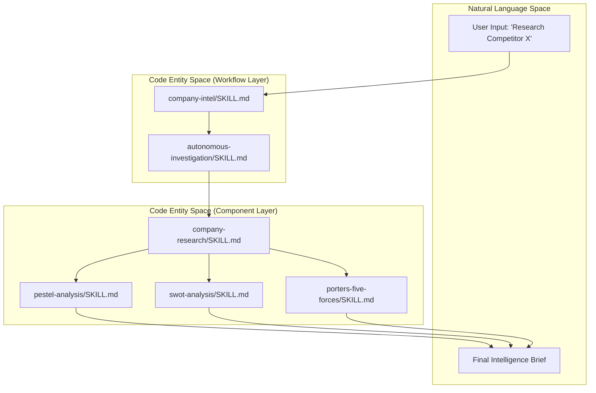
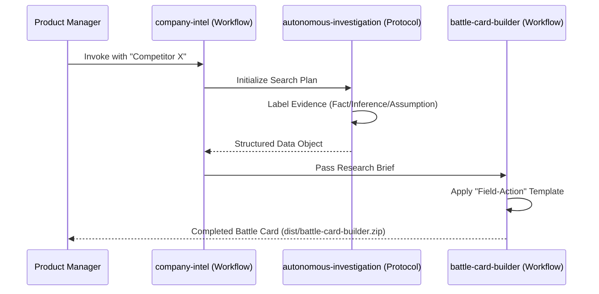

<!-- source: DeepWiki mcp.deepwiki.com · repo deanpeters/Product-Manager-Skills · page 3.7 Market Intelligence Suite · fetched 2026-10-26 -->

# Market Intelligence Suite

Relevant source files

The following files were used as context for generating this wiki page:

- [catalog/skills-by-type.md](catalog/skills-by-type.md)
- [catalog/skills-index.yaml](catalog/skills-index.yaml)
- [dist/ansoff-matrix.zip](dist/ansoff-matrix.zip)
- [dist/autonomous-investigation.zip](dist/autonomous-investigation.zip)
- [dist/battle-card-builder.zip](dist/battle-card-builder.zip)
- [dist/company-intel.zip](dist/company-intel.zip)
- [dist/company-research.zip](dist/company-research.zip)
- [dist/competitive-analysis-process.zip](dist/competitive-analysis-process.zip)
- [dist/competitive-intel-watch.zip](dist/competitive-intel-watch.zip)
- [dist/competitive-research-snapshot.zip](dist/competitive-research-snapshot.zip)
- [dist/context-engineering-advisor.zip](dist/context-engineering-advisor.zip)
- [dist/customer-journey-map.zip](dist/customer-journey-map.zip)
- [dist/customer-journey-mapping-workshop.zip](dist/customer-journey-mapping-workshop.zip)
- [dist/derisk-measurement-advisor.zip](dist/derisk-measurement-advisor.zip)
- [dist/intel-discipline-advisor.zip](dist/intel-discipline-advisor.zip)
- [dist/intelligence-collection-disciplines.zip](dist/intelligence-collection-disciplines.zip)
- [dist/market-landscape-scan.zip](dist/market-landscape-scan.zip)
- [dist/pestel-delta-monitor.zip](dist/pestel-delta-monitor.zip)
- [dist/porters-five-forces.zip](dist/porters-five-forces.zip)
- [dist/pricing-packaging-tracker.zip](dist/pricing-packaging-tracker.zip)
- [dist/swot-analysis.zip](dist/swot-analysis.zip)
- [dist/voice-of-customer-miner.zip](dist/voice-of-customer-miner.zip)
- [docs/announcements/2026-07-08-v0-82-inbound-requests-and-dist-shelf.md](docs/announcements/2026-07-08-v0-82-inbound-requests-and-dist-shelf.md)
- [skills/company-intel/SKILL.md](skills/company-intel/SKILL.md)
- [skills/derisk-measurement-advisor/SKILL.md](skills/derisk-measurement-advisor/SKILL.md)

The Market Intelligence Suite is a comprehensive set of analytical tools and workflows designed to transform raw market data into structured, actionable insights for product strategy. It provides a standardized protocol for competitive research, environmental scanning, and autonomous investigations, ensuring that all claims are backed by categorized evidence (Fact, Inference, or Assumption).

## Core Architecture and Data Flow

The suite operates on a hierarchical structure where low-level collection disciplines feed into structured analytical frameworks, eventually culminating in strategic decision tools.

### The Delta Investigation Pattern
A central theme across the suite is the **Delta Investigation** pattern. Instead of static reports, the system focuses on "deltas"—changes in competitor behavior, pricing, or market forces over time. This is implemented through specific monitor skills like the `pestel-delta-monitor` and `competitive-intel-watch`.

### Evidence Labeling Protocol
To maintain technical rigor, every claim generated by these skills must be labeled according to the **Autonomous Investigation** protocol:
*   **[FACT]**: Directly observable data (e.g., pricing listed on a website, a press release).
*   **[INFERENCE]**: Logical conclusions drawn from facts (e.g., "Hiring 50 AI engineers suggests a pivot to LLMs").
*   **[ASSUMPTION]**: Necessary gaps in knowledge required to complete a model.

**Sources:** [catalog/skills-index.yaml:55-65](), [skills/autonomous-investigation/SKILL.md:1-50]()

---

## The Seven Research Lenses

The `company-intel` workflow [skills/company-intel/SKILL.md]() serves as the primary research engine, utilizing seven distinct analytical lenses to process a company or industry:

| Lens | Technical Focus |
| :--- | :--- |
| **Financial Landscape** | Revenue models, funding rounds, and burn rates. |
| **Market Offer** | The "what" and "for whom" of the current value proposition. |
| **Product Portfolio** | Technical breakdown of features, platforms, and integrations. |
| **Competitive Dynamics** | Relative positioning within the immediate peer group. |
| **Rising Trends** | Emerging technologies or shifts in user behavior. |
| **PM Implications** | Direct impact on roadmap and backlog prioritization. |
| **Strategic Signals** | Patents, leadership changes, and hiring patterns. |

**Sources:** [catalog/skills-index.yaml:85-100](), [dist/company-intel.zip:4-15]()

---

## Implementation Diagram: Intelligence Orchestration

This diagram illustrates how the `company-intel` workflow orchestrates specialized component skills to produce a final strategic output.

**Sources:** [catalog/skills-index.yaml:85-120](), [catalog/skills-by-type.md:5-30](), [dist/company-intel.zip:39-41]()

---

## Key Skills Reference

### Company Research & Analysis
*   **`company-intel`**: The primary engine for deep, structured understanding of industries and competitors using the seven lenses [catalog/skills-index.yaml:85-100]().
*   **`company-research`**: A component skill focused on executive quotes, product strategy, and organizational context [dist/company-research.zip:39-42]().
*   **`competitive-analysis-process`**: An umbrella workflow covering six analytical steps from landscape scan to strategic direction [dist/competitive-analysis-process.zip:33-35]().

### Environmental and Market Scans
*   **`pestel-analysis`**: Evaluates Political, Economic, Social, Technological, Environmental, and Legal forces [catalog/skills-by-type.md:29-30]().
*   **`pestel-delta-monitor`**: Specifically tracks changes in PESTEL forces over time to identify emerging risks.
*   **`market-landscape-scan`**: A broad-spectrum analysis of market maturity, saturation, and whitespace.

### Strategic Frameworks
*   **`ansoff-matrix`**: Maps growth options (Market Penetration, Product Development, etc.) with risk-rated sequencing [catalog/skills-index.yaml:44-54]().
*   **`porters-five-forces`**: Analyzes industry structure and competitive intensity.
*   **`swot-analysis`**: Standard Strengths, Weaknesses, Opportunities, and Threats, but strictly tied to the Fact/Inference evidence protocol.

### Field Tools
*   **`battle-card-builder`**: Transforms research into 30-second field-action cards for sales teams, with every claim sourced [dist/battle-card-builder.zip:37-40]().
*   **`pricing-packaging-tracker`**: Monitors competitor SKU changes and pricing model shifts.
*   **`voice-of-customer-miner`**: Aggregates and categorizes public customer sentiment from reviews and forums.

**Sources:** [catalog/skills-index.yaml:4-120](), [catalog/skills-by-type.md:5-80]()

---

## Intelligence Collection Disciplines

The `intelligence-collection-disciplines` skill [catalog/skills-by-type.md:25-26]() provides the technical "how-to" for gathering data. It mirrors intelligence agency methodologies:

| Discipline | PM Application |
| :--- | :--- |
| **OSINT** (Open Source) | Web scraping pricing pages, SEC filings, and GitHub repos. |
| **SOCMINT** (Social Media) | Monitoring LinkedIn hiring trends and Reddit complaints. |
| **TECHINT** (Technical) | Analyzing API documentation and patent filings. |
| **HUMINT** (Human) | Synthesizing insights from customer interviews and sales calls. |

The `intel-discipline-advisor` [catalog/skills-index.yaml:200-210]() acts as a meta-skill, recommending which collection discipline to prioritize based on the research goal and available time.

**Sources:** [catalog/skills-by-type.md:25-26](), [catalog/skills-index.yaml:200-210]()

---

## Technical Data Flow: Battle Card Generation

This diagram demonstrates the data transformation from raw investigation to a field-ready artifact.

**Sources:** [dist/battle-card-builder.zip:37-47](), [skills/autonomous-investigation/SKILL.md:55-65](), [catalog/skills-index.yaml:66-75]()

---

