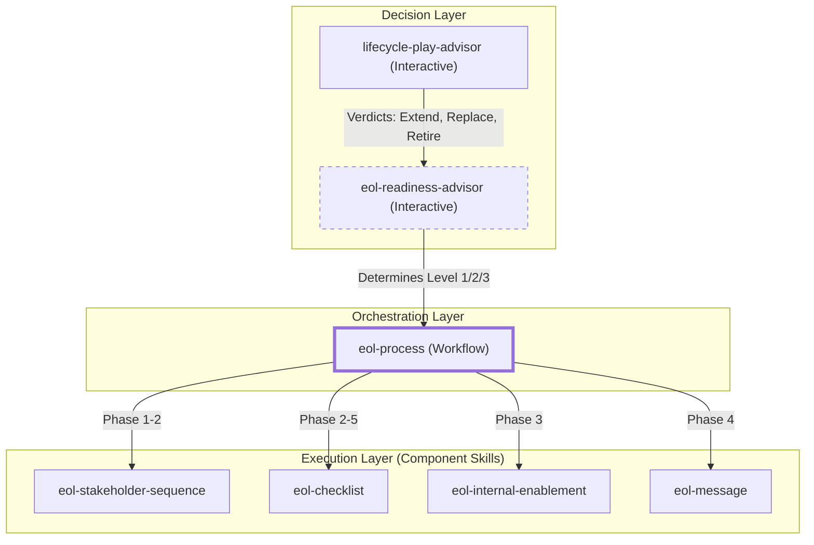

<!-- source: DeepWiki mcp.deepwiki.com · repo deanpeters/Product-Manager-Skills · page 3.8 Lifecycle and EOL Suite · fetched 2026-10-26 -->

# Lifecycle and EOL Suite

Relevant source files

The following files were used as context for generating this wiki page:

- [.claude-plugin/plugin.json](.claude-plugin/plugin.json)
- [09AUG26.md](09AUG26.md)
- [10AUG26.md](10AUG26.md)
- [17JUL26.md](17JUL26.md)
- [dist/eol-checklist.zip](dist/eol-checklist.zip)
- [dist/eol-internal-enablement.zip](dist/eol-internal-enablement.zip)
- [dist/eol-message.zip](dist/eol-message.zip)
- [dist/eol-process.zip](dist/eol-process.zip)
- [dist/eol-readiness-advisor.zip](dist/eol-readiness-advisor.zip)
- [dist/eol-stakeholder-sequence.zip](dist/eol-stakeholder-sequence.zip)
- [docs/Lifecycle and EOL Suite Summary.md](docs/Lifecycle and EOL Suite Summary.md)
- [docs/announcements/2026-08-10-v0-84-lifecycle-and-eol-suite.md](docs/announcements/2026-08-10-v0-84-lifecycle-and-eol-suite.md)
- [docs/maintenance/2026-08-09-eol-suite-plan.md](docs/maintenance/2026-08-09-eol-suite-plan.md)
- [scripts/build-claude-desktop-packs.sh](scripts/build-claude-desktop-packs.sh)
- [scripts/build-dist.sh](scripts/build-dist.sh)
- [skills/altitude-horizon-framework/template.md](skills/altitude-horizon-framework/template.md)

The **Lifecycle and EOL (End-of-Life) Suite** is a 7-skill collection introduced in v0.84 designed to help Product Managers navigate the transition of aging products [10AUG26.md:1-5](). The suite moves beyond simple decommissioning, focusing on the governing principle of **losing the product without losing the customer** [09AUG26.md:44](). It provides a structured framework for deciding whether to Extend, Replace, or Retire a product, and then executing that decision through a 6-phase, 8-gate operational workflow [10AUG26.md:47-83]().

## Architecture and Right-Sizing

The suite utilizes a "Goldilocks" right-sizing model (Level 1/2/3) to ensure the process overhead is proportional to the product's blast radius [09AUG26.md:22-25]().

### The Goldilocks Model
Unlike previous suites where tiers might be inherited, the Lifecycle suite treats the level as a "dial" the user sets, which can be overridden mid-run [10AUG26.md:47-52]().

| Dimension | Level 1 (Light) | Level 2 (Standard) | Level 3 (Heavy) |
| :--- | :--- | :--- | :--- |
| **Scope** | Feature, internal tool, API | Commercial product | Revenue-critical, regulated |
| **Functional Areas** | Product, Eng, Support | +Sales, Mktg, CS, Finance | +Supply Chain, Regulatory |
| **Lifecycle Gates** | 2-3 (NSC, EOS, EOL) | 4-5 (NSC, EOS, EOE, EOM) | All 8 Gates |

Sources: [09AUG26.md:58-68](), [10AUG26.md:47-56]()

### The Eight Lifecycle Gates
The suite defines a shared vocabulary for product transitions [09AUG26.md:71-80]():
1.  **GA (General Availability):** Active sale and support.
2.  **NSC (Notice of Status Change):** Internal decision communicated; planning begins.
3.  **EOS (End of Sale):** No new customer purchases.
4.  **EOE (End of Expansion):** Existing customers cannot add capacity.
5.  **EOR (End of Renewal):** Contracts will not be renewed.
6.  **EOM (End of Maintenance):** Bug fixes and patches cease.
7.  **EOL (End of Life):** Product is fully retired.
8.  **EOSRV (End of Service):** All support and service obligations end.

Sources: [09AUG26.md:71-80](), [10AUG26.md:75-83]()

## System Orchestration and Data Flow

The suite is anchored by `eol-process`, which acts as a route-based orchestrator rather than a linear pipeline [10AUG26.md:63-65]().

### Entity Relationship Diagram
This diagram maps the natural language phases to the specific code entities (skills) and their roles within the v0.84 suite.

Sources: [10AUG26.md:13-30](), [09AUG26.md:26-34](), [10AUG26.md:63-65]()

## Skill Reference

### 1. lifecycle-play-advisor (Interactive)
The entry point for products in decline. It evaluates three primary "plays": **Extend** (invest to prolong life), **Replace** (migrate to a new platform), or **Retire** (sunset without direct replacement) [10AUG26.md:88-93]().
*   **Source:** `skills/lifecycle-play-advisor/SKILL.md`

### 2. product-lifecycle-plays (Component)
A reference library of tactical patterns for the three plays. It includes failure-mode examples (e.g., the Northfield NFA-200 case) where a play was correctly chosen but poorly executed [10AUG26.md:115-121]().
*   **Source:** `skills/product-lifecycle-plays/SKILL.md`

### 3. eol-readiness-advisor (Interactive)
The diagnostic entry point for the sunsetting process. It classifies the EOL "Level" and provides a go/no-go assessment based on customer impact and organizational readiness [09AUG26.md:28]().
*   **Source:** `skills/eol-readiness-advisor/SKILL.md` [dist/eol-readiness-advisor.zip:4-10]()

### 4. eol-process (Workflow)
The master orchestrator. It manages 6 working phases and includes an "Entering Mid-Stream" diagnostic for teams that have already started a sunset but are experiencing friction [10AUG26.md:63-65]().
*   **Implementation:** Phased orchestration with decision gates (DP1, DP2) [10AUG26.md:129-135]().
*   **Source:** `skills/eol-process/SKILL.md` [dist/eol-process.zip:4-12]()

### 5. eol-checklist (Component)
A phase-gated operational plan covering 15 functional areas. It reconciles the 8-gate vocabulary into actionable tasks for Product, Engineering, Sales, and Legal [10AUG26.md:77-83]().
*   **Source:** `skills/eol-checklist/template.md` [dist/eol-checklist.zip:4-11]()

### 6. eol-stakeholder-sequence (Component)
Defines the order of operations for sensitive communications. It utilizes **Mendelow's Matrix** (Power vs. Interest) and **DACI** (Driver, Approver, Contributor, Informed) to prevent premature leaks [09AUG26.md:30](), [09AUG26.md:47]().
*   **Source:** `skills/eol-stakeholder-sequence/template.md` [dist/eol-stakeholder-sequence.zip:4-14]()

### 7. eol-internal-enablement (Component)
Provides the support FAQ and objection handling required to arm customer-facing teams. It focuses on "WIIFM" (What's In It For Me) for internal stakeholders [09AUG26.md:31](), [09AUG26.md:47]().
*   **Source:** `skills/eol-internal-enablement/template.md` [dist/eol-internal-enablement.zip:4-18]()

### 8. eol-message (Component)
An upgraded skill for generating customer-facing announcements. It supports three transition paths: **Direct Migration**, **Alternative Selection**, and **Hard Sunset** [09AUG26.md:32]().
*   **Source:** `skills/eol-message/template.md` [dist/eol-message.zip:4-14]()

## Implementation Details

### Data Handoff and Context
The suite follows a "no tight coupling" rule. Skills do not use a shared handoff schema. Instead, context is carried by the user pasting the output of one skill (e.g., "Level 2") into the next [10AUG26.md:57-69]().

### Example Universes
The suite uses two primary fictional universes to demonstrate Level 2 and Level 3 complexity:
*   **Fieldlight Classic (SaaS - Level 2):** A legacy dispatch module with 800 accounts and $2.4M ARR being replaced by "Fieldlight Next" [09AUG26.md:86-89](), [10AUG26.md:105-108]().
*   **Northfield NFA-200 (Industrial - Level 3):** Hardware controllers with active service contracts, regulatory requirements, and channel partners [09AUG26.md:90-93](), [10AUG26.md:98-103]().

### Distribution
The suite is packaged as `07-lifecycle-eol-pack.zip` [10AUG26.md:33-34](). This pack is assembled by `scripts/build-claude-desktop-packs.sh` [scripts/build-claude-desktop-packs.sh:143-152]() and registered in the `dist/` shelf by `scripts/build-dist.sh` [scripts/build-dist.sh:39-43]().

Sources: [10AUG26.md:33-40](), [09AUG26.md:84-98](), [scripts/build-dist.sh:39-43]()

---

