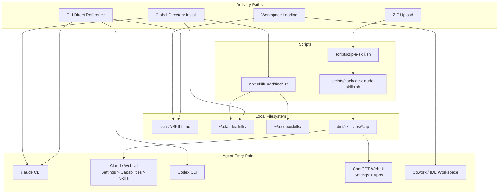
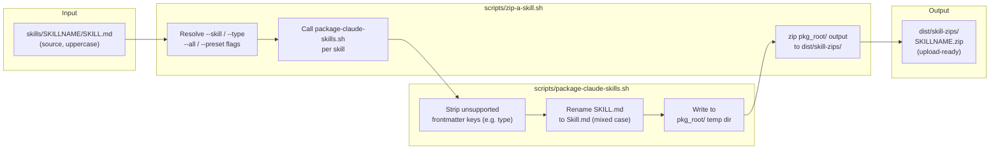

<!-- source: DeepWiki mcp.deepwiki.com · repo deanpeters/Product-Manager-Skills · page 4 Integration Guides · fetched 2026-10-26 -->

# Integration Guides

<details>
<summary>Relevant source files</summary>

The following files were used as context for generating this wiki page:

- [AGENTS.md](AGENTS.md)
- [docs/INSTALL-CLAUDE-CODE.md](docs/INSTALL-CLAUDE-CODE.md)
- [docs/INSTALL-CLAUDE-DESKTOP.md](docs/INSTALL-CLAUDE-DESKTOP.md)
- [docs/INSTALL-CODEX.md](docs/INSTALL-CODEX.md)
- [docs/PM Skills Rule-of-Thumb Guide.md](docs/PM Skills Rule-of-Thumb Guide.md)
- [docs/Using PM Skills with ChatGPT.md](docs/Using PM Skills with ChatGPT.md)
- [docs/Using PM Skills with Claude.md](docs/Using PM Skills with Claude.md)
- [docs/Using PM Skills with Codex.md](docs/Using PM Skills with Codex.md)
- [docs/announcements/2026-04-26-v0-78-release-packaging.md](docs/announcements/2026-04-26-v0-78-release-packaging.md)
- [scripts/build-codex-skills.sh](scripts/build-codex-skills.sh)
- [scripts/build-release.sh](scripts/build-release.sh)
- [scripts/package-claude-skills.sh](scripts/package-claude-skills.sh)
- [scripts/zip-a-skill.sh](scripts/zip-a-skill.sh)
- [skills/skill-authoring-workflow/SKILL.md](skills/skill-authoring-workflow/SKILL.md)

</details>


This section covers all methods for loading PM skills into AI agents. It explains the four delivery paths, the tradeoffs between them, and which path is appropriate for each combination of agent and use case.

For step-by-step instructions for a specific agent, see the sub-pages: [Using Skills with Claude](#4.1), [Using Skills with OpenAI Codex](#4.2), and [Using Skills with ChatGPT](#4.3). For authoring new skills or packaging them for distribution, see [Creating and Managing Skills](#5).

---

## Delivery Paths

Skills in this repository are plain Markdown files. No build system or runtime is required to use them. An agent consumes a skill by reading the file contents and applying the embedded framework. There are four distinct ways to make skill files available to an agent.

| # | Path | Mechanism | Agent Persistence |
|---|------|-----------|-------------------|
| 1 | **CLI direct reference** | File path in prompt (e.g., `skills/user-story/SKILL.md`) | Per-invocation only |
| 2 | **Global directory install** | Copy to agent's skill directory (e.g., `~/.claude/skills/`) | Persists across sessions |
| 3 | **ZIP upload** | Package with `zip-a-skill.sh`, upload via agent UI | Persists in agent account |
| 4 | **Workspace loading** | Open the repo folder as a workspace in an IDE-integrated agent | Active while workspace is open |

Sources: [AGENTS.md:32-41](), [docs/Using PM Skills with Claude.md:21-109](), [docs/PM Skills Rule-of-Thumb Guide.md:7-27]()

---

## Delivery Path Decision Guide

**CLI direct reference** is the lowest-friction option for one-off use. It requires the repo to be cloned locally and the terminal to be in the repo directory. [docs/Using PM Skills with Claude.md:27-41]()

**Global directory install** is suitable when you use the same skills repeatedly across different projects. Skills copied to `~/.claude/skills/` (or the equivalent for other agents) can be invoked by name without a file path. [docs/Using PM Skills with Claude.md:94-109]()

**ZIP upload** is the primary path for browser-based agents (Claude Web, ChatGPT) that do not have access to the local filesystem. It requires pre-packaging with `scripts/zip-a-skill.sh` because the Claude Skills UI expects a file named `Skill.md` (case-sensitive) while the repository stores source files as `SKILL.md`. [docs/Using PM Skills with Claude.md:153-184]()

**Workspace loading** is appropriate for IDE-integrated agents (Claude Cowork, Cursor) and GitHub-connected instances of Codex or ChatGPT. The agent scans the workspace directory and resolves skills by name automatically. [docs/Using PM Skills with Codex.md:21-38](), [docs/Using PM Skills with ChatGPT.md:18-39]()

Sources: [docs/PM Skills Rule-of-Thumb Guide.md:31-39](), [docs/Using PM Skills with Claude.md:153-184](), [AGENTS.md:84-85]()

---

## The `SKILL.md` / `Skill.md` Case-Sensitivity Requirement

The repository stores each skill's definition in a file named `SKILL.md` (all caps). Claude's web upload interface requires the file to be named `Skill.md` (mixed case). This mismatch means **raw repository files cannot be uploaded directly** to Claude Web. [AGENTS.md:84-85]()

The `scripts/package-claude-skills.sh` script handles the rename during packaging. The `scripts/zip-a-skill.sh` script calls `package-claude-skills.sh` internally, strips unsupported upload frontmatter keys, and zips packaged folders for upload. [scripts/zip-a-skill.sh:183-184]()

Sources: [AGENTS.md:84-85](), [docs/Using PM Skills with Claude.md:153-184]()

---

## Delivery Path to Code Entity Map

**Delivery paths and the scripts/directories they involve:**



Sources: [docs/Using PM Skills with Claude.md:21-152](), [docs/Using PM Skills with Codex.md:88-154](), [scripts/zip-a-skill.sh:1-15]()

---

## Agent–Path Compatibility Matrix

Not all delivery paths work with all agents. The table below maps each supported agent to the delivery paths that apply.

| Agent | CLI Direct Ref | Global Dir Install | ZIP Upload | Workspace Load | `npx skills` CLI |
|-------|:--------------:|:------------------:|:----------:|:--------------:|:----------------:|
| Claude Code (CLI) | ✅ | ✅ | — | — | ✅ |
| Claude Web / Desktop | — | — | ✅ | — | — |
| Claude Cowork | — | — | — | ✅ | — |
| OpenAI Codex (CLI) | ✅ | ✅ | — | — | ✅ |
| Codex on ChatGPT | — | — | — | ✅ (GitHub-connected) | — |
| ChatGPT (Projects) | — | — | ✅ | — | — |
| ChatGPT (Custom GPT) | — | — | ✅ | — | — |

Sources: [docs/PM Skills Rule-of-Thumb Guide.md:31-39](), [docs/Using PM Skills with Claude.md:10-150](), [docs/Using PM Skills with Codex.md:7-10]()

---

## ZIP Packaging Pipeline

The ZIP upload path involves two scripts. Understanding their responsibilities avoids surprises when packaging.



**Available `zip-a-skill.sh` flags:**

| Flag | Effect |
|------|--------|
| `--skill <name>` | Package one named skill [scripts/zip-a-skill.sh:37]() |
| `--type <type>` | Package by skill type: component, interactive, workflow [scripts/zip-a-skill.sh:39]() |
| `--all` | Package all skills [scripts/zip-a-skill.sh:38]() |
| `--preset <name>` | Package a curated preset (e.g., `core-pm`, `finance-suite`) [scripts/zip-a-skill.sh:40]() |
| `--output <dir>` | Set the output directory (default: `dist/skill-zips`) [scripts/zip-a-skill.sh:42]() |

Sources: [scripts/zip-a-skill.sh:30-55](), [docs/Using PM Skills with Claude.md:162-176]()

---

## Global Install via `npx skills`

For agents that support a skill directory (`~/.claude/skills/`, `~/.codex/skills/`), the `npx skills` CLI provides a marketplace-style install workflow without requiring a manual clone.

```bash
npx skills find product management          # discover skills in registry
npx skills add deanpeters/Product-Manager-Skills --list   # list skills in this repo
npx skills add deanpeters/Product-Manager-Skills --skill user-story -a claude-code -g
npx skills list -a claude-code              # confirm installed skills
```

For older CLI versions without `--agent` flag support, install to `~/.codex/skills/` and copy manually:

```bash
npx skills add deanpeters/Product-Manager-Skills@user-story
mkdir -p ~/.claude/skills
cp -R ~/.codex/skills/user-story ~/.claude/skills/
```

Sources: [docs/Using PM Skills with Claude.md:111-151](), [docs/Using PM Skills with Codex.md:88-154]()

---

## Prompt Patterns by Skill Type

Regardless of delivery path, the structure of the invocation prompt varies by skill tier. The following patterns apply across agents.

| Skill Tier | Example Prompt Pattern |
|------------|------------------------|
| **Component** | `"Using skills/user-story/SKILL.md, write user stories for a checkout flow"` |
| **Interactive** | `"Use skills/prioritization-advisor/SKILL.md to help me choose a framework"` |
| **Workflow** | `"Run skills/discovery-process/SKILL.md for our customer churn problem"` |

For detailed prompt patterns and agent-specific instructions, see:
- [Using Skills with Claude](#4.1)
- [Using Skills with OpenAI Codex](#4.2)
- [Using Skills with ChatGPT](#4.3)

Sources: [docs/Using PM Skills with Claude.md:43-63](), [docs/Using PM Skills with Codex.md:39-50]()

---

