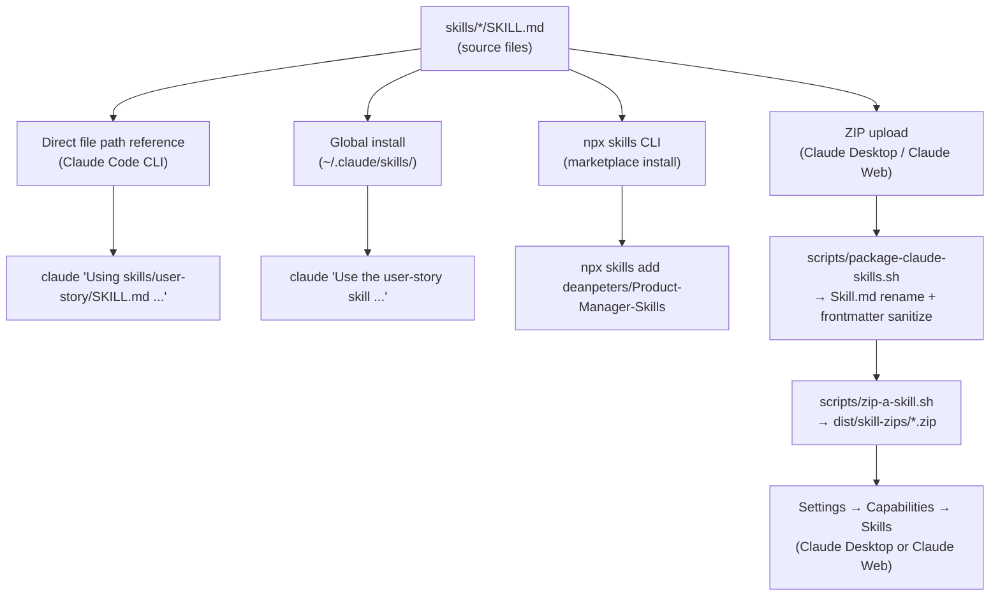
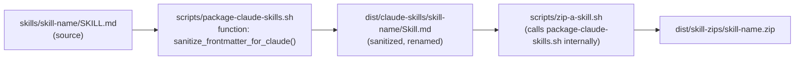

<!-- source: DeepWiki mcp.deepwiki.com · repo deanpeters/Product-Manager-Skills · page 4.1 Using Skills with Claude · fetched 2026-10-26 -->

# Using Skills with Claude

<details>
<summary>Relevant source files</summary>

The following files were used as context for generating this wiki page:

- [.claude-plugin/plugin.json](.claude-plugin/plugin.json)
- [docs/INSTALL-CLAUDE-CODE.md](docs/INSTALL-CLAUDE-CODE.md)
- [docs/INSTALL-CLAUDE-DESKTOP.md](docs/INSTALL-CLAUDE-DESKTOP.md)
- [docs/INSTALL-CODEX.md](docs/INSTALL-CODEX.md)
- [docs/Lifecycle and EOL Suite Summary.md](docs/Lifecycle and EOL Suite Summary.md)
- [docs/PM Skills Rule-of-Thumb Guide.md](docs/PM Skills Rule-of-Thumb Guide.md)
- [docs/Using PM Skills with ChatGPT.md](docs/Using PM Skills with ChatGPT.md)
- [docs/Using PM Skills with Claude.md](docs/Using PM Skills with Claude.md)
- [docs/Using PM Skills with Codex.md](docs/Using PM Skills with Codex.md)
- [docs/announcements/2026-04-26-v0-78-release-packaging.md](docs/announcements/2026-04-26-v0-78-release-packaging.md)
- [docs/announcements/2026-08-10-v0-84-lifecycle-and-eol-suite.md](docs/announcements/2026-08-10-v0-84-lifecycle-and-eol-suite.md)
- [scripts/build-claude-desktop-packs.sh](scripts/build-claude-desktop-packs.sh)
- [scripts/build-codex-skills.sh](scripts/build-codex-skills.sh)
- [scripts/build-dist.sh](scripts/build-dist.sh)
- [scripts/build-release.sh](scripts/build-release.sh)
- [scripts/package-claude-skills.sh](scripts/package-claude-skills.sh)
- [scripts/zip-a-skill.sh](scripts/zip-a-skill.sh)
- [skills/skill-authoring-workflow/SKILL.md](skills/skill-authoring-workflow/SKILL.md)

</details>


This page covers all delivery paths for consuming PM skills through Anthropic's Claude products: Claude Code (CLI), Claude Desktop, and Claude Web. It explains the required file transformations, installation commands, and prompt patterns for each skill type.

For background on the three skill tiers (Component, Interactive, Workflow) referenced throughout this page, see [1.1](). For the full skill catalog, see [2](). For packaging and distribution details shared with other agents, see [5.4]().

---

## Delivery Paths at a Glance

There are three distinct ways to get skills into Claude, each suited to a different usage context.

**Claude Code delivery paths overview**



Sources: [docs/Using PM Skills with Claude.md:1-50](), [docs/PM Skills Rule-of-Thumb Guide.md:31-40]()

---

## Claude Code (CLI)

Claude Code is Anthropic's official CLI for Claude. It reads files directly from the local filesystem; no transformation is required to use skills.

### Direct File Path Reference

Clone the repository and reference skill files by path:

```bash
git clone https://github.com/deanpeters/Product-Manager-Skills.git
cd Product-Manager-Skills
```

Invoke by skill type:

| Skill Type | Example Command |
|---|---|
| Component | `claude "Using skills/user-story/SKILL.md, write user stories for a checkout flow"` |
| Interactive | `claude "Use skills/prioritization-advisor/SKILL.md to help me choose a framework"` |
| Workflow | `claude "Run skills/discovery-process/SKILL.md for our enterprise churn problem"` |

Sources: [docs/Using PM Skills with Claude.md:21-63]()

### Global Install

Copy skills to Claude's global skills directory to eliminate file path requirements in every command:

```bash
mkdir -p ~/.claude/skills
cp -r skills/* ~/.claude/skills/
```

After installation, Claude resolves skills by name:

```bash
claude "Use the user-story skill to write stories for checkout"
```

Claude scans `~/.claude/skills/` automatically.

Sources: [docs/Using PM Skills with Claude.md:94-110]()

### Install via `npx skills` (Marketplace-Style)

The `npx skills` CLI provides marketplace-style discovery and installation without manually cloning the repository.

```bash
# Search
npx skills find product management

# List skills in this repo
npx skills add deanpeters/Product-Manager-Skills --list

# Install a single skill for Claude Code (global)
npx skills add deanpeters/Product-Manager-Skills --skill user-story -a claude-code -g

# Verify installed skills
npx skills list -a claude-code
```

For older CLI versions that do not support `--agent`, install to the Codex default location and copy manually:

```bash
npx skills add deanpeters/Product-Manager-Skills@user-story
mkdir -p ~/.claude/skills
cp -R ~/.codex/skills/user-story ~/.claude/skills/
```

Sources: [docs/Using PM Skills with Claude.md:111-152]()

---

## Claude Desktop and Claude Web (ZIP Upload)

Claude's web and desktop interfaces accept skills as ZIP archives through **Settings → Capabilities → Skills**. The source `SKILL.md` files cannot be uploaded directly because:

1. The Skills UI expects the file to be named `Skill.md` (capital S, lowercase `kill.md`) — case-sensitive.
2. The YAML frontmatter in source files contains a `type` key that the Skills UI does not accept.

Both issues are handled by the packaging pipeline before zipping.

### The Packaging Pipeline

**Packaging pipeline: SKILL.md → Skill.md**



`package-claude-skills.sh` does two things per skill:

1. Runs `sanitize_frontmatter_for_claude()` which filters the YAML frontmatter to only the keys Claude's Skills UI accepts: `name`, `description`, `license`, `allowed-tools`, `compatibility`, `metadata`. The `type` key present in all source files is stripped. [scripts/package-claude-skills.sh:7-33]()
2. Renames the output file from `SKILL.md` to `Skill.md`. [scripts/package-claude-skills.sh:45-47]()

`zip-a-skill.sh` calls `package-claude-skills.sh` into a temp directory, then zips individual skill folders from that output. [scripts/zip-a-skill.sh:300-301]()

### Building Upload ZIPs

```bash
# Single skill
./scripts/zip-a-skill.sh --skill user-story

# By skill type
./scripts/zip-a-skill.sh --type component --output dist/skill-zips
./scripts/zip-a-skill.sh --type interactive --output dist/skill-zips
./scripts/zip-a-skill.sh --type workflow --output dist/skill-zips

# Curated preset
./scripts/zip-a-skill.sh --preset core-pm --output dist/skill-zips

# All skills at once
./scripts/zip-a-skill.sh --all --output dist/skill-zips
```

Available presets include `core-pm`, `discovery-pack`, `strategy-pack`, `delivery-pack`, `ai-pm-pack`, `market-intel-pack`, and `lifecycle-eol-pack`. [scripts/build-claude-desktop-packs.sh:81-153]()

### Uploading to Claude

1. Run a `zip-a-skill.sh` command above to produce files in `dist/skill-zips/`.
2. Open Claude Desktop or Claude Web.
3. Navigate to **Settings → Capabilities → Skills**.
4. Click **Upload skill** and select a `.zip` file.
5. Enable the skill and run a smoke test prompt.

Sources: [docs/Using PM Skills with Claude.md:154-184](), [docs/INSTALL-CLAUDE-DESKTOP.md:1-13](), [scripts/build-claude-desktop-packs.sh:1-156]()

---

## Frontmatter Constraints for Claude Web

Claude's Skills UI enforces hard limits on skill metadata. Violating these causes upload or display failures.

| Field | Constraint | Where enforced |
|---|---|---|
| `name` | ≤ 64 characters | Claude Skills UI / `check-skill-metadata.py` |
| `description` | ≤ 200 characters | Claude Skills UI / `check-skill-metadata.py` |
| Folder name | Must exactly match `name` frontmatter value | Claude Skills UI |

These constraints are strictly validated by the `check-skill-metadata.py` script. [skills/skill-authoring-workflow/SKILL.md:58-59]()

Sources: [skills/skill-authoring-workflow/SKILL.md:53-65](), [docs/Using PM Skills with Claude.md:183-184]()

---

## Prompt Patterns by Skill Type

### Component Skills (single artifact, 10–30 min)

Component skills produce a specific deliverable. Provide goal context up front; Claude applies the skill template directly.

```bash
# CLI
claude "Using skills/user-story/SKILL.md, write user stories for a checkout flow redesign."
```

```
# Chat (after ZIP upload or global install)
Use the positioning-statement skill to define our positioning for enterprise customers.
```

### Interactive Skills (guided Q&A, 30–90 min)

Interactive skills ask 3–5 adaptive questions and then offer numbered recommendations. They follow the `workshop-facilitation` protocol. [skills/skill-authoring-workflow/SKILL.md:65-78]()

```bash
# CLI
claude "Use skills/prioritization-advisor/SKILL.md to help me choose a prioritization framework"
```

Expected interaction pattern:
- Claude asks one question at a time with progress labels (e.g., Context Q1/3).
- Answer with a number (`2`), multiple numbers (`1 & 3`), or free text.
- Claude synthesizes answers and produces numbered recommendations.

### Workflow Skills (multi-phase, days to weeks)

Workflow skills orchestrate multiple Component and Interactive skills across phases. Claude outlines all phases first, then executes phase by phase.

```bash
# CLI - workflow handles chaining internally
claude "Run skills/prd-development/SKILL.md for our mobile onboarding redesign"
```

Sources: [docs/Using PM Skills with Claude.md:43-63](), [skills/skill-authoring-workflow/SKILL.md:89-93]()

---

## Interaction Flow: Interactive Skill Session

**Interactive skill conversation flow**

```mermaid
sequenceDiagram
    participant U as "User"
    participant C as "Claude (interactive skill loaded)"
    U->>C: "Use prioritization-advisor skill"
    C->>U: "Context Q1/3: What product area are you prioritizing?"
    U->>C: "Mobile onboarding features"
    C->>U: "Context Q2/3: What constraints apply?"
    U->>C: "Engineering capacity is limited; 2 devs for 6 weeks"
    C->>U: "Context Q3/3: What is your primary success metric?"
    U->>C: "Day-7 retention"
    C->>U: "Recommendations:\n1. RICE scoring (effort-adjusted)\n2. Opportunity scoring\n3. Impact/effort matrix\nChoose a number or combination."
    U->>C: "1 & 3"
    C->>U: "Applying RICE + impact/effort. Here is your scored list..."
```

Sources: [docs/Using PM Skills with Claude.md:50-58](), [skills/skill-authoring-workflow/SKILL.md:65-78]()

---

## Troubleshooting

| Symptom | Cause | Fix |
|---|---|---|
| `Claude says it cannot find a file` | Wrong working directory or incorrect path | `cd` to repo root; verify with `ls skills/` [docs/Using PM Skills with Claude.md:201-205]() |
| Output is too generic | Insufficient context provided | Add goal, constraints, target users [docs/Using PM Skills with Claude.md:206-208]() |
| Upload fails on Claude Web | Metadata limit violation | Run `check-skill-metadata.py` and trim [skills/skill-authoring-workflow/SKILL.md:123-124]() |
| ZIP upload rejected | File named `SKILL.md` instead of `Skill.md` | Use `zip-a-skill.sh` or `package-claude-skills.sh` [docs/Using PM Skills with Claude.md:158-164]() |

Sources: [docs/Using PM Skills with Claude.md:199-208](), [skills/skill-authoring-workflow/SKILL.md:117-126]()

---

## Method Comparison

| Feature | Claude Code CLI (direct path) | Claude Code CLI (global install) | Claude Web / Desktop (ZIP upload) |
|---|---|---|---|
| Requires local repo | Yes | Yes (for install step) | No |
| File path in prompt | Required | Not required | Not required |
| Frontmatter sanitization | Not needed | Not needed | Required (`package-claude-skills.sh`) |
| `Skill.md` rename | Not needed | Not needed | Required |
| Persistent across sessions | No (per invocation) | Yes (if globally installed) | Yes (once uploaded and enabled) |

Sources: [docs/Using PM Skills with Claude.md:21-184](), [docs/PM Skills Rule-of-Thumb Guide.md:31-40]()

---

