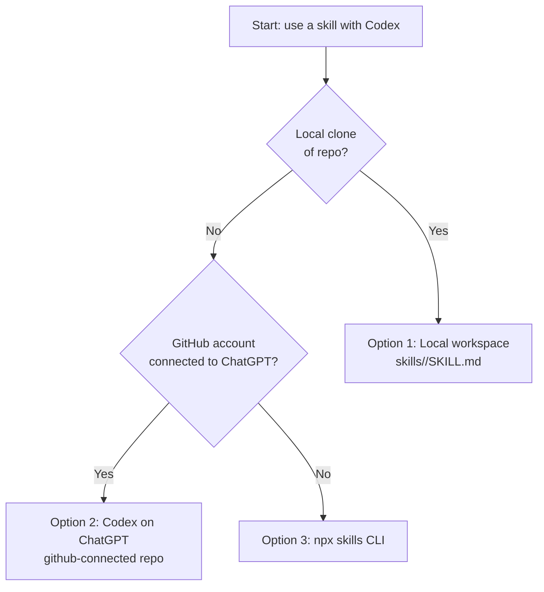
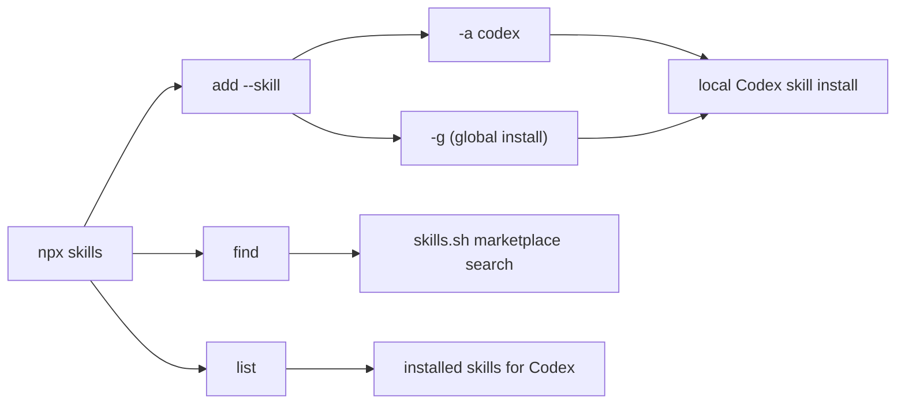
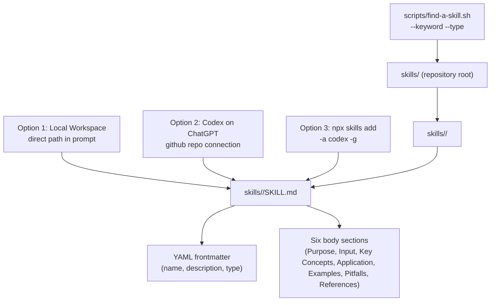

<!-- source: DeepWiki mcp.deepwiki.com · repo deanpeters/Product-Manager-Skills · page 4.2 Using Skills with OpenAI Codex · fetched 2026-10-26 -->

# Using Skills with OpenAI Codex

<details>
<summary>Relevant source files</summary>

The following files were used as context for generating this wiki page:

- [AGENTS.md](AGENTS.md)
- [docs/INSTALL-CLAUDE-CODE.md](docs/INSTALL-CLAUDE-CODE.md)
- [docs/INSTALL-CLAUDE-DESKTOP.md](docs/INSTALL-CLAUDE-DESKTOP.md)
- [docs/INSTALL-CODEX.md](docs/INSTALL-CODEX.md)
- [docs/PM Skills Rule-of-Thumb Guide.md](docs/PM Skills Rule-of-Thumb Guide.md)
- [docs/Using PM Skills with ChatGPT.md](docs/Using PM Skills with ChatGPT.md)
- [docs/Using PM Skills with Claude.md](docs/Using PM Skills with Claude.md)
- [docs/Using PM Skills with Codex.md](docs/Using PM Skills with Codex.md)
- [docs/announcements/2026-04-26-v0-78-release-packaging.md](docs/announcements/2026-04-26-v0-78-release-packaging.md)
- [scripts/build-codex-skills.sh](scripts/build-codex-skills.sh)
- [scripts/build-release.sh](scripts/build-release.sh)
- [scripts/package-claude-skills.sh](scripts/package-claude-skills.sh)
- [scripts/zip-a-skill.sh](scripts/zip-a-skill.sh)
- [skills/skill-authoring-workflow/SKILL.md](skills/skill-authoring-workflow/SKILL.md)

</details>


This page covers the three delivery paths for loading Product Manager Skills into OpenAI Codex: direct `SKILL.md` path reference from a local workspace, the GitHub-connected Codex on ChatGPT interface, and the `npx skills` CLI. It also documents prompt patterns tuned to each skill type.

For an overview of all agent integration options and a comparison of delivery methods, see [Integration Guides](#4). For the Claude-specific delivery paths (ZIP upload, global install), see [Using Skills with Claude](#4.1). For ChatGPT integration without Codex, see [Using Skills with ChatGPT](#4.3).

---

## Delivery Path Overview

**Delivery Path Summary**

| Path | Requires local clone | GitHub connection | Skill format | Best for |
|---|---|---|---|---|
| Local workspace | Yes | No | `skills/<name>/SKILL.md` direct path | Fastest iteration |
| Codex on ChatGPT | No | Yes | `skills/<name>/SKILL.md` path in prompt | No local setup |
| `npx skills` CLI | No | No | Marketplace install, `-a codex -g` flag | Portable / no repo |

**Delivery Path Decision Flow**



Sources: [docs/Using PM Skills with Codex.md:7-10]()

---

## Option 1: Local Workspace

This is the fastest path for developers and technical PMs. Open the repository in your Codex-enabled coding environment, then reference a skill by its exact file path in your prompt.

**File path structure:**

```
skills/<skill-name>/SKILL.md
```

Each skill lives under `skills/` in a lowercase kebab-case directory. The file is always named `SKILL.md` (uppercase). 

**Example prompt:**

```text
Using the skill at skills/prd-development/SKILL.md, create a PRD for a mobile
onboarding redesign. Ask up to 3 clarifying questions first, then proceed.
```

### Prompt Patterns by Skill Type

Different skill types (defined in the three-tier architecture) require different prompt patterns to trigger the correct agent behavior.

**Prompt Patterns by Skill Type**

| Skill type | Expected behavior | Recommended prompt pattern |
|---|---|---|
| Component | Single-shot artifact output | Ask for the specific artifact; provide all required inputs upfront |
| Interactive | 3–5 adaptive Q&A turns, then recommendations | Tell Codex to ask clarifying questions before generating output |
| Workflow | Multi-phase execution | Ask Codex to outline phases first, then execute one phase at a time |

**Component skill example:**
```text
Using skills/user-story/SKILL.md, write a user story for a checkout flow.
```

**Interactive skill example:**
```text
Use skills/prioritization-advisor/SKILL.md to help me choose a prioritization framework.
```

**Workflow skill example:**
```text
Run skills/discovery-process/SKILL.md for our enterprise customer churn problem.
```

### Chaining Multiple Skills
You can chain skills in a single prompt by referencing multiple paths in sequence:
```text
First use skills/problem-framing-canvas/SKILL.md to define the problem. Then apply skills/opportunity-solution-tree/SKILL.md to map solutions.
```

Sources: [docs/Using PM Skills with Codex.md:21-51](), [docs/Using PM Skills with Claude.md:45-64]()

---

## Option 2: Codex on ChatGPT (GitHub-Connected)

Codex at `chatgpt.com/codex` can operate directly against a connected GitHub repository. This removes the need for local cloning or ZIP packaging.

**Setup steps:**
1. Open [Codex](https://chatgpt.com/codex).
2. Connect GitHub via ChatGPT settings.
3. Select the `deanpeters/Product-Manager-Skills` repository and branch.
4. Reference skill paths in your prompts exactly as you would in a local workspace.

**Example prompt:**
```text
Use skills/finance-based-pricing-advisor/SKILL.md to evaluate whether we should test a 10% price increase. Show assumptions and risks.
```

### Recommended Prompt Template
This structure keeps output consistent across all skill types:
```text
Using skills/<skill-name>/SKILL.md:
1) Ask up to 3 clarifying questions.
2) Follow the skill sections exactly.
3) Show output in markdown.
4) End with risks, assumptions, and next steps.
```

**Codex on ChatGPT Data Flow**

```mermaid
sequenceDiagram
    participant User
    participant "Codex (chatgpt.com/codex)" as Codex
    participant "GitHub: deanpeters/Product-Manager-Skills" as Repo
    participant "skills/<name>/SKILL.md" as SkillFile

    User->>Codex: "Connect GitHub repo"
    Codex->>Repo: "Authenticate + select branch"
    User->>Codex: "Prompt referencing skills/<name>/SKILL.md"
    Codex->>SkillFile: "Fetch skill content"
    SkillFile-->>Codex: "YAML frontmatter + skill body"
    Codex-->>User: "Skill-structured output"
```

Sources: [docs/Using PM Skills with Codex.md:60-84]()

---

## Option 3: `npx skills` CLI

Use the Skills CLI to discover and install skills without cloning the repository. The CLI targets the skills marketplace at `skills.sh`.

### Discovery and Installation
```bash
# Search the marketplace
npx skills find product management

# List all skills available in this repo
npx skills add deanpeters/Product-Manager-Skills --list

# Install a single skill for Codex (global install)
npx skills add deanpeters/Product-Manager-Skills --skill user-story -a codex -g
```

### CLI Command Map



Sources: [docs/Using PM Skills with Codex.md:88-123]()

---

## Skill Resolution Architecture

This diagram maps natural-language concepts to the code entities and file paths Codex uses to locate and execute skills.

**Skill Resolution Paths**



Sources: [AGENTS.md:23-30](), [docs/Using PM Skills with Codex.md:21-38]()

---

## Troubleshooting

| Symptom | Likely cause | Resolution |
|---|---|---|
| Codex cannot find the file | Case sensitivity or wrong path | Confirm path is `skills/<name>/SKILL.md` (uppercase `SKILL.md` is mandatory). |
| Output is generic | Insufficient context | Provide real constraints (stage, KPI target, customer segment, timeline) in the prompt. |
| Format drift | Codex improvising | Explicitly instruct Codex to follow the seven standard sections: `Purpose, Input, Key Concepts, Application, Examples, Common Pitfalls, References`. |

Sources: [docs/Using PM Skills with Codex.md:157-162](), [AGENTS.md:45-51]()

---

