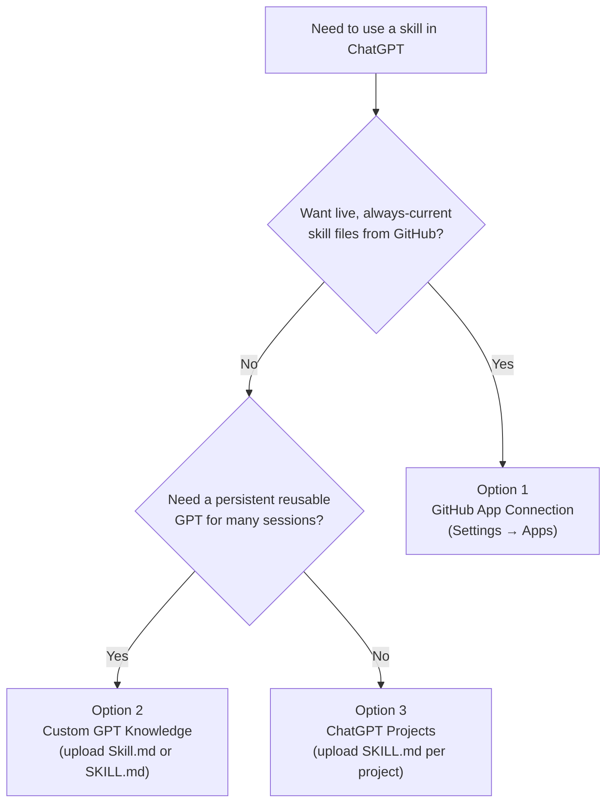
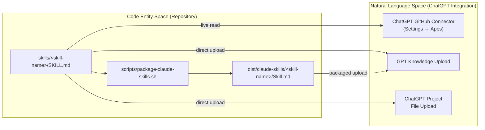
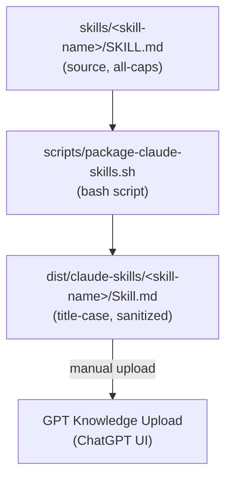

<!-- source: DeepWiki mcp.deepwiki.com · repo deanpeters/Product-Manager-Skills · page 4.3 Using Skills with ChatGPT · fetched 2026-10-26 -->

# Using Skills with ChatGPT

<details>
<summary>Relevant source files</summary>

The following files were used as context for generating this wiki page:

- [docs/INSTALL-CLAUDE-CODE.md](docs/INSTALL-CLAUDE-CODE.md)
- [docs/INSTALL-CLAUDE-DESKTOP.md](docs/INSTALL-CLAUDE-DESKTOP.md)
- [docs/INSTALL-CODEX.md](docs/INSTALL-CODEX.md)
- [docs/PM Skills Rule-of-Thumb Guide.md](docs/PM Skills Rule-of-Thumb Guide.md)
- [docs/Using PM Skills with ChatGPT.md](docs/Using PM Skills with ChatGPT.md)
- [docs/Using PM Skills with Claude.md](docs/Using PM Skills with Claude.md)
- [docs/Using PM Skills with Codex.md](docs/Using PM Skills with Codex.md)
- [docs/announcements/2026-04-26-v0-78-release-packaging.md](docs/announcements/2026-04-26-v0-78-release-packaging.md)
- [scripts/build-codex-skills.sh](scripts/build-codex-skills.sh)
- [scripts/build-release.sh](scripts/build-release.sh)
- [scripts/package-claude-skills.sh](scripts/package-claude-skills.sh)
- [scripts/zip-a-skill.sh](scripts/zip-a-skill.sh)
- [skills/skill-authoring-workflow/SKILL.md](skills/skill-authoring-workflow/SKILL.md)

</details>


This page covers how to load skills from the `deanpeters/Product-Manager-Skills` repository into ChatGPT. Three distinct integration paths are described: GitHub app connection, Custom GPT knowledge upload, and ChatGPT Projects. Each path suits a different usage pattern and level of setup investment.

- For integration with Claude, see [4.1]().
- For integration with OpenAI Codex, see [4.2]().
- For the Streamlit local playground (which also supports OpenAI), see [6]().
- For details on the `SKILL.md` file format, see [5.1]().
- For details on the `package-claude-skills.sh` packaging script, see [5.4]().

---

## Integration Options at a Glance

| Option | Best For | GitHub Sync | Repeatability | Setup Cost |
|---|---|---|---|---|
| **Option 1** — GitHub App Connection | Active repos; always-current skills | Yes (live read) | Per-chat | Low |
| **Option 2** — Custom GPT Knowledge | Reusable PM assistant | No (manual upload) | Persistent | Medium |
| **Option 3** — ChatGPT Projects | One initiative, scoped context | No (manual upload) | Project-scoped | Low |

Sources: [docs/Using PM Skills with ChatGPT.md:1-81]()

---

## Decision Flow

**Decision flow for selecting a ChatGPT integration path**



Sources: [docs/Using PM Skills with ChatGPT.md:1-63]()

---

## Option 1: GitHub App Connection

This path lets ChatGPT read files directly from the repository at chat time. No local file download is required.

**Steps:**

1. Open **Settings** in ChatGPT.
2. Navigate to **Apps** (also labeled **Connected Apps** [docs/Using PM Skills with ChatGPT.md:25-25]() depending on UI version).
3. Connect **GitHub** and authorize repository access [docs/Using PM Skills with ChatGPT.md:26-26]().
4. In a chat, reference a skill by its full path within the repository.

**Example prompt:**

```text
Use skills/prioritization-advisor/SKILL.md from deanpeters/Product-Manager-Skills
and guide me through choosing a framework for a B2B roadmap.
```

**Notes:**
- Availability varies by ChatGPT plan and regional rollout [docs/Using PM Skills with ChatGPT.md:22-22]().
- Files are read at the time of the chat; the skill reflects the current state of the `main` branch.
- No packaging step is needed. The source `SKILL.md` file is used directly.

Sources: [docs/Using PM Skills with ChatGPT.md:18-40]()

---

## Option 2: Custom GPT Knowledge Upload

This path creates a persistent GPT that embeds selected skills as knowledge files. Suitable when the same set of skills should be available across many sessions without re-uploading.

**Steps:**

1. In ChatGPT, create a new GPT via the GPT builder [docs/Using PM Skills with ChatGPT.md:47-47]().
2. Upload skill files as **Knowledge** files [docs/Using PM Skills with ChatGPT.md:48-48]().
3. Add instructions directing the GPT to follow skill structure exactly (see [Recommended Instruction Snippet](#recommended-instructiongpt-snippet) below) [docs/Using PM Skills with ChatGPT.md:49-49]().
4. Save and test.

### File Naming: SKILL.md vs Skill.md

The source repository stores all skills as `SKILL.md` (all-caps). ChatGPT GPT Knowledge accepts either naming, but `Skill.md` (title-case) is the Claude-compatible output produced by the packaging script [docs/Using PM Skills with ChatGPT.md:54-55](). The two options are:

| Approach | File Name | How to Obtain |
|---|---|---|
| Direct upload (ChatGPT only) | `SKILL.md` | Copy directly from `skills/<skill-name>/SKILL.md` |
| Packaged upload (Claude-compatible) | `Skill.md` | Run `scripts/package-claude-skills.sh`; take output from `dist/claude-skills/<skill-name>/Skill.md` |

**To produce `Skill.md` files via the packaging pipeline:**

```bash
bash scripts/package-claude-skills.sh
```

The `package-claude-skills.sh` script handles the `SKILL.md` to `Skill.md` rename [scripts/package-claude-skills.sh:45-47]() and frontmatter sanitization [scripts/package-claude-skills.sh:7-34](). Output lands in `dist/claude-skills/<skill-name>/Skill.md` [scripts/package-claude-skills.sh:5-5](). Upload that file to GPT Knowledge.

**Important:** ChatGPT GPT Knowledge does not auto-sync from GitHub. Each time skills are updated in the repository, files must be manually re-uploaded [docs/Using PM Skills with ChatGPT.md:53-53]().

Sources: [docs/Using PM Skills with ChatGPT.md:43-61](), [scripts/package-claude-skills.sh:1-58]()

---

## Option 3: ChatGPT Projects

ChatGPT Projects group files, instructions, and chat history under a single initiative. This is appropriate when a PM is working on one product area or discovery sprint and wants all relevant skills scoped to that context.

**Steps:**

1. Create a **Project** in ChatGPT [docs/Using PM Skills with ChatGPT.md:68-68]().
2. Upload one or more `SKILL.md` files directly (no packaging required) [docs/Using PM Skills with ChatGPT.md:69-69]().
3. Add project-level instructions using the recommended snippet below [docs/Using PM Skills with ChatGPT.md:70-70]().
4. Run all PM tasks within that project.

Sources: [docs/Using PM Skills with ChatGPT.md:64-72]()

---

## Recommended Instruction/GPT Snippet

Use this instruction text in both Custom GPT system instructions and ChatGPT Project instructions:

```text
When solving PM tasks, use the uploaded skill files as the operating standard.
Follow each skill's sections in order: Purpose, Input, Key Concepts, Application, Examples, Common Pitfalls, References.
If context is missing, ask up to 3 clarifying questions before drafting.
```

This instruction enforces the canonical six-section `SKILL.md` structure defined in [5.1](). The section order — Purpose → Key Concepts → Application → Examples → Common Pitfalls → References — is the same across all skill tiers (Component, Interactive, Workflow) [skills/skill-authoring-workflow/SKILL.md:57-57]().

Sources: [docs/Using PM Skills with ChatGPT.md:75-81](), [skills/skill-authoring-workflow/SKILL.md:55-60]()

---

## File and Script Reference

**Mapping of integration paths to repository files and scripts**



Sources: [docs/Using PM Skills with ChatGPT.md:18-72](), [scripts/package-claude-skills.sh:1-58]()

---

## Packaging Pipeline Detail (Option 2)

The `package-claude-skills.sh` script performs frontmatter sanitization [scripts/package-claude-skills.sh:7-34]() and renames `SKILL.md` to `Skill.md` for Claude upload compatibility [scripts/package-claude-skills.sh:46-46](). When used with ChatGPT, only the rename behavior is relevant; the sanitized `Skill.md` file is functionally equivalent to `SKILL.md` for ChatGPT's knowledge ingestion.

**Packaging pipeline for Custom GPT upload**



For full details on packaging and distribution, including the `zip-a-skill.sh` wrapper [scripts/zip-a-skill.sh:1-15](), see [5.4]().

Sources: [docs/Using PM Skills with ChatGPT.md:54-60](), [scripts/package-claude-skills.sh:1-58]()

---

## Local Testing Before Upload

To validate skill behavior against an OpenAI model before committing to any ChatGPT integration path, use the local Streamlit playground [docs/Using PM Skills with ChatGPT.md:9-10]():

```bash
pip install -r app/requirements.txt
streamlit run app/main.py
```

The playground supports OpenAI as a provider and renders Component, Interactive, and Workflow skill types. See [6]() for full configuration details.

Sources: [docs/Using PM Skills with ChatGPT.md:9-14]()

---

## Option Comparison Summary

| Attribute | Option 1 (GitHub App) | Option 2 (Custom GPT) | Option 3 (Projects) |
|---|---|---|---|
| **File read location** | GitHub (live) | Uploaded knowledge file | Uploaded project file |
| **File format** | `SKILL.md` | `SKILL.md` or `Skill.md` | `SKILL.md` |
| **Packaging script needed** | No | Optional (for `Skill.md`) | No |
| **Requires ChatGPT plan** | Yes (App access varies) | Yes (GPT builder access) | Yes (Projects access) |
| **Skill updates require re-upload** | No (auto-reads repo) | Yes | Yes |
| **Scope** | Per chat | Persistent GPT | Per project |
| **Instruction snippet applies** | Inline in prompt | GPT system instructions | Project instructions |

Sources: [docs/Using PM Skills with ChatGPT.md:1-81](), [docs/PM Skills Rule-of-Thumb Guide.md:33-39]()

---

