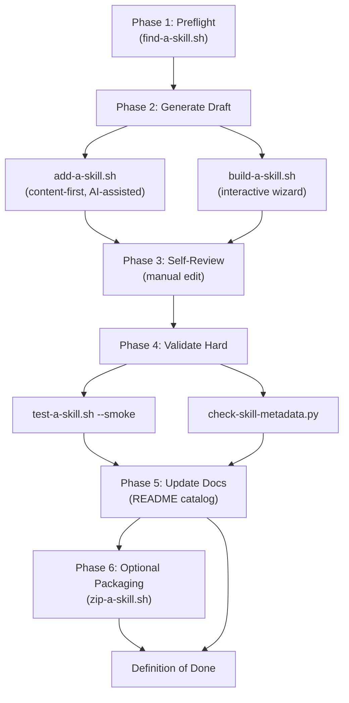
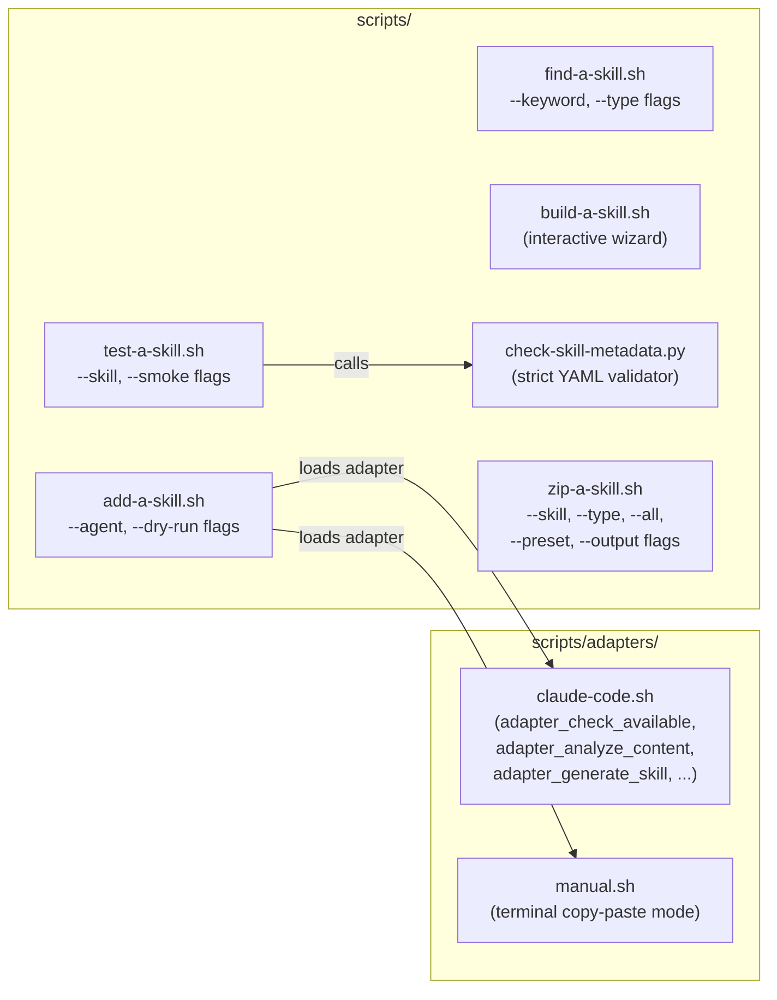

<!-- source: DeepWiki mcp.deepwiki.com · repo deanpeters/Product-Manager-Skills · page 5 Creating and Managing Skills · fetched 2026-10-26 -->

# Creating and Managing Skills

<details>
<summary>Relevant source files</summary>

The following files were used as context for generating this wiki page:

- [CONTRIBUTING.md](CONTRIBUTING.md)
- [docs/Add-a-Skill Utility Guide.md](docs/Add-a-Skill Utility Guide.md)
- [docs/Building PM Skills.md](docs/Building PM Skills.md)
- [docs/CHANGELOG.md](docs/CHANGELOG.md)
- [scripts/adapters/claude-code.sh](scripts/adapters/claude-code.sh)
- [scripts/adapters/manual.sh](scripts/adapters/manual.sh)
- [scripts/add-a-skill.sh](scripts/add-a-skill.sh)
- [scripts/build-a-skill.sh](scripts/build-a-skill.sh)
- [scripts/check-skill-metadata.py](scripts/check-skill-metadata.py)
- [scripts/test-a-skill.sh](scripts/test-a-skill.sh)
- [skills/finance-metrics-quickref/SKILL.md](skills/finance-metrics-quickref/SKILL.md)

</details>


This section covers the end-to-end lifecycle for creating, validating, and distributing skills in the Product Manager Skills repository. It is the entry point for authors who want to add new skills or modify existing ones.

For the precise file format that every `SKILL.md` must follow, see [Skill Format Reference](#5.1). For the detailed authoring phases, see [Skill Authoring Workflow](#5.2). For documentation on individual scripts, see [Authoring Tools Reference](#5.3). For building ZIP artifacts for upload to Claude or other platforms, see [Packaging and Distribution](#5.4).

---

## What a Skill Is

A skill is a single `SKILL.md` file stored at `skills/<skill-name>/SKILL.md`. It carries a YAML frontmatter block (`name`, `description`, `type`) followed by six required Markdown sections. The folder name must match the `name` frontmatter value exactly, in lowercase kebab-case.

Three types exist:

| Type | Primary use | Typical time | Orchestrates other skills? |
|---|---|---|---|
| `component` | Reusable artifact template | 10–30 min | No |
| `interactive` | Multi-turn adaptive Q&A | 30–90 min | Sometimes |
| `workflow` | End-to-end multi-phase process | Days/weeks | Yes |

Sources: [docs/Building PM Skills.md:77-83](), [CONTRIBUTING.md:47-61]()

---

## The Six-Phase Authoring Lifecycle

**Skill Creation Lifecycle**



Sources: [scripts/add-a-skill.sh:15-24](), [docs/Building PM Skills.md:7-30](), [docs/Add-a-Skill Utility Guide.md:76-250]()

### Phase 1 — Preflight

Run `find-a-skill.sh` to check for overlapping skills before starting:

```bash
./scripts/find-a-skill.sh --keyword "<topic>"
./scripts/find-a-skill.sh --keyword "discovery" --type interactive
```

Then decide which of the three `type` values applies. If a near-duplicate already exists, improve it rather than adding a new skill.

### Phase 2 — Generate Draft

Two creation paths exist depending on the state of your source material:

| Path | Script | Best when |
|---|---|---|
| Content-first | `scripts/add-a-skill.sh` | You have raw notes, frameworks, or workshop output |
| Guided wizard | `scripts/build-a-skill.sh` | You have an idea but no finished prose |

`add-a-skill.sh` is adapter-driven. It auto-detects Claude Code (`claude`) and falls back to a manual mode that works with any AI CLI. Pass `--dry-run` to generate and validate without writing to `skills/` or touching git.

### Phase 3 — Self-Review

Manually check the generated file against the quality criteria in `CONTRIBUTING.md`:

- Clear "when to use" statement
- At least one concrete example
- At least one explicit anti-pattern
- No filler language or vague terms
- **ABC — Always Be Coaching**: Explain the *why*, not just the *what*.

Sources: [CONTRIBUTING.md:7-21](), [docs/Building PM Skills.md:124-136]()

### Phase 4 — Validate Hard

Two validation tools must both pass before committing:

```bash
./scripts/test-a-skill.sh --skill <skill-name> --smoke
python3 scripts/check-skill-metadata.py skills/<skill-name>/SKILL.md
```

`check-skill-metadata.py` enforces strict limits: `name` ≤ 64 characters, `description` ≤ 200 characters, `type` must be one of `component`, `interactive`, or `workflow`. It also forbids the use of `$ARGUMENTS` in prose.

Sources: [scripts/check-skill-metadata.py:5-16](), [scripts/test-a-skill.sh:182-233]()

### Phase 5 — Update Docs

If the skill is new:

1. Add it to the correct README category table.
2. Update skill totals and category counts in `CLAUDE.md` and `README.md`.
3. Verify internal link paths resolve.

### Phase 6 — Optional Packaging

If targeting Claude's custom skill upload, produce ZIP artifacts:

```bash
# Single skill
./scripts/zip-a-skill.sh --skill <skill-name>

# All skills of a type
./scripts/zip-a-skill.sh --type component --output dist/skill-zips

# Curated presets
./scripts/zip-a-skill.sh --preset core-pm --output dist/skill-zips
```

Sources: [docs/Building PM Skills.md:25-27](), [docs/Add-a-Skill Utility Guide.md:17-19]()

---

## Definition of Done

A skill is considered complete only when all conditions hold:

| Condition | How to verify |
|---|---|
| Frontmatter is valid | `check-skill-metadata.py` exits 0 |
| Section order is compliant | `test-a-skill.sh --smoke` exits 0 |
| `name` ≤ 64 chars, `description` ≤ 200 chars | `check-skill-metadata.py` output |
| Cross-references resolve | `test-a-skill.sh` path resolution check |
| README catalog updated | Counts and table entries reflect the new skill |
| No `$ARGUMENTS` syntax | `check-skill-metadata.py` forbidden syntax check |

Sources: [scripts/check-skill-metadata.py:41-53](), [scripts/test-a-skill.sh:167-180]()

---

## Tool Inventory

**Authoring Scripts — Natural Language Names to Code Entities**



Sources: [scripts/add-a-skill.sh:1-24](), [scripts/build-a-skill.sh:1-14](), [scripts/test-a-skill.sh:1-19](), [docs/Add-a-Skill Utility Guide.md:197-229]()

| Script | Role | Key flags |
|---|---|---|
| `scripts/find-a-skill.sh` | Ranked keyword/type search across `skills/` | `--keyword`, `--type` |
| `scripts/add-a-skill.sh` | AI-assisted content-first skill generation | `--agent`, `--dry-run`, `--text`, `--list-agents` |
| `scripts/build-a-skill.sh` | Section-by-section interactive authoring wizard | none |
| `scripts/test-a-skill.sh` | Structural conformance and integrity checks | `--skill`, `--smoke` |
| `scripts/check-skill-metadata.py` | Strict YAML frontmatter and section validator | positional: path to `SKILL.md` |
| `scripts/zip-a-skill.sh` | Builds upload-ready ZIP artifacts | `--skill`, `--type`, `--all`, `--preset`, `--output` |

Sources: [docs/Building PM Skills.md:52-65](), [CONTRIBUTING.md:139-178]()

---

## `add-a-skill.sh` Adapter Interface

`add-a-skill.sh` is adapter-agnostic. Each adapter in `scripts/adapters/` must implement the required interface functions:

```mermaid
classDiagram
    class "AdapterInterface" {
        <<Interface>>
        +adapter_check_available()
        +adapter_analyze_content(content)
        +adapter_generate_plan(analysis, content)
        +adapter_generate_skill(plan, content, output_dir)
        +adapter_update_documentation(installed, output_dir)
        +adapter_apply_documentation_updates(installed)
    }
    class "claude-code.sh" {
        +adapter_check_available()
        +adapter_analyze_content(content)
        +adapter_generate_plan(analysis, content)
        +adapter_generate_skill(plan, content, output_dir)
        -_parse_and_create_files(input_file, output_dir)
    }
    class "manual.sh" {
        +adapter_check_available()
        +adapter_analyze_content(content)
        +adapter_generate_plan(analysis, content)
        +adapter_generate_skill(plan, content, output_dir)
        -_manual_capture_response(prompt_file, step_label)
    }
    "AdapterInterface" <|-- "claude-code.sh"
    "AdapterInterface" <|-- "manual.sh"
```

The `claude-code.sh` adapter calls the `claude` CLI and parses structured output using `===FILE:` / `===END FILE` markers. The `manual.sh` adapter allows users to copy prompts to external AI interfaces and paste the results back.

Sources: [scripts/adapters/claude-code.sh:7-14](), [scripts/adapters/manual.sh:14-40](), [docs/Add-a-Skill Utility Guide.md:19-30]()

---

## Contribution Paths

Three paths exist for submitting new skills, depending on technical familiarity:

| Path | Who | Steps |
|---|---|---|
| Email suggestion | Non-technical | Write in any doc format; maintainer formats it |
| GitHub Issue | Any | Describe the framework and use case; maintainer follows up |
| Fork and PR | Technical | Clone, branch, author with scripts, submit PR |

For the full PR checklist, commit message conventions, and catalog update obligations, see [Contributing](#8).

Sources: [CONTRIBUTING.md:91-135]()

---

## Sub-Pages

| Page | Contents |
|---|---|
| [Skill Format Reference](#5.1) | Complete `SKILL.md` schema: YAML frontmatter fields, six required body sections, folder naming rules |
| [Skill Authoring Workflow](#5.2) | Six-phase workflow detail, Dogfood First principle, Definition of Done criteria |
| [Authoring Tools Reference](#5.3) | Per-script flag reference, adapter interface contract, manual adapter mode |
| [Packaging and Distribution](#5.4) | `zip-a-skill.sh` and `package-claude-skills.sh` documentation, preset definitions, dist/ shelf layout |

---

