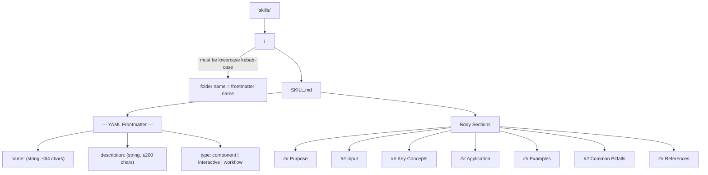
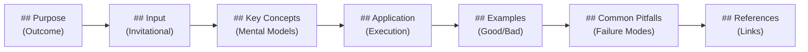
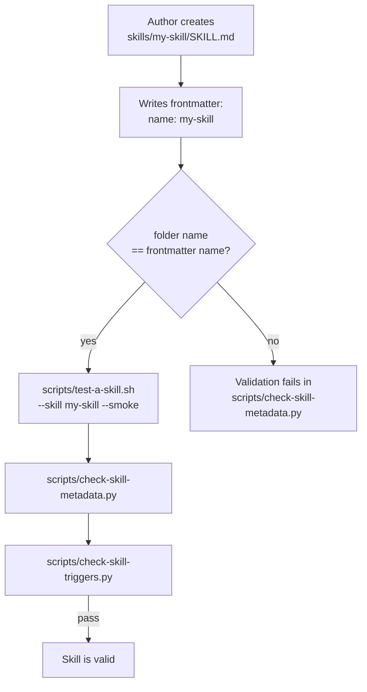

<!-- source: DeepWiki mcp.deepwiki.com · repo deanpeters/Product-Manager-Skills · page 5.1 Skill Format Reference · fetched 2026-10-26 -->

# Skill Format Reference

<details>
<summary>Relevant source files</summary>

The following files were used as context for generating this wiki page:

- [CLAUDE.md](CLAUDE.md)
- [CONTRIBUTING.md](CONTRIBUTING.md)
- [README.md](README.md)
- [docs/Add-a-Skill Utility Guide.md](docs/Add-a-Skill Utility Guide.md)
- [docs/Building PM Skills.md](docs/Building PM Skills.md)
- [docs/CHANGELOG.md](docs/CHANGELOG.md)
- [scripts/build-a-skill.sh](scripts/build-a-skill.sh)
- [skills/ai-shaped-readiness-advisor/SKILL.md](skills/ai-shaped-readiness-advisor/SKILL.md)
- [skills/context-engineering-advisor/SKILL.md](skills/context-engineering-advisor/SKILL.md)
- [skills/positioning-statement/SKILL.md](skills/positioning-statement/SKILL.md)
- [skills/user-story/SKILL.md](skills/user-story/SKILL.md)
- [skills/workshop-facilitation/SKILL.md](skills/workshop-facilitation/SKILL.md)

</details>


This page defines the complete format specification for a `SKILL.md` file: the required YAML frontmatter fields, the six required body sections, folder naming rules, and constraints for Claude web upload compatibility. It is the normative reference for what a valid skill file looks like.

For guidance on the authoring workflow (how to go from idea to a finished, validated skill), see [Skill Authoring Workflow](5.2). For the command-line tools that generate and validate skill files, see [Authoring Tools Reference](5.3). For packaging and distribution (ZIP creation, `Skill.md` renaming), see [Packaging and Distribution](5.4).

---

## File Location and Naming

Each skill lives in its own subdirectory under `skills/`. The directory name must use **lowercase kebab-case** and must match the `name` field in the YAML frontmatter exactly [docs/Building PM Skills.md:98-99](). The skill file is always named `SKILL.md` (uppercase) [CLAUDE.md:16]().

```
skills/
└── user-story/
    └── SKILL.md
```

This naming contract is enforced by `scripts/check-skill-metadata.py` and verified by `scripts/test-a-skill.sh` [docs/Building PM Skills.md:22-23]().

**File Layout Diagram — Code Entity Map**



Sources: [CLAUDE.md:16](), [docs/Building PM Skills.md:98-122](), [scripts/build-a-skill.sh:228-233]()

---

## YAML Frontmatter

The frontmatter block appears at the top of every `SKILL.md`, delimited by `---`. Required fields ensure the skill is discoverable and triggers correctly in AI agents [docs/Building PM Skills.md:102-107]().

| Field | Type | Max Length | Constraint | Purpose |
|---|---|---|---|---|
| `name` | string | 64 chars | Must match folder name exactly (lowercase kebab-case) | Identifies the skill; used as the Claude web skill name |
| `description` | string | 200 chars | Should include "Use when..." cue | Displayed as the skill's trigger summary |
| `intent` | string | — | Repo-facing summary | Explains why the skill exists in the library |
| `type` | enum | — | `component`, `interactive`, `workflow` | Determines tier in the architecture |

The 64-char and 200-char limits are hard requirements for **Claude web upload compatibility** [docs/Building PM Skills.md:133-134]().

**Example frontmatter:**
```markdown
---
name: user-story
description: Create user stories with Mike Cohn format and Gherkin acceptance criteria. Use when turning user needs into development-ready work.
intent: Translate user needs into actionable work that focuses on outcomes and provides testable success criteria.
type: component
---
```
Sources: [docs/Building PM Skills.md:102-107](), [skills/user-story/SKILL.md:1-17](), [docs/Add-a-Skill Utility Guide.md:196-202]()

---

## The Seven Body Sections

Every `SKILL.md` must contain these sections in order. The `## Input` section is a mandatory addition as of v0.84 to support cross-runtime portability [CONTRIBUTING.md:23-31]().

| # | Section | Content |
|---|---|---|
| 1 | `## Purpose` | One paragraph. Outcome-focused: what it produces and when to use it. |
| 2 | `## Input` | **Mandatory.** Defines what context the user provides. Must state that partial/zero input is fine [CONTRIBUTING.md:31](). |
| 3 | `## Key Concepts` | Core frameworks, definitions, and mental models. Define PM jargon. |
| 4 | `## Application` | Step-by-step instructions. Numbered for sequences. Include decision points. |
| 5 | `## Examples` | Concrete real-world cases. Show good usage and anti-patterns. |
| 6 | `## Common Pitfalls` | Named failure modes with consequences and corrective actions. |
| 7 | `## References` | Cross-links to related `skills/*/SKILL.md` files. |

**The No-$ARGUMENTS Rule:** Do not use `$ARGUMENTS` syntax in the `## Input` section. It breaks portability across non-CLI runtimes like Claude Web and the Streamlit playground [CONTRIBUTING.md:25-31]().

**Section Ordering and Role Diagram**



Sources: [docs/Building PM Skills.md:109-122](), [CONTRIBUTING.md:23-31](), [skills/workshop-facilitation/SKILL.md:18-101]()

---

## Folder Naming and Validation

The folder name under `skills/` must use **lowercase kebab-case** only and match the `name` field exactly [docs/Building PM Skills.md:99](). Violations are caught by `scripts/check-skill-metadata.py`, which is called by the `test-a-skill.sh --smoke` check [docs/Building PM Skills.md:60-61]().

**Naming Contract Validation Flow**



Sources: [docs/Building PM Skills.md:56-64](), [docs/Add-a-Skill Utility Guide.md:196-208](), [scripts/build-a-skill.sh:151-165]()

---

## Claude Web Upload Compatibility

Claude web requires a specific file name casing and has strict frontmatter length limits. The packaging script `scripts/package-claude-skills.sh` handles the rename automatically [docs/Building PM Skills.md:25-26]().

| Requirement | Rule | Handled by |
|---|---|---|
| File name | Must be `Skill.md` (capital S) | `scripts/package-claude-skills.sh` |
| `name` field | ≤ 64 characters | `scripts/check-skill-metadata.py` |
| `description` field | ≤ 200 characters | `scripts/check-skill-metadata.py` |
| `$ARGUMENTS` | Forbidden in body | `scripts/check-skill-metadata.py` |

The `package-claude-skills.sh` script also performs frontmatter sanitization to ensure the YAML is compatible with the Claude web interface [docs/Building PM Skills.md:133-136]().

Sources: [docs/Building PM Skills.md:127-136](), [CONTRIBUTING.md:31](), [docs/Add-a-Skill Utility Guide.md:196-208]()

---

