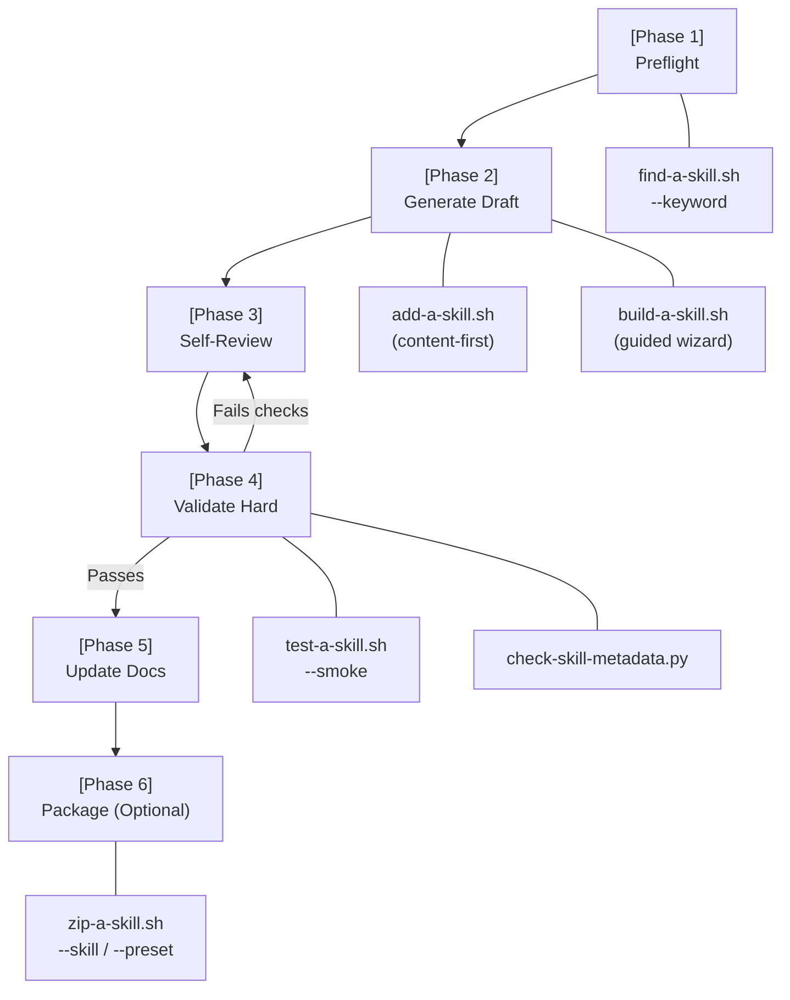
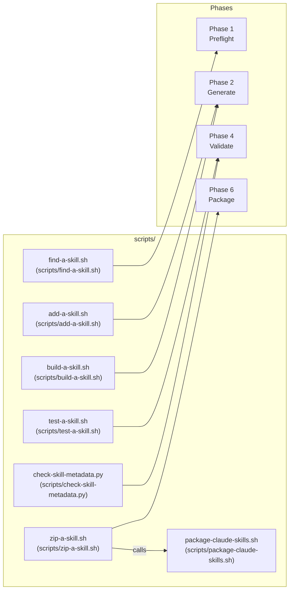

<!-- source: DeepWiki mcp.deepwiki.com · repo deanpeters/Product-Manager-Skills · page 5.2 Skill Authoring Workflow · fetched 2026-10-26 -->

# Skill Authoring Workflow

<details>
<summary>Relevant source files</summary>

The following files were used as context for generating this wiki page:

- [CONTRIBUTING.md](CONTRIBUTING.md)
- [dist/skill-authoring-workflow.zip](dist/skill-authoring-workflow.zip)
- [docs/Add-a-Skill Utility Guide.md](docs/Add-a-Skill Utility Guide.md)
- [docs/Building PM Skills.md](docs/Building PM Skills.md)
- [docs/CHANGELOG.md](docs/CHANGELOG.md)
- [docs/PM Skills Rule-of-Thumb Guide.md](docs/PM Skills Rule-of-Thumb Guide.md)
- [docs/Using PM Skills with ChatGPT.md](docs/Using PM Skills with ChatGPT.md)
- [docs/Using PM Skills with Claude.md](docs/Using PM Skills with Claude.md)
- [docs/Using PM Skills with Codex.md](docs/Using PM Skills with Codex.md)
- [scripts/build-a-skill.sh](scripts/build-a-skill.sh)
- [scripts/package-claude-skills.sh](scripts/package-claude-skills.sh)
- [scripts/zip-a-skill.sh](scripts/zip-a-skill.sh)
- [skills/skill-authoring-workflow/SKILL.md](skills/skill-authoring-workflow/SKILL.md)

</details>


This page documents the six-phase lifecycle for creating or updating a skill in the repository, as defined in [skills/skill-authoring-workflow/SKILL.md](). It covers the correct tool for each phase, the "Dogfood First" principle, and the Definition of Done criteria a skill must satisfy before commit.

For the format a completed skill must conform to (frontmatter fields, section order, character limits), see [Skill Format Reference](#5.1). For tool-level reference documentation on each script, see [Authoring Tools Reference](#5.3). For ZIP and Claude-upload packaging, see [Packaging and Distribution](#5.4).

---

## Overview

The authoring workflow exists to prevent "looks good to me" roulette. A skill is not done because it feels complete — it is done when it passes automated conformance checks and the README catalog is updated [skills/skill-authoring-workflow/SKILL.md:20-25]().

**Dogfood First** is the guiding principle: use repo-native tools and standards as the source of truth before inventing a custom process [skills/skill-authoring-workflow/SKILL.md:38-46](). The scripts in `scripts/` are the authoritative quality gate [CONTRIBUTING.md:170-177]().

Sources: [skills/skill-authoring-workflow/SKILL.md:1-46](), [CONTRIBUTING.md:170-177]()

---

## Six-Phase Lifecycle

**Workflow: Six-Phase Skill Authoring**



Sources: [skills/skill-authoring-workflow/SKILL.md:81-144](), [docs/Building PM Skills.md:8-27]()

---

### Phase 1 — Preflight

Before writing anything, confirm that a similar skill does not already exist [skills/skill-authoring-workflow/SKILL.md:81-83]().

```bash
./scripts/find-a-skill.sh --keyword "<topic>"
./scripts/find-a-skill.sh --keyword "<topic>" --type interactive
```

`find-a-skill.sh` ranks results by: exact name match > frontmatter match > section body match [docs/Building PM Skills.md:57-58]().

After confirming no duplicate exists, decide the skill type [skills/skill-authoring-workflow/SKILL.md:89-92]():

| Type | When to use |
|---|---|
| `component` | Single artifact or template (user story, canvas, statement) |
| `interactive` | 3–5 adaptive questions + numbered recommendations |
| `workflow` | Multi-phase orchestration referencing other skills |

Pick the smallest type that fits [docs/Building PM Skills.md:77-83](). Choosing `workflow` when the task is really a template is a named pitfall [skills/skill-authoring-workflow/SKILL.md:176]().

Sources: [skills/skill-authoring-workflow/SKILL.md:81-92](), [docs/Building PM Skills.md:57-83]()

---

### Phase 2 — Generate Draft

Two automated paths exist; choose based on how much source material you have [skills/skill-authoring-workflow/SKILL.md:47-51]().

**Path A — Content-first (recommended when source material exists)**

```bash
./scripts/add-a-skill.sh research/your-framework.md
```

`add-a-skill.sh` runs an 8-step pipeline: analyze content → suggest structure → generate SKILL.md → validate metadata → update docs [docs/Add-a-Skill Utility Guide.md:9-15](). It supports `--agent` and `--dry-run` flags [docs/Add-a-Skill Utility Guide.md:58-66]().

**Path B — Guided wizard (recommended when starting from an idea)**

```bash
./scripts/build-a-skill.sh
```

`build-a-skill.sh` prompts section-by-section in order (Purpose → Input → Key Concepts → Application → Examples → Common Pitfalls → References), then writes a deterministic `SKILL.md` [scripts/build-a-skill.sh:224-235]().

**Path C — Manual edit**

Used when tightening an existing skill rather than creating one from scratch [skills/skill-authoring-workflow/SKILL.md:51](). Create or edit `skills/<skill-name>/SKILL.md` directly, then proceed to Phase 3.

Sources: [skills/skill-authoring-workflow/SKILL.md:47-51](), [docs/Add-a-Skill Utility Guide.md:9-66](), [scripts/build-a-skill.sh:224-235]()

---

### Phase 3 — Self-Review

Before running automated checks, manually review the draft against these criteria [skills/skill-authoring-workflow/SKILL.md:108-116]():

| Criterion | Requirement |
|---|---|
| **When-to-use** | Does the Purpose section state exactly when this skill applies? |
| **Examples** | Optimally two worked examples from different domains (SaaS vs Industrial) using fictional universes (Fieldlight vs Helix) [docs/Building PM Skills.md:130](). |
| **Anti-pattern** | Is there at least one explicit failure mode with a corrective action? |
| **Input Section** | Plain language only. **Never** use `$ARGUMENTS` syntax [CONTRIBUTING.md:23-31](). |
| **Artifacts** | Include a `template.md` if the skill produces an artifact [skills/skill-authoring-workflow/SKILL.md:113](). |

Sources: [skills/skill-authoring-workflow/SKILL.md:108-116](), [docs/Building PM Skills.md:130](), [CONTRIBUTING.md:23-31]()

---

### Phase 4 — Validate Hard

This is the quality gate. Both commands must pass before the skill is considered done [skills/skill-authoring-workflow/SKILL.md:117-125]().

```bash
./scripts/test-a-skill.sh --skill <skill-name> --smoke
python3 scripts/check-skill-metadata.py skills/<skill-name>/SKILL.md
```

`test-a-skill.sh` with `--smoke` performs strict conformance checks [docs/Building PM Skills.md:60-61]().

`check-skill-metadata.py`:
- Validates YAML frontmatter fields (`name`, `description`, `intent`, `type`) [docs/Add-a-Skill Utility Guide.md:197-202]().
- Enforces `name` ≤ 64 chars, `description` ≤ 200 chars (required for Claude web upload compatibility) [skills/skill-authoring-workflow/SKILL.md:58]().
- Confirms folder name matches `name` field exactly [docs/Building PM Skills.md:99]().

Sources: [skills/skill-authoring-workflow/SKILL.md:58-125](), [docs/Building PM Skills.md:60-99](), [docs/Add-a-Skill Utility Guide.md:197-202]()

---

### Phase 5 — Integrate with Repo Docs

For any new skill (not an update to an existing one) [skills/skill-authoring-workflow/SKILL.md:127-133]():

1. Add a row to the correct category table in `README.md`.
2. Update the skill count totals and category counts.
3. Verify link paths resolve.

Skipping this step is a named anti-pattern that leads to broken references and inconsistent catalog numbers [skills/skill-authoring-workflow/SKILL.md:164-172]().

Sources: [skills/skill-authoring-workflow/SKILL.md:127-172]()

---

### Phase 6 — Optional Packaging

If the skill needs to be uploaded to Claude as a custom skill, run `zip-a-skill.sh`. This script internally calls `package-claude-skills.sh`, which sanitizes frontmatter and renames `SKILL.md` to `Skill.md` (case-sensitive, required by Claude) [docs/Using PM Skills with Claude.md:158-183]().

```bash
# Single skill
./scripts/zip-a-skill.sh --skill <skill-name>

# By type
./scripts/zip-a-skill.sh --type component --output dist/skill-zips

# Curated preset
./scripts/zip-a-skill.sh --preset core-pm --output dist/skill-zips
```

Available presets [scripts/zip-a-skill.sh:57-66]():

| Preset | Contents |
|---|---|
| `core-pm` | Foundational PM skills across all three types |
| `finance-suite` | All finance-focused foundation, decision, and diagnostic skills |
| `workflow-pack` | All multi-phase orchestration skills |
| `interactive-pack` | High-leverage adaptive advisors |
| `component-pack` | Common artifact templates |

Sources: [scripts/zip-a-skill.sh:57-66](), [docs/Using PM Skills with Claude.md:158-183]()

---

## Definition of Done

A skill is **done only when all criteria are met** — no exceptions [skills/skill-authoring-workflow/SKILL.md:53-64]().

| # | Criterion | Validated by |
|---|---|---|
| 1 | Frontmatter has `name`, `description`, `intent`, `type` | `check-skill-metadata.py` |
| 2 | Section order is compliant (Purpose → ... → References) | `test-a-skill.sh --smoke` |
| 3 | `name` ≤ 64 chars, `description` ≤ 200 chars | `check-skill-metadata.py` |
| 4 | Description includes "Use when..." trigger cue | `check-skill-triggers.py` |
| 5 | Input section uses plain language (No `$ARGUMENTS`) | `check-skill-metadata.py` |
| 6 | README catalog counts and tables updated | Manual review |

Sources: [skills/skill-authoring-workflow/SKILL.md:53-64](), [docs/Add-a-Skill Utility Guide.md:197-208]()

---

## Tool-to-Phase Mapping

**Diagram: Script Roles Across the Authoring Lifecycle**



Sources: [skills/skill-authoring-workflow/SKILL.md:38-46](), [scripts/zip-a-skill.sh:21](), [docs/Add-a-Skill Utility Guide.md:197-208]()

---

## Facilitation Mode

When `skill-authoring-workflow` is invoked as an interactive conversation, it delegates facilitation behavior to the `workshop-facilitation` protocol [skills/skill-authoring-workflow/SKILL.md:65-77]().

- **Session entry modes**: Guided, Context dump, Best guess.
- **Progress labels**: e.g., `Context Q3/8`.
- **Numbered recommendations**: At decision points.
- **Interruption handling**: Support for pause/resume behavior.

Sources: [skills/skill-authoring-workflow/SKILL.md:65-77]()

---

## Common Pitfalls

| Pitfall | Consequence | Fix |
|---|---|---|
| Shipping vibes, not standards | Broken references, inconsistent catalog | Always run `test-a-skill.sh --smoke` [skills/skill-authoring-workflow/SKILL.md:175](). |
| Using `$ARGUMENTS` | Broken rendering in Claude Web/Codex/Streamlit | Use `## Input` plain language convention [CONTRIBUTING.md:23-31](). |
| Choosing `workflow` for a template | Misleading type label, wrong catalog placement | Use `component` for single-artifact outputs [skills/skill-authoring-workflow/SKILL.md:176](). |
| Forgetting README counts | Catalog drift confuses contributors | Update counts in same commit as the new skill [skills/skill-authoring-workflow/SKILL.md:63](). |

Sources: [skills/skill-authoring-workflow/SKILL.md:63-176](), [CONTRIBUTING.md:23-31]()

---

