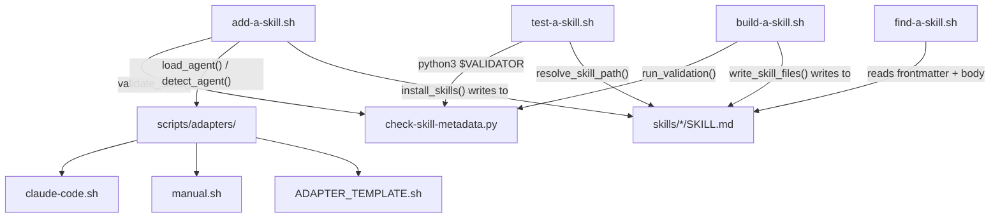
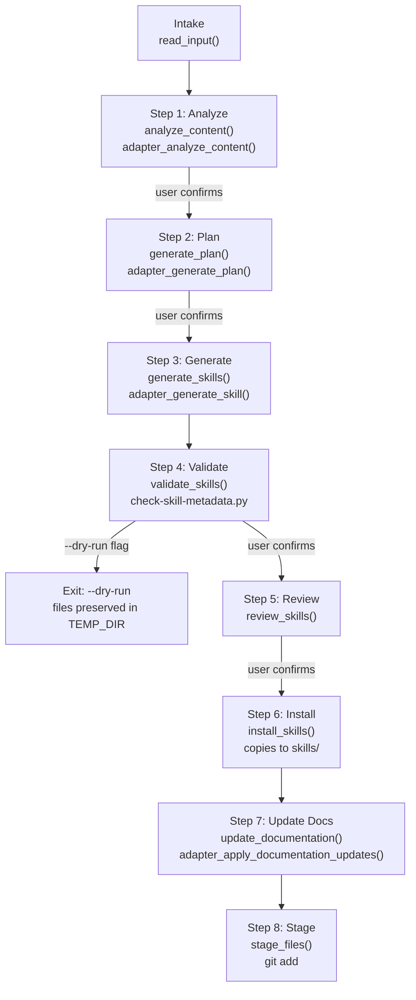
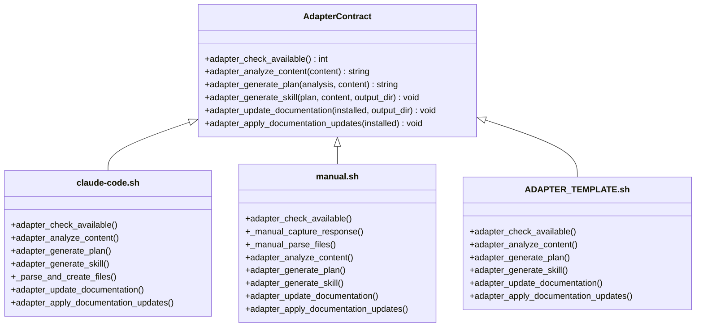
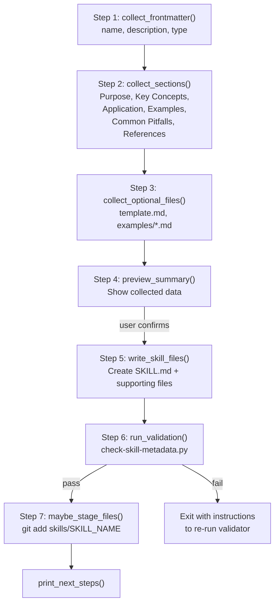
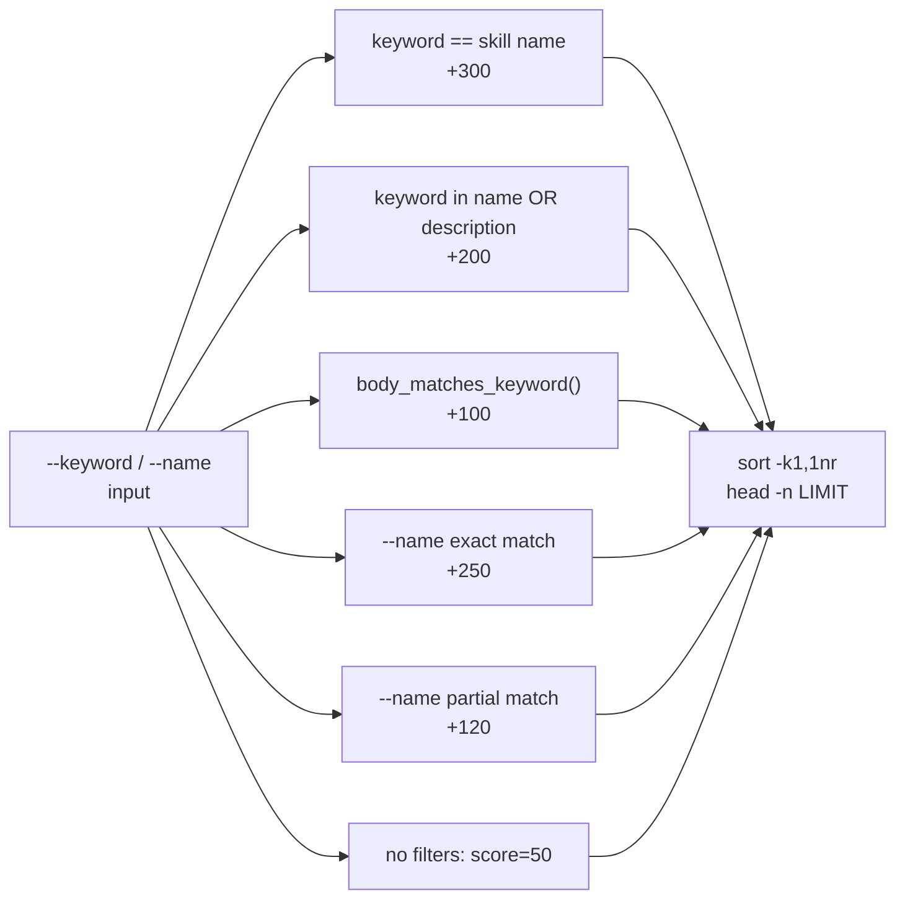
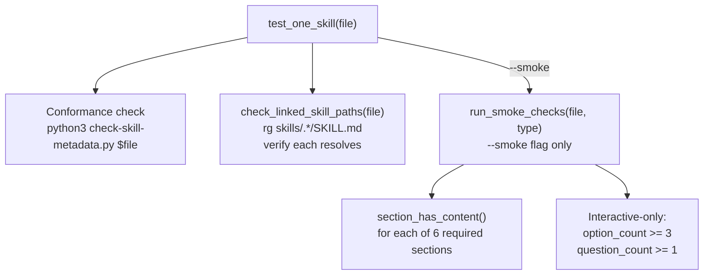

<!-- source: DeepWiki mcp.deepwiki.com · repo deanpeters/Product-Manager-Skills · page 5.3 Authoring Tools Reference · fetched 2026-10-26 -->

# Authoring Tools Reference

<details>
<summary>Relevant source files</summary>

The following files were used as context for generating this wiki page:

- [.github/workflows/build-release.yml](.github/workflows/build-release.yml)
- [CONTRIBUTING.md](CONTRIBUTING.md)
- [docs/Add-a-Skill Utility Guide.md](docs/Add-a-Skill Utility Guide.md)
- [docs/Building PM Skills.md](docs/Building PM Skills.md)
- [docs/CHANGELOG.md](docs/CHANGELOG.md)
- [docs/RELEASE-PACKAGING.md](docs/RELEASE-PACKAGING.md)
- [scripts/adapters/claude-code.sh](scripts/adapters/claude-code.sh)
- [scripts/adapters/manual.sh](scripts/adapters/manual.sh)
- [scripts/add-a-skill.sh](scripts/add-a-skill.sh)
- [scripts/build-a-skill.sh](scripts/build-a-skill.sh)
- [scripts/check-dist-freshness.py](scripts/check-dist-freshness.py)
- [scripts/check-library-drift.py](scripts/check-library-drift.py)
- [scripts/check-skill-metadata.py](scripts/check-skill-metadata.py)
- [scripts/test-a-skill.sh](scripts/test-a-skill.sh)
- [scripts/test-library.sh](scripts/test-library.sh)
- [scripts/validate-skills.sh](scripts/validate-skills.sh)
- [skills/finance-metrics-quickref/SKILL.md](skills/finance-metrics-quickref/SKILL.md)

</details>


This page documents every script in the `scripts/` directory: what each script does, its flags, internal mechanics, and how the scripts relate to each other. This reference covers `add-a-skill.sh`, `build-a-skill.sh`, `find-a-skill.sh`, `test-a-skill.sh`, and `check-skill-metadata.py`.

For the broader authoring *lifecycle* that orchestrates these tools (phases, Definition of Done, the Dogfood First principle), see the [Skill Authoring Workflow](#5.2). For the SKILL.md file format those tools produce and validate, see the [Skill Format Reference](#5.1). For packaging the resulting skills for distribution, see [Packaging and Distribution](#5.4).

---

## Script Ecosystem Overview

All five tools share a common dependency on `check-skill-metadata.py` and operate on the `skills/` directory. `add-a-skill.sh` additionally delegates AI work to swappable adapter scripts in `scripts/adapters/`.

**Script relationships and shared dependencies**



Sources: [scripts/add-a-skill.sh:1-50](), [scripts/build-a-skill.sh:28-33](), [scripts/find-a-skill.sh:17-22](), [scripts/test-a-skill.sh:22-26](), [docs/Add-a-Skill Utility Guide.md:1-20]()

---

## `add-a-skill.sh`

**Path:** `scripts/add-a-skill.sh`

Converts raw PM content (notes, research documents, framework descriptions) into a validated, installed `SKILL.md` file using an AI agent adapter. This is the primary automated authoring path. The companion manual path is `build-a-skill.sh`.

### Flags

| Flag | Description |
|---|---|
| `--agent <name>` | Load a specific adapter by name (e.g. `claude-code`, `manual`) |
| `--list-agents` | Print all adapters in `scripts/adapters/` and their availability |
| `--text "content"` | Provide input content directly as a string argument |
| `--dry-run` | Run steps 1–4 (intake → validate) but skip install, docs, and git staging |
| `--help`, `-h` | Print usage information |

### Input methods

```bash
# From a file
./scripts/add-a-skill.sh research/my-framework.md

# From stdin
cat notes.txt | ./scripts/add-a-skill.sh

# From clipboard (macOS)
pbpaste | ./scripts/add-a-skill.sh

# Direct text
./scripts/add-a-skill.sh --text "My framework for..."

# With a specific adapter
./scripts/add-a-skill.sh --agent manual research/content.md
```

### 8-step workflow

The `main()` function in `add-a-skill.sh` executes the following steps in sequence. Each interactive checkpoint (`confirm()`) gives the user an exit opportunity before any files are written.

**add-a-skill.sh internal workflow**



Sources: [scripts/add-a-skill.sh:464-503](), [scripts/add-a-skill.sh:212-325](), [scripts/add-a-skill.sh:358-462]()

### Agent auto-detection

When `--agent` is not specified, `detect_agent()` tries adapters in priority order:

1. `claude-code` (requires `claude` CLI on `$PATH`)
2. `manual` (always available)

[scripts/add-a-skill.sh:134-158]()

### Adapter interface contract

Each adapter is a bash script in `scripts/adapters/` that defines six required functions. The main script `source`s the adapter file and calls these functions directly.

**Adapter interface: required functions and call sites**



| Function | Called at step | Purpose |
|---|---|---|
| `adapter_check_available()` | Agent detection | Returns 0 if the agent CLI is present |
| `adapter_analyze_content(content)` | Step 1 | Returns free-form analysis recommending skill type, name, structure |
| `adapter_generate_plan(analysis, content)` | Step 2 | Returns file structure, YAML frontmatter, section outlines |
| `adapter_generate_skill(plan, content, output_dir)` | Step 3 | Creates files under `$output_dir/` using `===FILE:` / `===END FILE` markers |
| `adapter_update_documentation(installed, output_dir)` | Step 7 | Writes suggested doc changes to `$output_dir/doc-updates.txt` |
| `adapter_apply_documentation_updates(installed)` | Step 7 | Directly modifies `CLAUDE.md` and `README.md` |

Sources: [scripts/adapters/ADAPTER_TEMPLATE.sh:1-50](), [scripts/adapters/claude-code.sh:1-20](), [scripts/adapters/manual.sh:1-12](), [docs/Add-a-Skill Utility Guide.md:405-444]()

### File output format (`===FILE:` markers)

`adapter_generate_skill()` must emit files using this marker protocol. Both `claude-code.sh` (`_parse_and_create_files()`) and `manual.sh` (`_manual_parse_files()`) parse this same format:

```
===FILE: skill-name/SKILL.md
---
name: skill-name
description: ...
type: component
---
## Purpose
...
===END FILE
```

Paths prefixed with `skills/` have that prefix stripped automatically. Absolute paths or paths containing `..` are rejected with an error.

Sources: [scripts/adapters/claude-code.sh:146-188](), [scripts/adapters/manual.sh:42-72]()

### Manual adapter mode

When `--agent manual` is used, no AI CLI is required. Instead, `_manual_capture_response()` prints a prompt file path, instructs the user to run the prompt in any external AI tool, then reads the pasted response until a line containing only `__END__` is found.

```bash
./scripts/add-a-skill.sh --agent manual research/content.md
# For each AI step, the script prints the prompt file and waits
# Paste AI response, then type: __END__
```

Sources: [scripts/adapters/manual.sh:14-40]()

### Creating a custom adapter

1. Copy the template: `cp scripts/adapters/ADAPTER_TEMPLATE.sh scripts/adapters/my-agent.sh`
2. Implement all six required functions (stubs in template return 1 with a `TODO` message)
3. End the file with `export -f` for each function (required for subshell visibility)
4. Verify: `./scripts/add-a-skill.sh --list-agents`

Sources: [scripts/adapters/ADAPTER_TEMPLATE.sh:338-365]()

---

## `build-a-skill.sh`

**Path:** `scripts/build-a-skill.sh`

A fully interactive, AI-free wizard that collects skill content section by section through terminal prompts and writes deterministic output files. Suited for authors who prefer to write skill content manually rather than distilling it from existing documents.

### Flags

| Flag | Description |
|---|---|
| `--output-root <path>` | Write the skill directory here instead of the default `skills/` |
| `--help`, `-h` | Print usage information |

### Wizard steps

**build-a-skill.sh internal step sequence**



### Multi-line input protocol

All multi-line section fields use a consistent sentinel:

```
Paste your content below. End with a line containing only: __END__
```

The function `read_multiline_required()` buffers lines until it reads `__END__`, then validates the buffer is non-empty. [scripts/build-a-skill.sh:110-135]()

### Frontmatter validation

`validate_skill_name()` enforces two rules inline before the file is written:

- Length ≤ 64 characters
- Matches regex `^[a-z0-9]+(-[a-z0-9]+)*$` (lowercase kebab-case)

Description length is checked inline: > 200 characters triggers a re-prompt. [scripts/build-a-skill.sh:137-151](), [scripts/build-a-skill.sh:183-188]()

### Optional files

The wizard optionally collects:

- `template.md` — a fill-in-the-blank template for Component skills
- `examples/<filename>.md` — one or more example files (repeatable prompt)

Filenames for examples are sanitized by `sanitize_example_filename()`, which strips leading `./` and `/`, rejects `..`, and appends `.md` if missing. [scripts/build-a-skill.sh:219-240]()

### Output structure

```
$OUTPUT_ROOT/<skill-name>/
├── SKILL.md
├── template.md            (if collected)
└── examples/
    └── <filename>.md      (one per example added)
```

Sources: [scripts/build-a-skill.sh:276-331]()

---

## `find-a-skill.sh`

**Path:** `scripts/find-a-skill.sh`

Searches all `skills/*/SKILL.md` files and returns ranked results. Ranking is score-based, with frontmatter matches outweighing body-text matches.

### Flags

| Flag | Description |
|---|---|
| `--keyword <text>` | Match against name, description, and body text |
| `--type <type>` | Filter to `component`, `interactive`, or `workflow` |
| `--name <text>` | Filter to skills whose name contains this substring |
| `--limit <n>` | Cap results (default: 25) |
| `--list-all` | List all skills alphabetically; respects `--type` |
| `--help`, `-h` | Print usage |

### Ranking algorithm

Scores are accumulated per-skill and sorted descending. Higher score = better match.

**find-a-skill.sh scoring model**



Sources: [scripts/find-a-skill.sh:194-234]()

### Frontmatter extraction

`extract_frontmatter_field()` uses `awk` to read only within the `---` delimiters, never scanning the body. `body_matches_keyword()` uses a complementary `awk` pattern that skips the frontmatter block and pipes the body to `grep -Fqi`. [scripts/find-a-skill.sh:43-70]()

### Example usage

```bash
# Find skills matching "pricing"
./scripts/find-a-skill.sh pricing

# Find interactive skills related to roadmap
./scripts/find-a-skill.sh --type interactive --keyword roadmap

# Exact skill name lookup
./scripts/find-a-skill.sh --name user-story

# List all workflow skills
./scripts/find-a-skill.sh --list-all --type workflow
```

### Output format

Each result prints three lines:

```
- <name> (<type>) - <description>
  skills/<name>/SKILL.md
  match=<reason> score=<n>
```

Sources: [scripts/find-a-skill.sh:241-243]()

---

## `test-a-skill.sh`

**Path:** `scripts/test-a-skill.sh`

Runs conformance and integrity checks against one or more skills. By default, runs the metadata validator and checks that all skill cross-references (`skills/*/SKILL.md` paths in the file) resolve. The `--smoke` flag adds content-completeness checks.

### Flags

| Flag | Description |
|---|---|
| `--skill <name\|path>` | Test a specific skill; accepts skill name, directory path, or `SKILL.md` path; repeatable |
| `--smoke` | Run additional smoke checks (section completeness, interactive option counts) |
| `--help`, `-h` | Print usage |

### Check types

**test-a-skill.sh checks and their entry points**



| Check | Default | `--smoke` | Failure type |
|---|---|---|---|
| `check-skill-metadata.py` conformance | ✓ | ✓ | `FAIL` |
| Linked `skills/*/SKILL.md` paths resolve | ✓ | ✓ | `FAIL` |
| All 6 required sections non-empty | — | ✓ | `FAIL` |
| Interactive skill has ≥3 numbered options in Application | — | ✓ | `WARN` |
| Interactive skill has ≥1 question mark in Application | — | ✓ | `WARN` |

### Skill path resolution

`resolve_skill_path()` accepts four input forms:

1. Direct path to `SKILL.md` (e.g. `skills/user-story/SKILL.md`)
2. Directory path containing `SKILL.md` (e.g. `skills/user-story`)
3. Skill name only (e.g. `user-story`) — resolved against `$PROJECT_ROOT/skills/`
4. Project-relative path to `SKILL.md`

[scripts/test-a-skill.sh:108-145]()

### Link checking

`check_linked_skill_paths()` uses `rg` (ripgrep) to extract all occurrences of the pattern `skills/[a-z0-9-]+/SKILL\.md` from the file body, then verifies each extracted path exists under `$PROJECT_ROOT`. Missing paths are printed and counted as failures.

[scripts/test-a-skill.sh:165-178]()

### Summary output

After all targets are tested, the script prints a summary block and exits with code 1 if any skill failed:

```
Summary:
  total: 12
  pass:  11
  fail:  1
  warn:  2
```

Counters `TOTAL`, `PASS`, `FAIL`, and `WARN` are module-level globals. [scripts/test-a-skill.sh:29-33]()

### Example usage

```bash
# Test all skills
./scripts/test-a-skill.sh

# Test one skill by name
./scripts/test-a-skill.sh --skill user-story

# Full smoke check on a specific skill file
./scripts/test-a-skill.sh --skill skills/user-story/SKILL.md --smoke

# Test multiple skills
./scripts/test-a-skill.sh \
  --skill feature-investment-advisor \
  --skill finance-based-pricing-advisor \
  --smoke
```

Sources: [scripts/test-a-skill.sh:43-60](), [scripts/test-a-skill.sh:180-256]()

---

## `check-skill-metadata.py`

**Path:** `scripts/check-skill-metadata.py`

A Python 3 script that performs strict metadata validation on a single `SKILL.md` file. It is the lowest-level validator and is called by `add-a-skill.sh`, `build-a-skill.sh`, and `test-a-skill.sh`.

### Invocation

```bash
python3 scripts/check-skill-metadata.py skills/<name>/SKILL.md
```

Exits with code `0` on success, non-zero on any failure.

### Validation rules

| Field | Rule |
|---|---|
| YAML frontmatter | Must be valid YAML between `---` delimiters |
| `name` | Required; ≤ 64 characters |
| `description` | Required; ≤ 200 characters |
| `type` | Required; must be exactly `component`, `interactive`, or `workflow` |

The 200-character limit on `description` is a Claude web upload constraint: Skills uploaded to Claude's web UI via ZIP are parsed with this limit. [docs/Add-a-Skill Utility Guide.md:194-213]()

### Call sites

| Script | Function | Condition |
|---|---|---|
| `add-a-skill.sh` | `validate_skills()` | Step 4, after `adapter_generate_skill()` |
| `build-a-skill.sh` | `run_validation()` | Step 6, after `write_skill_files()` |
| `test-a-skill.sh` | `test_one_skill()` | Default check on every target skill |

Sources: [scripts/add-a-skill.sh:277-325](), [scripts/build-a-skill.sh:333-355](), [scripts/test-a-skill.sh:225-230]()

---

## Environment Variables and Shared Paths

The following variables appear across multiple scripts and are set from the script's own location at startup:

| Variable | Value | Used by |
|---|---|---|
| `SCRIPT_DIR` | Absolute path to `scripts/` | All scripts |
| `PROJECT_ROOT` | One level above `SCRIPT_DIR` | All scripts |
| `SKILLS_DIR` | `$PROJECT_ROOT/skills` | `add-a-skill.sh` |
| `ADAPTERS_DIR` | `$SCRIPT_DIR/adapters` | `add-a-skill.sh` |
| `VALIDATOR` | `$SCRIPT_DIR/check-skill-metadata.py` | `build-a-skill.sh`, `test-a-skill.sh` |
| `TEMP_DIR` | `mktemp -d` result; cleaned up on `EXIT` trap | `add-a-skill.sh` |

Sources: [scripts/add-a-skill.sh:37-48](), [scripts/build-a-skill.sh:28-32](), [scripts/find-a-skill.sh:19-22](), [scripts/test-a-skill.sh:22-24]()

---

