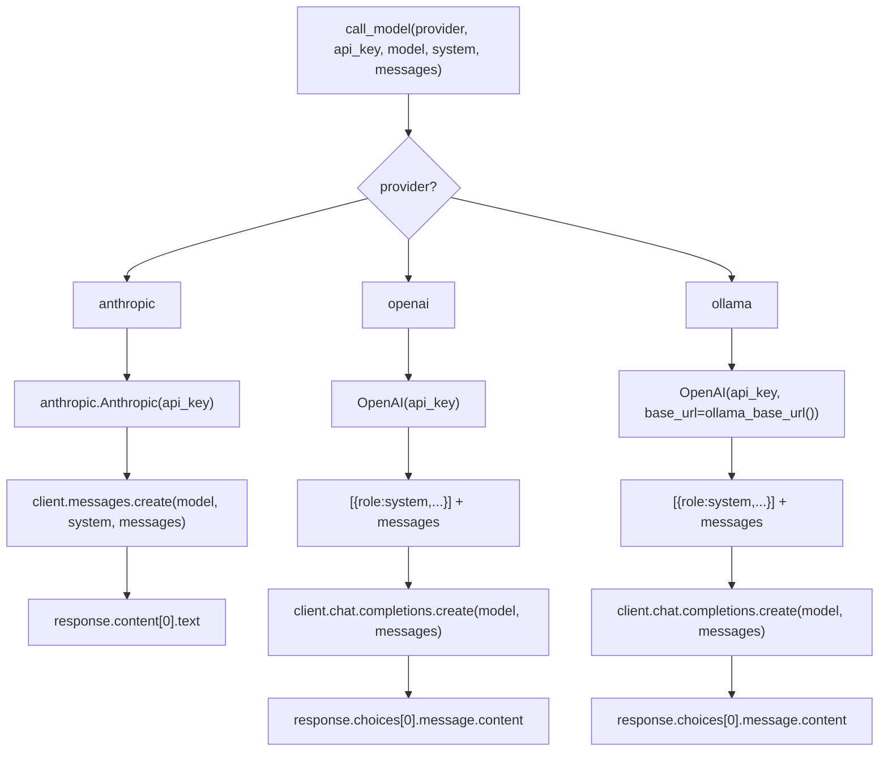
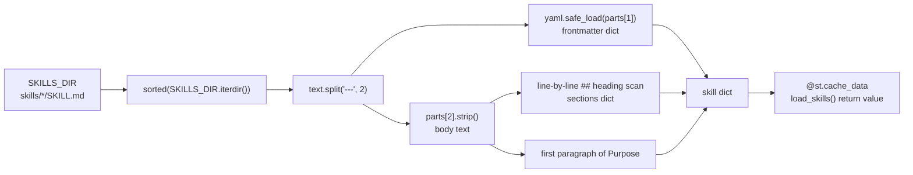
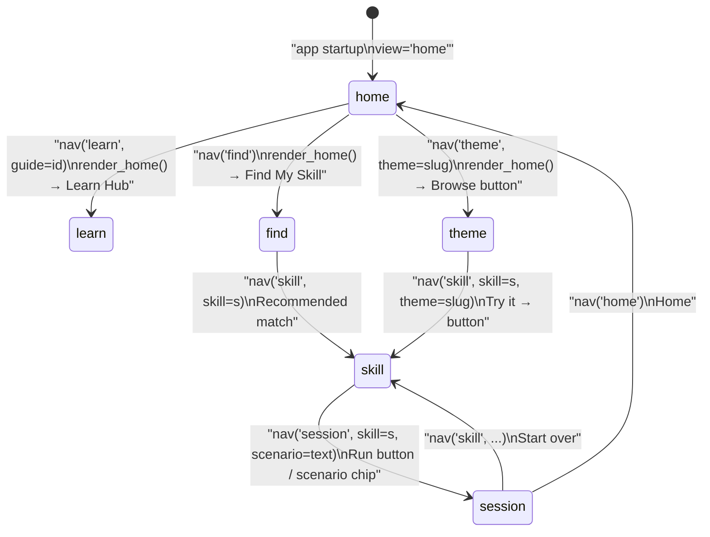
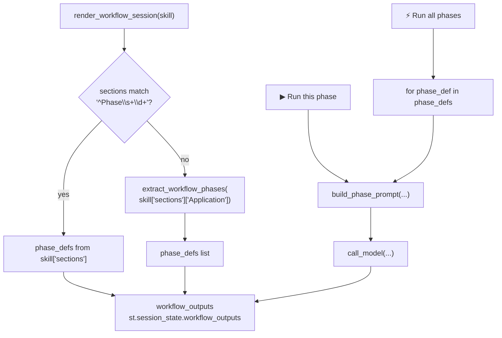

<!-- source: DeepWiki mcp.deepwiki.com · repo deanpeters/Product-Manager-Skills · page 6 Streamlit Playground · fetched 2026-10-26 -->

# Streamlit Playground

<details>
<summary>Relevant source files</summary>

The following files were used as context for generating this wiki page:

- [CLAUDE.md](CLAUDE.md)
- [README.md](README.md)
- [app/STREAMLIT_INTERFACE.md](app/STREAMLIT_INTERFACE.md)
- [app/main.py](app/main.py)
- [docs/announcements/2026-03-09-v0-7-skill-quality-trigger-clarity.md](docs/announcements/2026-03-09-v0-7-skill-quality-trigger-clarity.md)
- [docs/announcements/README.md](docs/announcements/README.md)

</details>


This page documents the local Streamlit application at `app/main.py`: what it is, how to run it, how it is structured internally, and how it renders each skill type. It covers the environment configuration, four-screen navigation flow, three session renderers, and provider/model selection.

For background on the skill types (Component, Interactive, Workflow) that the playground renders, see page [1.1](). For the skill file format that the app parses, see page [5.1]().

---

## Purpose

The Playground is a local web UI that lets users browse and test-drive PM skills against a live LLM before committing to an agent workflow integration. It reads the same `skills/*/SKILL.md` files used by Claude, Codex, and ChatGPT — making it an accurate preview environment. It is marked **beta** and actively refined based on feedback.

Sources: [app/STREAMLIT_INTERFACE.md:1-8]()

---

## Prerequisites and Launch

**Dependencies** (`app/requirements.txt`):

| Package | Minimum Version |
|---|---|
| `streamlit` | 1.32.0 |
| `anthropic` | 0.40.0 |
| `openai` | 1.40.0 |
| `pyyaml` | 6.0 |
| `python-dotenv` | 1.0.0 |

**Launch sequence:**

```bash
# From the repo root
pip install -r app/requirements.txt
cp app/.env.example app/.env
# Edit app/.env — add at least one provider key
streamlit run app/main.py
```

The `openai` package is optional at import time. If it is absent, `OpenAI` is set to `None` and the `openai` and `ollama` provider entries are excluded from `PROVIDERS` entirely ([app/main.py:17-22]()).

Sources: [app/requirements.txt:1-6](), [app/STREAMLIT_INTERFACE.md:13-20](), [app/main.py:17-22]()

---

## Environment Variable Configuration

All API keys are environment-variable only — there is no in-app key entry field. The app loads `.env` from the `app/` directory via `load_dotenv()` on startup ([app/main.py:26]()).

### Supported Variables

| Variable | Provider | Purpose |
|---|---|---|
| `ANTHROPIC_API_KEY` | Anthropic | Authentication |
| `ANTHROPIC_MODEL` | Anthropic | Default model override |
| `ANTHROPIC_MODELS` | Anthropic | Comma-separated model list |
| `OPENAI_API_KEY` | OpenAI | Authentication |
| `OPENAI_MODEL` | OpenAI | Default model override |
| `OPENAI_MODELS` | OpenAI | Comma-separated model list |
| `OLLAMA_ENABLED` | Ollama | `1`/`true`/`yes`/`on` to activate |
| `OLLAMA_BASE_URL` | Ollama | Base URL (default: `http://localhost:11434`) |
| `OLLAMA_API_KEY` | Ollama | Placeholder key (default: `"ollama"`) |
| `OLLAMA_MODEL` | Ollama | Default model override |
| `OLLAMA_MODELS` | Ollama | Comma-separated model list |

### Built-in Fast/Capable Model Pairs

| Provider | Fast model | Capable model |
|---|---|---|
| `anthropic` | `claude-haiku-4-5-20251001` | `claude-sonnet-4-6` |
| `openai` | `gpt-4o-mini` | `gpt-4o` |
| `ollama` | `qwen2.5:latest` | `llama3.2:latest` |

The app warns when a fast model is selected for a workflow skill with four or more phases ([app/main.py:819-824]()).

Sources: [app/.env.example:1-21](), [app/main.py:31-66](), [app/main.py:819-824]()

---

## Provider and Model Resolution

**Provider availability** (`provider_enabled()`):

- For `anthropic` and `openai`: a non-empty environment key is required.
- For `ollama`: either `OLLAMA_ENABLED` must be a truthy value, or `OLLAMA_BASE_URL` must be set.

**Model list construction** (`provider_model_options()`): starts from `PROVIDERS[provider]["default_models"]`, appends any entries from the `*_MODELS` env var, and inserts the default model at the front if not already present ([app/main.py:214-223]()).

**Ollama API routing** (`ollama_base_url()`): appends `/v1` to `OLLAMA_BASE_URL` unless it already ends with `/v1`. The OpenAI client is reused for Ollama because Ollama exposes an OpenAI-compatible endpoint ([app/main.py:198-200](), [app/main.py:257-267]()).

**Diagram: call_model Dispatch by Provider**



Sources: [app/main.py:176-269]()

---

## Skill Loading

`load_skills()` is decorated with `@st.cache_data`. It walks `SKILLS_DIR` (`skills/` relative to `app/`), reads each `SKILL.md`, parses YAML frontmatter, and extracts `##`-prefixed sections into a `sections` dict. Results are cached until the app restarts or the cache is cleared manually.

**Parsed fields per skill dict:**

| Field | Source | Notes |
|---|---|---|
| `name` | frontmatter | Falls back to directory name |
| `description` | frontmatter | |
| `intent` | frontmatter | Richer repo-facing purpose [docs/announcements/2026-03-09-v0-7-skill-quality-trigger-clarity.md:80-84]() |
| `type` | frontmatter | `component`, `interactive`, or `workflow` |
| `theme` | frontmatter | Optional; one of 7 slugs |
| `best_for` | frontmatter | List of plain-language use cases |
| `scenarios` | frontmatter | Pre-built scenario strings |
| `estimated_time` | frontmatter | Display string |
| `body` | parsed body | Full markdown body after frontmatter |
| `sections` | derived | Dict of `## Heading` → content |
| `purpose_short` | derived | First non-empty paragraph of `Purpose` section |
| `has_examples` | derived | Whether an `examples/` subdir exists |

**Diagram: load_skills Data Flow**



Sources: [app/main.py:114-171](), [app/STREAMLIT_INTERFACE.md:62-78](), [docs/announcements/2026-03-09-v0-7-skill-quality-trigger-clarity.md:80-84]()

---

## Four-Screen Navigation

All screen transitions go through `nav()`, which sets `st.session_state.view` and calls `st.rerun()`. Navigating away from `session` resets `messages`, `phase`, and `workflow_outputs`. Navigating _into_ `session` with a new skill or scenario also resets those fields ([app/main.py:287-302]()).

**Diagram: Screen State Machine and Render Functions**



**Screen-to-function mapping:**

| `st.session_state.view` | Render function | Description |
|---|---|---|
| `"home"` | `render_home()` | Mode chooser (Learn, Find, Run) [app/STREAMLIT_INTERFACE.md:8-10]() |
| `"learn"` | `render_learn_hub()` | Docs-driven onboarding [app/STREAMLIT_INTERFACE.md:87-88]() |
| `"find"` | `render_find_my_skill()` | Situation-to-skill recommendation [app/STREAMLIT_INTERFACE.md:104-120]() |
| `"theme"` | `render_theme()` | Skill cards within a theme |
| `"skill"` | `render_skill_detail()` | Skill preview + scenario input |
| `"session"` | `render_session()` | Live skill execution |

Sources: [app/main.py:287-302](), [app/main.py:937-975](), [app/STREAMLIT_INTERFACE.md:8-10](), [app/STREAMLIT_INTERFACE.md:79-120]()

---

## Find My Skill (`render_find_my_skill`)

Introduced in v0.7, this mode takes a plain-language description of a user's situation and ranks matching skills using trigger-oriented metadata ([docs/announcements/2026-03-09-v0-7-skill-quality-trigger-clarity.md:33]()).

**Ranking signals used:**
- `name`, `description`, `best_for`, `scenarios`, `intent`, and `purpose_short` ([app/STREAMLIT_INTERFACE.md:112-119]()).

This mode aligns with the `find-a-skill.sh --mode trigger` behavior to prioritize real-world usage cues over simple keyword matching ([docs/announcements/2026-03-09-v0-7-skill-quality-trigger-clarity.md:95-102]()).

Sources: [app/STREAMLIT_INTERFACE.md:104-120](), [docs/announcements/2026-03-09-v0-7-skill-quality-trigger-clarity.md:33, 95-102]()

---

## Session Screen (`render_session`)

`render_session()` reads the active `provider` and `model` from session state, calls `build_system_prompt()`, then dispatches to one of three renderer functions based on `skill["type"]` ([app/main.py:643-679]()).

### Learning Simulator vs. Advanced Mode

The playground now supports two distinct session paths ([app/STREAMLIT_INTERFACE.md:124-135]()):

1. **Learning Simulator** (Default):
   - Runs the selected skill end-to-end internally in one API call.
   - Output includes the **Filled Template/Form**, **Steps and Transformations**, and **Assumptions Made** ([app/STREAMLIT_INTERFACE.md:127-130]()).
   - Uses `build_learning_simulator_system_prompt()` to instruct the model to skip follow-up questions ([app/STREAMLIT_INTERFACE.md:163-169]()).

2. **Advanced Sessions**:
   - Preserves legacy behavior for multi-turn chat and phase-based testing.
   - Includes a "What to bring" expander rendering the skill's `## Input` section ([app/STREAMLIT_INTERFACE.md:138]()).

Sources: [app/main.py:643-679](), [app/STREAMLIT_INTERFACE.md:124-143](), [app/STREAMLIT_INTERFACE.md:163-169]()

---

## Interactive Session Renderer (`render_interactive_session`)

Multi-turn chat implementation for skills that require sequential questioning:

1. **Facilitation Protocol**: The assistant asks questions one at a time, uses answers to inform subsequent turns, and offers enumerated next-step recommendations ([app/STREAMLIT_INTERFACE.md:149-157]()).
2. **Progress bar**: `detect_progress()` scans the most recent assistant message for patterns like `Q1/3` or `Step N of M` ([app/main.py:305-318]()).
3. **Input**: `st.chat_input` handles user turns. Typing `done`, `exit`, `quit`, `bail`, or `stop` ends the session gracefully ([app/main.py:756-757]()).

Sources: [app/main.py:713-782](), [app/main.py:305-318](), [app/STREAMLIT_INTERFACE.md:149-157]()

---

## Workflow Session Renderer (`render_workflow_session`)

Phase-by-phase execution with persistent per-phase outputs.

### Phase Detection

Phases are resolved in two passes ([app/main.py:790-797]()):

1. **Parsed section keys**: scans `skill["sections"]` for keys matching `^Phase\s+\d+`.
2. **Heading extraction fallback**: calls `extract_workflow_phases()` on the `Application` section text ([app/main.py:321-338]()).

### Workflow UI Controls

| Button | Action |
|---|---|
| **▶ Run this phase** | Calls `call_model()` for the current phase; stores result in `workflow_outputs` |
| **⚡ Run all phases** | Iterates all phases sequentially, calling `call_model()` for each |

**Diagram: Workflow Renderer Data Flow**



Sources: [app/main.py:785-932](), [app/main.py:321-338](), [app/main.py:341-355]()

---

## Session State Keys

| Key | Type | Description |
|---|---|---|
| `view` | `str` | Active screen: `"home"`, `"learn"`, `"find"`, `"theme"`, `"skill"`, `"session"` |
| `messages` | `list` | OpenAI-format message list `[{"role": ..., "content": ...}]` |
| `workflow_outputs` | `dict` | `{phase_name: response_text}` for completed phases |
| `selected_provider` | `str` | Active provider key (anthropic, openai, ollama) |

Sources: [app/main.py:944-957](), [app/main.py:31-68]()

---

