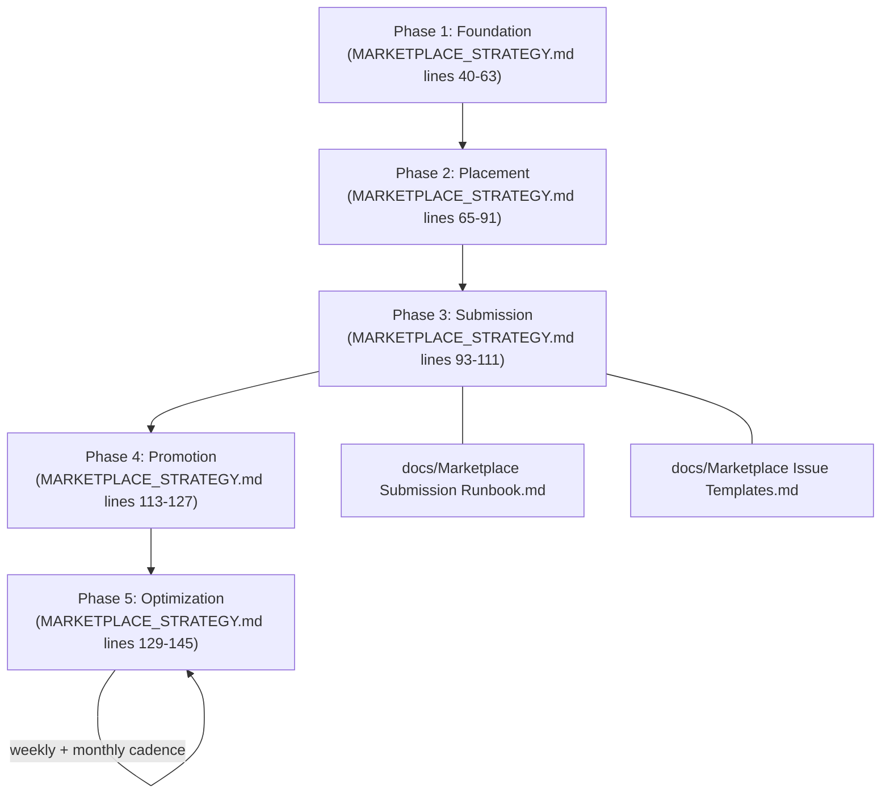
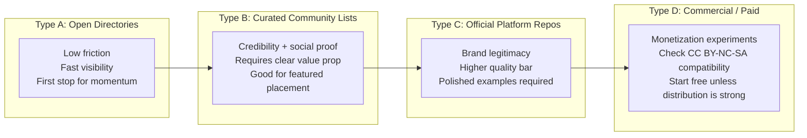
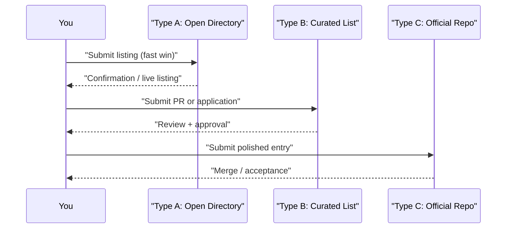
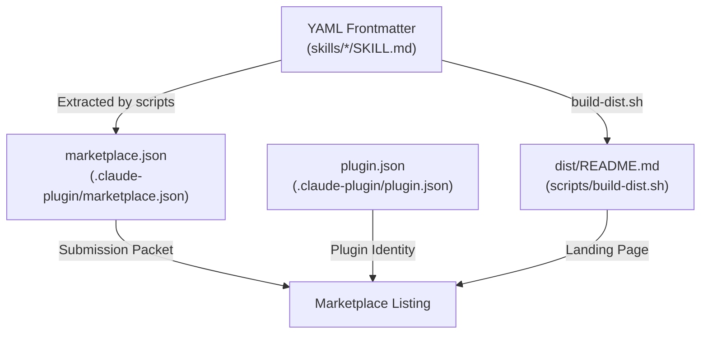
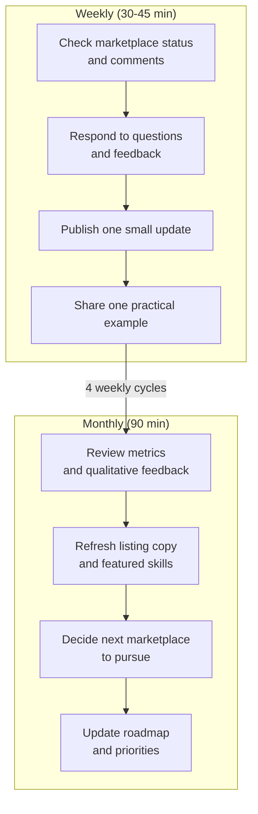

<!-- source: DeepWiki mcp.deepwiki.com · repo deanpeters/Product-Manager-Skills · page 7 Marketplace and Distribution Strategy · fetched 2026-10-26 -->

# Marketplace and Distribution Strategy

Relevant source files

The following files were used as context for generating this wiki page:

- [.claude-plugin/marketplace.json](.claude-plugin/marketplace.json)
- [.claude-plugin/plugin.json](.claude-plugin/plugin.json)
- [.gitignore](.gitignore)
- [LICENSE](LICENSE)
- [MARKETPLACE_STRATEGY.md](MARKETPLACE_STRATEGY.md)
- [docs/Lifecycle and EOL Suite Summary.md](docs/Lifecycle and EOL Suite Summary.md)
- [docs/Marketplace Issue Templates.md](docs/Marketplace Issue Templates.md)
- [docs/Marketplace Submission Runbook.md](docs/Marketplace Submission Runbook.md)
- [docs/announcements/2026-08-10-v0-84-lifecycle-and-eol-suite.md](docs/announcements/2026-08-10-v0-84-lifecycle-and-eol-suite.md)
- [scripts/build-claude-desktop-packs.sh](scripts/build-claude-desktop-packs.sh)
- [scripts/build-dist.sh](scripts/build-dist.sh)
- [skills/incoming-request-advisor/SKILL.md](skills/incoming-request-advisor/SKILL.md)
- [skills/incoming-request-advisor/examples/conversation-flow.md](skills/incoming-request-advisor/examples/conversation-flow.md)
- [skills/incoming-request-advisor/template.md](skills/incoming-request-advisor/template.md)

This page documents the strategy for distributing the Product Manager Skills library across agent marketplaces and community channels. It covers the five-phase rollout plan, the four marketplace type classifications, the reusable submission packet, the recommended submission sequence, and the weekly/monthly operating cadence.

This page is about *outbound distribution of the skill library itself*. For how to package skills into ZIP archives for upload to individual AI platforms, see [Packaging and Distribution](5.4) (`zip-a-skill.sh`, `package-claude-skills.sh`). For how end-users load skills into Claude, ChatGPT, or Codex, see [Integration Guides](4).

---

## Strategy Overview

The strategy is defined in [MARKETPLACE_STRATEGY.md:1-205]() and treats skill library distribution as a repeatable product process. It is organized into five sequential phases:

| Phase | Name | Goal |
|---|---|---|
| 1 | Foundation | Make the library publish-ready |
| 2 | Placement | Select target marketplace types |
| 3 | Submission | Execute listings using a reusable packet |
| 4 | Promotion | Drive discovery through PM channels |
| 5 | Optimization | Measure, iterate, and expand |

A successful rollout produces four outcomes: **Findability**, **Trust**, **Adoption**, and a **Learning loop** [MARKETPLACE_STRATEGY.md:24-29]().

**Five-Phase Strategy Flow**

**Sources:** [MARKETPLACE_STRATEGY.md:30-38](), [docs/Marketplace Submission Runbook.md:1-20]().

---

## Phase 1: Foundation

Before any submission, the library must pass a readiness checklist. This phase is defined in [MARKETPLACE_STRATEGY.md:40-63]().

### Required Assets

| Asset | Notes |
|---|---|
| Clean repository with clear docs | README, skill catalog, and working links |
| Valid skill frontmatter/metadata | Each `SKILL.md` must pass `check-skill-metadata.py` |
| Short and long listing descriptions | Used verbatim in submissions |
| License statement | Repository uses CC BY-NC-SA 4.0 (see `LICENSE`) |
| 3–5 featured skills | Curated entry point for new users |

### Readiness Checklist

- [ ] Skill names are clear and consistent.
- [ ] Descriptions are short, specific, and non-jargony.
- [ ] At least one example exists per highlighted skill.
- [ ] All links in docs work.
- [ ] Installation paths are documented for major tools.
- [ ] Library can be explained in 30 seconds.

**Sources:** [MARKETPLACE_STRATEGY.md:40-63](), [LICENSE:1-14]().

---

## Phase 2: Placement — Marketplace Type Classification

The strategy defines four marketplace types to reason about before committing to specific brands. This avoids over-indexing on any single channel [MARKETPLACE_STRATEGY.md:65-91]().

**Marketplace Type Classification**

| Type | Best For | Friction | When to Use |
|---|---|---|---|
| A — Open Directories | Fast visibility | Low | First submission target |
| B — Curated Community Lists | Credibility, social proof | Medium | After one win from Type A |
| C — Official Platform Repos | Brand legitimacy | High | After library is polished |
| D — Commercial/Paid | Monetization experiments | Variable | After strong distribution baseline |

> **License note:** The repository is licensed under CC BY-NC-SA 4.0 (`LICENSE`). Verify compatibility before submitting to any commercial marketplace (Type D).

**Sources:** [MARKETPLACE_STRATEGY.md:64-91](), [LICENSE:57-68]().

---

## Phase 3: Submission

### Submission Packet

Prepare once and reuse across all marketplace submissions. The packet is defined in [MARKETPLACE_STRATEGY.md:95-103]() and elaborated in [docs/Marketplace Submission Runbook.md:26-36]().

| Component | Constraint |
|---|---|
| One-paragraph description | Plain language; no jargon |
| Short tagline | ≤ ~200 characters |
| 3–5 featured skills | One-line value statement per skill |
| Installation instructions | Must cover at least one major AI platform |
| License statement | CC BY-NC-SA 4.0 |
| Feedback/contact route | Email, GitHub Issues, or community link |

### Recommended Submission Sequence

The three-step sequence intentionally orders submissions from lowest to highest friction:

[MARKETPLACE_STRATEGY.md:105-111]() explicitly requires this sequence to accumulate momentum before entering quality-gated channels.

### Automated Metadata Export

The codebase includes configuration files intended for marketplace ingestion, specifically for the Claude ecosystem:

- **`.claude-plugin/marketplace.json`**: Contains structured metadata for all 77 skills, including `name`, `source` path, `description`, `category`, and `tags` [.claude-plugin/marketplace.json:1-25]().
- **`.claude-plugin/plugin.json`**: Defines the top-level plugin identity, including the current version `0.84` [.claude-plugin/plugin.json:1-8]().

**Metadata to Marketplace Flow**

**Sources:** [MARKETPLACE_STRATEGY.md:93-111](), [.claude-plugin/marketplace.json:1-25](), [scripts/build-dist.sh:48-65]().

---

## Phase 4: Promotion

### High-Leverage Channels

| Channel | Format |
|---|---|
| LinkedIn | Post with one concrete use case |
| PM communities (Slack, Discord, Reddit) | Share where community rules permit |
| Newsletter / Substack | Article with worked examples |
| Demo walkthrough | Screenshots or short video |

### Announcement Message Pattern

Every announcement should follow this four-part structure (defined in [MARKETPLACE_STRATEGY.md:122-127]()):

1. **Problem pain** — what PMs struggle with.
2. **Skill promise** — what the library helps them do faster or better.
3. **Proof** — one real outcome or concrete example.
4. **Action** — one clear install or use step.

**Sources:** [MARKETPLACE_STRATEGY.md:113-127]().

---

## Phase 5: Optimization

This phase operationalizes the strategy as a running product process [MARKETPLACE_STRATEGY.md:129-130]().

### Metrics

**Weekly tracking (small set, tracked consistently):**

| Metric | Signal |
|---|---|
| Profile views / listing impressions | Discoverability health |
| Repo stars / watchers | Interest and trust |
| Installs or usage proxies | Adoption |
| Inbound feedback / issues | Learning loop quality |

**Monthly improvements:**

- Improve weak listing copy.
- Refresh featured skills.
- Add missing examples.
- Remove or merge low-value skills.

**Sources:** [MARKETPLACE_STRATEGY.md:129-145]().

---

## Operating Cadence

The strategy requires a dual-track cadence to ensure the library remains fresh and visible [MARKETPLACE_STRATEGY.md:147-162]().

**Cadence Overview**

**Sources:** [MARKETPLACE_STRATEGY.md:147-162](), [docs/Marketplace Submission Runbook.md:63-90]().

---

## Supporting Documents

Two companion documents in `docs/` provide execution-level details:

| File | Purpose |
|---|---|
| `docs/Marketplace Submission Runbook.md` | Six-step repeatable submission workflow with a tracking table template and Definition of Done per cycle. |
| `docs/Marketplace Issue Templates.md` | Four GitHub Issue templates for tracking curated list PRs, form submissions, metadata updates, and weekly reviews. |

> **Private working notes:** Team-specific notes (credentials, in-progress outreach text, personal execution logs) should be kept in `docs/marketplace/`, which is listed in `.gitignore` and is never committed to the repository [.gitignore:230]().

**Sources:** [MARKETPLACE_STRATEGY.md:180-193](), [.gitignore:230](), [docs/Marketplace Submission Runbook.md:1-96](), [docs/Marketplace Issue Templates.md:1-123]().

---

## Common Mistakes

| Mistake | Fix |
|---|---|
| Listing everywhere at once | Focus on 1–2 channels first, then expand |
| Over-technical copy | Write for the PM reader, not the tool builder |
| No featured entry point | Curate a starter set of 3–5 skills |
| Treating launch as one-and-done | Run the weekly and monthly cadence |
| Waiting for perfection | Ship a clear v1; improve in public |

**Sources:** [MARKETPLACE_STRATEGY.md:163-178]().

---

