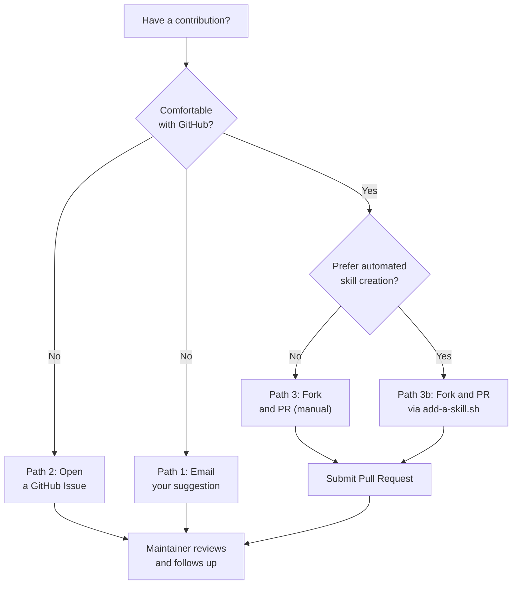
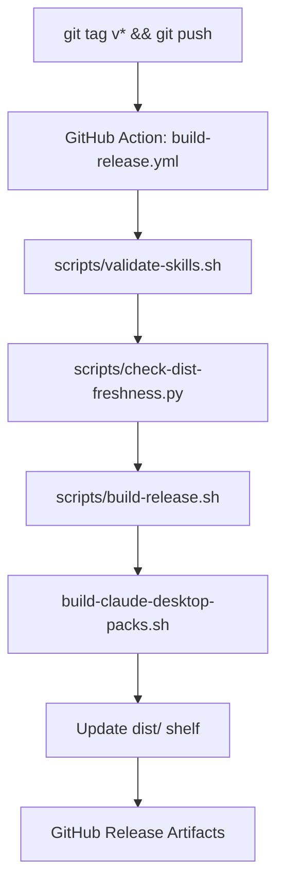
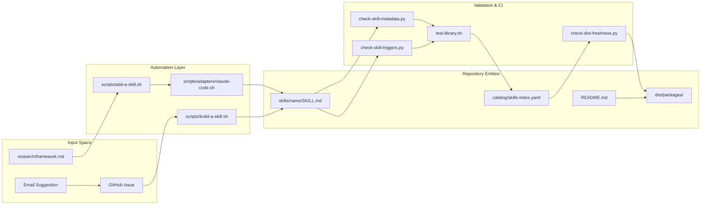

<!-- source: DeepWiki mcp.deepwiki.com · repo deanpeters/Product-Manager-Skills · page 8 Contributing · fetched 2026-10-26 -->

# Contributing

<details>
<summary>Relevant source files</summary>

The following files were used as context for generating this wiki page:

- [.github/workflows/build-release.yml](.github/workflows/build-release.yml)
- [CONTRIBUTING.md](CONTRIBUTING.md)
- [docs/Add-a-Skill Utility Guide.md](docs/Add-a-Skill Utility Guide.md)
- [docs/Building PM Skills.md](docs/Building PM Skills.md)
- [docs/CHANGELOG.md](docs/CHANGELOG.md)
- [docs/RELEASE-PACKAGING.md](docs/RELEASE-PACKAGING.md)
- [scripts/build-a-skill.sh](scripts/build-a-skill.sh)
- [scripts/check-dist-freshness.py](scripts/check-dist-freshness.py)
- [scripts/test-library.sh](scripts/test-library.sh)

</details>


This page covers the contribution process for the Product Manager Skills repository: who can contribute, what contribution paths exist, how to format commits and pull requests, what catalog updates are required, and how the release checklist works.

For information on the skill file format itself, see [Skill Format Reference](#5.1). For the authoring tools (`add-a-skill.sh`, `build-a-skill.sh`, etc.), see [Authoring Tools Reference](#5.3). For the six-phase authoring lifecycle, see [Skill Authoring Workflow](#5.2).

---

## Design Philosophy: ABC (Always Be Coaching)

The repository follows a strict design philosophy where every skill must not only instruct an AI agent but also coach the human PM.

*   **Explain the Why:** Skills must explain the reasoning behind a framework [CONTRIBUTING.md:16-16]().
*   **Name Failure Modes:** Readers should be able to recognize failure modes in the wild [CONTRIBUTING.md:17-17]().
*   **No `$ARGUMENTS`:** We deliberately avoid Claude Code's `$ARGUMENTS` syntax to maintain portability across Claude Web, Codex, and the Streamlit playground. Instead, we use a plain-language `## Input` section [CONTRIBUTING.md:23-31]().
*   **Opinionated Guidance:** We take stances rather than just listing options [CONTRIBUTING.md:75-75]().

Sources: [CONTRIBUTING.md:7-31](), [CONTRIBUTING.md:74-77]()

---

## Who Can Contribute

Contribution is open to anyone. Technical GitHub experience is not required.

| Contribution Type | Suitable For |
|---|---|
| New skill (PM framework) | PMs with a repeatable framework not yet in the catalog |
| Improvement to existing skill | Anyone who finds an error, gap, or unclear section |
| Feedback / suggestion | Anyone — open an issue and describe the idea |

**Out of scope** (contributions that will not be accepted):
- One-off advice or tips (these should be prompts, not skills) [CONTRIBUTING.md:58-58]().
- Company-specific processes [CONTRIBUTING.md:59-59]().
- Overly complex or academic frameworks [CONTRIBUTING.md:60-60]().

Sources: [CONTRIBUTING.md:35-61](), [docs/Building PM Skills.md:67-76]()

---

## Three Contribution Paths

**Contribution Decision Flow**



Sources: [CONTRIBUTING.md:91-133]()

### Path 1 — Email Suggestion
Write the framework in any document format (Google Docs, Word, plain text) and email it. The maintainer handles formatting [CONTRIBUTING.md:95-98]().

### Path 2 — GitHub Issue
1. Navigate to the [Issues tab](https://github.com/deanpeters/Product-Manager-Skills/issues).
2. Click **New Issue**.
3. For new skills: describe the framework and when a PM would use it.
4. For improvements: name the skill, the section, and what is wrong or unclear [CONTRIBUTING.md:100-106]().

### Path 3 — Fork and Pull Request
**Manual fork-and-PR flow:**
```bash
git clone https://github.com/YOUR-USERNAME/Product-Manager-Skills.git
cd Product-Manager-Skills
git checkout -b add-skill-name
# ... make changes ...
git add .
git commit -m "Add [skill-name] skill"
git push origin add-skill-name
# Then open a PR on GitHub
```
Sources: [CONTRIBUTING.md:112-133]()

**Automated fork-and-PR flow via `add-a-skill.sh`:**
```bash
# From a file
./scripts/add-a-skill.sh research/your-framework.md

# From clipboard (macOS)
pbpaste | ./scripts/add-a-skill.sh

# List available AI adapters
./scripts/add-a-skill.sh --list-agents
```
Sources: [CONTRIBUTING.md:139-161](), [docs/Add-a-Skill Utility Guide.md:41-56]()

---

## Commit Message Conventions

**Format:** Imperative voice subject line, optionally followed by an issue tag and em dash context note.

```text
Add agent-orchestration-advisor skill
Fix user-story frontmatter description length — closes #42
Update README skill counts for v0.84 release
```

| Rule | Detail |
|---|---|
| Voice | Imperative ("Add", "Fix", "Update") |
| Subject | Clear, specific — name the skill or file changed |
| Issue tag | Optional; append after em dash (e.g., `— closes #42`) |

Sources: [CONTRIBUTING.md:124-128]()

---

## Pull Request Requirements

Every PR should include:

| Element | Requirement |
|---|---|
| Summary | Short description of what changed and why |
| Issue link | Reference the related issue if one exists |
| Skill type label | State whether the addition is `component`, `interactive`, or `workflow` |
| Catalog update | `README.md` and `catalog/` must be updated if a skill is added |

**Validation before PR:**
Contributors should run the full library test suite to ensure no regressions or metadata errors:
```bash
./scripts/test-library.sh --smoke
```
Sources: [scripts/test-library.sh:1-12](), [docs/RELEASE-PACKAGING.md:159-159]()

---

## Catalog Update Obligations

When adding a new skill, the `README.md` catalog and `catalog/` directory **must** be updated.

**What to update:**
1. **Skill count:** Increment the total and per-tier counts in `README.md` and `catalog/skills-index.yaml` [scripts/check-dist-freshness.py:64-82]().
2. **Skill table:** Add the new skill to the correct section (Component / Interactive / Workflow), in alphabetical order.
3. **Regenerate Catalog:** Run `python3 scripts/generate-catalog.py` to sync the YAML index [scripts/check-dist-freshness.py:35-39]().
4. **Build Dist:** Run `bash scripts/build-dist.sh` to update the `dist/` shelf [docs/RELEASE-PACKAGING.md:159-159]().

Sources: [docs/RELEASE-PACKAGING.md:154-162](), [scripts/check-dist-freshness.py:35-39]()

---

## Quality Checklist Before Submitting

**Automated checks** (`scripts/check-skill-metadata.py`):
- YAML frontmatter valid [docs/Add-a-Skill Utility Guide.md:198-198]().
- `name` field length ≤ 64 characters [docs/Add-a-Skill Utility Guide.md:199-199]().
- `description` field length ≤ 200 characters [docs/Add-a-Skill Utility Guide.md:200-200]().
- `type` field value is `component`, `interactive`, or `workflow` [docs/Add-a-Skill Utility Guide.md:202-202]().

**Human judgment checks:**
- **Zero fluff:** Every word must earn its keep [CONTRIBUTING.md:76-76]().
- **Pedagogy:** Does the skill teach the human PM the "why"? [CONTRIBUTING.md:9-11]().
- **Examples:** Include at least one strong example and one explicit anti-pattern [docs/Building PM Skills.md:95-95]().
- **Fictional Universes:** Use established fictional universes (Fieldlight, Northfield Automation, Corvid) for examples [docs/Building PM Skills.md:130-130]().

Sources: [docs/Building PM Skills.md:124-136](), [CONTRIBUTING.md:15-21]()

---

## Release Process

The release process is triggered by pushing a version tag (e.g., `v0.84`).

**Release Automation Flow**

Sources: [.github/workflows/build-release.yml:1-59](), [docs/RELEASE-PACKAGING.md:48-58]()

### Maintainer Checklist
- Run `python3 scripts/generate-catalog.py` [docs/RELEASE-PACKAGING.md:159-159]().
- Run `bash scripts/build-dist.sh` to refresh the committed `dist/` shelf [docs/RELEASE-PACKAGING.md:154-154]().
- Run `python3 scripts/check-dist-freshness.py` to ensure no drift [scripts/test-library.sh:77-78]().

---

## Security and Safety Requirements

- **No Secrets:** Skills must not request API keys or credentials.
- **Deterministic Scripts:** If a skill includes a script in `skills/<skill-name>/scripts/`, it must avoid network calls and produce consistent output [docs/Building PM Skills.md:139-143]().
- **Safety Review:** Maintainers must review any embedded scripts before merging to ensure they are not destructive [docs/RELEASE-PACKAGING.md:141-141]().

Sources: [docs/Building PM Skills.md:137-143](), [docs/RELEASE-PACKAGING.md:140-143]()

---

## Contribution Path → Code Entity Map

The diagram below maps each contribution path to the specific scripts and files it touches.


Sources: [scripts/test-library.sh:1-84](), [scripts/add-a-skill.sh:1-24](), [scripts/check-dist-freshness.py:1-21]()

---

