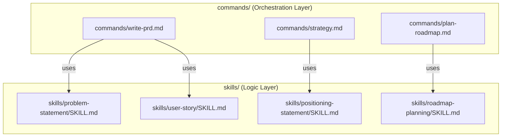
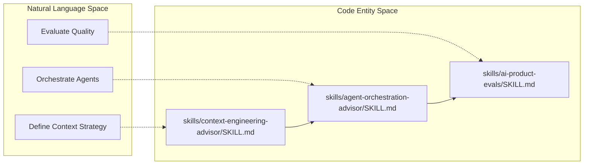

<!-- source: DeepWiki mcp.deepwiki.com · repo deanpeters/Product-Manager-Skills · page 9 Development Roadmap · fetched 2026-10-26 -->

# Development Roadmap

<details>
<summary>Relevant source files</summary>

The following files were used as context for generating this wiki page:

- [09AUG26.md](09AUG26.md)
- [10AUG26.md](10AUG26.md)
- [15MAY26.md](15MAY26.md)
- [17JUL26.md](17JUL26.md)
- [26APR26.md](26APR26.md)
- [PLANS.md](PLANS.md)
- [app/STREAMLIT_INTERFACE.md](app/STREAMLIT_INTERFACE.md)
- [app/main.py](app/main.py)
- [docs/Finance Suite Summary.md](docs/Finance Suite Summary.md)
- [docs/announcements/2026-03-09-v0-7-skill-quality-trigger-clarity.md](docs/announcements/2026-03-09-v0-7-skill-quality-trigger-clarity.md)
- [docs/announcements/README.md](docs/announcements/README.md)
- [docs/maintenance/2026-08-09-eol-suite-plan.md](docs/maintenance/2026-08-09-eol-suite-plan.md)
- [research/Context Engineering for Product Managers.md](research/Context Engineering for Product Managers.md)
- [research/deanpeters-substack-posts.zip](research/deanpeters-substack-posts.zip)
- [research/v080-ai-product-builder-execution-brief.md](research/v080-ai-product-builder-execution-brief.md)
- [skills/altitude-horizon-framework/template.md](skills/altitude-horizon-framework/template.md)

</details>


## Purpose and Scope

This page documents the phased development plan for the Product Manager Skills repository, as recorded in `PLANS.md` and the release files under `docs/announcements/`. It covers the history of completed development phases, the repository restructuring that standardized the `SKILL.md` format, the v0.4 through v0.84 release changelog, and the planned AI PM Orchestrator skill set.

For the three-tier architecture (Component → Interactive → Workflow) that all phases build toward, see [Three-Tier Skill Architecture](#1.1). For the current skill catalog produced by these phases, see [Skill Catalog](#2). For the tooling used during skill development, see [Authoring Tools Reference](#5.3). For the Streamlit playground introduced in v0.5, see [Streamlit Playground](#6).

---

## Overall Status

| Item | Value |
|------|-------|
| `PLANS.md` last updated | 2026-03-06 |
| Current release | v0.84 (Lifecycle & EOL Suite) |
| Total skills shipped | 77 |
| Phases complete | 1, 2, 3, 4, 5, 6, 7 |
| Current Theme | `eol-transition` |

Sources: [PLANS.md:1-6](), [10AUG26.md:11-12]()

---

## Repository Structural Change (Feb 5, 2026)

The repository layout was restructured from type-grouped subdirectories to a flat, skill-name-based layout to ensure compatibility with `~/.claude/skills/` and the Anthropic agent skills tooling standard [PLANS.md:113-127]().

**Before restructuring:**
```
skills/
├── components/user-story.md
├── interactive/positioning-workshop.md
└── workflows/product-strategy-session.md
```

**After restructuring (canonical form):**
```
skills/
├── user-story/SKILL.md
├── positioning-workshop/SKILL.md
└── product-strategy-session/SKILL.md
```

Each `SKILL.md` file now begins with a mandatory YAML frontmatter block [PLANS.md:135-142]():
```yaml
---
name: skill-name         # must match directory name exactly (lowercase kebab-case)
description: "..."       # up to 200 characters
type: component|interactive|workflow
---
```

Sources: [PLANS.md:113-144]()

---

## Completed Phases (v0.1 - v0.6)

The initial roadmap focused on establishing the core library and navigation tools.

| Phase | Goal | Status |
|-------|------|--------|
| 1 | Operating Model (Standardized `SKILL.md`) | ✅ Complete |
| 2 | Navigation System (`scripts/find-a-command.sh`) | ✅ Complete |
| 3 | Fast Onboarding (`START_HERE.md`) | ✅ Complete |
| 4 | Commands v1 (Orchestration wrappers) | ✅ Complete |
| 5 | Tooling + Validation (`scripts/check-command-metadata.py`) | ✅ Complete |
| 6 | Documentation Consolidation | ✅ Complete |

Sources: [PLANS.md:13-60]()

---

## Recent Release History (v0.80 - v0.84)

### v0.80 — AI Product Builder Track
Released May 15, 2026. This release introduced 9 skills designed to help PMs build with AI without outsourcing judgment [research/v080-ai-product-builder-execution-brief.md:1-12]().
- **Theme:** `ai-product-builder`
- **Key Skills:** `ai-product-sense`, `vibe-coding-guardrails`, `ai-evals-for-product-managers` [research/v080-ai-product-builder-execution-brief.md:88-100]().

### v0.83 — Market Intelligence Suite
Released July 17, 2026. Added 14 new skills under the `market-intelligence` theme [17JUL26.md:31-32]().
- **Protocol Skill:** `autonomous-investigation` (established Fact/Inference/Assumption labeling) [17JUL26.md:33-34]().
- **Backbone:** `intelligence-collection-disciplines` (OSINT, FININT, etc.) [17JUL26.md:34-35]().

### v0.84 — Lifecycle & EOL Suite
Released August 10, 2026. Added 7 new skills focused on product sunsetting [10AUG26.md:11-12]().
- **Standardized Gates:** NSC, EOS, EOE, EOM, EOL, EOSRV [10AUG26.md:80-83]().
- **Right-Sizing:** Level 1 (Light), Level 2 (Standard), Level 3 (Heavy) [10AUG26.md:70-73]().

---

## Skill Dependency Graph

The following diagram illustrates how the command layer orchestrates the underlying skill entities.

**Command-to-Skill Orchestration Graph:**



Sources: [PLANS.md:37-44](), [15MAY26.md:92-100]()

---

## Phase 7: Planned AI PM Orchestrator Skills

Phase 7 (currently in progress) focuses on the "AI Product Builder" track and advanced agentic orchestration.

| Skill directory | Type | Purpose |
|----------------|------|---------|
| `context-engineering-advisor` | interactive | Diagnose context stuffing vs. engineering; guide memory architecture [PLANS.md:106-107](). |
| `agent-orchestration-advisor` | interactive | Breaking complex tasks into multi-step agentic workflows [PLANS.md:406-407](). |
| `ai-product-evals` | component | Frameworks for Golden Datasets and LLM-as-Judge [PLANS.md:408-409](). |
| `ai-observability-framework` | component | Tracing, logging, and error analysis in AI products [PLANS.md:410-411](). |
| `ai-maintenance-planning` | component | Planning for model drift and updates [PLANS.md:412-413](). |

**Planned Orchestration Chain:**



Sources: [PLANS.md:392-414](), [15MAY26.md:189-192]()

---

## Upcoming Automation Tooling

The roadmap includes the following improvements to the repository's developer experience and distribution pipeline:

1.  **Streamlit Command Mode:** Adding command browsing and execution progress to the Streamlit beta [PLANS.md:61-64]().
2.  **Release Packaging Automation:** `scripts/build-release.sh` to generate ZIP packs for Claude Desktop and Codex [26APR26.md:249-255]().
3.  **Freshness Guards:** `check-dist-freshness.py` to ensure `dist/` artifacts remain in sync with `skills/` canonical source [10AUG26.md:150-153]().

Sources: [PLANS.md:61-64](), [26APR26.md:1-20](), [10AUG26.md:148-153]()

---

