# Page: Overview

# Overview

<details>
<summary>Relevant source files</summary>

The following files were used as context for generating this wiki page:

- [.claude-plugin/marketplace.json](.claude-plugin/marketplace.json)
- [CLAUDE.md](CLAUDE.md)
- [README.md](README.md)
- [catalog/skills-by-type.md](catalog/skills-by-type.md)
- [catalog/skills-index.yaml](catalog/skills-index.yaml)
- [docs/announcements/2026-07-08-v0-82-inbound-requests-and-dist-shelf.md](docs/announcements/2026-07-08-v0-82-inbound-requests-and-dist-shelf.md)
- [skills/company-intel/SKILL.md](skills/company-intel/SKILL.md)
- [skills/derisk-measurement-advisor/SKILL.md](skills/derisk-measurement-advisor/SKILL.md)
- [skills/incoming-request-advisor/SKILL.md](skills/incoming-request-advisor/SKILL.md)
- [skills/incoming-request-advisor/examples/conversation-flow.md](skills/incoming-request-advisor/examples/conversation-flow.md)
- [skills/incoming-request-advisor/template.md](skills/incoming-request-advisor/template.md)

</details>


This page introduces the Product Manager Skills repository: its purpose, the problem it solves, how skills are structured, and how AI agents consume them. For a detailed breakdown of the three-tier dependency model, see [Three-Tier Skill Architecture](#1.1). For the full directory layout, see [Repository Structure](#1.2). For a catalog of all skills by tier, see [Skill Catalog](#2).

---

## What This Repository Is

The Product Manager Skills repository is a collection of **77 structured Markdown files** that encode product management frameworks in a format readable by AI agents. Rather than prompting an agent from scratch each time, a practitioner loads one or more skill files into an agent's context, then invokes the skill by name. The agent executes the framework—asking questions, generating artifacts, or orchestrating multi-phase processes—without the user re-explaining the methodology.

Each skill is a single file, `SKILL.md`, stored in its own lowercase kebab-case directory under `skills/`. Every file contains YAML frontmatter declaring its `name`, `description`, `type`, and metadata like `theme` or `estimated_time`, followed by six standard Markdown sections.

**Minimal skill frontmatter:**
[skills/derisk-measurement-advisor/SKILL.md:1-25]()
```yaml
---
name: derisk-measurement-advisor
description: Identify what to measure, test, or track to de-risk a product or AI idea.
type: interactive
theme: validation-experiments
estimated_time: "15-20 min"
---
```

Skills are organized into three types that form a strict dependency hierarchy: **Component**, **Interactive**, and **Workflow**. No circular dependencies are permitted; the direction is always Component ← Interactive ← Workflow.

Sources: [README.md:24-34](), [CLAUDE.md:9-16](), [catalog/skills-index.yaml:1-13]()

---

## The Problem This Solves

| Without Skills | With Skills |
|---|---|
| Re-explain the framework every session | Agent loads `SKILL.md` once and knows the protocol |
| Generic output from vague prompts | Structured output from encoded methodology |
| Inconsistent results across team members | Repeatable, predictable artifacts |
| Manual orchestration of multi-step processes | Workflow skills handle phase sequencing |

The repository targets AI agents that can read structured knowledge: Claude Code, Claude Desktop/Web, OpenAI Codex, ChatGPT, Gemini, and any agent supporting file-based context loading. The goal is dual: **functional** (equipping agents to do PM work) and **pedagogic** (teaching humans the reasoning behind frameworks).

Sources: [README.md:28-36](), [CLAUDE.md:1-3]()

---

## Three-Tier Skill Architecture

Skills form a three-tier dependency hierarchy. Higher tiers orchestrate lower tiers; lower tiers never reference upward. As of v0.84, the library contains 77 skills across these tiers.

**Three-Tier Dependency Hierarchy**

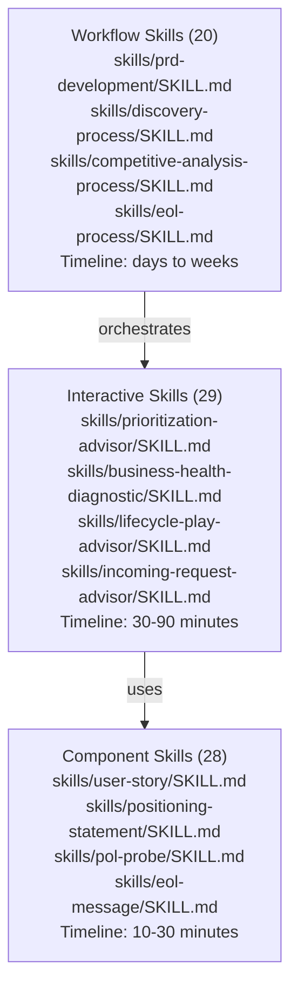

Sources: [CLAUDE.md:11-14](), [catalog/skills-by-type.md:5-130]()

| Tier | Count | Characteristics | Example |
|---|---|---|---|
| **Component** | 28 | Self-contained artifact templates; no external skill dependencies | `skills/user-story/SKILL.md` produces a user story with Gherkin criteria |
| **Interactive** | 29 | Multi-turn Q&A flows; ask 3–5 questions, then apply Component skills | `skills/incoming-request-advisor/SKILL.md` decodes Slack pings into JTBD |
| **Workflow** | 20 | End-to-end multi-phase processes; reference both Component and Interactive skills | `skills/competitive-analysis-process/SKILL.md` orchestrates a 6-step analysis |

Sources: [CLAUDE.md:11-14](), [skills/incoming-request-advisor/SKILL.md:1-25](), [catalog/skills-index.yaml:113-122]()

---

## Repository Layout

**Top-Level Directory Structure**

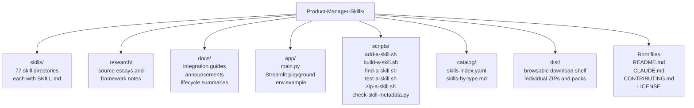

Sources: [CLAUDE.md:9-16](), [docs/announcements/2026-07-08-v0-82-inbound-requests-and-dist-shelf.md:19-25]()

Each skill follows a flat directory pattern. The `SKILL.md` filename is case-sensitive and required for compatibility. The folder name must exactly match the `name` field in YAML frontmatter.

Sources: [CLAUDE.md:16](), [docs/announcements/2026-07-08-v0-82-inbound-requests-and-dist-shelf.md:41-42]()

---

## How AI Agents Consume Skills

**Agent Integration Paths**

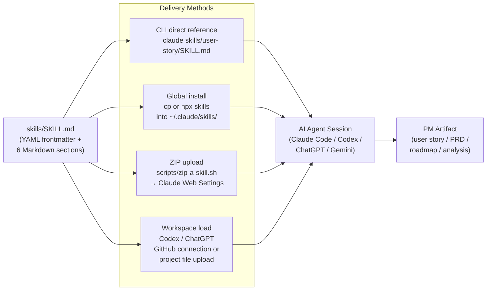

Sources: [docs/announcements/2026-07-08-v0-82-inbound-requests-and-dist-shelf.md:33-38](), [CLAUDE.md:3-5]()

For step-by-step instructions by agent platform, see [Using Skills with Claude](#4.1), [Using Skills with OpenAI Codex](#4.2), and [Using Skills with ChatGPT](#4.3).

---

## Skill File Internal Structure

Every `SKILL.md` file follows the same six-section body, preceded by YAML frontmatter:

| Section | Purpose |
|---|---|
| `## Purpose` | What the skill does and when to use it |
| `## Key Concepts` | Core frameworks, definitions, anti-patterns |
| `## Application` | Step-by-step instructions with examples |
| `## Examples` | Real-world cases (Fieldlight, Northfield, Brightwater) |
| `## Common Pitfalls` | What to avoid and why |
| `## References` | Related skills and external frameworks cited |

The `name` field must be ≤ 64 characters; `description` must be ≤ 200 characters. v0.84 skills also include three standard example universes: **Fieldlight** (B2B SaaS), **Northfield Automation** (Industrial/Hardware), and **Brightwater Biologics** (Life Sciences).

Sources: [CLAUDE.md:18-19](), [skills/derisk-measurement-advisor/SKILL.md:27-124]()

---

## Tooling Overview

The `scripts/` directory contains utilities that support skill authoring, search, testing, and packaging:

| Script | Role |
|---|---|
| `scripts/add-a-skill.sh` | AI-assisted skill generation from a file or clipboard input |
| `scripts/build-a-skill.sh` | Interactive wizard that prompts section-by-section |
| `scripts/find-a-skill.sh` | Ranked keyword/type search across existing skills |
| `scripts/test-a-skill.sh` | Conformance checks and optional smoke tests |
| `scripts/zip-a-skill.sh` | Builds upload-ready `.zip` files by skill, type, or preset |
| `scripts/check-skill-metadata.py` | Strict YAML frontmatter validation |

The Streamlit playground at `app/main.py` provides a local browser UI for browsing and running skills interactively. v0.82 introduced the `dist/` shelf, providing a browsable directory of pre-packaged ZIPs for non-technical users.

Sources: [docs/announcements/2026-07-08-v0-82-inbound-requests-and-dist-shelf.md:19-25](), [CLAUDE.md:37-42]()

---

## Quick-Start Paths by Audience

| Goal | Starting Point |
|---|---|
| Use an existing skill with Claude Code | `cd` into the repo; run `claude "Using skills/user-story/SKILL.md, write stories for..."` |
| Load skills into Claude Web | Navigate to `dist/`, download a pack ZIP, upload via Claude Settings → Capabilities → Skills |
| Browse and test skills locally | `pip install -r app/requirements.txt` then `streamlit run app/main.py` |
| Create a new skill | Run `scripts/add-a-skill.sh research/your-notes.md` or `scripts/build-a-skill.sh` |
| Find the right skill for a task | Run `scripts/find-a-skill.sh --keyword pricing --type interactive` |
| Triage a stakeholder request | Use `skills/incoming-request-advisor/SKILL.md` |

Sources: [docs/announcements/2026-07-08-v0-82-inbound-requests-and-dist-shelf.md:33-38](), [skills/incoming-request-advisor/SKILL.md:20-25]()

---

## Version History Summary

| Version | Date | Key Changes |
|---|---|---|
| v0.84 | Aug 10, 2026 | **Lifecycle & EOL Suite** (8 skills); 77 total skills; full adornment with Fieldlight/Northfield/Brightwater examples. |
| v0.83 | Jul 17, 2026 | **Market Intelligence Suite** (12 skills); autonomous-investigation protocol; library at 69 skills. |
| v0.82 | Jul 8, 2026 | `incoming-request-advisor` added; `dist/` browsable download shelf established; 56 total skills. |

Sources: [CLAUDE.md:7-42](), [docs/announcements/2026-07-08-v0-82-inbound-requests-and-dist-shelf.md:1-28]()

---

## License

CC BY-NC-SA 4.0 — non-commercial use with share-alike. See `LICENSE` for full terms.

Sources: [README.md:20](), [CLAUDE.md:15]()

---

# Page: Three-Tier Skill Architecture

# Three-Tier Skill Architecture

<details>
<summary>Relevant source files</summary>

The following files were used as context for generating this wiki page:

- [CLAUDE.md](CLAUDE.md)
- [CONTRIBUTING.md](CONTRIBUTING.md)
- [README.md](README.md)
- [catalog/skills-by-type.md](catalog/skills-by-type.md)
- [catalog/skills-index.yaml](catalog/skills-index.yaml)
- [docs/Add-a-Skill Utility Guide.md](docs/Add-a-Skill Utility Guide.md)
- [docs/Building PM Skills.md](docs/Building PM Skills.md)
- [docs/CHANGELOG.md](docs/CHANGELOG.md)
- [docs/announcements/2026-07-08-v0-82-inbound-requests-and-dist-shelf.md](docs/announcements/2026-07-08-v0-82-inbound-requests-and-dist-shelf.md)
- [scripts/build-a-skill.sh](scripts/build-a-skill.sh)
- [skills/company-intel/SKILL.md](skills/company-intel/SKILL.md)
- [skills/derisk-measurement-advisor/SKILL.md](skills/derisk-measurement-advisor/SKILL.md)

</details>


This page defines the dependency hierarchy that governs how the **77 skills** in this repository relate to each other. It covers each tier's responsibilities, constraints, time expectations, and the no-circular-dependency rule that enforces clean skill composition.

For a complete listing of every skill organized by tier, see [Skill Catalog](#2). For the file format that declares a skill's tier, see [Skill Format Reference](#5.1). For the process of creating a skill that conforms to these rules, see [Skill Authoring Workflow](#5.2).

---

## Architecture Overview

Every skill belongs to exactly one of three tiers. The tiers form a strict upward-only dependency chain: higher tiers orchestrate lower tiers; lower tiers never reference higher ones.

| Tier | `type` value in frontmatter | Count | Typical time | Role |
|------|-----------------------------|-------|-------------|------|
| Component | `component` | 28 | 10–30 min | Artifact template; self-contained deliverable format |
| Interactive | `interactive` | 29 | 30–90 min | Multi-turn Q&A; gathers context, issues recommendations |
| Workflow | `workflow` | 20 | Days to weeks | End-to-end process; orchestrates the two lower tiers |

The `type` field in each `SKILL.md` frontmatter is the authoritative declaration of a skill's tier. 

**Three-Tier Dependency Flow**

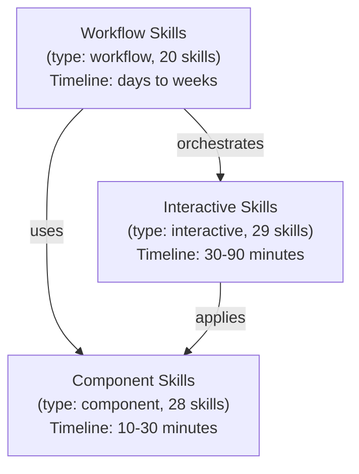

Sources: [README.md:17-20](), [CLAUDE.md:12-14](), [docs/Building PM Skills.md:79-84]()

---

## Tier 1: Component Skills

Component skills are self-contained artifact templates. Each one teaches an AI agent how to produce a single, well-structured PM deliverable or look up specific reference data.

**Characteristics:**

- Focused on "how to create X correctly" — not on gathering context or sequencing steps.
- Includes template structure, quality criteria, examples, and common pitfalls.
- No dependency on Interactive or Workflow skills.
- Consumed by Interactive and Workflow skills as execution targets.

**Representative examples:**

| Skill folder | Deliverable produced |
|---|---|
| `skills/user-story/` | User story with Mike Cohn format and Gherkin acceptance criteria |
| `skills/positioning-statement/` | Geoffrey Moore positioning statement |
| `skills/pol-probe/` | Proof of Life validation experiment definition |
| `skills/finance-metrics-quickref/` | SaaS finance metrics, formulas, and benchmarks |
| `skills/eol-message/` | Right-sized End-of-Life announcement comms |

Sources: [CLAUDE.md:12](), [catalog/skills-by-type.md:5-62](), [docs/Building PM Skills.md:81]()

---

## Tier 2: Interactive Skills

Interactive skills run a bounded multi-turn conversation — typically 3–5 questions — to gather context, then issue a ranked set of concrete recommendations. They frequently end by invoking a Component skill to produce a deliverable.

**Characteristics:**

- One question (or small batch) at a time; answers inform subsequent questions.
- Presents 3–5 enumerated, context-aware recommendations after the Q&A phase.
- Supports three canonical entry modes: **Guided**, **Context dump**, and **Best guess**.
- May reference Component skills as output targets, but never Workflow skills.

**Canonical question-flow pattern:**

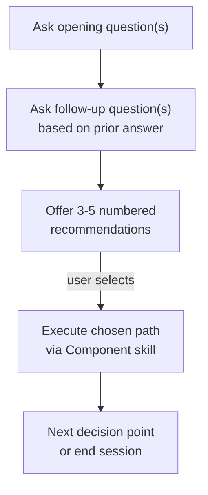

**Representative examples:**

| Skill folder | Context gathered | Recommendation type |
|---|---|---|
| `skills/prioritization-advisor/` | Product stage, team size, data availability | RICE, ICE, Kano, or other framework |
| `skills/acquisition-channel-advisor/` | Unit economics, CAC, LTV | Scale, test, or kill a growth channel |
| `skills/derisk-measurement-advisor/` | AI/Product idea, stage | Risk register (Act now vs. Watch) |
| `skills/lifecycle-play-advisor/` | Product stage, trigger, pressure source | Extend, Replace, Retire, or "Nothing yet" |

Sources: [CLAUDE.md:13](), [catalog/skills-by-type.md:64-122](), [skills/derisk-measurement-advisor/SKILL.md:27-31](), [skills/lifecycle-play-advisor/SKILL.md:25]()

---

## Tier 3: Workflow Skills

Workflow skills represent complete end-to-end PM processes. They define multi-phase sequences with decision points, delegate context-gathering to Interactive skills, and delegate artifact production to Component skills.

**Characteristics:**

- Span multiple sessions (days to weeks of real work).
- Include explicit phase structure (e.g., Frame → Research → Synthesize → Validate).
- Reference both Interactive and Component skills by name.
- Contain decision points that branch based on what was learned in prior phases.

**Representative examples:**

| Skill folder | What it orchestrates | Timeline |
|---|---|---|
| `skills/product-strategy-session/` | positioning → problem framing → roadmap | 2–4 weeks |
| `skills/discovery-process/` | frame → research → synthesize → validate | 3–4 weeks |
| `skills/competitive-analysis-process/` | landscape → comparison → strategic direction | 6-step umbrella |
| `skills/autonomous-investigation/` | search-plan → evidence labeling → diffable outputs | Protocol skill |
| `skills/eol-process/` | Prepare → Notify → Execute → Close | 6-phase sunset |

Sources: [CLAUDE.md:14](), [catalog/skills-by-type.md:124-165](), [skills/company-intel/SKILL.md:14](), [skills/competitive-analysis-process/SKILL.md:118]()

---

## Dependency Rules

The three-tier architecture enforces a strict no-circular-dependency rule. Allowed reference directions are summarized below.

| Skill tier | May reference | May NOT reference |
|---|---|---|
| `component` | Nothing | `interactive`, `workflow` |
| `interactive` | `component` | `workflow` |
| `workflow` | `component`, `interactive` | Nothing forbidden, but no cycles |

No skill at any tier may create a cycle (A references B, B references A).

**Allowed and Forbidden Reference Directions**

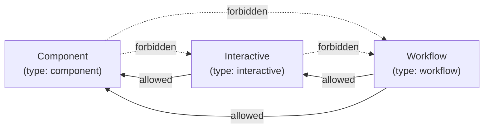

Sources: [docs/Building PM Skills.md:79-84](), [CONTRIBUTING.md:77]()

---

## Concrete Skill-Entity Dependency Graph

The following diagram maps real `SKILL.md` file entities to their dependency relationships for representative cross-tier suites, such as Market Intelligence and Lifecycle/EOL.

**Cross-Tier Suite Dependencies (Code Entity Space)**

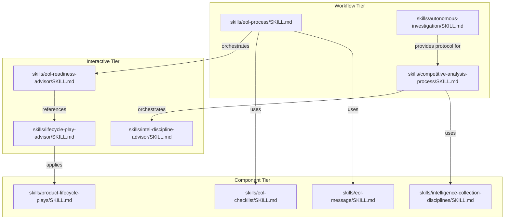

Sources: [CLAUDE.md:21-31](), [CLAUDE.md:35-42](), [README.md:76-84]()

---

## How the YAML `type` Field Encodes Tier

Every `SKILL.md` file begins with a YAML frontmatter block. The `type` field is what the tooling (scripts like `check-skill-metadata.py` and `add-a-skill.sh`) reads to classify a skill into its tier.

**`type` Field Values Mapped to Repository Tiers**

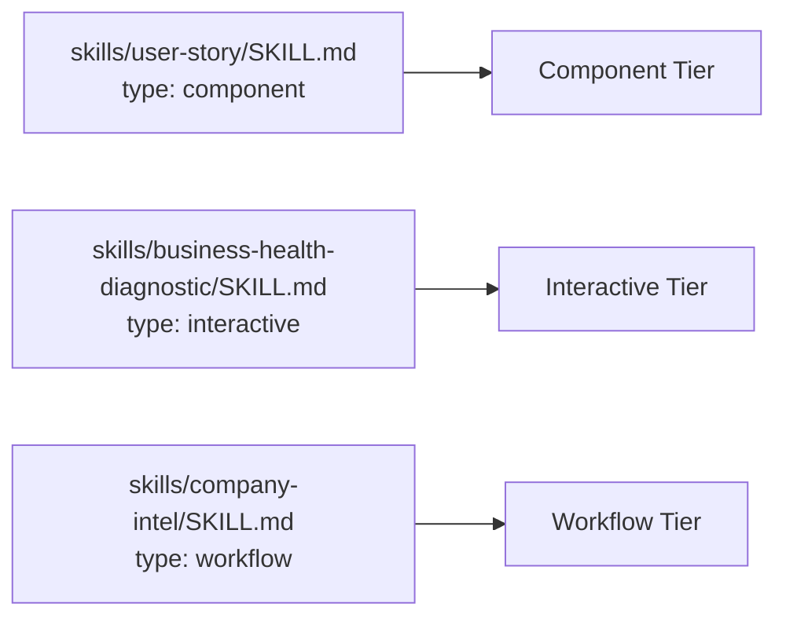

The three accepted values for `type` are: `component`, `interactive`, and `workflow`. Any other value causes `scripts/check-skill-metadata.py` to reject the skill. 

Sources: [docs/Building PM Skills.md:102-107](), [docs/Add-a-Skill Utility Guide.md:197-202](), [scripts/build-a-skill.sh:167-184]()

---

# Page: Repository Structure

# Repository Structure

<details>
<summary>Relevant source files</summary>

The following files were used as context for generating this wiki page:

- [AGENTS.md](AGENTS.md)
- [CLAUDE.md](CLAUDE.md)
- [CONTRIBUTING.md](CONTRIBUTING.md)
- [README.md](README.md)
- [docs/Add-a-Skill Utility Guide.md](docs/Add-a-Skill Utility Guide.md)
- [docs/Building PM Skills.md](docs/Building PM Skills.md)
- [docs/CHANGELOG.md](docs/CHANGELOG.md)
- [scripts/build-a-skill.sh](scripts/build-a-skill.sh)

</details>


This page documents the physical layout of the Product Manager Skills repository: directory organization, file naming conventions, and the design principles that govern how content is stored and consumed. For information about the logical relationships between skill types (Component, Interactive, Workflow), see [Three-Tier Skill Architecture](#1.1). For a complete catalog of individual skills, see [Skill Catalog](#2).

---

## Design Principle: Markdown-First, No Build System

The repository is intentionally buildless. Every skill is a standalone Markdown file that an AI agent can read directly. There is no compilation step, no dependency graph to resolve, and no runtime required to consume skill content. As stated in `AGENTS.md`:

> "This is a Markdown-first repository with lightweight validation and packaging scripts." [AGENTS.md:33-33]()

This design choice means any AI agent that can read structured text can consume skills without complex tooling. The only exception is the optional Streamlit playground under `app/`, which requires a Python environment. The repository prioritizes **Pedagogy and Practicality**, ensuring skills teach human PMs the *why* while instructing agents on the *how* [AGENTS.md:3-7]().

Sources: [AGENTS.md:3-7](), [AGENTS.md:33-33]()

---

## Top-Level Directory Layout

```
Product-Manager-Skills/
├── skills/           # All 77 skill definitions
├── research/         # Source essays and reference materials
├── docs/             # Usage guides and integration documentation
├── app/              # Streamlit (beta) local playground
├── scripts/          # Authoring, validation, and packaging tools
├── commands/         # Reusable orchestration workflows
├── catalog/          # Generated indexes for fast browsing
├── dist/             # Generated release artifacts
├── README.md         # Primary catalog and navigation hub
├── CLAUDE.md         # Skill distillation protocol for Claude
├── AGENTS.md         # Repository guidelines for AI agents
├── CONTRIBUTING.md   # Contributor guidelines
├── PLANS.md          # Development roadmap
└── LICENSE           # CC BY-NC-SA 4.0
```

**Directory-to-function mapping:**

| Directory / File | Role |
|---|---|
| `skills/` | Canonical skill definitions; one subdirectory per skill [AGENTS.md:23-23]() |
| `research/` | Raw source material (essays, transcripts, frameworks) [AGENTS.md:26-26]() |
| `docs/` | Human-facing usage guides, integration documentation, announcements [AGENTS.md:27-27]() |
| `app/` | Streamlit playground for locally test-driving skills [AGENTS.md:28-28]() |
| `scripts/` | Shell and Python tools for authoring, searching, and validating [AGENTS.md:32-41]() |
| `commands/` | YAML-frontmatter workflows that chain local skills [AGENTS.md:24-24]() |
| `catalog/` | Generated indexes (e.g., `skills-by-type.md`, `commands.md`) [AGENTS.md:25-25]() |
| `dist/` | Generated release artifacts; do not edit directly [AGENTS.md:29-29]() |
| `README.md` | Master index: skill catalog tables, usage instructions, architecture overview [AGENTS.md:30-30]() |
| `CLAUDE.md` | Distillation protocol for converting raw content into skills [AGENTS.md:30-30]() |
| `AGENTS.md` | Operating guidelines for AI agents working in the repo [AGENTS.md:1-2]() |

Sources: [AGENTS.md:22-30](), [AGENTS.md:32-41]()

---

## The `skills/` Directory

This is the core of the repository. Every skill is stored in its own subdirectory under `skills/`, using the pattern `skills/<skill-name>/SKILL.md`.

**Naming rules:**
- Folder name: lowercase kebab-case (e.g., `user-story`, `prd-development`) [AGENTS.md:23-23]()
- Folder name **must exactly match** the `name` field in the skill's YAML frontmatter [AGENTS.md:49-49]()
- The skill file is always named `SKILL.md` (uppercase, fixed filename) [AGENTS.md:23-23]()

**Directory structure diagram:**

*Figure 1: skills/ directory structure and file naming pattern*

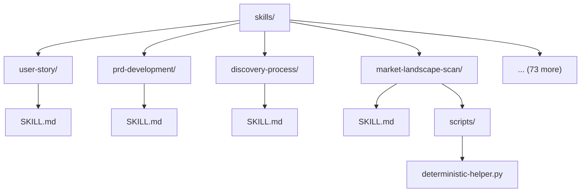

Some skills include an optional `scripts/` subdirectory for deterministic calculation helpers. These scripts must be deterministic, avoid network calls, and be documented in the parent `SKILL.md` [AGENTS.md:86-87]().

Sources: [AGENTS.md:23-23](), [AGENTS.md:49-49](), [AGENTS.md:86-87]()

---

## `SKILL.md` File Format

Each `SKILL.md` file begins with YAML frontmatter and is followed by a fixed set of Markdown sections.

**Frontmatter fields:**

| Field | Constraint | Purpose |
|---|---|---|
| `name` | ≤ 64 characters; matches folder name exactly | Skill identifier used by agent interfaces [AGENTS.md:48-49]() |
| `description` | ≤ 200 characters | Short summary for trigger detection; uses "Use when..." [AGENTS.md:48-48](), [docs/Building PM Skills.md:104-104]() |
| `intent` | Richer summary | Longer repo-facing summary of why the skill exists [docs/Building PM Skills.md:105-105]() |
| `type` | `component` \| `interactive` \| `workflow` | Tier identifier [AGENTS.md:47-47]() |

**Required body sections (in order):**

| Section | Role |
|---|---|
| `## Purpose` | What the skill does, when to use it, and expected outcome [docs/Building PM Skills.md:109-109]() |
| `## Input` | Plain language invitation for user context; NO `$ARGUMENTS` [docs/Building PM Skills.md:111-111](), [CONTRIBUTING.md:25-31]() |
| `## Key Concepts` | Core ideas, definitions, and non-obvious principles [docs/Building PM Skills.md:113-113]() |
| `## Application` | Step-by-step instructions for running the skill [docs/Building PM Skills.md:115-115]() |
| `## Examples` | Concrete cases, including anti-patterns [docs/Building PM Skills.md:117-117]() |
| `## Common Pitfalls` | Named failure modes the framework prevents [docs/Building PM Skills.md:119-119]() |
| `## References` | Links to related skills and external frameworks [docs/Building PM Skills.md:121-121]() |

*Figure 2: SKILL.md internal structure mapped to file sections*

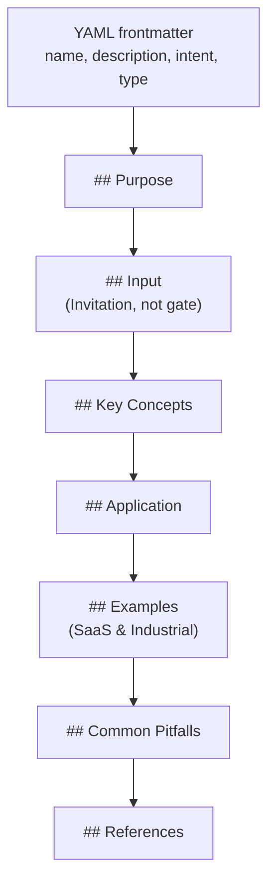

Sources: [AGENTS.md:45-49](), [docs/Building PM Skills.md:102-122](), [CONTRIBUTING.md:25-31]()

---

## The `research/` Directory

Contains source material that informs skill content. This includes essays, transcripts, and framework notes [AGENTS.md:26-26](). These files are inputs to the distillation workflow and are transformed into `SKILL.md` files via `scripts/add-a-skill.sh` or `scripts/build-a-skill.sh` [docs/Building PM Skills.md:19-20]().

Sources: [AGENTS.md:26-26](), [docs/Building PM Skills.md:19-20]()

---

## The `app/` Directory

Contains the Streamlit (beta) local playground for testing skills interactively.

| File | Purpose |
|---|---|
| `app/main.py` | Streamlit entry point [AGENTS.md:28-28]() |
| `app/STREAMLIT_INTERFACE.md` | Interface documentation [AGENTS.md:28-28]() |
| `app/.env.example` | Template for API keys and model selection |

Launch command:
```bash
streamlit run app/main.py
```
Sources: [AGENTS.md:28-28](), [AGENTS.md:41-41]()

---

## The `scripts/` Directory

Automation tools for the skill lifecycle. These are the only executable artifacts in the repository.

| Script | Language | Role |
|---|---|---|
| `scripts/add-a-skill.sh` | Bash | AI-assisted generation from raw content [docs/Add-a-Skill Utility Guide.md:9-15]() |
| `scripts/build-a-skill.sh` | Bash | Interactive section-by-section authoring wizard [scripts/build-a-skill.sh:5-8]() |
| `scripts/find-a-skill.sh` | Bash | Keyword and type-based search [AGENTS.md:72-72]() |
| `scripts/test-a-skill.sh` | Bash | Conformance and smoke checks [AGENTS.md:72-72]() |
| `scripts/check-skill-metadata.py` | Python | Strict YAML and character limit validation [AGENTS.md:72-72]() |
| `scripts/zip-a-skill.sh` | Bash | Builds upload-ready `.zip` files for presets [docs/Building PM Skills.md:26-26]() |
| `scripts/package-claude-skills.sh` | Bash | Renames `SKILL.md` → `Skill.md` for Claude Web [AGENTS.md:85-85]() |

*Figure 3: Tooling Data Flow from Source to Distribution*

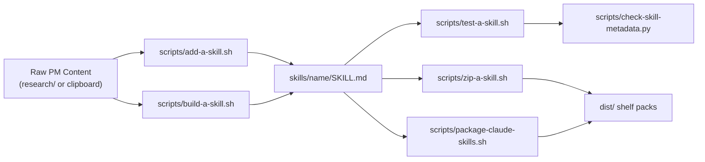

Sources: [docs/Add-a-Skill Utility Guide.md:9-15](), [scripts/build-a-skill.sh:5-8](), [AGENTS.md:72-72](), [AGENTS.md:85-85]()

---

## Claude Web Upload: `Skill.md` Case-Sensitivity

Claude's web interface requires the skill file to be named `Skill.md` (capital S, lowercase remainder) [AGENTS.md:85-85](). The repository stores files as `SKILL.md` for local use and CLI compatibility. The `scripts/package-claude-skills.sh` script handles the rename and frontmatter sanitization automatically for distribution to the `dist/` directory [AGENTS.md:85-85]().

Sources: [AGENTS.md:85-85]()

---

# Page: Skill Catalog

# Skill Catalog

<details>
<summary>Relevant source files</summary>

The following files were used as context for generating this wiki page:

- [.claude-plugin/marketplace.json](.claude-plugin/marketplace.json)
- [.claude-plugin/plugin.json](.claude-plugin/plugin.json)
- [catalog/skills-by-type.md](catalog/skills-by-type.md)
- [catalog/skills-index.yaml](catalog/skills-index.yaml)
- [docs/Lifecycle and EOL Suite Summary.md](docs/Lifecycle and EOL Suite Summary.md)
- [docs/announcements/2026-07-08-v0-82-inbound-requests-and-dist-shelf.md](docs/announcements/2026-07-08-v0-82-inbound-requests-and-dist-shelf.md)
- [docs/announcements/2026-08-10-v0-84-lifecycle-and-eol-suite.md](docs/announcements/2026-08-10-v0-84-lifecycle-and-eol-suite.md)
- [scripts/build-claude-desktop-packs.sh](scripts/build-claude-desktop-packs.sh)
- [scripts/build-dist.sh](scripts/build-dist.sh)
- [skills/company-intel/SKILL.md](skills/company-intel/SKILL.md)
- [skills/derisk-measurement-advisor/SKILL.md](skills/derisk-measurement-advisor/SKILL.md)
- [skills/incoming-request-advisor/SKILL.md](skills/incoming-request-advisor/SKILL.md)
- [skills/incoming-request-advisor/examples/conversation-flow.md](skills/incoming-request-advisor/examples/conversation-flow.md)
- [skills/incoming-request-advisor/template.md](skills/incoming-request-advisor/template.md)

</details>


This page is the complete reference index for all **77 skills** in the repository, organized by tier. Each entry lists the skill folder path, `type` value from the YAML frontmatter, and a one-line description. Use this page to identify which skill to load into an AI agent for a given task.

For deeper documentation, see:
- [Component Skills](#2.1) — Describe what Component Skills are (self-contained, reusable artifact templates, 10-30 min).
- [Interactive Skills](#2.2) — Describe what Interactive Skills are (multi-turn adaptive Q&A flows, 30-90 min).
- [Workflow Skills](#2.3) — Describe what Workflow Skills are (end-to-end multi-phase processes spanning days or weeks).
- [Commands](#2.4) — Document the `commands/` directory as a distinct orchestration layer above skills.

---

## How Skills Are Identified

Every skill is a folder under `skills/` containing a single `SKILL.md` file. The YAML frontmatter in that file declares the skill's identity [.claude-plugin/marketplace.json:1-11]().

```yaml
---
name: user-story
description: Create user stories with Mike Cohn format and Gherkin acceptance criteria.
type: component
---
```

The `type` field determines the tier and usage mode [catalog/skills-index.yaml:1-7]().

| Frontmatter Field | Constraint | Role |
|---|---|---|
| `name` | lowercase kebab-case, max 64 chars | Folder name; agent-facing identifier |
| `description` | max 200 chars | Shown in skill pickers and search results |
| `type` | `component`, `interactive`, or `workflow` | Assigns the skill to a tier |

Sources: [.claude-plugin/marketplace.json:1-11](), [catalog/skills-index.yaml:1-7](), [skills/derisk-measurement-advisor/SKILL.md:1-12]()

---

## Tier Architecture

The three tiers form a strict, acyclic dependency hierarchy. Higher tiers orchestrate lower tiers. Component skills have no upward dependencies.

**Tier Architecture Mapped to System Entities:**

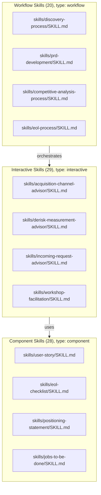

Sources: [catalog/skills-by-type.md:5-64](), [docs/announcements/2026-08-10-v0-84-lifecycle-and-eol-suite.md:4-5]()

---

## Component Skills (28)

Component skills produce a single, specific PM deliverable from a template. They are self-contained artifacts designed for 10-30 minute tasks [catalog/skills-by-type.md:5-62](). For detailed usage, see [Component Skills](#2.1).

| Skill Folder | Description |
|---|---|
| `skills/altitude-horizon-framework/` | Understand the PM-to-Director transition through altitude and horizon thinking. |
| `skills/company-research/` | Create a company research brief with executive quotes, product strategy, and org context. |
| `skills/customer-journey-map/` | Create a customer journey map across stages, touchpoints, actions, emotions, and metrics. |
| `skills/eol-checklist/` | Build a phase-gated EOL checklist sized to the sunset. |
| `skills/eol-message/` | Write a right-sized EOL announcement with three transition paths. |
| `skills/epic-hypothesis/` | Frame an epic as a testable hypothesis with target user and expected outcome. |
| `skills/finance-metrics-quickref/` | Look up SaaS finance metrics, formulas, and benchmarks fast. |
| `skills/jobs-to-be-done/` | Uncover customer jobs, pains, and gains in a structured JTBD format. |
| `skills/pestel-analysis/` | Analyze political, economic, social, technological, environmental, and legal forces. |
| `skills/pol-probe/` | Define a Proof of Life probe to test a risky hypothesis cheaply. |
| `skills/positioning-statement/` | Create a Geoffrey Moore-style positioning statement. |
| `skills/user-story/` | Create user stories with Mike Cohn format and Gherkin acceptance criteria. |

Sources: [catalog/skills-by-type.md:5-62](), [skills/derisk-measurement-advisor/SKILL.md:120-122]()

---

## Interactive Skills (29)

Interactive skills run multi-turn, adaptive Q&A flows (30-90 min). They apply the canonical facilitation protocol defined in `skills/workshop-facilitation/SKILL.md` [skills/incoming-request-advisor/SKILL.md:71-82](). For detailed usage, see [Interactive Skills](#2.2).

| Skill Folder | Description |
|---|---|
| `skills/acquisition-channel-advisor/` | Evaluate acquisition channels using unit economics and scalability. |
| `skills/agent-orchestration-advisor/` | Design multi-agent AI workflows with clear boundaries and handoffs. |
| `skills/ai-shaped-readiness-advisor/` | Assess whether product work is AI-first or AI-shaped across 5 competencies. |
| `skills/business-health-diagnostic/` | Diagnose SaaS business health across growth, retention, and efficiency. |
| `skills/context-engineering-advisor/` | Diagnose context stuffing vs. context engineering in AI workflows. |
| `skills/derisk-measurement-advisor/` | Identify what to measure or track to de-risk a product or AI idea. |
| `skills/incoming-request-advisor/` | Decode an incoming message separating the literal ask from the JTBD. |
| `skills/lifecycle-play-advisor/` | Map a product's lifecycle stage and choose extension, replacement, or retirement. |
| `skills/prioritization-advisor/` | Recommend the right prioritization framework for the current situation. |

Sources: [catalog/skills-by-type.md:64-120](), [skills/incoming-request-advisor/SKILL.md:1-17](), [skills/derisk-measurement-advisor/SKILL.md:1-25]()

---

## Workflow Skills (20)

Workflow skills define end-to-end multi-phase processes spanning days or weeks. They orchestrate lower-tier skills and handle complex decision points [docs/announcements/2026-08-10-v0-84-lifecycle-and-eol-suite.md:93-96](). For detailed usage, see [Workflow Skills](#2.3).

| Skill Folder | Description |
|---|---|
| `skills/ansoff-matrix/` | Map growth options across the Ansoff Matrix with risk-rated sequencing. |
| `skills/autonomous-investigation/` | Protocol for AI research: evidence labels, search-plan gate, diffable output. |
| `skills/battle-card-builder/` | Research and draft a competitive battle card from public evidence. |
| `skills/company-intel/` | Research a company or industry using seven analytical lenses. |
| `skills/competitive-analysis-process/` | Orchestrate a complete six-step competitive analysis. |
| `skills/discovery-process/` | Complete discovery cycle from problem framing to solution validation. |
| `skills/eol-process/` | 6-phase sunset workflow: decide, align, plan, prepare, announce, close. |
| `skills/prd-development/` | Structured PRD creation orchestrating multiple component skills. |

Sources: [catalog/skills-index.yaml:44-118](), [skills/company-intel/SKILL.md:1-28](), [docs/announcements/2026-08-10-v0-84-lifecycle-and-eol-suite.md:93-96]()

---

## Orchestration Layer: Commands

The `commands/` directory contains YAML files that act as a distinct orchestration layer, chaining multiple skills into fast execution paths [scripts/build-dist.sh:24-25]().

**Command Execution Logic:**

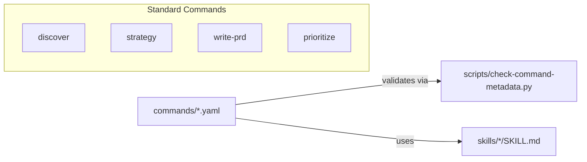

| Command | Role |
|---|---|
| `discover` | Chains research and discovery skills. |
| `strategy` | Orchestrates positioning and strategy sessions. |
| `write-prd` | Fast-track PRD development using component templates. |
| `prioritize` | Invokes the prioritization advisor and relevant canvases. |

For details, see [Commands](#2.4).

Sources: [scripts/build-dist.sh:24-25](), [docs/announcements/2026-08-10-v0-84-lifecycle-and-eol-suite.md:4-5]()

---

# Page: Component Skills

# Component Skills

<details>
<summary>Relevant source files</summary>

The following files were used as context for generating this wiki page:

- [catalog/skills-by-type.md](catalog/skills-by-type.md)
- [catalog/skills-index.yaml](catalog/skills-index.yaml)
- [dist/positioning-statement.zip](dist/positioning-statement.zip)
- [dist/user-story.zip](dist/user-story.zip)
- [docs/announcements/2026-07-08-v0-82-inbound-requests-and-dist-shelf.md](docs/announcements/2026-07-08-v0-82-inbound-requests-and-dist-shelf.md)
- [skills/company-intel/SKILL.md](skills/company-intel/SKILL.md)
- [skills/derisk-measurement-advisor/SKILL.md](skills/derisk-measurement-advisor/SKILL.md)
- [skills/epic-hypothesis/examples/sample-industrial.md](skills/epic-hypothesis/examples/sample-industrial.md)
- [skills/jobs-to-be-done/SKILL.md](skills/jobs-to-be-done/SKILL.md)
- [skills/pol-probe-advisor/SKILL.md](skills/pol-probe-advisor/SKILL.md)
- [skills/pol-probe/SKILL.md](skills/pol-probe/SKILL.md)
- [skills/positioning-statement/examples/sample-industrial.md](skills/positioning-statement/examples/sample-industrial.md)
- [skills/press-release/examples/sample-industrial.md](skills/press-release/examples/sample-industrial.md)
- [skills/problem-statement/SKILL.md](skills/problem-statement/SKILL.md)
- [skills/problem-statement/examples/sample-industrial.md](skills/problem-statement/examples/sample-industrial.md)
- [skills/proto-persona/examples/sample-industrial.md](skills/proto-persona/examples/sample-industrial.md)
- [skills/storyboard/examples/sample-industrial.md](skills/storyboard/examples/sample-industrial.md)
- [skills/user-story/examples/sample-industrial.md](skills/user-story/examples/sample-industrial.md)

</details>


This page documents the **Component Skill** tier: what they are, how their files are structured, the full catalog of the 28 skills in this tier, and concrete usage examples from `user-story` and `pol-probe`. Component Skills are the foundational building blocks of the three-tier architecture.

For the tiers above this one, see [Interactive Skills](#2.2) and [Workflow Skills](#2.3). For the skill file format specification that applies to all skill types, see [Skill Format Reference](#5.1). For authoring new skills of any type, see [Skill Authoring Workflow](#5.2).

---

## Role in the Three-Tier Architecture

Component Skills occupy the **base tier** of the dependency hierarchy. They produce a single, concrete PM artifact per invocation. Interactive and Workflow Skills depend on them, but they never depend upward.

**Figure: Three-tier dependency hierarchy**

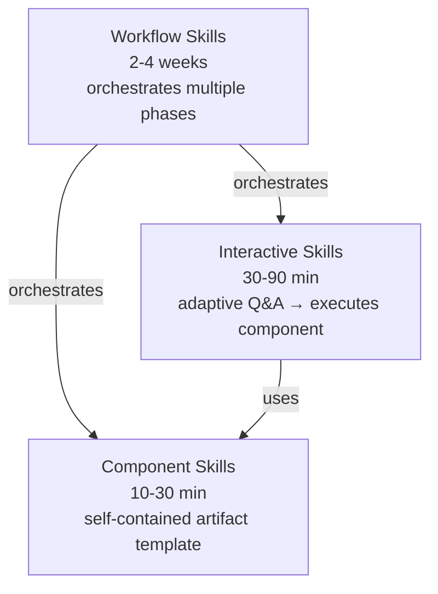

Sources: [catalog/skills-index.yaml:1-77](), [catalog/skills-by-type.md:5-62]()

The no-circular-dependency rule means a Component Skill may reference sibling Component Skills in its `References` section (for context), but the execution path always flows downward: a Component Skill does not invoke an Interactive or Workflow Skill.

---

## Defining Characteristics

| Property | Value |
|---|---|
| Frontmatter `type` | `component` |
| Typical session time | 10–30 min |
| Interaction model | Single-shot: one prompt in, one artifact out |
| Inputs | User context provided inline |
| Output | A filled-in, structured PM deliverable |
| Dependencies | None (may reference sibling components for context only) |

Component Skills are intentionally self-contained. They encode one framework and produce one artifact. This makes them composable: an Interactive Skill like `pol-probe-advisor` finishes by offering to generate a `pol-probe` artifact via the corresponding Component Skill.

Sources: [skills/pol-probe-advisor/SKILL.md:22-24](), [skills/pol-probe-advisor/SKILL.md:102-105]()

---

## File Structure

Every Component Skill lives at `skills/<skill-name>/SKILL.md`. The folder name must exactly match the `name` field in the YAML frontmatter.

**Figure: Component Skill file layout and validation constraints**

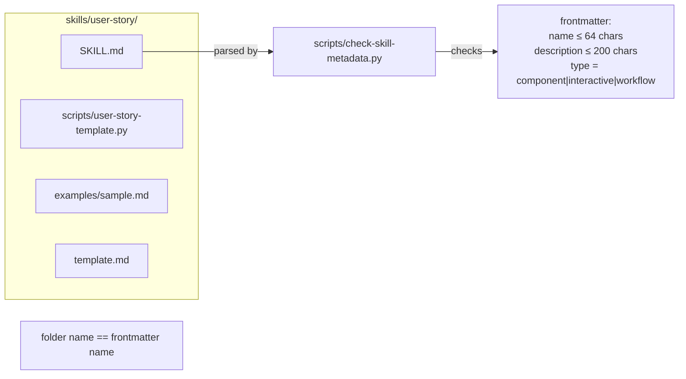

Sources: [skills/user-story/SKILL.md:1-18](), [dist/user-story.zip:1-33]()

The `scripts/` and `examples/` subdirectories are optional but common. Where present, the `scripts/` folder contains deterministic helpers (no network calls, no side effects) that generate stub artifacts from CLI inputs.

---

## Full Component Skill Catalog

| Skill folder | Framework / Origin | Primary Deliverable |
|---|---|---|
| `altitude-horizon-framework` | Leadership | Two-axis mental model for PM→Director transition |
| `company-research` | Market Intel | Deep-dive company research brief |
| `customer-journey-map` | UX/Discovery | Map of stages, touchpoints, and emotions |
| `eol-checklist` | Lifecycle | Phase-gated sunset operational plan |
| `eol-internal-enablement` | Lifecycle | Support FAQ and objection handling |
| `eol-message` | Lifecycle | Right-sized EOL announcement |
| `eol-stakeholder-sequence` | Lifecycle | Stakeholder communication sequence plan |
| `epic-hypothesis` | Discovery | Epic framed as a testable hypothesis |
| `finance-metrics-quickref` | Finance | SaaS metric definitions and formulas |
| `intelligence-collection-disciplines` | Market Intel | Intelligence agency collection protocols (OSINT, etc.) |
| `jobs-to-be-done` | Discovery | JTBD format (Jobs, Pains, Gains) |
| `pestel-analysis` | Strategy | External force analysis (P, E, S, T, E, L) |
| `pol-probe` | Discovery | Proof of Life probe validation artifact |
| `positioning-statement` | Core PM | Geoffrey Moore-style positioning |
| `press-release` | Core PM | Amazon-style future press release |
| `problem-statement` | Core PM | User-centered problem framing |
| `product-lifecycle-plays` | Lifecycle | Extend, Replace, or Retire decision map |
| `product-sense-interview-answer` | Career | Structured response for product sense interviews |
| `proto-persona` | Discovery | Hypothesis-based customer profile |
| `recommendation-canvas` | AI/Strategy | AI product idea evaluation |
| `saas-economics-efficiency-metrics` | Finance | Unit economics and capital efficiency metrics |
| `saas-revenue-growth-metrics` | Finance | Revenue, retention, and growth metrics |
| `stakeholder-identification` | Core PM | Comprehensive stakeholder mapping |
| `stakeholder-mapping` | Core PM | Prioritization grids for engagement |
| `storyboard` | UX/Discovery | Six-frame problem-to-solution narrative |
| `user-story` | Core PM | Mike Cohn / Gherkin format stories |
| `user-story-mapping` | Planning | User journey-based release slicing |
| `user-story-splitting` | Planning | Pattern-based story decomposition |

Sources: [catalog/skills-by-type.md:5-62](), [catalog/skills-index.yaml:1-100]()

---

## Dependency Graph Among Component Skills

Several Component Skills cross-reference each other as upstream inputs. The graph below captures the documented reference relationships.

**Figure: Reference relationships between Component Skills**

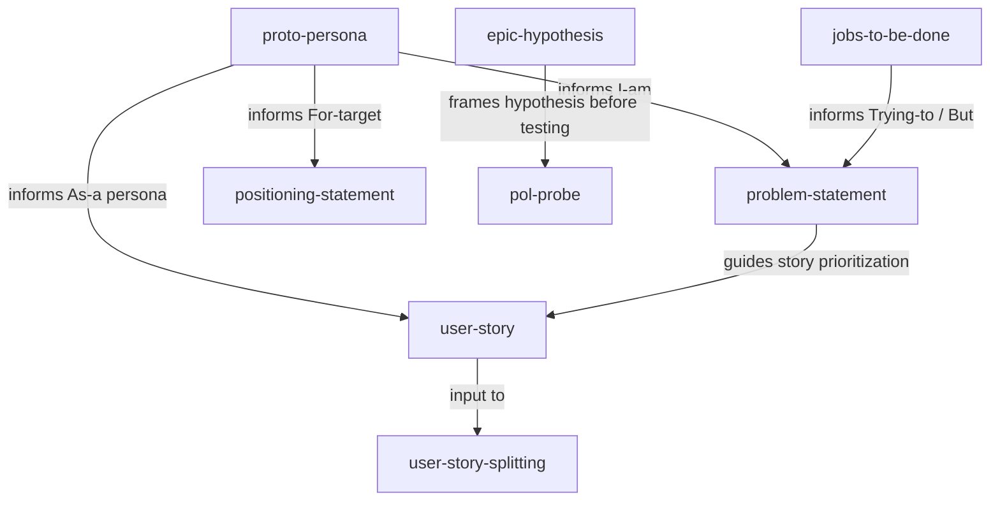

Sources: [skills/user-story/SKILL.md:37-50](), [skills/pol-probe/SKILL.md:116-130](), [catalog/skills-by-type.md:5-62]()

---

## How Higher-Tier Skills Invoke Component Skills

Component Skills are consumed in two ways by upper tiers:

1. **Interactive → Component (terminal step):** After an Interactive Skill completes its Q&A phase, it offers to generate the corresponding Component artifact. Example: `pol-probe-advisor` ends by matching the user to one of 5 probe flavors and recommending the `pol-probe` artifact.
2. **Workflow → Component (mid-phase step):** A Workflow Skill like `competitive-analysis-process` calls Component Skills at designated phases (e.g., `pestel-analysis`).

**Figure: pol-probe-advisor (Interactive) recommending pol-probe (Component)**

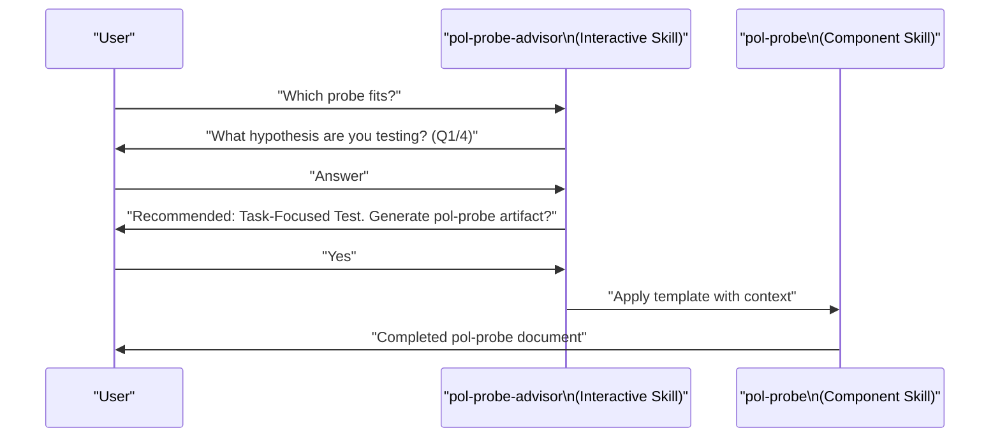

Sources: [skills/pol-probe-advisor/SKILL.md:107-140](), [skills/pol-probe-advisor/SKILL.md:20-24]()

---

## Worked Example: `user-story`

The `user-story` skill ([skills/user-story/SKILL.md]()) combines two frameworks into a single artifact template:

- **Use Case:** Mike Cohn's "As a / I want to / so that" format
- **Acceptance Criteria:** Gherkin's "Given / When / Then" format

### Concrete Output (Industrial Example)

```markdown
### User Story 118:
- **Summary:** Push firmware to NFA-500 units remotely

#### Use Case:
- **As a** field service technician supporting 40+ installations
- **I want to** apply a firmware update to a controller without traveling to the site
- **so that** a 20-minute patch stops costing a full day of windshield time

#### Acceptance Criteria:
- **Scenario:** Update fails mid-apply
- **Given** a firmware update has begun
- **When** the update fails or the connection drops
- **Then** the controller rolls back to the previous firmware
```

Sources: [skills/user-story/examples/sample-industrial.md:15-44](), [dist/user-story.zip:20-25]()

---

## Worked Example: `pol-probe`

The `pol-probe` skill ([skills/pol-probe/SKILL.md]()) templates a **Proof of Life (PoL) probe** — a disposable validation experiment to test a single hypothesis before committing to development.

### Five Probe Types

| Type | Core Question | Timeline |
|---|---|---|
| Feasibility Check | "Can we build this?" | 1–2 days |
| Task-Focused Test | "Can users complete this job?" | 2–5 days |
| Narrative Prototype | "Does this earn buy-in?" | 1–3 days |
| Synthetic Data Simulation | "Can we model this?" | 2–4 days |
| Vibe-Coded PoL Probe | "Will this survive user contact?" | 2–3 days |

Sources: [skills/pol-probe/SKILL.md:78-90](), [skills/pol-probe-advisor/SKILL.md:49-55]()

### Quality Constraints (The 5 Essential Characteristics)

Every PoL probe must satisfy these criteria to avoid "prototype theater":
- **Lightweight:** Minimal resource investment.
- **Disposable:** Explicitly planned for deletion.
- **Narrow Scope:** Tests one specific hypothesis.
- **Brutally Honest:** Surfaces harsh truths.
- **Tiny & Focused:** Reconnaissance mission, not an MVP.

Sources: [skills/pol-probe/SKILL.md:47-58](), [skills/pol-probe-advisor/SKILL.md:57-59]()

---

# Page: Interactive Skills

# Interactive Skills

<details>
<summary>Relevant source files</summary>

The following files were used as context for generating this wiki page:

- [.claude-plugin/marketplace.json](.claude-plugin/marketplace.json)
- [catalog/skills-by-type.md](catalog/skills-by-type.md)
- [catalog/skills-index.yaml](catalog/skills-index.yaml)
- [dist/prioritization-advisor.zip](dist/prioritization-advisor.zip)
- [dist/workshop-facilitation.zip](dist/workshop-facilitation.zip)
- [docs/announcements/2026-07-08-v0-82-inbound-requests-and-dist-shelf.md](docs/announcements/2026-07-08-v0-82-inbound-requests-and-dist-shelf.md)
- [skills/company-intel/SKILL.md](skills/company-intel/SKILL.md)
- [skills/derisk-measurement-advisor/SKILL.md](skills/derisk-measurement-advisor/SKILL.md)
- [skills/incoming-request-advisor/SKILL.md](skills/incoming-request-advisor/SKILL.md)
- [skills/incoming-request-advisor/examples/conversation-flow.md](skills/incoming-request-advisor/examples/conversation-flow.md)
- [skills/incoming-request-advisor/template.md](skills/incoming-request-advisor/template.md)

</details>


This page documents the **Interactive Skills** tier of the Product Manager Skills repository: what they are, how they behave during a session, and the complete catalog of available skills. For the broader three-tier architecture (Component → Interactive → Workflow), see [Three-Tier Skill Architecture](#1.1). For the Component Skills tier, see [Component Skills](#2.1). For Workflow Skills, see [Workflow Skills](#2.3).

---

## What Interactive Skills Are

Interactive Skills are multi-turn, adaptive conversational sessions in which an AI agent collects context through sequential questions and then produces tailored, enumerated recommendations. They sit in the middle tier of the skill hierarchy.

| Property | Value |
|---|---|
| `type` (YAML frontmatter) | `interactive` |
| Estimated duration | 15–90 minutes |
| Question depth | 3–13 questions, depending on skill |
| Output | Enumerated recommendations + optional artifact |
| Dependencies | May invoke Component Skills at output stage |
| Invoked by | Workflow Skills as sub-processes |

**Key behavioral characteristics:**

- Asks questions one at a time, bounded to 3–5 per phase (up to 13 total in complex skills).
- Uses prior answers to inform subsequent questions.
- Offers **enumerated, context-aware recommendations** (3–5 numbered options) at decision points.
- Allows number selection (`1`, `2 & 4`, `1,3`) or free-text input.
- Adapts based on user choices.
- Applies Component Skills at the output stage.

Sources: [catalog/skills-index.yaml:7-13](), [skills/derisk-measurement-advisor/SKILL.md:12-23](), [skills/incoming-request-advisor/SKILL.md:7-17]()

---

## Position in the Three-Tier Architecture

**Tier relationship diagram: file-level**

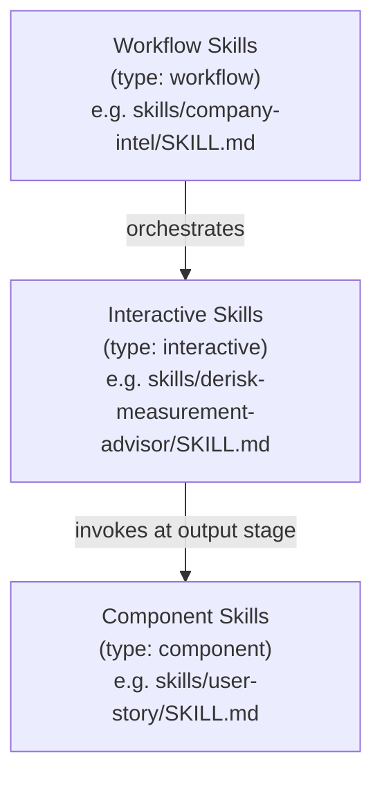

Sources: [catalog/skills-by-type.md:5-64](), [catalog/skills-by-type.md:65-115](), [catalog/skills-by-type.md:116-156]()

---

## The Canonical Facilitation Protocol

### Source of Truth: `workshop-facilitation/SKILL.md`

The file `skills/workshop-facilitation/SKILL.md` defines the interaction protocol that all other interactive skills must follow. Each individual interactive skill may add domain-specific logic on top, but in case of conflict with `workshop-facilitation`, the domain-specific logic wins.

Reference pattern used in skill files:

```
### Facilitation Source of Truth
Use [`workshop-facilitation`](../workshop-facilitation/SKILL.md) as the default interaction protocol for this skill.
```

Sources: [skills/incoming-request-advisor/SKILL.md:71-73](), [skills/derisk-measurement-advisor/SKILL.md:126-128]()

### Session Structure

**Facilitation protocol state diagram**

```mermaid
stateDiagram-v2
    [*] --> "SessionHeadsUp"
    "SessionHeadsUp" --> "EntryModeSelection" : "offer Guided / Context dump / Best guess"
    "EntryModeSelection" --> "GuidedMode" : "1"
    "EntryModeSelection" --> "ContextDumpMode" : "2"
    "EntryModeSelection" --> "BestGuessMode" : "3"
    "GuidedMode" --> "QuestionTurn" : "one question per turn\nContext Qx/N"
    "ContextDumpMode" --> "ParsePastedContext" : "user pastes known context"
    "ParsePastedContext" --> "QuestionTurn" : "skip resolved, ask gaps only"
    "BestGuessMode" --> "InferDefaults" : "label each as Assumption"
    "InferDefaults" --> "QuestionTurn" : "ask minimum viable input"
    "QuestionTurn" --> "QuestionTurn" : "next question (progress label)"
    "QuestionTurn" --> "DecisionPoint" : "context sufficient"
    "DecisionPoint" --> "EnumeratedRecommendations" : "numbered 1. 2. 3."
    "EnumeratedRecommendations" --> "UserSelection" : "accept: 1 / 1 and 3 / 1,3 / custom"
    "UserSelection" --> "QuestionTurn" : "more phases"
    "UserSelection" --> "FinalSummary" : "all phases done"
    "FinalSummary" --> "AssumptionsToValidate" : "if best-guess or context-dump mode"
    "AssumptionsToValidate" --> [*]
    "FinalSummary" --> [*]
```

Sources: [skills/incoming-request-advisor/examples/conversation-flow.md:20-110](), [skills/incoming-request-advisor/SKILL.md:83-110]()

### Three Entry Modes

| Mode | Trigger | Behavior |
|---|---|---|
| **Guided** | `1` | One question per turn, full sequence. |
| **Context dump** | `2` | User pastes existing context; agent skips resolved questions, asks 0–2 gap questions. |
| **Best guess** | `3` | Agent infers missing details, labels each as `Assumption` with confidence levels, continues without blocking. |

In **Best guess** mode and **Context dump** mode, the final summary includes an **Assumptions to Validate** section listing all inferred values.

Sources: [skills/incoming-request-advisor/SKILL.md:59-62](), [skills/incoming-request-advisor/examples/conversation-flow.md:90-94]()

### Decision Point Recommendations

Enumerated recommendations appear **only at decision points**, not after every answer. 

**Format Example from `incoming-request-advisor`:**
```
1. **Draft a reply to Priya** (Recommended)
2. **Build a meeting agenda for this ask**
3. **Reframe the ask as a discovery framing**
4. **Draft a counter-proposal that protects the outcome**
```

Accepted selection inputs: `#1`, `1`, `1 and 3`, `1,3`, or free text. Multi-selections are synthesized into a combined path.

Sources: [skills/incoming-request-advisor/examples/conversation-flow.md:102-109](), [skills/incoming-request-advisor/template.md:71-76]()

---

## Interactive Skill Catalog

As of version 0.84, there are 29 Interactive Skills. Key examples include:

### Discovery and Research
- `discovery-interview-prep`: Plans customer interviews (Mom Test style).
- `customer-journey-mapping-workshop`: Guides journey mapping with pain point identification.
- `problem-framing-canvas`: Leads through MITRE Problem Framing (Look Inward / Outward / Reframe).

### Planning and Prioritization
- `prioritization-advisor`: Recommends the right prioritization framework (RICE, ICE, Kano, etc.).
- `derisk-measurement-advisor`: Identifies what to measure/test across DUFV and PESTEL dimensions. [skills/derisk-measurement-advisor/SKILL.md:2-11]()
- `incoming-request-advisor`: Decodes messages into Ask vs. Job-to-be-Done. [skills/incoming-request-advisor/SKILL.md:2-7]()

### Finance and Business Health
- `acquisition-channel-advisor`: Evaluates acquisition channels using unit economics. [catalog/skills-index.yaml:4-13]()
- `business-health-diagnostic`: Diagnoses SaaS business health across growth and retention. [catalog/skills-index.yaml:76-84]()
- `feature-investment-advisor`: Evaluates feature investments using revenue impact and ROI.

### AI and Context Engineering
- `ai-shaped-readiness-advisor`: Assesses 5 AI competencies. [catalog/skills-index.yaml:24-33]()
- `agent-orchestration-advisor`: Designs multi-agent AI workflows with clear boundaries. [catalog/skills-index.yaml:14-23]()
- `context-engineering-advisor`: Diagnoses context stuffing vs. context engineering.

Sources: [catalog/skills-by-type.md:64-115](), [.claude-plugin/marketplace.json:1-205]()

---

## Thematic Grouping Overview

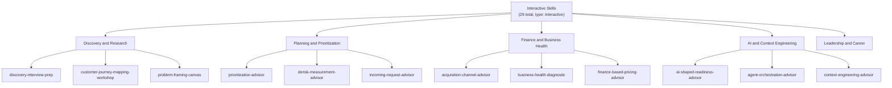

Sources: [catalog/skills-by-type.md:64-115](), [.claude-plugin/marketplace.json:11-205]()

---

## YAML Frontmatter for Interactive Skills

Every interactive skill file (`SKILL.md`) declares its type via YAML frontmatter. This metadata is consumed by orchestration scripts and the Streamlit app.

```yaml
---
name: derisk-measurement-advisor
argument-hint: "[product or AI idea]"
description: Identify what to measure, test, or track to de-risk a product or AI idea.
type: interactive
---
```

Sources: [skills/derisk-measurement-advisor/SKILL.md:1-12](), [skills/incoming-request-advisor/SKILL.md:1-7]()

---

# Page: Workflow Skills

# Workflow Skills

<details>
<summary>Relevant source files</summary>

The following files were used as context for generating this wiki page:

- [catalog/skills-by-type.md](catalog/skills-by-type.md)
- [catalog/skills-index.yaml](catalog/skills-index.yaml)
- [dist/discovery-process.zip](dist/discovery-process.zip)
- [dist/prd-development.zip](dist/prd-development.zip)
- [dist/product-strategy-session.zip](dist/product-strategy-session.zip)
- [docs/announcements/2026-07-08-v0-82-inbound-requests-and-dist-shelf.md](docs/announcements/2026-07-08-v0-82-inbound-requests-and-dist-shelf.md)
- [skills/company-intel/SKILL.md](skills/company-intel/SKILL.md)
- [skills/derisk-measurement-advisor/SKILL.md](skills/derisk-measurement-advisor/SKILL.md)

</details>


Workflow Skills represent the top tier of the three-tier skill architecture. Each Workflow Skill defines a complete, end-to-end PM process that spans multiple sessions over days or weeks. Rather than producing a single artifact (Component Skills) or running a single advisory conversation (Interactive Skills), Workflow Skills orchestrate these lower-tier assets into a structured lifecycle.

---

## What Workflow Skills Are

Workflow Skills are multi-phase processes that provide the "connective tissue" between individual PM tasks. They are characterized by:

- **Phased Execution:** Work is divided into numbered phases, each with explicit goals, activities, and outputs [skills/discovery-process/SKILL.md:77-78]().
- **Decision Points:** Explicit gates between phases that route the workflow based on evidence or outcomes (e.g., "If saturated, proceed; if not, more interviews") [skills/discovery-process/SKILL.md:201-209]().
- **Skill Orchestration:** They do not re-implement logic; instead, they reference specific `SKILL.md` files from the Component and Interactive tiers at each step [skills/prd-development/SKILL.md:616-644]().
- **Standardized Facilitation:** They delegate turn-taking and pacing to the canonical protocol defined in `skills/workshop-facilitation/SKILL.md` [README.md:65-83]().

The repository currently contains **10 Workflow Skills** (as of v0.84), identified in YAML frontmatter with `type: workflow` [catalog/skills-index.yaml:3-200]().

---

## The Workflow Skill Catalog

| Skill | File Path | Timeline | Domain |
|---|---|---|---|
| `ansoff-matrix` | [skills/ansoff-matrix/SKILL.md]() | 2–4 hours | Strategy |
| `autonomous-investigation` | [skills/autonomous-investigation/SKILL.md]() | Variable | Research |
| `battle-card-builder` | [skills/battle-card-builder/SKILL.md]() | 60–90 min | Market Intel |
| `company-intel` | [skills/company-intel/SKILL.md]() | 30–60 min | Market Intel |
| `competitive-analysis-process` | [skills/competitive-analysis-process/SKILL.md]() | 1–2 weeks | Market Intel |
| `discovery-process` | [skills/discovery-process/SKILL.md]() | 3–4 weeks | Discovery |
| `eol-process` | [skills/eol-process/SKILL.md]() | 4–12 weeks | Lifecycle |
| `prd-development` | [skills/prd-development/SKILL.md]() | 2–4 days | Delivery |
| `product-strategy-session` | [skills/product-strategy-session/SKILL.md]() | 2–4 weeks | Strategy |
| `roadmap-planning` | [skills/roadmap-planning/SKILL.md]() | 1–2 weeks | Planning |

Sources: [catalog/skills-index.yaml:48-125](), [catalog/skills-by-type.md:126-155]()

---

## Tier Position and Dependency Direction

Workflow Skills sit at the top of the hierarchy. While they can orchestrate lower tiers, circular dependencies are prohibited.

**Natural Language to Code Entity Space: Orchestration Map**

```mermaid
graph TD
    W["Workflow Skills (type: workflow)"] -->|"orchestrates"| I["Interactive Skills (type: interactive)"]
    I -->|"uses"| C["Component Skills (type: component)"]

    subgraph "Workflow Tier (skills/)"
        dp["discovery-process/SKILL.md"]
        prd["prd-development/SKILL.md"]
        rp["roadmap-planning/SKILL.md"]
        intel["company-intel/SKILL.md"]
        eol["eol-process/SKILL.md"]
    end

    subgraph "Interactive Tier (skills/)"
        pfc["problem-framing-canvas/SKILL.md"]
        dip["discovery-interview-prep/SKILL.md"]
    end

    subgraph "Component Tier (skills/)"
        ps["problem-statement/SKILL.md"]
        us["user-story/SKILL.md"]
    end

    dp -.-> pfc
    pfc -.-> ps
    prd -.-> us
    eol -.-> I
```

Sources: [README.md:224-278](), [catalog/skills-by-type.md:5-155]()

---

## Phase Architecture and Decision Logic

Every Workflow Skill defines a sequential set of phases. A phase is not just a text block; it is a functional unit containing goals, skill references, and branching logic.

**Logic Flow of a Workflow Phase**

```mermaid
flowchart TD
    subgraph "Phase block (SKILL.md ## Application)"
        Goal["Goal: Specific Outcome"]
        Act1["Activity 1: Invoke Component Skill"]
        Act2["Activity 2: Invoke Interactive Skill"]
        DP["Decision Point: Branching Question"]
    end
    
    Goal --> Act1
    Act1 --> Act2
    Act2 --> DP
    DP -->|"Criteria Met"| Next["Next Phase"]
    DP -->|"Criteria Failed"| Loop["Pivot/Repeat Path\n(+Time Impact)"]
```

### Example: `discovery-process` Decision Point
In `discovery-process`, Phase 3 (Interviewing) ends with a decision point regarding **Saturation**.
- **Question:** Have the same pain points emerged across 3+ interviews? [skills/discovery-process/SKILL.md:291-300]()
- **If YES:** Proceed to Phase 4 (Synthesize).
- **If NO:** Schedule 3–5 more interviews (Time impact: +1 week).

Sources: [skills/discovery-process/SKILL.md:81-210](), [skills/roadmap-planning/SKILL.md:99-315]()

---

## Skill Orchestration Pattern

Workflow Skills delegate to other skills using a standardized reference format. This allows the Workflow to maintain the high-level process while the specific sub-skills handle the detailed prompts and templates.

**Orchestration Reference Format:**
```markdown
- **Use:** `skills/<skill-name>/SKILL.md` (<type>)
- **Participants:** [Roles involved]
- **Duration:** [Time box]
- **Output:** [Artifact generated]
```

### Example: `prd-development` Orchestration
The `prd-development` workflow orchestrates a specific sequence of sub-skills:
1. **Phase 2 (Context):** Uses `problem-framing-canvas/SKILL.md` [skills/prd-development/SKILL.md:617]().
2. **Phase 3 (User):** Uses `jobs-to-be-done/SKILL.md` [skills/prd-development/SKILL.md:623]().
3. **Phase 7 (Breakdown):** Uses `epic-breakdown-advisor/SKILL.md` and `user-story/SKILL.md` [skills/prd-development/SKILL.md:639-642]().

Sources: [skills/prd-development/SKILL.md:616-644]()

---

## Facilitation Protocol

All Workflow Skills defer to `skills/workshop-facilitation/SKILL.md` for session management. This protocol ensures the AI agent:
- Uses a one-question-at-a-time pacing [README.md:75]().
- Provides progress labels (e.g., "Phase 2/6") [README.md:76]().
- Offers numbered response options for quick selection [README.md:79]().

The workflow's `SKILL.md` provides the **domain logic**, while `workshop-facilitation` provides the **interaction logic**.

Sources: [README.md:65-83](), [skills/discovery-process/SKILL.md:59-71]()

---

## Time Investment Model

Workflow Skills distinguish between the **AI Session Time** (interaction with the agent) and **Total Process Time** (real-world execution).

| Skill | AI Session Time (Frontmatter) | Total Process Time (Body) |
|---|---|---|
| `discovery-process` | 30–60 min [skills/discovery-process/SKILL.md:13]() | 3–4 weeks [skills/discovery-process/SKILL.md:78]() |
| `prd-development` | 60–120 min [skills/prd-development/SKILL.md:13]() | 2–4 days [skills/prd-development/SKILL.md:131]() |
| `eol-process` | 45–90 min | 4–12 weeks |

Sources: [skills/discovery-process/SKILL.md:13-78](), [skills/prd-development/SKILL.md:13-131]()

---

## Common Pitfalls

| Pitfall | Symptom | Fix |
|---|---|---|
| **Phase Skipping** | Moving to "Solutions" before "Problem Framing" is complete. | Treat Decision Points as mandatory gates [skills/discovery-process/SKILL.md:417-461](). |
| **Tooling Bypass** | Running a workflow without actually opening the referenced sub-skills. | Follow the `Use:` directive for every activity [skills/prd-development/SKILL.md:569-614](). |
| **False Saturation** | Ending discovery after 2 interviews because they "felt good." | Adhere to the 5–7 interview minimum threshold [skills/discovery-process/SKILL.md:291-300](). |

Sources: [skills/discovery-process/SKILL.md:417-461](), [skills/prd-development/SKILL.md:569-614](), [skills/roadmap-planning/SKILL.md:422-465]()

---

# Page: Commands

# Commands

<details>
<summary>Relevant source files</summary>

The following files were used as context for generating this wiki page:

- [CLAUDE.md](CLAUDE.md)
- [PLANS.md](PLANS.md)
- [README.md](README.md)
- [commands/write-prd.md](commands/write-prd.md)
- [docs/Finance Suite Summary.md](docs/Finance Suite Summary.md)
- [research/Context Engineering for Product Managers.md](research/Context Engineering for Product Managers.md)
- [skills/business-health-diagnostic/SKILL.md](skills/business-health-diagnostic/SKILL.md)
- [skills/discovery-interview-prep/SKILL.md](skills/discovery-interview-prep/SKILL.md)
- [skills/discovery-process/SKILL.md](skills/discovery-process/SKILL.md)
- [skills/prd-development/SKILL.md](skills/prd-development/SKILL.md)
- [skills/prd-development/examples/sample.md](skills/prd-development/examples/sample.md)
- [skills/prd-development/template.md](skills/prd-development/template.md)
- [skills/roadmap-planning/SKILL.md](skills/roadmap-planning/SKILL.md)
- [skills/saas-revenue-growth-metrics/SKILL.md](skills/saas-revenue-growth-metrics/SKILL.md)

</details>


Commands represent the highest orchestration layer in the repository, residing in the `commands/` directory. While **Skills** provide the atomic frameworks and guided protocols, **Commands** chain these skills into fast execution paths designed to achieve specific Product Management outcomes (e.g., writing a PRD or planning a roadmap) with minimal friction [PLANS.md:13-20]().

## Command Format and Metadata

Every command is defined in a Markdown file within the `commands/` directory. They utilize a strict YAML frontmatter schema to ensure they are discoverable by scripts and compatible with AI agent orchestration [PLANS.md:45-48]().

### YAML Frontmatter Fields

| Field | Description |
| :--- | :--- |
| `name` | The unique identifier for the command (e.g., `write-prd`). |
| `description` | A concise summary of the outcome this command provides. |
| `argument-hint` | A visual cue for the user on what inputs to provide (e.g., `"<feature or initiative>"`). |
| `uses` | A list of underlying skills (by their `name` metadata) that this command orchestrates. |
| `outputs` | The specific artifacts or states generated upon completion. |

[commands/write-prd.md:1-15]()

### Data Flow: Command Orchestration
The following diagram illustrates how a Command (Natural Language Space) maps to the underlying Code Entities (Skills) to produce specific PM artifacts.

**Command Execution Logic**
```mermaid
graph TD
    User["User Input: /write-prd [Context]"] --> Cmd["command/write-prd.md"]
    
    subgraph "Orchestration Layer (uses)"
        Cmd --> S1["skills/problem-statement"]
        Cmd --> S2["skills/proto-persona"]
        Cmd --> S3["skills/prd-development"]
        Cmd --> S4["skills/user-story"]
    end
    
    subgraph "Output Artifacts"
        S3 --> Out1["Structured PRD"]
        S4 --> Out2["Implementation-ready Stories"]
    end
    
    style Cmd stroke-width:4px
```
**Sources:** [commands/write-prd.md:1-15](), [PLANS.md:13-16]()

---

## Available Commands

There are six core commands designed to cover the primary lifecycle of product management work [PLANS.md:37-43]().

| Command | Purpose | Key Skills Orchestrated |
| :--- | :--- | :--- |
| `discover` | Validates problem space and customer pain. | `discovery-process`, `problem-framing-canvas` |
| `strategy` | Sets product direction and positioning. | `product-strategy-session`, `positioning-statement` |
| `write-prd` | Generates a decision-ready requirements doc. | `prd-development`, `problem-statement`, `user-story` |
| `plan-roadmap` | Sequences delivery and aligns stakeholders. | `roadmap-planning`, `prioritization-advisor` |
| `prioritize` | Ranks initiatives based on business value. | `prioritization-advisor`, `feature-investment-advisor` |
| `leadership-transition` | Manages 30-60-90 day onboarding for leaders. | `executive-onboarding-playbook` |

**Sources:** [PLANS.md:37-43](), [commands/write-prd.md:5-10]()

---

## The `write-prd` Workflow Example

The `write-prd` command demonstrates how multiple tiers of skills are chained. It moves from a high-level **Interactive Skill** (problem definition) to a complex **Workflow Skill** (PRD development) and finally to **Component Skills** (user stories) [commands/write-prd.md:27-34]().

### Execution Steps
1. **Context Setting**: Uses `problem-statement` to define the "why" [commands/write-prd.md:29]().
2. **User Alignment**: Invokes `proto-persona` to anchor the requirements in a specific user segment [commands/write-prd.md:30]().
3. **Core Drafting**: Orchestrates the 8-phase `prd-development` workflow [commands/write-prd.md:31]().
4. **Scaffolding**: Generates initial `user-story` drafts and splits them using `user-story-splitting` [commands/write-prd.md:32-33]().

**Sources:** [commands/write-prd.md:27-34](), [skills/prd-development/SKILL.md:150]()

---

## Tooling and Validation

To maintain the integrity of the command layer, the repository includes specific scripts for discovery and metadata enforcement [PLANS.md:45-48]().

### Key Scripts

*   **`scripts/find-a-command.sh`**: A terminal-based discovery tool that allows users to search the `commands/` directory by keyword or outcome [PLANS.md:24]().
*   **`scripts/check-command-metadata.py`**: A strict validator that ensures every command file follows the YAML schema and that all referenced skills in the `uses` field actually exist in the `skills/` directory [PLANS.md:46]().
*   **`scripts/run-pm.sh`**: A launcher that provides the execution scaffolding for both skills and commands [PLANS.md:47]().

### System Architecture: Command Validation
This diagram shows the relationship between the command definitions and the validation scripts that enforce repository standards.

**Metadata Validation Flow**
```mermaid
graph LR
    subgraph "Definition Space"
        CMD_FILE["commands/*.md"]
        SKILL_FILE["skills/*/SKILL.md"]
    end

    subgraph "Validation Logic"
        VAL["scripts/check-command-metadata.py"]
    end

    CMD_FILE -- "References skills in 'uses'" --> VAL
    SKILL_FILE -- "Verified as existing targets" --> VAL
    VAL -- "Success/Failure Report" --> Developer
```
**Sources:** [PLANS.md:45-51](), [commands/write-prd.md:5-10]()

---

## Checkpoints and Best Practices

Commands include built-in "Checkpoints" to ensure the AI agent maintains high-quality output throughout the chain [commands/write-prd.md:35-42]().

*   **Gap Tagging**: Every command requires the agent to tag unknowns as either an 🔶 **Assumption** (plausible but unvalidated) or a 🔵 **Open Question** (needs discovery) [commands/write-prd.md:40]().
*   **Self-Assessment**: Upon completion, commands prompt for a summary of the strongest and weakest sections of the generated artifact [commands/write-prd.md:42]().
*   **Next Steps**: Commands provide logical follow-on actions, such as running `/prioritize` if the generated PRD scope exceeds capacity [commands/write-prd.md:44-48]().

**Sources:** [commands/write-prd.md:35-48](), [skills/prd-development/SKILL.md:23-31]()

---

# Page: Skill Reference

# Skill Reference

<details>
<summary>Relevant source files</summary>

The following files were used as context for generating this wiki page:

- [.claude-plugin/marketplace.json](.claude-plugin/marketplace.json)
- [catalog/skills-by-type.md](catalog/skills-by-type.md)
- [catalog/skills-index.yaml](catalog/skills-index.yaml)
- [docs/announcements/2026-07-08-v0-82-inbound-requests-and-dist-shelf.md](docs/announcements/2026-07-08-v0-82-inbound-requests-and-dist-shelf.md)
- [skills/company-intel/SKILL.md](skills/company-intel/SKILL.md)
- [skills/derisk-measurement-advisor/SKILL.md](skills/derisk-measurement-advisor/SKILL.md)
- [skills/incoming-request-advisor/SKILL.md](skills/incoming-request-advisor/SKILL.md)
- [skills/incoming-request-advisor/examples/conversation-flow.md](skills/incoming-request-advisor/examples/conversation-flow.md)
- [skills/incoming-request-advisor/template.md](skills/incoming-request-advisor/template.md)

</details>


This section is the domain-grouped reference for all 77 skills in the `skills/` directory. Each sub-page groups skills by functional domain rather than by tier. If you are looking for the tier-based catalog (Component / Interactive / Workflow), see the [Skill Catalog](#2). For a detailed explanation of the three-tier architecture itself, see [Three-Tier Skill Architecture](#1.1).

---

## Domain Groups

The 77 skills are distributed across eight domain groups, each with a dedicated reference sub-page.

| Section | Domain | Skill Count | Tiers Present |
|---------|--------|-------------|---------------|
| [Leadership and Career Development Skills](#3.1) | Leadership and Career Development | 4 | 1 Component, 2 Interactive, 1 Workflow |
| [Discovery and Research Skills](#3.2) | Discovery and Research | 8 | 1 Component, 6 Interactive, 1 Workflow |
| [Finance Suite](#3.3) | Finance Suite | 7 | 3 Component, 4 Interactive |
| [AI and Context Engineering Skills](#3.4) | AI and Context Engineering | 3 | 3 Interactive |
| [Core PM Deliverable Skills](#3.5) | Core PM Deliverables | 11 | 8 Component, 3 Interactive |
| [Planning and Strategy Skills](#3.6) | Planning and Strategy | 14 | 7 Component, 4 Interactive, 3 Workflow |
| [Market Intelligence Suite](#3.7) | Market Intelligence Suite | 17 | 2 Component, 1 Interactive, 14 Workflow |
| [Lifecycle and EOL Suite](#3.8) | Lifecycle and EOL Suite | 7 | 4 Component, 2 Interactive, 1 Workflow |

**Meta-Skills** (`workshop-facilitation` and `skill-authoring-workflow`) are not assigned to a domain group. `workshop-facilitation/SKILL.md` is the canonical facilitation protocol source of truth referenced by all interactive skills. `skill-authoring-workflow/SKILL.md` is documented in [Skill Authoring Workflow](#5.2).

Sources: [catalog/skills-index.yaml:2-250](), [catalog/skills-by-type.md:5-150]()

---

## File Organization

Every skill lives at exactly one path: `skills/<skill-name>/SKILL.md`. The `<skill-name>` folder is lowercase kebab-case and matches the `name` field in the YAML frontmatter of the file. Domain groups are a conceptual and wiki-level grouping only; the `skills/` directory itself is flat.

Each `SKILL.md` file begins with a frontmatter block declaring required fields:

```yaml
---
name: skill-name-in-kebab-case
description: One-sentence summary under 200 characters
type: component|interactive|workflow
---
```

**Diagram: Wiki Sections Mapped to Code Entity Space (representative files)**

```mermaid
graph LR
    S31["3.1 Leadership and Career"]
    S32["3.2 Discovery and Research"]
    S33["3.3 Finance Suite"]
    S34["3.4 AI and Context Eng"]
    S37["3.7 Market Intelligence"]
    S38["3.8 Lifecycle and EOL"]

    subgraph "skills/ directory"
        altHz["altitude-horizon-framework/SKILL.md"]
        cjMap["customer-journey-map/SKILL.md"]
        bizH["business-health-diagnostic/SKILL.md"]
        ctxEng["context-engineering-advisor/SKILL.md"]
        cIntel["company-intel/SKILL.md"]
        eolProc["eol-process/SKILL.md"]
    end

    S31 --> altHz
    S32 --> cjMap
    S33 --> bizH
    S34 --> ctxEng
    S37 --> cIntel
    S38 --> eolProc
```

Sources: [.claude-plugin/marketplace.json:1-150](), [catalog/skills-index.yaml:1-100]()

---

## Cross-Reference Architecture

Skills reference each other through a strictly uni-directional dependency rule. This ensures no circular dependencies and keeps component skills portable.

| Tier | May Reference | May Not Reference |
|------|--------------|-------------------|
| `component` | Other component skills | Interactive or workflow skills |
| `interactive` | Component skills | Workflow skills |
| `workflow` | Component and interactive skills | — |

**Facilitation protocol:** `skills/workshop-facilitation/SKILL.md` is the canonical source of truth for the guided multi-turn interaction pattern. All interactive skills reference it via their `References` section rather than re-implementing the protocol inline.

**Diagram: High-Level Cross-Reference Dependencies**

```mermaid
graph TD
    subgraph "Component Tier (Atomic)"
        probStmt["problem-statement/SKILL.md"]
        posStmt["positioning-statement/SKILL.md"]
        jtbd["jobs-to-be-done/SKILL.md"]
    end

    subgraph "Interactive Tier (Guided)"
        inboundAdv["incoming-request-advisor/SKILL.md"]
        wFacil["workshop-facilitation/SKILL.md"]
    end

    subgraph "Workflow Tier (Orchestrated)"
        cIntelWF["company-intel/SKILL.md"]
        battleB["battle-card-builder/SKILL.md"]
    end

    inboundAdv -.->|"uses protocol"| wFacil
    battleB --> cIntelWF
    posStmt --> probStmt
    posStmt --> jtbd
```

Sources: [skills/incoming-request-advisor/SKILL.md:71-82](), [skills/company-intel/SKILL.md:5-13]()

---

## Domain Group Summaries

### 3.1 Leadership and Career Development → [Leadership and Career Development Skills](#3.1)
Covers the PM-to-Director transition. The anchor is `altitude-horizon-framework`, a component skill providing a two-axis mental model (altitude scope and horizon time).

### 3.2 Discovery and Research → [Discovery and Research Skills](#3.2)
Covers the continuous discovery cycle. Includes the `discovery-process` workflow and interactive canvases like `problem-framing-canvas` and `opportunity-solution-tree`.

### 3.3 Finance Suite → [Finance Suite](#3.3)
A three-layer architecture: Foundation (metrics), Decision (advisors for acquisition/investment), and Diagnostic (`business-health-diagnostic`).

### 3.4 AI and Context Engineering → [AI and Context Engineering Skills](#3.4)
Focused on how PMs design AI workflows. Includes `context-engineering-advisor` for diagnosing "context stuffing" and `ai-shaped-readiness-advisor` for assessing team maturity.

### 3.5 Core PM Deliverables → [Core PM Deliverable Skills](#3.5)
The foundational artifact skills: `user-story`, `positioning-statement`, `problem-statement`, and the `pol-probe` (Proof of Life) for cheap hypothesis testing.

### 3.6 Planning and Strategy → [Planning and Strategy Skills](#3.6)
Skills for long-horizon work, including `roadmap-planning`, `product-strategy-session`, and `user-story-mapping`.

### 3.7 Market Intelligence Suite → [Market Intelligence Suite](#3.7)
A heavy-duty research suite built on the `autonomous-investigation` protocol. Includes `company-intel` (7-lens research) and the `battle-card-builder`.

### 3.8 Lifecycle and EOL Suite → [Lifecycle and EOL Suite](#3.8)
A 7-skill suite for managing product decline. Orchestrated by `eol-process`, it covers the "Goldilocks" right-sizing model and the eight lifecycle gates from GA to EOSRV.

Sources: [catalog/skills-index.yaml:1-250](), [docs/announcements/2026-07-08-v0-82-inbound-requests-and-dist-shelf.md:9-15]()

---

# Page: Leadership and Career Development Skills

# Leadership and Career Development Skills

<details>
<summary>Relevant source files</summary>

The following files were used as context for generating this wiki page:

- [dist/director-readiness-advisor.zip](dist/director-readiness-advisor.zip)
- [dist/executive-onboarding-playbook.zip](dist/executive-onboarding-playbook.zip)
- [dist/vp-cpo-readiness-advisor.zip](dist/vp-cpo-readiness-advisor.zip)
- [skills/altitude-horizon-framework/SKILL.md](skills/altitude-horizon-framework/SKILL.md)
- [skills/customer-journey-map/SKILL.md](skills/customer-journey-map/SKILL.md)
- [skills/director-readiness-advisor/SKILL.md](skills/director-readiness-advisor/SKILL.md)
- [skills/executive-onboarding-playbook/SKILL.md](skills/executive-onboarding-playbook/SKILL.md)
- [skills/vp-cpo-readiness-advisor/SKILL.md](skills/vp-cpo-readiness-advisor/SKILL.md)

</details>


This page documents the four skills in the `career-leadership` theme: the foundational Altitude-Horizon Framework, two interactive coaching advisors for Director and VP/CPO transitions, and a structured onboarding workflow for new executives. Together these skills cover the full arc from PM-to-Director to VP/CPO-level leadership.

For skills related to discovery or research workflows, see [Discovery and Research Skills](#3.2). For core PM deliverables like user stories and PRDs, see [Core PM Deliverable Skills](#3.5).

---

## Skills in This Group

| Skill Name | Type | Estimated Time | Purpose |
|---|---|---|---|
| `altitude-horizon-framework` | component | 10–15 min | Core mental model for the PM-to-Director transition |
| `director-readiness-advisor` | interactive | 10–15 min | Adaptive coaching for the PM-to-Director transition |
| `vp-cpo-readiness-advisor` | interactive | 15–20 min | Adaptive coaching for the Director-to-VP/CPO transition |
| `executive-onboarding-playbook` | workflow | 20–30 min | Structured 30-60-90 day diagnostic for new VP/CPO roles |

The component skill provides shared vocabulary and templates consumed by all three higher-tier skills. For a full explanation of component, interactive, and workflow tier behavior, see [Three-Tier Skill Architecture](#1.1).

---

## Dependency Architecture

**Skill relationships and file locations — career-leadership theme:**

```mermaid
graph TD
    subgraph "career-leadership"
        AHF["altitude-horizon-framework<br/>skills/altitude-horizon-framework/SKILL.md<br/>type: component"]
        DRA["director-readiness-advisor<br/>skills/director-readiness-advisor/SKILL.md<br/>type: interactive"]
        VCRA["vp-cpo-readiness-advisor<br/>skills/vp-cpo-readiness-advisor/SKILL.md<br/>type: interactive"]
        EOP["executive-onboarding-playbook<br/>skills/executive-onboarding-playbook/SKILL.md<br/>type: workflow"]
    end
    WF["workshop-facilitation<br/>skills/workshop-facilitation/SKILL.md<br/>type: interactive"]

    DRA -->|"draws model from"| AHF
    VCRA -->|"references"| AHF
    EOP -->|"uses Cascading Context Map from"| AHF
    VCRA -->|"references for Branch 3"| EOP
    EOP -->|"references Alliance Building branch in"| VCRA
    DRA -->|"facilitation protocol"| WF
    VCRA -->|"facilitation protocol"| WF
```

Sources: [skills/director-readiness-advisor/SKILL.md:50-56](), [skills/vp-cpo-readiness-advisor/SKILL.md:109-120](), [skills/executive-onboarding-playbook/SKILL.md:164-165]()

---

## altitude-horizon-framework

**File:** [skills/altitude-horizon-framework/SKILL.md]()
**Type:** component | **Theme:** career-leadership

### The Two Axes

The framework defines two dimensions that change when a PM becomes a Director:

| Axis | PM | Director |
|---|---|---|
| **Altitude** (scope) | Individual features, customer problems, sprint priorities | Portfolio decisions, cross-functional systems, budget allocation, market positioning |
| **Horizon** (time) | Days to weeks; a quarter at most | Quarter as baseline; annual planning cycles, multi-year strategy, market shifts |

The shift is not about ignoring customer problems — it is about zooming out to see the entire system rather than one table in it.

Sources: [skills/altitude-horizon-framework/SKILL.md:38-49]()

### Waiter vs. Restaurant Operator

| Dimension | PM (Waiter) | Director (Restaurant Operator) |
|---|---|---|
| Focus | Individual diner experience | Entire system: staffing, margins, menu, suppliers |
| Authority | Influence without control | Portfolio decisions, budget, resource allocation |
| Success metric | Table seven is happy | Restaurant is profitable, consistent, and scalable |
| Relationship to customers | Direct, daily, intimate | Aggregate patterns, buyer personas, market cohorts |
| Failure mode | Ignoring Table Seven's needs | Obsessing over Table Seven's lemons |

Sources: [skills/altitude-horizon-framework/SKILL.md:52-64]()

### Four Transition Zones

The PM→Director shift requires movement across four named zones. Most people struggle with one or two more than the others — diagnosing which zone is creating friction is the leverage point.

| Zone | Stop | Start |
|---|---|---|
| **Zone 1 — Thinking Altitude** | Solving individual customer problems directly | Designing systems and teams that solve classes of problems |
| **Zone 2 — Persona Shift** | Obsessing over individual user personas and daily touchpoints | Thinking in buyer personas, market cohorts, organizational stakeholders |
| **Zone 3 — Hero Syndrome Recovery** | Being the person who saves the day | Getting satisfaction from team success; your product is your people |
| **Zone 4 — Direction Creation** | Waiting for clear direction from above | Creating context cascades from incomplete company strategy |

Sources: [skills/altitude-horizon-framework/SKILL.md:68-87]()

### Named Failure Modes

Five failure modes are explicitly named in the framework:

| Failure Mode | Symptom | Cost |
|---|---|---|
| **Hero Syndrome** | Jumping in to solve problems directly; staying in the tactical work | Under-performing as a Director while over-functioning as a senior IC; team doesn't grow |
| **Allergic to Process** | Resisting shared structures; each PM runs their own playbook | Stakeholders can't synthesize inconsistent outputs; coordination costs become invisible |
| **People-Pleaser Leadership** | Avoiding hard feedback; saying yes to preserve relationships | Confusing "popular" with "effective"; trust is built through clarity, not niceness |
| **Instant Gratification Trap** | Collecting certifications; asking "what do I need to do to get promoted?" | Director readiness requires lived humility and war stories; studying provides vocabulary, not readiness |
| **Black-and-White Thinking** | "Why is everything so political here?" | Fast decisions with low confidence create downstream chaos; grayscale is the actual terrain |

Sources: [skills/altitude-horizon-framework/SKILL.md:90-115]()

### The Cascading Context Map

The Cascading Context Map is the primary tool Directors use when organizational direction is absent or vague. Rather than waiting for clarity from above, the Director translates available signal into team-level context. The template is defined at [skills/altitude-horizon-framework/SKILL.md:145-153]():

```markdown
## Context Cascade

**Company Priority:** [What leadership said — in their words]
**Business Unit Translation:** [How your BU contributes to that priority]
**Product Portfolio Translation:** [How your products contribute to that]
**Team Accountabilities:** [What each team owns specifically]
**Why this matters:** [The so-what for your team — what changes, what stays the same]
```

**Information flow through the cascade:**

```mermaid
flowchart TD
    CS["Company Strategy<br/>QBR, all-hands, exec comms"]
    BU["Business Unit Translation<br/>3-5 extracted priority themes"]
    PP["Product Portfolio Translation<br/>which products own which priorities"]
    TA["Team Accountabilities<br/>specific ownership per team"]
    WHY["Why It Matters<br/>connects daily work to strategy above"]

    CS -->|"extract 3-5 themes"| BU
    BU -->|"map BU contribution"| PP
    PP -->|"map team ownership"| TA
    TA -->|"communicate with rationale"| WHY
```

The six-step process for building a cascade is defined at [skills/altitude-horizon-framework/SKILL.md:117-128]().

Sources: [skills/altitude-horizon-framework/SKILL.md:84-87](), [skills/altitude-horizon-framework/SKILL.md:117-153]()

---

## director-readiness-advisor

**File:** [skills/director-readiness-advisor/SKILL.md]()
**Type:** interactive | **Theme:** career-leadership

### Overview

An adaptive coaching session for PMs and Directors navigating the PM-to-Director transition. The skill draws directly on the `altitude-horizon-framework` model and uses `workshop-facilitation` as its facilitation protocol ([skills/director-readiness-advisor/SKILL.md:50-72]()).

Structure: **1 diagnostic question + up to 3 adaptive follow-up questions → 3–5 enumerated recommendations** ([skills/director-readiness-advisor/SKILL.md:76-78]()).

### Branching Logic

**Director Readiness Advisor — interaction flow:**

```mermaid
flowchart TD
    S0["Step 0: Entry mode<br/>Guided / Context dump / Best guess<br/>skills/director-readiness-advisor/SKILL.md:82-92"]
    Q1["Q1/3: Where are you in the PM-to-Director journey?"]

    B1["Branch 1: Preparing to make the leap<br/>skills/director-readiness-advisor/SKILL.md:109-138"]
    B2["Branch 2: Interviewing for Director roles<br/>skills/director-readiness-advisor/SKILL.md:143-185"]
    B3["Branch 3: Newly landed<br/>skills/director-readiness-advisor/SKILL.md:189-230"]
    B4["Branch 4: Recalibrating<br/>skills/director-readiness-advisor/SKILL.md:234-277"]

    S0 --> Q1
    Q1 -->|"1"| B1
    Q1 -->|"2"| B2
    Q1 -->|"3"| B3
    Q1 -->|"4"| B4
```

Sources: [skills/director-readiness-advisor/SKILL.md:82-277]()

---

## vp-cpo-readiness-advisor

**File:** [skills/vp-cpo-readiness-advisor/SKILL.md]()
**Type:** interactive | **Theme:** career-leadership

### The Three Ps Framework

At VP and CPO level, accountability expands across three dimensions simultaneously:

| Dimension | Description |
|---|---|
| **Product** | Portfolio decisions, roadmap strategy, product family coherence |
| **Practice** | How the work gets done; process discipline, execution consistency |
| **People** | Org structure, talent matching, developing leaders, setting expectations |

Sources: [skills/vp-cpo-readiness-advisor/SKILL.md:39-47]()

### The VP → CPO Paradigm Shift

| | VP Mindset | CPO Mindset |
|---|---|---|
| Primary question | "What are we releasing? How does our portfolio perform?" | "What business outcomes are we accountable for, and how does the product org achieve them?" |
| Language | Product language acceptable | Switch to business language: ROI, revenue, retention, margin |

Sources: [skills/vp-cpo-readiness-advisor/SKILL.md:61-73]()

---

## executive-onboarding-playbook

**File:** [skills/executive-onboarding-playbook/SKILL.md]()
**Type:** workflow | **Theme:** career-leadership

### Phase Structure

**Executive Onboarding Playbook — phase flow:**

```mermaid
flowchart TD
    subgraph "Phase 0: Before Day 1"
        P0["Evaluate the role<br/>5 CEO interview questions<br/>skills/executive-onboarding-playbook/SKILL.md:95-108"]
    end
    subgraph "Phase 1: Month 1 - Diagnose"
        P1["Interview 30+ people<br/>Take detailed notes<br/>Resist all action<br/>skills/executive-onboarding-playbook/SKILL.md:120-137"]
    end
    subgraph "Phase 2: Month 2 - Validate"
        P2["Reality-check with boss<br/>Complete people assessment<br/>skills/executive-onboarding-playbook/SKILL.md:141-156"]
    end
    subgraph "Phase 3: Month 3 - Act with Evidence"
        P3["Run Cascading Context Map<br/>Start people changes<br/>skills/executive-onboarding-playbook/SKILL.md:160-174"]
    end

    P0 --> P1 --> P2 --> P3
```

Sources: [skills/executive-onboarding-playbook/SKILL.md:95-174]()

### Key Concepts

**Consultant Mindset** — Enter every VP/CPO role as an external consultant hired to assess before changing. Negotiate explicitly: Month 1 is learning; Month 2 is recommending. ([skills/executive-onboarding-playbook/SKILL.md:41-52]())

**Unwritten Strategy** — Strategy lives in the CEO's head, board dynamics, and off-the-record founder conversations. Your job is to surface this unwritten layer. ([skills/executive-onboarding-playbook/SKILL.md:55-71]())

**Body of Evidence** — Every decision in Month 3 should rest on a body of evidence (patterns, notes, reality-checks) collected in Months 1 and 2. ([skills/executive-onboarding-playbook/SKILL.md:73-81]())

---

## Career Track and Skill Coverage

**Skill scope mapped to career progression:**

```mermaid
graph LR
    subgraph "Senior PM preparing"
        PM_STAGE["PM preparing for Director"]
    end
    subgraph "Director 0-24 months"
        DIR_STAGE["Director: newly landed or recalibrating"]
    end
    subgraph "VP or CPO"
        VP_STAGE["VP/CPO: evaluating, landed, or recalibrating"]
    end

    subgraph "skills/altitude-horizon-framework/SKILL.md"
        AHF["altitude-horizon-framework<br/>Shared mental model"]
    end
    subgraph "skills/director-readiness-advisor/SKILL.md"
        DRA["director-readiness-advisor"]
    end
    subgraph "skills/vp-cpo-readiness-advisor/SKILL.md"
        VCRA["vp-cpo-readiness-advisor"]
    end
    subgraph "skills/executive-onboarding-playbook/SKILL.md"
        EOP["executive-onboarding-playbook"]
    end

    PM_STAGE --> DRA
    DIR_STAGE --> DRA
    DIR_STAGE --> VCRA
    VP_STAGE --> VCRA
    VP_STAGE --> EOP

    DRA -.->|"uses"| AHF
    VCRA -.->|"uses"| AHF
    EOP -.->|"uses"| AHF
```

Sources: [skills/altitude-horizon-framework/SKILL.md:1-15](), [skills/director-readiness-advisor/SKILL.md:1-15](), [skills/vp-cpo-readiness-advisor/SKILL.md:1-15](), [skills/executive-onboarding-playbook/SKILL.md:1-15]()

---

# Page: Discovery and Research Skills

# Discovery and Research Skills

<details>
<summary>Relevant source files</summary>

The following files were used as context for generating this wiki page:

- [dist/discovery-interview-prep.zip](dist/discovery-interview-prep.zip)
- [dist/discovery-process.zip](dist/discovery-process.zip)
- [dist/lean-ux-canvas.zip](dist/lean-ux-canvas.zip)
- [dist/opportunity-solution-tree.zip](dist/opportunity-solution-tree.zip)
- [dist/tam-sam-som-calculator.zip](dist/tam-sam-som-calculator.zip)
- [skills/business-health-diagnostic/SKILL.md](skills/business-health-diagnostic/SKILL.md)
- [skills/discovery-interview-prep/SKILL.md](skills/discovery-interview-prep/SKILL.md)
- [skills/discovery-process/SKILL.md](skills/discovery-process/SKILL.md)
- [skills/epic-breakdown-advisor/SKILL.md](skills/epic-breakdown-advisor/SKILL.md)
- [skills/lean-ux-canvas/SKILL.md](skills/lean-ux-canvas/SKILL.md)
- [skills/problem-framing-canvas/SKILL.md](skills/problem-framing-canvas/SKILL.md)
- [skills/roadmap-planning/SKILL.md](skills/roadmap-planning/SKILL.md)
- [skills/saas-revenue-growth-metrics/SKILL.md](skills/saas-revenue-growth-metrics/SKILL.md)
- [skills/tam-sam-som-calculator/SKILL.md](skills/tam-sam-som-calculator/SKILL.md)

</details>


This page documents the seven skills in the discovery-research theme: `lean-ux-canvas`, `problem-framing-canvas`, `opportunity-solution-tree`, `tam-sam-som-calculator`, `discovery-interview-prep`, `customer-journey-map`, and the `discovery-process` workflow that orchestrates them. These skills cover the full arc from initial problem hypothesis through validated solution.

For skills that belong to adjacent domains—PRD authoring, story writing, or epic splitting—see [Core PM Deliverable Skills](#3.5). For planning-horizon skills that consume discovery outputs, see [Planning and Strategy Skills](#3.6).

---

## Skill Inventory

| Skill | File | Type | Time |
|---|---|---|---|
| `discovery-process` | `skills/discovery-process/SKILL.md` | Workflow | 30–60 min session; 3–8 weeks total |
| `lean-ux-canvas` | `skills/lean-ux-canvas/SKILL.md` | Interactive | ~90 min |
| `problem-framing-canvas` | `skills/problem-framing-canvas/SKILL.md` | Interactive | ~90 min |
| `opportunity-solution-tree` | `skills/opportunity-solution-tree/SKILL.md` | Interactive | ~90 min |
| `tam-sam-som-calculator` | `skills/tam-sam-som-calculator/SKILL.md` | Interactive | ~60 min |
| `discovery-interview-prep` | `skills/discovery-interview-prep/SKILL.md` | Interactive | 15–20 min |
| `customer-journey-map` | `skills/customer-journey-map/SKILL.md` | Component | 20–30 min |

All interactive and workflow skills in this group use `skills/workshop-facilitation/SKILL.md` as their facilitation protocol, which governs session entry mode, one-question-per-turn cadence, progress labels, and numbered option lists. Each skill's own file governs domain logic when conflicts arise.

Sources: [skills/discovery-process/SKILL.md:1-17](), [skills/lean-ux-canvas/SKILL.md:1-18](), [skills/tam-sam-som-calculator/SKILL.md:1-17](), [skills/discovery-interview-prep/SKILL.md:1-18](), [skills/discovery-process/SKILL.md:73-85]()

---

## The Discovery Process Workflow

`discovery-process` is the only Workflow-type skill in this group. It orchestrates the component and interactive skills into a six-phase cycle lasting three to eight weeks.

**Six-Phase Continuous Discovery Cycle**

```mermaid
flowchart TD
    P1["Phase 1\nFrame the Problem\n(Day 1-2)"]
    P2["Phase 2\nResearch Planning\n(Day 3)"]
    P3["Phase 3\nConduct Research\n(Week 1-2)"]
    P4["Phase 4\nSynthesize Insights\n(End of Week 2)"]
    P5["Phase 5\nGenerate and Validate\n(Week 3)"]
    P6["Phase 6\nDecide and Document\n(Week 3-4)"]

    D1{"Context\nenough?"}
    D2{"Reached\nsaturation?"}
    D3{"Experiments\nvalidated?"}

    P1 --> D1
    D1 -- "YES" --> P2
    D1 -- "NO: +2-3 days\nreview tickets, analytics" --> D1
    P2 --> P3
    P3 --> D2
    D2 -- "YES (same pain points\nacross 3+ interviews)" --> P4
    D2 -- "NO: schedule\n3-5 more interviews" --> P3
    P4 --> P5
    P5 --> D3
    D3 -- "YES" --> P6
    D3 -- "NO: pivot to\nnext solution" --> P5
    P6 --> outcome["GO / PIVOT / KILL"]
```

Sources: [skills/discovery-process/SKILL.md:95-212]()

### Phase–Skill Mapping

Each phase delegates to one or more component or interactive skills:

| Phase | Skills Invoked | Type | Required / Optional |
|---|---|---|---|
| 1: Frame the Problem | `problem-framing-canvas` | Interactive | Required |
| 1: Frame the Problem | `problem-statement` | Component | Required |
| 1: Frame the Problem | `proto-persona` | Component | Optional |
| 1: Frame the Problem | `jobs-to-be-done` | Component | Optional |
| 2: Research Planning | `discovery-interview-prep` | Interactive | Required |
| 4: Synthesize Insights | `customer-journey-map` | Component | Optional |
| 5: Generate and Validate | `opportunity-solution-tree` | Interactive | Required |
| 5: Generate and Validate | `lean-ux-canvas` | Interactive | Alternative to OST |
| 6: Decide and Document | `epic-hypothesis` | Component | If GO |
| 6: Decide and Document | `prd-development` | Workflow | If GO |

Sources: [skills/discovery-process/SKILL.md:101-209]()

**Skill orchestration across discovery phases**

```mermaid
graph LR
    WF["discovery-process\n(Workflow)"]

    subgraph "Phase 1"
        PFC["problem-framing-canvas\n(Interactive)"]
        PS["problem-statement\n(Component)"]
        PP["proto-persona\n(Component)"]
        JTBD["jobs-to-be-done\n(Component)"]
    end

    subgraph "Phase 2"
        DIP["discovery-interview-prep\n(Interactive)"]
    end

    subgraph "Phase 4"
        CJM["customer-journey-map\n(Component)"]
    end

    subgraph "Phase 5"
        OST["opportunity-solution-tree\n(Interactive)"]
        LUX["lean-ux-canvas\n(Interactive)"]
    end

    subgraph "Phase 6"
        EH["epic-hypothesis\n(Component)"]
        PRD["prd-development\n(Workflow)"]
    end

    WF --> PFC
    WF --> PS
    WF --> PP
    WF --> JTBD
    WF --> DIP
    WF --> CJM
    WF --> OST
    WF --> LUX
    WF --> EH
    WF --> PRD
```

Sources: [skills/discovery-process/SKILL.md:101-209]()

---

## Individual Skill Reference

### `problem-framing-canvas`

**Type:** Interactive | **File:** `skills/problem-framing-canvas/SKILL.md`

Implements MITRE's Problem Framing Canvas (v3) as a three-phase facilitated conversation. The purpose is to challenge assumptions before committing to a problem definition, not to brainstorm solutions.

**Canvas Structure**

```mermaid
block-beta
    columns 1
    block:LI["LOOK INWARD"]
        A["What is the problem?\n(symptoms)"]
        B["Why haven't we solved it?"]
        C["How are we part of\nthe problem?"]
    end
    block:LO["LOOK OUTWARD"]
        D["Who experiences it?\nWhen / where / consequences"]
        E["Who else has it?\nWho does NOT have it?"]
        F["Who has been left out?\nWho benefits?"]
    end
    block:RF["REFRAME"]
        G["Restated problem statement"]
        H["How Might We (HMW) statement"]
    end
```

Sources: [skills/discovery-process/SKILL.md:101-106]()

---

### `lean-ux-canvas`

**Type:** Interactive | **File:** `skills/lean-ux-canvas/SKILL.md`

Implements Jeff Gothelf's Lean UX Canvas v2 as an 8-step facilitated flow. The canvas reframes work from "solution to implement" to "business problem to solve."

**Canvas Layout (8 boxes)**

```mermaid
block-beta
    columns 3
    box1["1. Business Problem"]:1
    box5["5. Solutions"]:1
    box2["2. Business Outcomes"]:1
    box3["3. Users"]:1
    space:1
    box4["4. User Outcomes\nand Benefits"]:1
    box6["6. Hypotheses"]:1
    box7["7. Learn First"]:1
    box8["8. Experiments"]:1
```

Sources: [skills/lean-ux-canvas/SKILL.md:57-71]()

**Fill order and key distinctions:**

| Box | Content Type | Common Pitfall |
|---|---|---|
| 1. Business Problem | What changed in the world | Stating a solution instead of a change |
| 2. Business Outcomes | Measurable behavior change (metrics) | Confusing with Box 4 (user emotions) |
| 3. Users | Specific persona(s) | "All users" — too broad |
| 4. User Outcomes & Benefits | Goals, emotions, empathy | Metrics belong in Box 2, not here |
| 5. Solutions | Candidate features/policies | Listing only one solution |
| 6. Hypotheses | "We believe [Box 2] if [Box 3] attains [Box 4] with [Box 5]" | Non-testable statements |
| 7. Learn First | Riskiest assumption | Skipping risk prioritization |
| 8. Experiments | Smallest test to validate Box 7 | "We'll just build it" |

Sources: [skills/lean-ux-canvas/SKILL.md:73-116]()

---

### `opportunity-solution-tree`

**Type:** Interactive | **File:** `skills/opportunity-solution-tree/SKILL.md`

Implements Teresa Torres's Opportunity Solution Tree from *Continuous Discovery Habits* (2021). Operates in two phases: generating the tree, then selecting a proof-of-concept.

**OST Structure**

```mermaid
graph TD
    DO["Desired Outcome\n(business goal or metric)"]
    O1["Opportunity 1\n(customer problem)"]
    O2["Opportunity 2\n(customer problem)"]
    O3["Opportunity 3\n(customer problem)"]
    S1a["Solution A"]
    S1b["Solution B"]
    S1c["Solution C"]
    S2a["Solution A"]
    S2b["Solution B"]
    S2c["Solution C"]
    S3a["Solution A"]
    S3b["Solution B"]
    S3c["Solution C"]
    E["Experiment\n(POC)"]

    DO --> O1
    DO --> O2
    DO --> O3
    O1 --> S1a
    O1 --> S1b
    O1 --> S1c
    O2 --> S2a
    O2 --> S2b
    O2 --> S2c
    O3 --> S3a
    O3 --> S3b
    O3 --> S3c
    S1a --> E
```

Sources: [skills/discovery-process/SKILL.md:175-182]()

---

### `discovery-interview-prep`

**Type:** Interactive | **File:** `skills/discovery-interview-prep/SKILL.md`

Produces a tailored interview plan through up to 4 adaptive questions. The output is a structured Markdown document covering methodology, question framework with follow-ups and biases to avoid, logistics, and success criteria.

**Question Flow**

```mermaid
flowchart LR
    CTX["Step 0\nGather Context\n(product materials\nor description)"]
    Q1["Q1\nResearch Goal\n(4 options)"]
    Q2["Q2\nTarget Segment\n(4 options, adapts\nfrom Q1)"]
    Q3["Q3\nConstraints\n(4 options)"]
    Q4["Q4\nMethodology\n(3-4 options, adapts\nfrom Q1-Q3)"]
    OUT["Output\nInterview Plan\nMarkdown"]

    CTX --> Q1 --> Q2 --> Q3 --> Q4 --> OUT
```

Sources: [skills/discovery-interview-prep/SKILL.md:88-155]()

**Research Goal Options (Q1):**

| # | Goal | Typical Context |
|---|---|---|
| 1 | Problem validation | New product idea |
| 2 | Jobs-to-be-Done discovery | Product strategy |
| 3 | Retention/churn investigation | Existing product with churn |
| 4 | Feature prioritization | Roadmap planning |

Sources: [skills/discovery-interview-prep/SKILL.md:124-130]()

---

### `tam-sam-som-calculator`

**Type:** Interactive | **File:** `skills/tam-sam-som-calculator/SKILL.md`

Guides a four-question adaptive flow to produce a citation-backed TAM/SAM/SOM analysis. The output is a structured Markdown report with population estimates, dollar figures, data sources, and year 1–3 SOM projections.

**System Data Flow: Calculator to CLI**

```mermaid
sequenceDiagram
    participant PM as Product Manager
    participant Skill as tam-sam-som-calculator
    participant Script as market-sizing.py

    PM->>Skill: Invokes skill with context
    Skill->>PM: Asks Q1-Q4 (Market, Region, Segment)
    PM->>Skill: Provides numbers
    Skill->>Script: Calls market-sizing.py with --population and --arpu
    Script-->>Skill: Returns deterministic math
    Skill->>PM: Renders Markdown Report
```

Sources: [skills/tam-sam-som-calculator/SKILL.md:134-142](), [tam-sam-som-calculator/scripts/market-sizing.py:1-32]()

**TAM/SAM/SOM definitions:**

| Term | Scope | Key Question |
|---|---|---|
| TAM | Full market, no constraints | "If we captured 100%, what's revenue?" |
| SAM | Segment reachable with this product | "Who can we actually reach?" |
| SOM | Realistic 1–3 year capture from SAM | "What can we capture given competition?" |

Sources: [skills/tam-sam-som-calculator/SKILL.md:46-59]()

---

## How the Skills Chain Together

The diagram below shows the most common chaining paths between discovery and research skills, including which skills feed into downstream deliverables outside this group.

**Discovery skill dependency graph**

```mermaid
flowchart TD
    PFC["problem-framing-canvas\n(Interactive)"]
    DIP["discovery-interview-prep\n(Interactive)"]
    PS["problem-statement\n(Component)"]
    PP["proto-persona\n(Component)"]
    JTBD["jobs-to-be-done\n(Component)"]
    CJM["customer-journey-map\n(Component)"]
    OST["opportunity-solution-tree\n(Interactive)"]
    LUX["lean-ux-canvas\n(Interactive)"]
    TSS["tam-sam-som-calculator\n(Interactive)"]

    EH["epic-hypothesis\n(Component)"]
    PRD["prd-development\n(Workflow)"]
    POS["positioning-statement\n(Component)"]

    PP --> PFC
    PP --> DIP
    PP --> LUX
    JTBD --> DIP
    JTBD --> LUX
    PFC --> PS
    PFC --> DIP
    DIP --> CJM
    PS --> OST
    PS --> LUX
    CJM --> OST
    OST --> EH
    OST --> PRD
    LUX --> EH
    TSS --> POS
```

Sources: [skills/discovery-process/SKILL.md:101-209](), [skills/lean-ux-canvas/SKILL.md:143-145](), [skills/discovery-interview-prep/SKILL.md:72-84]()

---

## Facilitation Protocol

All interactive and workflow skills in this group delegate session mechanics to `skills/workshop-facilitation/SKILL.md`. The contract is referenced identically across all five interactive skills and the workflow:

- **Entry modes:** Guided (question-by-question), Context dump (paste all at once), Best guess (agent infers from available context)
- **Turn structure:** One question per turn with plain-language prompts
- **Progress labels:** Format `Context Qx/N` and `Scoring Qx/N`
- **Options:** Numbered enumerated lists (3–4 per question); always includes "Other (specify)" where appropriate
- **Decision points:** Numbered recommendations
- **Conflict rule:** When the domain skill's logic conflicts with the facilitation protocol, the domain skill wins

Sources: [skills/discovery-process/SKILL.md:73-85](), [skills/lean-ux-canvas/SKILL.md:143-155](), [skills/tam-sam-som-calculator/SKILL.md:85-97](), [skills/discovery-interview-prep/SKILL.md:72-84]()

---

# Page: Finance Suite

# Finance Suite

<details>
<summary>Relevant source files</summary>

The following files were used as context for generating this wiki page:

- [PLANS.md](PLANS.md)
- [dist/business-health-diagnostic.zip](dist/business-health-diagnostic.zip)
- [dist/feature-investment-advisor.zip](dist/feature-investment-advisor.zip)
- [dist/finance-based-pricing-advisor.zip](dist/finance-based-pricing-advisor.zip)
- [dist/finance-metrics-quickref.zip](dist/finance-metrics-quickref.zip)
- [dist/saas-economics-efficiency-metrics.zip](dist/saas-economics-efficiency-metrics.zip)
- [dist/saas-revenue-growth-metrics.zip](dist/saas-revenue-growth-metrics.zip)
- [docs/Finance Suite Summary.md](docs/Finance Suite Summary.md)
- [research/Context Engineering for Product Managers.md](research/Context Engineering for Product Managers.md)

</details>


This page documents the Finance Suite: a cohesive set of 7 skills covering SaaS finance metrics, unit economics, and decision frameworks for product managers. It covers the three-layer architecture, the 32 metrics tracked across the suite, the four decision frameworks, and the red flag categorization system.

For how skills are structured and how to author new ones, see [Skill Format Reference](#5.1) and [Skill Authoring Workflow](#5.2). For packaging and distributing the suite, see [Packaging and Distribution](#5.4).

---

## Suite Overview

The Finance Suite was released as suite version 1.0 (repo v0.3) on February 8, 2026. It comprises 7 skills totaling 4,290 lines of content, covering 32 distinct SaaS finance metrics.

| Property | Value |
|---|---|
| Release Date | February 8, 2026 |
| Total skills | 7 |
| Skill types | 3 Component, 4 Interactive |
| Metrics covered | 32 |
| Total Lines | 4,290 |

Sources: [docs/Finance Suite Summary.md:1-10](), [PLANS.md:95-96]()

---

## Three-Layer Architecture

The suite is organized into three layers with a clear dependency direction: the Diagnostic layer orchestrates the Decision layer, which draws on the Foundation layer for metric definitions and calculations.

**Suite Layer Architecture**

```mermaid
flowchart TD
    subgraph ["Foundation Layer"]
        SRG["saas-revenue-growth-metrics\n(Component)"]
        SEE["saas-economics-efficiency-metrics\n(Component)"]
        FMQ["finance-metrics-quickref\n(Component)"]
    end

    subgraph ["Decision Layer"]
        FIA["feature-investment-advisor\n(Interactive)"]
        ACA["acquisition-channel-advisor\n(Interactive)"]
        FPA["finance-based-pricing-advisor\n(Interactive)"]
    end

    subgraph ["Diagnostic Layer"]
        BHD["business-health-diagnostic\n(Interactive)"]
    end

    SRG --> FIA
    SRG --> ACA
    SRG --> FPA
    SRG --> BHD
    SEE --> FIA
    SEE --> ACA
    SEE --> FPA
    SEE --> BHD
    FMQ --> FIA
    FMQ --> ACA
    FMQ --> FPA
    FMQ --> BHD
```

Sources: [docs/Finance Suite Summary.md:31-57]()

---

## Foundation Layer

The Foundation layer provides the metric definitions, formulas, and benchmarks that all other skills reference.

### `saas-revenue-growth-metrics`

**File:** `skills/saas-revenue-growth-metrics/SKILL.md`  
**Type:** Component  
**Size:** 619 lines  

Covers 13 metrics focused on business momentum, retention, and expansion. Includes `template.md` for calculations and examples like `examples/warning-signs.md` for "leaky bucket" scenarios.

| Family | Metrics |
|---|---|
| **Revenue** | Revenue, ARPU, ARPA, ACV, MRR/ARR, Gross vs. Net |
| **Retention** | Churn Rate, NRR, Expansion Revenue, Quick Ratio |
| **Analysis** | Revenue Mix, Cohort Analysis |

Sources: [docs/Finance Suite Summary.md:62-92](), [dist/saas-revenue-growth-metrics.zip:4-10]()

---

### `saas-economics-efficiency-metrics`

**File:** `skills/saas-economics-efficiency-metrics/SKILL.md`  
**Type:** Component  
**Size:** 684 lines  

Covers 17 metrics to determine fundamental business model viability and capital efficiency.

| Family | Metrics |
|---|---|
| **Unit Economics** | Gross Margin, CAC, LTV, LTV:CAC, Payback Period, Contribution Margin |
| **Capital Efficiency** | Burn Rate, Runway, OpEx, Net Income, Working Capital |
| **Efficiency Ratios** | Rule of 40, Magic Number, Operating Leverage |

Sources: [docs/Finance Suite Summary.md:96-136](), [dist/saas-economics-efficiency-metrics.zip:4-12]()

---

### `finance-metrics-quickref`

**File:** `skills/finance-metrics-quickref/SKILL.md`  
**Type:** Component  

A scan-optimized reference providing a one-page table of all 32 metrics, benchmarks, and red flags. It directs users to the depth-skills for teaching but provides immediate access for board meetings or quick lookups.

Sources: [docs/Finance Suite Summary.md:140-157](), [dist/finance-metrics-quickref.zip:11-13]()

---

## Decision Layer

The Decision layer contains three Interactive skills that guide PMs through complex tradeoffs using multi-turn adaptive Q&A.

**Decision Layer Code-to-Logic Bridge**

```mermaid
flowchart LR
    subgraph ["Code Entity: SKILL.md (Interactive)"]
        P["Prompt: Facilitation Protocol"]
        E["Enumerated Options (1-5)"]
    end

    subgraph ["Logic: Decision Framework"]
        S0["Step 0: Context Gathering\n(Baseline Metrics)"]
        S1["Step 1: Impact Analysis\n(Revenue/CAC/Churn)"]
        S2["Step 2: Cost/Risk Profile\n(OpEx/Scalability)"]
        S3["Step 3: Recommendation\n(One of 4 Patterns)"]
    end

    P --> S0
    E --> S1
    E --> S2
    S3 --> REC["Recommendation Artifact"]
```

Sources: [docs/Finance Suite Summary.md:161-248]()

### `feature-investment-advisor`
Evaluates build/don't build decisions. 
- **Step 1:** Identifies revenue connection (Direct, Retention, Conversion, Expansion, or None).
- **Output:** Returns one of four recommendation patterns (Build Now, Strategic, Don't Build, Build Later).
Sources: [docs/Finance Suite Summary.md:161-187](), [dist/feature-investment-advisor.zip:25-30]()

### `acquisition-channel-advisor`
Evaluates acquisition channels (Scale/Test/Kill).
- **Metrics:** Uses LTV:CAC (>3:1 for scale), Payback (<12mo for scale), and Magic Number (>0.75 for scale).
Sources: [docs/Finance Suite Summary.md:191-213]()

### `finance-based-pricing-advisor`
Assesses financial impact of pricing changes (Price increase, Usage-based, Packaging).
- **Scope Note:** Does NOT cover pricing psychology or strategy design.
Sources: [docs/Finance Suite Summary.md:217-248](), [dist/finance-based-pricing-advisor.zip:6-12]()

---

## Diagnostic Layer

### `business-health-diagnostic`

**File:** `skills/business-health-diagnostic/SKILL.md`  
**Type:** Interactive  

The entry point for holistic assessment. It synthesizes all metrics from the foundation layer into a four-dimension scorecard.

**Diagnostic System Entity Mapping**

```mermaid
flowchart TD
    subgraph ["Diagnostic Logic (SKILL.md)"]
        Step1["S1: Growth & Retention\n(Quick Ratio, NRR)"]
        Step2["S2: Unit Economics\n(Payback, LTV:CAC)"]
        Step3["S3: Efficiency\n(Runway, Rule of 40)"]
    end

    subgraph ["Code-Defined Benchmarks"]
        Early["Early Stage (<$10M)"]
        Growth["Growth Stage ($10M-$50M)"]
        Scale["Scale Stage ($50M+)"]
    end

    Step1 & Step2 & Step3 --> Output["Scorecard & Red Flags"]
    Early & Growth & Scale -.-> Step1 & Step2 & Step3
```

Sources: [skills/business-health-diagnostic/SKILL.md:17-123](), [dist/business-health-diagnostic.zip:6-11]()

---

## Red Flag Classification

The Diagnostic layer uses a shared taxonomy for identifying urgent issues:

| Urgency | Indicators |
|---|---|
| **Critical** | Runway < 6mo, LTV:CAC < 1.5:1, Magic Number < 0.3 |
| **High Priority** | Rule of 40 < 25, Payback > 24mo, Gross Margin < 60% |
| **Medium Priority** | Negative Operating Leverage, Flat NRR (90-100%) |

Sources: [docs/Finance Suite Summary.md:391-425](), [skills/finance-metrics-quickref/SKILL.md:175-202]()

---

## Supporting Resources

The suite is backed by specialized research files that provide the "Natural Language Space" grounding for the code:

*   `research/finance/Finance for Product Managers.md`: Full 32-metric breakdown.
*   `research/finance/Finance_For_PMs.Putting_It_Together_Synthesis.md`: Logical mapping of decision frameworks.
*   `research/finance/Finance_Metrics_Additions_Reference.md`: Anti-pattern analysis.

Sources: [docs/Finance Suite Summary.md:583-591]()

---

# Page: AI and Context Engineering Skills

# AI and Context Engineering Skills

<details>
<summary>Relevant source files</summary>

The following files were used as context for generating this wiki page:

- [15MAY26.md](15MAY26.md)
- [26APR26.md](26APR26.md)
- [PLANS.md](PLANS.md)
- [dist/acquisition-channel-advisor.zip](dist/acquisition-channel-advisor.zip)
- [dist/agent-orchestration-advisor.zip](dist/agent-orchestration-advisor.zip)
- [dist/ai-shaped-readiness-advisor.zip](dist/ai-shaped-readiness-advisor.zip)
- [dist/altitude-horizon-framework.zip](dist/altitude-horizon-framework.zip)
- [dist/packages/05-ai-pm-pack.zip](dist/packages/05-ai-pm-pack.zip)
- [docs/Finance Suite Summary.md](docs/Finance Suite Summary.md)
- [research/Context Engineering for Product Managers.md](research/Context Engineering for Product Managers.md)
- [research/deanpeters-substack-posts.zip](research/deanpeters-substack-posts.zip)
- [research/v080-ai-product-builder-execution-brief.md](research/v080-ai-product-builder-execution-brief.md)
- [skills/ai-shaped-readiness-advisor/SKILL.md](skills/ai-shaped-readiness-advisor/SKILL.md)
- [skills/context-engineering-advisor/SKILL.md](skills/context-engineering-advisor/SKILL.md)
- [skills/positioning-statement/SKILL.md](skills/positioning-statement/SKILL.md)
- [skills/user-story/SKILL.md](skills/user-story/SKILL.md)
- [skills/workshop-facilitation/SKILL.md](skills/workshop-facilitation/SKILL.md)

</details>


## Purpose and Scope

This page documents two `interactive`-type skills in the `ai-agents` theme:

- **`context-engineering-advisor`** ([skills/context-engineering-advisor/SKILL.md:2-7]()): Guides PMs through diagnosing context stuffing problems and designing proper AI memory and retrieval architecture.
- **`ai-shaped-readiness-advisor`** ([skills/ai-shaped-readiness-advisor/SKILL.md:2-7]()): Assesses organizational AI maturity across five competencies and produces a prioritized action plan.

Both skills follow the facilitation protocol defined in `workshop-facilitation` ([PLANS.md:74-78]()). For loading these skills into AI agents, see [Integration Guides](#4).

Supporting theoretical background is found in the research essays based on Dean Peters' Substack articles, specifically addressing the transition from "AI-First" to "AI-Shaped" operations ([PLANS.md:108-112]()).

Sources: [skills/context-engineering-advisor/SKILL.md:1-17](), [skills/ai-shaped-readiness-advisor/SKILL.md:1-17](), [PLANS.md:102-112]()

---

## context-engineering-advisor

### Purpose
The skill frames the PM's role as an **architect of informational ecosystems** ([skills/context-engineering-advisor/SKILL.md:47-48]()). It addresses the "Fundamental Problem" where LLMs rely on parametric knowledge (static training data) and fail when asked about proprietary data ([skills/context-engineering-advisor/SKILL.md:42-45]()).

### Key Concepts

#### Context Stuffing vs. Context Engineering
The advisor distinguishes between **Context Stuffing** (Volume = Quality) and **Context Engineering** (Structure = Quality) ([skills/context-engineering-advisor/SKILL.md:53-60]()).

| Dimension | Context Stuffing | Context Engineering |
|-----------|------------------|---------------------|
| **Mindset** | Volume = quality | Structure = quality |
| **Persistence** | Persist all context | Retrieve with intent |
| **Agent Chains** | Share everything between agents | Bounded context per agent |

Sources: [skills/context-engineering-advisor/SKILL.md:53-60]()

#### Memory Architecture
The skill implements a **Two-Layer Memory Architecture** ([skills/context-engineering-advisor/SKILL.md:120-133]()):
1.  **Short-Term (Conversational):** Single session interactions, managed via summarization or truncation.
2.  **Long-Term (Persistent):** Facts (Declarative) and Behavioral patterns (Procedural) stored in vector databases.

#### The Research-Plan-Reset-Implement Cycle
To solve "Context Rot" (accumulated noise in a long session), the skill prescribes a 4-phase cycle ([skills/context-engineering-advisor/SKILL.md:139-148]()):
1.  **Research:** Gather raw data.
2.  **Plan:** Synthesize into high-density artifacts (e.g., `SPEC.md`).
3.  **Reset:** Clear the entire context window.
4.  **Implement:** Start a fresh session using only the high-density plan.

### Data Flow and Logic

**Context Engineering Diagnosis Flow**
```mermaid
graph TD
    Start["Interactive Start"] --> Q1["Q1: What decision does this support?"]
    Q1 --> Q2["Q2: Can retrieval replace persistence?"]
    Q2 --> Q3["Q3: Who owns the context boundary?"]
    Q3 --> Q4["Q4: What fails if we exclude this?"]
    Q4 --> Q5["Q5: Are we fixing structure or avoiding it?"]
    Q5 --> Diagnosis["Diagnosis: Stuffing vs Engineering"]
    Diagnosis --> Architecture["Architecture: 2-Layer Memory Design"]
```
Sources: [skills/context-engineering-advisor/SKILL.md:108-118]()

---

## ai-shaped-readiness-advisor

### Purpose
Assesses whether product work is **"AI-first"** (automating tasks for speed) or **"AI-shaped"** (redesigning operations around AI capabilities) ([skills/ai-shaped-readiness-advisor/SKILL.md:23-25]()).

### The 5 Essential PM Competencies (2026)
The maturity assessment evaluates the organization across five pillars ([skills/ai-shaped-readiness-advisor/SKILL.md:54-150]()):

1.  **Context Design:** Building a durable "reality layer" (definitions, evidence standards).
2.  **Agent Orchestration:** Creating repeatable, traceable AI workflows rather than one-off prompts.
3.  **Outcome Acceleration:** Compressing learning cycles and eliminating validation lag.
4.  **Team-AI Facilitation:** Redesigning systems so AI acts as co-intelligence, not an accountability shield.
5.  **Strategic Differentiation:** Creating defensible moats (e.g., proprietary datasets) rather than temporary efficiency gains.

### Application Logic

**AI Readiness Maturity Assessment**
```mermaid
graph TD
    subgraph "Natural Language Space"
        UserContext["User describes team AI usage"]
        AdvisorFacilitation["Advisor asks 5 Competency Questions"]
    end

    subgraph "Code Entity Space"
        SkillMD["skills/ai-shaped-readiness-advisor/SKILL.md"]
        ContextSkill["skills/context-engineering-advisor/SKILL.md"]
    end

    UserContext --> AdvisorFacilitation
    AdvisorFacilitation -- "Low Context Score" --> ContextSkill
    AdvisorFacilitation -- "Full Assessment" --> MaturityReport["Maturity Report (Level 1-5)"]
    MaturityReport --> Recommendations["Next Capability to Build"]
```
Sources: [skills/ai-shaped-readiness-advisor/SKILL.md:54-150](), [skills/ai-shaped-readiness-advisor/SKILL.md:86-87]()

### Common Pitfalls
- **Positioning Theater:** Using AI for generic efficiency without solving specific customer pains ([skills/ai-shaped-readiness-advisor/SKILL.md:158-159]()).
- **Context Rot:** Allowing irrelevant data to accumulate in AI workflows ([skills/context-engineering-advisor/SKILL.md:77-78]()).

Sources: [skills/ai-shaped-readiness-advisor/SKILL.md:152-161](), [skills/context-engineering-advisor/SKILL.md:75-80]()

---

# Page: Core PM Deliverable Skills

# Core PM Deliverable Skills

<details>
<summary>Relevant source files</summary>

The following files were used as context for generating this wiki page:

- [commands/write-prd.md](commands/write-prd.md)
- [dist/epic-breakdown-advisor.zip](dist/epic-breakdown-advisor.zip)
- [dist/jobs-to-be-done.zip](dist/jobs-to-be-done.zip)
- [dist/positioning-statement.zip](dist/positioning-statement.zip)
- [dist/prd-development.zip](dist/prd-development.zip)
- [dist/problem-statement.zip](dist/problem-statement.zip)
- [dist/proto-persona.zip](dist/proto-persona.zip)
- [dist/user-story.zip](dist/user-story.zip)
- [skills/jobs-to-be-done/SKILL.md](skills/jobs-to-be-done/SKILL.md)
- [skills/pol-probe-advisor/SKILL.md](skills/pol-probe-advisor/SKILL.md)
- [skills/pol-probe/SKILL.md](skills/pol-probe/SKILL.md)
- [skills/prd-development/SKILL.md](skills/prd-development/SKILL.md)
- [skills/prd-development/examples/sample.md](skills/prd-development/examples/sample.md)
- [skills/prd-development/template.md](skills/prd-development/template.md)
- [skills/problem-statement/SKILL.md](skills/problem-statement/SKILL.md)

</details>


## Purpose and Scope

This page documents the skills in the **Core PM Deliverable** group. These skills produce the foundational artifacts of product management: user personas, problem frames, user stories, positioning statements, validation probes, epic breakdowns, and full PRDs. They span all three skill tiers and act as the raw material consumed by planning, discovery, and engineering handoff processes.

For discovery-specific skills (Lean UX Canvas, Opportunity Solution Tree, discovery interview prep), see [Discovery and Research Skills](3.2). For roadmap and strategy orchestration skills, see [Planning and Strategy Skills](3.6). For the SKILL.md file format and frontmatter schema, see [Skill Format Reference](5.1).

---

## Skill Inventory

| Skill | File Path | Tier | Estimated Time |
|---|---|---|---|
| `problem-statement` | `skills/problem-statement/SKILL.md` | Component | 15–30 min |
| `proto-persona` | `skills/proto-persona/SKILL.md` | Component | 30–60 min |
| `jobs-to-be-done` | `skills/jobs-to-be-done/SKILL.md` | Component | 30–60 min |
| `user-story` | `skills/user-story/SKILL.md` | Component | 5–10 min |
| `positioning-statement` | `skills/positioning-statement/SKILL.md` | Component | 10–15 min |
| `pol-probe` | `skills/pol-probe/SKILL.md` | Component | 15-25 min |
| `pol-probe-advisor` | `skills/pol-probe-advisor/SKILL.md` | Interactive | 15-20 min |
| `epic-breakdown-advisor` | `skills/epic-breakdown-advisor/SKILL.md` | Interactive | 60–90 min |
| `prd-development` | `skills/prd-development/SKILL.md` | Workflow | 60–120 min |

**Diagram: Skill Files by Tier (Natural Language → Code Space)**

```mermaid
graph LR
    subgraph "Component Skills"
        PROB["problem-statement\nskills/problem-statement/SKILL.md"]
        PP["proto-persona\nskills/proto-persona/SKILL.md"]
        JTBD["jobs-to-be-done\nskills/jobs-to-be-done/SKILL.md"]
        US["user-story\nskills/user-story/SKILL.md"]
        PS["positioning-statement\nskills/positioning-statement/SKILL.md"]
        POLC["pol-probe\nskills/pol-probe/SKILL.md"]
    end
    subgraph "Interactive Skills"
        POLA["pol-probe-advisor\nskills/pol-probe-advisor/SKILL.md"]
        EBA["epic-breakdown-advisor\nskills/epic-breakdown-advisor/SKILL.md"]
    end
    subgraph "Workflow Skills"
        PRD["prd-development\nskills/prd-development/SKILL.md"]
    end
```

Sources: [skills/user-story/SKILL.md:1-14](), [skills/positioning-statement/SKILL.md:1-14](), [skills/pol-probe/SKILL.md:1-18](), [skills/pol-probe-advisor/SKILL.md:1-18](), [skills/prd-development/SKILL.md:1-17](), [skills/problem-statement/SKILL.md:1-4](), [skills/proto-persona/SKILL.md:1-4](), [skills/jobs-to-be-done/SKILL.md:1-4]()

---

## Inter-Skill Dependencies

Skills in this group have a layered dependency structure. Foundation skills (persona, problem, JTBD) feed into artifact skills (user story, positioning), which feed the orchestration layer (PRD development). The `workshop-facilitation` skill acts as a shared facilitation protocol for all interactive and workflow skills.

**Diagram: Reference Graph — File Paths as Identifiers**

```mermaid
graph TD
    PRD["prd-development/SKILL.md"]
    EBA["epic-breakdown-advisor/SKILL.md"]
    POLA["pol-probe-advisor/SKILL.md"]
    US["user-story/SKILL.md"]
    PS["positioning-statement/SKILL.md"]
    PROB["problem-statement/SKILL.md"]
    PP["proto-persona/SKILL.md"]
    JTBD["jobs-to-be-done/SKILL.md"]
    POLC["pol-probe/SKILL.md"]
    WF["workshop-facilitation/SKILL.md"]

    PRD --> PROB
    PRD --> PP
    PRD --> JTBD
    PRD --> US
    PRD --> EBA
    PRD --> WF

    EBA --> US
    EBA --> WF

    POLA --> POLC
    POLA --> PROB
    POLA --> WF

    US --> PP
    US --> PROB

    PS --> PROB
    PS --> JTBD
    PS --> PP

    PROB --> JTBD
    PROB --> PP

    PP --> JTBD
```

Sources: [skills/prd-development/SKILL.md:148-149](), [skills/pol-probe-advisor/SKILL.md:86-88](), [skills/prd-development/SKILL.md:126-128](), [commands/write-prd.md:5-15]()

---

## Foundation Skills

### Problem Statement

**File:** `skills/problem-statement/SKILL.md` | **Type:** Component

Produces a human-centered problem narrative using a five-field empathy framework. The output is a single-sentence **Final Problem Statement** suitable for stakeholder alignment before solutioning.

**Final Problem Statement formula:**
```
[Persona] needs a way to [desired outcome] because [root cause],
which currently [emotional/practical impact].
```

Sources: [skills/problem-statement/SKILL.md:20-50]()

---

### Proto-Persona

**File:** `skills/proto-persona/SKILL.md` | **Type:** Component

Creates an assumption-based working hypothesis about the target user. Unlike a validated persona, a proto-persona makes its assumptions explicit and taggable with `[ASSUMPTION—VALIDATE]`.

**Template Sections:**
- Name (Alliterative, e.g., "Manager Mike")
- Bio & Demographics
- Quotes (Real or representative)
- Pains (Friction points)
- Goals (Short and long-term)

Sources: [skills/proto-persona/SKILL.md:20-45]()

---

### Jobs-to-be-Done

**File:** `skills/jobs-to-be-done/SKILL.md` | **Type:** Component  
**Framework:** Clayton Christensen JTBD / Osterwalder Value Proposition Canvas

Structures customer needs into three top-level categories: Customer Jobs (Functional, Social, Emotional), Pains, and Gains.

Sources: [skills/jobs-to-be-done/SKILL.md:20-50]()

---

## Artifact Skills

### User Story

**File:** `skills/user-story/SKILL.md` | **Type:** Component | **Theme:** `pm-artifacts`  
**Frameworks:** Mike Cohn + Gherkin/Cucumber | **Time:** 5–10 min

Combines the Mike Cohn use case format with Gherkin acceptance criteria into a single testable artifact.

**Format:**
- **As a** [persona]
- **I want to** [action]
- **so that** [outcome]
- **Scenario:** [title]
- **Given** [context] **When** [trigger] **Then** [result]

**Automation:** `skills/user-story/scripts/user-story-template.py` generates deterministic Markdown stubs via CLI.

Sources: [skills/user-story/SKILL.md:20-50](), [skills/user-story/scripts/user-story-template.py:1-10]()

---

### Positioning Statement

**File:** `skills/positioning-statement/SKILL.md` | **Type:** Component | **Theme:** `strategy-positioning`  
**Framework:** Geoffrey Moore framework | **Time:** 10–15 min

A strategic clarity artifact consisting of a Value Proposition and a Differentiation Statement.

**Template:**
- **For** [target] **that need** [need], [product] **is a** [category] **that** [benefit].
- **Unlike** [competitor], [product] **provides** [differentiation].

Sources: [skills/positioning-statement/SKILL.md:20-50]()

---

## Validation Skills

### PoL Probe (Component)

**File:** `skills/pol-probe/SKILL.md` | **Type:** Component

A Proof of Life (PoL) probe is a deliberate, disposable validation experiment designed to answer one specific question as cheaply as possible. It is a reconnaissance mission, not an MVP.

**The 5 Essential Characteristics:**
1. **Lightweight:** Minimal resource investment.
2. **Disposable:** Planned for deletion, not scaling.
3. **Narrow Scope:** Tests one specific hypothesis.
4. **Brutally Honest:** Surfaces harsh truths.
5. **Tiny & Focused:** Never an MVP.

Sources: [skills/pol-probe/SKILL.md:39-57]()

### PoL Probe Advisor (Interactive)

**File:** `skills/pol-probe-advisor/SKILL.md` | **Type:** Interactive  

Guides selection between the **5 Prototype Flavors**:
1. **Feasibility Checks:** "Can we build this?" (Technical risk)
2. **Task-Focused Tests:** "Can users complete this job?" (UX friction)
3. **Narrative Prototypes:** "Does this earn buy-in?" (Stakeholder alignment)
4. **Synthetic Data Simulations:** "Can we model this?" (Edge cases)
5. **Vibe-Coded PoL Probes:** "Will it survive user contact?" (Frankensoft/No-code)

Sources: [skills/pol-probe-advisor/SKILL.md:47-57](), [skills/pol-probe/SKILL.md:78-90]()

---

## Backlog Management

### Epic Breakdown Advisor (Interactive)

**File:** `skills/epic-breakdown-advisor/SKILL.md` | **Type:** Interactive  

Applies **9 splitting patterns** to decompose epics into vertical slices:
1. Workflow Steps
2. Operations (CRUD)
3. Business Rule Variations
4. Data Variations
5. Data Entry Methods
6. Major Effort
7. Simple/Complex
8. Defer Performance
9. Break Out a Spike

Sources: [dist/epic-breakdown-advisor.zip]() (Skill content)

---

## Orchestration Layer

### PRD Development (Workflow)

**File:** `skills/prd-development/SKILL.md` | **Type:** Workflow | **Theme:** `pm-artifacts`  

Orchestrates **8 phases** over 2-4 days. It utilizes `template.md` which includes per-section coaching, inline gap tagging (🔶 Assumption, 🔵 Open Question), and a final self-assessment.

**Phase Overview:**
- Phase 1: Executive Summary
- Phase 2: Problem Statement
- Phase 3: Target Users & Personas
- Phase 4: Strategic Context
- Phase 5: Solution Overview
- Phase 6: Success Metrics
- Phase 7: User Stories & Requirements
- Phase 8: Out of Scope & Dependencies

Sources: [skills/prd-development/SKILL.md:49-100](), [skills/prd-development/SKILL.md:140-154]()

### write-prd (Command)

**File:** `commands/write-prd.md` | **Type:** Command

Chains multiple skills into a fast execution path: `problem-statement` -> `proto-persona` -> `prd-development` -> `user-story` -> `user-story-splitting`.

Sources: [commands/write-prd.md:1-15]()

---

# Page: Planning and Strategy Skills

# Planning and Strategy Skills

<details>
<summary>Relevant source files</summary>

The following files were used as context for generating this wiki page:

- [dist/product-strategy-session.zip](dist/product-strategy-session.zip)
- [dist/recommendation-canvas.zip](dist/recommendation-canvas.zip)
- [dist/roadmap-planning.zip](dist/roadmap-planning.zip)
- [dist/storyboard.zip](dist/storyboard.zip)
- [dist/user-story-mapping.zip](dist/user-story-mapping.zip)
- [dist/user-story-splitting.zip](dist/user-story-splitting.zip)
- [skills/discovery-process/examples/sample-lifesciences.md](skills/discovery-process/examples/sample-lifesciences.md)
- [skills/prd-development/examples/sample-industrial.md](skills/prd-development/examples/sample-industrial.md)
- [skills/product-strategy-session/examples/sample-lifesciences.md](skills/product-strategy-session/examples/sample-lifesciences.md)
- [skills/roadmap-planning/examples/sample-industrial.md](skills/roadmap-planning/examples/sample-industrial.md)

</details>


## Purpose and Scope

This page documents the skills that support longer-horizon product planning: translating business goals, customer insights, and strategic bets into sequenced, outcome-driven roadmaps. The group spans the full tier hierarchy—from Component artifacts (single-use templates for planning tools) up through Workflow orchestrations that span 1–2 weeks.

Covered here:

- **`roadmap-planning`**: A Workflow that orchestrates epic definition, prioritization, sequencing, and stakeholder communication.
- **`product-strategy-session`**: A Workflow for high-level positioning, problem framing, and discovery synthesis before roadmap commitment.
- **`user-story-mapping`** and **`user-story-mapping-workshop`**: A Component/Interactive pair for visualizing user workflows and planning releases.
- **`user-story-splitting`**: A Component for decomposing epics into sprint-sized stories using systematic patterns.
- **`storyboard`**: A Component for narrative-based stakeholder alignment.
- **`recommendation-canvas`**: A Component for structuring AI product proposals for executive review.
- **`company-research`**: A Component for competitive intelligence gathering.

Sources: [skills/roadmap-planning/SKILL.md:1-25](), [skills/product-strategy-session/SKILL.md:1-30](), [skills/user-story-mapping/SKILL.md:1-10](), [skills/user-story-splitting/SKILL.md:1-12]()

---

## Skill Inventory

| Skill | Type | File | Est. Time |
|---|---|---|---|
| `roadmap-planning` | Workflow | `skills/roadmap-planning/SKILL.md` | 45–90 min session; 1–2 weeks end-to-end |
| `product-strategy-session` | Workflow | `skills/product-strategy-session/SKILL.md` | 2–4 hour session; 1 week prep |
| `user-story-mapping` | Component | `skills/user-story-mapping/SKILL.md` | 30-60 min |
| `user-story-mapping-workshop` | Interactive | `skills/user-story-mapping-workshop/SKILL.md` | 30–90 min |
| `user-story-splitting` | Component | `skills/user-story-splitting/SKILL.md` | 20-40 min |
| `storyboard` | Component | `skills/storyboard/SKILL.md` | 30-60 min |
| `recommendation-canvas` | Component | `skills/recommendation-canvas/SKILL.md` | 60-90 min |
| `company-research` | Component | `skills/company-research/SKILL.md` | 2-4 hours |

Sources: [skills/roadmap-planning/SKILL.md:7-15](), [skills/product-strategy-session/SKILL.md:7-15](), [skills/user-story-mapping/SKILL.md:7-10](), [skills/user-story-splitting/SKILL.md:7-10]()

---

## Skill Relationships

**Planning & Strategy Skill Dependency Map**

```mermaid
graph TD
    subgraph W["Workflow Skills"]
        rp["skills/roadmap-planning/SKILL.md"]
        pss["skills/product-strategy-session/SKILL.md"]
    end

    subgraph I["Interactive Skills"]
        pa["skills/prioritization-advisor/SKILL.md"]
        usmw["skills/user-story-mapping-workshop/SKILL.md"]
        pw["skills/positioning-workshop/SKILL.md"]
    end

    subgraph C["Component Skills"]
        eh["skills/epic-hypothesis/SKILL.md"]
        usm["skills/user-story-mapping/SKILL.md"]
        uss["skills/user-story-splitting/SKILL.md"]
        sb["skills/storyboard/SKILL.md"]
        rc["skills/recommendation-canvas/SKILL.md"]
        cr["skills/company-research/SKILL.md"]
        pest["skills/pestel-analysis/SKILL.md"]
        pos["skills/positioning-statement/SKILL.md"]
        prob["skills/problem-statement/SKILL.md"]
        pfc["skills/problem-framing-canvas/SKILL.md"]
    end

    pss -->|"Phase 1"| pw
    pss -->|"Phase 2"| pfc
    pss -.->|"leads to"| rp
    
    rp -->|"Phase 2 orchestrates"| eh
    rp -->|"Phase 3 orchestrates"| pa
    rp -.->|"optional Phase 4"| usmw

    usmw --> usm
    uss --> eh

    rc --> eh
    rc --> prob
    rc --> pos
    rc --> pest

    cr --> pos
    cr --> pest

    sb --> prob
    sb --> pos
```

Sources: [skills/roadmap-planning/SKILL.md:471-503](), [skills/product-strategy-session/SKILL.md:435-460](), [skills/recommendation-canvas/SKILL.md:350-374](), [skills/user-story-splitting/SKILL.md:277-301]()

---

## Product Strategy Session Workflow

### Overview
`skills/product-strategy-session/SKILL.md` is a high-altitude Workflow that answers the "Should we do this?" question before the roadmap answers "When?". It is particularly effective for internal tools considering a product pivot or highly regulated domains like Life Sciences [skills/product-strategy-session/examples/sample-lifesciences.md:1-12]().

### 4-Phase Workflow
1.  **Phase 1: Positioning**: Defines segments and proto-personas. Dispatches to `positioning-workshop` [skills/product-strategy-session/SKILL.md:105-150]().
2.  **Phase 2: Problem Framing**: Uses `problem-framing-canvas` to look inward (internal constraints) and outward (market pull) [skills/product-strategy-session/SKILL.md:152-195]().
3.  **Phase 3: Discovery**: Synthesizes interviews to identify blockers like regulatory validation or "services in software clothing" [skills/product-strategy-session/SKILL.md:197-250]().
4.  **Phase 4: Roadmap & Decision**: Establishes a "Kill Criterion" (e.g., "if validation takes > 2 quarters, stop") and sequences a limited pilot [skills/product-strategy-session/SKILL.md:252-320]().

Sources: [skills/product-strategy-session/SKILL.md:99-320](), [skills/product-strategy-session/examples/sample-lifesciences.md:19-73]()

---

## Roadmap Planning Workflow

### Overview
`skills/roadmap-planning/SKILL.md` orchestrates the translation of strategy into a sequenced plan. In industrial contexts, this workflow prioritizes **constraint-first sequencing** (lead times, certifications) over simple RICE scoring [skills/roadmap-planning/examples/sample-industrial.md:42-53]().

### 5-Phase Workflow
1.  **Phase 1: Gather Inputs**: Collects OKRs, customer problems, and tech constraints [skills/roadmap-planning/SKILL.md:105-145]().
2.  **Phase 2: Define Initiatives**: Dispatches to `epic-hypothesis` for T-shirt sizing [skills/roadmap-planning/SKILL.md:147-205]().
3.  **Phase 3: Prioritize**: Calls `prioritization-advisor`. Explicitly identifies "shock absorbers"—epics that move first if something slips [skills/roadmap-planning/examples/sample-industrial.md:66-67]().
4.  **Phase 4: Sequence**: Maps dependencies. Distinguishes between "Committed" and "Reserved" (gated) items [skills/roadmap-planning/examples/sample-industrial.md:57-65]().
5.  **Phase 5: Communicate**: Tailors the roadmap for internal teams, channel partners, and customers [skills/roadmap-planning/SKILL.md:345-402]().

Sources: [skills/roadmap-planning/SKILL.md:99-402](), [skills/roadmap-planning/examples/sample-industrial.md:20-79]()

---

## User Story Mapping & Splitting

### User Story Mapping
`skills/user-story-mapping/SKILL.md` follows the Jeff Patton framework to build a 2D backbone. The horizontal axis represents the user's narrative, while the vertical axis represents priority slices (Release 1/2/3) [skills/user-story-mapping/SKILL.md:15-55]().

### User Story Splitting
`skills/user-story-splitting/SKILL.md` provides 8 patterns to decompose large epics into INVEST-compliant stories. 

| Pattern | Description | Example |
|---|---|---|
| **Workflow Steps** | Split by sequential actions | "Sign up" → "Email entry" + "Verification" |
| **Business Rules** | Split by varying logic | "Standard shipping" vs "Express shipping" |
| **Data Variations** | Split by input types | "Upload PDF" vs "Upload Image" |
| **TADs** | Tiny Acts of Discovery | A research spike to resolve an unknown |

Sources: [skills/user-story-splitting/SKILL.md:15-208](), [skills/user-story-mapping/SKILL.md:73-194]()

---

## Strategic Artifacts

### Storyboard
`skills/storyboard/SKILL.md` creates a 6-frame narrative arc:
1.  **Main Character**: Persona context.
2.  **Problem Emerges**: Initial friction.
3.  **"Oh Crap" Moment**: The crisis point.
4.  **Solution Appears**: Product introduction.
5.  **"Aha" Moment**: The breakthrough.
6.  **Life After**: The improved state.

Sources: [skills/storyboard/SKILL.md:14-77]()

### Recommendation Canvas
`skills/recommendation-canvas/SKILL.md` is a 10-component structure designed for executive buy-in. It bridges business outcomes with PESTEL risks and Tiny Acts of Discovery [skills/recommendation-canvas/SKILL.md:13-281]().

### Company Research
`skills/company-research/SKILL.md` uses a 9-step framework to profile competitors, focusing on executive quotes, product philosophy, and organizational impact of PMs [skills/company-research/SKILL.md:13-298]().

---

## Code and Implementation Space

The following diagram bridges the high-level planning workflows with the underlying SKILL.md entities and facilitation protocols.

**Planning Workflow Implementation**

```mermaid
graph LR
    subgraph Workflow_Engine["scripts/ (Facilitation & Orchestration)"]
        wf["skills/workshop-facilitation/SKILL.md"]
    end

    subgraph Planning_Code["skills/ (Code Entity Space)"]
        RP["roadmap-planning/SKILL.md"]
        PSS["product-strategy-session/SKILL.md"]
        USS["user-story-splitting/SKILL.md"]
        USM["user-story-mapping/SKILL.md"]
    end

    subgraph Artifact_Templates["dist/ (Packaged Entities)"]
        RP_ZIP["dist/roadmap-planning.zip"]
        RC_ZIP["dist/recommendation-canvas.zip"]
        USS_ZIP["dist/user-story-splitting.zip"]
    end

    RP -- "uses" --> wf
    PSS -- "uses" --> wf
    RP -- "references" --> USS
    RP -- "references" --> USM
    
    RP_ZIP -- "contains" --> RP
    RC_ZIP -- "contains" --> Artifact_Templates
```

Sources: [skills/roadmap-planning/SKILL.md:77-89](), [skills/product-strategy-session/SKILL.md:67-78](), [dist/roadmap-planning.zip:1-6](), [dist/recommendation-canvas.zip:1-6]()

**Decomposition Logic Flow**

```mermaid
flowchart TD
    EPIC["Epic Idea"]
    EH["skills/epic-hypothesis/SKILL.md"]
    SPLIT["skills/user-story-splitting/SKILL.md"]
    STORY["skills/user-story/SKILL.md"]
    
    EPIC --> EH
    EH -->|"If Valid"| SPLIT
    SPLIT -->|"Workflow Steps Pattern"| STORY
    SPLIT -->|"Business Rules Pattern"| STORY
    SPLIT -->|"Data Variations Pattern"| STORY
```

Sources: [skills/epic-hypothesis/SKILL.md:160-183](), [skills/user-story-splitting/SKILL.md:55-208]()

---

## Common Pitfalls

| Pitfall | Symptom | Fix |
|---|---|---|
| **Roadmap as Contract** | Stakeholders treat Q3 dates as fixed | Communicate "Reserved" vs "Committed" status [skills/roadmap-planning/examples/sample-industrial.md:64-68](). |
| **Feature-First Planning** | Roadmap is a list of features with no "Why" | Use `epic-hypothesis` to map every epic to a metric [skills/roadmap-planning/SKILL.md:147-205](). |
| **Ignoring Constraints** | Scheduling software work while hardware tooling is on a 14-week lead | Use **constraint-first sequencing** [skills/roadmap-planning/examples/sample-industrial.md:46-53](). |
| **Regulatory Blindness** | Shipping a feature that requires a UL 508A reassessment without a gate | Make the regulatory assessment the first roadmap item and a kill criterion [skills/product-strategy-session/examples/sample-lifesciences.md:68-70](). |

Sources: [skills/roadmap-planning/SKILL.md:423-466](), [skills/roadmap-planning/examples/sample-industrial.md:82-98](), [skills/product-strategy-session/examples/sample-lifesciences.md:76-92]()

---

# Page: Market Intelligence Suite

# Market Intelligence Suite

<details>
<summary>Relevant source files</summary>

The following files were used as context for generating this wiki page:

- [catalog/skills-by-type.md](catalog/skills-by-type.md)
- [catalog/skills-index.yaml](catalog/skills-index.yaml)
- [dist/ansoff-matrix.zip](dist/ansoff-matrix.zip)
- [dist/autonomous-investigation.zip](dist/autonomous-investigation.zip)
- [dist/battle-card-builder.zip](dist/battle-card-builder.zip)
- [dist/company-intel.zip](dist/company-intel.zip)
- [dist/company-research.zip](dist/company-research.zip)
- [dist/competitive-analysis-process.zip](dist/competitive-analysis-process.zip)
- [dist/competitive-intel-watch.zip](dist/competitive-intel-watch.zip)
- [dist/competitive-research-snapshot.zip](dist/competitive-research-snapshot.zip)
- [dist/context-engineering-advisor.zip](dist/context-engineering-advisor.zip)
- [dist/customer-journey-map.zip](dist/customer-journey-map.zip)
- [dist/customer-journey-mapping-workshop.zip](dist/customer-journey-mapping-workshop.zip)
- [dist/derisk-measurement-advisor.zip](dist/derisk-measurement-advisor.zip)
- [dist/intel-discipline-advisor.zip](dist/intel-discipline-advisor.zip)
- [dist/intelligence-collection-disciplines.zip](dist/intelligence-collection-disciplines.zip)
- [dist/market-landscape-scan.zip](dist/market-landscape-scan.zip)
- [dist/pestel-delta-monitor.zip](dist/pestel-delta-monitor.zip)
- [dist/porters-five-forces.zip](dist/porters-five-forces.zip)
- [dist/pricing-packaging-tracker.zip](dist/pricing-packaging-tracker.zip)
- [dist/swot-analysis.zip](dist/swot-analysis.zip)
- [dist/voice-of-customer-miner.zip](dist/voice-of-customer-miner.zip)
- [docs/announcements/2026-07-08-v0-82-inbound-requests-and-dist-shelf.md](docs/announcements/2026-07-08-v0-82-inbound-requests-and-dist-shelf.md)
- [skills/company-intel/SKILL.md](skills/company-intel/SKILL.md)
- [skills/derisk-measurement-advisor/SKILL.md](skills/derisk-measurement-advisor/SKILL.md)

</details>


The Market Intelligence Suite is a comprehensive set of analytical tools and workflows designed to transform raw market data into structured, actionable insights for product strategy. It provides a standardized protocol for competitive research, environmental scanning, and autonomous investigations, ensuring that all claims are backed by categorized evidence (Fact, Inference, or Assumption).

## Core Architecture and Data Flow

The suite operates on a hierarchical structure where low-level collection disciplines feed into structured analytical frameworks, eventually culminating in strategic decision tools.

### The Delta Investigation Pattern
A central theme across the suite is the **Delta Investigation** pattern. Instead of static reports, the system focuses on "deltas"—changes in competitor behavior, pricing, or market forces over time. This is implemented through specific monitor skills like the `pestel-delta-monitor` and `competitive-intel-watch`.

### Evidence Labeling Protocol
To maintain technical rigor, every claim generated by these skills must be labeled according to the **Autonomous Investigation** protocol:
*   **[FACT]**: Directly observable data (e.g., pricing listed on a website, a press release).
*   **[INFERENCE]**: Logical conclusions drawn from facts (e.g., "Hiring 50 AI engineers suggests a pivot to LLMs").
*   **[ASSUMPTION]**: Necessary gaps in knowledge required to complete a model.

**Sources:** [catalog/skills-index.yaml:55-65](), [skills/autonomous-investigation/SKILL.md:1-50]()

---

## The Seven Research Lenses

The `company-intel` workflow [skills/company-intel/SKILL.md]() serves as the primary research engine, utilizing seven distinct analytical lenses to process a company or industry:

| Lens | Technical Focus |
| :--- | :--- |
| **Financial Landscape** | Revenue models, funding rounds, and burn rates. |
| **Market Offer** | The "what" and "for whom" of the current value proposition. |
| **Product Portfolio** | Technical breakdown of features, platforms, and integrations. |
| **Competitive Dynamics** | Relative positioning within the immediate peer group. |
| **Rising Trends** | Emerging technologies or shifts in user behavior. |
| **PM Implications** | Direct impact on roadmap and backlog prioritization. |
| **Strategic Signals** | Patents, leadership changes, and hiring patterns. |

**Sources:** [catalog/skills-index.yaml:85-100](), [dist/company-intel.zip:4-15]()

---

## Implementation Diagram: Intelligence Orchestration

This diagram illustrates how the `company-intel` workflow orchestrates specialized component skills to produce a final strategic output.

```mermaid
graph TD
    subgraph "Natural Language Space"
        Input["User Input: 'Research Competitor X'"]
        Report["Final Intelligence Brief"]
    end

    subgraph "Code Entity Space (Workflow Layer)"
        CI_WF["company-intel/SKILL.md"]
        AI_Proto["autonomous-investigation/SKILL.md"]
    end

    subgraph "Code Entity Space (Component Layer)"
        PESTEL["pestel-analysis/SKILL.md"]
        SWOT["swot-analysis/SKILL.md"]
        P5F["porters-five-forces/SKILL.md"]
        CompRes["company-research/SKILL.md"]
    end

    Input --> CI_WF
    CI_WF --> AI_Proto
    AI_Proto --> CompRes
    CompRes --> PESTEL
    CompRes --> SWOT
    CompRes --> P5F
    PESTEL --> Report
    SWOT --> Report
    P5F --> Report
```
**Sources:** [catalog/skills-index.yaml:85-120](), [catalog/skills-by-type.md:5-30](), [dist/company-intel.zip:39-41]()

---

## Key Skills Reference

### Company Research & Analysis
*   **`company-intel`**: The primary engine for deep, structured understanding of industries and competitors using the seven lenses [catalog/skills-index.yaml:85-100]().
*   **`company-research`**: A component skill focused on executive quotes, product strategy, and organizational context [dist/company-research.zip:39-42]().
*   **`competitive-analysis-process`**: An umbrella workflow covering six analytical steps from landscape scan to strategic direction [dist/competitive-analysis-process.zip:33-35]().

### Environmental and Market Scans
*   **`pestel-analysis`**: Evaluates Political, Economic, Social, Technological, Environmental, and Legal forces [catalog/skills-by-type.md:29-30]().
*   **`pestel-delta-monitor`**: Specifically tracks changes in PESTEL forces over time to identify emerging risks.
*   **`market-landscape-scan`**: A broad-spectrum analysis of market maturity, saturation, and whitespace.

### Strategic Frameworks
*   **`ansoff-matrix`**: Maps growth options (Market Penetration, Product Development, etc.) with risk-rated sequencing [catalog/skills-index.yaml:44-54]().
*   **`porters-five-forces`**: Analyzes industry structure and competitive intensity.
*   **`swot-analysis`**: Standard Strengths, Weaknesses, Opportunities, and Threats, but strictly tied to the Fact/Inference evidence protocol.

### Field Tools
*   **`battle-card-builder`**: Transforms research into 30-second field-action cards for sales teams, with every claim sourced [dist/battle-card-builder.zip:37-40]().
*   **`pricing-packaging-tracker`**: Monitors competitor SKU changes and pricing model shifts.
*   **`voice-of-customer-miner`**: Aggregates and categorizes public customer sentiment from reviews and forums.

**Sources:** [catalog/skills-index.yaml:4-120](), [catalog/skills-by-type.md:5-80]()

---

## Intelligence Collection Disciplines

The `intelligence-collection-disciplines` skill [catalog/skills-by-type.md:25-26]() provides the technical "how-to" for gathering data. It mirrors intelligence agency methodologies:

| Discipline | PM Application |
| :--- | :--- |
| **OSINT** (Open Source) | Web scraping pricing pages, SEC filings, and GitHub repos. |
| **SOCMINT** (Social Media) | Monitoring LinkedIn hiring trends and Reddit complaints. |
| **TECHINT** (Technical) | Analyzing API documentation and patent filings. |
| **HUMINT** (Human) | Synthesizing insights from customer interviews and sales calls. |

The `intel-discipline-advisor` [catalog/skills-index.yaml:200-210]() acts as a meta-skill, recommending which collection discipline to prioritize based on the research goal and available time.

**Sources:** [catalog/skills-by-type.md:25-26](), [catalog/skills-index.yaml:200-210]()

---

## Technical Data Flow: Battle Card Generation

This diagram demonstrates the data transformation from raw investigation to a field-ready artifact.

```mermaid
sequenceDiagram
    participant PM as Product Manager
    participant CI as company-intel (Workflow)
    participant AI as autonomous-investigation (Protocol)
    participant BCB as battle-card-builder (Workflow)
    
    PM->>CI: Invoke with "Competitor X"
    CI->>AI: Initialize Search Plan
    AI->>AI: Label Evidence (Fact/Inference/Assumption)
    AI-->>CI: Structured Data Object
    CI->>BCB: Pass Research Brief
    BCB->>BCB: Apply "Field-Action" Template
    BCB-->>PM: Completed Battle Card (dist/battle-card-builder.zip)
```
**Sources:** [dist/battle-card-builder.zip:37-47](), [skills/autonomous-investigation/SKILL.md:55-65](), [catalog/skills-index.yaml:66-75]()

---

# Page: Lifecycle and EOL Suite

# Lifecycle and EOL Suite

<details>
<summary>Relevant source files</summary>

The following files were used as context for generating this wiki page:

- [.claude-plugin/plugin.json](.claude-plugin/plugin.json)
- [09AUG26.md](09AUG26.md)
- [10AUG26.md](10AUG26.md)
- [17JUL26.md](17JUL26.md)
- [dist/eol-checklist.zip](dist/eol-checklist.zip)
- [dist/eol-internal-enablement.zip](dist/eol-internal-enablement.zip)
- [dist/eol-message.zip](dist/eol-message.zip)
- [dist/eol-process.zip](dist/eol-process.zip)
- [dist/eol-readiness-advisor.zip](dist/eol-readiness-advisor.zip)
- [dist/eol-stakeholder-sequence.zip](dist/eol-stakeholder-sequence.zip)
- [docs/Lifecycle and EOL Suite Summary.md](docs/Lifecycle and EOL Suite Summary.md)
- [docs/announcements/2026-08-10-v0-84-lifecycle-and-eol-suite.md](docs/announcements/2026-08-10-v0-84-lifecycle-and-eol-suite.md)
- [docs/maintenance/2026-08-09-eol-suite-plan.md](docs/maintenance/2026-08-09-eol-suite-plan.md)
- [scripts/build-claude-desktop-packs.sh](scripts/build-claude-desktop-packs.sh)
- [scripts/build-dist.sh](scripts/build-dist.sh)
- [skills/altitude-horizon-framework/template.md](skills/altitude-horizon-framework/template.md)

</details>


The **Lifecycle and EOL (End-of-Life) Suite** is a 7-skill collection introduced in v0.84 designed to help Product Managers navigate the transition of aging products [10AUG26.md:1-5](). The suite moves beyond simple decommissioning, focusing on the governing principle of **losing the product without losing the customer** [09AUG26.md:44](). It provides a structured framework for deciding whether to Extend, Replace, or Retire a product, and then executing that decision through a 6-phase, 8-gate operational workflow [10AUG26.md:47-83]().

## Architecture and Right-Sizing

The suite utilizes a "Goldilocks" right-sizing model (Level 1/2/3) to ensure the process overhead is proportional to the product's blast radius [09AUG26.md:22-25]().

### The Goldilocks Model
Unlike previous suites where tiers might be inherited, the Lifecycle suite treats the level as a "dial" the user sets, which can be overridden mid-run [10AUG26.md:47-52]().

| Dimension | Level 1 (Light) | Level 2 (Standard) | Level 3 (Heavy) |
| :--- | :--- | :--- | :--- |
| **Scope** | Feature, internal tool, API | Commercial product | Revenue-critical, regulated |
| **Functional Areas** | Product, Eng, Support | +Sales, Mktg, CS, Finance | +Supply Chain, Regulatory |
| **Lifecycle Gates** | 2-3 (NSC, EOS, EOL) | 4-5 (NSC, EOS, EOE, EOM) | All 8 Gates |

Sources: [09AUG26.md:58-68](), [10AUG26.md:47-56]()

### The Eight Lifecycle Gates
The suite defines a shared vocabulary for product transitions [09AUG26.md:71-80]():
1.  **GA (General Availability):** Active sale and support.
2.  **NSC (Notice of Status Change):** Internal decision communicated; planning begins.
3.  **EOS (End of Sale):** No new customer purchases.
4.  **EOE (End of Expansion):** Existing customers cannot add capacity.
5.  **EOR (End of Renewal):** Contracts will not be renewed.
6.  **EOM (End of Maintenance):** Bug fixes and patches cease.
7.  **EOL (End of Life):** Product is fully retired.
8.  **EOSRV (End of Service):** All support and service obligations end.

Sources: [09AUG26.md:71-80](), [10AUG26.md:75-83]()

## System Orchestration and Data Flow

The suite is anchored by `eol-process`, which acts as a route-based orchestrator rather than a linear pipeline [10AUG26.md:63-65]().

### Entity Relationship Diagram
This diagram maps the natural language phases to the specific code entities (skills) and their roles within the v0.84 suite.

```mermaid
graph TD
    subgraph "Decision Layer"
        LP["lifecycle-play-advisor (Interactive)"] -->|Verdicts: Extend, Replace, Retire| RA["eol-readiness-advisor (Interactive)"]
    end

    subgraph "Orchestration Layer"
        RA -->|Determines Level 1/2/3| PROC["eol-process (Workflow)"]
    end

    subgraph "Execution Layer (Component Skills)"
        PROC -->|Phase 1-2| SS["eol-stakeholder-sequence"]
        PROC -->|Phase 2-5| CHK["eol-checklist"]
        PROC -->|Phase 3| ENB["eol-internal-enablement"]
        PROC -->|Phase 4| MSG["eol-message"]
    end

    style PROC stroke-width:4px
    style RA stroke-dasharray: 5 5
```
Sources: [10AUG26.md:13-30](), [09AUG26.md:26-34](), [10AUG26.md:63-65]()

## Skill Reference

### 1. lifecycle-play-advisor (Interactive)
The entry point for products in decline. It evaluates three primary "plays": **Extend** (invest to prolong life), **Replace** (migrate to a new platform), or **Retire** (sunset without direct replacement) [10AUG26.md:88-93]().
*   **Source:** `skills/lifecycle-play-advisor/SKILL.md`

### 2. product-lifecycle-plays (Component)
A reference library of tactical patterns for the three plays. It includes failure-mode examples (e.g., the Northfield NFA-200 case) where a play was correctly chosen but poorly executed [10AUG26.md:115-121]().
*   **Source:** `skills/product-lifecycle-plays/SKILL.md`

### 3. eol-readiness-advisor (Interactive)
The diagnostic entry point for the sunsetting process. It classifies the EOL "Level" and provides a go/no-go assessment based on customer impact and organizational readiness [09AUG26.md:28]().
*   **Source:** `skills/eol-readiness-advisor/SKILL.md` [dist/eol-readiness-advisor.zip:4-10]()

### 4. eol-process (Workflow)
The master orchestrator. It manages 6 working phases and includes an "Entering Mid-Stream" diagnostic for teams that have already started a sunset but are experiencing friction [10AUG26.md:63-65]().
*   **Implementation:** Phased orchestration with decision gates (DP1, DP2) [10AUG26.md:129-135]().
*   **Source:** `skills/eol-process/SKILL.md` [dist/eol-process.zip:4-12]()

### 5. eol-checklist (Component)
A phase-gated operational plan covering 15 functional areas. It reconciles the 8-gate vocabulary into actionable tasks for Product, Engineering, Sales, and Legal [10AUG26.md:77-83]().
*   **Source:** `skills/eol-checklist/template.md` [dist/eol-checklist.zip:4-11]()

### 6. eol-stakeholder-sequence (Component)
Defines the order of operations for sensitive communications. It utilizes **Mendelow's Matrix** (Power vs. Interest) and **DACI** (Driver, Approver, Contributor, Informed) to prevent premature leaks [09AUG26.md:30](), [09AUG26.md:47]().
*   **Source:** `skills/eol-stakeholder-sequence/template.md` [dist/eol-stakeholder-sequence.zip:4-14]()

### 7. eol-internal-enablement (Component)
Provides the support FAQ and objection handling required to arm customer-facing teams. It focuses on "WIIFM" (What's In It For Me) for internal stakeholders [09AUG26.md:31](), [09AUG26.md:47]().
*   **Source:** `skills/eol-internal-enablement/template.md` [dist/eol-internal-enablement.zip:4-18]()

### 8. eol-message (Component)
An upgraded skill for generating customer-facing announcements. It supports three transition paths: **Direct Migration**, **Alternative Selection**, and **Hard Sunset** [09AUG26.md:32]().
*   **Source:** `skills/eol-message/template.md` [dist/eol-message.zip:4-14]()

## Implementation Details

### Data Handoff and Context
The suite follows a "no tight coupling" rule. Skills do not use a shared handoff schema. Instead, context is carried by the user pasting the output of one skill (e.g., "Level 2") into the next [10AUG26.md:57-69]().

### Example Universes
The suite uses two primary fictional universes to demonstrate Level 2 and Level 3 complexity:
*   **Fieldlight Classic (SaaS - Level 2):** A legacy dispatch module with 800 accounts and $2.4M ARR being replaced by "Fieldlight Next" [09AUG26.md:86-89](), [10AUG26.md:105-108]().
*   **Northfield NFA-200 (Industrial - Level 3):** Hardware controllers with active service contracts, regulatory requirements, and channel partners [09AUG26.md:90-93](), [10AUG26.md:98-103]().

### Distribution
The suite is packaged as `07-lifecycle-eol-pack.zip` [10AUG26.md:33-34](). This pack is assembled by `scripts/build-claude-desktop-packs.sh` [scripts/build-claude-desktop-packs.sh:143-152]() and registered in the `dist/` shelf by `scripts/build-dist.sh` [scripts/build-dist.sh:39-43]().

Sources: [10AUG26.md:33-40](), [09AUG26.md:84-98](), [scripts/build-dist.sh:39-43]()

---

# Page: Integration Guides

# Integration Guides

<details>
<summary>Relevant source files</summary>

The following files were used as context for generating this wiki page:

- [AGENTS.md](AGENTS.md)
- [docs/INSTALL-CLAUDE-CODE.md](docs/INSTALL-CLAUDE-CODE.md)
- [docs/INSTALL-CLAUDE-DESKTOP.md](docs/INSTALL-CLAUDE-DESKTOP.md)
- [docs/INSTALL-CODEX.md](docs/INSTALL-CODEX.md)
- [docs/PM Skills Rule-of-Thumb Guide.md](docs/PM Skills Rule-of-Thumb Guide.md)
- [docs/Using PM Skills with ChatGPT.md](docs/Using PM Skills with ChatGPT.md)
- [docs/Using PM Skills with Claude.md](docs/Using PM Skills with Claude.md)
- [docs/Using PM Skills with Codex.md](docs/Using PM Skills with Codex.md)
- [docs/announcements/2026-04-26-v0-78-release-packaging.md](docs/announcements/2026-04-26-v0-78-release-packaging.md)
- [scripts/build-codex-skills.sh](scripts/build-codex-skills.sh)
- [scripts/build-release.sh](scripts/build-release.sh)
- [scripts/package-claude-skills.sh](scripts/package-claude-skills.sh)
- [scripts/zip-a-skill.sh](scripts/zip-a-skill.sh)
- [skills/skill-authoring-workflow/SKILL.md](skills/skill-authoring-workflow/SKILL.md)

</details>


This section covers all methods for loading PM skills into AI agents. It explains the four delivery paths, the tradeoffs between them, and which path is appropriate for each combination of agent and use case.

For step-by-step instructions for a specific agent, see the sub-pages: [Using Skills with Claude](#4.1), [Using Skills with OpenAI Codex](#4.2), and [Using Skills with ChatGPT](#4.3). For authoring new skills or packaging them for distribution, see [Creating and Managing Skills](#5).

---

## Delivery Paths

Skills in this repository are plain Markdown files. No build system or runtime is required to use them. An agent consumes a skill by reading the file contents and applying the embedded framework. There are four distinct ways to make skill files available to an agent.

| # | Path | Mechanism | Agent Persistence |
|---|------|-----------|-------------------|
| 1 | **CLI direct reference** | File path in prompt (e.g., `skills/user-story/SKILL.md`) | Per-invocation only |
| 2 | **Global directory install** | Copy to agent's skill directory (e.g., `~/.claude/skills/`) | Persists across sessions |
| 3 | **ZIP upload** | Package with `zip-a-skill.sh`, upload via agent UI | Persists in agent account |
| 4 | **Workspace loading** | Open the repo folder as a workspace in an IDE-integrated agent | Active while workspace is open |

Sources: [AGENTS.md:32-41](), [docs/Using PM Skills with Claude.md:21-109](), [docs/PM Skills Rule-of-Thumb Guide.md:7-27]()

---

## Delivery Path Decision Guide

**CLI direct reference** is the lowest-friction option for one-off use. It requires the repo to be cloned locally and the terminal to be in the repo directory. [docs/Using PM Skills with Claude.md:27-41]()

**Global directory install** is suitable when you use the same skills repeatedly across different projects. Skills copied to `~/.claude/skills/` (or the equivalent for other agents) can be invoked by name without a file path. [docs/Using PM Skills with Claude.md:94-109]()

**ZIP upload** is the primary path for browser-based agents (Claude Web, ChatGPT) that do not have access to the local filesystem. It requires pre-packaging with `scripts/zip-a-skill.sh` because the Claude Skills UI expects a file named `Skill.md` (case-sensitive) while the repository stores source files as `SKILL.md`. [docs/Using PM Skills with Claude.md:153-184]()

**Workspace loading** is appropriate for IDE-integrated agents (Claude Cowork, Cursor) and GitHub-connected instances of Codex or ChatGPT. The agent scans the workspace directory and resolves skills by name automatically. [docs/Using PM Skills with Codex.md:21-38](), [docs/Using PM Skills with ChatGPT.md:18-39]()

Sources: [docs/PM Skills Rule-of-Thumb Guide.md:31-39](), [docs/Using PM Skills with Claude.md:153-184](), [AGENTS.md:84-85]()

---

## The `SKILL.md` / `Skill.md` Case-Sensitivity Requirement

The repository stores each skill's definition in a file named `SKILL.md` (all caps). Claude's web upload interface requires the file to be named `Skill.md` (mixed case). This mismatch means **raw repository files cannot be uploaded directly** to Claude Web. [AGENTS.md:84-85]()

The `scripts/package-claude-skills.sh` script handles the rename during packaging. The `scripts/zip-a-skill.sh` script calls `package-claude-skills.sh` internally, strips unsupported upload frontmatter keys, and zips packaged folders for upload. [scripts/zip-a-skill.sh:183-184]()

Sources: [AGENTS.md:84-85](), [docs/Using PM Skills with Claude.md:153-184]()

---

## Delivery Path to Code Entity Map

**Delivery paths and the scripts/directories they involve:**

```mermaid
flowchart TD
    subgraph "Delivery Paths"
        A["CLI Direct Reference"]
        B["Global Directory Install"]
        C["ZIP Upload"]
        D["Workspace Loading"]
    end

    subgraph "Local Filesystem"
        E["skills/*/SKILL.md"]
        F["~/.claude/skills/"]
        G["~/.codex/skills/"]
        H["dist/skill-zips/*.zip"]
    end

    subgraph "Scripts"
        I["scripts/zip-a-skill.sh"]
        J["scripts/package-claude-skills.sh"]
        K["npx skills add/find/list"]
    end

    subgraph "Agent Entry Points"
        L["claude CLI"]
        M["Claude Web UI\nSettings > Capabilities > Skills"]
        N["Codex CLI"]
        O["ChatGPT Web UI\nSettings > Apps"]
        P["Cowork / IDE Workspace"]
    end

    A --> E
    A --> L
    A --> N

    B --> F
    B --> L
    B --> K

    C --> I
    I --> J
    J --> H
    H --> M
    H --> O

    D --> E
    D --> P

    K --> G
    K --> F
```

Sources: [docs/Using PM Skills with Claude.md:21-152](), [docs/Using PM Skills with Codex.md:88-154](), [scripts/zip-a-skill.sh:1-15]()

---

## Agent–Path Compatibility Matrix

Not all delivery paths work with all agents. The table below maps each supported agent to the delivery paths that apply.

| Agent | CLI Direct Ref | Global Dir Install | ZIP Upload | Workspace Load | `npx skills` CLI |
|-------|:--------------:|:------------------:|:----------:|:--------------:|:----------------:|
| Claude Code (CLI) | ✅ | ✅ | — | — | ✅ |
| Claude Web / Desktop | — | — | ✅ | — | — |
| Claude Cowork | — | — | — | ✅ | — |
| OpenAI Codex (CLI) | ✅ | ✅ | — | — | ✅ |
| Codex on ChatGPT | — | — | — | ✅ (GitHub-connected) | — |
| ChatGPT (Projects) | — | — | ✅ | — | — |
| ChatGPT (Custom GPT) | — | — | ✅ | — | — |

Sources: [docs/PM Skills Rule-of-Thumb Guide.md:31-39](), [docs/Using PM Skills with Claude.md:10-150](), [docs/Using PM Skills with Codex.md:7-10]()

---

## ZIP Packaging Pipeline

The ZIP upload path involves two scripts. Understanding their responsibilities avoids surprises when packaging.

```mermaid
flowchart LR
    subgraph "Input"
        A["skills/SKILLNAME/SKILL.md\n(source, uppercase)"]
    end

    subgraph "scripts/package-claude-skills.sh"
        B["Strip unsupported\nfrontmatter keys (e.g. type)"]
        C["Rename SKILL.md\nto Skill.md (mixed case)"]
        D["Write to\npkg_root/ temp dir"]
    end

    subgraph "scripts/zip-a-skill.sh"
        E["Resolve --skill / --type\n--all / --preset flags"]
        F["Call package-claude-skills.sh\nper skill"]
        G["zip pkg_root/ output\nto dist/skill-zips/"]
    end

    subgraph "Output"
        H["dist/skill-zips/\nSKILLNAME.zip\n(upload-ready)"]
    end

    A --> E
    E --> F
    F --> B
    B --> C
    C --> D
    D --> G
    G --> H
```

**Available `zip-a-skill.sh` flags:**

| Flag | Effect |
|------|--------|
| `--skill <name>` | Package one named skill [scripts/zip-a-skill.sh:37]() |
| `--type <type>` | Package by skill type: component, interactive, workflow [scripts/zip-a-skill.sh:39]() |
| `--all` | Package all skills [scripts/zip-a-skill.sh:38]() |
| `--preset <name>` | Package a curated preset (e.g., `core-pm`, `finance-suite`) [scripts/zip-a-skill.sh:40]() |
| `--output <dir>` | Set the output directory (default: `dist/skill-zips`) [scripts/zip-a-skill.sh:42]() |

Sources: [scripts/zip-a-skill.sh:30-55](), [docs/Using PM Skills with Claude.md:162-176]()

---

## Global Install via `npx skills`

For agents that support a skill directory (`~/.claude/skills/`, `~/.codex/skills/`), the `npx skills` CLI provides a marketplace-style install workflow without requiring a manual clone.

```bash
npx skills find product management          # discover skills in registry
npx skills add deanpeters/Product-Manager-Skills --list   # list skills in this repo
npx skills add deanpeters/Product-Manager-Skills --skill user-story -a claude-code -g
npx skills list -a claude-code              # confirm installed skills
```

For older CLI versions without `--agent` flag support, install to `~/.codex/skills/` and copy manually:

```bash
npx skills add deanpeters/Product-Manager-Skills@user-story
mkdir -p ~/.claude/skills
cp -R ~/.codex/skills/user-story ~/.claude/skills/
```

Sources: [docs/Using PM Skills with Claude.md:111-151](), [docs/Using PM Skills with Codex.md:88-154]()

---

## Prompt Patterns by Skill Type

Regardless of delivery path, the structure of the invocation prompt varies by skill tier. The following patterns apply across agents.

| Skill Tier | Example Prompt Pattern |
|------------|------------------------|
| **Component** | `"Using skills/user-story/SKILL.md, write user stories for a checkout flow"` |
| **Interactive** | `"Use skills/prioritization-advisor/SKILL.md to help me choose a framework"` |
| **Workflow** | `"Run skills/discovery-process/SKILL.md for our customer churn problem"` |

For detailed prompt patterns and agent-specific instructions, see:
- [Using Skills with Claude](#4.1)
- [Using Skills with OpenAI Codex](#4.2)
- [Using Skills with ChatGPT](#4.3)

Sources: [docs/Using PM Skills with Claude.md:43-63](), [docs/Using PM Skills with Codex.md:39-50]()

---

# Page: Using Skills with Claude

# Using Skills with Claude

<details>
<summary>Relevant source files</summary>

The following files were used as context for generating this wiki page:

- [.claude-plugin/plugin.json](.claude-plugin/plugin.json)
- [docs/INSTALL-CLAUDE-CODE.md](docs/INSTALL-CLAUDE-CODE.md)
- [docs/INSTALL-CLAUDE-DESKTOP.md](docs/INSTALL-CLAUDE-DESKTOP.md)
- [docs/INSTALL-CODEX.md](docs/INSTALL-CODEX.md)
- [docs/Lifecycle and EOL Suite Summary.md](docs/Lifecycle and EOL Suite Summary.md)
- [docs/PM Skills Rule-of-Thumb Guide.md](docs/PM Skills Rule-of-Thumb Guide.md)
- [docs/Using PM Skills with ChatGPT.md](docs/Using PM Skills with ChatGPT.md)
- [docs/Using PM Skills with Claude.md](docs/Using PM Skills with Claude.md)
- [docs/Using PM Skills with Codex.md](docs/Using PM Skills with Codex.md)
- [docs/announcements/2026-04-26-v0-78-release-packaging.md](docs/announcements/2026-04-26-v0-78-release-packaging.md)
- [docs/announcements/2026-08-10-v0-84-lifecycle-and-eol-suite.md](docs/announcements/2026-08-10-v0-84-lifecycle-and-eol-suite.md)
- [scripts/build-claude-desktop-packs.sh](scripts/build-claude-desktop-packs.sh)
- [scripts/build-codex-skills.sh](scripts/build-codex-skills.sh)
- [scripts/build-dist.sh](scripts/build-dist.sh)
- [scripts/build-release.sh](scripts/build-release.sh)
- [scripts/package-claude-skills.sh](scripts/package-claude-skills.sh)
- [scripts/zip-a-skill.sh](scripts/zip-a-skill.sh)
- [skills/skill-authoring-workflow/SKILL.md](skills/skill-authoring-workflow/SKILL.md)

</details>


This page covers all delivery paths for consuming PM skills through Anthropic's Claude products: Claude Code (CLI), Claude Desktop, and Claude Web. It explains the required file transformations, installation commands, and prompt patterns for each skill type.

For background on the three skill tiers (Component, Interactive, Workflow) referenced throughout this page, see [1.1](). For the full skill catalog, see [2](). For packaging and distribution details shared with other agents, see [5.4]().

---

## Delivery Paths at a Glance

There are three distinct ways to get skills into Claude, each suited to a different usage context.

**Claude Code delivery paths overview**

```mermaid
flowchart TD
    repo["skills/*/SKILL.md\n(source files)"]
    
    repo --> pathA["Direct file path reference\n(Claude Code CLI)"]
    repo --> pathB["Global install\n(~/.claude/skills/)"]
    repo --> pathC["npx skills CLI\n(marketplace install)"]
    repo --> pathD["ZIP upload\n(Claude Desktop / Claude Web)"]

    pathA --> codeA["claude 'Using skills/user-story/SKILL.md ...'"]
    pathB --> codeB["claude 'Use the user-story skill ...'"]
    pathC --> codeC["npx skills add deanpeters/Product-Manager-Skills"]
    pathD --> packager["scripts/package-claude-skills.sh\n→ Skill.md rename + frontmatter sanitize"]
    packager --> zipper["scripts/zip-a-skill.sh\n→ dist/skill-zips/*.zip"]
    zipper --> upload["Settings → Capabilities → Skills\n(Claude Desktop or Claude Web)"]
```

Sources: [docs/Using PM Skills with Claude.md:1-50](), [docs/PM Skills Rule-of-Thumb Guide.md:31-40]()

---

## Claude Code (CLI)

Claude Code is Anthropic's official CLI for Claude. It reads files directly from the local filesystem; no transformation is required to use skills.

### Direct File Path Reference

Clone the repository and reference skill files by path:

```bash
git clone https://github.com/deanpeters/Product-Manager-Skills.git
cd Product-Manager-Skills
```

Invoke by skill type:

| Skill Type | Example Command |
|---|---|
| Component | `claude "Using skills/user-story/SKILL.md, write user stories for a checkout flow"` |
| Interactive | `claude "Use skills/prioritization-advisor/SKILL.md to help me choose a framework"` |
| Workflow | `claude "Run skills/discovery-process/SKILL.md for our enterprise churn problem"` |

Sources: [docs/Using PM Skills with Claude.md:21-63]()

### Global Install

Copy skills to Claude's global skills directory to eliminate file path requirements in every command:

```bash
mkdir -p ~/.claude/skills
cp -r skills/* ~/.claude/skills/
```

After installation, Claude resolves skills by name:

```bash
claude "Use the user-story skill to write stories for checkout"
```

Claude scans `~/.claude/skills/` automatically.

Sources: [docs/Using PM Skills with Claude.md:94-110]()

### Install via `npx skills` (Marketplace-Style)

The `npx skills` CLI provides marketplace-style discovery and installation without manually cloning the repository.

```bash
# Search
npx skills find product management

# List skills in this repo
npx skills add deanpeters/Product-Manager-Skills --list

# Install a single skill for Claude Code (global)
npx skills add deanpeters/Product-Manager-Skills --skill user-story -a claude-code -g

# Verify installed skills
npx skills list -a claude-code
```

For older CLI versions that do not support `--agent`, install to the Codex default location and copy manually:

```bash
npx skills add deanpeters/Product-Manager-Skills@user-story
mkdir -p ~/.claude/skills
cp -R ~/.codex/skills/user-story ~/.claude/skills/
```

Sources: [docs/Using PM Skills with Claude.md:111-152]()

---

## Claude Desktop and Claude Web (ZIP Upload)

Claude's web and desktop interfaces accept skills as ZIP archives through **Settings → Capabilities → Skills**. The source `SKILL.md` files cannot be uploaded directly because:

1. The Skills UI expects the file to be named `Skill.md` (capital S, lowercase `kill.md`) — case-sensitive.
2. The YAML frontmatter in source files contains a `type` key that the Skills UI does not accept.

Both issues are handled by the packaging pipeline before zipping.

### The Packaging Pipeline

**Packaging pipeline: SKILL.md → Skill.md**

```mermaid
flowchart LR
    src["skills/skill-name/SKILL.md\n(source)"]
    packager["scripts/package-claude-skills.sh\nfunction: sanitize_frontmatter_for_claude()"]
    intermediate["dist/claude-skills/skill-name/Skill.md\n(sanitized, renamed)"]
    zipper["scripts/zip-a-skill.sh\n(calls package-claude-skills.sh internally)"]
    output["dist/skill-zips/skill-name.zip"]

    src --> packager
    packager --> intermediate
    intermediate --> zipper
    zipper --> output
```

`package-claude-skills.sh` does two things per skill:

1. Runs `sanitize_frontmatter_for_claude()` which filters the YAML frontmatter to only the keys Claude's Skills UI accepts: `name`, `description`, `license`, `allowed-tools`, `compatibility`, `metadata`. The `type` key present in all source files is stripped. [scripts/package-claude-skills.sh:7-33]()
2. Renames the output file from `SKILL.md` to `Skill.md`. [scripts/package-claude-skills.sh:45-47]()

`zip-a-skill.sh` calls `package-claude-skills.sh` into a temp directory, then zips individual skill folders from that output. [scripts/zip-a-skill.sh:300-301]()

### Building Upload ZIPs

```bash
# Single skill
./scripts/zip-a-skill.sh --skill user-story

# By skill type
./scripts/zip-a-skill.sh --type component --output dist/skill-zips
./scripts/zip-a-skill.sh --type interactive --output dist/skill-zips
./scripts/zip-a-skill.sh --type workflow --output dist/skill-zips

# Curated preset
./scripts/zip-a-skill.sh --preset core-pm --output dist/skill-zips

# All skills at once
./scripts/zip-a-skill.sh --all --output dist/skill-zips
```

Available presets include `core-pm`, `discovery-pack`, `strategy-pack`, `delivery-pack`, `ai-pm-pack`, `market-intel-pack`, and `lifecycle-eol-pack`. [scripts/build-claude-desktop-packs.sh:81-153]()

### Uploading to Claude

1. Run a `zip-a-skill.sh` command above to produce files in `dist/skill-zips/`.
2. Open Claude Desktop or Claude Web.
3. Navigate to **Settings → Capabilities → Skills**.
4. Click **Upload skill** and select a `.zip` file.
5. Enable the skill and run a smoke test prompt.

Sources: [docs/Using PM Skills with Claude.md:154-184](), [docs/INSTALL-CLAUDE-DESKTOP.md:1-13](), [scripts/build-claude-desktop-packs.sh:1-156]()

---

## Frontmatter Constraints for Claude Web

Claude's Skills UI enforces hard limits on skill metadata. Violating these causes upload or display failures.

| Field | Constraint | Where enforced |
|---|---|---|
| `name` | ≤ 64 characters | Claude Skills UI / `check-skill-metadata.py` |
| `description` | ≤ 200 characters | Claude Skills UI / `check-skill-metadata.py` |
| Folder name | Must exactly match `name` frontmatter value | Claude Skills UI |

These constraints are strictly validated by the `check-skill-metadata.py` script. [skills/skill-authoring-workflow/SKILL.md:58-59]()

Sources: [skills/skill-authoring-workflow/SKILL.md:53-65](), [docs/Using PM Skills with Claude.md:183-184]()

---

## Prompt Patterns by Skill Type

### Component Skills (single artifact, 10–30 min)

Component skills produce a specific deliverable. Provide goal context up front; Claude applies the skill template directly.

```bash
# CLI
claude "Using skills/user-story/SKILL.md, write user stories for a checkout flow redesign."
```

```
# Chat (after ZIP upload or global install)
Use the positioning-statement skill to define our positioning for enterprise customers.
```

### Interactive Skills (guided Q&A, 30–90 min)

Interactive skills ask 3–5 adaptive questions and then offer numbered recommendations. They follow the `workshop-facilitation` protocol. [skills/skill-authoring-workflow/SKILL.md:65-78]()

```bash
# CLI
claude "Use skills/prioritization-advisor/SKILL.md to help me choose a prioritization framework"
```

Expected interaction pattern:
- Claude asks one question at a time with progress labels (e.g., Context Q1/3).
- Answer with a number (`2`), multiple numbers (`1 & 3`), or free text.
- Claude synthesizes answers and produces numbered recommendations.

### Workflow Skills (multi-phase, days to weeks)

Workflow skills orchestrate multiple Component and Interactive skills across phases. Claude outlines all phases first, then executes phase by phase.

```bash
# CLI - workflow handles chaining internally
claude "Run skills/prd-development/SKILL.md for our mobile onboarding redesign"
```

Sources: [docs/Using PM Skills with Claude.md:43-63](), [skills/skill-authoring-workflow/SKILL.md:89-93]()

---

## Interaction Flow: Interactive Skill Session

**Interactive skill conversation flow**

```mermaid
sequenceDiagram
    participant U as "User"
    participant C as "Claude (interactive skill loaded)"
    U->>C: "Use prioritization-advisor skill"
    C->>U: "Context Q1/3: What product area are you prioritizing?"
    U->>C: "Mobile onboarding features"
    C->>U: "Context Q2/3: What constraints apply?"
    U->>C: "Engineering capacity is limited; 2 devs for 6 weeks"
    C->>U: "Context Q3/3: What is your primary success metric?"
    U->>C: "Day-7 retention"
    C->>U: "Recommendations:\n1. RICE scoring (effort-adjusted)\n2. Opportunity scoring\n3. Impact/effort matrix\nChoose a number or combination."
    U->>C: "1 & 3"
    C->>U: "Applying RICE + impact/effort. Here is your scored list..."
```

Sources: [docs/Using PM Skills with Claude.md:50-58](), [skills/skill-authoring-workflow/SKILL.md:65-78]()

---

## Troubleshooting

| Symptom | Cause | Fix |
|---|---|---|
| `Claude says it cannot find a file` | Wrong working directory or incorrect path | `cd` to repo root; verify with `ls skills/` [docs/Using PM Skills with Claude.md:201-205]() |
| Output is too generic | Insufficient context provided | Add goal, constraints, target users [docs/Using PM Skills with Claude.md:206-208]() |
| Upload fails on Claude Web | Metadata limit violation | Run `check-skill-metadata.py` and trim [skills/skill-authoring-workflow/SKILL.md:123-124]() |
| ZIP upload rejected | File named `SKILL.md` instead of `Skill.md` | Use `zip-a-skill.sh` or `package-claude-skills.sh` [docs/Using PM Skills with Claude.md:158-164]() |

Sources: [docs/Using PM Skills with Claude.md:199-208](), [skills/skill-authoring-workflow/SKILL.md:117-126]()

---

## Method Comparison

| Feature | Claude Code CLI (direct path) | Claude Code CLI (global install) | Claude Web / Desktop (ZIP upload) |
|---|---|---|---|
| Requires local repo | Yes | Yes (for install step) | No |
| File path in prompt | Required | Not required | Not required |
| Frontmatter sanitization | Not needed | Not needed | Required (`package-claude-skills.sh`) |
| `Skill.md` rename | Not needed | Not needed | Required |
| Persistent across sessions | No (per invocation) | Yes (if globally installed) | Yes (once uploaded and enabled) |

Sources: [docs/Using PM Skills with Claude.md:21-184](), [docs/PM Skills Rule-of-Thumb Guide.md:31-40]()

---

# Page: Using Skills with OpenAI Codex

# Using Skills with OpenAI Codex

<details>
<summary>Relevant source files</summary>

The following files were used as context for generating this wiki page:

- [AGENTS.md](AGENTS.md)
- [docs/INSTALL-CLAUDE-CODE.md](docs/INSTALL-CLAUDE-CODE.md)
- [docs/INSTALL-CLAUDE-DESKTOP.md](docs/INSTALL-CLAUDE-DESKTOP.md)
- [docs/INSTALL-CODEX.md](docs/INSTALL-CODEX.md)
- [docs/PM Skills Rule-of-Thumb Guide.md](docs/PM Skills Rule-of-Thumb Guide.md)
- [docs/Using PM Skills with ChatGPT.md](docs/Using PM Skills with ChatGPT.md)
- [docs/Using PM Skills with Claude.md](docs/Using PM Skills with Claude.md)
- [docs/Using PM Skills with Codex.md](docs/Using PM Skills with Codex.md)
- [docs/announcements/2026-04-26-v0-78-release-packaging.md](docs/announcements/2026-04-26-v0-78-release-packaging.md)
- [scripts/build-codex-skills.sh](scripts/build-codex-skills.sh)
- [scripts/build-release.sh](scripts/build-release.sh)
- [scripts/package-claude-skills.sh](scripts/package-claude-skills.sh)
- [scripts/zip-a-skill.sh](scripts/zip-a-skill.sh)
- [skills/skill-authoring-workflow/SKILL.md](skills/skill-authoring-workflow/SKILL.md)

</details>


This page covers the three delivery paths for loading Product Manager Skills into OpenAI Codex: direct `SKILL.md` path reference from a local workspace, the GitHub-connected Codex on ChatGPT interface, and the `npx skills` CLI. It also documents prompt patterns tuned to each skill type.

For an overview of all agent integration options and a comparison of delivery methods, see [Integration Guides](#4). For the Claude-specific delivery paths (ZIP upload, global install), see [Using Skills with Claude](#4.1). For ChatGPT integration without Codex, see [Using Skills with ChatGPT](#4.3).

---

## Delivery Path Overview

**Delivery Path Summary**

| Path | Requires local clone | GitHub connection | Skill format | Best for |
|---|---|---|---|---|
| Local workspace | Yes | No | `skills/<name>/SKILL.md` direct path | Fastest iteration |
| Codex on ChatGPT | No | Yes | `skills/<name>/SKILL.md` path in prompt | No local setup |
| `npx skills` CLI | No | No | Marketplace install, `-a codex -g` flag | Portable / no repo |

**Delivery Path Decision Flow**

```mermaid
flowchart TD
    Start["Start: use a skill with Codex"]
    HasClone{"Local clone\nof repo?"}
    HasGitHub{"GitHub account\nconnected to ChatGPT?"}
    NoClonesNeed["Option 3: npx skills CLI"]
    LocalPath["Option 1: Local workspace\nskills/<name>/SKILL.md"]
    ChatGPTCodex["Option 2: Codex on ChatGPT\ngithub-connected repo"]

    Start --> HasClone
    HasClone -- "Yes" --> LocalPath
    HasClone -- "No" --> HasGitHub
    HasGitHub -- "Yes" --> ChatGPTCodex
    HasGitHub -- "No" --> NoClonesNeed
```

Sources: [docs/Using PM Skills with Codex.md:7-10]()

---

## Option 1: Local Workspace

This is the fastest path for developers and technical PMs. Open the repository in your Codex-enabled coding environment, then reference a skill by its exact file path in your prompt.

**File path structure:**

```
skills/<skill-name>/SKILL.md
```

Each skill lives under `skills/` in a lowercase kebab-case directory. The file is always named `SKILL.md` (uppercase). 

**Example prompt:**

```text
Using the skill at skills/prd-development/SKILL.md, create a PRD for a mobile
onboarding redesign. Ask up to 3 clarifying questions first, then proceed.
```

### Prompt Patterns by Skill Type

Different skill types (defined in the three-tier architecture) require different prompt patterns to trigger the correct agent behavior.

**Prompt Patterns by Skill Type**

| Skill type | Expected behavior | Recommended prompt pattern |
|---|---|---|
| Component | Single-shot artifact output | Ask for the specific artifact; provide all required inputs upfront |
| Interactive | 3–5 adaptive Q&A turns, then recommendations | Tell Codex to ask clarifying questions before generating output |
| Workflow | Multi-phase execution | Ask Codex to outline phases first, then execute one phase at a time |

**Component skill example:**
```text
Using skills/user-story/SKILL.md, write a user story for a checkout flow.
```

**Interactive skill example:**
```text
Use skills/prioritization-advisor/SKILL.md to help me choose a prioritization framework.
```

**Workflow skill example:**
```text
Run skills/discovery-process/SKILL.md for our enterprise customer churn problem.
```

### Chaining Multiple Skills
You can chain skills in a single prompt by referencing multiple paths in sequence:
```text
First use skills/problem-framing-canvas/SKILL.md to define the problem. Then apply skills/opportunity-solution-tree/SKILL.md to map solutions.
```

Sources: [docs/Using PM Skills with Codex.md:21-51](), [docs/Using PM Skills with Claude.md:45-64]()

---

## Option 2: Codex on ChatGPT (GitHub-Connected)

Codex at `chatgpt.com/codex` can operate directly against a connected GitHub repository. This removes the need for local cloning or ZIP packaging.

**Setup steps:**
1. Open [Codex](https://chatgpt.com/codex).
2. Connect GitHub via ChatGPT settings.
3. Select the `deanpeters/Product-Manager-Skills` repository and branch.
4. Reference skill paths in your prompts exactly as you would in a local workspace.

**Example prompt:**
```text
Use skills/finance-based-pricing-advisor/SKILL.md to evaluate whether we should test a 10% price increase. Show assumptions and risks.
```

### Recommended Prompt Template
This structure keeps output consistent across all skill types:
```text
Using skills/<skill-name>/SKILL.md:
1) Ask up to 3 clarifying questions.
2) Follow the skill sections exactly.
3) Show output in markdown.
4) End with risks, assumptions, and next steps.
```

**Codex on ChatGPT Data Flow**

```mermaid
sequenceDiagram
    participant User
    participant "Codex (chatgpt.com/codex)" as Codex
    participant "GitHub: deanpeters/Product-Manager-Skills" as Repo
    participant "skills/<name>/SKILL.md" as SkillFile

    User->>Codex: "Connect GitHub repo"
    Codex->>Repo: "Authenticate + select branch"
    User->>Codex: "Prompt referencing skills/<name>/SKILL.md"
    Codex->>SkillFile: "Fetch skill content"
    SkillFile-->>Codex: "YAML frontmatter + skill body"
    Codex-->>User: "Skill-structured output"
```

Sources: [docs/Using PM Skills with Codex.md:60-84]()

---

## Option 3: `npx skills` CLI

Use the Skills CLI to discover and install skills without cloning the repository. The CLI targets the skills marketplace at `skills.sh`.

### Discovery and Installation
```bash
# Search the marketplace
npx skills find product management

# List all skills available in this repo
npx skills add deanpeters/Product-Manager-Skills --list

# Install a single skill for Codex (global install)
npx skills add deanpeters/Product-Manager-Skills --skill user-story -a codex -g
```

### CLI Command Map

```mermaid
graph LR
    CLI["npx skills"]
    Find["find <keyword>"]
    Add["add <repo> --skill <name>"]
    List["list"]
    FlagAgent["-a codex"]
    FlagGlobal["-g (global install)"]
    MarketSearch["skills.sh marketplace search"]
    LocalInstall["local Codex skill install"]
    InstalledList["installed skills for Codex"]

    CLI --> Find
    CLI --> Add
    CLI --> List
    Find --> MarketSearch
    Add --> FlagAgent
    Add --> FlagGlobal
    FlagAgent --> LocalInstall
    FlagGlobal --> LocalInstall
    List --> InstalledList
```

Sources: [docs/Using PM Skills with Codex.md:88-123]()

---

## Skill Resolution Architecture

This diagram maps natural-language concepts to the code entities and file paths Codex uses to locate and execute skills.

**Skill Resolution Paths**

```mermaid
graph TD
    SkillDir["skills/ (repository root)"]
    SkillFolder["skills/<skill-name>/"]
    SkillFile["skills/<skill-name>/SKILL.md"]
    FrontMatter["YAML frontmatter\n(name, description, type)"]
    SkillBody["Six body sections\n(Purpose, Input, Key Concepts, Application, Examples, Pitfalls, References)"]

    LocalWorkspace["Option 1: Local Workspace\ndirect path in prompt"]
    GitHubCodex["Option 2: Codex on ChatGPT\ngithub repo connection"]
    NpxCLI["Option 3: npx skills add\n-a codex -g"]
    FindScript["scripts/find-a-skill.sh\n--keyword --type"]

    LocalWorkspace --> SkillFile
    GitHubCodex --> SkillFile
    NpxCLI --> SkillFile
    FindScript --> SkillDir

    SkillDir --> SkillFolder
    SkillFolder --> SkillFile
    SkillFile --> FrontMatter
    SkillFile --> SkillBody
```

Sources: [AGENTS.md:23-30](), [docs/Using PM Skills with Codex.md:21-38]()

---

## Troubleshooting

| Symptom | Likely cause | Resolution |
|---|---|---|
| Codex cannot find the file | Case sensitivity or wrong path | Confirm path is `skills/<name>/SKILL.md` (uppercase `SKILL.md` is mandatory). |
| Output is generic | Insufficient context | Provide real constraints (stage, KPI target, customer segment, timeline) in the prompt. |
| Format drift | Codex improvising | Explicitly instruct Codex to follow the seven standard sections: `Purpose, Input, Key Concepts, Application, Examples, Common Pitfalls, References`. |

Sources: [docs/Using PM Skills with Codex.md:157-162](), [AGENTS.md:45-51]()

---

# Page: Using Skills with ChatGPT

# Using Skills with ChatGPT

<details>
<summary>Relevant source files</summary>

The following files were used as context for generating this wiki page:

- [docs/INSTALL-CLAUDE-CODE.md](docs/INSTALL-CLAUDE-CODE.md)
- [docs/INSTALL-CLAUDE-DESKTOP.md](docs/INSTALL-CLAUDE-DESKTOP.md)
- [docs/INSTALL-CODEX.md](docs/INSTALL-CODEX.md)
- [docs/PM Skills Rule-of-Thumb Guide.md](docs/PM Skills Rule-of-Thumb Guide.md)
- [docs/Using PM Skills with ChatGPT.md](docs/Using PM Skills with ChatGPT.md)
- [docs/Using PM Skills with Claude.md](docs/Using PM Skills with Claude.md)
- [docs/Using PM Skills with Codex.md](docs/Using PM Skills with Codex.md)
- [docs/announcements/2026-04-26-v0-78-release-packaging.md](docs/announcements/2026-04-26-v0-78-release-packaging.md)
- [scripts/build-codex-skills.sh](scripts/build-codex-skills.sh)
- [scripts/build-release.sh](scripts/build-release.sh)
- [scripts/package-claude-skills.sh](scripts/package-claude-skills.sh)
- [scripts/zip-a-skill.sh](scripts/zip-a-skill.sh)
- [skills/skill-authoring-workflow/SKILL.md](skills/skill-authoring-workflow/SKILL.md)

</details>


This page covers how to load skills from the `deanpeters/Product-Manager-Skills` repository into ChatGPT. Three distinct integration paths are described: GitHub app connection, Custom GPT knowledge upload, and ChatGPT Projects. Each path suits a different usage pattern and level of setup investment.

- For integration with Claude, see [4.1]().
- For integration with OpenAI Codex, see [4.2]().
- For the Streamlit local playground (which also supports OpenAI), see [6]().
- For details on the `SKILL.md` file format, see [5.1]().
- For details on the `package-claude-skills.sh` packaging script, see [5.4]().

---

## Integration Options at a Glance

| Option | Best For | GitHub Sync | Repeatability | Setup Cost |
|---|---|---|---|---|
| **Option 1** — GitHub App Connection | Active repos; always-current skills | Yes (live read) | Per-chat | Low |
| **Option 2** — Custom GPT Knowledge | Reusable PM assistant | No (manual upload) | Persistent | Medium |
| **Option 3** — ChatGPT Projects | One initiative, scoped context | No (manual upload) | Project-scoped | Low |

Sources: [docs/Using PM Skills with ChatGPT.md:1-81]()

---

## Decision Flow

**Decision flow for selecting a ChatGPT integration path**

```mermaid
flowchart TD
    Start["Need to use a skill in ChatGPT"]
    Q1{"Want live, always-current\nskill files from GitHub?"}
    Q2{"Need a persistent reusable\nGPT for many sessions?"}
    Opt1["Option 1\nGitHub App Connection\n(Settings → Apps)"]
    Opt2["Option 2\nCustom GPT Knowledge\n(upload Skill.md or SKILL.md)"]
    Opt3["Option 3\nChatGPT Projects\n(upload SKILL.md per project)"]

    Start --> Q1
    Q1 -- "Yes" --> Opt1
    Q1 -- "No" --> Q2
    Q2 -- "Yes" --> Opt2
    Q2 -- "No" --> Opt3
```

Sources: [docs/Using PM Skills with ChatGPT.md:1-63]()

---

## Option 1: GitHub App Connection

This path lets ChatGPT read files directly from the repository at chat time. No local file download is required.

**Steps:**

1. Open **Settings** in ChatGPT.
2. Navigate to **Apps** (also labeled **Connected Apps** [docs/Using PM Skills with ChatGPT.md:25-25]() depending on UI version).
3. Connect **GitHub** and authorize repository access [docs/Using PM Skills with ChatGPT.md:26-26]().
4. In a chat, reference a skill by its full path within the repository.

**Example prompt:**

```text
Use skills/prioritization-advisor/SKILL.md from deanpeters/Product-Manager-Skills
and guide me through choosing a framework for a B2B roadmap.
```

**Notes:**
- Availability varies by ChatGPT plan and regional rollout [docs/Using PM Skills with ChatGPT.md:22-22]().
- Files are read at the time of the chat; the skill reflects the current state of the `main` branch.
- No packaging step is needed. The source `SKILL.md` file is used directly.

Sources: [docs/Using PM Skills with ChatGPT.md:18-40]()

---

## Option 2: Custom GPT Knowledge Upload

This path creates a persistent GPT that embeds selected skills as knowledge files. Suitable when the same set of skills should be available across many sessions without re-uploading.

**Steps:**

1. In ChatGPT, create a new GPT via the GPT builder [docs/Using PM Skills with ChatGPT.md:47-47]().
2. Upload skill files as **Knowledge** files [docs/Using PM Skills with ChatGPT.md:48-48]().
3. Add instructions directing the GPT to follow skill structure exactly (see [Recommended Instruction Snippet](#recommended-instructiongpt-snippet) below) [docs/Using PM Skills with ChatGPT.md:49-49]().
4. Save and test.

### File Naming: SKILL.md vs Skill.md

The source repository stores all skills as `SKILL.md` (all-caps). ChatGPT GPT Knowledge accepts either naming, but `Skill.md` (title-case) is the Claude-compatible output produced by the packaging script [docs/Using PM Skills with ChatGPT.md:54-55](). The two options are:

| Approach | File Name | How to Obtain |
|---|---|---|
| Direct upload (ChatGPT only) | `SKILL.md` | Copy directly from `skills/<skill-name>/SKILL.md` |
| Packaged upload (Claude-compatible) | `Skill.md` | Run `scripts/package-claude-skills.sh`; take output from `dist/claude-skills/<skill-name>/Skill.md` |

**To produce `Skill.md` files via the packaging pipeline:**

```bash
bash scripts/package-claude-skills.sh
```

The `package-claude-skills.sh` script handles the `SKILL.md` to `Skill.md` rename [scripts/package-claude-skills.sh:45-47]() and frontmatter sanitization [scripts/package-claude-skills.sh:7-34](). Output lands in `dist/claude-skills/<skill-name>/Skill.md` [scripts/package-claude-skills.sh:5-5](). Upload that file to GPT Knowledge.

**Important:** ChatGPT GPT Knowledge does not auto-sync from GitHub. Each time skills are updated in the repository, files must be manually re-uploaded [docs/Using PM Skills with ChatGPT.md:53-53]().

Sources: [docs/Using PM Skills with ChatGPT.md:43-61](), [scripts/package-claude-skills.sh:1-58]()

---

## Option 3: ChatGPT Projects

ChatGPT Projects group files, instructions, and chat history under a single initiative. This is appropriate when a PM is working on one product area or discovery sprint and wants all relevant skills scoped to that context.

**Steps:**

1. Create a **Project** in ChatGPT [docs/Using PM Skills with ChatGPT.md:68-68]().
2. Upload one or more `SKILL.md` files directly (no packaging required) [docs/Using PM Skills with ChatGPT.md:69-69]().
3. Add project-level instructions using the recommended snippet below [docs/Using PM Skills with ChatGPT.md:70-70]().
4. Run all PM tasks within that project.

Sources: [docs/Using PM Skills with ChatGPT.md:64-72]()

---

## Recommended Instruction/GPT Snippet

Use this instruction text in both Custom GPT system instructions and ChatGPT Project instructions:

```text
When solving PM tasks, use the uploaded skill files as the operating standard.
Follow each skill's sections in order: Purpose, Input, Key Concepts, Application, Examples, Common Pitfalls, References.
If context is missing, ask up to 3 clarifying questions before drafting.
```

This instruction enforces the canonical six-section `SKILL.md` structure defined in [5.1](). The section order — Purpose → Key Concepts → Application → Examples → Common Pitfalls → References — is the same across all skill tiers (Component, Interactive, Workflow) [skills/skill-authoring-workflow/SKILL.md:57-57]().

Sources: [docs/Using PM Skills with ChatGPT.md:75-81](), [skills/skill-authoring-workflow/SKILL.md:55-60]()

---

## File and Script Reference

**Mapping of integration paths to repository files and scripts**

```mermaid
flowchart LR
    subgraph "Code Entity Space (Repository)"
        SKILLMD["skills/&lt;skill-name&gt;/SKILL.md"]
        PKG["scripts/package-claude-skills.sh"]
        DIST["dist/claude-skills/&lt;skill-name&gt;/Skill.md"]
    end

    subgraph "Natural Language Space (ChatGPT Integration)"
        GH["ChatGPT GitHub Connector\n(Settings → Apps)"]
        GPT["GPT Knowledge Upload"]
        PROJ["ChatGPT Project\nFile Upload"]
    end

    SKILLMD -->|"live read"| GH
    SKILLMD -->|"direct upload"| GPT
    SKILLMD --> PKG
    PKG --> DIST
    DIST -->|"packaged upload"| GPT
    SKILLMD -->|"direct upload"| PROJ
```

Sources: [docs/Using PM Skills with ChatGPT.md:18-72](), [scripts/package-claude-skills.sh:1-58]()

---

## Packaging Pipeline Detail (Option 2)

The `package-claude-skills.sh` script performs frontmatter sanitization [scripts/package-claude-skills.sh:7-34]() and renames `SKILL.md` to `Skill.md` for Claude upload compatibility [scripts/package-claude-skills.sh:46-46](). When used with ChatGPT, only the rename behavior is relevant; the sanitized `Skill.md` file is functionally equivalent to `SKILL.md` for ChatGPT's knowledge ingestion.

**Packaging pipeline for Custom GPT upload**

```mermaid
flowchart TD
    SRC["skills/&lt;skill-name&gt;/SKILL.md\n(source, all-caps)"]
    SCRIPT["scripts/package-claude-skills.sh\n(bash script)"]
    OUT["dist/claude-skills/&lt;skill-name&gt;/Skill.md\n(title-case, sanitized)"]
    UPLOAD["GPT Knowledge Upload\n(ChatGPT UI)"]

    SRC --> SCRIPT
    SCRIPT --> OUT
    OUT -->|"manual upload"| UPLOAD
```

For full details on packaging and distribution, including the `zip-a-skill.sh` wrapper [scripts/zip-a-skill.sh:1-15](), see [5.4]().

Sources: [docs/Using PM Skills with ChatGPT.md:54-60](), [scripts/package-claude-skills.sh:1-58]()

---

## Local Testing Before Upload

To validate skill behavior against an OpenAI model before committing to any ChatGPT integration path, use the local Streamlit playground [docs/Using PM Skills with ChatGPT.md:9-10]():

```bash
pip install -r app/requirements.txt
streamlit run app/main.py
```

The playground supports OpenAI as a provider and renders Component, Interactive, and Workflow skill types. See [6]() for full configuration details.

Sources: [docs/Using PM Skills with ChatGPT.md:9-14]()

---

## Option Comparison Summary

| Attribute | Option 1 (GitHub App) | Option 2 (Custom GPT) | Option 3 (Projects) |
|---|---|---|---|
| **File read location** | GitHub (live) | Uploaded knowledge file | Uploaded project file |
| **File format** | `SKILL.md` | `SKILL.md` or `Skill.md` | `SKILL.md` |
| **Packaging script needed** | No | Optional (for `Skill.md`) | No |
| **Requires ChatGPT plan** | Yes (App access varies) | Yes (GPT builder access) | Yes (Projects access) |
| **Skill updates require re-upload** | No (auto-reads repo) | Yes | Yes |
| **Scope** | Per chat | Persistent GPT | Per project |
| **Instruction snippet applies** | Inline in prompt | GPT system instructions | Project instructions |

Sources: [docs/Using PM Skills with ChatGPT.md:1-81](), [docs/PM Skills Rule-of-Thumb Guide.md:33-39]()

---

# Page: Creating and Managing Skills

# Creating and Managing Skills

<details>
<summary>Relevant source files</summary>

The following files were used as context for generating this wiki page:

- [CONTRIBUTING.md](CONTRIBUTING.md)
- [docs/Add-a-Skill Utility Guide.md](docs/Add-a-Skill Utility Guide.md)
- [docs/Building PM Skills.md](docs/Building PM Skills.md)
- [docs/CHANGELOG.md](docs/CHANGELOG.md)
- [scripts/adapters/claude-code.sh](scripts/adapters/claude-code.sh)
- [scripts/adapters/manual.sh](scripts/adapters/manual.sh)
- [scripts/add-a-skill.sh](scripts/add-a-skill.sh)
- [scripts/build-a-skill.sh](scripts/build-a-skill.sh)
- [scripts/check-skill-metadata.py](scripts/check-skill-metadata.py)
- [scripts/test-a-skill.sh](scripts/test-a-skill.sh)
- [skills/finance-metrics-quickref/SKILL.md](skills/finance-metrics-quickref/SKILL.md)

</details>


This section covers the end-to-end lifecycle for creating, validating, and distributing skills in the Product Manager Skills repository. It is the entry point for authors who want to add new skills or modify existing ones.

For the precise file format that every `SKILL.md` must follow, see [Skill Format Reference](#5.1). For the detailed authoring phases, see [Skill Authoring Workflow](#5.2). For documentation on individual scripts, see [Authoring Tools Reference](#5.3). For building ZIP artifacts for upload to Claude or other platforms, see [Packaging and Distribution](#5.4).

---

## What a Skill Is

A skill is a single `SKILL.md` file stored at `skills/<skill-name>/SKILL.md`. It carries a YAML frontmatter block (`name`, `description`, `type`) followed by six required Markdown sections. The folder name must match the `name` frontmatter value exactly, in lowercase kebab-case.

Three types exist:

| Type | Primary use | Typical time | Orchestrates other skills? |
|---|---|---|---|
| `component` | Reusable artifact template | 10–30 min | No |
| `interactive` | Multi-turn adaptive Q&A | 30–90 min | Sometimes |
| `workflow` | End-to-end multi-phase process | Days/weeks | Yes |

Sources: [docs/Building PM Skills.md:77-83](), [CONTRIBUTING.md:47-61]()

---

## The Six-Phase Authoring Lifecycle

**Skill Creation Lifecycle**

```mermaid
flowchart TD
    P1["Phase 1: Preflight\n(find-a-skill.sh)"]
    P2["Phase 2: Generate Draft"]
    P2a["add-a-skill.sh\n(content-first, AI-assisted)"]
    P2b["build-a-skill.sh\n(interactive wizard)"]
    P3["Phase 3: Self-Review\n(manual edit)"]
    P4["Phase 4: Validate Hard"]
    P4a["test-a-skill.sh --smoke"]
    P4b["check-skill-metadata.py"]
    P5["Phase 5: Update Docs\n(README catalog)"]
    P6["Phase 6: Optional Packaging\n(zip-a-skill.sh)"]
    DONE["Definition of Done"]

    P1 --> P2
    P2 --> P2a
    P2 --> P2b
    P2a --> P3
    P2b --> P3
    P3 --> P4
    P4 --> P4a
    P4 --> P4b
    P4a --> P5
    P4b --> P5
    P5 --> P6
    P6 --> DONE
    P5 --> DONE
```

Sources: [scripts/add-a-skill.sh:15-24](), [docs/Building PM Skills.md:7-30](), [docs/Add-a-Skill Utility Guide.md:76-250]()

### Phase 1 — Preflight

Run `find-a-skill.sh` to check for overlapping skills before starting:

```bash
./scripts/find-a-skill.sh --keyword "<topic>"
./scripts/find-a-skill.sh --keyword "discovery" --type interactive
```

Then decide which of the three `type` values applies. If a near-duplicate already exists, improve it rather than adding a new skill.

### Phase 2 — Generate Draft

Two creation paths exist depending on the state of your source material:

| Path | Script | Best when |
|---|---|---|
| Content-first | `scripts/add-a-skill.sh` | You have raw notes, frameworks, or workshop output |
| Guided wizard | `scripts/build-a-skill.sh` | You have an idea but no finished prose |

`add-a-skill.sh` is adapter-driven. It auto-detects Claude Code (`claude`) and falls back to a manual mode that works with any AI CLI. Pass `--dry-run` to generate and validate without writing to `skills/` or touching git.

### Phase 3 — Self-Review

Manually check the generated file against the quality criteria in `CONTRIBUTING.md`:

- Clear "when to use" statement
- At least one concrete example
- At least one explicit anti-pattern
- No filler language or vague terms
- **ABC — Always Be Coaching**: Explain the *why*, not just the *what*.

Sources: [CONTRIBUTING.md:7-21](), [docs/Building PM Skills.md:124-136]()

### Phase 4 — Validate Hard

Two validation tools must both pass before committing:

```bash
./scripts/test-a-skill.sh --skill <skill-name> --smoke
python3 scripts/check-skill-metadata.py skills/<skill-name>/SKILL.md
```

`check-skill-metadata.py` enforces strict limits: `name` ≤ 64 characters, `description` ≤ 200 characters, `type` must be one of `component`, `interactive`, or `workflow`. It also forbids the use of `$ARGUMENTS` in prose.

Sources: [scripts/check-skill-metadata.py:5-16](), [scripts/test-a-skill.sh:182-233]()

### Phase 5 — Update Docs

If the skill is new:

1. Add it to the correct README category table.
2. Update skill totals and category counts in `CLAUDE.md` and `README.md`.
3. Verify internal link paths resolve.

### Phase 6 — Optional Packaging

If targeting Claude's custom skill upload, produce ZIP artifacts:

```bash
# Single skill
./scripts/zip-a-skill.sh --skill <skill-name>

# All skills of a type
./scripts/zip-a-skill.sh --type component --output dist/skill-zips

# Curated presets
./scripts/zip-a-skill.sh --preset core-pm --output dist/skill-zips
```

Sources: [docs/Building PM Skills.md:25-27](), [docs/Add-a-Skill Utility Guide.md:17-19]()

---

## Definition of Done

A skill is considered complete only when all conditions hold:

| Condition | How to verify |
|---|---|
| Frontmatter is valid | `check-skill-metadata.py` exits 0 |
| Section order is compliant | `test-a-skill.sh --smoke` exits 0 |
| `name` ≤ 64 chars, `description` ≤ 200 chars | `check-skill-metadata.py` output |
| Cross-references resolve | `test-a-skill.sh` path resolution check |
| README catalog updated | Counts and table entries reflect the new skill |
| No `$ARGUMENTS` syntax | `check-skill-metadata.py` forbidden syntax check |

Sources: [scripts/check-skill-metadata.py:41-53](), [scripts/test-a-skill.sh:167-180]()

---

## Tool Inventory

**Authoring Scripts — Natural Language Names to Code Entities**

```mermaid
flowchart LR
    subgraph "scripts/"
        FAS["find-a-skill.sh\n--keyword, --type flags"]
        AAS["add-a-skill.sh\n--agent, --dry-run flags"]
        BAS["build-a-skill.sh\n(interactive wizard)"]
        TAS["test-a-skill.sh\n--skill, --smoke flags"]
        CSM["check-skill-metadata.py\n(strict YAML validator)"]
        ZAS["zip-a-skill.sh\n--skill, --type, --all,\n--preset, --output flags"]
    end

    subgraph "scripts/adapters/"
        CC["claude-code.sh\n(adapter_check_available,\nadapter_analyze_content,\nadapter_generate_skill, ...)"]
        MAN["manual.sh\n(terminal copy-paste mode)"]
    end

    AAS -->|"loads adapter"| CC
    AAS -->|"loads adapter"| MAN
    TAS -->|"calls"| CSM
```

Sources: [scripts/add-a-skill.sh:1-24](), [scripts/build-a-skill.sh:1-14](), [scripts/test-a-skill.sh:1-19](), [docs/Add-a-Skill Utility Guide.md:197-229]()

| Script | Role | Key flags |
|---|---|---|
| `scripts/find-a-skill.sh` | Ranked keyword/type search across `skills/` | `--keyword`, `--type` |
| `scripts/add-a-skill.sh` | AI-assisted content-first skill generation | `--agent`, `--dry-run`, `--text`, `--list-agents` |
| `scripts/build-a-skill.sh` | Section-by-section interactive authoring wizard | none |
| `scripts/test-a-skill.sh` | Structural conformance and integrity checks | `--skill`, `--smoke` |
| `scripts/check-skill-metadata.py` | Strict YAML frontmatter and section validator | positional: path to `SKILL.md` |
| `scripts/zip-a-skill.sh` | Builds upload-ready ZIP artifacts | `--skill`, `--type`, `--all`, `--preset`, `--output` |

Sources: [docs/Building PM Skills.md:52-65](), [CONTRIBUTING.md:139-178]()

---

## `add-a-skill.sh` Adapter Interface

`add-a-skill.sh` is adapter-agnostic. Each adapter in `scripts/adapters/` must implement the required interface functions:

```mermaid
classDiagram
    class "AdapterInterface" {
        <<Interface>>
        +adapter_check_available()
        +adapter_analyze_content(content)
        +adapter_generate_plan(analysis, content)
        +adapter_generate_skill(plan, content, output_dir)
        +adapter_update_documentation(installed, output_dir)
        +adapter_apply_documentation_updates(installed)
    }
    class "claude-code.sh" {
        +adapter_check_available()
        +adapter_analyze_content(content)
        +adapter_generate_plan(analysis, content)
        +adapter_generate_skill(plan, content, output_dir)
        -_parse_and_create_files(input_file, output_dir)
    }
    class "manual.sh" {
        +adapter_check_available()
        +adapter_analyze_content(content)
        +adapter_generate_plan(analysis, content)
        +adapter_generate_skill(plan, content, output_dir)
        -_manual_capture_response(prompt_file, step_label)
    }
    "AdapterInterface" <|-- "claude-code.sh"
    "AdapterInterface" <|-- "manual.sh"
```

The `claude-code.sh` adapter calls the `claude` CLI and parses structured output using `===FILE:` / `===END FILE` markers. The `manual.sh` adapter allows users to copy prompts to external AI interfaces and paste the results back.

Sources: [scripts/adapters/claude-code.sh:7-14](), [scripts/adapters/manual.sh:14-40](), [docs/Add-a-Skill Utility Guide.md:19-30]()

---

## Contribution Paths

Three paths exist for submitting new skills, depending on technical familiarity:

| Path | Who | Steps |
|---|---|---|
| Email suggestion | Non-technical | Write in any doc format; maintainer formats it |
| GitHub Issue | Any | Describe the framework and use case; maintainer follows up |
| Fork and PR | Technical | Clone, branch, author with scripts, submit PR |

For the full PR checklist, commit message conventions, and catalog update obligations, see [Contributing](#8).

Sources: [CONTRIBUTING.md:91-135]()

---

## Sub-Pages

| Page | Contents |
|---|---|
| [Skill Format Reference](#5.1) | Complete `SKILL.md` schema: YAML frontmatter fields, six required body sections, folder naming rules |
| [Skill Authoring Workflow](#5.2) | Six-phase workflow detail, Dogfood First principle, Definition of Done criteria |
| [Authoring Tools Reference](#5.3) | Per-script flag reference, adapter interface contract, manual adapter mode |
| [Packaging and Distribution](#5.4) | `zip-a-skill.sh` and `package-claude-skills.sh` documentation, preset definitions, dist/ shelf layout |

---

# Page: Skill Format Reference

# Skill Format Reference

<details>
<summary>Relevant source files</summary>

The following files were used as context for generating this wiki page:

- [CLAUDE.md](CLAUDE.md)
- [CONTRIBUTING.md](CONTRIBUTING.md)
- [README.md](README.md)
- [docs/Add-a-Skill Utility Guide.md](docs/Add-a-Skill Utility Guide.md)
- [docs/Building PM Skills.md](docs/Building PM Skills.md)
- [docs/CHANGELOG.md](docs/CHANGELOG.md)
- [scripts/build-a-skill.sh](scripts/build-a-skill.sh)
- [skills/ai-shaped-readiness-advisor/SKILL.md](skills/ai-shaped-readiness-advisor/SKILL.md)
- [skills/context-engineering-advisor/SKILL.md](skills/context-engineering-advisor/SKILL.md)
- [skills/positioning-statement/SKILL.md](skills/positioning-statement/SKILL.md)
- [skills/user-story/SKILL.md](skills/user-story/SKILL.md)
- [skills/workshop-facilitation/SKILL.md](skills/workshop-facilitation/SKILL.md)

</details>


This page defines the complete format specification for a `SKILL.md` file: the required YAML frontmatter fields, the six required body sections, folder naming rules, and constraints for Claude web upload compatibility. It is the normative reference for what a valid skill file looks like.

For guidance on the authoring workflow (how to go from idea to a finished, validated skill), see [Skill Authoring Workflow](5.2). For the command-line tools that generate and validate skill files, see [Authoring Tools Reference](5.3). For packaging and distribution (ZIP creation, `Skill.md` renaming), see [Packaging and Distribution](5.4).

---

## File Location and Naming

Each skill lives in its own subdirectory under `skills/`. The directory name must use **lowercase kebab-case** and must match the `name` field in the YAML frontmatter exactly [docs/Building PM Skills.md:98-99](). The skill file is always named `SKILL.md` (uppercase) [CLAUDE.md:16]().

```
skills/
└── user-story/
    └── SKILL.md
```

This naming contract is enforced by `scripts/check-skill-metadata.py` and verified by `scripts/test-a-skill.sh` [docs/Building PM Skills.md:22-23]().

**File Layout Diagram — Code Entity Map**

```mermaid
flowchart TD
    skillsdir["skills/"] --> skilldir["<skill-name>/"]
    skilldir -->|"must be lowercase kebab-case"| rule1["folder name = frontmatter name"]
    skilldir --> SKILLMD["SKILL.md"]
    SKILLMD --> fmblock["--- YAML Frontmatter ---"]
    SKILLMD --> body["Body Sections"]
    fmblock --> fname["name: (string, ≤64 chars)"]
    fmblock --> fdesc["description: (string, ≤200 chars)"]
    fmblock --> ftype["type: component | interactive | workflow"]
    body --> s1["## Purpose"]
    body --> s2["## Input"]
    body --> s3["## Key Concepts"]
    body --> s4["## Application"]
    body --> s5["## Examples"]
    body --> s6["## Common Pitfalls"]
    body --> s7["## References"]
```

Sources: [CLAUDE.md:16](), [docs/Building PM Skills.md:98-122](), [scripts/build-a-skill.sh:228-233]()

---

## YAML Frontmatter

The frontmatter block appears at the top of every `SKILL.md`, delimited by `---`. Required fields ensure the skill is discoverable and triggers correctly in AI agents [docs/Building PM Skills.md:102-107]().

| Field | Type | Max Length | Constraint | Purpose |
|---|---|---|---|---|
| `name` | string | 64 chars | Must match folder name exactly (lowercase kebab-case) | Identifies the skill; used as the Claude web skill name |
| `description` | string | 200 chars | Should include "Use when..." cue | Displayed as the skill's trigger summary |
| `intent` | string | — | Repo-facing summary | Explains why the skill exists in the library |
| `type` | enum | — | `component`, `interactive`, `workflow` | Determines tier in the architecture |

The 64-char and 200-char limits are hard requirements for **Claude web upload compatibility** [docs/Building PM Skills.md:133-134]().

**Example frontmatter:**
```markdown
---
name: user-story
description: Create user stories with Mike Cohn format and Gherkin acceptance criteria. Use when turning user needs into development-ready work.
intent: Translate user needs into actionable work that focuses on outcomes and provides testable success criteria.
type: component
---
```
Sources: [docs/Building PM Skills.md:102-107](), [skills/user-story/SKILL.md:1-17](), [docs/Add-a-Skill Utility Guide.md:196-202]()

---

## The Seven Body Sections

Every `SKILL.md` must contain these sections in order. The `## Input` section is a mandatory addition as of v0.84 to support cross-runtime portability [CONTRIBUTING.md:23-31]().

| # | Section | Content |
|---|---|---|
| 1 | `## Purpose` | One paragraph. Outcome-focused: what it produces and when to use it. |
| 2 | `## Input` | **Mandatory.** Defines what context the user provides. Must state that partial/zero input is fine [CONTRIBUTING.md:31](). |
| 3 | `## Key Concepts` | Core frameworks, definitions, and mental models. Define PM jargon. |
| 4 | `## Application` | Step-by-step instructions. Numbered for sequences. Include decision points. |
| 5 | `## Examples` | Concrete real-world cases. Show good usage and anti-patterns. |
| 6 | `## Common Pitfalls` | Named failure modes with consequences and corrective actions. |
| 7 | `## References` | Cross-links to related `skills/*/SKILL.md` files. |

**The No-$ARGUMENTS Rule:** Do not use `$ARGUMENTS` syntax in the `## Input` section. It breaks portability across non-CLI runtimes like Claude Web and the Streamlit playground [CONTRIBUTING.md:25-31]().

**Section Ordering and Role Diagram**

```mermaid
flowchart LR
    p["## Purpose\n(Outcome)"] --> i["## Input\n(Invitational)"]
    i --> kc["## Key Concepts\n(Mental Models)"]
    kc --> app["## Application\n(Execution)"]
    app --> ex["## Examples\n(Good/Bad)"]
    ex --> cp["## Common Pitfalls\n(Failure Modes)"]
    cp --> ref["## References\n(Links)"]
```

Sources: [docs/Building PM Skills.md:109-122](), [CONTRIBUTING.md:23-31](), [skills/workshop-facilitation/SKILL.md:18-101]()

---

## Folder Naming and Validation

The folder name under `skills/` must use **lowercase kebab-case** only and match the `name` field exactly [docs/Building PM Skills.md:99](). Violations are caught by `scripts/check-skill-metadata.py`, which is called by the `test-a-skill.sh --smoke` check [docs/Building PM Skills.md:60-61]().

**Naming Contract Validation Flow**

```mermaid
flowchart TD
    author["Author creates\nskills/my-skill/SKILL.md"] --> write["Writes frontmatter:\nname: my-skill"]
    write --> matchcheck{"folder name\n== frontmatter name?"}
    matchcheck -->|"yes"| testskill["scripts/test-a-skill.sh\n--skill my-skill --smoke"]
    matchcheck -->|"no"| fail["Validation fails in\nscripts/check-skill-metadata.py"]
    testskill --> metacheck["scripts/check-skill-metadata.py"]
    metacheck --> triggercheck["scripts/check-skill-triggers.py"]
    triggercheck -->|"pass"| done["Skill is valid"]
```

Sources: [docs/Building PM Skills.md:56-64](), [docs/Add-a-Skill Utility Guide.md:196-208](), [scripts/build-a-skill.sh:151-165]()

---

## Claude Web Upload Compatibility

Claude web requires a specific file name casing and has strict frontmatter length limits. The packaging script `scripts/package-claude-skills.sh` handles the rename automatically [docs/Building PM Skills.md:25-26]().

| Requirement | Rule | Handled by |
|---|---|---|
| File name | Must be `Skill.md` (capital S) | `scripts/package-claude-skills.sh` |
| `name` field | ≤ 64 characters | `scripts/check-skill-metadata.py` |
| `description` field | ≤ 200 characters | `scripts/check-skill-metadata.py` |
| `$ARGUMENTS` | Forbidden in body | `scripts/check-skill-metadata.py` |

The `package-claude-skills.sh` script also performs frontmatter sanitization to ensure the YAML is compatible with the Claude web interface [docs/Building PM Skills.md:133-136]().

Sources: [docs/Building PM Skills.md:127-136](), [CONTRIBUTING.md:31](), [docs/Add-a-Skill Utility Guide.md:196-208]()

---

# Page: Skill Authoring Workflow

# Skill Authoring Workflow

<details>
<summary>Relevant source files</summary>

The following files were used as context for generating this wiki page:

- [CONTRIBUTING.md](CONTRIBUTING.md)
- [dist/skill-authoring-workflow.zip](dist/skill-authoring-workflow.zip)
- [docs/Add-a-Skill Utility Guide.md](docs/Add-a-Skill Utility Guide.md)
- [docs/Building PM Skills.md](docs/Building PM Skills.md)
- [docs/CHANGELOG.md](docs/CHANGELOG.md)
- [docs/PM Skills Rule-of-Thumb Guide.md](docs/PM Skills Rule-of-Thumb Guide.md)
- [docs/Using PM Skills with ChatGPT.md](docs/Using PM Skills with ChatGPT.md)
- [docs/Using PM Skills with Claude.md](docs/Using PM Skills with Claude.md)
- [docs/Using PM Skills with Codex.md](docs/Using PM Skills with Codex.md)
- [scripts/build-a-skill.sh](scripts/build-a-skill.sh)
- [scripts/package-claude-skills.sh](scripts/package-claude-skills.sh)
- [scripts/zip-a-skill.sh](scripts/zip-a-skill.sh)
- [skills/skill-authoring-workflow/SKILL.md](skills/skill-authoring-workflow/SKILL.md)

</details>


This page documents the six-phase lifecycle for creating or updating a skill in the repository, as defined in [skills/skill-authoring-workflow/SKILL.md](). It covers the correct tool for each phase, the "Dogfood First" principle, and the Definition of Done criteria a skill must satisfy before commit.

For the format a completed skill must conform to (frontmatter fields, section order, character limits), see [Skill Format Reference](#5.1). For tool-level reference documentation on each script, see [Authoring Tools Reference](#5.3). For ZIP and Claude-upload packaging, see [Packaging and Distribution](#5.4).

---

## Overview

The authoring workflow exists to prevent "looks good to me" roulette. A skill is not done because it feels complete — it is done when it passes automated conformance checks and the README catalog is updated [skills/skill-authoring-workflow/SKILL.md:20-25]().

**Dogfood First** is the guiding principle: use repo-native tools and standards as the source of truth before inventing a custom process [skills/skill-authoring-workflow/SKILL.md:38-46](). The scripts in `scripts/` are the authoritative quality gate [CONTRIBUTING.md:170-177]().

Sources: [skills/skill-authoring-workflow/SKILL.md:1-46](), [CONTRIBUTING.md:170-177]()

---

## Six-Phase Lifecycle

**Workflow: Six-Phase Skill Authoring**

```mermaid
flowchart TD
    P1["[Phase 1]\nPreflight"]
    P2["[Phase 2]\nGenerate Draft"]
    P3["[Phase 3]\nSelf-Review"]
    P4["[Phase 4]\nValidate Hard"]
    P5["[Phase 5]\nUpdate Docs"]
    P6["[Phase 6]\nPackage (Optional)"]

    P1 --> P2
    P2 --> P3
    P3 --> P4
    P4 -->|"Fails checks"| P3
    P4 -->|"Passes"| P5
    P5 --> P6

    P1_tool["find-a-skill.sh\n--keyword"]
    P2a["add-a-skill.sh\n(content-first)"]
    P2b["build-a-skill.sh\n(guided wizard)"]
    P4a["test-a-skill.sh\n--smoke"]
    P4b["check-skill-metadata.py"]
    P6a["zip-a-skill.sh\n--skill / --preset"]

    P1 --- P1_tool
    P2 --- P2a
    P2 --- P2b
    P4 --- P4a
    P4 --- P4b
    P6 --- P6a
```

Sources: [skills/skill-authoring-workflow/SKILL.md:81-144](), [docs/Building PM Skills.md:8-27]()

---

### Phase 1 — Preflight

Before writing anything, confirm that a similar skill does not already exist [skills/skill-authoring-workflow/SKILL.md:81-83]().

```bash
./scripts/find-a-skill.sh --keyword "<topic>"
./scripts/find-a-skill.sh --keyword "<topic>" --type interactive
```

`find-a-skill.sh` ranks results by: exact name match > frontmatter match > section body match [docs/Building PM Skills.md:57-58]().

After confirming no duplicate exists, decide the skill type [skills/skill-authoring-workflow/SKILL.md:89-92]():

| Type | When to use |
|---|---|
| `component` | Single artifact or template (user story, canvas, statement) |
| `interactive` | 3–5 adaptive questions + numbered recommendations |
| `workflow` | Multi-phase orchestration referencing other skills |

Pick the smallest type that fits [docs/Building PM Skills.md:77-83](). Choosing `workflow` when the task is really a template is a named pitfall [skills/skill-authoring-workflow/SKILL.md:176]().

Sources: [skills/skill-authoring-workflow/SKILL.md:81-92](), [docs/Building PM Skills.md:57-83]()

---

### Phase 2 — Generate Draft

Two automated paths exist; choose based on how much source material you have [skills/skill-authoring-workflow/SKILL.md:47-51]().

**Path A — Content-first (recommended when source material exists)**

```bash
./scripts/add-a-skill.sh research/your-framework.md
```

`add-a-skill.sh` runs an 8-step pipeline: analyze content → suggest structure → generate SKILL.md → validate metadata → update docs [docs/Add-a-Skill Utility Guide.md:9-15](). It supports `--agent` and `--dry-run` flags [docs/Add-a-Skill Utility Guide.md:58-66]().

**Path B — Guided wizard (recommended when starting from an idea)**

```bash
./scripts/build-a-skill.sh
```

`build-a-skill.sh` prompts section-by-section in order (Purpose → Input → Key Concepts → Application → Examples → Common Pitfalls → References), then writes a deterministic `SKILL.md` [scripts/build-a-skill.sh:224-235]().

**Path C — Manual edit**

Used when tightening an existing skill rather than creating one from scratch [skills/skill-authoring-workflow/SKILL.md:51](). Create or edit `skills/<skill-name>/SKILL.md` directly, then proceed to Phase 3.

Sources: [skills/skill-authoring-workflow/SKILL.md:47-51](), [docs/Add-a-Skill Utility Guide.md:9-66](), [scripts/build-a-skill.sh:224-235]()

---

### Phase 3 — Self-Review

Before running automated checks, manually review the draft against these criteria [skills/skill-authoring-workflow/SKILL.md:108-116]():

| Criterion | Requirement |
|---|---|
| **When-to-use** | Does the Purpose section state exactly when this skill applies? |
| **Examples** | Optimally two worked examples from different domains (SaaS vs Industrial) using fictional universes (Fieldlight vs Helix) [docs/Building PM Skills.md:130](). |
| **Anti-pattern** | Is there at least one explicit failure mode with a corrective action? |
| **Input Section** | Plain language only. **Never** use `$ARGUMENTS` syntax [CONTRIBUTING.md:23-31](). |
| **Artifacts** | Include a `template.md` if the skill produces an artifact [skills/skill-authoring-workflow/SKILL.md:113](). |

Sources: [skills/skill-authoring-workflow/SKILL.md:108-116](), [docs/Building PM Skills.md:130](), [CONTRIBUTING.md:23-31]()

---

### Phase 4 — Validate Hard

This is the quality gate. Both commands must pass before the skill is considered done [skills/skill-authoring-workflow/SKILL.md:117-125]().

```bash
./scripts/test-a-skill.sh --skill <skill-name> --smoke
python3 scripts/check-skill-metadata.py skills/<skill-name>/SKILL.md
```

`test-a-skill.sh` with `--smoke` performs strict conformance checks [docs/Building PM Skills.md:60-61]().

`check-skill-metadata.py`:
- Validates YAML frontmatter fields (`name`, `description`, `intent`, `type`) [docs/Add-a-Skill Utility Guide.md:197-202]().
- Enforces `name` ≤ 64 chars, `description` ≤ 200 chars (required for Claude web upload compatibility) [skills/skill-authoring-workflow/SKILL.md:58]().
- Confirms folder name matches `name` field exactly [docs/Building PM Skills.md:99]().

Sources: [skills/skill-authoring-workflow/SKILL.md:58-125](), [docs/Building PM Skills.md:60-99](), [docs/Add-a-Skill Utility Guide.md:197-202]()

---

### Phase 5 — Integrate with Repo Docs

For any new skill (not an update to an existing one) [skills/skill-authoring-workflow/SKILL.md:127-133]():

1. Add a row to the correct category table in `README.md`.
2. Update the skill count totals and category counts.
3. Verify link paths resolve.

Skipping this step is a named anti-pattern that leads to broken references and inconsistent catalog numbers [skills/skill-authoring-workflow/SKILL.md:164-172]().

Sources: [skills/skill-authoring-workflow/SKILL.md:127-172]()

---

### Phase 6 — Optional Packaging

If the skill needs to be uploaded to Claude as a custom skill, run `zip-a-skill.sh`. This script internally calls `package-claude-skills.sh`, which sanitizes frontmatter and renames `SKILL.md` to `Skill.md` (case-sensitive, required by Claude) [docs/Using PM Skills with Claude.md:158-183]().

```bash
# Single skill
./scripts/zip-a-skill.sh --skill <skill-name>

# By type
./scripts/zip-a-skill.sh --type component --output dist/skill-zips

# Curated preset
./scripts/zip-a-skill.sh --preset core-pm --output dist/skill-zips
```

Available presets [scripts/zip-a-skill.sh:57-66]():

| Preset | Contents |
|---|---|
| `core-pm` | Foundational PM skills across all three types |
| `finance-suite` | All finance-focused foundation, decision, and diagnostic skills |
| `workflow-pack` | All multi-phase orchestration skills |
| `interactive-pack` | High-leverage adaptive advisors |
| `component-pack` | Common artifact templates |

Sources: [scripts/zip-a-skill.sh:57-66](), [docs/Using PM Skills with Claude.md:158-183]()

---

## Definition of Done

A skill is **done only when all criteria are met** — no exceptions [skills/skill-authoring-workflow/SKILL.md:53-64]().

| # | Criterion | Validated by |
|---|---|---|
| 1 | Frontmatter has `name`, `description`, `intent`, `type` | `check-skill-metadata.py` |
| 2 | Section order is compliant (Purpose → ... → References) | `test-a-skill.sh --smoke` |
| 3 | `name` ≤ 64 chars, `description` ≤ 200 chars | `check-skill-metadata.py` |
| 4 | Description includes "Use when..." trigger cue | `check-skill-triggers.py` |
| 5 | Input section uses plain language (No `$ARGUMENTS`) | `check-skill-metadata.py` |
| 6 | README catalog counts and tables updated | Manual review |

Sources: [skills/skill-authoring-workflow/SKILL.md:53-64](), [docs/Add-a-Skill Utility Guide.md:197-208]()

---

## Tool-to-Phase Mapping

**Diagram: Script Roles Across the Authoring Lifecycle**

```mermaid
flowchart LR
    subgraph "scripts/"
        FAS["find-a-skill.sh\n(scripts/find-a-skill.sh)"]
        AAS["add-a-skill.sh\n(scripts/add-a-skill.sh)"]
        BAS["build-a-skill.sh\n(scripts/build-a-skill.sh)"]
        TAS["test-a-skill.sh\n(scripts/test-a-skill.sh)"]
        CSM["check-skill-metadata.py\n(scripts/check-skill-metadata.py)"]
        ZAS["zip-a-skill.sh\n(scripts/zip-a-skill.sh)"]
        PCS["package-claude-skills.sh\n(scripts/package-claude-skills.sh)"]
    end

    subgraph "Phases"
        Ph1["Phase 1\nPreflight"]
        Ph2["Phase 2\nGenerate"]
        Ph4["Phase 4\nValidate"]
        Ph6["Phase 6\nPackage"]
    end

    FAS --> Ph1
    AAS --> Ph2
    BAS --> Ph2
    TAS --> Ph4
    CSM --> Ph4
    ZAS --> Ph6
    ZAS -->|"calls"| PCS
```

Sources: [skills/skill-authoring-workflow/SKILL.md:38-46](), [scripts/zip-a-skill.sh:21](), [docs/Add-a-Skill Utility Guide.md:197-208]()

---

## Facilitation Mode

When `skill-authoring-workflow` is invoked as an interactive conversation, it delegates facilitation behavior to the `workshop-facilitation` protocol [skills/skill-authoring-workflow/SKILL.md:65-77]().

- **Session entry modes**: Guided, Context dump, Best guess.
- **Progress labels**: e.g., `Context Q3/8`.
- **Numbered recommendations**: At decision points.
- **Interruption handling**: Support for pause/resume behavior.

Sources: [skills/skill-authoring-workflow/SKILL.md:65-77]()

---

## Common Pitfalls

| Pitfall | Consequence | Fix |
|---|---|---|
| Shipping vibes, not standards | Broken references, inconsistent catalog | Always run `test-a-skill.sh --smoke` [skills/skill-authoring-workflow/SKILL.md:175](). |
| Using `$ARGUMENTS` | Broken rendering in Claude Web/Codex/Streamlit | Use `## Input` plain language convention [CONTRIBUTING.md:23-31](). |
| Choosing `workflow` for a template | Misleading type label, wrong catalog placement | Use `component` for single-artifact outputs [skills/skill-authoring-workflow/SKILL.md:176](). |
| Forgetting README counts | Catalog drift confuses contributors | Update counts in same commit as the new skill [skills/skill-authoring-workflow/SKILL.md:63](). |

Sources: [skills/skill-authoring-workflow/SKILL.md:63-176](), [CONTRIBUTING.md:23-31]()

---

# Page: Authoring Tools Reference

# Authoring Tools Reference

<details>
<summary>Relevant source files</summary>

The following files were used as context for generating this wiki page:

- [.github/workflows/build-release.yml](.github/workflows/build-release.yml)
- [CONTRIBUTING.md](CONTRIBUTING.md)
- [docs/Add-a-Skill Utility Guide.md](docs/Add-a-Skill Utility Guide.md)
- [docs/Building PM Skills.md](docs/Building PM Skills.md)
- [docs/CHANGELOG.md](docs/CHANGELOG.md)
- [docs/RELEASE-PACKAGING.md](docs/RELEASE-PACKAGING.md)
- [scripts/adapters/claude-code.sh](scripts/adapters/claude-code.sh)
- [scripts/adapters/manual.sh](scripts/adapters/manual.sh)
- [scripts/add-a-skill.sh](scripts/add-a-skill.sh)
- [scripts/build-a-skill.sh](scripts/build-a-skill.sh)
- [scripts/check-dist-freshness.py](scripts/check-dist-freshness.py)
- [scripts/check-library-drift.py](scripts/check-library-drift.py)
- [scripts/check-skill-metadata.py](scripts/check-skill-metadata.py)
- [scripts/test-a-skill.sh](scripts/test-a-skill.sh)
- [scripts/test-library.sh](scripts/test-library.sh)
- [scripts/validate-skills.sh](scripts/validate-skills.sh)
- [skills/finance-metrics-quickref/SKILL.md](skills/finance-metrics-quickref/SKILL.md)

</details>


This page documents every script in the `scripts/` directory: what each script does, its flags, internal mechanics, and how the scripts relate to each other. This reference covers `add-a-skill.sh`, `build-a-skill.sh`, `find-a-skill.sh`, `test-a-skill.sh`, and `check-skill-metadata.py`.

For the broader authoring *lifecycle* that orchestrates these tools (phases, Definition of Done, the Dogfood First principle), see the [Skill Authoring Workflow](#5.2). For the SKILL.md file format those tools produce and validate, see the [Skill Format Reference](#5.1). For packaging the resulting skills for distribution, see [Packaging and Distribution](#5.4).

---

## Script Ecosystem Overview

All five tools share a common dependency on `check-skill-metadata.py` and operate on the `skills/` directory. `add-a-skill.sh` additionally delegates AI work to swappable adapter scripts in `scripts/adapters/`.

**Script relationships and shared dependencies**

```mermaid
graph TD
    AddSkill["add-a-skill.sh"]
    BuildSkill["build-a-skill.sh"]
    FindSkill["find-a-skill.sh"]
    TestSkill["test-a-skill.sh"]
    Validator["check-skill-metadata.py"]
    AdaptersDir["scripts/adapters/"]
    ClaudeAdapter["claude-code.sh"]
    ManualAdapter["manual.sh"]
    CustomAdapter["ADAPTER_TEMPLATE.sh"]
    SkillsDir["skills/*/SKILL.md"]

    AddSkill -->|"validate_skills()"| Validator
    AddSkill -->|"load_agent() / detect_agent()"| AdaptersDir
    BuildSkill -->|"run_validation()"| Validator
    TestSkill -->|"python3 $VALIDATOR"| Validator
    FindSkill -->|"reads frontmatter + body"| SkillsDir
    TestSkill -->|"resolve_skill_path()"| SkillsDir
    AddSkill -->|"install_skills() writes to"| SkillsDir
    BuildSkill -->|"write_skill_files() writes to"| SkillsDir
    AdaptersDir --> ClaudeAdapter
    AdaptersDir --> ManualAdapter
    AdaptersDir --> CustomAdapter
```

Sources: [scripts/add-a-skill.sh:1-50](), [scripts/build-a-skill.sh:28-33](), [scripts/find-a-skill.sh:17-22](), [scripts/test-a-skill.sh:22-26](), [docs/Add-a-Skill Utility Guide.md:1-20]()

---

## `add-a-skill.sh`

**Path:** `scripts/add-a-skill.sh`

Converts raw PM content (notes, research documents, framework descriptions) into a validated, installed `SKILL.md` file using an AI agent adapter. This is the primary automated authoring path. The companion manual path is `build-a-skill.sh`.

### Flags

| Flag | Description |
|---|---|
| `--agent <name>` | Load a specific adapter by name (e.g. `claude-code`, `manual`) |
| `--list-agents` | Print all adapters in `scripts/adapters/` and their availability |
| `--text "content"` | Provide input content directly as a string argument |
| `--dry-run` | Run steps 1–4 (intake → validate) but skip install, docs, and git staging |
| `--help`, `-h` | Print usage information |

### Input methods

```bash
# From a file
./scripts/add-a-skill.sh research/my-framework.md

# From stdin
cat notes.txt | ./scripts/add-a-skill.sh

# From clipboard (macOS)
pbpaste | ./scripts/add-a-skill.sh

# Direct text
./scripts/add-a-skill.sh --text "My framework for..."

# With a specific adapter
./scripts/add-a-skill.sh --agent manual research/content.md
```

### 8-step workflow

The `main()` function in `add-a-skill.sh` executes the following steps in sequence. Each interactive checkpoint (`confirm()`) gives the user an exit opportunity before any files are written.

**add-a-skill.sh internal workflow**

```mermaid
flowchart TD
    Intake["Intake\nread_input()"]
    Analyze["Step 1: Analyze\nanalyze_content()\nadapter_analyze_content()"]
    Plan["Step 2: Plan\ngenerate_plan()\nadapter_generate_plan()"]
    Generate["Step 3: Generate\ngenerate_skills()\nadapter_generate_skill()"]
    Validate["Step 4: Validate\nvalidate_skills()\ncheck-skill-metadata.py"]
    DryRunExit["Exit: --dry-run\nfiles preserved in TEMP_DIR"]
    Review["Step 5: Review\nreview_skills()"]
    Install["Step 6: Install\ninstall_skills()\ncopies to skills/"]
    UpdateDocs["Step 7: Update Docs\nupdate_documentation()\nadapter_apply_documentation_updates()"]
    Stage["Step 8: Stage\nstage_files()\ngit add"]

    Intake --> Analyze
    Analyze -->|"user confirms"| Plan
    Plan -->|"user confirms"| Generate
    Generate --> Validate
    Validate -->|"--dry-run flag"| DryRunExit
    Validate -->|"user confirms"| Review
    Review -->|"user confirms"| Install
    Install --> UpdateDocs
    UpdateDocs --> Stage
```

Sources: [scripts/add-a-skill.sh:464-503](), [scripts/add-a-skill.sh:212-325](), [scripts/add-a-skill.sh:358-462]()

### Agent auto-detection

When `--agent` is not specified, `detect_agent()` tries adapters in priority order:

1. `claude-code` (requires `claude` CLI on `$PATH`)
2. `manual` (always available)

[scripts/add-a-skill.sh:134-158]()

### Adapter interface contract

Each adapter is a bash script in `scripts/adapters/` that defines six required functions. The main script `source`s the adapter file and calls these functions directly.

**Adapter interface: required functions and call sites**

```mermaid
classDiagram
    class AdapterContract {
        +adapter_check_available() int
        +adapter_analyze_content(content) string
        +adapter_generate_plan(analysis, content) string
        +adapter_generate_skill(plan, content, output_dir) void
        +adapter_update_documentation(installed, output_dir) void
        +adapter_apply_documentation_updates(installed) void
    }
    class claude_code_sh["claude-code.sh"] {
        +adapter_check_available()
        +adapter_analyze_content()
        +adapter_generate_plan()
        +adapter_generate_skill()
        +_parse_and_create_files()
        +adapter_update_documentation()
        +adapter_apply_documentation_updates()
    }
    class manual_sh["manual.sh"] {
        +adapter_check_available()
        +_manual_capture_response()
        +_manual_parse_files()
        +adapter_analyze_content()
        +adapter_generate_plan()
        +adapter_generate_skill()
        +adapter_update_documentation()
        +adapter_apply_documentation_updates()
    }
    class ADAPTER_TEMPLATE_sh["ADAPTER_TEMPLATE.sh"] {
        +adapter_check_available()
        +adapter_analyze_content()
        +adapter_generate_plan()
        +adapter_generate_skill()
        +adapter_update_documentation()
        +adapter_apply_documentation_updates()
    }
    AdapterContract <|-- claude_code_sh
    AdapterContract <|-- manual_sh
    AdapterContract <|-- ADAPTER_TEMPLATE_sh
```

| Function | Called at step | Purpose |
|---|---|---|
| `adapter_check_available()` | Agent detection | Returns 0 if the agent CLI is present |
| `adapter_analyze_content(content)` | Step 1 | Returns free-form analysis recommending skill type, name, structure |
| `adapter_generate_plan(analysis, content)` | Step 2 | Returns file structure, YAML frontmatter, section outlines |
| `adapter_generate_skill(plan, content, output_dir)` | Step 3 | Creates files under `$output_dir/` using `===FILE:` / `===END FILE` markers |
| `adapter_update_documentation(installed, output_dir)` | Step 7 | Writes suggested doc changes to `$output_dir/doc-updates.txt` |
| `adapter_apply_documentation_updates(installed)` | Step 7 | Directly modifies `CLAUDE.md` and `README.md` |

Sources: [scripts/adapters/ADAPTER_TEMPLATE.sh:1-50](), [scripts/adapters/claude-code.sh:1-20](), [scripts/adapters/manual.sh:1-12](), [docs/Add-a-Skill Utility Guide.md:405-444]()

### File output format (`===FILE:` markers)

`adapter_generate_skill()` must emit files using this marker protocol. Both `claude-code.sh` (`_parse_and_create_files()`) and `manual.sh` (`_manual_parse_files()`) parse this same format:

```
===FILE: skill-name/SKILL.md
---
name: skill-name
description: ...
type: component
---
## Purpose
...
===END FILE
```

Paths prefixed with `skills/` have that prefix stripped automatically. Absolute paths or paths containing `..` are rejected with an error.

Sources: [scripts/adapters/claude-code.sh:146-188](), [scripts/adapters/manual.sh:42-72]()

### Manual adapter mode

When `--agent manual` is used, no AI CLI is required. Instead, `_manual_capture_response()` prints a prompt file path, instructs the user to run the prompt in any external AI tool, then reads the pasted response until a line containing only `__END__` is found.

```bash
./scripts/add-a-skill.sh --agent manual research/content.md
# For each AI step, the script prints the prompt file and waits
# Paste AI response, then type: __END__
```

Sources: [scripts/adapters/manual.sh:14-40]()

### Creating a custom adapter

1. Copy the template: `cp scripts/adapters/ADAPTER_TEMPLATE.sh scripts/adapters/my-agent.sh`
2. Implement all six required functions (stubs in template return 1 with a `TODO` message)
3. End the file with `export -f` for each function (required for subshell visibility)
4. Verify: `./scripts/add-a-skill.sh --list-agents`

Sources: [scripts/adapters/ADAPTER_TEMPLATE.sh:338-365]()

---

## `build-a-skill.sh`

**Path:** `scripts/build-a-skill.sh`

A fully interactive, AI-free wizard that collects skill content section by section through terminal prompts and writes deterministic output files. Suited for authors who prefer to write skill content manually rather than distilling it from existing documents.

### Flags

| Flag | Description |
|---|---|
| `--output-root <path>` | Write the skill directory here instead of the default `skills/` |
| `--help`, `-h` | Print usage information |

### Wizard steps

**build-a-skill.sh internal step sequence**

```mermaid
flowchart TD
    FM["Step 1: collect_frontmatter()\nname, description, type"]
    Sections["Step 2: collect_sections()\nPurpose, Key Concepts,\nApplication, Examples,\nCommon Pitfalls, References"]
    Optional["Step 3: collect_optional_files()\ntemplate.md, examples/*.md"]
    Preview["Step 4: preview_summary()\nShow collected data"]
    Write["Step 5: write_skill_files()\nCreate SKILL.md + supporting files"]
    Validate["Step 6: run_validation()\ncheck-skill-metadata.py"]
    Stage["Step 7: maybe_stage_files()\ngit add skills/SKILL_NAME"]
    Done["print_next_steps()"]

    FM --> Sections
    Sections --> Optional
    Optional --> Preview
    Preview -->|"user confirms"| Write
    Write --> Validate
    Validate -->|"pass"| Stage
    Stage --> Done
    Validate -->|"fail"| ExitMsg["Exit with instructions\nto re-run validator"]
```

### Multi-line input protocol

All multi-line section fields use a consistent sentinel:

```
Paste your content below. End with a line containing only: __END__
```

The function `read_multiline_required()` buffers lines until it reads `__END__`, then validates the buffer is non-empty. [scripts/build-a-skill.sh:110-135]()

### Frontmatter validation

`validate_skill_name()` enforces two rules inline before the file is written:

- Length ≤ 64 characters
- Matches regex `^[a-z0-9]+(-[a-z0-9]+)*$` (lowercase kebab-case)

Description length is checked inline: > 200 characters triggers a re-prompt. [scripts/build-a-skill.sh:137-151](), [scripts/build-a-skill.sh:183-188]()

### Optional files

The wizard optionally collects:

- `template.md` — a fill-in-the-blank template for Component skills
- `examples/<filename>.md` — one or more example files (repeatable prompt)

Filenames for examples are sanitized by `sanitize_example_filename()`, which strips leading `./` and `/`, rejects `..`, and appends `.md` if missing. [scripts/build-a-skill.sh:219-240]()

### Output structure

```
$OUTPUT_ROOT/<skill-name>/
├── SKILL.md
├── template.md            (if collected)
└── examples/
    └── <filename>.md      (one per example added)
```

Sources: [scripts/build-a-skill.sh:276-331]()

---

## `find-a-skill.sh`

**Path:** `scripts/find-a-skill.sh`

Searches all `skills/*/SKILL.md` files and returns ranked results. Ranking is score-based, with frontmatter matches outweighing body-text matches.

### Flags

| Flag | Description |
|---|---|
| `--keyword <text>` | Match against name, description, and body text |
| `--type <type>` | Filter to `component`, `interactive`, or `workflow` |
| `--name <text>` | Filter to skills whose name contains this substring |
| `--limit <n>` | Cap results (default: 25) |
| `--list-all` | List all skills alphabetically; respects `--type` |
| `--help`, `-h` | Print usage |

### Ranking algorithm

Scores are accumulated per-skill and sorted descending. Higher score = better match.

**find-a-skill.sh scoring model**

```mermaid
flowchart LR
    Input["--keyword / --name\ninput"]
    ExactName["keyword == skill name\n+300"]
    FrontmatterHit["keyword in name OR description\n+200"]
    BodyHit["body_matches_keyword()\n+100"]
    ExactNameFilter["--name exact match\n+250"]
    NameFilterPartial["--name partial match\n+120"]
    BaseScore["no filters: score=50"]
    Output["sort -k1,1nr\nhead -n LIMIT"]

    Input --> ExactName
    Input --> FrontmatterHit
    Input --> BodyHit
    Input --> ExactNameFilter
    Input --> NameFilterPartial
    Input --> BaseScore
    ExactName --> Output
    FrontmatterHit --> Output
    BodyHit --> Output
    ExactNameFilter --> Output
    NameFilterPartial --> Output
    BaseScore --> Output
```

Sources: [scripts/find-a-skill.sh:194-234]()

### Frontmatter extraction

`extract_frontmatter_field()` uses `awk` to read only within the `---` delimiters, never scanning the body. `body_matches_keyword()` uses a complementary `awk` pattern that skips the frontmatter block and pipes the body to `grep -Fqi`. [scripts/find-a-skill.sh:43-70]()

### Example usage

```bash
# Find skills matching "pricing"
./scripts/find-a-skill.sh pricing

# Find interactive skills related to roadmap
./scripts/find-a-skill.sh --type interactive --keyword roadmap

# Exact skill name lookup
./scripts/find-a-skill.sh --name user-story

# List all workflow skills
./scripts/find-a-skill.sh --list-all --type workflow
```

### Output format

Each result prints three lines:

```
- <name> (<type>) - <description>
  skills/<name>/SKILL.md
  match=<reason> score=<n>
```

Sources: [scripts/find-a-skill.sh:241-243]()

---

## `test-a-skill.sh`

**Path:** `scripts/test-a-skill.sh`

Runs conformance and integrity checks against one or more skills. By default, runs the metadata validator and checks that all skill cross-references (`skills/*/SKILL.md` paths in the file) resolve. The `--smoke` flag adds content-completeness checks.

### Flags

| Flag | Description |
|---|---|
| `--skill <name\|path>` | Test a specific skill; accepts skill name, directory path, or `SKILL.md` path; repeatable |
| `--smoke` | Run additional smoke checks (section completeness, interactive option counts) |
| `--help`, `-h` | Print usage |

### Check types

**test-a-skill.sh checks and their entry points**

```mermaid
flowchart TD
    TestOne["test_one_skill(file)"]
    Conformance["Conformance check\npython3 check-skill-metadata.py $file"]
    LinkCheck["check_linked_skill_paths(file)\nrg skills/.*/SKILL.md\nverify each resolves"]
    SmokeCheck["run_smoke_checks(file, type)\n--smoke flag only"]
    SectionCheck["section_has_content()\nfor each of 6 required sections"]
    InteractiveCheck["Interactive-only:\noption_count >= 3\nquestion_count >= 1"]

    TestOne --> Conformance
    TestOne --> LinkCheck
    TestOne -->|"--smoke"| SmokeCheck
    SmokeCheck --> SectionCheck
    SmokeCheck --> InteractiveCheck
```

| Check | Default | `--smoke` | Failure type |
|---|---|---|---|
| `check-skill-metadata.py` conformance | ✓ | ✓ | `FAIL` |
| Linked `skills/*/SKILL.md` paths resolve | ✓ | ✓ | `FAIL` |
| All 6 required sections non-empty | — | ✓ | `FAIL` |
| Interactive skill has ≥3 numbered options in Application | — | ✓ | `WARN` |
| Interactive skill has ≥1 question mark in Application | — | ✓ | `WARN` |

### Skill path resolution

`resolve_skill_path()` accepts four input forms:

1. Direct path to `SKILL.md` (e.g. `skills/user-story/SKILL.md`)
2. Directory path containing `SKILL.md` (e.g. `skills/user-story`)
3. Skill name only (e.g. `user-story`) — resolved against `$PROJECT_ROOT/skills/`
4. Project-relative path to `SKILL.md`

[scripts/test-a-skill.sh:108-145]()

### Link checking

`check_linked_skill_paths()` uses `rg` (ripgrep) to extract all occurrences of the pattern `skills/[a-z0-9-]+/SKILL\.md` from the file body, then verifies each extracted path exists under `$PROJECT_ROOT`. Missing paths are printed and counted as failures.

[scripts/test-a-skill.sh:165-178]()

### Summary output

After all targets are tested, the script prints a summary block and exits with code 1 if any skill failed:

```
Summary:
  total: 12
  pass:  11
  fail:  1
  warn:  2
```

Counters `TOTAL`, `PASS`, `FAIL`, and `WARN` are module-level globals. [scripts/test-a-skill.sh:29-33]()

### Example usage

```bash
# Test all skills
./scripts/test-a-skill.sh

# Test one skill by name
./scripts/test-a-skill.sh --skill user-story

# Full smoke check on a specific skill file
./scripts/test-a-skill.sh --skill skills/user-story/SKILL.md --smoke

# Test multiple skills
./scripts/test-a-skill.sh \
  --skill feature-investment-advisor \
  --skill finance-based-pricing-advisor \
  --smoke
```

Sources: [scripts/test-a-skill.sh:43-60](), [scripts/test-a-skill.sh:180-256]()

---

## `check-skill-metadata.py`

**Path:** `scripts/check-skill-metadata.py`

A Python 3 script that performs strict metadata validation on a single `SKILL.md` file. It is the lowest-level validator and is called by `add-a-skill.sh`, `build-a-skill.sh`, and `test-a-skill.sh`.

### Invocation

```bash
python3 scripts/check-skill-metadata.py skills/<name>/SKILL.md
```

Exits with code `0` on success, non-zero on any failure.

### Validation rules

| Field | Rule |
|---|---|
| YAML frontmatter | Must be valid YAML between `---` delimiters |
| `name` | Required; ≤ 64 characters |
| `description` | Required; ≤ 200 characters |
| `type` | Required; must be exactly `component`, `interactive`, or `workflow` |

The 200-character limit on `description` is a Claude web upload constraint: Skills uploaded to Claude's web UI via ZIP are parsed with this limit. [docs/Add-a-Skill Utility Guide.md:194-213]()

### Call sites

| Script | Function | Condition |
|---|---|---|
| `add-a-skill.sh` | `validate_skills()` | Step 4, after `adapter_generate_skill()` |
| `build-a-skill.sh` | `run_validation()` | Step 6, after `write_skill_files()` |
| `test-a-skill.sh` | `test_one_skill()` | Default check on every target skill |

Sources: [scripts/add-a-skill.sh:277-325](), [scripts/build-a-skill.sh:333-355](), [scripts/test-a-skill.sh:225-230]()

---

## Environment Variables and Shared Paths

The following variables appear across multiple scripts and are set from the script's own location at startup:

| Variable | Value | Used by |
|---|---|---|
| `SCRIPT_DIR` | Absolute path to `scripts/` | All scripts |
| `PROJECT_ROOT` | One level above `SCRIPT_DIR` | All scripts |
| `SKILLS_DIR` | `$PROJECT_ROOT/skills` | `add-a-skill.sh` |
| `ADAPTERS_DIR` | `$SCRIPT_DIR/adapters` | `add-a-skill.sh` |
| `VALIDATOR` | `$SCRIPT_DIR/check-skill-metadata.py` | `build-a-skill.sh`, `test-a-skill.sh` |
| `TEMP_DIR` | `mktemp -d` result; cleaned up on `EXIT` trap | `add-a-skill.sh` |

Sources: [scripts/add-a-skill.sh:37-48](), [scripts/build-a-skill.sh:28-32](), [scripts/find-a-skill.sh:19-22](), [scripts/test-a-skill.sh:22-24]()

---

# Page: Packaging and Distribution

# Packaging and Distribution

<details>
<summary>Relevant source files</summary>

The following files were used as context for generating this wiki page:

- [.claude-plugin/plugin.json](.claude-plugin/plugin.json)
- [.github/workflows/build-release.yml](.github/workflows/build-release.yml)
- [dist/packages/02-discovery-pack.zip](dist/packages/02-discovery-pack.zip)
- [dist/packages/03-strategy-pack.zip](dist/packages/03-strategy-pack.zip)
- [dist/packages/04-delivery-pack.zip](dist/packages/04-delivery-pack.zip)
- [dist/packages/05-ai-pm-pack.zip](dist/packages/05-ai-pm-pack.zip)
- [dist/packages/06-market-intel-pack.zip](dist/packages/06-market-intel-pack.zip)
- [dist/packages/99-all-skills-pack.zip](dist/packages/99-all-skills-pack.zip)
- [dist/packages/pm-skills-codex.zip](dist/packages/pm-skills-codex.zip)
- [docs/Lifecycle and EOL Suite Summary.md](docs/Lifecycle and EOL Suite Summary.md)
- [docs/PM Skills Rule-of-Thumb Guide.md](docs/PM Skills Rule-of-Thumb Guide.md)
- [docs/RELEASE-PACKAGING.md](docs/RELEASE-PACKAGING.md)
- [docs/Using PM Skills with ChatGPT.md](docs/Using PM Skills with ChatGPT.md)
- [docs/Using PM Skills with Claude.md](docs/Using PM Skills with Claude.md)
- [docs/Using PM Skills with Codex.md](docs/Using PM Skills with Codex.md)
- [docs/announcements/2026-08-10-v0-84-lifecycle-and-eol-suite.md](docs/announcements/2026-08-10-v0-84-lifecycle-and-eol-suite.md)
- [scripts/build-claude-desktop-packs.sh](scripts/build-claude-desktop-packs.sh)
- [scripts/build-dist.sh](scripts/build-dist.sh)
- [scripts/check-dist-freshness.py](scripts/check-dist-freshness.py)
- [scripts/package-claude-skills.sh](scripts/package-claude-skills.sh)
- [scripts/test-library.sh](scripts/test-library.sh)
- [scripts/zip-a-skill.sh](scripts/zip-a-skill.sh)
- [skills/skill-authoring-workflow/SKILL.md](skills/skill-authoring-workflow/SKILL.md)

</details>


This page documents the automation pipeline used to transform source skill files into distributable packages for AI agents. The primary focus is the conversion of repository-native `SKILL.md` files into Claude-compatible `Skill.md` ZIP archives and the assembly of curated "packs" for different product management domains.

---

## Why Packaging Exists

The repository maintains a strict internal standard for skills (uppercase `SKILL.md`, specific YAML frontmatter keys). However, distribution platforms have conflicting requirements:
- **Claude Web/Desktop:** Requires a mixed-case `Skill.md` (case-sensitive) and rejects certain YAML keys like `type` or `intent` [docs/Using PM Skills with Claude.md:154-158](), [scripts/package-claude-skills.sh:7-34]().
- **OpenAI Codex:** Expects skills inside a `.agents/skills/` directory structure [docs/RELEASE-PACKAGING.md:77-83]().
- **Non-Technical Users:** Benefit from a "browsable shelf" of pre-built ZIPs rather than cloning a repository [docs/RELEASE-PACKAGING.md:11-18]().

Sources: [docs/RELEASE-PACKAGING.md:11-47](), [scripts/package-claude-skills.sh:1-57]()

---

## The Packaging Pipeline

The packaging process follows a multi-stage flow, starting from the canonical `skills/` directory and ending in the `dist/` (distribution) directory.

**Packaging Data Flow Diagram:**

```mermaid
flowchart TD
  subgraph "Source Space"
    SK["skills/&lt;skill-name&gt;/SKILL.md"]
    TMPL["template.md"]
    EX["examples/"]
  end

  subgraph "Transformation Logic"
    P["package-claude-skills.sh"]
    S["sanitize_frontmatter_for_claude()"]
    R["Rename to Skill.md"]
  end

  subgraph "Packaging Layer"
    Z["zip-a-skill.sh"]
    BP["build-claude-desktop-packs.sh"]
    BC["build-codex-skills.sh"]
  end

  subgraph "Code Entities (dist/)"
    ZIP["dist/skill-zips/&lt;skill&gt;.zip"]
    PACK["dist/packages/&lt;pack&gt;.zip"]
    CDX["dist/pm-skills-codex.zip"]
  end

  SK --> P
  P --> S --> R
  R --> Z
  Z --> ZIP
  ZIP --> BP
  BP --> PACK
  SK --> BC --> CDX
```

Sources: [scripts/zip-a-skill.sh:298-302](), [scripts/package-claude-skills.sh:36-57](), [docs/RELEASE-PACKAGING.md:60-93]()

---

## `package-claude-skills.sh`

**File:** [scripts/package-claude-skills.sh:1-57]()

This script handles the sanitization and renaming required for Claude's web interface. It creates an intermediate "packaged root" directory (defaulting to `dist/claude-skills/`) where it stages the modified files.

### Frontmatter Sanitization
The function `sanitize_frontmatter_for_claude()` [scripts/package-claude-skills.sh:7-34]() uses `awk` to filter YAML keys. It operates on an allowlist:
- **Kept:** `name`, `description`, `license`, `allowed-tools`, `compatibility`, `metadata`.
- **Stripped:** `type` (rejected by Claude's parser), `intent`, `best_for`, `scenarios`, `theme`, `estimated_time`.

### File Operations
1. **Rename:** `SKILL.md` is written as `Skill.md` [scripts/package-claude-skills.sh:44]().
2. **Copy:** If they exist, `template.md`, `examples/`, and `scripts/` are copied to the packaged folder [scripts/package-claude-skills.sh:46-52]().

Sources: [scripts/package-claude-skills.sh:7-57]()

---

## `zip-a-skill.sh`

**File:** [scripts/zip-a-skill.sh:1-357]()

This is the primary tool for creating individual skill ZIPs. It delegates sanitization to `package-claude-skills.sh` and then archives the result.

### Command Flags
- `--skill <name>`: Archive a specific skill [scripts/zip-a-skill.sh:205]().
- `--all`: Archive every skill in the library [scripts/zip-a-skill.sh:211]().
- `--type <type>`: Filter by `component`, `interactive`, or `workflow` [scripts/zip-a-skill.sh:215]().
- `--preset <name>`: Use a named collection (see table below) [scripts/zip-a-skill.sh:221]().
- `--output <dir>`: Target directory (defaults to `dist/skill-zips/`) [scripts/zip-a-skill.sh:225]().

### Presets
Presets are defined in `preset_skills()` [scripts/zip-a-skill.sh:68-137]().

| Preset | Description / Included Skills |
| :--- | :--- |
| `core-pm` | The "starter pack" including `user-story`, `prd-development`, `roadmap-planning`, etc. |
| `finance-suite` | All 7 finance-related skills (e.g., `saas-economics-efficiency-metrics`). |
| `workflow-pack` | Only skills of type `workflow`. |
| `interactive-pack` | Multi-turn adaptive advisors like `prioritization-advisor`. |
| `component-pack` | Reusable templates like `positioning-statement` and `lean-ux-canvas`. |

Sources: [scripts/zip-a-skill.sh:68-137](), [scripts/zip-a-skill.sh:201-243]()

---

## Distribution Shelf (`dist/`)

The `dist/` directory is an intentional, committed "browsable shelf" for non-technical users [docs/RELEASE-PACKAGING.md:11-18]().

### Named Packs
The script `build-claude-desktop-packs.sh` [scripts/build-claude-desktop-packs.sh:1-159]() aggregates individual skill ZIPs into eight thematic bundles:
1. `01-core-pm-starter-pack.zip` (Alias: `pm-skills-starter-pack.zip`) [scripts/build-claude-desktop-packs.sh:81-89]()
2. `02-discovery-pack.zip` [scripts/build-claude-desktop-packs.sh:91-98]()
3. `03-strategy-pack.zip` [scripts/build-claude-desktop-packs.sh:100-107]()
4. `04-delivery-pack.zip` [scripts/build-claude-desktop-packs.sh:109-115]()
5. `05-ai-pm-pack.zip` [scripts/build-claude-desktop-packs.sh:117-123]()
6. `06-market-intel-pack.zip` [scripts/build-claude-desktop-packs.sh:125-141]()
7. `07-lifecycle-eol-pack.zip` [scripts/build-claude-desktop-packs.sh:143-151]()
8. `99-all-skills-pack.zip` [scripts/build-claude-desktop-packs.sh:153]()

### CI Freshness Guard
Because `dist/` is committed, it can drift from the source `skills/`. The CI pipeline runs `check-dist-freshness.py` [scripts/check-dist-freshness.py:1-150]() to ensure the shelf is updated. It verifies:
- `catalog/skills-index.yaml` matches actual skill counts [docs/RELEASE-PACKAGING.md:138]().
- `dist/` contains one ZIP for every skill [docs/RELEASE-PACKAGING.md:139]().
- All declared packs exist in `dist/packages/` [docs/RELEASE-PACKAGING.md:140]().

Sources: [docs/RELEASE-PACKAGING.md:11-47](), [scripts/build-claude-desktop-packs.sh:81-156](), [scripts/test-library.sh:77-79]()

---

## Implementation Details

### The `packaged_root` Temp Flow
To ensure a clean build, `zip-a-skill.sh` uses a temporary directory for transformation.

**Build Sequence Diagram:**

```mermaid
sequenceDiagram
  participant CLI as "zip-a-skill.sh"
  participant PKG as "package-claude-skills.sh"
  participant FS as "Filesystem"

  CLI->>FS: "mktemp -d (tmp_dir)"
  CLI->>PKG: "bash package-claude-skills.sh tmp_dir/claude-skills"
  PKG->>FS: "Transform SKILL.md -> Skill.md in tmp_dir"
  CLI->>CLI: "zip_one_skill(packaged_root, skill_name)"
  CLI->>FS: "zip -qr dist/skill-zips/&lt;name&gt;.zip tmp_dir/claude-skills/&lt;name&gt;"
  CLI->>FS: "trap EXIT: rm -rf tmp_dir"
```

Sources: [scripts/zip-a-skill.sh:296-302](), [scripts/zip-a-skill.sh:229-243]()

### Safety Review Requirement
The `AGENTS.md` file [AGENTS.md:44-46]() and packaging documentation emphasize that any scripts in the `scripts/` subfolder of a skill are copied verbatim. Maintainers must perform a safety review for embedded scripts to ensure they are deterministic and lack network calls before they are packaged into ZIPs for distribution.

Sources: [AGENTS.md:44-46](), [scripts/package-claude-skills.sh:49-52]()

---

# Page: Streamlit Playground

# Streamlit Playground

<details>
<summary>Relevant source files</summary>

The following files were used as context for generating this wiki page:

- [CLAUDE.md](CLAUDE.md)
- [README.md](README.md)
- [app/STREAMLIT_INTERFACE.md](app/STREAMLIT_INTERFACE.md)
- [app/main.py](app/main.py)
- [docs/announcements/2026-03-09-v0-7-skill-quality-trigger-clarity.md](docs/announcements/2026-03-09-v0-7-skill-quality-trigger-clarity.md)
- [docs/announcements/README.md](docs/announcements/README.md)

</details>


This page documents the local Streamlit application at `app/main.py`: what it is, how to run it, how it is structured internally, and how it renders each skill type. It covers the environment configuration, four-screen navigation flow, three session renderers, and provider/model selection.

For background on the skill types (Component, Interactive, Workflow) that the playground renders, see page [1.1](). For the skill file format that the app parses, see page [5.1]().

---

## Purpose

The Playground is a local web UI that lets users browse and test-drive PM skills against a live LLM before committing to an agent workflow integration. It reads the same `skills/*/SKILL.md` files used by Claude, Codex, and ChatGPT — making it an accurate preview environment. It is marked **beta** and actively refined based on feedback.

Sources: [app/STREAMLIT_INTERFACE.md:1-8]()

---

## Prerequisites and Launch

**Dependencies** (`app/requirements.txt`):

| Package | Minimum Version |
|---|---|
| `streamlit` | 1.32.0 |
| `anthropic` | 0.40.0 |
| `openai` | 1.40.0 |
| `pyyaml` | 6.0 |
| `python-dotenv` | 1.0.0 |

**Launch sequence:**

```bash
# From the repo root
pip install -r app/requirements.txt
cp app/.env.example app/.env
# Edit app/.env — add at least one provider key
streamlit run app/main.py
```

The `openai` package is optional at import time. If it is absent, `OpenAI` is set to `None` and the `openai` and `ollama` provider entries are excluded from `PROVIDERS` entirely ([app/main.py:17-22]()).

Sources: [app/requirements.txt:1-6](), [app/STREAMLIT_INTERFACE.md:13-20](), [app/main.py:17-22]()

---

## Environment Variable Configuration

All API keys are environment-variable only — there is no in-app key entry field. The app loads `.env` from the `app/` directory via `load_dotenv()` on startup ([app/main.py:26]()).

### Supported Variables

| Variable | Provider | Purpose |
|---|---|---|
| `ANTHROPIC_API_KEY` | Anthropic | Authentication |
| `ANTHROPIC_MODEL` | Anthropic | Default model override |
| `ANTHROPIC_MODELS` | Anthropic | Comma-separated model list |
| `OPENAI_API_KEY` | OpenAI | Authentication |
| `OPENAI_MODEL` | OpenAI | Default model override |
| `OPENAI_MODELS` | OpenAI | Comma-separated model list |
| `OLLAMA_ENABLED` | Ollama | `1`/`true`/`yes`/`on` to activate |
| `OLLAMA_BASE_URL` | Ollama | Base URL (default: `http://localhost:11434`) |
| `OLLAMA_API_KEY` | Ollama | Placeholder key (default: `"ollama"`) |
| `OLLAMA_MODEL` | Ollama | Default model override |
| `OLLAMA_MODELS` | Ollama | Comma-separated model list |

### Built-in Fast/Capable Model Pairs

| Provider | Fast model | Capable model |
|---|---|---|
| `anthropic` | `claude-haiku-4-5-20251001` | `claude-sonnet-4-6` |
| `openai` | `gpt-4o-mini` | `gpt-4o` |
| `ollama` | `qwen2.5:latest` | `llama3.2:latest` |

The app warns when a fast model is selected for a workflow skill with four or more phases ([app/main.py:819-824]()).

Sources: [app/.env.example:1-21](), [app/main.py:31-66](), [app/main.py:819-824]()

---

## Provider and Model Resolution

**Provider availability** (`provider_enabled()`):

- For `anthropic` and `openai`: a non-empty environment key is required.
- For `ollama`: either `OLLAMA_ENABLED` must be a truthy value, or `OLLAMA_BASE_URL` must be set.

**Model list construction** (`provider_model_options()`): starts from `PROVIDERS[provider]["default_models"]`, appends any entries from the `*_MODELS` env var, and inserts the default model at the front if not already present ([app/main.py:214-223]()).

**Ollama API routing** (`ollama_base_url()`): appends `/v1` to `OLLAMA_BASE_URL` unless it already ends with `/v1`. The OpenAI client is reused for Ollama because Ollama exposes an OpenAI-compatible endpoint ([app/main.py:198-200](), [app/main.py:257-267]()).

**Diagram: call_model Dispatch by Provider**

```mermaid
flowchart TD
    A["call_model(provider, api_key, model, system, messages)"] --> B{"provider?"}
    B --> C["anthropic"]
    B --> D["openai"]
    B --> E["ollama"]

    C --> C1["anthropic.Anthropic(api_key)"]
    C1 --> C2["client.messages.create(model, system, messages)"]
    C2 --> C3["response.content[0].text"]

    D --> D1["OpenAI(api_key)"]
    D1 --> D2["[{role:system,...}] + messages"]
    D2 --> D3["client.chat.completions.create(model, messages)"]
    D3 --> D4["response.choices[0].message.content"]

    E --> E1["OpenAI(api_key, base_url=ollama_base_url())"]
    E1 --> E2["[{role:system,...}] + messages"]
    E2 --> E3["client.chat.completions.create(model, messages)"]
    E3 --> E4["response.choices[0].message.content"]
```

Sources: [app/main.py:176-269]()

---

## Skill Loading

`load_skills()` is decorated with `@st.cache_data`. It walks `SKILLS_DIR` (`skills/` relative to `app/`), reads each `SKILL.md`, parses YAML frontmatter, and extracts `##`-prefixed sections into a `sections` dict. Results are cached until the app restarts or the cache is cleared manually.

**Parsed fields per skill dict:**

| Field | Source | Notes |
|---|---|---|
| `name` | frontmatter | Falls back to directory name |
| `description` | frontmatter | |
| `intent` | frontmatter | Richer repo-facing purpose [docs/announcements/2026-03-09-v0-7-skill-quality-trigger-clarity.md:80-84]() |
| `type` | frontmatter | `component`, `interactive`, or `workflow` |
| `theme` | frontmatter | Optional; one of 7 slugs |
| `best_for` | frontmatter | List of plain-language use cases |
| `scenarios` | frontmatter | Pre-built scenario strings |
| `estimated_time` | frontmatter | Display string |
| `body` | parsed body | Full markdown body after frontmatter |
| `sections` | derived | Dict of `## Heading` → content |
| `purpose_short` | derived | First non-empty paragraph of `Purpose` section |
| `has_examples` | derived | Whether an `examples/` subdir exists |

**Diagram: load_skills Data Flow**

```mermaid
flowchart LR
    SkillsDir["SKILLS_DIR\nskills/*/SKILL.md"] --> Walker["sorted(SKILLS_DIR.iterdir())"]
    Walker --> Parser["text.split('---', 2)"]
    Parser --> FM["yaml.safe_load(parts[1])\nfrontmatter dict"]
    Parser --> Body["parts[2].strip()\nbody text"]
    Body --> SectionParser["line-by-line ## heading scan\nsections dict"]
    Body --> PurposeShort["first paragraph of Purpose"]
    FM --> SkillDict["skill dict"]
    SectionParser --> SkillDict
    PurposeShort --> SkillDict
    SkillDict --> Cache["@st.cache_data\nload_skills() return value"]
```

Sources: [app/main.py:114-171](), [app/STREAMLIT_INTERFACE.md:62-78](), [docs/announcements/2026-03-09-v0-7-skill-quality-trigger-clarity.md:80-84]()

---

## Four-Screen Navigation

All screen transitions go through `nav()`, which sets `st.session_state.view` and calls `st.rerun()`. Navigating away from `session` resets `messages`, `phase`, and `workflow_outputs`. Navigating _into_ `session` with a new skill or scenario also resets those fields ([app/main.py:287-302]()).

**Diagram: Screen State Machine and Render Functions**

```mermaid
stateDiagram-v2
    [*] --> home: "app startup\nview='home'"
    home --> learn: "nav('learn', guide=id)\nrender_home() → Learn Hub"
    home --> find: "nav('find')\nrender_home() → Find My Skill"
    home --> theme: "nav('theme', theme=slug)\nrender_home() → Browse button"
    find --> skill: "nav('skill', skill=s)\nRecommended match"
    theme --> skill: "nav('skill', skill=s, theme=slug)\nTry it → button"
    skill --> session: "nav('session', skill=s, scenario=text)\nRun button / scenario chip"
    session --> skill: "nav('skill', ...)\nStart over"
    session --> home: "nav('home')\nHome"
```

**Screen-to-function mapping:**

| `st.session_state.view` | Render function | Description |
|---|---|---|
| `"home"` | `render_home()` | Mode chooser (Learn, Find, Run) [app/STREAMLIT_INTERFACE.md:8-10]() |
| `"learn"` | `render_learn_hub()` | Docs-driven onboarding [app/STREAMLIT_INTERFACE.md:87-88]() |
| `"find"` | `render_find_my_skill()` | Situation-to-skill recommendation [app/STREAMLIT_INTERFACE.md:104-120]() |
| `"theme"` | `render_theme()` | Skill cards within a theme |
| `"skill"` | `render_skill_detail()` | Skill preview + scenario input |
| `"session"` | `render_session()` | Live skill execution |

Sources: [app/main.py:287-302](), [app/main.py:937-975](), [app/STREAMLIT_INTERFACE.md:8-10](), [app/STREAMLIT_INTERFACE.md:79-120]()

---

## Find My Skill (`render_find_my_skill`)

Introduced in v0.7, this mode takes a plain-language description of a user's situation and ranks matching skills using trigger-oriented metadata ([docs/announcements/2026-03-09-v0-7-skill-quality-trigger-clarity.md:33]()).

**Ranking signals used:**
- `name`, `description`, `best_for`, `scenarios`, `intent`, and `purpose_short` ([app/STREAMLIT_INTERFACE.md:112-119]()).

This mode aligns with the `find-a-skill.sh --mode trigger` behavior to prioritize real-world usage cues over simple keyword matching ([docs/announcements/2026-03-09-v0-7-skill-quality-trigger-clarity.md:95-102]()).

Sources: [app/STREAMLIT_INTERFACE.md:104-120](), [docs/announcements/2026-03-09-v0-7-skill-quality-trigger-clarity.md:33, 95-102]()

---

## Session Screen (`render_session`)

`render_session()` reads the active `provider` and `model` from session state, calls `build_system_prompt()`, then dispatches to one of three renderer functions based on `skill["type"]` ([app/main.py:643-679]()).

### Learning Simulator vs. Advanced Mode

The playground now supports two distinct session paths ([app/STREAMLIT_INTERFACE.md:124-135]()):

1. **Learning Simulator** (Default):
   - Runs the selected skill end-to-end internally in one API call.
   - Output includes the **Filled Template/Form**, **Steps and Transformations**, and **Assumptions Made** ([app/STREAMLIT_INTERFACE.md:127-130]()).
   - Uses `build_learning_simulator_system_prompt()` to instruct the model to skip follow-up questions ([app/STREAMLIT_INTERFACE.md:163-169]()).

2. **Advanced Sessions**:
   - Preserves legacy behavior for multi-turn chat and phase-based testing.
   - Includes a "What to bring" expander rendering the skill's `## Input` section ([app/STREAMLIT_INTERFACE.md:138]()).

Sources: [app/main.py:643-679](), [app/STREAMLIT_INTERFACE.md:124-143](), [app/STREAMLIT_INTERFACE.md:163-169]()

---

## Interactive Session Renderer (`render_interactive_session`)

Multi-turn chat implementation for skills that require sequential questioning:

1. **Facilitation Protocol**: The assistant asks questions one at a time, uses answers to inform subsequent turns, and offers enumerated next-step recommendations ([app/STREAMLIT_INTERFACE.md:149-157]()).
2. **Progress bar**: `detect_progress()` scans the most recent assistant message for patterns like `Q1/3` or `Step N of M` ([app/main.py:305-318]()).
3. **Input**: `st.chat_input` handles user turns. Typing `done`, `exit`, `quit`, `bail`, or `stop` ends the session gracefully ([app/main.py:756-757]()).

Sources: [app/main.py:713-782](), [app/main.py:305-318](), [app/STREAMLIT_INTERFACE.md:149-157]()

---

## Workflow Session Renderer (`render_workflow_session`)

Phase-by-phase execution with persistent per-phase outputs.

### Phase Detection

Phases are resolved in two passes ([app/main.py:790-797]()):

1. **Parsed section keys**: scans `skill["sections"]` for keys matching `^Phase\s+\d+`.
2. **Heading extraction fallback**: calls `extract_workflow_phases()` on the `Application` section text ([app/main.py:321-338]()).

### Workflow UI Controls

| Button | Action |
|---|---|
| **▶ Run this phase** | Calls `call_model()` for the current phase; stores result in `workflow_outputs` |
| **⚡ Run all phases** | Iterates all phases sequentially, calling `call_model()` for each |

**Diagram: Workflow Renderer Data Flow**

```mermaid
flowchart TD
    RWS["render_workflow_session(skill)"] --> PD1{"sections match\n'^Phase\\s+\\d+'?"}
    PD1 -->|"yes"| PhaseList1["phase_defs from skill['sections']"]
    PD1 -->|"no"| EWP["extract_workflow_phases(\nskill['sections']['Application'])"]
    EWP --> PhaseList2["phase_defs list"]
    PhaseList1 --> WO["workflow_outputs\nst.session_state.workflow_outputs"]
    PhaseList2 --> WO
    
    RunPhase["▶ Run this phase"] --> BPP["build_phase_prompt(...)"]
    BPP --> CM["call_model(...)"]
    CM --> WO

    RunAll["⚡ Run all phases"] --> Loop["for phase_def in phase_defs"]
    Loop --> BPP
```

Sources: [app/main.py:785-932](), [app/main.py:321-338](), [app/main.py:341-355]()

---

## Session State Keys

| Key | Type | Description |
|---|---|---|
| `view` | `str` | Active screen: `"home"`, `"learn"`, `"find"`, `"theme"`, `"skill"`, `"session"` |
| `messages` | `list` | OpenAI-format message list `[{"role": ..., "content": ...}]` |
| `workflow_outputs` | `dict` | `{phase_name: response_text}` for completed phases |
| `selected_provider` | `str` | Active provider key (anthropic, openai, ollama) |

Sources: [app/main.py:944-957](), [app/main.py:31-68]()

---

# Page: Marketplace and Distribution Strategy

# Marketplace and Distribution Strategy

<details>
<summary>Relevant source files</summary>

The following files were used as context for generating this wiki page:

- [.claude-plugin/marketplace.json](.claude-plugin/marketplace.json)
- [.claude-plugin/plugin.json](.claude-plugin/plugin.json)
- [.gitignore](.gitignore)
- [LICENSE](LICENSE)
- [MARKETPLACE_STRATEGY.md](MARKETPLACE_STRATEGY.md)
- [docs/Lifecycle and EOL Suite Summary.md](docs/Lifecycle and EOL Suite Summary.md)
- [docs/Marketplace Issue Templates.md](docs/Marketplace Issue Templates.md)
- [docs/Marketplace Submission Runbook.md](docs/Marketplace Submission Runbook.md)
- [docs/announcements/2026-08-10-v0-84-lifecycle-and-eol-suite.md](docs/announcements/2026-08-10-v0-84-lifecycle-and-eol-suite.md)
- [scripts/build-claude-desktop-packs.sh](scripts/build-claude-desktop-packs.sh)
- [scripts/build-dist.sh](scripts/build-dist.sh)
- [skills/incoming-request-advisor/SKILL.md](skills/incoming-request-advisor/SKILL.md)
- [skills/incoming-request-advisor/examples/conversation-flow.md](skills/incoming-request-advisor/examples/conversation-flow.md)
- [skills/incoming-request-advisor/template.md](skills/incoming-request-advisor/template.md)

</details>


This page documents the strategy for distributing the Product Manager Skills library across agent marketplaces and community channels. It covers the five-phase rollout plan, the four marketplace type classifications, the reusable submission packet, the recommended submission sequence, and the weekly/monthly operating cadence.

This page is about *outbound distribution of the skill library itself*. For how to package skills into ZIP archives for upload to individual AI platforms, see [Packaging and Distribution](5.4) (`zip-a-skill.sh`, `package-claude-skills.sh`). For how end-users load skills into Claude, ChatGPT, or Codex, see [Integration Guides](4).

---

## Strategy Overview

The strategy is defined in [MARKETPLACE_STRATEGY.md:1-205]() and treats skill library distribution as a repeatable product process. It is organized into five sequential phases:

| Phase | Name | Goal |
|---|---|---|
| 1 | Foundation | Make the library publish-ready |
| 2 | Placement | Select target marketplace types |
| 3 | Submission | Execute listings using a reusable packet |
| 4 | Promotion | Drive discovery through PM channels |
| 5 | Optimization | Measure, iterate, and expand |

A successful rollout produces four outcomes: **Findability**, **Trust**, **Adoption**, and a **Learning loop** [MARKETPLACE_STRATEGY.md:24-29]().

**Five-Phase Strategy Flow**

```mermaid
flowchart TD
  P1["Phase 1: Foundation\n(MARKETPLACE_STRATEGY.md lines 40-63)"]
  P2["Phase 2: Placement\n(MARKETPLACE_STRATEGY.md lines 65-91)"]
  P3["Phase 3: Submission\n(MARKETPLACE_STRATEGY.md lines 93-111)"]
  P4["Phase 4: Promotion\n(MARKETPLACE_STRATEGY.md lines 113-127)"]
  P5["Phase 5: Optimization\n(MARKETPLACE_STRATEGY.md lines 129-145)"]
  RB["docs/Marketplace Submission Runbook.md"]
  IT["docs/Marketplace Issue Templates.md"]

  P1 --> P2
  P2 --> P3
  P3 --> P4
  P4 --> P5
  P5 -->|"weekly + monthly cadence"| P5
  P3 --- RB
  P3 --- IT
```

**Sources:** [MARKETPLACE_STRATEGY.md:30-38](), [docs/Marketplace Submission Runbook.md:1-20]().

---

## Phase 1: Foundation

Before any submission, the library must pass a readiness checklist. This phase is defined in [MARKETPLACE_STRATEGY.md:40-63]().

### Required Assets

| Asset | Notes |
|---|---|
| Clean repository with clear docs | README, skill catalog, and working links |
| Valid skill frontmatter/metadata | Each `SKILL.md` must pass `check-skill-metadata.py` |
| Short and long listing descriptions | Used verbatim in submissions |
| License statement | Repository uses CC BY-NC-SA 4.0 (see `LICENSE`) |
| 3–5 featured skills | Curated entry point for new users |

### Readiness Checklist

- [ ] Skill names are clear and consistent.
- [ ] Descriptions are short, specific, and non-jargony.
- [ ] At least one example exists per highlighted skill.
- [ ] All links in docs work.
- [ ] Installation paths are documented for major tools.
- [ ] Library can be explained in 30 seconds.

**Sources:** [MARKETPLACE_STRATEGY.md:40-63](), [LICENSE:1-14]().

---

## Phase 2: Placement — Marketplace Type Classification

The strategy defines four marketplace types to reason about before committing to specific brands. This avoids over-indexing on any single channel [MARKETPLACE_STRATEGY.md:65-91]().

**Marketplace Type Classification**

```mermaid
flowchart LR
  subgraph "Type A: Open Directories"
    A["Low friction\nFast visibility\nFirst stop for momentum"]
  end
  subgraph "Type B: Curated Community Lists"
    B["Credibility + social proof\nRequires clear value prop\nGood for featured placement"]
  end
  subgraph "Type C: Official Platform Repos"
    C["Brand legitimacy\nHigher quality bar\nPolished examples required"]
  end
  subgraph "Type D: Commercial / Paid"
    D["Monetization experiments\nCheck CC BY-NC-SA compatibility\nStart free unless distribution is strong"]
  end
  A --> B
  B --> C
  C --> D
```

| Type | Best For | Friction | When to Use |
|---|---|---|---|
| A — Open Directories | Fast visibility | Low | First submission target |
| B — Curated Community Lists | Credibility, social proof | Medium | After one win from Type A |
| C — Official Platform Repos | Brand legitimacy | High | After library is polished |
| D — Commercial/Paid | Monetization experiments | Variable | After strong distribution baseline |

> **License note:** The repository is licensed under CC BY-NC-SA 4.0 (`LICENSE`). Verify compatibility before submitting to any commercial marketplace (Type D).

**Sources:** [MARKETPLACE_STRATEGY.md:64-91](), [LICENSE:57-68]().

---

## Phase 3: Submission

### Submission Packet

Prepare once and reuse across all marketplace submissions. The packet is defined in [MARKETPLACE_STRATEGY.md:95-103]() and elaborated in [docs/Marketplace Submission Runbook.md:26-36]().

| Component | Constraint |
|---|---|
| One-paragraph description | Plain language; no jargon |
| Short tagline | ≤ ~200 characters |
| 3–5 featured skills | One-line value statement per skill |
| Installation instructions | Must cover at least one major AI platform |
| License statement | CC BY-NC-SA 4.0 |
| Feedback/contact route | Email, GitHub Issues, or community link |

### Recommended Submission Sequence

The three-step sequence intentionally orders submissions from lowest to highest friction:

```mermaid
sequenceDiagram
  participant You
  participant TypeA as "Type A: Open Directory"
  participant TypeB as "Type B: Curated List"
  participant TypeC as "Type C: Official Repo"

  You->>TypeA: "Submit listing (fast win)"
  TypeA-->>You: "Confirmation / live listing"
  You->>TypeB: "Submit PR or application"
  TypeB-->>You: "Review + approval"
  You->>TypeC: "Submit polished entry"
  TypeC-->>You: "Merge / acceptance"
```

[MARKETPLACE_STRATEGY.md:105-111]() explicitly requires this sequence to accumulate momentum before entering quality-gated channels.

### Automated Metadata Export

The codebase includes configuration files intended for marketplace ingestion, specifically for the Claude ecosystem:

- **`.claude-plugin/marketplace.json`**: Contains structured metadata for all 77 skills, including `name`, `source` path, `description`, `category`, and `tags` [.claude-plugin/marketplace.json:1-25]().
- **`.claude-plugin/plugin.json`**: Defines the top-level plugin identity, including the current version `0.84` [.claude-plugin/plugin.json:1-8]().

**Metadata to Marketplace Flow**

```mermaid
graph TD
  FM["YAML Frontmatter\n(skills/*/SKILL.md)"]
  MJ["marketplace.json\n(.claude-plugin/marketplace.json)"]
  PJ["plugin.json\n(.claude-plugin/plugin.json)"]
  DIST["dist/README.md\n(scripts/build-dist.sh)"]
  
  FM -->|"Extracted by scripts"| MJ
  MJ -->|"Submission Packet"| MP["Marketplace Listing"]
  PJ -->|"Plugin Identity"| MP
  FM -->|"build-dist.sh"| DIST
  DIST -->|"Landing Page"| MP
```

**Sources:** [MARKETPLACE_STRATEGY.md:93-111](), [.claude-plugin/marketplace.json:1-25](), [scripts/build-dist.sh:48-65]().

---

## Phase 4: Promotion

### High-Leverage Channels

| Channel | Format |
|---|---|
| LinkedIn | Post with one concrete use case |
| PM communities (Slack, Discord, Reddit) | Share where community rules permit |
| Newsletter / Substack | Article with worked examples |
| Demo walkthrough | Screenshots or short video |

### Announcement Message Pattern

Every announcement should follow this four-part structure (defined in [MARKETPLACE_STRATEGY.md:122-127]()):

1. **Problem pain** — what PMs struggle with.
2. **Skill promise** — what the library helps them do faster or better.
3. **Proof** — one real outcome or concrete example.
4. **Action** — one clear install or use step.

**Sources:** [MARKETPLACE_STRATEGY.md:113-127]().

---

## Phase 5: Optimization

This phase operationalizes the strategy as a running product process [MARKETPLACE_STRATEGY.md:129-130]().

### Metrics

**Weekly tracking (small set, tracked consistently):**

| Metric | Signal |
|---|---|
| Profile views / listing impressions | Discoverability health |
| Repo stars / watchers | Interest and trust |
| Installs or usage proxies | Adoption |
| Inbound feedback / issues | Learning loop quality |

**Monthly improvements:**

- Improve weak listing copy.
- Refresh featured skills.
- Add missing examples.
- Remove or merge low-value skills.

**Sources:** [MARKETPLACE_STRATEGY.md:129-145]().

---

## Operating Cadence

The strategy requires a dual-track cadence to ensure the library remains fresh and visible [MARKETPLACE_STRATEGY.md:147-162]().

**Cadence Overview**

```mermaid
flowchart TD
  subgraph "Weekly (30-45 min)"
    W1["Check marketplace status\nand comments"]
    W2["Respond to questions\nand feedback"]
    W3["Publish one small update"]
    W4["Share one practical example"]
    W1 --> W2 --> W3 --> W4
  end
  subgraph "Monthly (90 min)"
    M1["Review metrics\nand qualitative feedback"]
    M2["Refresh listing copy\nand featured skills"]
    M3["Decide next marketplace\nto pursue"]
    M4["Update roadmap\nand priorities"]
    M1 --> M2 --> M3 --> M4
  end
  W4 -->|"4 weekly cycles"| M1
```

**Sources:** [MARKETPLACE_STRATEGY.md:147-162](), [docs/Marketplace Submission Runbook.md:63-90]().

---

## Supporting Documents

Two companion documents in `docs/` provide execution-level details:

| File | Purpose |
|---|---|
| `docs/Marketplace Submission Runbook.md` | Six-step repeatable submission workflow with a tracking table template and Definition of Done per cycle. |
| `docs/Marketplace Issue Templates.md` | Four GitHub Issue templates for tracking curated list PRs, form submissions, metadata updates, and weekly reviews. |

> **Private working notes:** Team-specific notes (credentials, in-progress outreach text, personal execution logs) should be kept in `docs/marketplace/`, which is listed in `.gitignore` and is never committed to the repository [.gitignore:230]().

**Sources:** [MARKETPLACE_STRATEGY.md:180-193](), [.gitignore:230](), [docs/Marketplace Submission Runbook.md:1-96](), [docs/Marketplace Issue Templates.md:1-123]().

---

## Common Mistakes

| Mistake | Fix |
|---|---|
| Listing everywhere at once | Focus on 1–2 channels first, then expand |
| Over-technical copy | Write for the PM reader, not the tool builder |
| No featured entry point | Curate a starter set of 3–5 skills |
| Treating launch as one-and-done | Run the weekly and monthly cadence |
| Waiting for perfection | Ship a clear v1; improve in public |

**Sources:** [MARKETPLACE_STRATEGY.md:163-178]().

---

# Page: Contributing

# Contributing

<details>
<summary>Relevant source files</summary>

The following files were used as context for generating this wiki page:

- [.github/workflows/build-release.yml](.github/workflows/build-release.yml)
- [CONTRIBUTING.md](CONTRIBUTING.md)
- [docs/Add-a-Skill Utility Guide.md](docs/Add-a-Skill Utility Guide.md)
- [docs/Building PM Skills.md](docs/Building PM Skills.md)
- [docs/CHANGELOG.md](docs/CHANGELOG.md)
- [docs/RELEASE-PACKAGING.md](docs/RELEASE-PACKAGING.md)
- [scripts/build-a-skill.sh](scripts/build-a-skill.sh)
- [scripts/check-dist-freshness.py](scripts/check-dist-freshness.py)
- [scripts/test-library.sh](scripts/test-library.sh)

</details>


This page covers the contribution process for the Product Manager Skills repository: who can contribute, what contribution paths exist, how to format commits and pull requests, what catalog updates are required, and how the release checklist works.

For information on the skill file format itself, see [Skill Format Reference](#5.1). For the authoring tools (`add-a-skill.sh`, `build-a-skill.sh`, etc.), see [Authoring Tools Reference](#5.3). For the six-phase authoring lifecycle, see [Skill Authoring Workflow](#5.2).

---

## Design Philosophy: ABC (Always Be Coaching)

The repository follows a strict design philosophy where every skill must not only instruct an AI agent but also coach the human PM.

*   **Explain the Why:** Skills must explain the reasoning behind a framework [CONTRIBUTING.md:16-16]().
*   **Name Failure Modes:** Readers should be able to recognize failure modes in the wild [CONTRIBUTING.md:17-17]().
*   **No `$ARGUMENTS`:** We deliberately avoid Claude Code's `$ARGUMENTS` syntax to maintain portability across Claude Web, Codex, and the Streamlit playground. Instead, we use a plain-language `## Input` section [CONTRIBUTING.md:23-31]().
*   **Opinionated Guidance:** We take stances rather than just listing options [CONTRIBUTING.md:75-75]().

Sources: [CONTRIBUTING.md:7-31](), [CONTRIBUTING.md:74-77]()

---

## Who Can Contribute

Contribution is open to anyone. Technical GitHub experience is not required.

| Contribution Type | Suitable For |
|---|---|
| New skill (PM framework) | PMs with a repeatable framework not yet in the catalog |
| Improvement to existing skill | Anyone who finds an error, gap, or unclear section |
| Feedback / suggestion | Anyone — open an issue and describe the idea |

**Out of scope** (contributions that will not be accepted):
- One-off advice or tips (these should be prompts, not skills) [CONTRIBUTING.md:58-58]().
- Company-specific processes [CONTRIBUTING.md:59-59]().
- Overly complex or academic frameworks [CONTRIBUTING.md:60-60]().

Sources: [CONTRIBUTING.md:35-61](), [docs/Building PM Skills.md:67-76]()

---

## Three Contribution Paths

**Contribution Decision Flow**

```mermaid
flowchart TD
    start["Have a contribution?"]
    start --> Q1{"Comfortable\nwith GitHub?"}
    Q1 -- "No" --> P1["Path 1: Email\nyour suggestion"]
    Q1 -- "No" --> P2["Path 2: Open\na GitHub Issue"]
    Q1 -- "Yes" --> Q2{"Prefer automated\nskill creation?"}
    Q2 -- "No" --> P3["Path 3: Fork\nand PR (manual)"]
    Q2 -- "Yes" --> P4["Path 3b: Fork and PR\nvia add-a-skill.sh"]
    P3 --> PR["Submit Pull Request"]
    P4 --> PR
    P2 --> Review["Maintainer reviews\nand follows up"]
    P1 --> Review
    PR --> Review
```

Sources: [CONTRIBUTING.md:91-133]()

### Path 1 — Email Suggestion
Write the framework in any document format (Google Docs, Word, plain text) and email it. The maintainer handles formatting [CONTRIBUTING.md:95-98]().

### Path 2 — GitHub Issue
1. Navigate to the [Issues tab](https://github.com/deanpeters/Product-Manager-Skills/issues).
2. Click **New Issue**.
3. For new skills: describe the framework and when a PM would use it.
4. For improvements: name the skill, the section, and what is wrong or unclear [CONTRIBUTING.md:100-106]().

### Path 3 — Fork and Pull Request
**Manual fork-and-PR flow:**
```bash
git clone https://github.com/YOUR-USERNAME/Product-Manager-Skills.git
cd Product-Manager-Skills
git checkout -b add-skill-name
# ... make changes ...
git add .
git commit -m "Add [skill-name] skill"
git push origin add-skill-name
# Then open a PR on GitHub
```
Sources: [CONTRIBUTING.md:112-133]()

**Automated fork-and-PR flow via `add-a-skill.sh`:**
```bash
# From a file
./scripts/add-a-skill.sh research/your-framework.md

# From clipboard (macOS)
pbpaste | ./scripts/add-a-skill.sh

# List available AI adapters
./scripts/add-a-skill.sh --list-agents
```
Sources: [CONTRIBUTING.md:139-161](), [docs/Add-a-Skill Utility Guide.md:41-56]()

---

## Commit Message Conventions

**Format:** Imperative voice subject line, optionally followed by an issue tag and em dash context note.

```text
Add agent-orchestration-advisor skill
Fix user-story frontmatter description length — closes #42
Update README skill counts for v0.84 release
```

| Rule | Detail |
|---|---|
| Voice | Imperative ("Add", "Fix", "Update") |
| Subject | Clear, specific — name the skill or file changed |
| Issue tag | Optional; append after em dash (e.g., `— closes #42`) |

Sources: [CONTRIBUTING.md:124-128]()

---

## Pull Request Requirements

Every PR should include:

| Element | Requirement |
|---|---|
| Summary | Short description of what changed and why |
| Issue link | Reference the related issue if one exists |
| Skill type label | State whether the addition is `component`, `interactive`, or `workflow` |
| Catalog update | `README.md` and `catalog/` must be updated if a skill is added |

**Validation before PR:**
Contributors should run the full library test suite to ensure no regressions or metadata errors:
```bash
./scripts/test-library.sh --smoke
```
Sources: [scripts/test-library.sh:1-12](), [docs/RELEASE-PACKAGING.md:159-159]()

---

## Catalog Update Obligations

When adding a new skill, the `README.md` catalog and `catalog/` directory **must** be updated.

**What to update:**
1. **Skill count:** Increment the total and per-tier counts in `README.md` and `catalog/skills-index.yaml` [scripts/check-dist-freshness.py:64-82]().
2. **Skill table:** Add the new skill to the correct section (Component / Interactive / Workflow), in alphabetical order.
3. **Regenerate Catalog:** Run `python3 scripts/generate-catalog.py` to sync the YAML index [scripts/check-dist-freshness.py:35-39]().
4. **Build Dist:** Run `bash scripts/build-dist.sh` to update the `dist/` shelf [docs/RELEASE-PACKAGING.md:159-159]().

Sources: [docs/RELEASE-PACKAGING.md:154-162](), [scripts/check-dist-freshness.py:35-39]()

---

## Quality Checklist Before Submitting

**Automated checks** (`scripts/check-skill-metadata.py`):
- YAML frontmatter valid [docs/Add-a-Skill Utility Guide.md:198-198]().
- `name` field length ≤ 64 characters [docs/Add-a-Skill Utility Guide.md:199-199]().
- `description` field length ≤ 200 characters [docs/Add-a-Skill Utility Guide.md:200-200]().
- `type` field value is `component`, `interactive`, or `workflow` [docs/Add-a-Skill Utility Guide.md:202-202]().

**Human judgment checks:**
- **Zero fluff:** Every word must earn its keep [CONTRIBUTING.md:76-76]().
- **Pedagogy:** Does the skill teach the human PM the "why"? [CONTRIBUTING.md:9-11]().
- **Examples:** Include at least one strong example and one explicit anti-pattern [docs/Building PM Skills.md:95-95]().
- **Fictional Universes:** Use established fictional universes (Fieldlight, Northfield Automation, Corvid) for examples [docs/Building PM Skills.md:130-130]().

Sources: [docs/Building PM Skills.md:124-136](), [CONTRIBUTING.md:15-21]()

---

## Release Process

The release process is triggered by pushing a version tag (e.g., `v0.84`).

**Release Automation Flow**
```mermaid
flowchart TD
    Tag["git tag v* && git push"]
    CI["GitHub Action: build-release.yml"]
    Val["scripts/validate-skills.sh"]
    Fresh["scripts/check-dist-freshness.py"]
    Build["scripts/build-release.sh"]
    Pack["build-claude-desktop-packs.sh"]
    Dist["Update dist/ shelf"]
    Release["GitHub Release Artifacts"]

    Tag --> CI
    CI --> Val
    Val --> Fresh
    Fresh --> Build
    Build --> Pack
    Pack --> Dist
    Dist --> Release
```
Sources: [.github/workflows/build-release.yml:1-59](), [docs/RELEASE-PACKAGING.md:48-58]()

### Maintainer Checklist
- Run `python3 scripts/generate-catalog.py` [docs/RELEASE-PACKAGING.md:159-159]().
- Run `bash scripts/build-dist.sh` to refresh the committed `dist/` shelf [docs/RELEASE-PACKAGING.md:154-154]().
- Run `python3 scripts/check-dist-freshness.py` to ensure no drift [scripts/test-library.sh:77-78]().

---

## Security and Safety Requirements

- **No Secrets:** Skills must not request API keys or credentials.
- **Deterministic Scripts:** If a skill includes a script in `skills/<skill-name>/scripts/`, it must avoid network calls and produce consistent output [docs/Building PM Skills.md:139-143]().
- **Safety Review:** Maintainers must review any embedded scripts before merging to ensure they are not destructive [docs/RELEASE-PACKAGING.md:141-141]().

Sources: [docs/Building PM Skills.md:137-143](), [docs/RELEASE-PACKAGING.md:140-143]()

---

## Contribution Path → Code Entity Map

The diagram below maps each contribution path to the specific scripts and files it touches.

```mermaid
flowchart LR
    subgraph "Input Space"
        email["Email Suggestion"]
        issue["GitHub Issue"]
        raw_md["research/framework.md"]
    end

    subgraph "Automation Layer"
        add_a_skill["scripts/add-a-skill.sh"]
        build_a_skill["scripts/build-a-skill.sh"]
        adapter["scripts/adapters/claude-code.sh"]
    end

    subgraph "Validation & CI"
        meta_check["check-skill-metadata.py"]
        trigger_check["check-skill-triggers.py"]
        fresh_check["check-dist-freshness.py"]
        lib_test["test-library.sh"]
    end

    subgraph "Repository Entities"
        skill_file["skills/name/SKILL.md"]
        readme["README.md"]
        dist_shelf["dist/packages/"]
        catalog_yaml["catalog/skills-index.yaml"]
    end

    email --> issue
    issue --> build_a_skill
    raw_md --> add_a_skill
    add_a_skill --> adapter
    adapter --> skill_file
    build_a_skill --> skill_file
    
    skill_file --> meta_check
    skill_file --> trigger_check
    
    meta_check --> lib_test
    trigger_check --> lib_test
    
    lib_test --> catalog_yaml
    catalog_yaml --> fresh_check
    fresh_check --> dist_shelf
    readme --> dist_shelf
```
Sources: [scripts/test-library.sh:1-84](), [scripts/add-a-skill.sh:1-24](), [scripts/check-dist-freshness.py:1-21]()

---

# Page: Development Roadmap

# Development Roadmap

<details>
<summary>Relevant source files</summary>

The following files were used as context for generating this wiki page:

- [09AUG26.md](09AUG26.md)
- [10AUG26.md](10AUG26.md)
- [15MAY26.md](15MAY26.md)
- [17JUL26.md](17JUL26.md)
- [26APR26.md](26APR26.md)
- [PLANS.md](PLANS.md)
- [app/STREAMLIT_INTERFACE.md](app/STREAMLIT_INTERFACE.md)
- [app/main.py](app/main.py)
- [docs/Finance Suite Summary.md](docs/Finance Suite Summary.md)
- [docs/announcements/2026-03-09-v0-7-skill-quality-trigger-clarity.md](docs/announcements/2026-03-09-v0-7-skill-quality-trigger-clarity.md)
- [docs/announcements/README.md](docs/announcements/README.md)
- [docs/maintenance/2026-08-09-eol-suite-plan.md](docs/maintenance/2026-08-09-eol-suite-plan.md)
- [research/Context Engineering for Product Managers.md](research/Context Engineering for Product Managers.md)
- [research/deanpeters-substack-posts.zip](research/deanpeters-substack-posts.zip)
- [research/v080-ai-product-builder-execution-brief.md](research/v080-ai-product-builder-execution-brief.md)
- [skills/altitude-horizon-framework/template.md](skills/altitude-horizon-framework/template.md)

</details>


## Purpose and Scope

This page documents the phased development plan for the Product Manager Skills repository, as recorded in `PLANS.md` and the release files under `docs/announcements/`. It covers the history of completed development phases, the repository restructuring that standardized the `SKILL.md` format, the v0.4 through v0.84 release changelog, and the planned AI PM Orchestrator skill set.

For the three-tier architecture (Component → Interactive → Workflow) that all phases build toward, see [Three-Tier Skill Architecture](#1.1). For the current skill catalog produced by these phases, see [Skill Catalog](#2). For the tooling used during skill development, see [Authoring Tools Reference](#5.3). For the Streamlit playground introduced in v0.5, see [Streamlit Playground](#6).

---

## Overall Status

| Item | Value |
|------|-------|
| `PLANS.md` last updated | 2026-03-06 |
| Current release | v0.84 (Lifecycle & EOL Suite) |
| Total skills shipped | 77 |
| Phases complete | 1, 2, 3, 4, 5, 6, 7 |
| Current Theme | `eol-transition` |

Sources: [PLANS.md:1-6](), [10AUG26.md:11-12]()

---

## Repository Structural Change (Feb 5, 2026)

The repository layout was restructured from type-grouped subdirectories to a flat, skill-name-based layout to ensure compatibility with `~/.claude/skills/` and the Anthropic agent skills tooling standard [PLANS.md:113-127]().

**Before restructuring:**
```
skills/
├── components/user-story.md
├── interactive/positioning-workshop.md
└── workflows/product-strategy-session.md
```

**After restructuring (canonical form):**
```
skills/
├── user-story/SKILL.md
├── positioning-workshop/SKILL.md
└── product-strategy-session/SKILL.md
```

Each `SKILL.md` file now begins with a mandatory YAML frontmatter block [PLANS.md:135-142]():
```yaml
---
name: skill-name         # must match directory name exactly (lowercase kebab-case)
description: "..."       # up to 200 characters
type: component|interactive|workflow
---
```

Sources: [PLANS.md:113-144]()

---

## Completed Phases (v0.1 - v0.6)

The initial roadmap focused on establishing the core library and navigation tools.

| Phase | Goal | Status |
|-------|------|--------|
| 1 | Operating Model (Standardized `SKILL.md`) | ✅ Complete |
| 2 | Navigation System (`scripts/find-a-command.sh`) | ✅ Complete |
| 3 | Fast Onboarding (`START_HERE.md`) | ✅ Complete |
| 4 | Commands v1 (Orchestration wrappers) | ✅ Complete |
| 5 | Tooling + Validation (`scripts/check-command-metadata.py`) | ✅ Complete |
| 6 | Documentation Consolidation | ✅ Complete |

Sources: [PLANS.md:13-60]()

---

## Recent Release History (v0.80 - v0.84)

### v0.80 — AI Product Builder Track
Released May 15, 2026. This release introduced 9 skills designed to help PMs build with AI without outsourcing judgment [research/v080-ai-product-builder-execution-brief.md:1-12]().
- **Theme:** `ai-product-builder`
- **Key Skills:** `ai-product-sense`, `vibe-coding-guardrails`, `ai-evals-for-product-managers` [research/v080-ai-product-builder-execution-brief.md:88-100]().

### v0.83 — Market Intelligence Suite
Released July 17, 2026. Added 14 new skills under the `market-intelligence` theme [17JUL26.md:31-32]().
- **Protocol Skill:** `autonomous-investigation` (established Fact/Inference/Assumption labeling) [17JUL26.md:33-34]().
- **Backbone:** `intelligence-collection-disciplines` (OSINT, FININT, etc.) [17JUL26.md:34-35]().

### v0.84 — Lifecycle & EOL Suite
Released August 10, 2026. Added 7 new skills focused on product sunsetting [10AUG26.md:11-12]().
- **Standardized Gates:** NSC, EOS, EOE, EOM, EOL, EOSRV [10AUG26.md:80-83]().
- **Right-Sizing:** Level 1 (Light), Level 2 (Standard), Level 3 (Heavy) [10AUG26.md:70-73]().

---

## Skill Dependency Graph

The following diagram illustrates how the command layer orchestrates the underlying skill entities.

**Command-to-Skill Orchestration Graph:**

```mermaid
graph TD
    subgraph Commands["commands/ (Orchestration Layer)"]
        C_PRD["commands/write-prd.md"]
        C_STRAT["commands/strategy.md"]
        C_ROAD["commands/plan-roadmap.md"]
    end

    subgraph Skills["skills/ (Logic Layer)"]
        S_PS["skills/problem-statement/SKILL.md"]
        S_US["skills/user-story/SKILL.md"]
        S_POS["skills/positioning-statement/SKILL.md"]
        S_RP["skills/roadmap-planning/SKILL.md"]
    end

    C_PRD -->|"uses"| S_PS
    C_PRD -->|"uses"| S_US
    C_STRAT -->|"uses"| S_POS
    C_ROAD -->|"uses"| S_RP
```

Sources: [PLANS.md:37-44](), [15MAY26.md:92-100]()

---

## Phase 7: Planned AI PM Orchestrator Skills

Phase 7 (currently in progress) focuses on the "AI Product Builder" track and advanced agentic orchestration.

| Skill directory | Type | Purpose |
|----------------|------|---------|
| `context-engineering-advisor` | interactive | Diagnose context stuffing vs. engineering; guide memory architecture [PLANS.md:106-107](). |
| `agent-orchestration-advisor` | interactive | Breaking complex tasks into multi-step agentic workflows [PLANS.md:406-407](). |
| `ai-product-evals` | component | Frameworks for Golden Datasets and LLM-as-Judge [PLANS.md:408-409](). |
| `ai-observability-framework` | component | Tracing, logging, and error analysis in AI products [PLANS.md:410-411](). |
| `ai-maintenance-planning` | component | Planning for model drift and updates [PLANS.md:412-413](). |

**Planned Orchestration Chain:**

```mermaid
graph LR
    subgraph Logic["Code Entity Space"]
        CEA["skills/context-engineering-advisor/SKILL.md"]
        AOA["skills/agent-orchestration-advisor/SKILL.md"]
        APE["skills/ai-product-evals/SKILL.md"]
    end

    subgraph Process["Natural Language Space"]
        P1["Define Context Strategy"]
        P2["Orchestrate Agents"]
        P3["Evaluate Quality"]
    end

    P1 -.-> CEA
    P2 -.-> AOA
    P3 -.-> APE
    
    CEA --> AOA
    AOA --> APE
```

Sources: [PLANS.md:392-414](), [15MAY26.md:189-192]()

---

## Upcoming Automation Tooling

The roadmap includes the following improvements to the repository's developer experience and distribution pipeline:

1.  **Streamlit Command Mode:** Adding command browsing and execution progress to the Streamlit beta [PLANS.md:61-64]().
2.  **Release Packaging Automation:** `scripts/build-release.sh` to generate ZIP packs for Claude Desktop and Codex [26APR26.md:249-255]().
3.  **Freshness Guards:** `check-dist-freshness.py` to ensure `dist/` artifacts remain in sync with `skills/` canonical source [10AUG26.md:150-153]().

Sources: [PLANS.md:61-64](), [26APR26.md:1-20](), [10AUG26.md:148-153]()

---

# Page: Glossary

# Glossary

<details>
<summary>Relevant source files</summary>

The following files were used as context for generating this wiki page:

- [.claude-plugin/marketplace.json](.claude-plugin/marketplace.json)
- [09AUG26.md](09AUG26.md)
- [10AUG26.md](10AUG26.md)
- [17JUL26.md](17JUL26.md)
- [CLAUDE.md](CLAUDE.md)
- [CONTRIBUTING.md](CONTRIBUTING.md)
- [README.md](README.md)
- [catalog/skills-by-type.md](catalog/skills-by-type.md)
- [catalog/skills-index.yaml](catalog/skills-index.yaml)
- [dist/ansoff-matrix.zip](dist/ansoff-matrix.zip)
- [dist/autonomous-investigation.zip](dist/autonomous-investigation.zip)
- [dist/battle-card-builder.zip](dist/battle-card-builder.zip)
- [dist/competitive-analysis-process.zip](dist/competitive-analysis-process.zip)
- [docs/Add-a-Skill Utility Guide.md](docs/Add-a-Skill Utility Guide.md)
- [docs/Building PM Skills.md](docs/Building PM Skills.md)
- [docs/CHANGELOG.md](docs/CHANGELOG.md)
- [docs/announcements/2026-07-08-v0-82-inbound-requests-and-dist-shelf.md](docs/announcements/2026-07-08-v0-82-inbound-requests-and-dist-shelf.md)
- [docs/maintenance/2026-08-09-eol-suite-plan.md](docs/maintenance/2026-08-09-eol-suite-plan.md)
- [scripts/build-a-skill.sh](scripts/build-a-skill.sh)
- [skills/altitude-horizon-framework/template.md](skills/altitude-horizon-framework/template.md)
- [skills/company-intel/SKILL.md](skills/company-intel/SKILL.md)
- [skills/derisk-measurement-advisor/SKILL.md](skills/derisk-measurement-advisor/SKILL.md)
- [skills/incoming-request-advisor/SKILL.md](skills/incoming-request-advisor/SKILL.md)
- [skills/incoming-request-advisor/examples/conversation-flow.md](skills/incoming-request-advisor/examples/conversation-flow.md)
- [skills/incoming-request-advisor/template.md](skills/incoming-request-advisor/template.md)

</details>


This glossary defines the technical terms, architectural concepts, and domain-specific jargon used within the Product Manager Skills repository. It serves as a reference for engineers and Product Managers to ensure consistency across skill development and AI agent orchestration.

## Skill Architecture Terms

The repository organizes PM knowledge into a hierarchical structure designed for both human learning and agent execution.

*   **SKILL.md**: The canonical file format for every skill. It must contain a YAML frontmatter block and six mandatory Markdown sections: Purpose, Input, Key Concepts, Application, Examples, Common Pitfalls, and References [docs/Building PM Skills.md:101-122]().
*   **Frontmatter**: YAML metadata at the top of a `SKILL.md` file. Required fields include `name` (max 64 chars), `description` (max 200 chars for trigger optimization), `intent`, and `type` [docs/Building PM Skills.md:102-107]().
*   **Three Tiers**: The dependency hierarchy governing skill complexity:
    1.  **Component**: Self-contained artifact templates (e.g., `user-story`).
    2.  **Interactive**: Multi-turn guided flows (e.g., `prioritization-advisor`).
    3.  **Workflow**: Multi-phase processes that orchestrate other skills (e.g., `prd-development`) [README.md:42-83](), [docs/Building PM Skills.md:81-83]().
*   **Adaptive Decision Ladder**: A facilitation pattern where the agent adjusts its guidance based on the user's expertise and the complexity of the task [skills/derisk-measurement-advisor/SKILL.md:124-126]().
*   **ABC (Always Be Coaching)**: The governing design principle that skills must teach the "why" behind a framework, not just generate the "what" [CONTRIBUTING.md:13-21]().

### Skill Entity Mapping
The following diagram illustrates how natural language concepts map to specific code entities within the repository.

```mermaid
graph TD
    subgraph "Natural Language Space"
        A["PM Framework"]
        B["Step-by-Step Process"]
        C["Decision Logic"]
    end

    subgraph "Code Entity Space"
        A --> D["skills/name/SKILL.md"]
        B --> E["Workflow Skill Type"]
        C --> F["Interactive Skill Type"]
        
        D --> G["YAML Frontmatter"]
        D --> H["Markdown Sections"]
        
        E --> I["discovery-process/SKILL.md"]
        F --> J["prioritization-advisor/SKILL.md"]
    end
    
    style D stroke-width:2px
    style I stroke-width:2px
    style J stroke-width:2px
```
Sources: [README.md:42-83](), [docs/Building PM Skills.md:77-83](), [CONTRIBUTING.md:13-21]()

## Lifecycle and EOL Terms

Terms specific to the management of aging products and the execution of End-of-Life (EOL) transitions.

*   **Goldilocks Right-sizing**: A model for scaling EOL efforts into three levels: **Level 1 (Light)** for features/APIs, **Level 2 (Standard)** for commercial products, and **Level 3 (Heavy)** for revenue-critical or regulated hardware [10AUG26.md:29-30](), [09AUG26.md:58-68]().
*   **Lifecycle Gates**: The eight standardized states of a product transition [10AUG26.md:31](), [09AUG26.md:71-80]():
    *   **GA**: General Availability (active state).
    *   **NSC**: Notice of Status Change (internal decision).
    *   **EOS**: End of Sale (no new customers).
    *   **EOE**: End of Expansion (no seat/capacity additions).
    *   **EOR**: End of Renewal (contract-driven termination).
    *   **EOM**: End of Maintenance (no more bug fixes).
    *   **EOL**: End of Life (full retirement).
    *   **EOSRV**: End of Service (all obligations end).

Sources: [10AUG26.md:29-31](), [09AUG26.md:58-80]()

## Research and Discovery Terms

Terms used in market intelligence and autonomous research protocols.

*   **Fact/Inference/Assumption**: The canonical vocabulary for labeling evidence in research. **Facts** are verified data, **Inferences** are logical conclusions, and **Assumptions** are unverified leaps [CLAUDE.md:38](), [README.md:79]().
*   **DUFV**: The internal risk framework assessing **D**esirability, **U**sability, **F**easibility, and **V**iability [skills/derisk-measurement-advisor/SKILL.md:61-75]().
*   **PESTEL**: The external risk framework assessing **P**olitical, **E**conomic, **S**ocial, **T**echnological, **E**nvironmental, and **L**egal forces [skills/derisk-measurement-advisor/SKILL.md:80-95]().
*   **Seven Research Lenses**: The structured approach used in `company-intel` to analyze a target: Financial, Market Offer, Product Portfolio, Competitive Dynamics, Trends, PM Implications, and Strategic Signals [catalog/skills-index.yaml:91-94]().
*   **Delta Investigation**: A research pattern focused on material changes (e.g., `competitive-intel-watch`) rather than static snapshots [README.md:79](), [catalog/skills-index.yaml:165-167]().

Sources: [CLAUDE.md:38-41](), [skills/derisk-measurement-advisor/SKILL.md:61-95](), [catalog/skills-index.yaml:91-100]()

## PM Methodology Terms

*   **JTBD (Jobs-to-be-Done)**: A framework for uncovering customer needs based on the "job" they are hiring a product to do [catalog/skills-by-type.md:27-28]().
*   **PoL Probe (Proof of Life)**: Lightweight, low-cost experiments designed to find the "harsh truth" about a hypothesis before building [README.md:68-69](), [catalog/skills-by-type.md:31-32]().
*   **Context Engineering**: The practice of designing precise, structured prompts and data flows for AI, as opposed to **Context Stuffing** (dumping unstructured data into a prompt window) [catalog/skills-index.yaml:193-205]().
*   **Sticky-Note Rule**: A constraint for user story splitting where a story must be small enough to describe its value on a physical sticky note [skills/user-story-splitting/SKILL.md]().

Sources: [README.md:68-69](), [catalog/skills-index.yaml:193-205](), [catalog/skills-by-type.md:27-32]()

## Tooling and Distribution Terms

*   **Adapter**: An interface script (e.g., `scripts/add-a-skill.sh`) that allows the repository tools to interact with different AI models like Claude or OpenAI [CONTRIBUTING.md:141-161]().
*   **Dist Shelf**: The `dist/` directory where packaged skill ZIPs and multi-skill packs are stored for distribution [10AUG26.md:38](), [17JUL26.md]().
*   **Pack / Preset**: A collection of related skills bundled together (e.g., `02-discovery-pack.zip`). Presets are defined in `scripts/zip-a-skill.sh` [docs/Building PM Skills.md:25-27](), [10AUG26.md:33-34]().
*   **check-dist-freshness**: A CI utility (`scripts/check-dist-freshness.py`) that ensures the `dist/` shelf is synchronized with the latest `SKILL.md` changes [10AUG26.md:151-152]().

### Distribution Pipeline
This diagram shows the flow from raw skill files to distributed artifacts.

```mermaid
graph LR
    subgraph "Source"
        S1["skills/skill-name/SKILL.md"]
        S2["skills/skill-name/template.md"]
    end

    subgraph "Processing"
        P1["scripts/zip-a-skill.sh"]
        P2["scripts/package-claude-skills.sh"]
    end

    subgraph "Distribution (dist/)"
        D1["individual-skill.zip"]
        D2["01-core-pm-starter.zip"]
        D3["99-all-skills-pack.zip"]
    end

    S1 & S2 --> P1
    P1 --> D1
    D1 --> P2
    P2 --> D2 & D3
```
Sources: [docs/Building PM Skills.md:25-27](), [10AUG26.md:33-38](), [CONTRIBUTING.md:141-161]()

## Fictional Universes

Standardized example domains used across all skills to demonstrate frameworks without violating real-world confidentiality [CLAUDE.md:19]().

*   **Fieldlight**: A B2B SaaS platform for Field Service Management (FSM). Used for Tier 2/Standard examples [10AUG26.md:105-107]().
*   **Northfield Automation**: An industrial universe involving hardware retrofit controllers (NFA-200 series) and long sales cycles. Used for Tier 3/Heavy examples [10AUG26.md:90-94]().
*   **Brightwater Biologics**: A life sciences universe (Platform: Trialpath) used for regulated, evidence-driven, and long-cycle examples [CLAUDE.md:19]().
*   **Wrenchline**: A sub-brand or alternative SaaS FSM universe [docs/Building PM Skills.md:130]().
*   **Helix / Corvid**: Industrial/Manufacturing universes used for hardware and supply chain examples [docs/Building PM Skills.md:130]().

Sources: [CLAUDE.md:19](), [10AUG26.md:90-107](), [docs/Building PM Skills.md:130]()