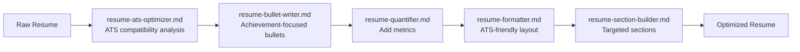
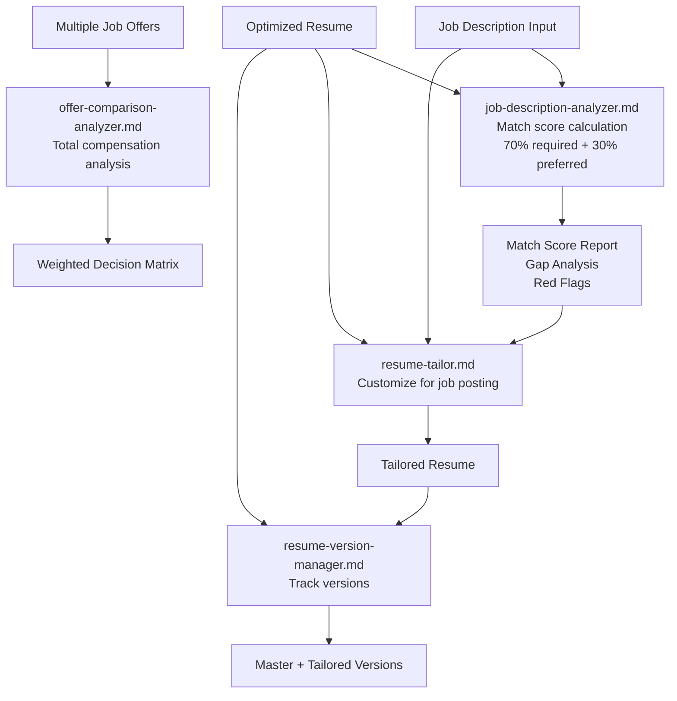
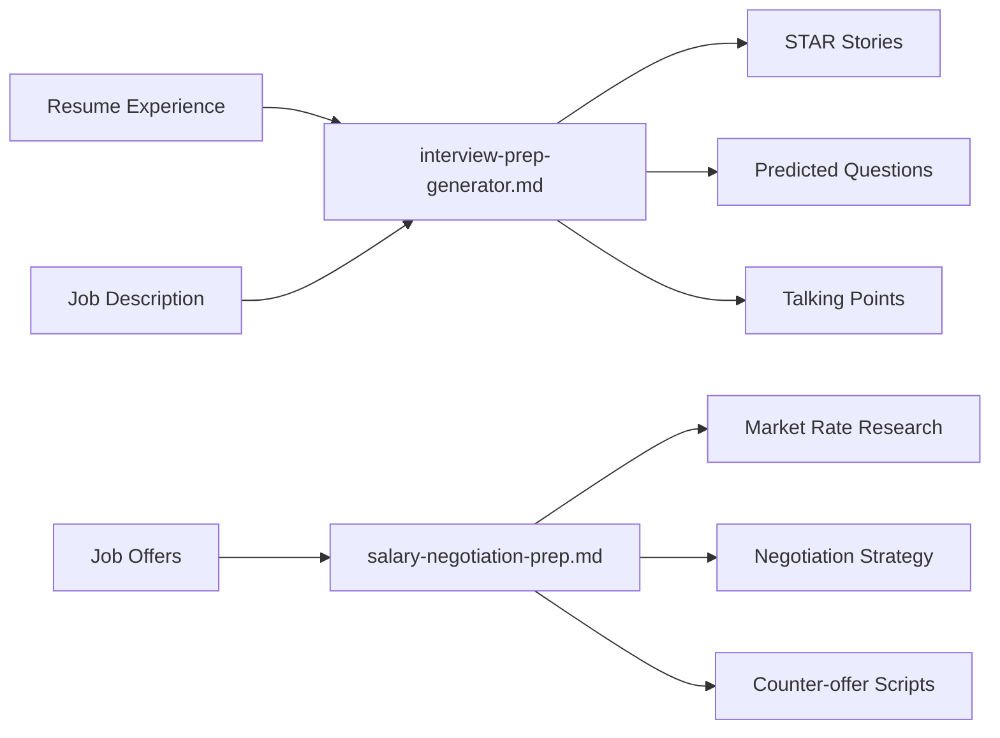
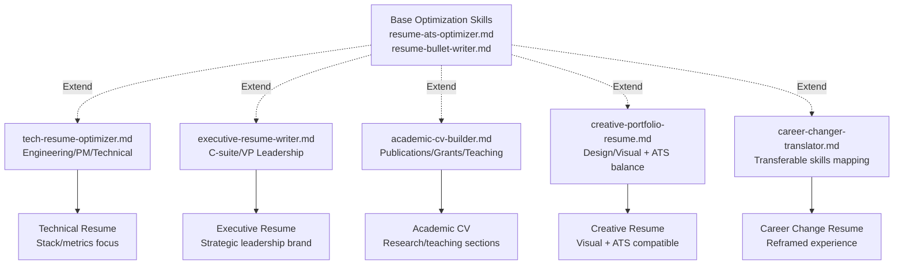
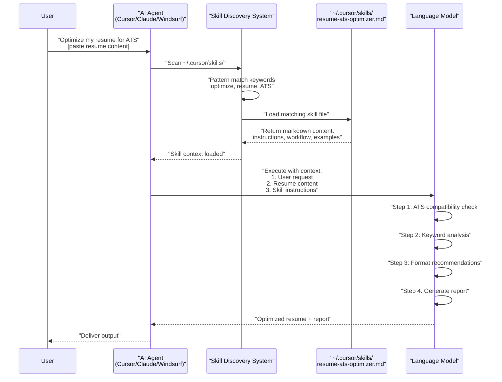
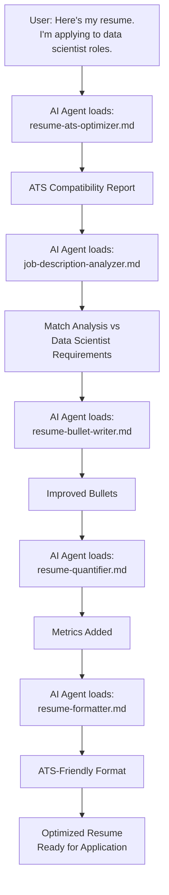

<!-- source: DeepWiki mcp.deepwiki.com · repo Paramchoudhary/ResumeSkills · page 1 Home · fetched 2026-10-26 -->

# Home

Relevant source files

The following files were used as context for generating this wiki page:

- [README.md](README.md)

## Purpose and Scope

This document introduces the ResumeSkills system: a collection of 20 AI agent skills implemented as markdown files that provide specialized knowledge for resume optimization, job search strategy, and career development. This page covers the system's architecture, problem-solution mapping, skill inventory, and measurable outcomes. 

For installation procedures, see [Getting Started](#2). For detailed skill documentation, see [Skills Reference](#4). For workflow examples, see [End-to-End Workflows](#5).

**Sources:** [README.md:1-33]()

---

## What is ResumeSkills

ResumeSkills is a skill repository containing markdown-based instruction files that extend AI coding assistants with domain expertise in job search and career development. Each skill is a standalone `.md` file stored in the `/skills` directory at [github.com/Paramchoudhary/ResumeSkills](https://github.com/Paramchoudhary/ResumeSkills).

### System Components

```mermaid
graph TB
    subgraph "GitHub Repository"
        REPO["Paramchoudhary/ResumeSkills"]
        SKILLS_DIR["/skills directory"]
        README["README.md"]
        
        REPO --> SKILLS_DIR
        REPO --> README
    end
    
    subgraph "Local Storage Locations"
        GLOBAL["~/.cursor/skills/"]
        PROJECT["./.skills/"]
    end
    
    subgraph "Skill Files (20 total)"
        ATS["resume-ats-optimizer.md"]
        BULLET["resume-bullet-writer.md"]
        JDA["job-description-analyzer.md"]
        TAILOR["resume-tailor.md"]
        COVER["cover-letter-generator.md"]
        INTERVIEW["interview-prep-generator.md"]
        SALARY["salary-negotiation-prep.md"]
        TECH["tech-resume-optimizer.md"]
        EXEC["executive-resume-writer.md"]
        QUANT["resume-quantifier.md"]
        FORMAT["resume-formatter.md"]
        PORTFOLIO["portfolio-case-study-writer.md"]
        LINKEDIN["linkedin-profile-optimizer.md"]
        ACADEMIC["academic-cv-builder.md"]
        REFERENCE["reference-list-builder.md"]
        OFFER["offer-comparison-analyzer.md"]
        VERSION["resume-version-manager.md"]
        CREATIVE["creative-portfolio-resume.md"]
        SECTION["resume-section-builder.md"]
        CAREER["career-changer-translator.md"]
    end
    
    subgraph "AI Agents (30+ supported)"
        CURSOR["Cursor IDE"]
        CLAUDE["Claude Code CLI"]
        WINDSURF["Windsurf"]
        OTHERS["Codex, Gemini CLI, Amp, Augment, etc."]
    end
    
    SKILLS_DIR --> ATS & BULLET & JDA & TAILOR & COVER
    SKILLS_DIR --> INTERVIEW & SALARY & TECH & EXEC & QUANT
    SKILLS_DIR --> FORMAT & PORTFOLIO & LINKEDIN & ACADEMIC & REFERENCE
    SKILLS_DIR --> OFFER & VERSION & CREATIVE & SECTION & CAREER
    
    ATS & BULLET & JDA & TAILOR & COVER --> GLOBAL
    INTERVIEW & SALARY & TECH & EXEC & QUANT --> GLOBAL
    FORMAT & PORTFOLIO & LINKEDIN & ACADEMIC & REFERENCE --> GLOBAL
    OFFER & VERSION & CREATIVE & SECTION & CAREER --> GLOBAL
    
    ATS & BULLET & JDA --> PROJECT
    
    GLOBAL --> CURSOR & CLAUDE & WINDSURF & OTHERS
    PROJECT --> CURSOR & CLAUDE & WINDSURF & OTHERS
```

**File Storage Architecture**: Skills are deployed to `~/.cursor/skills/` for global access across all projects, or `./.skills/` for project-specific scope. AI agents scan these directories at runtime to discover available skills.

**Sources:** [README.md:1-7](), [README.md:34-65](), [README.md:77-87]()

---

## Problem-Solution Architecture

The system addresses documented pain points in the job search process through targeted skill interventions.

| Problem | Impact | Solving Skills | File Paths |
|---------|--------|----------------|------------|
| 75% of resumes rejected by ATS | Never reach human reviewers | `resume-ats-optimizer` `resume-formatter` | `/skills/resume-ats-optimizer.md` `/skills/resume-formatter.md` |
| 250 applications per job posting | Fierce competition requires differentiation | `job-description-analyzer` `resume-tailor` | `/skills/job-description-analyzer.md` `/skills/resume-tailor.md` |
| Weak bullets lacking metrics | Unclear impact and value | `resume-bullet-writer` `resume-quantifier` | `/skills/resume-bullet-writer.md` `/skills/resume-quantifier.md` |
| Applying to wrong-fit jobs | Wasted time and effort | `job-description-analyzer` | `/skills/job-description-analyzer.md` |
| Unprepared for interviews | Poor performance in interviews | `interview-prep-generator` | `/skills/interview-prep-generator.md` |
| Leaving money on table in negotiation | $10K+ lower offers | `salary-negotiation-prep` `offer-comparison-analyzer` | `/skills/salary-negotiation-prep.md` `/skills/offer-comparison-analyzer.md` |

**Sources:** [README.md:141-160]()

---

## The 20 Skills: Functional Organization

Skills are organized into five functional categories based on job search lifecycle stages.

### Category 1: Resume Optimization (5 skills)

**Pipeline Architecture**: These skills form a sequential processing pipeline where each skill builds upon the previous optimization.

| Skill File | Purpose | Key Function |
|------------|---------|--------------|
| `resume-ats-optimizer.md` | Parse ATS compatibility | Keyword density analysis, formatting checks |
| `resume-bullet-writer.md` | Transform bullets | Convert task lists to achievement statements |
| `resume-quantifier.md` | Add metrics | Insert numbers, percentages, scale indicators |
| `resume-formatter.md` | Clean layout | Remove formatting that breaks ATS parsers |
| `resume-section-builder.md` | Section targeting | Create role-specific section structures |

**Sources:** [README.md:110-117](), [README.md:13-16](), [README.md:24-26](), [README.md:32]()

### Category 2: Job Search Strategy (4 skills)

**Analysis Layer**: `job-description-analyzer.md` acts as a gatekeeper, calculating match scores before tailoring. Only jobs meeting threshold (typically 70% required skills) proceed to customization.

**Sources:** [README.md:118-123](), [README.md:15-17](), [README.md:28-30]()

### Category 3: Supporting Documents (4 skills)

| Skill File | Input Sources | Output Document |
|------------|---------------|-----------------|
| `cover-letter-generator.md` | Tailored resume + job description | Personalized cover letter |
| `linkedin-profile-optimizer.md` | Resume content | Optimized LinkedIn profile with keyword strategy |
| `portfolio-case-study-writer.md` | Resume bullets | Detailed case studies (6-section structure) |
| `reference-list-builder.md` | Career experience | Professional reference list with prep materials |

**Sources:** [README.md:124-129](), [README.md:17-19](), [README.md:26-28]()

### Category 4: Interview & Negotiation (2 skills)

**Three-Phase Framework**: `interview-prep-generator.md` implements role analysis → story banking → mock preparation. `salary-negotiation-prep.md` handles market research and scripting.

**Sources:** [README.md:130-133](), [README.md:19-21]()

### Category 5: Specialized Roles (5 skills)

**Extension Pattern**: Specialized skills extend base optimization patterns with role-specific frameworks. `executive-resume-writer.md` replaces task-focused bullets with leadership impact statements. `tech-resume-optimizer.md` adds technology stack emphasis.

**Sources:** [README.md:134-140](), [README.md:21-24]()

---

## Runtime Invocation Model

### Natural Language to Skill Mapping

**Keyword Matching**: When a user invokes with natural language like `"Optimize my resume for ATS"`, the AI agent scans `~/.cursor/skills/` for markdown files containing matching keywords in their filenames and content. The file `resume-ats-optimizer.md` is loaded and its structured instructions guide the language model's execution.

**Sources:** [README.md:88-107]()

### Example Invocations

| User Prompt | Matched Skill File | Trigger Keywords |
|-------------|-------------------|------------------|
| `"Optimize my resume for ATS"` | `resume-ats-optimizer.md` | optimize, resume, ATS |
| `"Improve my resume bullets"` | `resume-bullet-writer.md` | improve, resume, bullets |
| `"Should I apply to this job?"` + JD | `job-description-analyzer.md` | apply, job, job description |
| `"Write me a cover letter"` | `cover-letter-generator.md` | write, cover letter |
| `"Prep me for an interview"` | `interview-prep-generator.md` | prep, interview |

**Sources:** [README.md:91-107]()

---

## Multi-Skill Workflows

Skills can be chained together to form complete workflows:

**Workflow Example**: A single user request triggers sequential skill invocations. Each skill's output feeds into the next, creating a processing pipeline.

**Sources:** [README.md:161-175]()

---

## Measurable Outcomes

The system produces quantified improvements across key job search metrics:

| Metric | Baseline | With ResumeSkills | Improvement |
|--------|----------|-------------------|-------------|
| Interview Rate | 1-2% per application | 3-6% per application | **2-3x increase** |
| Response Quality | Generic rejections | Personalized recruiter outreach | **Higher quality** |
| Job Search Duration | 4-6 months average | 2-4 months average | **2 months saved** |
| Salary Offers | Market rate | Market rate + $10K-$20K | **$10K+ higher** |

**Problem Resolution Map**:
- **75% ATS rejection** → Resolved by `resume-ats-optimizer.md` + `resume-formatter.md`
- **250 applications/job competition** → Mitigated by `job-description-analyzer.md` (match scoring) + `resume-tailor.md` (targeted applications)
- **Weak bullets** → Fixed by `resume-bullet-writer.md` + `resume-quantifier.md`
- **Wrong-fit applications** → Prevented by `job-description-analyzer.md` (70% threshold)
- **Unprepared interviews** → Addressed by `interview-prep-generator.md` (STAR framework)
- **Low salary offers** → Improved by `salary-negotiation-prep.md` + `offer-comparison-analyzer.md`

**Sources:** [README.md:141-160]()

---

## Supported Platforms

The skills work with 30+ AI coding assistants through a common skill discovery protocol:

### Confirmed Compatible Agents

| Agent | Type | Skill Directory |
|-------|------|----------------|
| Cursor | IDE | `~/.cursor/skills/` |
| Claude Code | CLI | `~/.cursor/skills/` |
| Windsurf | IDE | `~/.cursor/skills/` |
| Codex | CLI/API | `~/.cursor/skills/` |
| Gemini CLI | CLI | `~/.cursor/skills/` |
| Amp, Antigravity, Augment | Various | `~/.cursor/skills/` or `./.skills/` |

**Agent-Agnostic Design**: All skills are implemented as plain markdown files following a common structure. Any AI agent that can read markdown files from `~/.cursor/skills/` or `./.skills/` can utilize these skills without modification.

**Sources:** [README.md:77-87]()

---

## Next Steps

- **To install the system**, see [Installation](#2.1)
- **To run your first skills**, see [Your First Skills](#2.2)
- **For detailed skill documentation**, see [Skills Reference](#4)
- **For complete workflow examples**, see [End-to-End Workflows](#5)
- **For CLI command reference**, see [CLI Reference](#6)

**Sources:** [README.md:34-76]()

---

