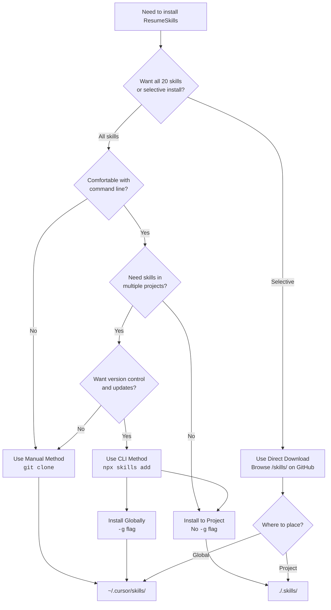
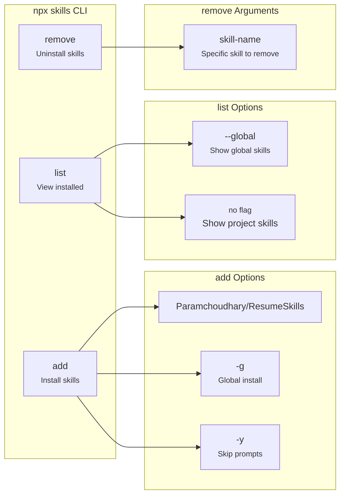
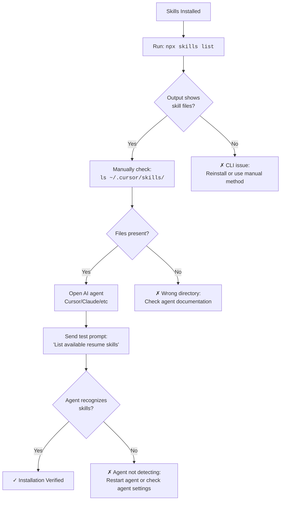
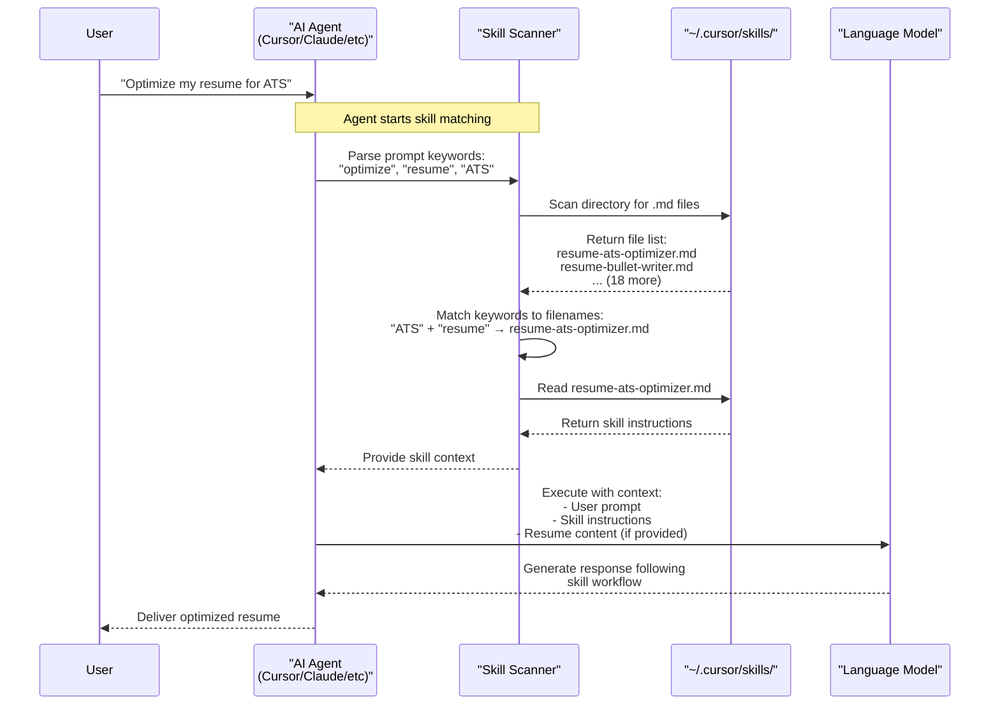
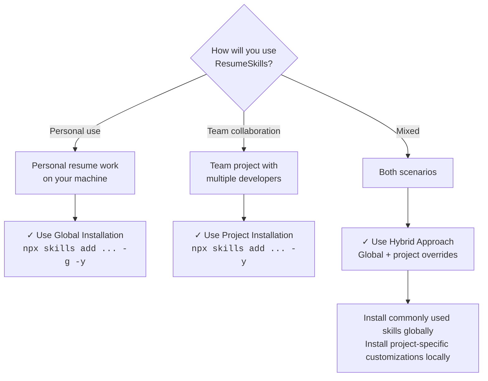
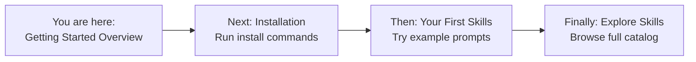

<!-- source: DeepWiki mcp.deepwiki.com · repo Paramchoudhary/ResumeSkills · page 2 Getting Started · fetched 2026-10-26 -->

# Getting Started

<details>
<summary>Relevant source files</summary>

The following files were used as context for generating this wiki page:

- [README.md](README.md)

</details>


This page provides an overview of how to install and configure the ResumeSkills system for use with AI coding assistants. It covers the installation decision process, storage locations, and verification steps. For detailed installation commands, see [Installation](#2.1). For examples of using skills after installation, see [Your First Skills](#2.2).

---

## Purpose and Scope

The ResumeSkills system requires a one-time setup process to make skills available to your AI agent. This involves:

1. **Choosing an installation method** - CLI, manual, or direct download
2. **Selecting a storage scope** - global (all projects) or project-specific
3. **Verifying installation** - confirming skills are discoverable
4. **Understanding skill invocation** - how to trigger skills with natural language

This page provides the conceptual overview. Detailed step-by-step instructions are in the child pages.

**Sources:** [README.md:34-75]()

---

## Installation Decision Tree

The first decision is which installation method to use. The three methods differ in automation level, scope control, and selectivity:



**Key Decision Factors:**

| Method | Automation | Selectivity | Updates | Best For |
|--------|-----------|-------------|---------|----------|
| **CLI** (`npx skills add`) | High | All skills only | Easy (`npx skills update`) | Most users, production use |
| **Manual** (`git clone`) | Medium | All skills only | Manual (`git pull`) | Control, offline work |
| **Direct Download** | Low | Individual files | Manual re-download | Trying specific skills |

**Sources:** [README.md:34-63]()

---

## File System Architecture

After installation, skills are stored as individual markdown files in one of two locations. Understanding this structure is critical for troubleshooting and manual management:

```mermaid
graph TD
    subgraph FILESYSTEM["File System"]
        subgraph HOME["Home Directory (~/)"]
            CURSOR_DIR[".cursor/"]
            AGENTS_DIR[".agents/"]
            
            CURSOR_DIR --> SKILLS_GLOBAL[".cursor/skills/"]
            AGENTS_DIR --> AGENTS_SKILLS[".agents/skills/"]
        end
        
        subgraph PROJECT["Project Directory (./)"]
            PROJ_SKILLS[".skills/"]
        end
        
        subgraph SKILL_FILES["Skill Markdown Files"]
            ATS["resume-ats-optimizer.md"]
            BULLET["resume-bullet-writer.md"]
            JDA["job-description-analyzer.md"]
            TAILOR["resume-tailor.md"]
            COVER["cover-letter-generator.md"]
            LINKEDIN["linkedin-profile-optimizer.md"]
            INTERVIEW["interview-prep-generator.md"]
            SALARY["salary-negotiation-prep.md"]
            TECH["tech-resume-optimizer.md"]
            EXEC["executive-resume-writer.md"]
            CAREER["career-changer-translator.md"]
            QUANT["resume-quantifier.md"]
            FORMAT["resume-formatter.md"]
            PORTFOLIO["portfolio-case-study-writer.md"]
            ACADEMIC["academic-cv-builder.md"]
            REFERENCE["reference-list-builder.md"]
            OFFER["offer-comparison-analyzer.md"]
            VERSION["resume-version-manager.md"]
            CREATIVE["creative-portfolio-resume.md"]
            SECTION["resume-section-builder.md"]
        end
    end
    
    subgraph AI_AGENTS["AI Agent Discovery"]
        CURSOR_IDE["Cursor IDE"]
        CLAUDE_CLI["Claude Code CLI"]
        WINDSURF["Windsurf"]
        OTHER["30+ Other Agents"]
    end
    
    SKILLS_GLOBAL -.-> ATS
    SKILLS_GLOBAL -.-> BULLET
    SKILLS_GLOBAL -.-> JDA
    SKILLS_GLOBAL -.-> TAILOR
    SKILLS_GLOBAL -.-> COVER
    AGENTS_SKILLS -.-> LINKEDIN
    AGENTS_SKILLS -.-> INTERVIEW
    PROJ_SKILLS -.-> SALARY
    PROJ_SKILLS -.-> TECH
    
    CURSOR_IDE -->|"Scans on startup"| SKILLS_GLOBAL
    CURSOR_IDE -->|"Scans on open"| PROJ_SKILLS
    CLAUDE_CLI -->|"Scans"| AGENTS_SKILLS
    WINDSURF -->|"Scans"| SKILLS_GLOBAL
    OTHER -->|"Scans"| SKILLS_GLOBAL
```



**Storage Locations:**

| Path | Scope | Used By | Priority |
|------|-------|---------|----------|
| `~/.cursor/skills/` | Global | Cursor IDE | All projects |
| `~/.agents/skills/` | Global | Claude Code CLI, others | All projects |
| `./.skills/` | Project | All agents | Current project only |

**Discovery Priority:** When a skill exists in both locations, project-specific (`./.skills/`) takes precedence over global (`~/.cursor/skills/` or `~/.agents/skills/`).

**File Structure:** Each skill is a single `.md` file with naming pattern `{skill-name}.md`. The filename becomes the skill identifier.

**Sources:** [README.md:39-59](), [README.md:72-74]()

---

## CLI Command Reference

The `npx skills` CLI provides commands for managing skill installation lifecycle:



**Command Syntax:**

```bash
# Installation
npx skills add Paramchoudhary/ResumeSkills -g -y    # Global, skip prompts
npx skills add Paramchoudhary/ResumeSkills -y       # Project-specific

# Verification
npx skills list --global                            # List global skills
npx skills list                                     # List project skills

# Removal
npx skills remove resume-ats-optimizer              # Remove specific skill
```

**Command Breakdown:**

| Command | Arguments | Flags | Effect |
|---------|-----------|-------|--------|
| `add` | `{owner}/{repo}` | `-g` (global), `-y` (auto-yes) | Fetches from GitHub, installs to storage location |
| `list` | None | `--global` (show global) | Lists installed skills in specified scope |
| `remove` | `{skill-name}` | None | Deletes `.md` file from storage location |

**Sources:** [README.md:39-51](), [README.md:65-75]()

---

## Installation Methods Overview

### Method 1: CLI Installation (Recommended)

Uses the `npx skills` command to fetch and install skills from the GitHub repository. Provides automatic scope management and supports both global and project-specific installation.

**When to use:**
- First-time users who want all 20 skills
- Teams standardizing on a skill set
- Production environments requiring version control

**Detailed instructions:** See [Installation](#2.1) → CLI Installation

**Sources:** [README.md:36-51]()

---

### Method 2: Manual Git Clone

Clones the repository and manually copies skill files to the global skills directory. Provides full control over the installation process and enables offline work.

**When to use:**
- Developers who prefer manual control
- Offline or air-gapped environments
- Contributing to or modifying skills

**Detailed instructions:** See [Installation](#2.1) → Manual Installation

**Sources:** [README.md:52-59]()

---

### Method 3: Direct File Download

Downloads individual skill markdown files from the `/skills` directory on GitHub and places them manually in the skills folder.

**When to use:**
- Testing specific skills before full installation
- Selective installation of 1-3 skills
- Environments with restricted CLI access

**Detailed instructions:** See [Installation](#2.1) → Direct Download

**Sources:** [README.md:61-63]()

---

## Verification Process

After installation, verify that skills are discoverable by AI agents:



**Verification Commands:**

```bash
# List installed skills (requires successful installation)
npx skills list --global              # Check global installation
npx skills list                       # Check project installation

# Manual filesystem verification
ls ~/.cursor/skills/                  # Cursor IDE global location
ls ~/.agents/skills/                  # Claude Code CLI location
ls ./.skills/                         # Project-specific location

# Count installed skills
ls ~/.cursor/skills/ | wc -l          # Should show 20 for full install
```

**Expected Output:** If installation succeeded, you should see a list of 20 `.md` files with names like `resume-ats-optimizer.md`, `resume-bullet-writer.md`, etc.

**Sources:** [README.md:45-49]()

---

## Skill Discovery and Invocation

Once installed, AI agents automatically discover skills when you use natural language prompts. No explicit "import" or "load" commands are needed:



**Natural Language to Skill Mapping:**

| User Prompt Example | Keywords Matched | Skill Loaded |
|---------------------|------------------|--------------|
| "Optimize my resume for ATS" | `ATS`, `optimize`, `resume` | `resume-ats-optimizer.md` |
| "Improve my resume bullets" | `bullets`, `resume`, `improve` | `resume-bullet-writer.md` |
| "Should I apply to this job?" | `job`, `apply`, `should` | `job-description-analyzer.md` |
| "Write a cover letter" | `cover letter`, `write` | `cover-letter-generator.md` |
| "Prep for interview at Google" | `interview`, `prep` | `interview-prep-generator.md` |

**No Explicit Invocation Required:** Unlike traditional software where you call functions by name, skills work through semantic matching. You describe what you want in natural language, and the agent finds the appropriate skill.

**Sources:** [README.md:88-107](), Diagram 4 from context

---

## Global vs Project-Specific Installation

Understanding the difference between global and project-specific installation is crucial for multi-project workflows:

| Aspect | Global Installation | Project-Specific Installation |
|--------|-------------------|------------------------------|
| **Storage Path** | `~/.cursor/skills/` or `~/.agents/skills/` | `./.skills/` in project root |
| **Availability** | All projects, system-wide | Current project only |
| **CLI Flag** | `-g` (e.g., `npx skills add ... -g`) | No flag (default) |
| **Use Case** | Personal resume work across multiple folders | Team project with shared skill requirements |
| **Conflict Resolution** | Lower priority (overridden by project skills) | Higher priority (overrides global) |
| **Version Control** | Not tracked in project repos | Can be committed to `.git` |

**Decision Guideline:**



**Example Hybrid Setup:**

```bash
# Global installation for personal use
npx skills add Paramchoudhary/ResumeSkills -g -y

# Project-specific override (in a team repo)
cd ~/work/team-hiring-project
npx skills add Paramchoudhary/ResumeSkills -y

# Result: Team project uses ./.skills/, other projects use ~/.cursor/skills/
```

**Sources:** [README.md:39-43]()

---

## Supported AI Agents

The ResumeSkills system is agent-agnostic. Skills work with any AI agent that supports a skills/prompts directory. Confirmed compatible agents include:

| Agent Type | Agent Name | Skills Directory |
|------------|-----------|------------------|
| **IDE** | Cursor | `~/.cursor/skills/` |
| **CLI** | Claude Code | `~/.agents/skills/` |
| **IDE** | Windsurf | `~/.cursor/skills/` or agent-specific path |
| **IDE** | Codex | Agent-specific skills path |
| **CLI** | Gemini CLI | Agent-specific skills path |
| **Various** | Amp, Antigravity, Augment, +30 more | Varies by agent |

**Compatibility Note:** If your agent doesn't automatically detect skills in `~/.cursor/skills/` or `~/.agents/skills/`, consult your agent's documentation for the correct skills directory path.

**Sources:** [README.md:77-87]()

---

## Next Steps

After completing installation and verification:

1. **Learn detailed installation commands** → See [Installation](#2.1) for step-by-step instructions for each method
2. **Try your first skills** → See [Your First Skills](#2.2) for example prompts and expected outputs
3. **Understand skill architecture** → See [System Architecture](#3) for how skills work internally
4. **Explore all available skills** → See [Skills Reference](#4) for complete skill catalog

**Quick Start Path:**



**Sources:** [README.md:161-200]()

---

