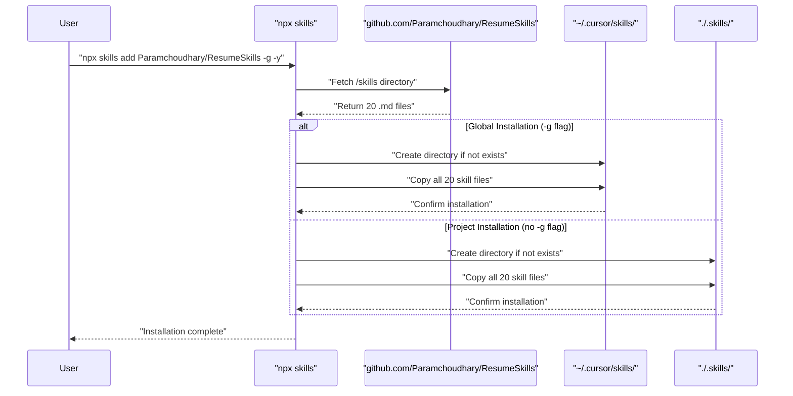
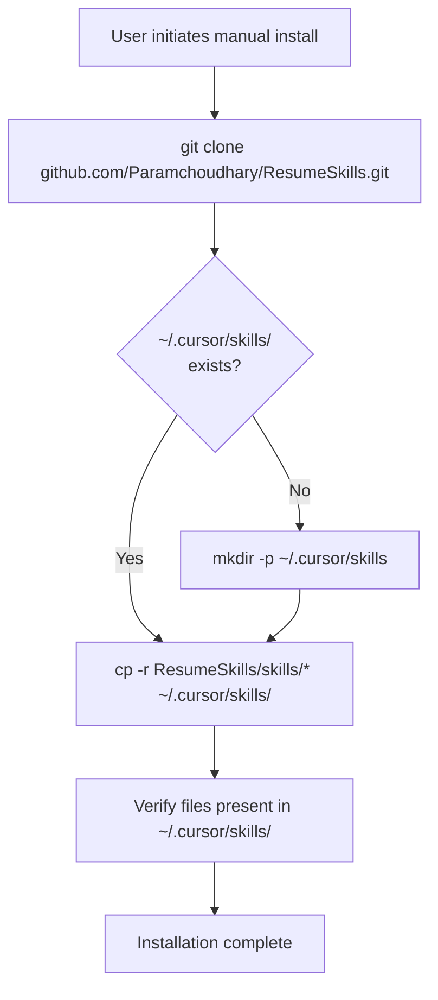
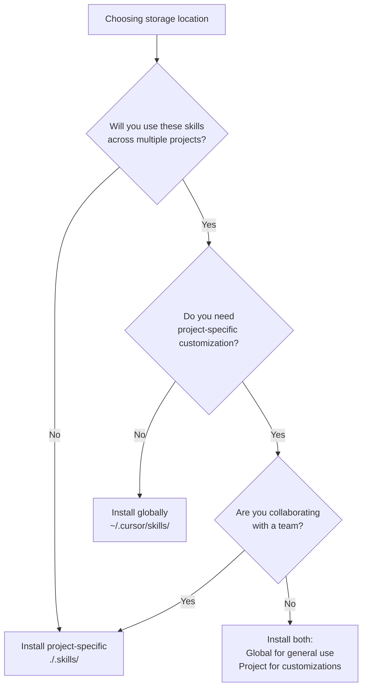
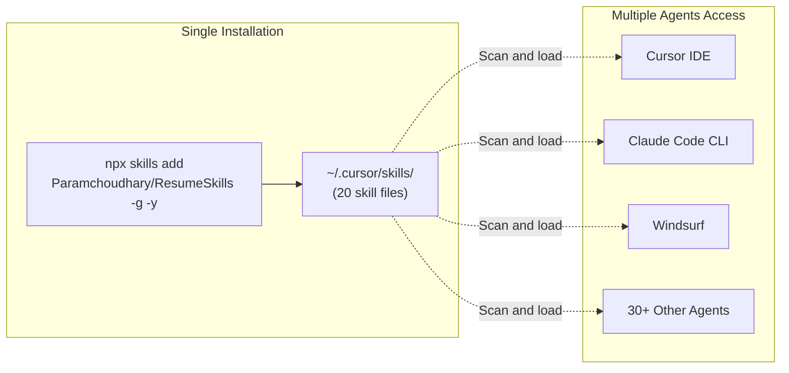

<!-- source: DeepWiki mcp.deepwiki.com · repo Paramchoudhary/ResumeSkills · page 2.1 Installation · fetched 2026-10-26 -->

# Installation

<details>
<summary>Relevant source files</summary>

The following files were used as context for generating this wiki page:

- [README.md](README.md)

</details>


## Purpose and Scope

This page provides detailed installation instructions for the ResumeSkills system. It covers all three installation methods: CLI-based installation (recommended), manual git clone installation, and direct file download. Each method deploys skill markdown files to local storage locations where AI agents can discover and load them.

For information on how to use skills after installation, see [Your First Skills](#2.2). For details on how AI agents discover and execute skills, see [AI Agent Integration](#3.2).

---

## Installation Overview

The ResumeSkills system consists of 20 markdown files (skills) that must be deployed to one of two local storage locations:

| Storage Type | Location | Scope |
|-------------|----------|-------|
| **Global** | `~/.cursor/skills/` | Available to all projects and AI agents |
| **Project-specific** | `./.skills/` | Available only within the current project directory |

All installation methods ultimately copy skill files to these locations. AI agents scan these directories to discover available skills.

**Sources:** [README.md:34-75]()

---

## Installation Method Comparison

The following table compares the three installation approaches:

| Method | Speed | Skill Selection | Automation | Best For |
|--------|-------|----------------|------------|----------|
| **CLI Install** | Fast | All 20 skills | Fully automated | Most users |
| **Manual Install** | Medium | All 20 skills | Semi-automated | Users who prefer git workflow |
| **Direct Download** | Slow | Individual skills | Manual | Selective installation |

---

## Method 1: CLI Installation (Recommended)

The CLI method uses the `npx skills` command to fetch all 20 skills from the GitHub repository and deploy them automatically.

### Global Installation

Global installation makes skills available across all projects:

```bash
npx skills add Paramchoudhary/ResumeSkills -g -y
```

**Command breakdown:**
- `npx skills add` - Invokes the skills CLI tool
- `Paramchoudhary/ResumeSkills` - GitHub repository identifier
- `-g` - Global flag (installs to `~/.cursor/skills/`)
- `-y` - Auto-confirm flag (skips prompts)

### Project-Specific Installation

Project-specific installation confines skills to the current directory:

```bash
npx skills add Paramchoudhary/ResumeSkills -y
```

**Difference from global:** Omitting the `-g` flag installs to `./.skills/` in the current working directory.

### Installation Flow Diagram



### Verification Commands

After installation, verify skills are available:

```bash
# List global skills
npx skills list --global

# List project-specific skills
npx skills list

# Sample output:
# resume-ats-optimizer
# resume-bullet-writer
# job-description-analyzer
# [... 17 more skills]
```

**Sources:** [README.md:36-50]()

---

## Method 2: Manual Installation

Manual installation uses git to clone the repository, then copies files to the global skills directory.

### Step-by-Step Process

```bash
# Step 1: Clone the repository
git clone https://github.com/Paramchoudhary/ResumeSkills.git

# Step 2: Create the global skills directory (if it doesn't exist)
mkdir -p ~/.cursor/skills

# Step 3: Copy all skill files to the global directory
cp -r ResumeSkills/skills/* ~/.cursor/skills/
```

### Manual Installation Flow



### When to Use Manual Installation

Manual installation is appropriate when:
- You want to inspect skill files before installation
- You need to customize skills before deployment
- You prefer git-based workflows
- The CLI tool is unavailable or blocked by corporate policies

**Sources:** [README.md:52-59]()

---

## Method 3: Direct Download

Direct download allows selective installation of individual skills rather than all 20.

### Process

1. Navigate to the repository's `/skills` directory in a web browser: `https://github.com/Paramchoudhary/ResumeSkills/tree/main/skills`
2. Click on individual skill markdown files (e.g., `resume-ats-optimizer.md`)
3. Click "Raw" button to view the raw markdown
4. Save the file to your local skills directory

### Manual File Placement

After downloading, place files in the appropriate directory:

```bash
# For global access
mv ~/Downloads/resume-ats-optimizer.md ~/.cursor/skills/

# For project-specific access
mv ~/Downloads/resume-ats-optimizer.md ./.skills/
```

### Skills Available for Individual Download

The repository contains these 20 skill files in the `/skills` directory:

| Category | Skill Files |
|----------|-------------|
| **Resume Optimization** | `resume-ats-optimizer.md`, `resume-bullet-writer.md`, `resume-quantifier.md`, `resume-formatter.md`, `resume-section-builder.md` |
| **Job Search Strategy** | `job-description-analyzer.md`, `resume-tailor.md`, `resume-version-manager.md`, `offer-comparison-analyzer.md` |
| **Supporting Documents** | `cover-letter-generator.md`, `linkedin-profile-optimizer.md`, `portfolio-case-study-writer.md`, `reference-list-builder.md` |
| **Interview & Negotiation** | `interview-prep-generator.md`, `salary-negotiation-prep.md` |
| **Specialized Roles** | `tech-resume-optimizer.md`, `executive-resume-writer.md`, `academic-cv-builder.md`, `creative-portfolio-resume.md`, `career-changer-translator.md` |

**Sources:** [README.md:61-63](), [README.md:11-32]()

---

## Post-Installation Directory Structure

After successful installation, your directory structure should match one of these patterns:

### Global Installation Structure

```
~/.cursor/skills/
├── resume-ats-optimizer.md
├── resume-bullet-writer.md
├── job-description-analyzer.md
├── resume-tailor.md
├── cover-letter-generator.md
├── linkedin-profile-optimizer.md
├── interview-prep-generator.md
├── salary-negotiation-prep.md
├── tech-resume-optimizer.md
├── executive-resume-writer.md
├── career-changer-translator.md
├── resume-quantifier.md
├── resume-formatter.md
├── portfolio-case-study-writer.md
├── academic-cv-builder.md
├── reference-list-builder.md
├── offer-comparison-analyzer.md
├── resume-version-manager.md
├── creative-portfolio-resume.md
└── resume-section-builder.md
```

### Project-Specific Installation Structure

```
your-project/
├── .skills/
│   ├── resume-ats-optimizer.md
│   ├── resume-bullet-writer.md
│   ├── [... 18 more skill files]
├── src/
├── package.json
└── [other project files]
```

### Storage Location Decision Matrix



**Sources:** [README.md:52-59]()

---

## Uninstallation

### CLI-Based Removal

Remove individual skills by name:

```bash
npx skills remove resume-ats-optimizer
npx skills remove resume-bullet-writer
```

### Manual Removal

Remove all skills from global storage:

```bash
rm -rf ~/.cursor/skills/resume-*
```

Remove all skills from project storage:

```bash
rm -rf ./.skills/resume-*
```

### Complete Removal

To remove the entire skills directory:

```bash
# Remove global skills directory
rm -rf ~/.cursor/skills/

# Remove project skills directory
rm -rf ./.skills/
```

**Warning:** This removes all skills, not just ResumeSkills. If you have other skills installed, they will also be deleted.

**Sources:** [README.md:65-75]()

---

## Verification and Testing

### Verify Installation

Confirm skills are discoverable by AI agents:

```bash
# Check global installation
npx skills list --global

# Check project installation
npx skills list

# Check specific file exists
ls ~/.cursor/skills/resume-ats-optimizer.md
```

### Test Skill Invocation

After installation, test with your AI agent:

```
"List all installed resume skills"
```

The AI agent should recognize and list the 20 ResumeSkills.

### Verification Checklist

| Check | Command | Expected Result |
|-------|---------|-----------------|
| Directory exists | `ls ~/.cursor/skills/` | Directory found with 20 .md files |
| Specific skill exists | `ls ~/.cursor/skills/resume-ats-optimizer.md` | File found |
| CLI recognition | `npx skills list --global` | Lists all 20 resume skills |
| Agent recognition | Ask AI "What resume skills are available?" | AI lists installed skills |

**Sources:** [README.md:45-49]()

---

## Supported AI Agents and Compatibility

The installed skills work with multiple AI agents. Each agent has specific directory scanning behaviors:

| AI Agent | Default Skills Directory | Configuration |
|----------|-------------------------|---------------|
| **Cursor** | `~/.cursor/skills/` | Built-in support |
| **Claude Code CLI** | `~/.cursor/skills/` | Built-in support |
| **Windsurf** | `~/.cursor/skills/` | Built-in support |
| **Other agents** | Varies (check docs) | May require configuration |

### Multi-Agent Installation Flow



**Sources:** [README.md:77-86]()

---

## Troubleshooting Common Issues

### Issue: CLI Command Not Found

**Problem:** `npx skills` command fails with "command not found"

**Solutions:**
1. Ensure Node.js and npm are installed: `node --version && npm --version`
2. Update npm: `npm install -g npm@latest`
3. Try manual installation method instead

### Issue: Permission Denied

**Problem:** Cannot write to `~/.cursor/skills/`

**Solutions:**
```bash
# Fix directory permissions
mkdir -p ~/.cursor/skills
chmod 755 ~/.cursor/skills

# Or install with project scope instead
npx skills add Paramchoudhary/ResumeSkills -y
```

### Issue: Skills Not Recognized by AI Agent

**Problem:** AI agent doesn't see installed skills

**Solutions:**
1. Verify installation location matches agent's expected directory
2. Restart the AI agent
3. Check file permissions: `ls -la ~/.cursor/skills/`
4. Verify .md file extensions are present

### Issue: GitHub Rate Limiting

**Problem:** CLI installation fails due to GitHub API limits

**Solutions:**
1. Wait 1 hour for rate limit reset
2. Use manual installation method
3. Authenticate with GitHub CLI: `gh auth login`

**Sources:** [README.md:34-75]()

---

## Next Steps

After successful installation, proceed to [Your First Skills](#2.2) to learn how to invoke and use the installed skills with natural language prompts.

For advanced usage patterns and skill chaining workflows, see [End-to-End Workflows](#5).

For complete CLI reference and command options, see [CLI Reference](#6).

---

