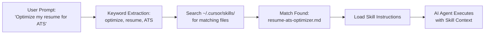
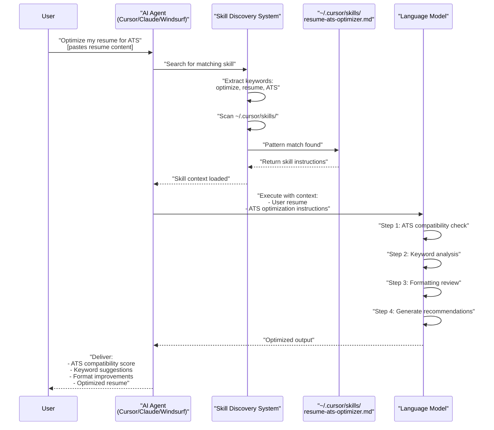
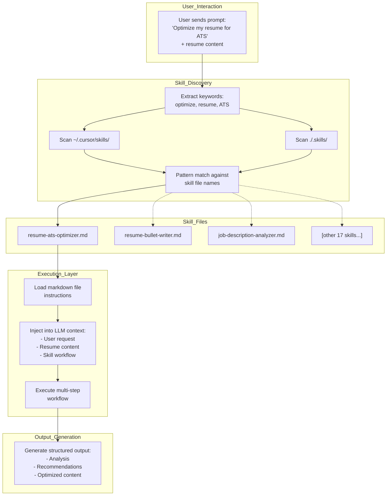
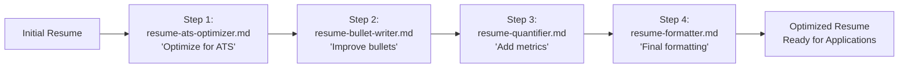

<!-- source: DeepWiki mcp.deepwiki.com · repo Paramchoudhary/ResumeSkills · page 2.2 Your First Skills · fetched 2026-10-26 -->

# Your First Skills

<details>
<summary>Relevant source files</summary>

The following files were used as context for generating this wiki page:

- [README.md](README.md)

</details>


## Purpose and Scope

This page provides a quick start guide for invoking skills after installation. You will learn how to use natural language prompts to trigger specific skills, understand what happens when skills execute, and practice with essential first examples.

For installation instructions, see [Installation](#2.1). For detailed documentation of individual skills, see [Skills Reference](#4). For complete multi-skill workflows, see [End-to-End Workflows](#5).

---

## Prerequisites

Before invoking skills, ensure you have completed installation using one of the methods described in [Installation](#2.1). Skills must be present in either:
- `~/.cursor/skills/` (global installation)
- `./.skills/` (project-specific installation)

Verify installation:
```bash
npx skills list --global
npx skills list
```

**Sources:** [README.md:45-49]()

---

## Basic Invocation Pattern

Skills are invoked through natural language prompts to your AI agent. The AI agent performs keyword matching between your prompt and skill file names stored locally, then loads the matching skill's instructions to guide its response.

### How Prompts Trigger Skills



**Sources:** [README.md:88-107]()

### Storage Location to Skill File Mapping

| Storage Path | Skill File | Triggered By Keywords |
|-------------|------------|----------------------|
| `~/.cursor/skills/resume-ats-optimizer.md` | resume-ats-optimizer | "optimize", "ATS", "resume", "applicant tracking" |
| `~/.cursor/skills/resume-bullet-writer.md` | resume-bullet-writer | "improve", "bullets", "achievement", "resume" |
| `~/.cursor/skills/job-description-analyzer.md` | job-description-analyzer | "should I apply", "match score", "analyze job" |
| `~/.cursor/skills/resume-tailor.md` | resume-tailor | "customize", "tailor", "specific job" |
| `~/.cursor/skills/cover-letter-generator.md` | cover-letter-generator | "cover letter", "write letter" |

**Sources:** [README.md:11-32](), [README.md:92-107]()

---

## Essential First Skills

Start with these three foundational skills to understand the invocation pattern:

### 1. resume-ats-optimizer

**Purpose:** Checks resume compatibility with Applicant Tracking Systems (ATS) and identifies optimization opportunities.

**Storage Location:** `~/.cursor/skills/resume-ats-optimizer.md`

**Common Triggers:**
- "Optimize my resume for ATS"
- "Check if my resume will pass ATS"
- "Is my resume ATS-friendly?"

### 2. resume-bullet-writer

**Purpose:** Transforms weak bullet points into achievement-focused statements with metrics and impact.

**Storage Location:** `~/.cursor/skills/resume-bullet-writer.md`

**Common Triggers:**
- "Improve my resume bullets"
- "Make my bullet points stronger"
- "Add achievements to my resume"

### 3. job-description-analyzer

**Purpose:** Analyzes job postings, calculates match scores, and identifies application strategy.

**Storage Location:** `~/.cursor/skills/job-description-analyzer.md`

**Common Triggers:**
- "Should I apply to this job?" [paste job description]
- "Analyze this job posting"
- "What's my match score for this role?"

**Sources:** [README.md:13-15](), [README.md:92-100](), [README.md:112-116]()

---

## Step-by-Step: Your First Skill Invocation

### Example: Using resume-ats-optimizer



**Step 1: Prepare Your Content**
```
Have your current resume ready in text format.
```

**Step 2: Send Prompt to AI Agent**
```
"Optimize my resume for ATS"

[paste your resume content here]
```

**Step 3: AI Agent Processes Request**
The agent:
1. Extracts keywords: "optimize", "resume", "ATS"
2. Searches `~/.cursor/skills/` directory
3. Finds match: `resume-ats-optimizer.md`
4. Loads skill instructions from file
5. Executes workflow defined in skill

**Step 4: Review Output**
You receive:
- ATS compatibility score
- Keyword match analysis
- Formatting recommendations
- Optimized resume version

**Sources:** [README.md:165-174]()

---

## Prompt Templates and Triggers

### Prompt-to-Skill Mapping Table

| User Prompt | Matched Skill File | Output Delivered |
|-------------|-------------------|------------------|
| "Optimize my resume for ATS" | `resume-ats-optimizer.md` | ATS compatibility report, keyword suggestions, optimized resume |
| "Improve my resume bullets" | `resume-bullet-writer.md` | Rewritten bullets with metrics and achievement focus |
| "Should I apply to this job?" [+JD] | `job-description-analyzer.md` | Match score, gap analysis, application recommendation |
| "Write me a cover letter for this role" [+JD] | `cover-letter-generator.md` | Personalized cover letter draft |
| "Prep me for an interview at [Company]" | `interview-prep-generator.md` | STAR stories, predicted questions, talking points |
| "Tailor my resume for this job" [+JD] | `resume-tailor.md` | Customized resume version |
| "Add metrics to my resume" | `resume-quantifier.md` | Bullets enhanced with quantifiable results |
| "Is my resume formatting ATS-friendly?" | `resume-formatter.md` | Format analysis and corrected layout |

**Sources:** [README.md:92-107]()

### Advanced Prompt Patterns

#### Multi-Step Invocation
```
User: "Optimize my resume for ATS"
[AI uses resume-ats-optimizer.md]

User: "Now improve the bullet points"
[AI uses resume-bullet-writer.md on optimized resume]

User: "Add specific metrics where possible"
[AI uses resume-quantifier.md on improved bullets]
```

#### Context-Rich Prompts
```
User: "Here's a job description [paste JD] and my resume [paste resume]. 
Should I apply?"

[AI uses job-description-analyzer.md to calculate match score]
```

**Sources:** [README.md:165-174]()

---

## What Happens Behind the Scenes

### Skill Loading and Execution Architecture



### File System Structure During Invocation

```mermaid
graph TB
    subgraph "Global_Skills_Directory"
        GLOBAL_PATH["~/.cursor/skills/"]
        
        ATS_FILE["resume-ats-optimizer.md"]
        BULLET_FILE["resume-bullet-writer.md"]
        JDA_FILE["job-description-analyzer.md"]
        TAILOR_FILE["resume-tailor.md"]
        COVER_FILE["cover-letter-generator.md"]
        MORE_FILES["... 15 more skill files"]
        
        GLOBAL_PATH --> ATS_FILE
        GLOBAL_PATH --> BULLET_FILE
        GLOBAL_PATH --> JDA_FILE
        GLOBAL_PATH --> TAILOR_FILE
        GLOBAL_PATH --> COVER_FILE
        GLOBAL_PATH --> MORE_FILES
    end
    
    subgraph "Project_Skills_Directory"
        PROJECT_PATH["./.skills/"]
        PROJECT_SKILL["project-specific-skill.md"]
        PROJECT_PATH --> PROJECT_SKILL
    end
    
    subgraph "AI_Agent_Search_Priority"
        SEARCH_1["1. Search ./.skills/ first"]
        SEARCH_2["2. Search ~/.cursor/skills/ second"]
        SEARCH_3["3. Use first match found"]
    end
    
    PROJECT_PATH -.->|"Priority 1"| SEARCH_1
    GLOBAL_PATH -.->|"Priority 2"| SEARCH_2
```



**Priority Rules:**
1. Project-specific skills (`./.skills/`) are checked first
2. Global skills (`~/.cursor/skills/`) are checked second
3. First matching skill file is loaded
4. If no match found, AI agent proceeds without skill context

**Sources:** [README.md:39-63]()

---

## Common First-Time Scenarios

### Scenario 1: Resume Needs ATS Optimization

```
Prompt: "Optimize my resume for ATS"

File Loaded: ~/.cursor/skills/resume-ats-optimizer.md

Expected Output:
- ATS compatibility score (0-100)
- Keyword analysis against common job descriptions
- Formatting issues detected
- Recommended improvements
- Optimized resume draft
```

### Scenario 2: Weak Bullet Points

```
Prompt: "Improve my resume bullets"

File Loaded: ~/.cursor/skills/resume-bullet-writer.md

Expected Output:
- Rewritten bullets using achievement framework
- Added action verbs and metrics
- Before/after comparison
- Explanation of improvements
```

### Scenario 3: Job Application Decision

```
Prompt: "Should I apply to this job? [paste job description]"

File Loaded: ~/.cursor/skills/job-description-analyzer.md

Expected Output:
- Match score calculation (required vs preferred skills)
- Gap analysis (missing skills)
- Red flags in job posting
- Application recommendation (yes/no/maybe)
- Resume customization strategy
```

**Sources:** [README.md:165-200]()

---

## Skill Chaining for First-Time Users

### Sequential Skill Usage Pattern



**Recommended First Session:**

```
Session Goal: Create ATS-optimized resume with strong bullets

1. "Optimize my resume for ATS"
   → Uses resume-ats-optimizer.md
   
2. "Now improve my bullet points"
   → Uses resume-bullet-writer.md
   
3. "Add specific metrics to each bullet"
   → Uses resume-quantifier.md
   
4. "Check the formatting one more time"
   → Uses resume-formatter.md

Result: Fully optimized resume in ~30 minutes
```

**Sources:** [README.md:165-174]()

---

## Troubleshooting First Invocations

### Skill Not Triggered

**Problem:** AI agent doesn't use skill context

**Diagnostic Steps:**
1. Verify installation:
   ```bash
   npx skills list --global
   ```
2. Check file exists:
   ```bash
   ls ~/.cursor/skills/resume-ats-optimizer.md
   ```
3. Use more explicit keywords in prompt:
   - Instead of: "Make my resume better"
   - Use: "Optimize my resume for ATS compatibility"

### Wrong Skill Triggered

**Problem:** Different skill than expected is loaded

**Solution:** Use skill name explicitly:
```
"Use the resume-ats-optimizer skill to check my resume"
```

### No Output Generated

**Problem:** Skill loads but no structured output

**Solution:** Provide required context:
```
"Optimize my resume for ATS

[paste resume content here - required for skill to execute]"
```

**Sources:** [README.md:45-49](), [README.md:88-107]()

---

## Quick Reference: First Five Skills to Try

| Order | Skill File | Prompt Template | Purpose |
|-------|------------|-----------------|---------|
| 1 | `resume-ats-optimizer.md` | "Optimize my resume for ATS" [+resume] | Ensure ATS compatibility |
| 2 | `resume-bullet-writer.md` | "Improve my resume bullets" [+resume] | Strengthen bullet points |
| 3 | `resume-quantifier.md` | "Add metrics to my resume" [+resume] | Quantify achievements |
| 4 | `job-description-analyzer.md` | "Should I apply?" [+JD] | Analyze job match |
| 5 | `resume-tailor.md` | "Tailor my resume for this job" [+resume +JD] | Customize for specific role |

**Sources:** [README.md:11-32](), [README.md:112-122]()

---

## Next Steps

After mastering basic skill invocation:

- **Learn about skill architecture:** See [How Skills Work](#3.1) for technical details on skill structure and AI agent integration
- **Explore all available skills:** See [Skills Reference](#4) for complete documentation of all 20 skills
- **Build complete workflows:** See [End-to-End Workflows](#5) for multi-skill job search processes
- **Understand AI agent integration:** See [AI Agent Integration](#3.2) for details on how different agents load and execute skills
- **Master the CLI:** See [CLI Reference](#6) for advanced skill management commands

**Sources:** [README.md:97-140](), [README.md:161-200]()

---

