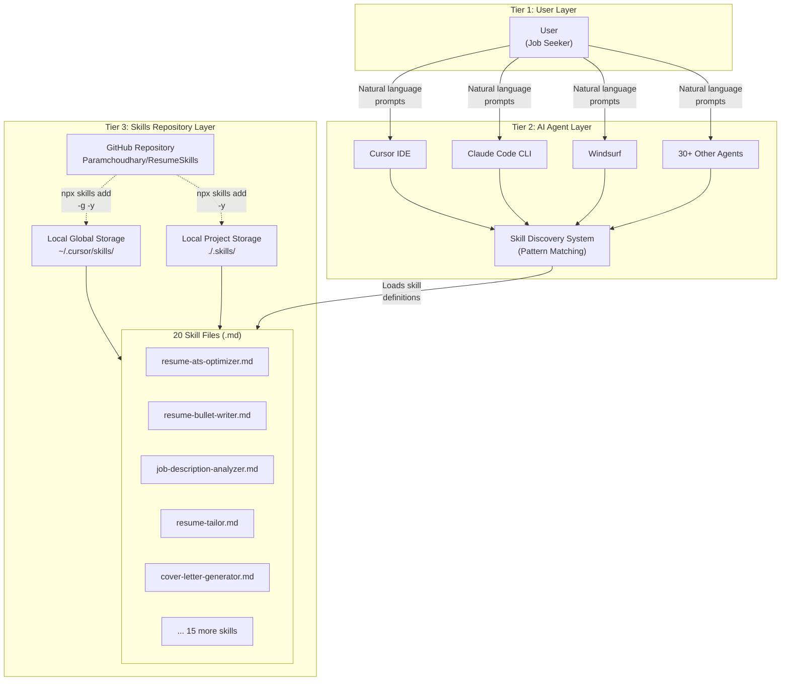
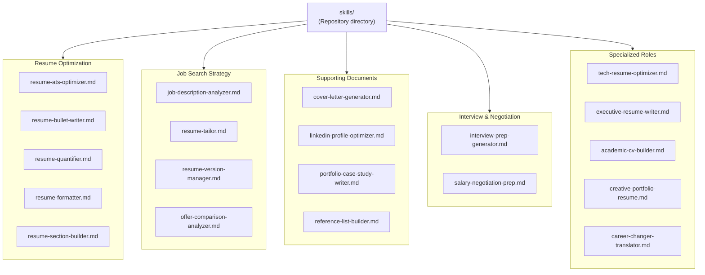
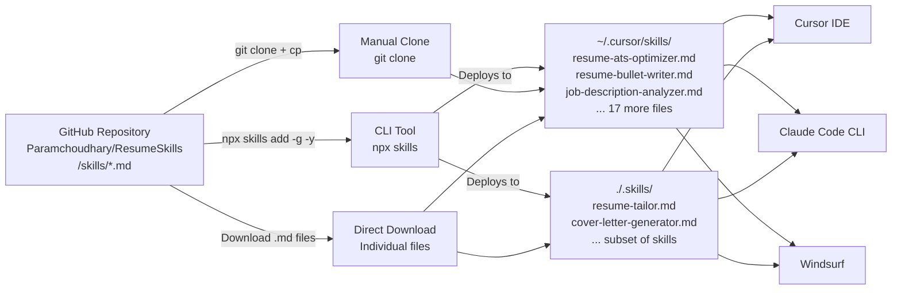
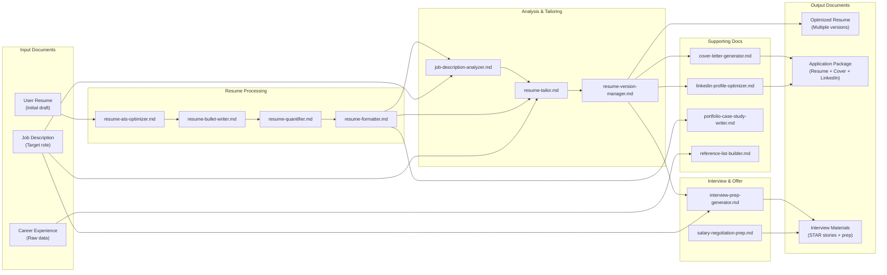
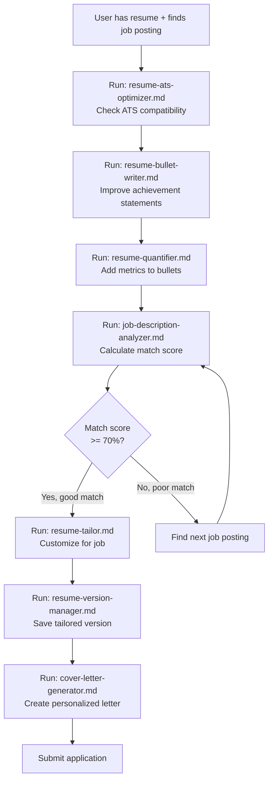

<!-- source: DeepWiki mcp.deepwiki.com · repo Paramchoudhary/ResumeSkills · page 3 System Architecture · fetched 2026-10-26 -->

# System Architecture

Relevant source files

The following files were used as context for generating this wiki page:

- [README.md](README.md)

## Purpose and Scope

This document provides a technical overview of the ResumeSkills system architecture, including its three-tier design, component relationships, storage mechanisms, and skill organization. This page focuses on the overall system structure and how components interact.

For detailed information about how individual skills function internally, see [How Skills Work](#3.1). For specifics on AI agent integration mechanisms, see [AI Agent Integration](#3.2). For the runtime execution model, see [Skill Invocation and Execution](#3.3).

---

## Overview

ResumeSkills implements a **three-tier architecture** that separates user interaction, AI agent orchestration, and skill storage into distinct layers. The system is designed to be **agent-agnostic**, allowing any AI assistant (Cursor, Claude Code, Windsurf, etc.) to access the same skill definitions without modification.

**Key Design Principles:**

| Principle | Implementation |
|-----------|----------------|
| **Portability** | Skills are markdown files, not code dependencies |
| **Agent-Agnostic** | Works with 30+ AI assistants without changes |
| **Local-First** | Skills stored locally in `~/.cursor/skills/` or `./.skills/` |
| **Declarative** | Skills define workflows, agents execute them |
| **Composable** | Skills chain together to form complete workflows |

**Sources:** [README.md:1-8](), [README.md:77-87]()

---

## Three-Tier Architecture

### Architecture Diagram

**Sources:** [README.md:34-75](), [README.md:77-87]()

---

### Tier 1: User Layer

Users interact with the system through natural language prompts directed at their AI assistant. The user does not need to know which skill will be invoked; the system handles skill selection automatically.

**Example Interactions:**

| User Prompt | Skill Invoked |
|-------------|---------------|
| `"Optimize my resume for ATS"` | `resume-ats-optimizer.md` |
| `"Improve my resume bullets"` | `resume-bullet-writer.md` |
| `"Should I apply to this job?"` | `job-description-analyzer.md` |
| `"Write a cover letter for this role"` | `cover-letter-generator.md` |

**Sources:** [README.md:88-107]()

---

### Tier 2: AI Agent Layer

The AI agent layer consists of:

1. **AI Assistants** - Supported agents include:
   - Cursor (IDE)
   - Claude Code (CLI)
   - Windsurf
   - Codex, Gemini CLI, Amp, Antigravity, Augment
   - 30+ additional agents

2. **Skill Discovery System** - Pattern-matching mechanism that:
   - Scans `~/.cursor/skills/` and `./.skills/` directories
   - Matches keywords in user prompts to skill definitions
   - Loads relevant skill markdown files
   - Injects skill instructions into the language model context

**Sources:** [README.md:77-87]()

---

### Tier 3: Skills Repository Layer

The repository layer has three components:

#### GitHub Repository

Central repository at `Paramchoudhary/ResumeSkills` containing the `/skills` directory with 20 skill markdown files.

**Sources:** [README.md:55-59]()

#### Local Storage Locations

| Location | Scope | Installation Command |
|----------|-------|---------------------|
| `~/.cursor/skills/` | Global (all projects) | `npx skills add Paramchoudhary/ResumeSkills -g -y` |
| `./.skills/` | Project-specific | `npx skills add Paramchoudhary/ResumeSkills -y` |

**Sources:** [README.md:36-50]()

#### Skill Files

Each skill is a single markdown file (e.g., `resume-ats-optimizer.md`) containing:
- Skill purpose and triggers
- Step-by-step workflow instructions
- Best practices and examples
- Output format specifications

**Sources:** [README.md:5-7]()

---

## Skill Organization and Categories

### Skill File Structure

**Sources:** [README.md:109-140]()

### Category Breakdown

| Category | Skill Count | Purpose |
|----------|-------------|---------|
| **Resume Optimization** | 5 | Core resume improvement: ATS compatibility, bullet writing, quantification, formatting, section building |
| **Job Search Strategy** | 4 | Strategic application: job analysis, resume tailoring, version management, offer comparison |
| **Supporting Documents** | 4 | Additional materials: cover letters, LinkedIn profiles, portfolios, references |
| **Interview & Negotiation** | 2 | Final stages: interview preparation, salary negotiation |
| **Specialized Roles** | 5 | Role-specific optimization: tech, executive, academic, creative, career changers |

**Sources:** [README.md:109-140]()

---

## Installation and Deployment Architecture

### Deployment Pathways

**Sources:** [README.md:34-75]()

### CLI Commands

| Command | Action | Example |
|---------|--------|---------|
| `npx skills add` | Install skills | `npx skills add Paramchoudhary/ResumeSkills -g -y` |
| `npx skills list` | List installed skills | `npx skills list --global` |
| `npx skills remove` | Remove skills | `npx skills remove resume-ats-optimizer` |

**Flags:**

- `-g` or `--global`: Install to `~/.cursor/skills/` (available to all projects)
- `-y`: Auto-confirm installation
- No flags: Install to `./.skills/` (current project only)

**Sources:** [README.md:36-75]()

---

## Data Flow Architecture

The system processes user documents through multiple skill stages, with each stage consuming inputs and producing outputs for downstream skills.

### Complete Data Pipeline

**Sources:** [README.md:109-140](), [README.md:161-200]()

### Pipeline Characteristics

| Pipeline | Input Dependencies | Output Type | Chaining Pattern |
|----------|-------------------|-------------|------------------|
| **Resume Processing** | Original resume | Optimized resume | Sequential refinement |
| **Analysis & Tailoring** | Optimized resume + JD | Tailored resume versions | Conditional branching |
| **Supporting Docs** | Tailored resume + raw data | Multiple document types | Parallel generation |
| **Interview & Offer** | Resume + JD + offers | Preparation materials | Context-dependent |

**Sources:** [README.md:161-200]()

---

## Storage and Discovery Mechanism

### Skill Discovery Process

When a user submits a prompt, the AI agent performs the following discovery sequence:

1. **Scan Local Directories**
   - Check `./.skills/` (project-specific, higher priority)
   - Check `~/.cursor/skills/` (global fallback)

2. **Pattern Matching**
   - Extract keywords from user prompt
   - Match against skill file names and content
   - Select most relevant skill(s)

3. **Load Skill Definition**
   - Read markdown file (e.g., `resume-ats-optimizer.md`)
   - Parse workflow instructions
   - Extract examples and best practices

4. **Context Injection**
   - Inject skill instructions into language model context
   - Combine with user's request and provided documents
   - Execute multi-step workflow

**Sources:** [README.md:5-7](), [README.md:88-107]()

### Priority Rules

| Scenario | Skill Source | Rationale |
|----------|--------------|-----------|
| Skill exists in both `./.skills/` and `~/.cursor/skills/` | `./.skills/` | Project-specific customizations take precedence |
| Skill only in `~/.cursor/skills/` | `~/.cursor/skills/` | Global skills available to all projects |
| Skill not found locally | Error/Skip | System requires local installation; no remote fetching at runtime |

**Sources:** [README.md:36-50]()

---

## Skill Composability and Workflows

Skills are designed to chain together, forming complete end-to-end workflows. Each skill produces outputs that serve as inputs to downstream skills.

### Example Workflow: Job Application Pipeline

**Sources:** [README.md:176-187](), [README.md:109-140]()

---

## Design Rationale

### Why Markdown Files?

| Alternative | Rejected Because | Markdown Advantage |
|-------------|------------------|-------------------|
| **Code libraries** | Requires dependency management | Zero dependencies, pure text |
| **API endpoints** | Network dependency, latency | Works offline |
| **Binary formats** | Not human-readable | Easy to read, edit, version control |
| **Proprietary formats** | Vendor lock-in | Universal compatibility |

**Sources:** [README.md:5-7]()

### Why Local Storage?

| Benefit | Explanation |
|---------|-------------|
| **Privacy** | Sensitive resume data never leaves local machine |
| **Performance** | No network latency for skill loading |
| **Reliability** | Works offline, no service dependencies |
| **Control** | Users can modify/customize skills |

**Sources:** [README.md:36-50]()

### Why Agent-Agnostic?

The system supports 30+ AI agents by adhering to a common storage convention (`~/.cursor/skills/` and `./.skills/`) rather than tying to a specific agent's API. This allows:

- **Portability** - Switch agents without reinstalling skills
- **Experimentation** - Try multiple agents with same skills
- **Future-Proofing** - New agents can adopt the convention
- **Vendor Independence** - No lock-in to specific AI platform

**Sources:** [README.md:77-87]()

---

## Scalability and Extension

### Adding New Skills

New skills can be added to the ecosystem by:

1. Creating a new markdown file following the skill template
2. Placing in `~/.cursor/skills/` or `./.skills/`
3. Using descriptive file names for keyword matching (e.g., `resume-keyword-optimizer.md`)

**Sources:** [README.md:202-214]()

### Skill Categories Extension

The five categories (Resume Optimization, Job Search Strategy, Supporting Documents, Interview & Negotiation, Specialized Roles) provide logical organization but are not technically enforced. New categories can be introduced by grouping skill files with related prefixes.

**Sources:** [README.md:109-140]()

---

## Summary

The ResumeSkills system implements a clean three-tier architecture:

1. **User Layer** - Natural language interaction
2. **AI Agent Layer** - Skill discovery and orchestration  
3. **Skills Repository Layer** - Markdown-based skill definitions

This design achieves portability, agent-agnosticism, and composability while maintaining simplicity through local file storage and pattern-based discovery.

For implementation details on individual components, see:
- Skill internal structure and format: [How Skills Work](#3.1)
- Agent integration mechanisms: [AI Agent Integration](#3.2)
- Runtime execution model: [Skill Invocation and Execution](#3.3)

**Sources:** [README.md:1-230]()

---

