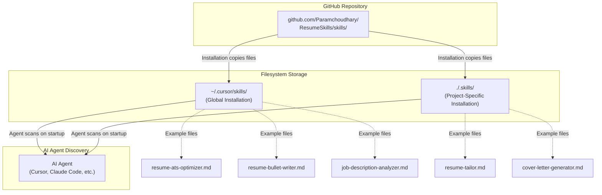
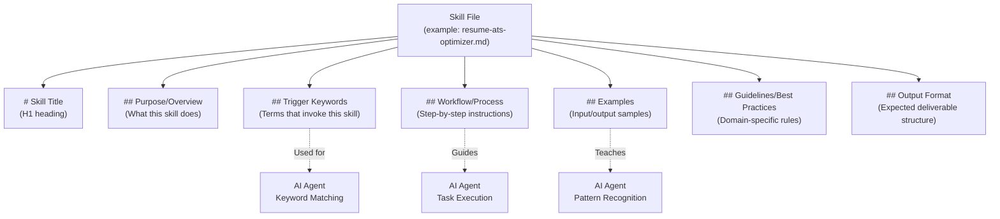
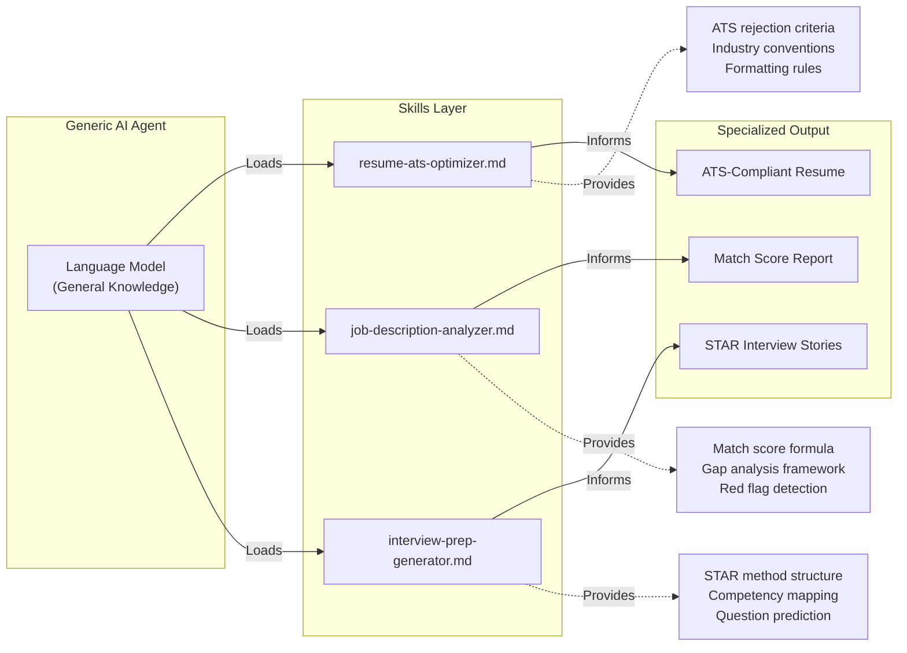
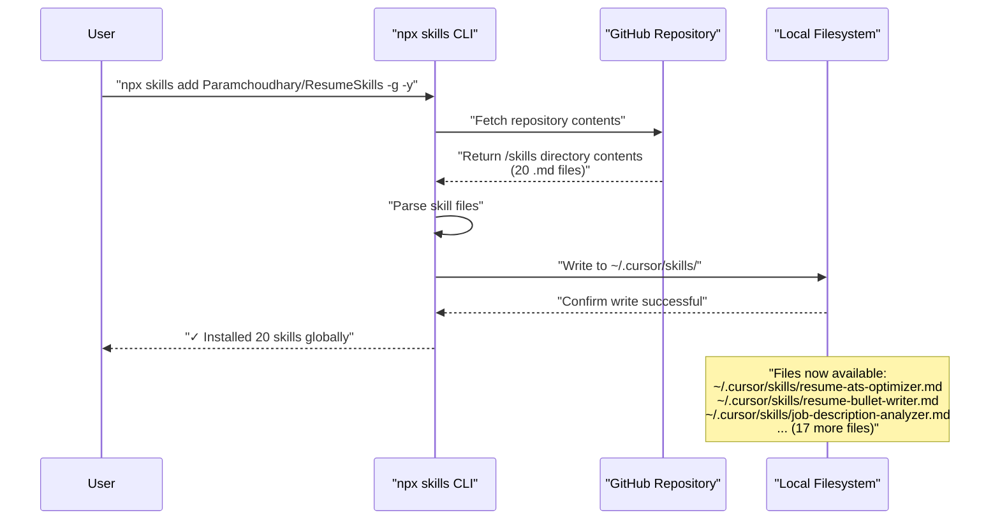

<!-- source: DeepWiki mcp.deepwiki.com · repo Paramchoudhary/ResumeSkills · page 3.1 How Skills Work · fetched 2026-10-26 -->

# How Skills Work

<details>
<summary>Relevant source files</summary>

The following files were used as context for generating this wiki page:

- [README.md](README.md)

</details>


## Purpose and Scope

This page explains the fundamental architecture of skills: what they are, how they're structured, where they're stored, and how they serve as a knowledge transfer mechanism between the ResumeSkills repository and AI agents.

For information about how AI agents discover and load skills at runtime, see [AI Agent Integration](#3.2). For details about the execution process when a skill is invoked, see [Skill Invocation and Execution](#3.3). For installation procedures, see [Installation](#2.1).

---

## Skills as Markdown Files

Skills in the ResumeSkills system are **markdown files** (`.md`) that contain structured instructions, workflows, and domain knowledge. Each skill is a self-contained document that teaches an AI agent how to perform a specific task within the job search domain.

A skill file serves three primary functions:

| Function | Description | Example |
|----------|-------------|---------|
| **Knowledge Transfer** | Provides domain expertise the AI agent doesn't inherently possess | ATS rejection criteria, industry-specific resume conventions |
| **Workflow Definition** | Defines step-by-step processes for completing complex tasks | Multi-phase resume optimization pipeline, interview prep framework |
| **Output Standardization** | Ensures consistent formatting and structure across invocations | Match score calculation formula, STAR story template |

Skills are **declarative** rather than executable code. They contain natural language instructions that guide the AI agent's decision-making process, not procedural scripts that run deterministically.

**Sources:** [README.md:7]()

---

## Storage Architecture

### Storage Locations

Skills are stored in two possible filesystem locations, depending on installation scope:



**Sources:** [README.md:39-63]()

### Global vs Project-Specific Storage

| Aspect | Global Storage (`~/.cursor/skills/`) | Project-Specific Storage (`./.skills/`) |
|--------|--------------------------------------|------------------------------------------|
| **Scope** | Available to all projects on the system | Available only within the current project directory |
| **Use Case** | General-purpose skills used across multiple resumes/jobs | Skills customized for a specific job search campaign |
| **Installation Command** | `npx skills add Paramchoudhary/ResumeSkills -g -y` | `npx skills add Paramchoudhary/ResumeSkills -y` |
| **Persistence** | Persists across all sessions | Only available when working in that project directory |
| **Typical Content** | All 20 base skills | Subset of skills relevant to current job search |

**Sources:** [README.md:39-50]()

### File Naming Convention

Skill files follow a consistent naming pattern:

```
<domain>-<function>-<specialization>.md
```

Examples from the codebase:
- `resume-ats-optimizer.md` → Domain: resume, Function: ats-optimizer
- `job-description-analyzer.md` → Domain: job-description, Function: analyzer
- `interview-prep-generator.md` → Domain: interview-prep, Function: generator

This naming convention serves two purposes:
1. **Human readability**: Clear indication of what the skill does
2. **Keyword matching**: AI agents can match user prompts containing these terms to the appropriate skill file

**Sources:** [README.md:11-32]()

---

## Skill File Anatomy

While each skill has unique content, all skills follow a common structural pattern. Below is the typical anatomy of a skill markdown file:



### Core Components

Each skill markdown file typically contains these sections:

| Section | Purpose | Example Content |
|---------|---------|-----------------|
| **Trigger Keywords** | Terms that should invoke this skill | "ATS", "Applicant Tracking System", "compatibility check" |
| **Workflow** | Ordered steps to complete the task | "1. Scan for ATS-unfriendly formatting, 2. Check keyword density, 3. Generate report" |
| **Domain Knowledge** | Specialized information the AI needs | "ATS systems reject tables, text boxes, headers/footers" |
| **Output Template** | Structure for the skill's deliverable | "Match Score: X%, Required Skills: [list], Gaps: [list]" |
| **Examples** | Sample inputs and expected outputs | Before/after resume bullets, sample match score reports |

**Sources:** [README.md:7](), [README.md:11-32]()

---

## Skills as Knowledge Transfer Mechanism

Skills function as a **knowledge injection layer** between the generic capabilities of an AI language model and the specialized requirements of resume writing and job search tasks.



### Why Markdown Files?

The choice of markdown as the skill format provides several architectural advantages:

1. **Human-readable**: Skills can be read, edited, and improved by non-programmers
2. **Version controllable**: Skills can be tracked in Git with clear diffs
3. **Language model native**: Markdown is a natural format for language models to parse and understand
4. **No execution risk**: Static text files cannot execute arbitrary code, making them safe to load
5. **Agent-agnostic**: Any AI agent that can read files can consume markdown skills

**Sources:** [README.md:7](), [README.md:77-87]()

---

## Skills Repository Structure

The ResumeSkills repository on GitHub serves as the **canonical source** for all skill definitions. When skills are installed locally, they are copies of files from this repository.

### Repository Organization

```mermaid
graph TB
    ROOT["github.com/Paramchoudhary/ResumeSkills/"]
    
    ROOT --> README["README.md<br/>(Documentation)"]
    ROOT --> SKILLS_DIR["skills/<br/>(Skill Files Directory)"]
    ROOT --> OTHER["LICENSE, CONTRIBUTING.md, etc."]
    
    SKILLS_DIR --> CAT1["Resume Optimization Skills"]
    SKILLS_DIR --> CAT2["Job Search Strategy Skills"]
    SKILLS_DIR --> CAT3["Supporting Documents Skills"]
    SKILLS_DIR --> CAT4["Interview & Negotiation Skills"]
    SKILLS_DIR --> CAT5["Specialized Roles Skills"]
    
    CAT1 --> S1_1["resume-ats-optimizer.md"]
    CAT1 --> S1_2["resume-bullet-writer.md"]
    CAT1 --> S1_3["resume-quantifier.md"]
    CAT1 --> S1_4["resume-formatter.md"]
    CAT1 --> S1_5["resume-section-builder.md"]
    
    CAT2 --> S2_1["job-description-analyzer.md"]
    CAT2 --> S2_2["resume-tailor.md"]
    CAT2 --> S2_3["resume-version-manager.md"]
    CAT2 --> S2_4["offer-comparison-analyzer.md"]
    
    CAT3 --> S3_1["cover-letter-generator.md"]
    CAT3 --> S3_2["linkedin-profile-optimizer.md"]
    CAT3 --> S3_3["portfolio-case-study-writer.md"]
    CAT3 --> S3_4["reference-list-builder.md"]
    
    CAT4 --> S4_1["interview-prep-generator.md"]
    CAT4 --> S4_2["salary-negotiation-prep.md"]
    
    CAT5 --> S5_1["tech-resume-optimizer.md"]
    CAT5 --> S5_2["executive-resume-writer.md"]
    CAT5 --> S5_3["academic-cv-builder.md"]
    CAT5 --> S5_4["creative-portfolio-resume.md"]
    CAT5 --> S5_5["career-changer-translator.md"]
```



**Sources:** [README.md:11-32](), [README.md:109-140]()

### Skill Categories

The 20 skills are organized into 5 functional categories that map to the job search lifecycle:

| Category | Skill Count | Phase | Purpose |
|----------|-------------|-------|---------|
| **Resume Optimization** | 5 | Phase 1: Resume Creation | Create ATS-compliant, achievement-focused resumes |
| **Job Search Strategy** | 4 | Phase 2: Strategic Application | Analyze job fit and tailor applications |
| **Supporting Documents** | 4 | Phase 3: Application Package | Create cover letters, LinkedIn, portfolio |
| **Interview & Negotiation** | 2 | Phase 4: Offer Stage | Prepare for interviews and negotiate offers |
| **Specialized Roles** | 5 | Overlay: Role-Specific | Customize for specific career paths |

The categories are **logical groupings** for documentation purposes. In the filesystem, all 20 skills are stored as individual `.md` files in the same directory (`skills/`), not in subdirectories.

**Sources:** [README.md:109-140]()

---

## Relationship to GitHub Repository

### Installation Workflow

When a user installs skills, the following data flow occurs:



**Sources:** [README.md:39-50]()

### Update Mechanism

Skills are **static copies** once installed. They do not auto-update. If skill definitions are improved in the GitHub repository, users must re-run the installation command to fetch the updated versions:

```bash
# Re-fetch latest skill versions from GitHub
npx skills add Paramchoudhary/ResumeSkills -g -y
```

This design choice provides **version stability**: users' AI agents will continue using the same skill definitions until they explicitly choose to update.

**Sources:** [README.md:39-50]()

---

## Summary

Skills in the ResumeSkills system are:
- **Format**: Markdown files (`.md`) containing structured natural language instructions
- **Storage**: Filesystem locations (`~/.cursor/skills/` or `./.skills/`)
- **Source**: GitHub repository at `Paramchoudhary/ResumeSkills/skills/`
- **Count**: 20 skills organized into 5 functional categories
- **Purpose**: Provide specialized resume/job search knowledge to generic AI agents
- **Loading**: AI agents scan storage locations and load skills as context (see [AI Agent Integration](#3.2))
- **Execution**: Skills guide AI agent decision-making through declarative workflows (see [Skill Invocation and Execution](#3.3))

The skill architecture separates **knowledge definition** (markdown files in repository) from **knowledge discovery and execution** (AI agent runtime behavior), enabling skills to be updated, versioned, and distributed independently of the AI agents that consume them.

**Sources:** [README.md:5-7](), [README.md:39-63](), [README.md:109-140]()

---

