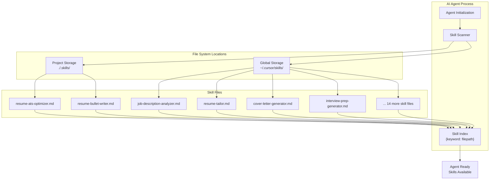
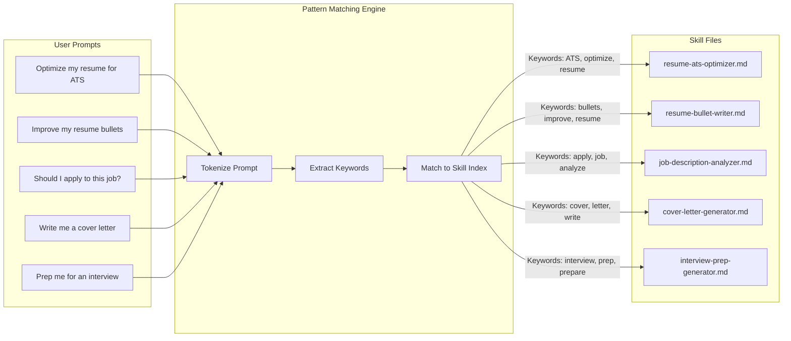
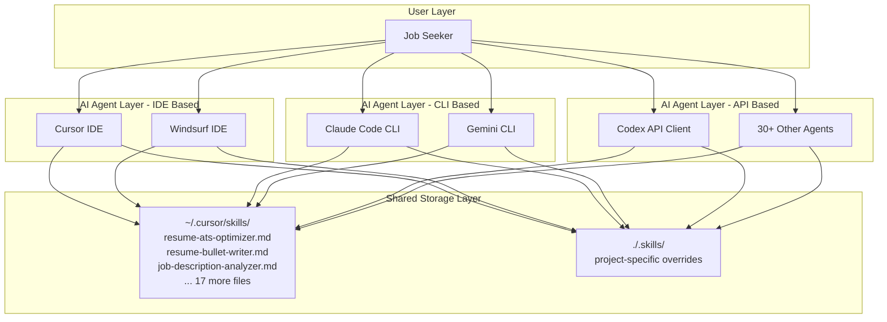
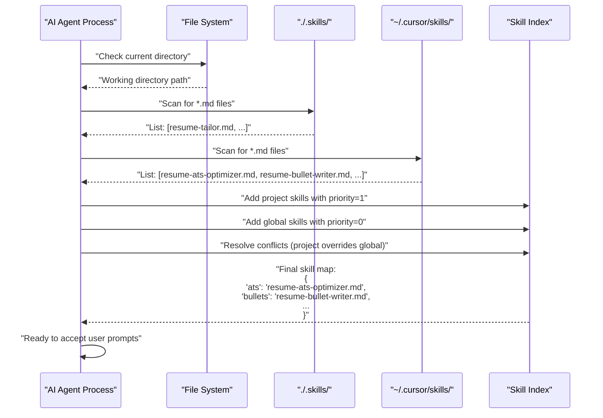
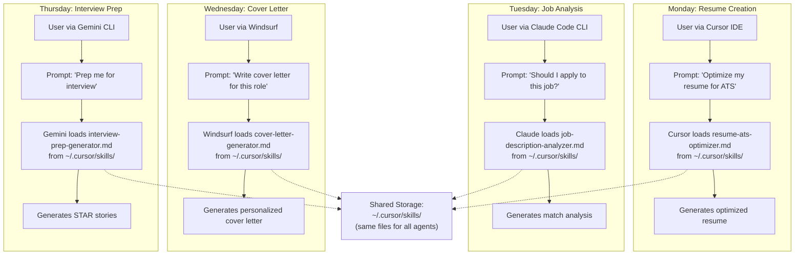

<!-- source: DeepWiki mcp.deepwiki.com · repo Paramchoudhary/ResumeSkills · page 3.2 AI Agent Integration · fetched 2026-10-26 -->

# AI Agent Integration

<details>
<summary>Relevant source files</summary>

The following files were used as context for generating this wiki page:

- [README.md](README.md)

</details>


## Purpose and Scope

This document explains how AI agents integrate with the ResumeSkills system to discover, load, and execute skills. It covers the file system-based discovery mechanism, the 30+ supported AI agents, and how natural language prompts are matched to skill files. For details on what skills are and how they're structured, see [How Skills Work](#3.1). For detailed runtime execution mechanics, see [Skill Invocation and Execution](#3.3).

---

## Agent Discovery System

AI agents discover skills by scanning predefined file system locations. The system supports two deployment scopes:

| Scope | Location | Purpose | Installation Command |
|-------|----------|---------|---------------------|
| Global | `~/.cursor/skills/` | Available to all projects | `npx skills add Paramchoudhary/ResumeSkills -g -y` |
| Project | `./.skills/` | Specific to current project | `npx skills add Paramchoudhary/ResumeSkills -y` |

When an AI agent starts, it scans these directories to build an index of available skills. Each skill is represented as a markdown file with a standardized naming pattern: `<skill-name>.md`.

### File System Structure

```
~/.cursor/skills/
├── resume-ats-optimizer.md
├── resume-bullet-writer.md
├── resume-quantifier.md
├── resume-formatter.md
├── resume-section-builder.md
├── job-description-analyzer.md
├── resume-tailor.md
├── resume-version-manager.md
├── offer-comparison-analyzer.md
├── cover-letter-generator.md
├── linkedin-profile-optimizer.md
├── portfolio-case-study-writer.md
├── reference-list-builder.md
├── interview-prep-generator.md
├── salary-negotiation-prep.md
├── tech-resume-optimizer.md
├── executive-resume-writer.md
├── academic-cv-builder.md
├── creative-portfolio-resume.md
└── career-changer-translator.md
```

The discovery system prioritizes project-specific skills over global skills when both exist, allowing users to override global defaults for specific projects.

**Sources:** [README.md:34-63](), [README.md:39-51]()

---

## File System Discovery Architecture



**Title:** File System-Based Skill Discovery Process

This diagram shows how AI agents scan the file system to discover available skills during initialization. The scanner checks project-specific storage first (`./.skills/`), then global storage (`~/.cursor/skills/`), building an index that maps keywords to file paths.

**Sources:** [README.md:39-51](), [README.md:55-59]()

---

## Supported AI Agents

The ResumeSkills system is designed to be agent-agnostic, supporting 30+ AI coding assistants. All agents that implement the skills discovery protocol can load and execute these skills.

### Core Supported Agents

| Agent | Type | Primary Interface |
|-------|------|------------------|
| **Cursor** | IDE | Integrated development environment with AI assistant |
| **Claude Code** | CLI | Command-line interface for Claude |
| **Windsurf** | IDE | AI-powered coding environment |
| **Codex** | API | OpenAI's code generation model |
| **Gemini CLI** | CLI | Google's Gemini command-line interface |

### Additional Supported Agents

The system also supports: Amp, Antigravity, Augment, and 30+ additional AI agents that follow the skills discovery protocol.

**Sources:** [README.md:77-86]()

---

## Pattern Matching and Skill Selection

AI agents use keyword pattern matching to select the appropriate skill based on user prompts. The matching system analyzes natural language input and compares it against skill names, descriptions, and embedded keywords.

### Natural Language to Skill Mapping



**Title:** Keyword Pattern Matching from Natural Language Prompts to Skill Files

This diagram illustrates how the pattern matching engine tokenizes user prompts, extracts keywords, and matches them to specific skill markdown files in the file system.

**Sources:** [README.md:88-107]()

---

## Keyword Matching Examples

The following table shows common natural language patterns and their corresponding skill matches:

| User Prompt Pattern | Extracted Keywords | Matched Skill File |
|---------------------|-------------------|-------------------|
| "Optimize my resume for ATS" | optimize, ATS, resume | `resume-ats-optimizer.md` |
| "Improve my resume bullets" | improve, bullets, resume | `resume-bullet-writer.md` |
| "Should I apply to this job?" | apply, job, should | `job-description-analyzer.md` |
| "Tailor my resume for this role" | tailor, resume, customize | `resume-tailor.md` |
| "Write me a cover letter" | write, cover, letter | `cover-letter-generator.md` |
| "Help me prep for interview" | prep, interview, help | `interview-prep-generator.md` |
| "Negotiate salary for this offer" | negotiate, salary, offer | `salary-negotiation-prep.md` |
| "Optimize my LinkedIn profile" | optimize, LinkedIn, profile | `linkedin-profile-optimizer.md` |
| "Add metrics to my resume" | metrics, numbers, quantify | `resume-quantifier.md` |
| "Format my resume properly" | format, resume, layout | `resume-formatter.md` |

The pattern matching system is fuzzy and can handle variations in phrasing, synonyms, and context-specific language. Agents use the skill name (hyphen-separated components) as the primary matching signal.

**Sources:** [README.md:88-107]()

---

## Integration Architecture

The integration architecture is designed around a standardized skills discovery protocol that all agents implement. This protocol ensures consistency across different AI assistants while maintaining agent-specific optimizations.

### Multi-Agent Integration Model



**Title:** Multi-Agent Integration Architecture with Shared Storage

This diagram shows how multiple AI agents (IDE-based, CLI-based, and API-based) all access the same shared storage locations, ensuring consistent skill availability regardless of which agent the user employs.

**Sources:** [README.md:77-86](), [README.md:39-51]()

---

## Agent-Agnostic Design Principles

The system's agent-agnostic design is achieved through several architectural principles:

### 1. File System-Based Storage

Skills are stored as standard markdown files in well-known locations. No agent-specific databases, registries, or proprietary formats are used. This ensures any agent that can read the file system can access skills.

**Location:** `~/.cursor/skills/` for global, `./.skills/` for project-specific

### 2. Standardized Naming Convention

All skill files follow the pattern `<skill-name>.md` where the skill name uses kebab-case (hyphen-separated words). This predictable naming allows agents to implement discovery without hardcoded mappings.

**Example:** `resume-ats-optimizer.md`, `job-description-analyzer.md`

### 3. Markdown Format

Skills are defined in markdown, a universal text format that all AI agents can parse. No custom binary formats or proprietary schemas are required.

### 4. Self-Contained Definitions

Each skill file contains all necessary instructions, examples, and workflows. Agents don't need to fetch external dependencies or consult remote APIs to execute skills.

### 5. Priority Resolution

The system defines clear precedence rules: project-specific skills (`./.skills/`) override global skills (`~/.cursor/skills/`) when conflicts exist. This allows users to customize behavior per-project while maintaining global defaults.

**Sources:** [README.md:34-63](), [README.md:39-51]()

---

## Agent Loading Sequence

When an AI agent initializes, it follows this sequence to load available skills:



**Title:** Agent Initialization and Skill Loading Sequence

This sequence diagram shows the step-by-step process an AI agent follows during initialization to discover and index skills from both project-specific and global storage locations.

**Sources:** [README.md:39-51]()

---

## Global vs Project-Specific Deployment

The system supports two deployment scopes to handle different use cases:

### Global Deployment (`~/.cursor/skills/`)

**Use Case:** Skills available across all projects

**Installation:**
```bash
npx skills add Paramchoudhary/ResumeSkills -g -y
```

**Advantages:**
- One-time setup
- Consistent behavior across projects
- Simplified management

**Typical Scenarios:**
- Individual job seekers working on multiple resumes
- Freelancers managing client portfolios
- Career coaches working with multiple clients

### Project-Specific Deployment (`./.skills/`)

**Use Case:** Skills scoped to a single project or specialized overrides

**Installation:**
```bash
npx skills add Paramchoudhary/ResumeSkills -y
```

**Advantages:**
- Isolated from other projects
- Version control integration
- Team collaboration (committed to repository)
- Custom skill overrides

**Typical Scenarios:**
- Teams collaborating on resume content
- A/B testing different skill versions
- Industry-specific customizations

**Sources:** [README.md:39-51]()

---

## Multi-Agent Workflow Consistency

Since all agents read from the same storage locations, users can switch between different AI assistants while maintaining consistent skill behavior. The following workflow demonstrates this consistency:



**Title:** Cross-Agent Workflow Consistency Over Multiple Sessions

This diagram illustrates how a user can switch between different AI agents (Cursor, Claude Code, Windsurf, Gemini) across multiple work sessions while all agents consistently load the same skill definitions from shared storage.

**Sources:** [README.md:77-86](), [README.md:88-107]()

---

## Integration Benefits

The agent-agnostic integration architecture provides several key benefits:

### 1. Vendor Independence
Users are not locked into a single AI agent. They can evaluate and switch between agents based on performance, pricing, or features without losing access to skills.

### 2. Skill Portability
Skills installed once are immediately available to all supported agents. No per-agent installation or configuration is required.

### 3. Consistent Behavior
The same skill file produces consistent results regardless of which agent executes it, reducing learning curves and unexpected behavior.

### 4. Simplified Updates
When skill files are updated (via `npx skills add`), all agents immediately benefit from improvements without requiring agent-specific patches.

### 5. Community Ecosystem
The standard format enables community contributions that work across all agents, accelerating skill development and refinement.

**Sources:** [README.md:77-86](), [README.md:202-213]()

---

## Installation Command Reference

The following commands manage skill deployment across different agents:

```bash
# Global installation (available to all agents, all projects)
npx skills add Paramchoudhary/ResumeSkills -g -y

# Project-specific installation (available to all agents, current project)
npx skills add Paramchoudhary/ResumeSkills -y

# List globally installed skills
npx skills list --global

# List project-specific skills
npx skills list

# Remove specific skill (removes for all agents)
npx skills remove resume-ats-optimizer

# Remove all resume skills globally
rm -rf ~/.cursor/skills/resume-*

# Remove all resume skills from current project
rm -rf ./.skills/resume-*
```

**Sources:** [README.md:39-51](), [README.md:65-75]()

---

## Next Steps

For understanding how skills are structured and what they contain, see [How Skills Work](#3.1).

For detailed information about the runtime execution process when an agent invokes a skill, see [Skill Invocation and Execution](#3.3).

---

