<!-- source: DeepWiki mcp.deepwiki.com · repo Paramchoudhary/ResumeSkills · page 3.3 Skill Invocation and Execution · fetched 2026-10-26 -->

# Skill Invocation and Execution

<details>
<summary>Relevant source files</summary>

The following files were used as context for generating this wiki page:

- [README.md](README.md)

</details>


## Purpose and Scope

This document explains the runtime process that occurs when a user invokes a skill through an AI agent. It covers the complete execution flow from user prompt to final output: keyword-based skill discovery, markdown file loading, context injection into the language model, and multi-step workflow execution.

For information about how skills are structured as markdown files, see [How Skills Work](#3.1). For details on how different AI agents integrate with the skill system, see [AI Agent Integration](#3.2). For complete workflow examples showing multiple skills working together, see [End-to-End Workflows](#5).

---

## Skill Discovery System

When a user submits a natural language prompt to an AI agent, the agent must identify which skill (if any) is relevant to the request. This discovery process operates through file system scanning and keyword pattern matching.

### File System Locations

The skill discovery system scans two locations in priority order:

| Priority | Location | Scope | Use Case |
|----------|----------|-------|----------|
| 1 | `./.skills/` | Project-specific | Skills relevant only to current project |
| 2 | `~/.cursor/skills/` | Global | Skills available across all projects |

Project-specific skills override global skills if both contain a file with the same name.

### Keyword Pattern Matching

The discovery system analyzes the user's prompt for keywords that map to skill names and descriptions. The matching algorithm uses fuzzy matching on:

- **Skill filename** (e.g., `resume-ats-optimizer.md`)
- **Skill title** (first heading in markdown file)
- **Skill description** (from metadata or first paragraph)
- **Domain keywords** (e.g., "ATS", "optimize", "resume")

#### Pattern Matching Examples

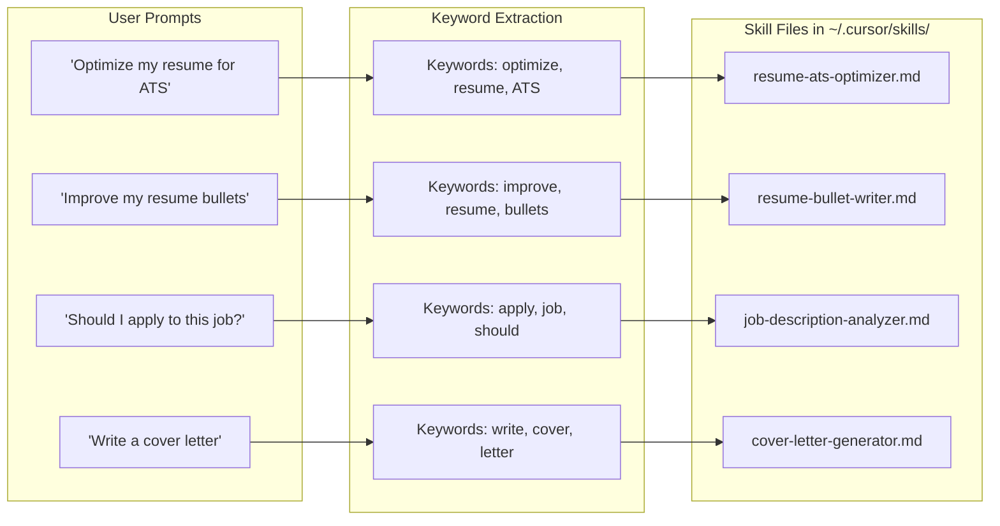

**Sources:** [README.md:92-107]()

### Discovery Algorithm Flow

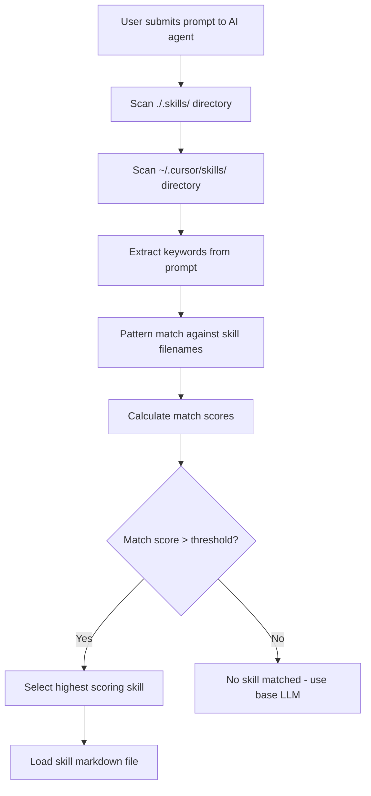

**Sources:** [README.md:39-65](), [README.md:80-92]()

---

## Skill Loading Process

Once a skill is discovered, the AI agent loads the markdown file and parses its contents to extract structured instructions.

### Markdown File Structure

Skills follow a standardized markdown format:

```
# [Skill Name]

[Brief description of skill purpose]

## What This Skill Does

[Detailed capability description]

## When to Use

[Trigger scenarios]

## Workflow

1. Step one
2. Step two
3. Step three

## Examples

[Input/output examples]

## Output Format

[Expected output structure]
```

### Loading Sequence

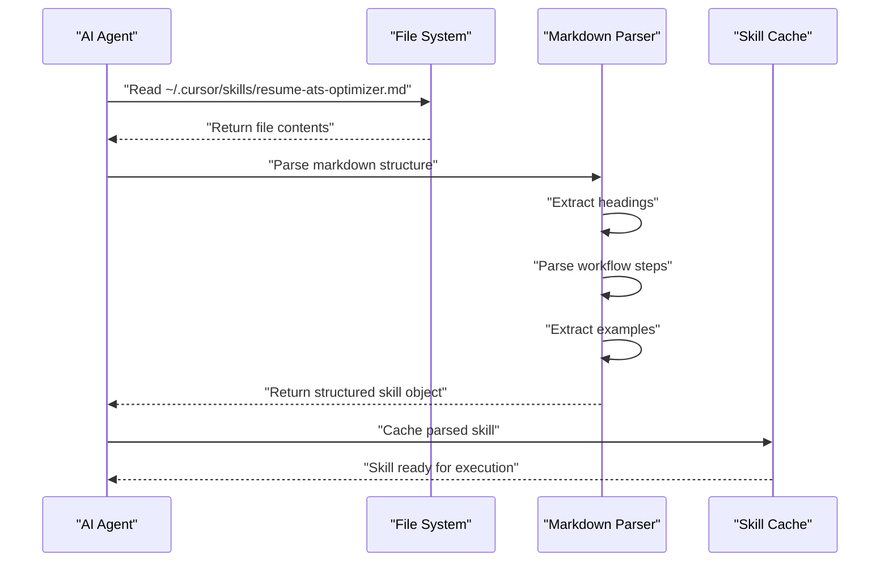

**Sources:** [README.md:10-11](), [README.md:57-59]()

### Parsed Skill Object Structure

The parsed skill contains these key components:

| Component | Description | Usage |
|-----------|-------------|-------|
| `name` | Skill identifier | Logging, tracking |
| `description` | Purpose statement | Context for LLM |
| `triggers` | Keyword list | Discovery matching |
| `workflow` | Ordered step list | Execution sequence |
| `examples` | Input/output pairs | Few-shot learning |
| `outputFormat` | Structure template | Response formatting |
| `metadata` | Version, author, etc. | Skill management |

**Sources:** [README.md:11-32]()

---

## Context Injection

After loading a skill, the AI agent constructs a multi-part prompt that combines the user's request with the skill's instructions. This context injection guides the language model's behavior.

### Context Assembly Process

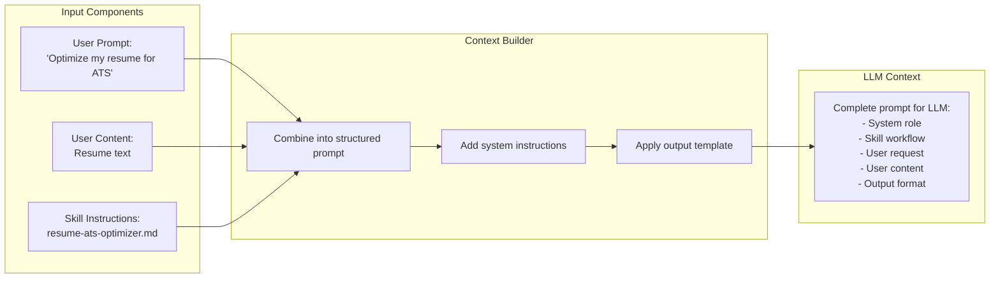

**Sources:** [README.md:166-174]()

### Multi-Part Prompt Structure

The assembled context follows this structure:

```
[System Instructions]
You are an AI assistant with specialized knowledge in resume optimization.

[Skill Context]
Skill: resume-ats-optimizer
Purpose: Optimize resumes for Applicant Tracking Systems

Workflow:
1. Run ATS compatibility check
2. Analyze keywords vs common job descriptions
3. Suggest improvements
4. Format recommendations

[User Request]
Optimize my resume for ATS

[User Content]
<user's resume text>

[Output Format]
Provide:
- ATS compatibility score
- Keyword analysis
- Specific improvements
- Formatted recommendations
```

This multi-part structure ensures the LLM has:
1. Role context (what it is)
2. Task context (what to do)
3. Process context (how to do it)
4. Content context (what to work with)
5. Format context (how to respond)

**Sources:** [README.md:92-107]()

---

## Multi-Step Execution

The language model executes the skill's workflow as a series of ordered steps, maintaining state between steps and building toward a final output.

### Execution Flow

```mermaid
stateDiagram-v2
    [*] --> LoadContext
    
    LoadContext --> Step1: "Context loaded"
    
    state "Step 1: ATS Compatibility Check" as Step1 {
        [*] --> ParseResume
        ParseResume --> CheckFormat
        CheckFormat --> ScoreCompatibility
        ScoreCompatibility --> [*]
    }
    
    Step1 --> Step2: "Score: 65/100"
    
    state "Step 2: Keyword Analysis" as Step2 {
        [*] --> ExtractKeywords
        ExtractKeywords --> CompareToDatabase
        CompareToDatabase --> IdentifyGaps
        IdentifyGaps --> [*]
    }
    
    Step2 --> Step3: "15 missing keywords"
    
    state "Step 3: Generate Improvements" as Step3 {
        [*] --> PrioritizeIssues
        PrioritizeIssues --> CreateSuggestions
        CreateSuggestions --> ValidateChanges
        ValidateChanges --> [*]
    }
    
    Step3 --> Step4: "12 recommendations"
    
    state "Step 4: Format Output" as Step4 {
        [*] --> StructureReport
        StructureReport --> FormatMarkdown
        FormatMarkdown --> AddExamples
        AddExamples --> [*]
    }
    
    Step4 --> [*]: "Return formatted report"
```

**Sources:** [README.md:166-174]()

### State Management During Execution

The LLM maintains intermediate results between steps:

| Step | Input State | Processing | Output State |
|------|-------------|------------|--------------|
| 1 | Resume text | Parse and analyze format | Compatibility score |
| 2 | Resume text + Score | Extract and compare keywords | Missing keyword list |
| 3 | Score + Keywords | Generate recommendations | Improvement suggestions |
| 4 | All previous | Structure and format | Final report |

### Example: resume-ats-optimizer Execution

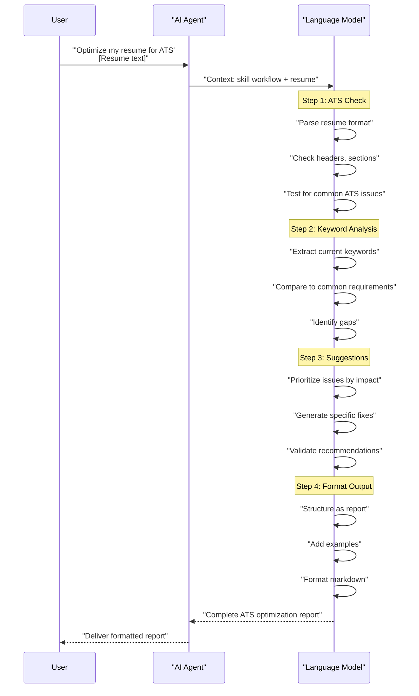

**Sources:** [README.md:166-174]()

---

## Skill Chaining

Users can invoke multiple skills sequentially, with each skill's output becoming input for the next. This enables compound workflows that combine specialized capabilities.

### Sequential Chaining Pattern

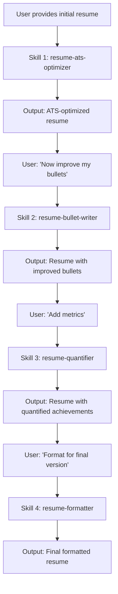

**Sources:** [README.md:163-174]()

### Data Flow in Skill Chains

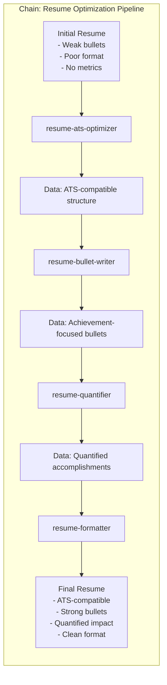

**Sources:** [README.md:163-174]()

### Context Accumulation

During skill chaining, the AI agent maintains conversation context:

| Invocation | Active Skill | Context Includes |
|------------|--------------|------------------|
| 1 | resume-ats-optimizer | User resume only |
| 2 | resume-bullet-writer | User resume + ATS optimization results |
| 3 | resume-quantifier | All previous + bullet improvements |
| 4 | resume-formatter | All previous + quantification data |

This context accumulation allows later skills to reference outputs from earlier skills, creating coherent multi-step transformations.

**Sources:** [README.md:163-174]()

### Parallel Skill Invocation

Some workflows branch into parallel skill invocations:

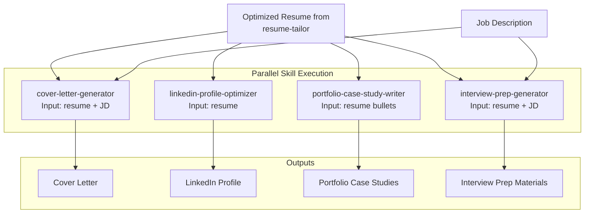

**Sources:** [README.md:176-187]()

---

## Execution Performance Characteristics

### Skill Loading Time

| Operation | Typical Duration | Notes |
|-----------|------------------|-------|
| Directory scan | 1-5ms | Depends on skill count |
| File read | 5-10ms | Single markdown file |
| Markdown parse | 10-20ms | Structure extraction |
| Context assembly | 5-10ms | Prompt construction |
| **Total overhead** | **~25-50ms** | Before LLM execution |

The actual execution time is dominated by the LLM inference, not the skill loading process.

### Caching Strategy

To minimize repeated loading, agents implement caching:

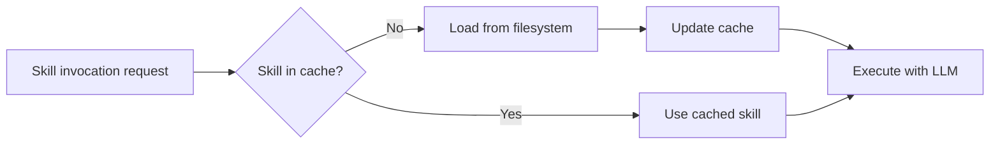

**Sources:** [README.md:39-65]()

---

## Error Handling

### Skill Not Found

When no skill matches the user's request:

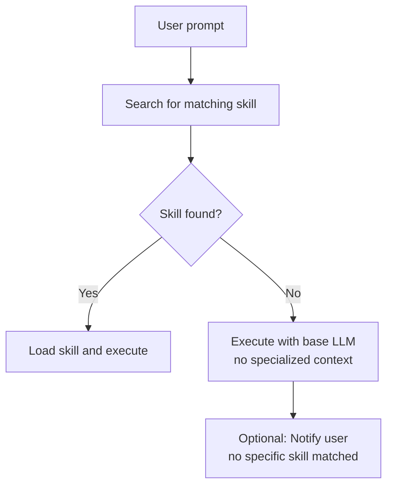

The system gracefully falls back to base LLM capabilities when no skill matches, ensuring the user always receives a response.

### Malformed Skill File

If a skill markdown file is malformed:

| Error Type | Handling Strategy |
|------------|------------------|
| Missing required sections | Skip skill, use fallback |
| Invalid markdown syntax | Parse what's possible, continue |
| Corrupted file | Skip skill, log error |
| Missing file | Remove from index, use fallback |

**Sources:** [README.md:80-92]()

---

## Summary

The skill invocation and execution system operates through a pipeline:

1. **Discovery**: Keyword-based pattern matching against filesystem (`~/.cursor/skills/`, `./.skills/`)
2. **Loading**: Markdown file parsing into structured skill objects
3. **Context Injection**: Multi-part prompt assembly combining user request + skill instructions
4. **Execution**: Multi-step LLM processing following skill workflow
5. **Chaining**: Sequential or parallel skill invocations for compound workflows

This architecture enables AI agents to dynamically acquire specialized capabilities without hardcoding knowledge, making the system extensible through simple markdown file additions.

**Sources:** [README.md:1-230]()

---

