<!-- source: DeepWiki mcp.deepwiki.com · repo Paramchoudhary/ResumeSkills · page 4 Skills Reference · fetched 2026-10-26 -->

# Skills Reference

<details>
<summary>Relevant source files</summary>

The following files were used as context for generating this wiki page:

- [README.md](README.md)

</details>


## Purpose and Scope

This reference provides a comprehensive catalog of all 20 skills in the ResumeSkills repository, organized into five functional categories. Each skill is implemented as a markdown file (`.md`) stored in the `/skills` directory and provides specialized instructions that AI agents use to perform specific resume and job search tasks.

This page serves as an index and overview. For detailed installation instructions, see [Installation](#2.1). For understanding how AI agents discover and execute these skills, see [AI Agent Integration](#3.2) and [Skill Invocation and Execution](#3.3). For complete end-to-end usage workflows, see [End-to-End Workflows](#5).

**Sources:** [README.md:3-7](), [README.md:11-32]()

---

## Skill Organization

The 20 skills are organized into five categories that map to distinct phases of the job search lifecycle. Each skill is a standalone markdown file but is designed to work in combination with other skills to create compound workflows.

### Skills by Category and File Location

```mermaid
graph TB
    subgraph "Skills Repository: /skills/"
        subgraph "Resume Optimization Category"
            ATS["resume-ats-optimizer.md"]
            BULLET["resume-bullet-writer.md"]
            QUANT["resume-quantifier.md"]
            FORMAT["resume-formatter.md"]
            SECTION["resume-section-builder.md"]
        end
        
        subgraph "Job Search Strategy Category"
            JDA["job-description-analyzer.md"]
            TAILOR["resume-tailor.md"]
            VERSION["resume-version-manager.md"]
            OFFER["offer-comparison-analyzer.md"]
        end
        
        subgraph "Supporting Documents Category"
            COVER["cover-letter-generator.md"]
            LINKEDIN["linkedin-profile-optimizer.md"]
            PORTFOLIO["portfolio-case-study-writer.md"]
            REFERENCE["reference-list-builder.md"]
        end
        
        subgraph "Interview & Negotiation Category"
            INTERVIEW["interview-prep-generator.md"]
            SALARY["salary-negotiation-prep.md"]
        end
        
        subgraph "Specialized Roles Category"
            TECH["tech-resume-optimizer.md"]
            EXEC["executive-resume-writer.md"]
            ACADEMIC["academic-cv-builder.md"]
            CREATIVE["creative-portfolio-resume.md"]
            CAREER["career-changer-translator.md"]
        end
    end
    
    subgraph "Deployment Locations"
        GLOBAL["~/.cursor/skills/"]
        PROJECT["./.skills/"]
    end
    
    ATS & BULLET & QUANT & FORMAT & SECTION --> GLOBAL
    ATS & BULLET & QUANT & FORMAT & SECTION --> PROJECT
    JDA & TAILOR & VERSION & OFFER --> GLOBAL
    JDA & TAILOR & VERSION & OFFER --> PROJECT
    COVER & LINKEDIN & PORTFOLIO & REFERENCE --> GLOBAL
    COVER & LINKEDIN & PORTFOLIO & REFERENCE --> PROJECT
    INTERVIEW & SALARY --> GLOBAL
    INTERVIEW & SALARY --> PROJECT
    TECH & EXEC & ACADEMIC & CREATIVE & CAREER --> GLOBAL
    TECH & EXEC & ACADEMIC & CREATIVE & CAREER --> PROJECT
```



**Diagram: Skill File Organization and Deployment Paths**

This diagram shows the exact file names and their locations in the repository structure. After installation via `npx skills add` or manual copying, these `.md` files are deployed to either `~/.cursor/skills/` (global) or `./.skills/` (project-specific), where AI agents can discover them.

**Sources:** [README.md:11-32](), [README.md:109-139](), [README.md:42-58]()

---

## Complete Skills Catalog

The following table lists all 20 skills with their file names, primary purposes, and links to detailed documentation where available.

| Skill File Name | Description | Category | Detailed Docs |
|-----------------|-------------|----------|---------------|
| `resume-ats-optimizer.md` | Optimize resumes for Applicant Tracking Systems, check ATS compatibility, analyze keyword match | Resume Optimization | See [#4.1](#4.1) |
| `resume-bullet-writer.md` | Transform weak bullets into achievement-focused statements with metrics and impact | Resume Optimization | See [#4.1](#4.1) |
| `resume-quantifier.md` | Find opportunities to add metrics, estimate when numbers unknown | Resume Optimization | See [#4.1](#4.1) |
| `resume-formatter.md` | Ensure ATS-friendly formatting, create clean scannable layouts | Resume Optimization | See [#4.1](#4.1) |
| `resume-section-builder.md` | Create targeted sections optimized for different experience levels and roles | Resume Optimization | See [#4.1](#4.1) |
| `job-description-analyzer.md` | Analyze job postings, calculate match scores, identify gaps, create application strategy | Job Search Strategy | See [#4.2.1](#4.2.1) |
| `resume-tailor.md` | Customize resume for specific job postings while maintaining truthfulness | Job Search Strategy | See [#4.2](#4.2) |
| `resume-version-manager.md` | Track different resume versions, maintain master resume, manage tailored versions | Job Search Strategy | See [#4.2](#4.2) |
| `offer-comparison-analyzer.md` | Compare multiple job offers side-by-side with total compensation analysis | Job Search Strategy | See [#4.2.2](#4.2.2) |
| `cover-letter-generator.md` | Create personalized, compelling cover letters from resume + job description | Supporting Documents | See [#4.3](#4.3) |
| `linkedin-profile-optimizer.md` | Sync resume with LinkedIn, optimize for searchability and engagement | Supporting Documents | See [#4.3.1](#4.3.1) |
| `portfolio-case-study-writer.md` | Transform resume bullets into detailed portfolio case studies | Supporting Documents | See [#4.3.2](#4.3.2) |
| `reference-list-builder.md` | Format professional references properly and prepare reference materials | Supporting Documents | See [#4.3.3](#4.3.3) |
| `interview-prep-generator.md` | Generate STAR stories, practice questions, talking points from resume | Interview & Negotiation | See [#4.4.1](#4.4.1) |
| `salary-negotiation-prep.md` | Research market rates, build negotiation strategy, create counter-offer scripts | Interview & Negotiation | See [#4.4](#4.4) |
| `tech-resume-optimizer.md` | Optimize resumes for software engineering, PM, and technical roles | Specialized Roles | See [#4.5](#4.5) |
| `executive-resume-writer.md` | Create C-suite and VP level resumes emphasizing strategic leadership | Specialized Roles | See [#4.5.1](#4.5.1) |
| `academic-cv-builder.md` | Format CVs for academic positions with publications, grants, teaching | Specialized Roles | See [#4.5](#4.5) |
| `creative-portfolio-resume.md` | Balance visual design with ATS compatibility for creative roles | Specialized Roles | See [#4.5](#4.5) |
| `career-changer-translator.md` | Translate skills from one industry to another, identify transferable skills | Specialized Roles | See [#4.5](#4.5) |

**Sources:** [README.md:11-32]()

---

## Category 1: Resume Optimization Skills

**Category Overview:** Five skills that form a sequential pipeline for creating optimized, ATS-compatible resumes. These skills address the core problem that 75% of resumes are rejected by ATS systems before human review.

**Skills in this category:**
- `resume-ats-optimizer.md`
- `resume-bullet-writer.md`
- `resume-quantifier.md`
- `resume-formatter.md`
- `resume-section-builder.md`

**Typical invocation patterns:**
- "Optimize my resume for ATS"
- "Improve my resume bullets"
- "Add metrics to my resume"
- "Format my resume for ATS compatibility"

For detailed documentation of these skills including their processing pipeline and how they work together, see [Resume Optimization Skills](#4.1).

**Sources:** [README.md:111-116](), [README.md:92-94](), [README.md:143-153]()

---

## Category 2: Job Search Strategy Skills

**Category Overview:** Four skills that analyze job postings, tailor resumes for specific opportunities, and manage multiple resume versions. These skills address the strategic application problem where job seekers waste time applying to wrong-fit roles.

**Skills in this category:**
- `job-description-analyzer.md` - Documented at [#4.2.1](#4.2.1)
- `resume-tailor.md`
- `resume-version-manager.md`
- `offer-comparison-analyzer.md` - Documented at [#4.2.2](#4.2.2)

**Typical invocation patterns:**
- "Should I apply to this job?" + job description
- "Tailor my resume for this job posting"
- "Compare these job offers"

For category overview and skills without dedicated pages, see [Job Search Strategy Skills](#4.2).

**Sources:** [README.md:118-122](), [README.md:98-100](), [README.md:147]()

---

## Category 3: Supporting Documents Skills

**Category Overview:** Four skills that create application materials beyond the resume itself. These skills generate cover letters, optimize LinkedIn profiles, create portfolio case studies, and prepare reference lists.

**Skills in this category:**
- `cover-letter-generator.md`
- `linkedin-profile-optimizer.md` - Documented at [#4.3.1](#4.3.1)
- `portfolio-case-study-writer.md` - Documented at [#4.3.2](#4.3.2)
- `reference-list-builder.md` - Documented at [#4.3.3](#4.3.3)

**Typical invocation patterns:**
- "Write me a cover letter for this role"
- "Optimize my LinkedIn profile based on my resume"
- "Turn this resume bullet into a portfolio case study"

For category overview and skills without dedicated pages, see [Supporting Documents Skills](#4.3).

**Sources:** [README.md:124-128](), [README.md:102-103]()

---

## Category 4: Interview & Negotiation Skills

**Category Overview:** Two skills that prepare candidates for the final stages of the job search: interviews and salary negotiations. These skills address the problem that unprepared candidates leave $10K+ on the table during negotiations.

**Skills in this category:**
- `interview-prep-generator.md` - Documented at [#4.4.1](#4.4.1)
- `salary-negotiation-prep.md`

**Typical invocation patterns:**
- "Prep me for an interview at Google"
- "Help me negotiate this job offer"

For category overview and the salary negotiation skill, see [Interview & Negotiation Skills](#4.4).

**Sources:** [README.md:130-132](), [README.md:105-106](), [README.md:159]()

---

## Category 5: Specialized Roles Skills

**Category Overview:** Five skills that extend base resume functionality for specific career paths and industries. These skills act as overlays that apply domain-specific best practices to resume creation and optimization.

**Skills in this category:**
- `tech-resume-optimizer.md`
- `executive-resume-writer.md` - Documented at [#4.5.1](#4.5.1)
- `academic-cv-builder.md`
- `creative-portfolio-resume.md`
- `career-changer-translator.md`

**Typical invocation patterns:**
- "Optimize my resume for software engineering roles"
- "Write an executive resume for VP-level positions"
- "Translate my teaching experience into corporate skills"

For category overview and skills without dedicated pages, see [Specialized Roles Skills](#4.5).

**Sources:** [README.md:134-139]()

---

## Skill File Naming and Discovery

All skill files follow a consistent naming convention that enables AI agent discovery through keyword matching:

### Naming Pattern

```
[domain]-[subdomain]-[action].md
```

**Examples:**
- `resume-ats-optimizer.md` → Keywords: resume, ats, optimizer, optimize
- `job-description-analyzer.md` → Keywords: job, description, analyzer, analyze
- `interview-prep-generator.md` → Keywords: interview, prep, generator, prepare

### Discovery Mechanism

```mermaid
graph LR
    subgraph "User Request"
        USER_PROMPT["User: 'Optimize my resume for ATS'"]
    end
    
    subgraph "AI Agent Processing"
        EXTRACT["Extract keywords:<br/>optimize, resume, ATS"]
        SCAN["Scan ~/.cursor/skills/<br/>and ./.skills/"]
        MATCH["Pattern match against:<br/>resume-ats-optimizer.md<br/>resume-bullet-writer.md<br/>resume-formatter.md<br/>..."]
        SELECT["Select best match:<br/>resume-ats-optimizer.md"]
    end
    
    subgraph "Skill Loading"
        LOAD["Load resume-ats-optimizer.md"]
        PARSE["Parse markdown sections:<br/>- Instructions<br/>- Workflow steps<br/>- Examples"]
        INJECT["Inject into LLM context"]
    end
    
    subgraph "Execution"
        EXECUTE["Execute skill workflow"]
        OUTPUT["Return optimized resume"]
    end
    
    USER_PROMPT --> EXTRACT
    EXTRACT --> SCAN
    SCAN --> MATCH
    MATCH --> SELECT
    SELECT --> LOAD
    LOAD --> PARSE
    PARSE --> INJECT
    INJECT --> EXECUTE
    EXECUTE --> OUTPUT
```



**Diagram: Skill Discovery and Loading Pipeline**

This diagram shows how user requests in natural language are mapped to specific skill files through keyword extraction and pattern matching. AI agents scan both `~/.cursor/skills/` (global) and `./.skills/` (project-specific) directories for matching `.md` files.

**Sources:** [README.md:7](), [README.md:90-107]()

---

## Cross-Skill Dependencies and Data Flow

Many skills are designed to consume outputs from other skills, creating data dependencies and sequential workflows:

### Primary Data Dependencies

| Consumer Skill | Depends On | Data Consumed |
|----------------|------------|---------------|
| `resume-tailor.md` | `resume-ats-optimizer.md`, `resume-formatter.md` | Optimized base resume |
| `cover-letter-generator.md` | `resume-tailor.md` | Tailored resume content |
| `linkedin-profile-optimizer.md` | `resume-formatter.md` | Resume sections and bullets |
| `portfolio-case-study-writer.md` | `resume-bullet-writer.md`, `resume-quantifier.md` | Achievement bullets with metrics |
| `interview-prep-generator.md` | `resume-tailor.md`, `job-description-analyzer.md` | Resume bullets and job match analysis |
| `salary-negotiation-prep.md` | `offer-comparison-analyzer.md` | Offer comparison data |

**Sources:** [README.md:163-200]()

---

## Problem-Solution Mapping

The skill catalog is designed to address specific, documented problems in the job search process:

### Problems Addressed by Skill Categories

| Problem | Impact | Skills that Address It | Expected Result |
|---------|--------|------------------------|-----------------|
| 75% of resumes rejected by ATS | Never seen by humans | `resume-ats-optimizer.md`, `resume-formatter.md` | 2-3x more interviews |
| Weak bullets lacking metrics | No differentiation | `resume-bullet-writer.md`, `resume-quantifier.md` | Higher quality responses |
| Applying to wrong-fit jobs | Wasted time | `job-description-analyzer.md`, `resume-tailor.md` | 2 months saved on average |
| Generic applications | Low response rate | `resume-tailor.md`, `cover-letter-generator.md` | 2-3x more interviews |
| Unprepared for interviews | Lost opportunities | `interview-prep-generator.md` | Higher quality responses |
| Poor salary negotiation | $10K+ left on table | `salary-negotiation-prep.md`, `offer-comparison-analyzer.md` | $10K+ higher offers |

**Sources:** [README.md:141-159]()

---

## Skill Invocation Examples by User Intent

The following table maps common user requests to the skill files that would be invoked:

| User Request | Primary Skill Invoked | Secondary Skills Often Used |
|--------------|----------------------|----------------------------|
| "Optimize my resume for ATS" | `resume-ats-optimizer.md` | `resume-formatter.md` |
| "Improve my resume bullets" | `resume-bullet-writer.md` | `resume-quantifier.md` |
| "Should I apply to this job?" | `job-description-analyzer.md` | `resume-tailor.md` |
| "Write me a cover letter" | `cover-letter-generator.md` | `resume-tailor.md` |
| "Prep me for an interview" | `interview-prep-generator.md` | `job-description-analyzer.md` |
| "Help me negotiate this offer" | `salary-negotiation-prep.md` | `offer-comparison-analyzer.md` |
| "Update my LinkedIn profile" | `linkedin-profile-optimizer.md` | `resume-formatter.md` |
| "Create a portfolio case study" | `portfolio-case-study-writer.md` | `resume-bullet-writer.md` |
| "Optimize for software engineering" | `tech-resume-optimizer.md` | `resume-ats-optimizer.md` |
| "Create an executive resume" | `executive-resume-writer.md` | `resume-bullet-writer.md` |

**Sources:** [README.md:90-107]()

---

## Next Steps

- For detailed documentation of Resume Optimization skills and their processing pipeline, see [Resume Optimization Skills](#4.1)
- For Job Search Strategy skills including the Job Description Analyzer and Offer Comparison Analyzer, see [Job Search Strategy Skills](#4.2)
- For Supporting Documents skills including LinkedIn, Portfolio, and Reference skills, see [Supporting Documents Skills](#4.3)
- For Interview & Negotiation skills, see [Interview & Negotiation Skills](#4.4)
- For Specialized Role skills including Tech and Executive optimizers, see [Specialized Roles Skills](#4.5)
- For complete end-to-end workflows showing how skills work together, see [End-to-End Workflows](#5)

**Sources:** [README.md:1-230]()

---

