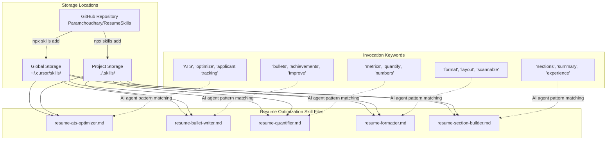
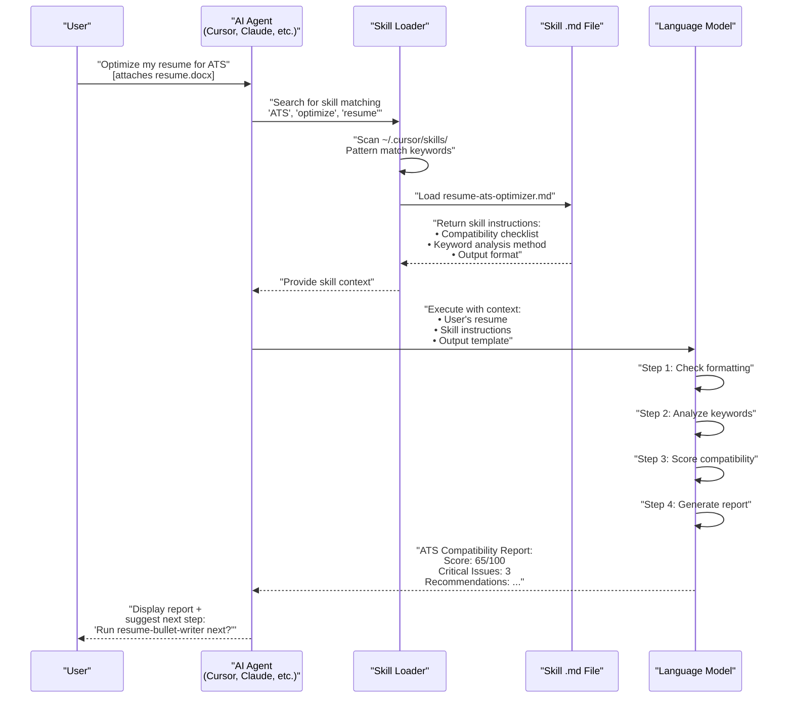
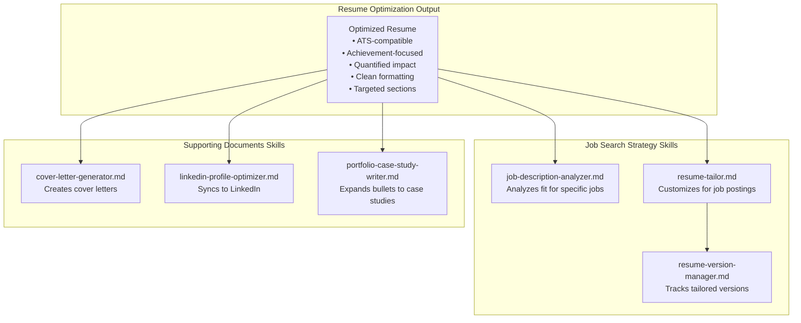

<!-- source: DeepWiki mcp.deepwiki.com · repo Paramchoudhary/ResumeSkills · page 4.1 Resume Optimization Skills · fetched 2026-10-26 -->

# Resume Optimization Skills

<details>
<summary>Relevant source files</summary>

The following files were used as context for generating this wiki page:

- [README.md](README.md)

</details>


## Purpose and Scope

This document covers the five skills in the Resume Optimization category that form the foundation of the ResumeSkills system. These skills provide AI agents with specialized knowledge for transforming draft resumes into ATS-compatible, achievement-focused documents. The skills in this category work sequentially as a processing pipeline, where each skill adds a layer of optimization to produce interview-generating resumes.

For skills that analyze job postings and tailor resumes to specific roles, see [Job Search Strategy Skills](#4.2). For skills that create supporting materials like cover letters and LinkedIn profiles, see [Supporting Documents Skills](#4.3).

**Sources:** [README.md:112-116]()

---

## Overview

The Resume Optimization category contains five skills that address the fundamental problems preventing resumes from passing Applicant Tracking Systems (ATS) and capturing recruiter attention:

| Skill | File | Primary Function |
|-------|------|------------------|
| `resume-ats-optimizer` | `skills/resume-ats-optimizer.md` | ATS compatibility analysis, keyword matching |
| `resume-bullet-writer` | `skills/resume-bullet-writer.md` | Transform weak statements into achievement-focused bullets |
| `resume-quantifier` | `skills/resume-quantifier.md` | Add metrics and measurable impact to bullets |
| `resume-formatter` | `skills/resume-formatter.md` | Ensure ATS-parseable formatting and clean layout |
| `resume-section-builder` | `skills/resume-section-builder.md` | Create targeted sections for different experience levels |

These skills are designed to be invoked sequentially, with each skill building upon the output of the previous one. The result is a resume that passes the 75% ATS rejection filter and generates 2-3x more interview callbacks.

**Sources:** [README.md:13-14](), [README.md:24-26](), [README.md:32](), [README.md:112-116](), [README.md:143-159]()

---

## Skill File Locations and Invocation



**Diagram: Skill File Deployment and Discovery**

This diagram shows how the five Resume Optimization skills are deployed from the GitHub repository to local storage locations where AI agents can discover them. Each `.md` file contains structured instructions that are loaded when the AI agent detects matching keywords in user prompts.

**Sources:** [README.md:39-65](), [README.md:92-107]()

---

## Skill Descriptions

### resume-ats-optimizer

**File:** `skills/resume-ats-optimizer.md`

**Purpose:** Analyzes resume compatibility with Applicant Tracking Systems that parse and score resumes before human review.

**Functionality:**
- Scans for ATS-incompatible formatting (tables, text boxes, headers/footers, images)
- Identifies keyword gaps between resume and target job descriptions
- Checks standard section headers (Experience, Education, Skills)
- Validates file format compatibility (.docx, .pdf)
- Generates compatibility score and prioritized improvement recommendations

**Typical Invocation:**
```
"Optimize my resume for ATS"
"Check ATS compatibility"
"Will my resume pass applicant tracking systems?"
```

**Sources:** [README.md:13](), [README.md:112](), [README.md:169]()

---

### resume-bullet-writer

**File:** `skills/resume-bullet-writer.md`

**Purpose:** Transforms weak, task-oriented bullet points into achievement-focused statements that demonstrate impact.

**Functionality:**
- Converts passive language to action verbs
- Restructures bullets to lead with accomplishments rather than responsibilities
- Applies the CAR formula: Challenge + Action + Result
- Eliminates vague phrases ("responsible for", "helped with")
- Maintains truthfulness while maximizing impact

**Typical Invocation:**
```
"Improve my resume bullets"
"Make my bullet points more achievement-focused"
"Rewrite these weak bullets"
```

**Sources:** [README.md:14](), [README.md:113](), [README.md:96-97]()

---

### resume-quantifier

**File:** `skills/resume-quantifier.md`

**Purpose:** Identifies opportunities to add metrics and measurable outcomes to resume bullets, including estimation strategies when exact numbers are unknown.

**Functionality:**
- Scans bullets for missing quantifiable elements
- Suggests specific metrics relevant to each role/industry
- Provides estimation frameworks for unknown values
- Adds scale indicators (team size, budget, timelines, percentages)
- Validates that numbers pass credibility checks

**Typical Invocation:**
```
"Add metrics to my resume"
"Quantify my achievements"
"Where can I add numbers to this bullet?"
```

**Sources:** [README.md:24](), [README.md:114]()

---

### resume-formatter

**File:** `skills/resume-formatter.md`

**Purpose:** Ensures resume formatting is both ATS-parseable and visually scannable by human recruiters.

**Functionality:**
- Removes ATS-incompatible elements (tables, graphics, multi-column layouts)
- Standardizes section headers and hierarchy
- Optimizes whitespace and line spacing
- Validates font choices (standard fonts only)
- Creates consistent date formatting
- Ensures proper use of bold/italic emphasis

**Typical Invocation:**
```
"Format my resume for ATS"
"Make my resume more scannable"
"Fix formatting issues"
```

**Sources:** [README.md:25](), [README.md:115](), [README.md:173]()

---

### resume-section-builder

**File:** `skills/resume-section-builder.md`

**Purpose:** Creates or optimizes specific resume sections (Summary, Experience, Skills, Projects) tailored to different experience levels and target roles.

**Functionality:**
- Generates professional summaries aligned with target role
- Structures experience section with proper hierarchy
- Creates skills taxonomy (technical, soft, domain)
- Builds projects section for career changers or junior candidates
- Adapts section order and emphasis based on experience level
- Eliminates or consolidates weak sections

**Typical Invocation:**
```
"Build a strong summary section"
"Create a skills section for a data scientist"
"How should I structure my experience section?"
```

**Sources:** [README.md:32](), [README.md:116]()

---

## Processing Pipeline Architecture

```mermaid
graph LR
    INPUT["User's Draft Resume"]
    
    INPUT --> ATS_CHECK["Step 1: resume-ats-optimizer<br/>• Compatibility scan<br/>• Keyword analysis<br/>• Format validation"]
    
    ATS_CHECK --> BULLETS["Step 2: resume-bullet-writer<br/>• Convert to achievements<br/>• Apply CAR formula<br/>• Action verb selection"]
    
    BULLETS --> METRICS["Step 3: resume-quantifier<br/>• Add measurable outcomes<br/>• Estimate missing numbers<br/>• Validate credibility"]
    
    METRICS --> LAYOUT["Step 4: resume-formatter<br/>• ATS-safe layout<br/>• Visual hierarchy<br/>• Whitespace optimization"]
    
    LAYOUT --> SECTIONS["Step 5: resume-section-builder<br/>• Summary creation<br/>• Section ordering<br/>• Level-appropriate structure"]
    
    SECTIONS --> OUTPUT["Optimized Resume<br/>Ready for tailoring"]
    
    OUTPUT -.->|"Next phase"| TAILOR["resume-tailor<br/>See section 4.2"]
```



**Diagram: Sequential Processing Pipeline**

The Resume Optimization skills form a five-stage pipeline where each skill addresses a specific layer of optimization. The pipeline is designed to be executed in order, with each stage building upon the improvements made by the previous stage. The output is a base optimized resume that can then be tailored to specific job postings using skills from the Job Search Strategy category.

**Sources:** [README.md:112-116](), [README.md:166-174]()

---

## Data Transformations Through Pipeline

| Pipeline Stage | Input State | Transformation | Output State |
|---------------|-------------|----------------|--------------|
| **resume-ats-optimizer** | Draft resume with unknown ATS issues | Identifies formatting problems, keyword gaps, compatibility score | Resume with compatibility report and prioritized fixes |
| **resume-bullet-writer** | Resume with task-oriented bullets | Converts bullets to achievement statements with CAR structure | Resume with impact-focused bullets lacking metrics |
| **resume-quantifier** | Achievement bullets without numbers | Adds metrics, scales, percentages, timelines | Resume with quantified achievements |
| **resume-formatter** | Content-optimized resume with layout issues | Applies ATS-safe formatting, visual hierarchy, whitespace | Clean, scannable, ATS-compatible layout |
| **resume-section-builder** | Formatted resume with weak/missing sections | Creates targeted sections, optimizes order, adds professional summary | Complete, role-appropriate resume structure |

**Sources:** [README.md:166-174]()

---

## Integration with AI Agents

When a user provides a natural language prompt related to resume optimization, the AI agent follows this execution pattern:



**Diagram: Skill Invocation Flow for resume-ats-optimizer**

This sequence shows how the `resume-ats-optimizer.md` file is discovered and executed. The same pattern applies to all five Resume Optimization skills. The AI agent doesn't hard-code the skill logic; instead, it loads the markdown file from `~/.cursor/skills/` and follows the instructions contained within.

**Sources:** [README.md:92-107](), [README.md:39-65]()

---

## Typical Usage Patterns

### Pattern 1: Full Pipeline Execution

Users typically run all five skills sequentially when starting with a draft resume:

```
1. "Check my resume for ATS compatibility"
   → Invokes resume-ats-optimizer

2. "Now improve the bullet points"
   → Invokes resume-bullet-writer

3. "Add metrics to the achievements"
   → Invokes resume-quantifier

4. "Format this for ATS systems"
   → Invokes resume-formatter

5. "Build a strong summary section"
   → Invokes resume-section-builder
```

**Sources:** [README.md:166-174]()

### Pattern 2: Targeted Optimization

Users may invoke individual skills to address specific weaknesses:

```
"My bullets are weak and generic. Help me improve them."
→ Invokes resume-bullet-writer only

"Add numbers to quantify my impact"
→ Invokes resume-quantifier only
```

**Sources:** [README.md:92-107]()

### Pattern 3: Iterative Refinement

Users may cycle through skills multiple times as they refine content:

```
1. Run resume-bullet-writer
2. Run resume-quantifier
3. Review output, realize bullets need more work
4. Run resume-bullet-writer again with feedback
5. Run resume-quantifier again
6. Finalize with resume-formatter
```

---

## Output Handoff to Job Search Strategy Skills

The optimized resume produced by the Resume Optimization pipeline serves as the base document for skills in the Job Search Strategy category:



**Diagram: Resume Optimization Output Consumers**

The optimized resume acts as a foundation document that downstream skills consume. The Job Search Strategy skills (section 4.2) use it to analyze job fit and create tailored versions. The Supporting Documents skills (section 4.3) extract content from it to generate related materials.

**Sources:** [README.md:119-128]()

---

## Skill Storage and Management

All five Resume Optimization skills are installed together when users run the installation command:

```bash
# Install all skills including Resume Optimization category
npx skills add Paramchoudhary/ResumeSkills -g -y
```

Individual skills from this category can be removed if not needed:

```bash
# Remove specific Resume Optimization skills
npx skills remove resume-ats-optimizer
npx skills remove resume-quantifier
```

List installed Resume Optimization skills:

```bash
# List all skills including Resume Optimization category
npx skills list --global
```

**Sources:** [README.md:39-51](), [README.md:68-74]()

---

## Implementation Notes

### Skill File Format

Each of the five skills is implemented as a markdown file containing:
- Skill description and purpose
- Step-by-step workflow instructions
- Input/output specifications
- Examples and templates
- Edge case handling
- Best practices and guidelines

The AI agent parses these markdown files to understand what actions to take when a matching prompt is detected.

### File Naming Convention

All Resume Optimization skills follow the pattern `resume-*.md` where `*` describes the specific optimization function. This naming convention enables:
- Easy pattern matching for related skills
- Consistent organization in the file system
- Clear semantic meaning from the filename

**Sources:** [README.md:7-11](), [README.md:13-14](), [README.md:24-26](), [README.md:32]()

---

## Related Skills

For skills that work with the optimized resume output:
- [Job Search Strategy Skills](#4.2) - Analyze jobs, tailor resumes, manage versions
- [Supporting Documents Skills](#4.3) - Generate cover letters, optimize LinkedIn
- [Specialized Roles Skills](#4.5) - Apply role-specific optimizations for tech, executive, academic, creative, and career-changer contexts

**Sources:** [README.md:118-140]()

---

