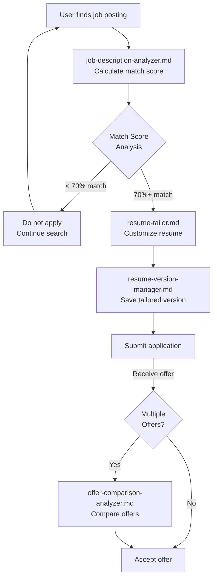
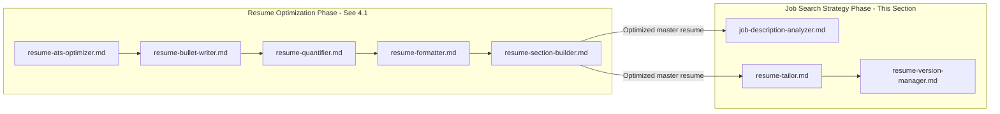
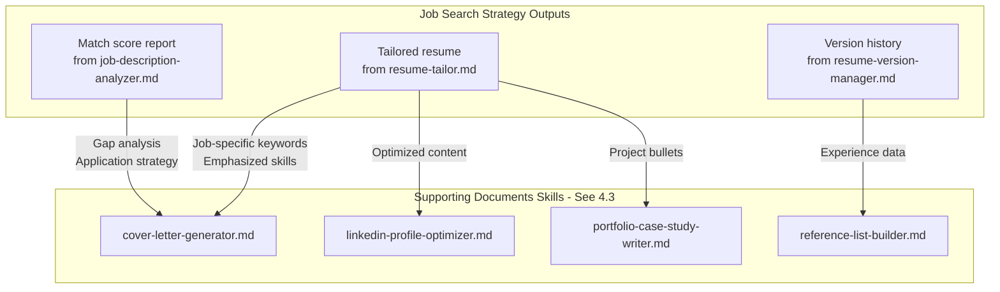

<!-- source: DeepWiki mcp.deepwiki.com · repo Paramchoudhary/ResumeSkills · page 4.2 Job Search Strategy Skills · fetched 2026-10-26 -->

# Job Search Strategy Skills

<details>
<summary>Relevant source files</summary>

The following files were used as context for generating this wiki page:

- [README.md](README.md)

</details>


## Purpose and Scope

This page documents the four Job Search Strategy skills that analyze job opportunities, customize applications, and manage multiple resume versions. These skills operate between the resume creation phase and the application submission phase, providing strategic decision-making and customization capabilities.

For initial resume creation and optimization, see [Resume Optimization Skills](#4.1). For application materials that accompany the resume, see [Supporting Documents Skills](#4.3). For final-stage preparation, see [Interview & Negotiation Skills](#4.4).

**Sources:** [README.md:118-122]()

## Overview of Skills

The Job Search Strategy category contains four skills that implement a strategic, data-driven approach to job applications:

| Skill Name | File Name | Primary Function | Typical Output |
|------------|-----------|------------------|----------------|
| **Job Description Analyzer** | `job-description-analyzer.md` | Calculates match scores, identifies gaps, flags red flags | Match score (%), gap analysis, application recommendation |
| **Resume Tailor** | `resume-tailor.md` | Customizes resume content for specific job postings | Tailored resume with job-specific keywords and emphasis |
| **Resume Version Manager** | `resume-version-manager.md` | Tracks multiple resume versions and master resume | Version history, naming conventions, content differences |
| **Offer Comparison Analyzer** | `offer-comparison-analyzer.md` | Compares multiple job offers with total compensation | Side-by-side comparison table, weighted decision matrix |

Complete documentation for individual skills:
- Job Description Analyzer: See [Job Description Analyzer](#4.2.1)
- Offer Comparison Analyzer: See [Offer Comparison Analyzer](#4.2.2)

**Sources:** [README.md:15-16](), [README.md:29-30](), [README.md:118-122]()

## Skill Invocation Patterns

### Natural Language Triggers

These skills are invoked through specific natural language patterns that AI agents recognize:

```
# Job Description Analyzer
"Should I apply to this job?" + [paste job description]
"Analyze this job posting for me"
"What's my match score for this role?"
"Is this job a good fit for my background?"

# Resume Tailor
"Customize my resume for this job"
"Tailor my experience to match this job description"
"Rewrite my resume for [specific job title]"

# Resume Version Manager
"Create a version of my resume for data science roles"
"Show me all my resume versions"
"What's different between my master resume and the Google version?"

# Offer Comparison Analyzer
"Compare these job offers" + [paste offer details]
"Which offer has better total compensation?"
"Help me decide between these two companies"
```

The AI agent's skill discovery system matches these patterns against keyword metadata in each skill file to determine which skill to load and execute.

**Sources:** [README.md:92-107]()

## Strategic Application Workflow

The following diagram shows how the four Job Search Strategy skills form a sequential decision pipeline:

### Job Application Decision Pipeline



This pipeline implements quality gates that prevent wasted effort on low-match applications. The `job-description-analyzer` acts as a filter, the `resume-tailor` and `resume-version-manager` work in sequence to create customized applications, and the `offer-comparison-analyzer` operates independently at the end of the process.

**Sources:** [README.md:118-122](), [README.md:176-187]()

## Data Dependencies and Flow

### Input-Output Relationships

```mermaid
graph LR
    subgraph "Inputs"
        MASTER["Master Resume<br/>from resume optimization"]
        JD["Job Description<br/>from job posting"]
        OFFERS["Job Offers<br/>from companies"]
    end
    
    subgraph "job-description-analyzer.md"
        JDA_PARSE["Parse JD requirements"]
        JDA_MATCH["Calculate match score"]
        JDA_GAPS["Identify gaps"]
        JDA_FLAGS["Flag red flags"]
        
        JDA_PARSE --> JDA_MATCH
        JDA_MATCH --> JDA_GAPS
        JDA_GAPS --> JDA_FLAGS
    end
    
    subgraph "resume-tailor.md"
        TAILOR_KEYWORDS["Inject keywords"]
        TAILOR_REORDER["Reorder bullets"]
        TAILOR_EMPHASIZE["Emphasize relevant skills"]
        
        TAILOR_KEYWORDS --> TAILOR_REORDER
        TAILOR_REORDER --> TAILOR_EMPHASIZE
    end
    
    subgraph "resume-version-manager.md"
        VERSION_SAVE["Save with naming convention"]
        VERSION_TRACK["Track changes"]
        VERSION_COMPARE["Enable comparison"]
        
        VERSION_SAVE --> VERSION_TRACK
        VERSION_TRACK --> VERSION_COMPARE
    end
    
    subgraph "offer-comparison-analyzer.md"
        OFFER_CASH["Calculate total cash"]
        OFFER_EQUITY["Value equity"]
        OFFER_BENEFITS["Quantify benefits"]
        OFFER_MATRIX["Build decision matrix"]
        
        OFFER_CASH --> OFFER_EQUITY
        OFFER_EQUITY --> OFFER_BENEFITS
        OFFER_BENEFITS --> OFFER_MATRIX
    end
    
    subgraph "Outputs"
        MATCH_REPORT["Match score report<br/>70% threshold"]
        TAILORED["Tailored resume<br/>Job-specific version"]
        VERSION_HISTORY["Version history<br/>Named versions"]
        DECISION_MATRIX["Offer comparison<br/>Weighted matrix"]
    end
    
    MASTER --> JDA_PARSE
    JD --> JDA_PARSE
    
    JDA_FLAGS --> MATCH_REPORT
    
    MATCH_REPORT --> TAILOR_KEYWORDS
    MASTER --> TAILOR_KEYWORDS
    JD --> TAILOR_KEYWORDS
    
    TAILOR_EMPHASIZE --> TAILORED
    
    TAILORED --> VERSION_SAVE
    
    VERSION_COMPARE --> VERSION_HISTORY
    
    OFFERS --> OFFER_CASH
    
    OFFER_MATRIX --> DECISION_MATRIX
```



The diagram shows three distinct data flows:

1. **Analysis Flow**: Master resume + job description → `job-description-analyzer.md` → match report
2. **Customization Flow**: Match report + master resume + job description → `resume-tailor.md` → tailored resume → `resume-version-manager.md` → version history
3. **Comparison Flow**: Job offers → `offer-comparison-analyzer.md` → decision matrix (operates independently)

**Sources:** [README.md:176-187]()

## File Structure and Storage Locations

### Skill File Locations

The Job Search Strategy skill files are stored in the repository and deployed to local storage:

| Repository Path | Deployed Global Path | Deployed Project Path |
|----------------|---------------------|----------------------|
| `/skills/job-description-analyzer.md` | `~/.cursor/skills/job-description-analyzer.md` | `./.skills/job-description-analyzer.md` |
| `/skills/resume-tailor.md` | `~/.cursor/skills/resume-tailor.md` | `./.skills/resume-tailor.md` |
| `/skills/resume-version-manager.md` | `~/.cursor/skills/resume-version-manager.md` | `./.skills/resume-version-manager.md` |
| `/skills/offer-comparison-analyzer.md` | `~/.cursor/skills/offer-comparison-analyzer.md` | `./.skills/offer-comparison-analyzer.md` |

### Installation Commands

```bash
# Install all Job Search Strategy skills as part of full suite
npx skills add Paramchoudhary/ResumeSkills -g -y

# Skills are discovered by AI agents through file scanning
# Location: ~/.cursor/skills/ (global) or ./.skills/ (project)
```

**Sources:** [README.md:39-50](), [README.md:54-63]()

## Integration with Resume Optimization Pipeline

### Pre-requisite Skills

Job Search Strategy skills operate on resume content that has already been optimized. The expected input is a resume that has passed through:



The optimized resume serves as the "master resume" that is analyzed and customized for specific job applications. Without optimization, the Job Search Strategy skills will identify more gaps and produce lower match scores.

**Sources:** [README.md:111-116](), [README.md:118-122]()

## Match Score Calculation Logic

### Job Description Analyzer Scoring

The `job-description-analyzer.md` skill implements a two-tier scoring system:

| Component | Weight | Scoring Method |
|-----------|--------|----------------|
| **Required Qualifications** | 70% | Binary match (present/absent) |
| **Preferred Qualifications** | 30% | Partial credit for similar skills |

**Application Decision Thresholds:**

- **70%+ match**: Strong candidate, proceed with tailoring
- **60-69% match**: Borderline, consider if gaps are addressable
- **<60% match**: Weak fit, continue searching

The analyzer identifies:
- **Hard gaps**: Missing required qualifications (deal-breakers)
- **Soft gaps**: Missing preferred qualifications (addressable in cover letter)
- **Red flags**: Unrealistic requirements, signs of poor job posting quality

**Sources:** [README.md:15](), [README.md:179-186]()

## Version Management Strategy

### Naming Conventions

The `resume-version-manager.md` skill enforces systematic version naming:

```
Master_Resume.pdf                          # Base optimized resume
Resume_DataScientist_Google.pdf           # Role-specific version
Resume_ProductManager_Startup.pdf         # Industry-specific version
Resume_2024Q1_Archive.pdf                 # Time-based archive
```

### Version Tracking Table

| Version Name | Job Target | Date Created | Changes from Master | Application Status |
|--------------|------------|--------------|---------------------|-------------------|
| Master | N/A | 2024-01-15 | N/A | N/A |
| DataScientist_Google | Data Scientist - Google | 2024-02-01 | +ML keywords, reordered projects | Submitted |
| DataScientist_Netflix | Data Scientist - Netflix | 2024-02-03 | +recommendation systems, +scale bullets | Interview scheduled |
| PM_Startup | Product Manager - TechStartup | 2024-02-05 | Emphasized leadership, reduced technical depth | Awaiting response |

The version manager maintains this tracking to enable:
1. **Audit trail**: Know which version was sent to which company
2. **Comparison**: Identify differences between master and tailored versions
3. **Rollback**: Revert unsuccessful tailoring experiments

**Sources:** [README.md:30]()

## Downstream Integration

### Supporting Documents Skills

Job Search Strategy skills provide input to Supporting Documents skills (see [Supporting Documents Skills](#4.3)):



The tailored resume becomes the canonical source for generating cover letters and updating LinkedIn profiles, ensuring consistency across all application materials.

**Sources:** [README.md:124-128]()

## Strategic Decision Points

### Quality Gates

The Job Search Strategy skills implement three critical quality gates:

1. **Application Gate** (job-description-analyzer)
   - **Input**: Master resume + job description
   - **Decision**: Apply or skip based on match score
   - **Prevents**: Wasting time on poor-fit applications

2. **Customization Gate** (resume-tailor)
   - **Input**: Job description + match score report
   - **Decision**: Which skills to emphasize, which to de-emphasize
   - **Prevents**: Generic, unfocused applications

3. **Offer Gate** (offer-comparison-analyzer)
   - **Input**: Multiple job offers
   - **Decision**: Which offer has highest total value
   - **Prevents**: Accepting suboptimal compensation

**Sources:** [README.md:143-159]()

## Usage Examples

### Example 1: Analyzing a Job Posting

```
User: Here's a job description for Senior Data Scientist at Meta.
[pastes job description]
Should I apply?

AI Agent invokes: job-description-analyzer.md

Output:
- Match Score: 78% (Strong fit)
- Required Skills Met: 9/10
- Missing: Production ML deployment at scale
- Preferred Skills Met: 4/6
- Recommendation: Apply and emphasize your experimentation platform work
```

### Example 2: Tailoring Resume

```
User: Tailor my resume for this Google software engineer role.
[pastes job description]

AI Agent invokes: resume-tailor.md

Output:
- Reordered experience bullets to prioritize distributed systems work
- Added keywords: Kubernetes, gRPC, Protocol Buffers
- De-emphasized non-technical leadership to fit IC role
- Emphasized scale: "serving 10M+ requests/day"
```

### Example 3: Managing Versions

```
User: Save this as my Google SWE version.

AI Agent invokes: resume-version-manager.md

Output:
- Saved as: Resume_SoftwareEngineer_Google_2024.pdf
- Changes from master: 12 bullets reordered, 8 keywords added
- Previous versions: 3 other SWE versions exist
- Recommendation: Archive versions older than 90 days
```

**Sources:** [README.md:176-200]()

## Performance Metrics

### Expected Outcomes

When Job Search Strategy skills are used systematically, users experience:

| Metric | Without Skills | With Skills | Improvement |
|--------|---------------|-------------|-------------|
| **Applications per interview** | 50-100 | 15-30 | 2-3x more efficient |
| **Match score of applied jobs** | 45-60% | 70-85% | Higher quality targets |
| **Time per application** | 30-45 min | 60-90 min | More thorough, but fewer total applications |
| **Offer acceptance confidence** | Low | High | Data-driven decision |

The strategy is quality over quantity: fewer applications with higher match scores yield better outcomes than mass-applying with generic resumes.

**Sources:** [README.md:155-159]()

---

