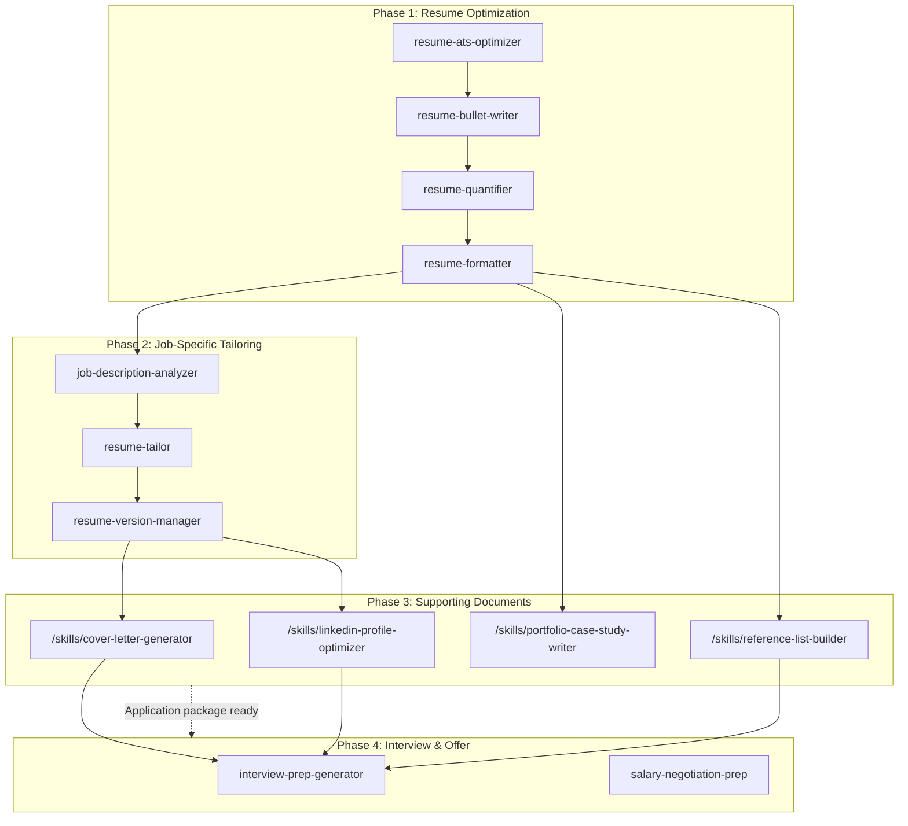
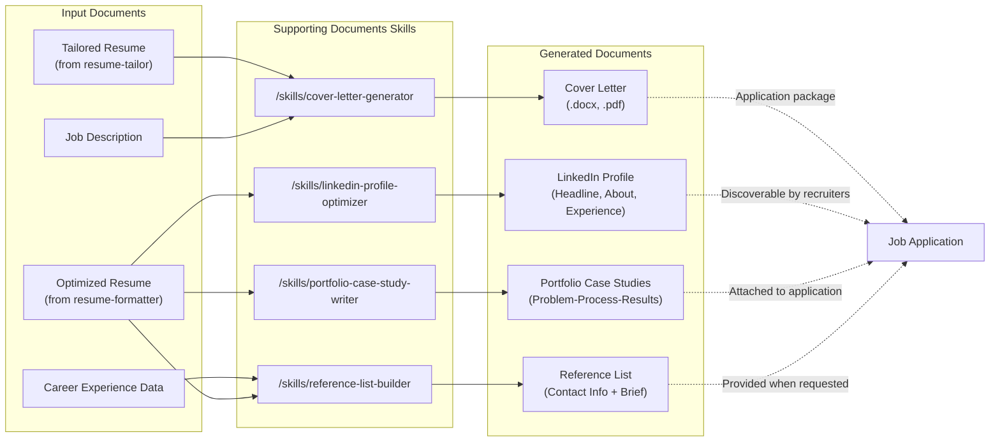
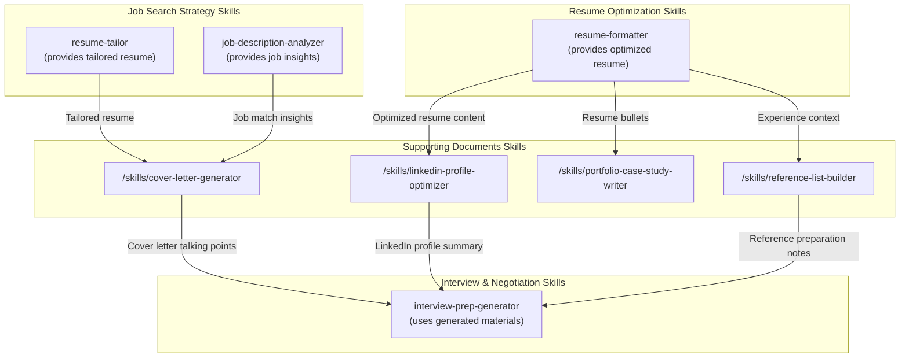
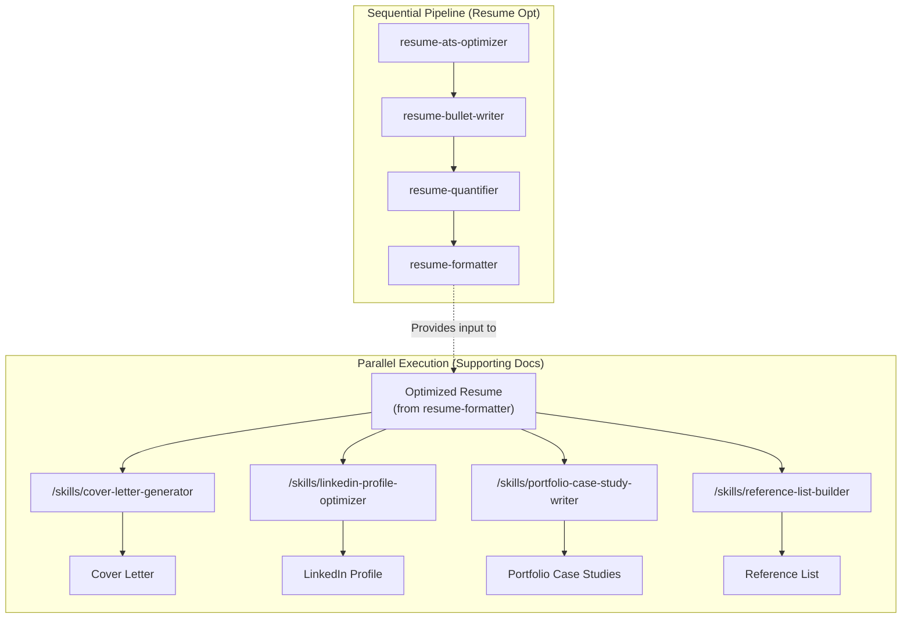

<!-- source: DeepWiki mcp.deepwiki.com · repo Paramchoudhary/ResumeSkills · page 4.3 Supporting Documents Skills · fetched 2026-10-26 -->

# Supporting Documents Skills

<details>
<summary>Relevant source files</summary>

The following files were used as context for generating this wiki page:

- [README.md](README.md)

</details>


## Purpose and Scope

This page documents the **Supporting Documents Skills** category, which contains four skills that generate materials to complement the primary resume document. These skills consume outputs from Resume Optimization and Job Search Strategy skills to create cover letters, LinkedIn profiles, portfolio case studies, and reference lists.

For detailed information about individual skills, see:
- [LinkedIn Profile Optimizer](#4.3.1) - Complete documentation of LinkedIn optimization
- [Portfolio Case Study Writer](#4.3.2) - Complete documentation of portfolio content generation
- [Reference List Builder](#4.3.3) - Complete documentation of reference list preparation

For information about the resume optimization pipeline that feeds these skills, see [Resume Optimization Skills](#4.1). For job-specific tailoring that these skills build upon, see [Job Search Strategy Skills](#4.2).

**Sources:** [README.md:124-128]()

---

## Overview

The Supporting Documents Skills category contains four parallel skills that create application materials beyond the resume itself:

| Skill | File Path | Primary Function |
|-------|-----------|------------------|
| `cover-letter-generator` | `/skills/cover-letter-generator` | Generate personalized cover letters from resume + job description |
| `linkedin-profile-optimizer` | `/skills/linkedin-profile-optimizer` | Sync resume content to LinkedIn profile, optimize for recruiter search |
| `portfolio-case-study-writer` | `/skills/portfolio-case-study-writer` | Transform resume bullets into detailed project case studies |
| `reference-list-builder` | `/skills/reference-list-builder` | Format professional reference lists and prepare reference briefing materials |

These skills operate in **Phase 3: Application Materials** of the job search workflow, after resume optimization (Phase 1) and job-specific tailoring (Phase 2) are complete.

**Sources:** [README.md:17-18](), [README.md:26](), [README.md:28](), [README.md:124-128]()

---

## Workflow Position

The following diagram shows where Supporting Documents Skills fit in the complete job search pipeline:

**Title: Supporting Documents Skills in Job Search Pipeline**



**Sources:** [README.md:109-139]()

---

## Data Flow and Dependencies

Supporting Documents Skills consume outputs from earlier pipeline stages and generate parallel application materials:

**Title: Supporting Documents Skills Data Dependencies**



**Key Data Dependencies:**

- `cover-letter-generator`: Requires tailored resume + job description as inputs
- `linkedin-profile-optimizer`: Consumes optimized resume content only
- `portfolio-case-study-writer`: Transforms resume bullets from optimized resume
- `reference-list-builder`: Uses experience data and optimized resume for context

**Sources:** [README.md:176-186]()

---

## Skill Details

### cover-letter-generator

**File:** `/skills/cover-letter-generator`

**Invocation Triggers:**
- "Write me a cover letter"
- "Create a cover letter for this job"
- "Generate cover letter from my resume"

**Primary Function:** Generates personalized cover letters by combining resume content with job description requirements. Creates narrative that connects candidate's experience to employer's needs.

**Input Requirements:**
- Tailored resume (from `resume-tailor`)
- Job description text
- Company name and hiring manager (optional)

**Output Format:**
- Three-paragraph structure: Opening hook, Experience alignment, Closing call-to-action
- Personalized to company and role
- 250-400 words target length

**Sources:** [README.md:17](), [README.md:102-103](), [README.md:125]()

---

### linkedin-profile-optimizer

**File:** `/skills/linkedin-profile-optimizer`

**Invocation Triggers:**
- "Optimize my LinkedIn profile"
- "Sync my resume to LinkedIn"
- "Make my LinkedIn profile recruiter-friendly"

**Primary Function:** Transforms resume content into LinkedIn-optimized format with keyword strategy for recruiter searchability. Ensures profile completeness and consistency with resume.

**Key Components:**
- Headline formula: `[Role] | [Value Proposition] | [Keywords]`
- About section structure (first-person narrative)
- Keyword density optimization
- Experience bullets adapted for LinkedIn format
- Skills section prioritization

**For complete documentation, see [LinkedIn Profile Optimizer](#4.3.1).**

**Sources:** [README.md:18](), [README.md:126]()

---

### portfolio-case-study-writer

**File:** `/skills/portfolio-case-study-writer`

**Invocation Triggers:**
- "Turn my resume bullets into case studies"
- "Create portfolio content from my experience"
- "Write detailed project case studies"

**Primary Function:** Expands resume bullets into detailed portfolio case studies with full problem-process-results structure. Transforms 1-2 line bullets into 300-500 word narratives.

**Standard Structure:**
1. **Overview** - Project summary and role
2. **Problem** - Business challenge and constraints
3. **Process** - Methodology and approach
4. **Solution** - What was built/delivered
5. **Results** - Quantified business impact
6. **Learnings** - Takeaways and growth

**For complete documentation, see [Portfolio Case Study Writer](#4.3.2).**

**Sources:** [README.md:26](), [README.md:127]()

---

### reference-list-builder

**File:** `/skills/reference-list-builder`

**Invocation Triggers:**
- "Create my reference list"
- "Format my professional references"
- "Prepare reference materials"

**Primary Function:** Formats professional reference lists with proper contact information structure. Prepares reference briefing materials so references can speak effectively about your work.

**Key Features:**
- Reference hierarchy guidance (direct managers most valuable)
- Contact information formatting
- Reference brief creation (what to prep references on)
- Special situations handling (first job, career change, confidential search)

**For complete documentation, see [Reference List Builder](#4.3.3).**

**Sources:** [README.md:28](), [README.md:128]()

---

## Usage Patterns

### Pattern 1: Complete Application Package Generation

**Scenario:** User has optimized resume and wants full application materials for specific job.

```
User: "I have this resume [paste] and I'm applying to [job]. Create complete application package."

AI Agent executes sequence:
1. resume-tailor (customize resume for job)
2. cover-letter-generator (create cover letter)
3. linkedin-profile-optimizer (sync LinkedIn)
4. reference-list-builder (prepare references)

Output: Tailored resume + cover letter + LinkedIn updates + reference list
```

**Skills Invoked:** All four Supporting Documents Skills in parallel after `resume-tailor` runs.

**Sources:** [README.md:176-186]()

---

### Pattern 2: LinkedIn-Only Sync

**Scenario:** User has updated resume and wants to sync changes to LinkedIn without creating other materials.

```
User: "I just updated my resume. Sync the changes to my LinkedIn profile."

AI Agent executes:
1. Load optimized resume from resume-formatter
2. linkedin-profile-optimizer (transform to LinkedIn format)

Output: LinkedIn profile updates (Headline, About, Experience sections)
```

**Skills Invoked:** Only `linkedin-profile-optimizer` from Supporting Documents category.

**Sources:** [README.md:18]()

---

### Pattern 3: Portfolio Expansion

**Scenario:** User needs portfolio content but already has resume and LinkedIn optimized.

```
User: "Take the three main projects from my resume and create detailed case studies."

AI Agent executes:
1. Load optimized resume bullets
2. portfolio-case-study-writer (expand top 3-5 bullets into case studies)

Output: 3-5 detailed case studies (300-500 words each)
```

**Skills Invoked:** Only `portfolio-case-study-writer` from Supporting Documents category.

**Sources:** [README.md:26]()

---

## Integration with Other Skills

Supporting Documents Skills integrate with skills from other categories:

**Title: Supporting Documents Integration Points**



**Integration Points:**

| Supporting Docs Skill | Upstream Dependencies | Downstream Consumers |
|----------------------|----------------------|---------------------|
| `cover-letter-generator` | `resume-tailor`, `job-description-analyzer` | `interview-prep-generator` |
| `linkedin-profile-optimizer` | `resume-formatter` | Recruiter search systems |
| `portfolio-case-study-writer` | `resume-formatter` | Application packages |
| `reference-list-builder` | `resume-formatter` | `interview-prep-generator` |

**Sources:** [README.md:97-139]()

---

## When to Use Each Skill

**Decision Matrix:**

| Situation | Use This Skill | Rationale |
|-----------|---------------|-----------|
| Applying to job that requires cover letter | `cover-letter-generator` | Most applications need personalized letter |
| Updated resume, need to sync online presence | `linkedin-profile-optimizer` | Keeps LinkedIn consistent with resume |
| Application asks for portfolio/work samples | `portfolio-case-study-writer` | Expands bullets into detailed case studies |
| Employer asks for references | `reference-list-builder` | Formats professional references properly |
| Job portal auto-fills from LinkedIn | `linkedin-profile-optimizer` | Many portals scrape LinkedIn for application |
| Creative/technical role needs work examples | `portfolio-case-study-writer` | Shows depth beyond resume bullets |
| First round interview scheduled | `reference-list-builder` | Prep references before they're contacted |

**Sources:** [README.md:141-159]()

---

## Parallel Execution Model

Unlike Resume Optimization Skills which form a sequential pipeline, Supporting Documents Skills execute in **parallel** after the optimized resume is ready:

**Title: Sequential vs Parallel Skill Execution**



**Execution Characteristics:**

- **No dependencies between Supporting Docs Skills:** Each can run independently
- **Order doesn't matter:** User can invoke in any sequence
- **Partial execution allowed:** Don't need all four for every application
- **Shared input:** All consume same optimized resume base
- **Different outputs:** Each produces distinct deliverable

This parallel model enables flexible workflows where users select only needed skills for each application.

**Sources:** [README.md:156-200]()

---

## Summary

The Supporting Documents Skills category provides four independent skills that generate application materials beyond the resume:

1. **`cover-letter-generator`** - Personalized cover letters
2. **`linkedin-profile-optimizer`** - LinkedIn profile optimization (see [detailed docs](#4.3.1))
3. **`portfolio-case-study-writer`** - Detailed case studies (see [detailed docs](#4.3.2))
4. **`reference-list-builder`** - Reference list preparation (see [detailed docs](#4.3.3))

These skills execute in parallel after resume optimization, consuming optimized/tailored resume content to create complementary materials for the complete application package.

**Sources:** [README.md:124-128]()

---

