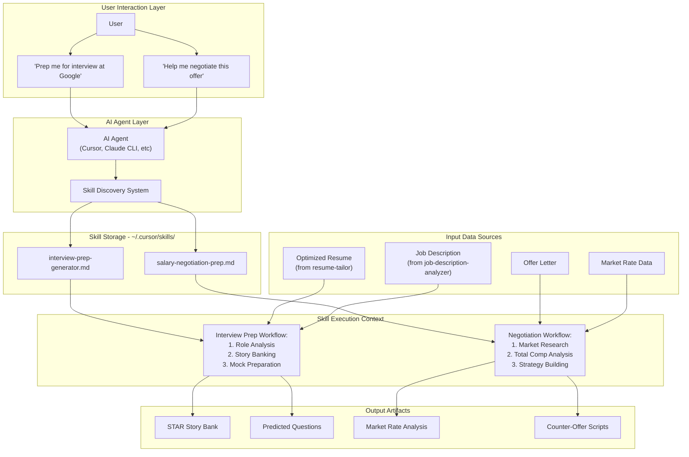
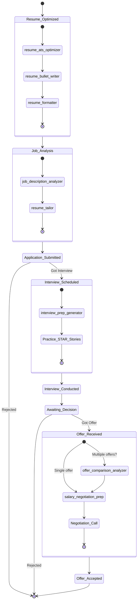
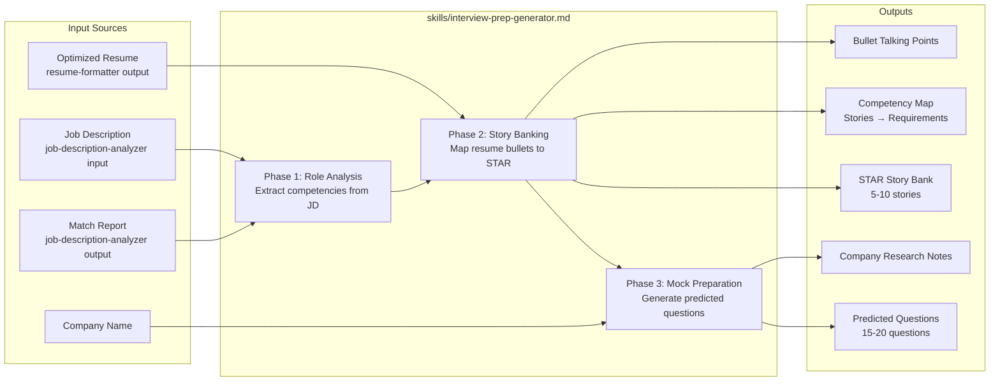
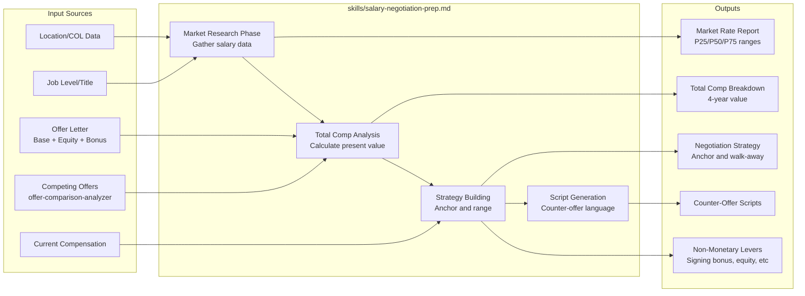
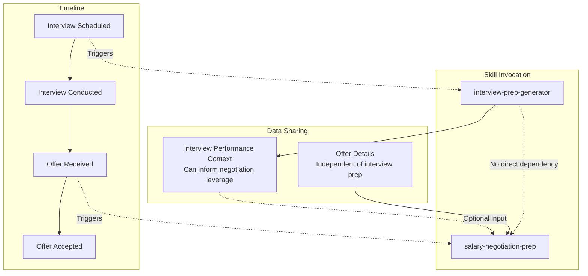

<!-- source: DeepWiki mcp.deepwiki.com · repo Paramchoudhary/ResumeSkills · page 4.4 Interview & Negotiation Skills · fetched 2026-10-26 -->

# Interview & Negotiation Skills

<details>
<summary>Relevant source files</summary>

The following files were used as context for generating this wiki page:

- [README.md](README.md)

</details>


## Purpose and Scope

This document describes the Interview & Negotiation Skills category, which contains two specialized skills that prepare candidates for the final stages of the job search process: `interview-prep-generator` and `salary-negotiation-prep`. These skills consume outputs from earlier-stage skills (resume optimization, job analysis) and produce materials for interview performance and compensation negotiation.

For detailed documentation of the interview preparation skill's three-phase framework and STAR method, see [Interview Prep Generator](#4.4.1). For information on job search strategy skills that precede this phase, see [Job Search Strategy Skills](#4.2). For the complete end-to-end workflow showing how these skills integrate with earlier stages, see [End-to-End Workflows](#5).

**Sources:** [README.md:130-132](), [README.md:19-20]()

---

## Category Overview

The Interview & Negotiation category addresses the post-application phase of job search when candidates have secured interviews or received offers. Unlike earlier-stage skills that optimize documents for submission, these skills prepare candidates for live interactions with hiring managers and recruiters.

### Core Functions

| Function | Skill | Primary Output |
|----------|-------|----------------|
| Interview preparation | `interview-prep-generator` | STAR stories, predicted questions, talking points |
| Salary negotiation | `salary-negotiation-prep` | Market rate research, negotiation scripts, counter-offer strategy |

### When to Invoke

These skills are invoked sequentially in the job search lifecycle:

1. **After interview confirmation**: Trigger `interview-prep-generator` immediately upon scheduling
2. **After offer receipt**: Trigger `salary-negotiation-prep` when offer letter is received
3. **Between rounds**: Re-trigger `interview-prep-generator` for subsequent interview rounds with updated context

**Sources:** [README.md:130-132](), [README.md:19-20]()

---

## Skill Inventory

### interview-prep-generator

**File Location**: `skills/interview-prep-generator.md`

**Invocation Triggers**:
- "Prep me for an interview at [Company]"
- "Help me prepare for [Role] interview"
- "Generate STAR stories from my resume"
- "What questions should I expect for [Position]?"

**Input Requirements**:
- User's resume (optimized via earlier skills)
- Job description
- Company name
- Interview format (phone screen, technical, behavioral, panel)

**Output Structure**:
- STAR story bank (5-10 stories mapped to competencies)
- Predicted interview questions (15-20 questions)
- Talking points for each resume bullet
- Questions to ask interviewer
- Company-specific research notes

**Sources:** [README.md:19](), [README.md:105-106]()

### salary-negotiation-prep

**File Location**: `skills/salary-negotiation-prep.md`

**Invocation Triggers**:
- "Help me negotiate this offer"
- "What's the market rate for [Role] at [Company]?"
- "Create a counter-offer script"
- "Should I accept this salary?"

**Input Requirements**:
- Offer letter details (base, equity, bonus, benefits)
- Job title and level
- Location/cost of living data
- User's current compensation
- Competing offers (if any)

**Output Structure**:
- Market rate analysis (percentile ranges)
- Total compensation breakdown
- Negotiation strategy (anchor points, walk-away threshold)
- Counter-offer script templates
- Non-monetary negotiation levers

**Sources:** [README.md:20](), [README.md:189-200]()

---

## Skill Architecture

The following diagram shows how these skills are invoked by AI agents and their relationship to the underlying skill definition files:



**Sources:** [README.md:7-11](), [README.md:80-92]()

---

## Workflow Integration

### Position in Job Search Lifecycle

These skills operate in the final two phases of the job search process, consuming outputs from earlier-stage skills:



**Sources:** [README.md:161-200]()

---

## Data Flow and Dependencies

### Interview Preparation Data Flow

The `interview-prep-generator` skill consumes data from multiple upstream sources:



**Sources:** [README.md:189-200]()

### Negotiation Preparation Data Flow

The `salary-negotiation-prep` skill analyzes offer details and market conditions:



**Sources:** [README.md:20]()

---

## Invocation Patterns

### Pattern 1: Scheduled Interview

```
User: I have an interview at Microsoft for Senior Product Manager next week. 
      Here's my resume [paste] and the job description [paste].

Agent Response:
1. Load skills/interview-prep-generator.md
2. Extract competencies from job description
3. Map resume bullets to STAR stories
4. Generate predicted behavioral questions
5. Create company-specific talking points
```

### Pattern 2: Multi-Round Interview Preparation

```
User: I passed the phone screen. Now I have onsite interviews with 5 people.
      Can you update my prep materials?

Agent Response:
1. Re-invoke skills/interview-prep-generator.md
2. Adjust story bank for panel interview format
3. Generate role-specific questions for each interviewer
4. Create cross-functional talking points
```

### Pattern 3: Offer Negotiation

```
User: I got an offer: $150K base, $30K signing, 50K equity/year. 
      Current salary is $130K. Should I counter?

Agent Response:
1. Load skills/salary-negotiation-prep.md
2. Research market rates for role/location/level
3. Calculate total 4-year compensation value
4. Compare to current comp and market P50/P75
5. Generate counter-offer strategy and scripts
```

### Pattern 4: Multiple Offer Comparison with Negotiation

```
User: I have two offers [paste details]. Which is better and how do I negotiate?

Agent Response:
1. Load skills/offer-comparison-analyzer.md (from category 4.2)
2. Compare total compensation and non-monetary factors
3. Load skills/salary-negotiation-prep.md
4. Use higher offer as leverage for negotiating lower offer
5. Generate negotiation scripts for both companies
```

**Sources:** [README.md:88-107](), [README.md:189-200]()

---

## Relationship Between Skills

The two skills in this category have a sequential dependency in the job search process but can also operate independently:



### Independence Property

Unlike skills in the Resume Optimization category that form a pipeline (where `resume-bullet-writer` depends on `resume-ats-optimizer` output), these two skills are **temporally sequential but data-independent**:

- `interview-prep-generator` does not produce outputs consumed by `salary-negotiation-prep`
- Both can be invoked without the other (e.g., negotiate an offer without using interview prep)
- Interview performance context is an optional, not required, input to negotiation

**Sources:** [README.md:111-139]()

---

## Usage Recommendations

### Best Practices

| Scenario | Recommended Approach | Skill Sequence |
|----------|---------------------|----------------|
| First-time job seeker | Invoke early to build story bank before applying | `interview-prep-generator` → store stories → reuse for each interview |
| Senior professional | Focus on leadership stories, strategic impact | `interview-prep-generator` + emphasize executive-level achievements |
| Multiple offers | Use comparison before negotiation | `offer-comparison-analyzer` → `salary-negotiation-prep` |
| Low initial offer | Research thoroughly before countering | `salary-negotiation-prep` + market data emphasis |
| Career changer | Prepare translatable skill stories | `career-changer-translator` + `interview-prep-generator` |

### Common Invocation Sequences

**Full Lifecycle**:
```
resume-ats-optimizer → resume-bullet-writer → resume-formatter → 
job-description-analyzer → resume-tailor → [Application Submitted] → 
interview-prep-generator → [Interview Conducted] → 
offer-comparison-analyzer → salary-negotiation-prep → [Offer Accepted]
```

**Interview-Only**:
```
[Resume exists] → interview-prep-generator → [Practice] → [Interview]
```

**Negotiation-Only**:
```
[Offer received] → salary-negotiation-prep → [Negotiation call] → [Accept]
```

**Sources:** [README.md:161-200]()

---

## Integration with Other Skill Categories

### Upstream Dependencies

These skills consume data from:

| Input Source | Providing Skill | Data Used |
|--------------|----------------|-----------|
| Optimized resume | `resume-formatter` | Bullet points, achievements, experience timeline |
| Job requirements | `job-description-analyzer` | Required competencies, match score, gaps |
| Tailored resume | `resume-tailor` | Job-specific bullet emphasis |
| Offer details | `offer-comparison-analyzer` | Total compensation breakdown |

### Downstream Outputs

These skills produce final-stage materials that are not typically consumed by other skills. They represent terminal nodes in the skill dependency graph.

**Sources:** [README.md:97-139]()

---

## Installation and Availability

Both skills are included in the default ResumeSkills installation:

```bash
# Install all skills including interview and negotiation
npx skills add Paramchoudhary/ResumeSkills -g -y

# Verify installation
npx skills list --global | grep -E "(interview|negotiation)"
```

**Expected Output**:
```
interview-prep-generator
salary-negotiation-prep
```

Individual skill files can also be installed separately:

```bash
# Manual download of specific skills
wget https://github.com/Paramchoudhary/ResumeSkills/blob/main/skills/interview-prep-generator.md
wget https://github.com/Paramchoudhary/ResumeSkills/blob/main/skills/salary-negotiation-prep.md

# Copy to global skills directory
cp interview-prep-generator.md ~/.cursor/skills/
cp salary-negotiation-prep.md ~/.cursor/skills/
```

**Sources:** [README.md:34-75]()

---

## Skill Detection and Keyword Matching

AI agents identify when to invoke these skills based on keyword pattern matching in user prompts:

### interview-prep-generator Keywords

| Primary Keywords | Secondary Keywords | Context Keywords |
|-----------------|-------------------|------------------|
| interview | prep, prepare, practice | Google, Amazon, Microsoft |
| STAR | stories, behavioral | competencies, questions |
| talking points | answers | mock interview |

### salary-negotiation-prep Keywords

| Primary Keywords | Secondary Keywords | Context Keywords |
|-----------------|-------------------|------------------|
| salary | negotiate, negotiation | offer, compensation |
| counter-offer | market rate | equity, bonus |
| accept | decline | walk-away |

**Sources:** [README.md:88-107]()

---

## Summary

The Interview & Negotiation Skills category provides specialized support for the final stages of job search:

- **Two skills**: `interview-prep-generator` and `salary-negotiation-prep`
- **Sequential timing**: Interview prep → Interview → Offer → Negotiation
- **Data independence**: Skills do not depend on each other's outputs
- **Input sources**: Consume optimized resumes, job descriptions, and offer details from upstream skills
- **Output types**: STAR stories, predicted questions, market analysis, negotiation scripts
- **Terminal nodes**: Represent end of skill dependency chain; outputs used directly by humans, not other skills

For detailed documentation of the interview preparation framework, see [Interview Prep Generator](#4.4.1).

**Sources:** [README.md:130-132](), [README.md:19-20]()

---

